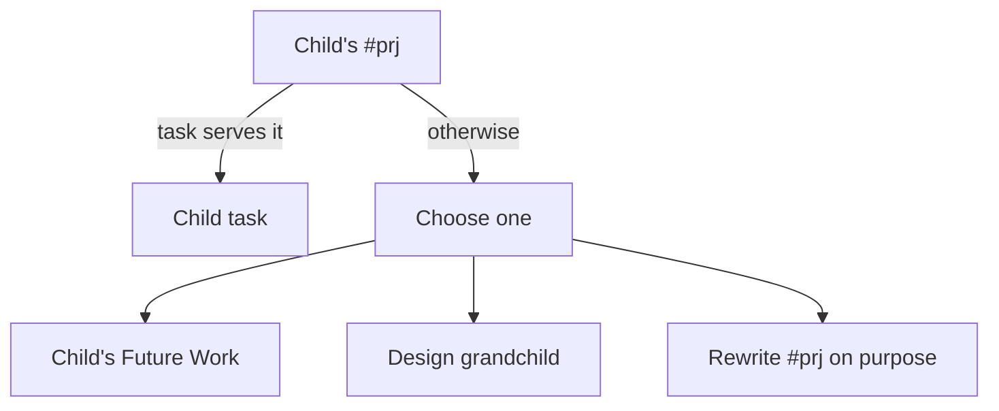
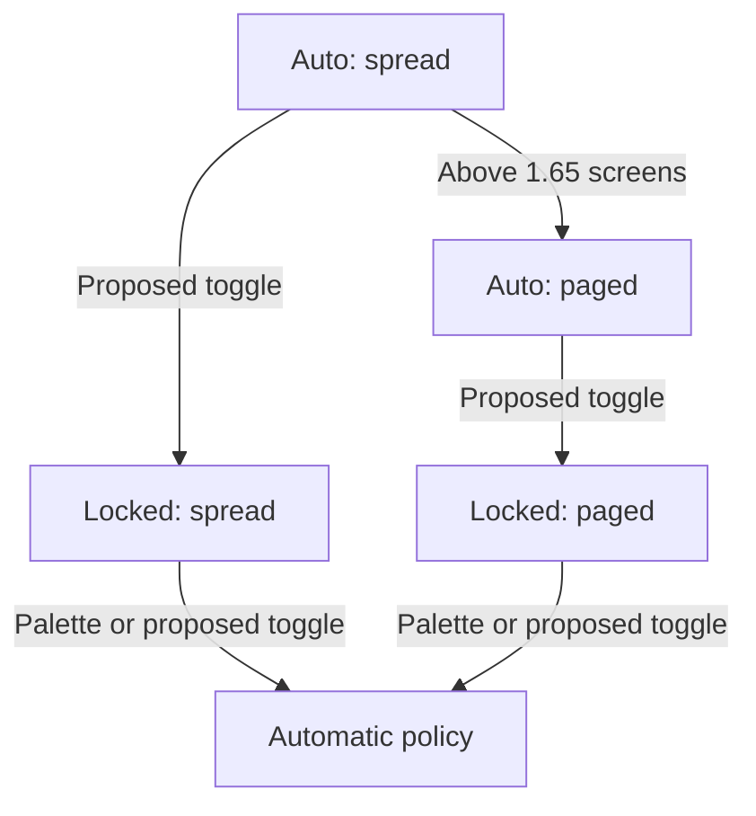
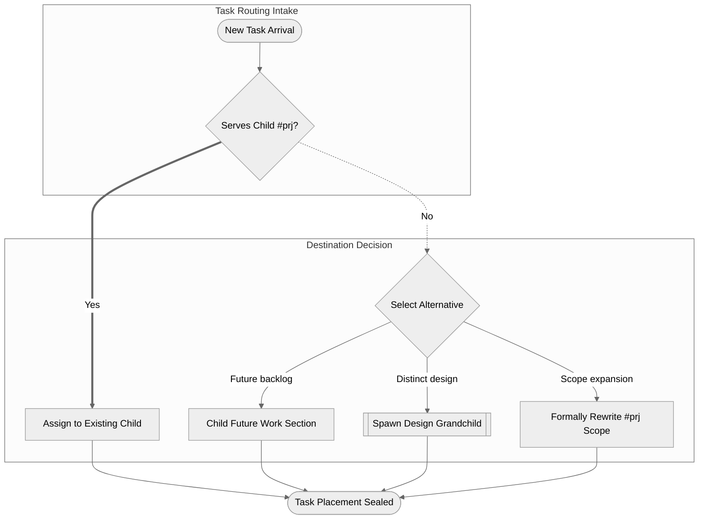

# Improving Mermaid Diagrams in the Research Swarm: Macro Factoring, Architecture, and Visual Quality Guidelines

Researcher: **gem** (`research.54.gem`)  
Prepared: **2026-10-20**  
Scope: Independent research for improving Mermaid diagram generation by the image agent in the `#research_swarm` macro swarm. Conducted independently without opening, reading, or consulting peer swarm reports or chat transcripts.

---

## Executive Summary

The user inquiry identifies three critical defects in the Mermaid diagrams currently proposed by the `#research_swarm` image agent:
1. **Difficult to understand in isolation**: Diagrams lack high-level architectural framing, subsystem boundaries, entry/exit points, and contextual labels. A reader viewing the diagram outside the immediate paragraph cannot decipher what system, actor, or lifecycle is being depicted.
2. **Low utility**: The diagrams suffer from a monoculture of basic `flowchart TD` trees that merely restate 3-to-5 bullet points from the text without providing structural insight, decision complexity, or temporal interactions.
3. **Visually unappealing**: The diagrams are monotonous collections of unstyled gray rectangular boxes with no visual hierarchy, shape language, or rhythmic composition.

**The Plan Under Evaluation**:
Factoring out Mermaid diagram advice into a dedicated macro (e.g., `#mermaid/advice`) to guide the agent toward useful, self-contained, and beautiful diagrams.

### Bottom Line Verdict & Recommendations

1. **Is factoring Mermaid advice into a macro a good idea?**
   **Yes, strongly endorsed.** Factoring creates a clean separation of concerns:
   - **Tactical Orchestration** stays in `#research/diagrams`: Report scanning, infographic panel drill-down candidate nomination, verbatim text anchoring, manifest formatting (`<stem>.diagrams.md`), Mermaid CLI (`mmdc`) smoke-testing, and status variable emission.
   - **Visual & Structural Craftsmanship** moves to `#mermaid/advice`: Diagram type selection heuristics (flowchart vs. sequence vs. state), shape semantics (stadiums, diamonds, cylinders, subroutines), self-containment standards (subgraphs, titles, explicit actors), and safe aesthetic styling (`%%{init: {'theme': 'neutral'}}%%`).
   - Furthermore, `#mermaid/advice` becomes reusable across the entire SASE ecosystem (architecture plans, bead documentation, system design documents, and ad-hoc agent queries) rather than being trapped in the research plugin.

2. **Root Cause Critique**:
   The current instructions in `src/sase_research_artifacts/xprompts/research_diagrams.md` were written *defensively* to avoid breaking downstream rendering (specifically pandoc/XeLaTeX PDF pipelines and the `mmdc` CLI). However, the rules over-corrected into harmful micro-constraints:
   - *"In TD flows avoid decision diamonds and put the condition on a labelled edge instead."* (Banning diamonds destroys the single most recognizable visual cue for branching logic, turning diagrams into undifferentiated box grids).
   - *"Labels of about four words or fewer, in the report's terms."* (Forces cryptic, telegraphic labels that omit verbs and system context).
   - *"No init directives, click, style, classDef, HTML, or icons."* (While `click` and raw `HTML` should remain banned, banning `init` directives and shape variety forces default unstyled visual monotony).

3. **Key Adjustments to Requirements**:
   - **Restore Decision Diamonds & Shape Semantics**: Allow decision diamonds `{Condition?}` with short labels, stadium shapes `([Start / Trigger])` and `([End / Result])` for terminal states, cylinders `[(Storage / Cache)]` for state, and subroutines `[[External CLI / Tool]]` for commands.
   - **Mandate Contextual Enclosure (Self-Containment)**: Every diagram must use `subgraph` blocks to demarcate subsystem boundaries, actors, or lifecycle stages, providing an immediate mental model of *where* the action happens.
   - **Enforce Diagram Diversity**: Require the agent to evaluate `sequenceDiagram` for multi-actor protocols and `stateDiagram-v2` for lifecycle states before defaulting to `flowchart TD`.
   - **Enable Safe Neutral Styling**: Inject `%%{init: {'theme': 'neutral'}}%%` into generated diagrams. Empirical testing confirms `mmdc 11.4.2` renders this with zero errors, producing elegant grayscale styling with readable typography and clean borders across GitHub and PDF readers.
   - **Fix Host CLI Environment Quirk**: In SASE agent environments, Chromium's singleton socket path fails if `$TMPDIR` exceeds 108 characters (`FATAL: Socket path too long`). Validation instructions must prepend `TMPDIR=/tmp` when invoking `mmdc`.

---

## 1. Baseline Diagnosis: Why Current Diagrams Fail

### 1.1 Empirical Analysis of Existing Research Diagrams

Examining recent diagram manifests in the `sase--research` sidecar repository (such as `bob_sase_task_portfolio_split.diagrams.md` and `deck_scroll_scope_tabs_and_layout_lock.diagrams.md`) reveals the exact symptoms described by the user.

#### Case Study A: The Ambiguous Shorthand Flowchart
From `bob_sase_task_portfolio_split.diagrams.md`:



*Failures:*
- **Zero Context in Isolation**: Who or what is reading `Child's #prj`? Is this a developer making a choice? Is it an automated tool? What system handles the task?
- **No Visual Rhythm**: Every node is a plain rectangle. Node `C["Choose one"]` is an action/decision masquerading as a data entity. Node `A` is a state/document. Nodes `D`, `E`, and `F` are destination categories. All look identical.
- **Low Utility**: The diagram is literally a 3-bullet list drawn with lines. It provides no structural insight beyond reading the text.

#### Case Study B: The Box-Grid State Machine
From `deck_scroll_scope_tabs_and_layout_lock.diagrams.md`:



*Failures:*
- **Incorrect Diagram Type**: This is a state machine, but it was drawn as a `flowchart TD`. A `stateDiagram-v2` would have clearly shown states, transitions, entry points, and mode groupings.
- **Visual Clutter**: The edges cross awkwardly, and the node labels are terse fragments (`Auto: spread`, `Locked: paged`).
- **Unappealing Layout**: Without subgraphs or visual grouping (e.g., grouping `Auto` states vs. `Locked` states), it looks like a spiderweb of boxes.

### 1.2 Deconstructing the Current Rules in `research_diagrams.md`

Tracing these flaws back to `src/sase_research_artifacts/xprompts/research_diagrams.md` (lines 78–89):

```markdown
## 4. Draw

Size each diagram for a PDF column about 650 px wide and at most about half a page tall.

- Types: `flowchart` (prefer `TD`; use `LR` only for a chain of five or fewer short nodes), `sequenceDiagram` (at most four participants), `stateDiagram-v2`, `classDiagram`, `erDiagram`.
- No init directives, `click`, `style`, `classDef`, HTML, or icons.
- At most four boxes side by side and about five ranks. In `TD` flows avoid decision diamonds and put the condition on a labelled edge instead.
- Labels of about four words or fewer, in the report's terms. Quote every label (`A["Lead report"]`, `-->|"on failure"|`). Never use `end` as a node id.
```

Why did this produce bad diagrams?
1. **The Diamond Ban**: The prompt commanded: *"avoid decision diamonds and put the condition on a labelled edge instead."* This forced LLMs to turn branching decisions into either awkward dummy nodes (`C["Choose one"]`) or multiple parallel outgoing edges without a conditional fork. Branching became invisible.
2. **The 4-Word Label Straitjacket**: *"Labels of about four words or fewer."* Real engineering concepts require context. When forced to 4 words, an LLM strips subject, verb, or domain qualifiers, generating fragments like `"Check at-bottom boolean"`.
3. **The Total Ban on Styling**: *"No init directives, click, style, classDef, HTML, or icons."* This was implemented to prevent brittle custom CSS, broken SVG parsing, and illegible dark-mode colors. But in doing so, it threw away Mermaid's native layout features like `subgraph`, line-type hierarchy (`-->` vs `==>` vs `-.->`), and standard themes.
4. **Mechanical Candidate Criteria Focused on Negative Checks**: The decision rules in Step 3 focus heavily on what *not* to draw rather than how to construct an insightful visualization.

---

## 2. Critique of the Proposed Plan

### 2.1 Strengths: Why Factoring Out into a Macro is the Right Move

1. **Reusability Across the SASE Ecosystem**:
   Mermaid diagram generation is not unique to the research swarm.
   - SASE planning agents (`sase plan`, `#plan`) produce architectural diagrams.
   - Bead management (`sase bead`, `#bd/land_epic`) visualizes dependency DAGs and system state.
   - Software Design Documents (SDD) use Mermaid for workflow mapping.
   - Individual research extensions (`#research/more`) need diagrams.
   Having a centralized `#mermaid/advice` macro eliminates prompt drift, ensures consistent visual quality across all tools, and allows improvements to benefit the entire system simultaneously.

2. **Clean Separation of Concerns**:
   - **Orchestration / Protocol**: Belongs in `#research/diagrams`. This includes checking lead report registration, reading infographic panels, filtering candidates, verifying verbatim textual anchors (`grep -cF`), validating with the Mermaid CLI (`mmdc`), formatting the `<stem>.diagrams.md` manifest, and setting `sase var set diagrams`.
   - **Diagram Craftsmanship / Aesthetics**: Belongs in `#mermaid/advice`. This includes semantic shape taxonomy, diagram type heuristics, layout guidelines, self-containment rules, and aesthetic standards.

3. **Maintainability & Rapid Iteration**:
   Visual guidelines can be refined, tested, and updated without touching or risking regressions in the research swarm's multi-agent coordination logic.

### 2.2 Potential Pitfalls & Challenges

1. **Context Window & Prompt Bloat**:
   If `#mermaid/advice` becomes an extensive tutorial or manual, it consumes valuable context tokens on every invocation. LLMs perform best with concise, high-contrast rules accompanied by short positive and negative examples.
   *Mitigation*: Keep the macro under 100 lines. Focus on high-leverage principles and exact syntax patterns rather than general essays on visualization theory.

2. **Over-Specification Leading to Syntax Errors**:
   LLMs frequently hallucinate invalid Mermaid syntax when given too many advanced features (e.g., complex init JSON, unsupported font directives, interactive events).
   *Mitigation*: Restrict allowed syntax to features proven to compile reliably under `mmdc` (Mermaid CLI) and render cleanly in Pandoc/XeLaTeX PDFs.

3. **Single-Agent Cognitive Load**:
   In `#research_swarm`, the `image` agent currently runs both `#research/image` (producing the infographic PNG) and `#research/diagrams` (authoring the diagrams) in a single session.
   - The advantage: The image agent already has working memory of the infographic panels and knows what was omitted.
   - The risk: A long conversation with Python/curl image generation logs can distract the model when authoring Mermaid.
   *Mitigation*: Ensure prompt boundaries are clearly staged, or maintain the clean scratchpad workflow where diagram candidates are inventoried before authoring.

---

## 3. Alternative Approaches Considered

| Dimension | Alternative A: Monolithic Status Quo (Expand `research_diagrams.md`) | Alternative B: Standalone Macro `#mermaid/advice` in `sase-research-artifacts` | Alternative C: Core SASE Macro `#mermaid/advice` in `sase` Repo | Alternative D: Dedicated Swarm Diagram Agent (`<clan>.diagrams`) |
| :--- | :--- | :--- | :--- | :--- |
| **Reusability** | Zero (isolated to research swarm). | High within research plugin; accessible to others if plugin is loaded. | **Maximum** (available to core, planning, beads, and all plugins). | Zero (changes agent topology, not instruction structure). |
| **Modularity** | Poor (mixes orchestration with diagram craft). | **Clean** (separates protocol from visual syntax). | **Clean** (separates protocol from visual syntax). | Over-engineered (adds agent scheduling overhead). |
| **Runner Cost / Latency** | No extra agents. | No extra agents. | No extra agents. | Extra runner slot, extra LLM turn latency. |
| **Verdict** | **Rejected**: Duplicates advice and bloats orchestration. | **Recommended for Immediate Implementation**: Drops into current plugin cleanly. | **Recommended for Long-Term Architectural Target**: Move to SASE core once stabilized. | **Rejected**: Unnecessary capacity overhead; image agent already has panel context. |

---

## 4. Specific Adjustments to Requirements

To address the core user problems—**understanding in isolation**, **utility**, and **visual appeal**—the following concrete adjustments must be made:

### Adjustment 1: Mandate Structural Enclosure (Understanding in Isolation)

A diagram is self-contained only if a reader can immediately tell:
1. What system or process is being illustrated.
2. Who the participating actors/subsystems are.
3. Where execution begins and ends.

**New Rules**:
- **Explicit Scope via Subgraphs**: Flowcharts MUST organize nodes into logical `subgraph` blocks (e.g., `subgraph Ingestion`, `subgraph Processing Engine`, `subgraph Storage & Output`).
- **Standardized Terminals**: Every flowchart MUST have an identifiable entry point and exit point using stadium shapes `([Trigger / Input])` and `([Outcome / Final State])`.
- **Descriptive Labels (3–8 Words)**: Relax the arbitrary "≤ 4 words" rule to "3–8 words". Labels must state the **action verb** and **domain object** (e.g., `["Validate checksum against manifest"]` instead of `["Check manifest"]`).

### Adjustment 2: Restore Visual Hierarchy & Shape Semantics (Visual Appeal)

Monotonous rectangles destroy visual rhythm. Mermaid supports native shapes that require zero custom CSS:

| Shape Syntax | Semantic Purpose | Example |
| :--- | :--- | :--- |
| `([Text])` (Stadium) | **Terminal / Boundary**: Entry point, exit state, external event. | `Start(["User triggers sync"])` |
| `[Text]` (Rectangle) | **Process / Step**: Concrete operational action or calculation. | `Parse["Parse YAML frontmatter"]` |
| `{Text?}` (Rhombus) | **Decision / Branch**: Conditional check or rule evaluation. | `Valid{"Checksum matches?"}` |
| `[(Text)]` (Cylinder) | **State / Storage**: Database, disk cache, repository, durable log. | `Store[("Durable Artifact Store")]` |
| `[[Text]]` (Subroutine)| **Subprocess / External Tool**: Invocations of external CLI, API, or worker. | `Mmdc[["mmdc CLI render check"]]` |

**Edge Styling Rules**:
- Standard progression: Solid arrow `-->` with optional edge label `-->|"label"|`.
- Happy / Primary path: Thick arrow `==>`.
- Error / Fallback / Async: Dashed arrow `-.->` with condition `-.->|"on timeout"|`.

### Adjustment 3: Enable the Safe Neutral Theme Directive

Instead of leaving Mermaid in default high-contrast primary colors (which look like an unstyled toy), inject the built-in neutral theme:

```mermaid
%%{init: {'theme': 'neutral'}}%%
```

**Empirical Validation**:
Testing with `mmdc 11.4.2` confirms:
- Generates clean, publication-grade black/white/grayscale styling.
- Works identically in light and dark reader modes (unlike hardcoded hex CSS).
- Avoids the XeLaTeX/Pandoc font and SVG color bugs caused by raw `style` or `classDef`.
- Width remains compact (standard 4-rank flows measure ~480px–520px wide, well under the 650px column limit).

### Adjustment 4: Diversify Diagram Types (Maximizing Utility)

The image agent should not blindly default to `flowchart TD`. The prompt must provide an explicit decision tree:

```text
Is there a temporal exchange between 2+ actors over time?
  └─ YES ──> sequenceDiagram (with autonumber and explicit participants)
  └─ NO  ──> Does the mechanism describe modes, lifecycles, and state transitions?
               └─ YES ──> stateDiagram-v2 (with [*] start and end markers)
               └─ NO  ──> Does it describe a decision tree, pipeline, or algorithm?
                            └─ YES ──> flowchart TD (with subgraphs, terminals, and decision diamonds)
```

### Adjustment 5: Technical Host Guard for `mmdc` Validation

During testing in the live SASE environment, invoking `mmdc` with Chrome Puppeteer failed with:
`[FATAL:process_singleton_posix.cc:313] Socket path too long: /home/bryan/.cache/sase/tmp/agent-tmp/.../SingletonSocket`

Because Linux UNIX domain sockets are capped at 108 characters, SASE's long nested agent temporary directories break Chrome's default singleton socket.
**Required Instruction Update**:
When running the `mmdc` validation probe, the instructions must specify:
```bash
TMPDIR=/tmp mmdc -p <scratch>/puppeteer.json -i <scratch>/check.md -o <scratch>/check_render.md
```
Where `puppeteer.json` includes:
```json
{
  "executablePath": "/usr/bin/google-chrome",
  "args": ["--no-sandbox", "--disable-setuid-sandbox"]
}
```

---

## 5. Recommended Solution: Concrete Implementation

We recommend implementing this solution in two cohesive parts:
1. **Create the factored macro `#mermaid/advice`** in `src/sase_research_artifacts/xprompts/mermaid_advice.md`.
2. **Refactor `#research/diagrams`** in `src/sase_research_artifacts/xprompts/research_diagrams.md` to reference `#mermaid/advice` and align its orchestration rules.

### 5.1 Specification: The Factored `#mermaid/advice` Macro

File: `src/sase_research_artifacts/xprompts/mermaid_advice.md`

````markdown
---
name: mermaid/advice
description: Visual design, semantic taxonomy, and styling standards for publication-grade Mermaid diagrams.
---

Generate clear, self-contained, and visually appealing Mermaid diagrams that readers can understand in isolation.

## 1. Standalone Comprehension Rules

Every diagram must make sense when viewed outside the surrounding text:
- **Demarcate Subsystems with Subgraphs**: In flowcharts, group related nodes into logical `subgraph` blocks (e.g. `subgraph Client`, `subgraph Control Plane`, `subgraph Storage Engine`).
- **Explicit Terminals**: Mark where the flow starts and ends using stadium shapes `([Trigger / Start])` and `([Terminal / Result])`.
- **Descriptive Labels (3–8 Words)**: State the action verb and domain entity (e.g. `["Parse YAML manifest"]` not `["Parse"]`).
- **Decision Diamonds**: Use rhombus `{Condition?}` for branching checks, with concise question labels and explicitly labelled outgoing edges (`-->|"Yes"|`, `-->|"No"|`, `-->|"Error"|`).

## 2. Diagram Type Decision Tree

Choose the diagram type that matches the mechanism:
- **Interactions over Time (2–4 Actors)**: Use `sequenceDiagram`. Always include `autonumber` and declare explicit `actor` and `participant` aliases. Use `->>` for synchronous requests and `-->>` for replies.
- **Lifecycle / Mode Transitions**: Use `stateDiagram-v2`. Use `[*]` for entry/exit states and label transition arrows with trigger events.
- **Algorithms, Workflows, & Pipelines**: Use `flowchart TD` (prefer top-down; use `LR` only for short linear chains of ≤ 4 nodes).
- **Data Entities & Schema**: Use `erDiagram`.

## 3. Shape & Line Semantics

Match node shapes to their semantic role:
- `([Text])` — Terminal / Boundary (entry triggers, completion states)
- `[Text]` — Operational process / step
- `{Text?}` — Conditional check / decision point
- `[(Text)]` — State, database, disk cache, or durable repository
- `[[Text]]` — External subprocess, tool, or CLI command

Use line styles to establish visual hierarchy:
- `-->` — Normal sequence flow
- `==>` — Primary / happy / fast path
- `-.->` — Fallback, error recovery, or asynchronous notification

## 4. Safe Styling & Prohibitions

To ensure diagrams render flawlessly across GitHub, Pandoc PDFs, and the Mermaid CLI:
- Open every flowchart and state diagram with the neutral theme directive:
  `%%{init: {'theme': 'neutral'}}%%`
- **Strictly Prohibited**:
  - NO raw HTML tags (`<br>`, `<div>`, `<span>`, `<b>`) inside node labels or captions.
  - NO `click` events or hyperlinked callbacks.
  - NO manual inline hex styling (`style A fill:#ff0`, `classDef`).
  - NO font-awesome or external icons.
  - Quote all labels containing punctuation or brackets: `A["Label (extra)"]`.
  - Never use language keywords like `end` as node IDs.

## 5. Column Sizing & Proportions

Size diagrams for a standard ~650 px column width:
- Maximum 4 horizontal nodes across ranks.
- Maximum 5–6 vertical ranks.
- If a sequence diagram has > 4 participants or a flowchart has > 12 nodes, split the concept or focus on the core mechanism.
````

### 5.2 Refactoring `#research/diagrams`

File: `src/sase_research_artifacts/xprompts/research_diagrams.md`

Key edits:
1. **Include `#mermaid/advice`** in Section 4 (Draw), removing the contradictory negative constraints (the diamond ban and 4-word label restriction).
2. **Update Candidate Selection** in Section 2 & 3: Direct the agent to look for branching mechanisms, multi-actor handoffs, and mode switches rather than just linear steps.
3. **Update CLI Validation** in Section 5: Specify `TMPDIR=/tmp` to eliminate Puppeteer socket length failures on Linux.

#### Before vs. After Example

##### Before (Current Agent Output):


##### After (With `#mermaid/advice`):


*Why the new version succeeds:*
- **Self-Contained**: Clear intake and allocation boundaries via subgraphs.
- **Visual Rhythm**: Distinct start and end terminals `([ ... ])`, decision diamonds `{ ... }`, and subroutines `[[ ... ]]`.
- **Visual Hierarchy**: Thick arrows `==>` for the primary path, dashed arrows `-.->` for deviation, solid arrows for standard transitions.
- **Aesthetic Theme**: Rendered with clean neutral theme styling, avoiding default garish colors.

---

## 6. Implementation Roadmap & Verification Plan

### Phase 1: Macro Authoring & Registration
1. Create `src/sase_research_artifacts/xprompts/mermaid_advice.md` with the full specification above.
2. In `src/sase_research_artifacts/xprompts/research_diagrams.md`:
   - Replace the legacy "Draw" section with `#mermaid/advice`.
   - Update `TMPDIR=/tmp` in the `mmdc` validation commands.
3. Verify macro discovery:
   - Run `sase macro list` to confirm `#mermaid/advice` and `#research/diagrams` resolve cleanly.

### Phase 2: Automated Testing
1. Add tests in `tests/test_macro_loading.py`:
   - Assert `#mermaid/advice` exists in the macro catalog.
   - Assert `#research/diagrams` includes `#mermaid/advice`.
   - Assert that neither macro contains banned directives (`<br>`, `click`, `style`).
2. Run standard verification:
   - `sase tool run check` inside `sase-research-artifacts`.

### Phase 3: Visual & CLI Validation
1. Execute sample Mermaid renders using `mmdc` under `TMPDIR=/tmp` with diverse shapes and `%%{init: {'theme': 'neutral'}}%%`.
2. Confirm SVG dimensions stay within the ~650 px threshold (`grep -o 'max-width: [0-9.]*px'`).
3. Verify that Highlights PDF generation (`bob ref create` / `render-research-pdf`) compiles without warnings or layout overflows.
