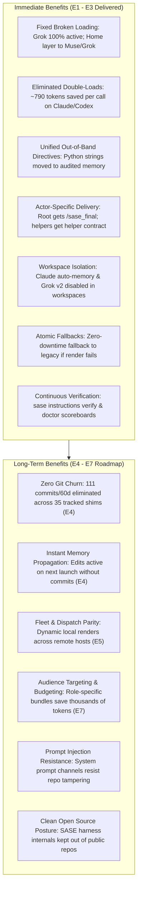

# Evaluating the Migration from Static Agent Instruction Files to Dynamic Instruction Bundles: Transparency, Benefits, and Strategic Recommendation

> **Research Report**  
> **Author:** Researcher gem (`research.1a.gem`)  
> **Date:** October 14, 2026  
> **Context:** SASE Instruction Delivery Migration (`sase-1ko` / E1–E5 Epics)  
> **Artifact Identifier:** `research:202610/instruction_bundles_migration_transparency_and_benefits__gem.md`

---

## Executive Summary

This report evaluates the recent architectural migration in SASE from static, repository-committed agent instruction files (`AGENTS.md`, `CLAUDE.md`, `GEMINI.md`, etc.) to dynamically compiled, per-invocation **instruction bundles** (developed across epics `sase-1gu` [E1], `sase-1h3` [E2], and `sase-1ko` [E3]).

Specifically, this research investigates the core tension raised by engineering leadership:
1. **The Transparency Concern:** The fear that dynamic instruction bundles obscure what instructions an agent actually receives, replacing an easily readable `AGENTS.md` file with an opaque runtime generation process.
2. **The Non-SASE & New User Experience:** How human developers, outside contributors, and non-SASE tools inspect and interact with repository instructions when static files are migrated.
3. **The Value Proposition:** A complete accounting of both the immediate and long-term benefits of dynamic instruction bundles.
4. **The Strategic Verdict:** Whether SASE should proceed with this migration or revert it.

### Bottom Line Recommendation: Proceed with the Migration; Do NOT Revert

**The migration should proceed.** Reverting to static instruction files would be a severe technical regression that reintroduces critical, verified production bugs across multiple LLM providers, revives heavy git commit churn across 35 generated files, and forfeits deterministic agent control.

The concern regarding lost transparency is understandable but rests on an **illusion of transparency**. In the legacy architecture, opening `AGENTS.md` did not tell you what an agent actually received—it told you what developers *hoped* an agent would receive. In production, providers loaded contradictory files, dropped instructions entirely (Grok loaded zero instruction files for a month without anyone noticing), suffered massive double-loads of the runtime contract (Codex and Claude), leaked state across ephemeral workspaces (Claude auto-memory), and crashed native subagents by instructing them to execute root-only finalizers (`/sase_final`).

Dynamic instruction bundles replace this unverified, static fiction with **cryptographically verifiable, per-invocation provenance**. With dynamic bundles, every invocation records the exact rendered markdown bundle and a normalized JSON manifest containing section-by-section hashes, byte offsets, inclusion/exclusion rationales, and runtime slot status. Furthermore, dedicated inspection tools (`sase instructions show`, `sase instructions render`, `sase instructions verify`) provide instant visibility for humans and automated systems alike.

To address the legitimate ergonomic concerns of human developers and non-SASE tools, the roadmap already specifies the proper solution in E4 and E5: a lightweight, committed public repository stub combined with `sase instructions sync` to materialize clean, gitignored local projections for interactive and external CLI use.

---

## 1. Context and Origin: Why SASE Began This Migration (`sase-1ko`)

To assess whether to proceed or revert, we must first review the baseline reality that triggered this multi-epic initiative.

### 1.1 The Legacy Sprawl: 35 Generated Files and Constant Churn

Prior to the migration, SASE maintained **35 generated, memory-backed instruction files** across four scopes:
- **sase repo root:** 5 byte-identical shims (`AGENTS.md`, `CLAUDE.md`, `GEMINI.md`, `QWEN.md`, `OPENCODE.md`).
- **sase subdirectories:** 15 shims across nested scopes (`demos/tapes/`, `src/sase/ace/`, `tools/`).
- **home directory:** 5 shims (`~/AGENTS.md`, `~/CLAUDE.md`, etc.) managed via chezmoi templates.
- **external projects:** 10 shims across `bob-cli` and `actstat`.

Whenever any durable memory note in `sase/memory/` was edited, developers had to run `sase memory init`, which re-rendered the files and committed them. In the 60 days preceding the migration audit, **111 separate commits** touched root `AGENTS.md`. In multi-agent swarms running in parallel ephemeral checkouts (`sase_<N>`), these generated files caused frequent, disruptive merge conflicts on unrelated branches.

### 1.2 The Production Baseline: Severe, Silent Provider Failures

Far worse than the git churn was the discovery that **different LLM provider harnesses interact with static filesystem files in radically inconsistent ways**. A comprehensive audit of thousands of historical SASE agent runs revealed major systemic defects:

| Provider | Intended Ingestion | Actual Production Reality Under Static Files | Severity |
| :--- | :--- | :--- | :--- |
| **Grok** | Load project `AGENTS.md` | **Loaded 0 files since ~2026-09-10.** Grok 1.0.46 requires folder trust for project files. SASE workspaces are untrusted. For over 4 weeks (465+ sessions), Grok received zero instructions. Grok's final-declaration compliance collapsed from 60% to 26%. | **Critical** (Silent failure) |
| **Codex** | Load project `AGENTS.md` | **Received the contract twice.** SASE's shadow `CODEX_HOME` symlinked `~/AGENTS.md`, and Codex also loaded project `AGENTS.md`. Codex received a 21 KB instruction block with "SASE Final Declaration" and all rules duplicated. | **High** (Context waste & confusion) |
| **Claude** | Load project `CLAUDE.md` | **Received contradictory instructions.** Claude loaded ancestor `~/CLAUDE.md` AND workspace `CLAUDE.md`. The home file listed `chezmoi` as the only linked repo; the project file listed six `sase-*` repos. Claude subagents inherited the root contract and crashed attempting `/sase_final`. | **High** (Contradictory state & crashes) |
| **Muse** | Load project & home rules | **Never received the home layer.** SASE invoked Muse with `--no-foreign-personal-context`, completely blinding it to personal tailnet, Obsidian, and chezmoi rules. | **Medium** (Missing capability) |
| **Antigravity** | Load `GEMINI.md` | **Double-loaded `GEMINI.md` and `AGENTS.md`**, consuming up to 24 KB per file against a strict 20k-token rules budget. | **Medium** (Redundant tokens) |
| **Claude Cache** | Clean workspace isolation | **Claude auto-memory quietly leaked state across workspaces.** What an agent knew depended unpredictably on which `sase_<N>` ephemeral directory it landed in. | **High** (Non-deterministic runs) |

### 1.3 Out-of-Band Directives (The "Dark Matter" of Instructions)

Under the legacy architecture, the instructions in `AGENTS.md` were only a fraction of what models were told. Adapters routinely injected hardcoded, provider-specific strings directly into CLI invocations:
- **Claude:** `_SINGLE_TURN_DIRECTIVE` injected via `--append-system-prompt`.
- **Codex:** `developer_instructions` JSON blob injected via `-c`.
- **Antigravity:** `_AGY_PRINT_MODE_DIRECTIVE` injected as a prompt prefix.
- **Muse:** `wrap_muse_prompt` prefix injected via `_muse_directive.py`.

These strings were hand-maintained Python constants hidden deep inside `src/sase/llm_provider/`. They bypassed memory auditing, were never reviewed by `sase memory review`, and were completely invisible to anyone reading `AGENTS.md`.

---

## 2. Deconstructing the Transparency Concern: Illusory vs. Verifiable Transparency

The primary motivation for considering a revert is the fear that dynamic instruction bundles destroy transparency:
> *"I used to be able to just read the AGENTS.md file to understand what initial / project-level instructions a sase agent was given... But now new users and/or non-sase agents need to generate it using a `sase` command?"*

This concern touches on three distinct dimensions:
1. **Developer inspection:** How do developers know what instructions an agent received?
2. **Non-SASE tools & new users:** How do outside tools and new developers inspect instructions?
3. **Truthfulness:** Did `AGENTS.md` actually represent the truth?

### 2.1 The Legacy Illusion: Why `AGENTS.md` Was a False Proxy for Reality

The belief that reading `AGENTS.md` provided transparency was based on a flawed assumption: *that what is written in `AGENTS.md` is what the LLM receives*.

In reality:
1. **Static files lied about execution:** SASE's legacy `capture_instruction_snapshot` utility recorded which instruction files existed **on disk**, not what the provider CLI actually ingested. When Grok ran for four weeks with zero instructions loaded, the SASE dashboard faithfully and falsely reported that Grok had received `AGENTS.md`. The static file gave developers a false sense of security while the model operated completely unguided.
2. **Hidden injections were omitted:** Anyone reading `AGENTS.md` had no visibility into the critical single-turn directives, print-mode wrappers, and developer instructions injected dynamically by the Python adapters.
3. **Actor conflation:** `AGENTS.md` declared rules meant exclusively for the root agent (such as submitting `/sase_final`). When native subagents or helpers read `AGENTS.md`, they attempted to execute root finalizers, causing operational errors because helper agents do not own the turn lifecycle.

Reading `AGENTS.md` did not give transparency into the agent's prompt; it gave transparency into an unverified document template.

### 2.2 Verifiable Transparency in the Dynamic Bundle Architecture

The dynamic instruction bundle architecture does not hide instructions; it elevates them to **auditable, first-class runtime artifacts**.

#### Cryptographic Provenance
For every agent invocation, SASE renders a frozen bundle immediately prior to calling the provider. It writes two files into the run's durable artifacts directory (`$SASE_ARTIFACTS_DIR/instructions/`):
1. `NN-<provider>.md`: The exact, byte-for-byte markdown bundle delivered to the model.
2. `NN-<provider>.json`: The normalized v2 manifest recording:
   - Exact schema and compiler versions.
   - Host facts (actor, mode, purpose, provider, project, host, VCS).
   - Bundle SHA256 and `common_digest`.
   - The ordered section table: every section included, its byte range, token estimate, and source note.
   - The exclusion table: every section omitted, along with explicit reasons (`superseded_input`, `shadowed`, `audience_mismatch`).
   - Delivery status (`explicit`, `inherits_native`, `inherits_root`, or `fallback`).

#### Agent Self-Inspection
During execution, SASE exports `SASE_INSTRUCTIONS_FILE` pointing directly to the frozen bundle path. An agent that needs to verify its own operational parameters can inspect this file directly.

#### Human and Developer Inspection Tooling
Developers do not need to guess what an agent received or dig through raw logs. SASE provides a dedicated suite of inspection commands:

```bash
# 1. Preview what an agent would receive right now from current memory:
sase instructions render

# 2. View the exact section-by-section breakdown, token counts, and layers:
sase instructions render -s

# 3. View the preview manifest as structured JSON:
sase instructions render -j

# 4. Check parity between current memory bundles and legacy AGENTS.md files:
sase instructions render -p

# 5. Inspect the EXACT historical bundle delivered to a specific past agent:
sase instructions show <agent-name>

# 6. Verify that historical stored bytes match the manifest SHA256:
sase instructions show <agent-name> -l

# 7. Check the live scoreboard of observed provider delivery across all runs:
sase instructions verify --since 24h

# 8. Track declaration misses and audited memory reads over time:
sase instructions readout --since 7d
```

Testing `sase instructions render -s` on the current workspace illustrates this transparency:
```
render 49526658010c common=6b4280fc40a6 sections=27 bytes=20038 tokens_est=5013 cache=hit 102.1ms
┏━━━━━━━━━━━━━━━┳━━━━━━━━━┳━━━━━━━━━━━┳━━━━━━━━━━━┳━━━━━━━┳━━━━━━━━━━━━┳━━━━━━━━━━━┓
┃ id            ┃ layer   ┃ status    ┃ lifecycle ┃ bytes ┃ tokens_est ┃ source    ┃
┡━━━━━━━━━━━━━━━╇━━━━━━━━━╇━━━━━━━━━━━╇━━━━━━━━━━━╇━━━━━━━╇━━━━━━━━━━━━╇━━━━━━━━━━━┩
│ frame.title   │ frame   │ included  │ neutral   │ 118   │ 30         │ —         │
│ pkg.sase.core │ package │ included  │ neutral   │ 1138  │ 282        │ package:… │
│ pkg.root.decl │ package │ included  │ root      │ 751   │ 187        │ package:… │
│ pkg.provider  │ package │ included  │ root      │ 880   │ 220        │ package:… │
│ proj.core.*   │ project │ included  │ neutral   │ 1206  │ 302        │ project:… │
│ home.ref.*    │ home    │ included  │ neutral   │ 246   │ 62         │ home:…    │
│ proj.web.*    │ project │ included  │ neutral   │ 10503 │ 2625       │ project:… │
│ home.core.sase│ home    │ supersede │ neutral   │ —     │ 0          │ home:…    │
│ pkg.helper.con│ package │ overlay   │ helper    │ —     │ 0          │ package:… │
└───────────────┴─────────┴───────────┴───────────┴───────┴────────────┴───────────┘
```
This is far more transparent than a static markdown file. Every byte has an accountable origin, and overlays (like helper contracts) are explicitly separated from root rules.

### 2.3 The Non-SASE Agent and New User Experience

The user's query highlights a critical question:
> *"But now new users and/or non-sase agents need to generate it using a `sase` command I'm assuming?"*

This question addresses two distinct personas:

#### Persona A: External Developers & Non-SASE Tools (Cursor, Aider, Raw CLI Users)
Under the legacy architecture, committing the full SASE `AGENTS.md` to public repositories created severe problems for outside tools. SASE's full `AGENTS.md` is heavily tailored to SASE's specific runtime harness. It explicitly commands the model to:
- "Before any normal response that ends this SASE provider turn, use your `/sase_final` skill..."
- "Use `/sase_repo` before accessing sidecar repos..."
- "Use `/sase_plan` instead of plan mode..."

When a non-SASE tool (such as Cursor, raw `claude`, or Aider) or an outside contributor ran in the repository, the model read these instructions and attempted to invoke non-existent SASE CLI skills or waited for SASE finalizers that were never executed. 

**The Solution in E4/E5:**
1. **Lightweight Repository Stub:** In epic E4, repositories may commit a clean, 10–15 line `AGENTS.md` stub explaining repository build/test basics and clarifying that full SASE agent workflows are compiled dynamically by SASE. External tools and open-source contributors get clean, applicable rules without harness confusion.
2. **Interactive Local Projections (`sase instructions sync`):** For developers who want local static files for interactive tools, `sase instructions sync` projects a clean, gitignored `AGENTS.md` and `CLAUDE.md` in primary checkouts and `~`. These files are ignored by git, preventing repository pollution.

#### Persona B: New SASE Users and Internal Developers
For a developer working on SASE:
- If they want to read the current project rules: `sase instructions render` prints the exact markdown bundle in ~100 ms.
- If they want to inspect what an agent saw yesterday: `sase instructions show <agent-name>` displays the exact archived bytes and verifies integrity (`bytes match`).
- If they are authoring rules: They edit durable notes in `sase/memory/`, where content is modular, audited, and automatically compiled on the next run without requiring manual regeneration or multi-file git commits.

---

## 3. Comprehensive Catalogue of Benefits: Immediate and Long-Term

To justify proceeding with the migration, the benefits must substantially outweigh the transitional friction. The benefits fall into two clear categories: immediate operational repairs (already active in E1–E3) and strategic architectural unlocks (scheduled for E4–E7).



### 3.1 Immediate Benefits (Delivered and Verified in Epics E1, E2, and E3)

1. **Restoration of Broken Provider Pipelines:**
   - **Grok Rescued:** Grok was completely blind in SASE workspaces for over a month due to untrusted directory semantics in Grok 1.0.46. Dynamic bundles deliver instructions via the explicit `--rules` channel, restoring Grok's instruction ingestion to 100% while maintaining folder isolation.
   - **Home Layer Delivered to All Providers:** Prior to dynamic bundles, Muse and Grok never received personal memory notes (tailnet, Obsidian, chezmoi). Dynamic bundles inject the home layer uniformly across all providers.

2. **Elimination of Context Waste and Conflicting Instructions:**
   - **~790 Duplicate Tokens Stripped:** Codex and Claude previously received the SASE contract twice (from both home and workspace files). Dynamic bundles deduplicate sections across layers by construction, freeing context space on every invocation.
   - **Resolution of Contradictory Rosters:** Legacy Claude runs received `~/CLAUDE.md` (which named `chezmoi` as the only linked repo) and workspace `CLAUDE.md` (which named six `sase-*` repos). Bundles reconcile these into a single coherent section.

3. **Bringing "Dark Matter" Directives into Audited Memory:**
   - Previously, critical directives (`_SINGLE_TURN_DIRECTIVE`, `developer_instructions`, `_AGY_PRINT_MODE_DIRECTIVE`) were hardcoded Python strings scattered across adapter files.
   - In the bundle architecture, these are compiled into standard package sections (`pkg.provider.<provider>`) derived from versioned templates, visible in manifests, and subject to memory audit.

4. **Actor-Specific and Helper-Safe Delivery:**
   - A root agent and a native helper (subagent) have fundamentally different lifecycles.
   - The bundle compiler generates separate root and helper overlays: root agents receive `pkg.root.final_declaration` (requiring `/sase_final`), while helper agents receive `pkg.helper.contract` (commanding them to return results to their parent and forbidding `/sase_final`).
   - This cleanly eliminates a major class of helper agent crashes where subagents attempted to execute root-only termination commands.

5. **Determinism and Workspace Isolation:**
   - Claude auto-memory previously wrote memory notes into whichever ephemeral workspace directory (`sase_<N>`) an agent happened to occupy, causing cross-agent contamination and non-reproducible behavior.
   - Grok memory-v2 exhibited similar uncontrolled persistence.
   - Epic E3 explicitly suppresses foreign auto-memory in SASE runs, ensuring agents execute deterministically.

6. **Atomic Fallback and Zero-Downtime Resilience:**
   - The delivery boundary (`invoke_with_instructions`) is built defensively. If bundle rendering fails, if a bundle exceeds size limits, or if an adapter fails to deliver, the invocation **atomically falls back to legacy delivery**.
   - Failures generate deduplicated notifications and are recorded in manifests (`.error.json`), ensuring no agent invocation is ever dropped or halted mid-flight.

7. **Continuous Conformance Auditing:**
   - The `sase instructions verify` scoreboard and `sase doctor -C instructions` checks read actual provider session transcripts, verifying whether the bundle hash was ingested exactly once.
   - Regressions can no longer persist undetected for weeks.

### 3.2 Long-Term Benefits (Roadmap Epics E4, E5, E6, and E7)

1. **Complete Elimination of Git Churn and Merge Conflicts (Epic E4):**
   - Retiring the 35 tracked generated files permanently eliminates 111 commits per 60 days to root `AGENTS.md`.
   - Parallel agents operating across ephemeral workspaces will no longer collide on generated markdown files when merging or rebasing code.

2. **Instant Memory Propagation (Epic E4):**
   - When a developer updates a rule or adds a memory strand in `sase/memory/`, the change takes effect immediately upon the very next agent launch.
   - There is no need to run `sase memory init`, stage five identical files, commit them, and push them across repositories.

3. **Fleet Rollout and Multi-Host Dispatch Parity (Epic E5):**
   - SASE agents frequently execute across remote nodes (`apollo`, `athena`, `mac`) via `%dispatch`.
   - In E5, remote dispatch requests do not pass raw instruction files across the network. The target host compiles the instruction bundle locally using its own local environment facts, cleanly retiring fragile chezmoi hostname templates.

4. **Audience Targeting and Token Budgeting (Epic E7):**
   - With dynamic bundles, instructions can be tailored to the agent's role using closed launch facts:
     - *Research vs. Code:* A research swarm member does not need Symvision lint rules, TUI snapshot triggers, or commit rollover instructions; removing these saves thousands of tokens per turn.
     - *Phase Worker vs. Legend Planner:* Phase workers can receive strict instructions to append notes to their existing phase bead rather than creating new beads.
     - *Declaration Recovery:* Specialized recovery agents receive minimal contract prompts rather than the full reference memory catalog.
   - The compiler enforces strict token budgets per audience, preventing instruction bloat from degrading model reasoning.

5. **Resistance to Prompt Injection and Upstream Tampering:**
   - In foreign, open-source, or client repositories, relying on a committed workspace `AGENTS.md` allows untrusted repository content to alter or override SASE core safety rules.
   - Delivering the SASE contract through explicit provider channels (such as `--append-system-prompt-file` or `--rules`) gives SASE instructions precedence over repository-supplied files, mitigating prompt injection risks.

6. **Clean Public Repository Posture:**
   - Public open-source projects managed by SASE will no longer display hundreds of lines of SASE-internal prompt engineering, private tool calls, and macros in their root `AGENTS.md`.
   - Outside contributors see standard, readable documentation.

---

## 4. The Revert Alternative: Cost, Risk, and Technical Regression

To make an informed decision, we must examine what happens if SASE reverts this work.

### 4.1 What Reverting Actually Entails

Reverting does not simply mean "restoring `AGENTS.md`." Because `AGENTS.md` was never deleted (it is currently retained as a projection during E3), reverting means **abandoning the explicit delivery channels in the adapters and restoring unmanaged filesystem loading**.

### 4.2 The Immediate Regressions Triggered by a Revert

If this work is reverted:
1. **Grok Immediately Breaks Again:** Grok in SASE workspaces will revert to loading zero instruction files. Grok agents will lose all awareness of the SASE contract, bead conventions, and tool rules, sending declaration compliance plunging back toward 26%.
2. **Context Waste Returns:** Every Claude and Codex invocation will immediately resume wasting ~790 tokens per call on duplicate contract text, while Claude will resume seeing contradictory linked repo definitions.
3. **Claude Helper Crashes Return:** Native subagents will resume inheriting the root `CLAUDE.md`, prompting them to execute `/sase_final` and generating spurious failure notifications.
4. **Git Churn Resumes:** All 35 generated files will remain permanently tracked, continuing the pace of 50+ commits per month solely to keep generated shims in sync.
5. **Loss of Verifiable Provenance:** SASE loses the ability to prove what an agent saw. Diagnostic tools like `sase instructions show` and `sase instructions verify` become meaningless, returning SASE to the era of blind assumptions.

### 4.3 Sunk Cost vs. Solved Problem

This migration was not undertaken as speculative refactoring. It was launched in response to verified, measured production failures where models operated without instructions or crashed on conflicting contracts. 

The heavy lifting of the migration—the manifest wire in `sase-core`, the Python compiler, the cache, the boundary architecture, and the provider adapters—**is already built, tested, and active in epic `sase-1ko`**. Reverting now would throw away a functioning, verified solution to return to an architecture known to be broken.

---

## 5. Strategic Recommendations and Practical Roadmap

Based on this investigation, SASE should proceed with the migration while implementing specific measures to ensure maximum transparency and convenience for human developers.

### Recommendation 1: Do Not Revert; Proceed with Epic `sase-1ko` Completion
Maintain the dynamic instruction bundle architecture. Complete the remaining live acceptance phases of `sase-1ko` and attach the acceptance records as planned.

### Recommendation 2: Respect the 7-Day Sunset Flag Soak Period
Do not rush the retirement of legacy fallback code. SASE's feature flag architecture provides per-provider sunset flags:
- `claude_explicit_instructions`
- `codex_explicit_instructions`
- `grok_explicit_instructions`
- `muse_explicit_instructions`

Keep these sunset flags enabled by default for a full 7-day soak period. If an unforeseen edge case arises with a specific provider, that individual provider can be instantly reverted via `sase flag disable <provider>_explicit_instructions` without impacting other providers or rolling back the entire architecture.

### Recommendation 3: Address the Ergonomic Gap in Developer Documentation
The anxiety over transparency is largely an ergonomics and awareness issue. Developers are accustomed to `cat AGENTS.md`. SASE should make the new inspection commands second nature:
1. Document `sase instructions render` prominently in developer onboarding guides and cheat sheets as the standard command for "what do agents see in this repo?"
2. Add a convenient alias or mention in `sase doctor` and `sase init`.
3. Highlight `sase instructions show <agent>` as the definitive post-mortem tool for debugging agent behavior.

### Recommendation 4: Complete the E4 Human Tooling (`sase instructions sync` & Public Stub)
When advancing to epic E4 (retiring tracked generated files):
1. **Commit a Clean Stub:** Place a concise 10–15 line `AGENTS.md` in the repository root explaining project build commands and stating that SASE compiles full runtime instructions dynamically.
2. **Deploy `sase instructions sync`:** Ensure `sase instructions sync` smoothly generates gitignored `AGENTS.md` and `CLAUDE.md` files in primary checkouts so that local tools (like Cursor, VS Code, or manual Claude runs) continue to operate with full context.

### Recommendation 5: Proceed to Audience Targeting (E7) Deliberately
Once E4 and E5 eliminate file churn and unify fleet dispatch, activate audience targeting (epic E7). Use launch facts to deliver lean, role-specific bundles (e.g., stripping lint and TUI rules from research swarms), achieving substantial context savings without compromising safety.

---

## 6. Conclusion

The transition from static agent instruction files to dynamic instruction bundles is one of the most critical structural upgrades to SASE's agent execution runtime. 

The perception that `AGENTS.md` provided transparency was an illusion that masked severe provider-level loading failures, duplicate contracts, and out-of-band directives. Dynamic instruction bundles replace that illusion with **true, cryptographic provenance, real-time auditability, actor safety, and determinism**.

SASE should **proceed with confidence**. Reverting would bring back documented, severe failures; proceeding unlocks a cleaner, faster, and truly transparent agent engineering environment.
