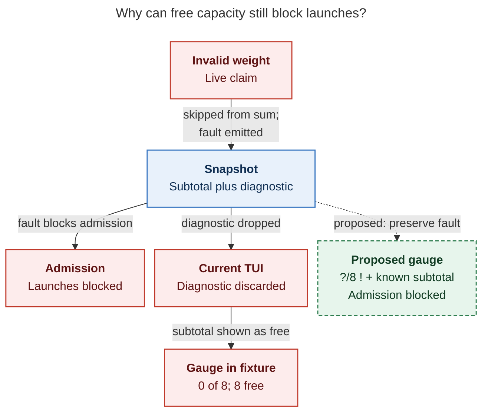
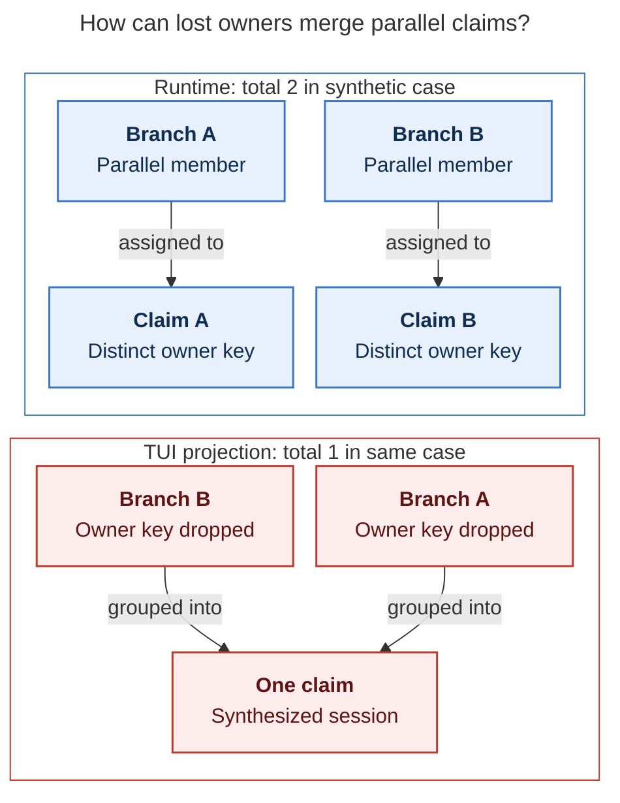

# Diagram proposals: Machine load: why athena showed `3/8` with 6 agents running, and how to make it legible

Proposals for the swarm linker, not a report. Each diagram restates only what the source
report says.

```yaml
source: research:202610/machine_load_accounting_transparency/machine_load_accounting_transparency__final.md
producer: research.5e.image
check: "mmdc 12.0.0 with the PDF-mirroring config rendered 2 of 2 Mermaid diagrams"
```

## invalid-weight-fault

```yaml
anchor: |-
  a live claim with an invalid weight is skipped from the sum
question: |-
  Why can the gauge show free capacity while admission is blocked?
illustrates: |-
  An invalid live weight emits a diagnostic and blocks admission, but the TUI discards that diagnostic, so the proposed gauge preserves the fault alongside the known subtotal.
caption: "Invalid weights block admission; discarding diagnostics makes the terminal UI show spare capacity, while the proposed gauge preserves the fault."
review: "684.641x766 px, fit 95.3%; question and visual checks passed; every node and edge traced to C4 or F5; 0 revisions"
```



## parallel-claim-owners

```yaml
anchor: |-
  cdx built a synthetic case with two parallel branches in one displayed session:
question: |-
  How can lost claim owners merge parallel work?
illustrates: |-
  Dropping runner_claim_owner_key lets the TUI synthesize a shared session for two parallel branches, explaining the synthetic runtime count of 2 versus the TUI count of 1, not the screenshot incident.
caption: "Lost owner keys merge parallel claims in this synthetic example: runtime 2, terminal UI 1; this did not cause the screenshot discrepancy."
review: "491.812x728 px, fit 100.0%; question and visual checks passed; claim membership and totals traced to C3 and the claim rules; 1 revision"
```


