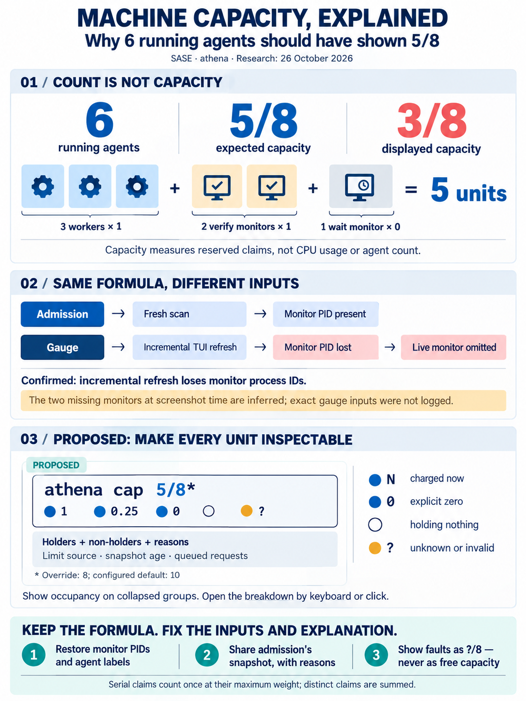
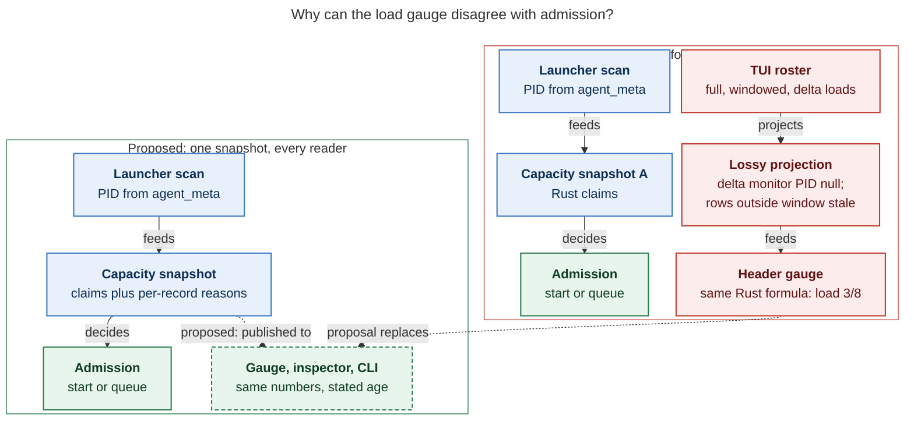
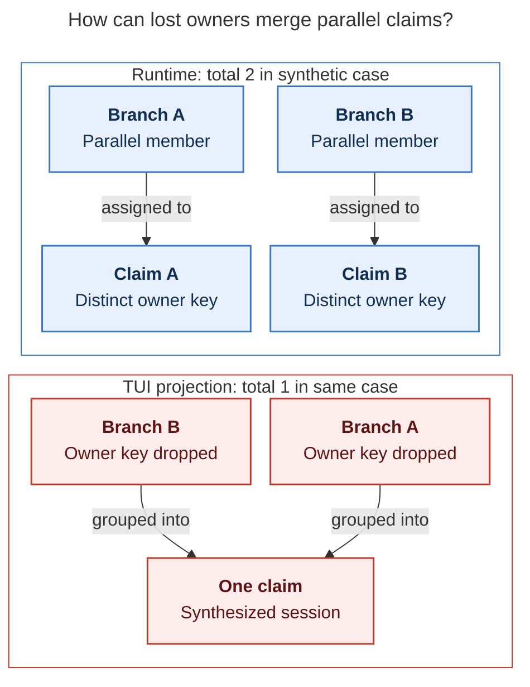
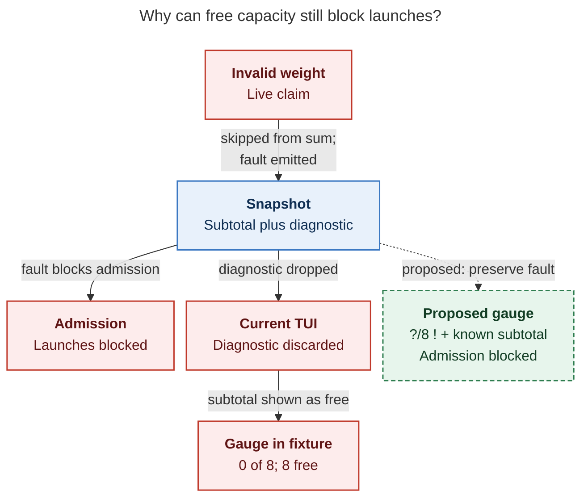

# Machine load: why athena showed `3/8` with 6 agents running, and how to make it legible

> **Research query:** How is the current machine's load determined, and why did the screenshot
> show a load of only 3/8 with 6 agents running, when only one agent was running a
> waiting monitor and a load of about 5 was expected? Which UX changes would make this
> state clearer, including which nodes have no weight, and what fixes, if any, does the
> load calculation need? End with a recommended UX and solutions to any load-calculation
> issues.



## Bottom line

- **The screenshot was wrong, and your estimate of 5 was right.** At 17:27:51 athena had
  three workers at 1.0, two verify monitors (`TESTING`) at 1.0, and the `sase-1n6`
  cutover monitor at an explicit 0. That is **6 running, 5.0 occupied**. The gauge showed
  3. The two missing units were almost certainly the two verify monitors (see
  [what the screenshot should have said](#what-the-screenshot-should-have-said)).
- **Admission was probably not wrong, only the TUI's picture of it.** The launcher
  decides from a fresh, locked artifact scan that reads each PID from
  `agent_meta.json`. The header gauge re-runs the same Rust formula over the **TUI's own
  roster**, which is a lossy, eventually-consistent copy. Of the five reports, cdx and cld
  found this. grk, mus, and gem concluded "no bug" from evidence that does not hold up
  (see [where the five reports disagreed](#where-the-five-reports-disagreed-and-how-i-resolved-it)).
- **I confirmed the specific mechanism live.** The TUI's incremental (exact-delta)
  refresh rebuilds a live monitor row with `pid=None`. Monitors keep their PID only in
  `agent_meta.json` and the project spec's RUNNING claim; their `workflow_state.json` PID
  is null, and the delta path reads neither of the other sources. Rust treats a monitor
  with no PID as "not started", so the monitor drops out of the load. Workers survive the
  same path because their `workflow_state.json` does carry the PID. That asymmetry
  matches the screenshot exactly: three workers counted, two monitors dropped
  ([C1](#c1-exact-delta-refresh-drops-live-monitors-from-the-gauge)).
- **The only existing explanation surface is broken too.** On the live roster, every
  "Held by" entry in the gauge tooltip is labelled `checkout` or `diff`, never an agent
  name ([C5](#c5-holder-labels-in-the-tooltip-are-workflow-step-names)). The tooltip is
  also hover-only, and it never lists rows that hold nothing.
- **Even with correct numbers, `6 running` and `load 5/8` will legitimately differ.** They
  measure different things: status-bucket node count versus weighted capacity claims.
  Nothing on screen says so, and nothing tells you which rows count and which don't
  (see [why the state is hard to read](#why-the-state-is-hard-to-read-even-when-the-number-is-right)).
- **Recommendation, in short.**
  1. [Fix the PID projection now.](#recommended-fixes-to-the-load-calculation)
  2. Make every surface read the admission snapshot, extended in sase-core with a reason
     code per record ([recommended fixes](#recommended-fixes-to-the-load-calculation)).
  3. Add an [occupancy mark](#occupancy-mark-on-running-group-rows-including-collapsed-clans)
     to rows, including collapsed clans.
  4. Add a keyboard-reachable [capacity inspector](#capacity-inspector-and-load-command),
     plus `sase agent load`.
  5. Rename the gauge to a machine-labelled `cap`, with an override marker
     ([header chip](#header-chip)).

  Keep the current weighted-claim formula. The evidence does not support changing it.

## How load is calculated today

The gauge is `occupied_capacity / effective_limit` from sase-core
`runner_capacity_snapshot`. It measures **reserved capacity**, not OS load average, CPU,
or a row count.

- **Occupying record.** A record holds capacity only when all of these hold
  (`records.rs::is_occupying_record`):
  - it is an `ace-run` user agent with `agent_meta` and no done marker;
  - its process is live;
  - it has no pending question and no pending gate turn;
  - it has **started**. Ordinary turns need `run_started_at`; a real monitor member
    needs `pid.is_some()`.
- **Claims.** Occupying records group into claims by lineage, in this order: explicit
  `runner_claim_owner_key`, then parallel member, then `parent_timestamp` chain, then
  `agent_session`, then standalone. Each claim counts the **maximum** weight among its
  records, and claims are summed. A serial session (worker → monitor → follow-up) counts
  once; parallel members count separately.
- **Weight.** Defaults to 1.0. `%q(w=…)` sets it. Explicit 0 is valid: `sase monitor
  start -w 0` and the host epic-launch monitor use it. Verify monitors (`TESTING`)
  inherit the starter's weight, and `-w 0` is refused for them.
- **Limit.** `~/.sase/max_running_agents_override.json` if present, else config. On
  athena the override has been `limit: 8, source: ace, expires_at: null` since
  2026-09-13. The configured default is 10.
- **Running count.** The header's `6 running` and the clan `[R…]` chips count Agents-tab
  agent nodes in the **Running status bucket**. Any status that isn't exactly `WAITING`,
  `QUEUED`, a done/failed state, and so on falls through to Running in
  `status_bucket_for_status`. That includes `TESTING` and `WAITING CUTOVER`.

What each kind of row you see adds to load, and why:

- **`RUNNING` worker (root or parallel member)**
  - *Adds to load?* its weight (default 1.0)
  - *Why:* started, live claim
- **Verify monitor (`TESTING`)**
  - *Adds to load?* the session's weight, usually 1.0
  - *Why:* real monitor member with a PID
- **`-w 0` wait monitor or epic-launch monitor (`WAITING CUTOVER`)**
  - *Adds to load?* 0
  - *Why:* claim exists, but at explicit zero
- **Serial member riding a session claim**
  - *Adds to load?* 0 extra
  - *Why:* the claim counts once, at max weight
- **`WAITING` on dependencies, beads, time, or an epic**
  - *Adds to load?* 0
  - *Why:* not started
- **`QUEUED` slot waiter**
  - *Adds to load?* 0 (it *requests* its weight)
  - *Why:* at the admission gate
- **`QUESTION` / pending gate**
  - *Adds to load?* 0
  - *Why:* yields capacity
- **Clan container, named proc, workflow step row**
  - *Adds to load?* 0
  - *Why:* not an agent record

None of these rules is visible in the TUI today.

## What the screenshot should have said

cdx and cld reconstructed this independently from artifact start and stop times. gem
named the same six members, and mus's later listing agrees on the weights. One item per
holder:

- **`bob-cli-ct.5`**
  - *Running node (clan chip):* `bob-cli-ct` `[R2]`
  - *Kind:* worker
  - *Weight:* 1.0 default
  - *Started → ended (EDT):* 17:20:03 → 17:48:46
  - *Counted by gauge?* yes
- **`bob-cli-ct.3--mon`**
  - *Running node (clan chip):* `bob-cli-ct` `[R2]`
  - *Kind:* verify monitor
  - *Weight:* 1.0 inherited
  - *Started → ended (EDT):* 17:25:32 → 17:29:57
  - *Counted by gauge?* **no**
- **`sase-1oh.5.1.2`**
  - *Running node (clan chip):* `sase-1oh.5.1` `[R1]`
  - *Kind:* worker
  - *Weight:* 1.0 default
  - *Started → ended (EDT):* 17:13:55 → running
  - *Counted by gauge?* yes
- **`sase-1oh.4.1.2`**
  - *Running node (clan chip):* `sase-1oh.4.1` `[R1]`
  - *Kind:* worker
  - *Weight:* 1.0 default
  - *Started → ended (EDT):* 15:45:06 → running
  - *Counted by gauge?* yes
- **`sase-1oe.3--mon-1`**
  - *Running node (clan chip):* `sase-1oe` `TESTING` `[R1]`
  - *Kind:* verify monitor
  - *Weight:* 1.0 explicit
  - *Started → ended (EDT):* 17:21:02 → later
  - *Counted by gauge?* **no**
- **`sase-1n6.10--mon`**
  - *Running node (clan chip):* `sase-1n6` `WAITING CUTOVER` `[R1]`
  - *Kind:* `-w 0` wait monitor
  - *Weight:* **0** explicit
  - *Started → ended (EDT):* Oct 25 17:52 → running
  - *Counted by gauge?* holds 0 (correct)
- **Total**
  - *Weight:* **5.0 / 8**
  - *Counted by gauge?* gauge: **3**

Why the two monitors are the missing units:

- **Monitor PIDs live in a different file.** Both monitors have their supervisor PID in
  `agent_meta.json` (283336 and, for the cutover monitor, 4026430) and `pid: null` in
  `workflow_state.json`. I checked the files. Workers carry the same PID in both files
  (for example, `sase-1oh.4.1.2`: 4136720 in each).
- **Full loads repair this; delta loads don't.** On a full load the TUI recovers the
  monitor PID from the project spec's RUNNING claim
  (`#10 | 4026430 | ace-monitor | … | 20261025175222`) in `dedup_running_vs_workflow`.
  The exact-delta loader "intentionally do[es] not rescan ProjectSpec RUNNING claims"
  (`agent_loader.py::_mark_live_artifact_delta_runners`).
- **Both monitors started after the last full-history reconcile.** cld found that in
  `~/.sase/logs/tui_agent_loads.jsonl` the last reconcile was at 17:13:33. Every load
  after that was a ~680-row `auto_refresh`/`roster_completion_retry` taking 19–25 s.
  Both monitors started after 17:13:33. So did two of the workers, and those were
  counted, which fits: delta-loaded workers keep their PID.
- **The exact rows dropped at 17:27 are inferred, not logged.** The TUI does not record
  its capacity inputs. A second mechanism, bounded viewport loads (cld §3.2), drops the
  same two rows in replay. Both explanations point at the same monitors.

## Findings on the calculation

### C1 Exact-delta refresh drops live monitors from the gauge

_Confirmed live · P0._

I ran a read-only probe using the installed interpreter and the TUI's own functions.

- **Fresh full load.** `load_tiered_agents(full_history=True)` gave
  `sase-1n6.10--mon` `pid=4026430, runner_is_live=True`. The TUI capacity came to
  **8.25**, matching the launcher snapshot exactly (8.25 from 105 scanned records,
  14.2 s scan).
- **Exact-delta load of the same directory.**
  `load_artifact_delta_agents([<monitor dir>], update_index=False)` gave the same
  monitor `pid=None, runner_is_live=False`.
- **Effect on holders.** Splicing those delta rows into the full roster dropped the
  holder count from 10 to 9. This monitor is weight 0, so the number stayed at 8.25. A
  1.0 verify monitor loses 1.0 the same way.

cdx reached the same defect from the loader side: `_workflow_snapshot_loaders.py` sets
`pid = wf_state.pid`, while the runtime's `_record_pid()` prefers `agent_meta.pid`. Its
probe shows TUI capacity 0.0 against runtime 1.0 for the live `sase-1oe.3--mon-1`
records.

**Fix.** Wherever Agent rows are built from artifact records (full, index, and delta
loaders), take a monitor row's PID from `agent_meta.pid`, falling back to the running
marker. That matches what admission already does. Then re-probe liveness. Don't just
mark monitor rows live: dead or reused PIDs and pending or terminal turns must stay
excluded. Add a parity test that loads real monitor artifacts through the delta path.
The current `tests/test_capacity_snapshot_parity.py` fixture injects `pid` directly, so
it can't catch this.

### C2 The gauge has no authoritative source

_Confirmed by cld's live drift · P0/P1._

Admission and the gauge both call the same Rust function, but on different inputs:

- **Admission:** `axe/run_agent_wait_slots.py::_try_claim_runner_slot` scans with
  `scan_runner_slot_records()` and liveness-probes under `runner_slots.lock`.
- **Gauge:** `refresh_runner_slot_context(prep.filtered_agents, capacity_agents=…)`
  calls `capacity_record_from_agent(Agent)` once per roster row.

The roster drifts for several reasons:

- membership is windowed and cached (growing-prefix viewport loads merged over a cached
  roster);
- a full reconcile happens only after 30 s with no input;
- loads take 19–37 s on athena;
- a stale-capacity generation keeps the previous snapshot;
- watcher deltas can be missed between the 300 s sanity passes.

cld ran a private TUI next to the launcher snapshot taken each minute:

- a fresh TUI matched exactly;
- within minutes it drifted by −2.0 to +2.0, for example `7/8` while the launcher was
  full at `8.0`;
- a new root agent (`sase-1oi.1`) was missing from both the list and the gauge for about
  15 minutes, including 8+ minutes with no input.

C1 is one concrete cause of the drift. The structural fix is for every surface to read
one snapshot (see [recommended fixes](#recommended-fixes-to-the-load-calculation)).



_Today the gauge counts only what the TUI roster happens to hold. Exact-delta rows lose
monitor PIDs, and windowed loads leave rows stale. The proposal paints every display
from the snapshot admission uses, with its age stated. Rendered with mermaid-cli 12.0.0
at 580.7 × 1160 px (77.0% PDF fit)._

### C3 Canonical claim ownership is dropped by the TUI projection

_Latent · P1._

`capacity_record_from_agent` doesn't forward `runner_claim_owner_key`, and the TUI
`Agent` model has no field for it. The TUI synthesizes `agent_session` from
`parent_timestamp` instead.

- cdx built a synthetic case with two parallel branches in one displayed session: the
  runtime counted 2, the TUI counted 1.
- cld checked today's live data and found every live worker had its own key, so the
  claims matched.

[The parallel-claim-owners diagram](#figure-parallel-claim-owners) shows how, in cdx's
synthetic case, a dropped owner key lets the TUI fold two parallel branches into one
synthesized session claim.

<div id="figure-parallel-claim-owners">



_Lost owner keys merge parallel claims in this synthetic example: runtime 2, terminal UI 1; this did not cause the screenshot discrepancy._

</div>

This is a real lossy boundary, but it did not cause this incident.

### C4 Invalid weights show more free capacity while admission is blocked

_Confirmed · P1._

In Rust, a live claim with an invalid weight is skipped from the sum, emits
`invalid-live-claim-weight`, and fails admission closed. The TUI drops snapshot
`diagnostics` entirely. cdx's fixture produced a tooltip reading "0 of 8 … (8 free)"
while nothing could launch. An unknown contribution must never look like spare
capacity. [The invalid-weight fault diagram](#figure-invalid-weight-fault) traces how
the discarded diagnostic turns blocked admission into apparent free capacity, and how
the proposed gauge would keep the fault beside the known subtotal.

<div id="figure-invalid-weight-fault">



_Invalid weights block admission; discarding diagnostics makes the terminal UI show spare capacity, while the proposed gauge preserves the fault._

</div>

### C5 Holder labels in the tooltip are workflow step names

_Confirmed live · P0 · trivial._

`agent_runner_slots.py` builds `source_agent_by_artifact_dir` with a last-wins dict
comprehension. Workflow step rows (`checkout`, `diff`, …) share their agent's
`artifacts_dir`, so they overwrite the agent row. My probe printed all 10 live holders
as `checkout`/`diff` (cld and gem saw the same).

**Fix.** Skip `is_workflow_child` rows when indexing, or prefer rows with an
`agent_name`. Add a regression test where step rows share the directory.

### C6 Three implementations of "who holds capacity"

_P2._

1. Rust claims over the launcher scan. This one is authoritative.
2. Rust claims over the TUI roster
   ([C2](#c2-the-gauge-has-no-authoritative-source)).
3. A Python predicate behind `holds_runner_slot` and `runner_slot_holders` in
   `sase agent list -j`. It groups by session, and its fallback is
   `agent.status == "RUNNING"` (`integrations/agent_list_entries.py:289`). So `TESTING`
   and `WAITING CUTOVER` rows miss it.

No CLI command prints the load breakdown.

### C7 The snapshot can't say why a live row holds nothing

_P1 · core._

`RunnerCapacitySnapshotWire` returns `claims`, `waiters`, and `diagnostics`. A live
record that is neither claimed nor waiting simply vanishes. Explaining it today means
re-implementing `is_occupying_record` in Python, which the Rust-core boundary rule
forbids.

### C8 Over-limit load reads as "at capacity"

_Observed · minor._

During my probe athena was at **8.25 / 8**. Per-launch `%queue(capacity=N)` budgets can
admit work above the displayed limit (`docs/reference/runner-slots.md`). The widget
renders this with the at-capacity style and the text "at capacity". It doesn't show the
overage or why it's allowed. I did not trace which launch caused the overage.

### Non-findings (checked)

- **The Rust math is fine.** Given a complete roster, the TUI path and the launcher agree
  to the hundredth (cld's replays; my 8.25 = 8.25).
- **The cutover monitor's 0 is correct.** It has `queue_weight 0.0, explicit`.
- **Verify monitors holding 1.0 is the intended policy.** They run real local work. Don't
  auto-zero them.
- **Serial dedup didn't double count.** A briefly live failed `bob-cli-ct.3--mon-0` sat
  in the same session claim (max, not sum).

## Why the state is hard to read even when the number is right

All five reports agree on these gaps:

1. **`running` and `load` look like the same quantity.** `6 running` on the left and
   `load: 3/8` on the right are both small integers in `n` / `n/m` slots. The docs make
   it worse: `docs/reference/runner-slots.md:19` says the header shows "the same global
   capacity state" as `load: 8/10` next to `8 [8 running · 1 queued]`. That equality only
   holds when every running node weighs 1.0 and no session has dedup.
2. **Collapsed clans hide every occupancy signal.**
   - Default 1.0 has no badge (`format_queue_weight_badge_value` returns `None`).
   - Clan containers, monitors, serial children, gates, and named procs suppress the
     `wN` badge.
   - The detail pane suppresses `Weight:` for clans and monitors.

   In `group: by status` the Running group is all collapsed clans, so you can't tell 1.0
   from 0 from "not holding" for any of them.
3. **The holder list is hover-only, truncated at 12, and mislabelled
   ([C5](#c5-holder-labels-in-the-tooltip-are-workflow-step-names)).** It lists
   only rows that hold capacity. The rows whose *exclusion* you want to check never
   appear.
4. **The limit's provenance is invisible.** `/8` is a six-week-old ACE override with no
   expiry, sitting over a configured 10. The models-panel runner-limit card knows this;
   the gauge doesn't show it.
5. **Scope is unlabelled.** The gauge counts local (athena) rows only, computed before
   fleet rows are projected in. It sits next to `athena 174 | apollo 23` machine tabs.
6. **Compact density drops the label,** leaving a bare `3/8 ·` next to the model name.
7. **"Running" has three meanings:** the group header, the status, and occupancy. A 24-hour
   `WAITING CUTOVER` poll loop sits in the Running group with a running clock.
8. **Degraded and fault states are cryptic or hidden.** `—/—` and `—/N` don't say why,
   and invalid-weight faults show as free capacity
   ([C4](#c4-invalid-weights-show-more-free-capacity-while-admission-is-blocked)).

## Where the five reports disagreed and how I resolved it

- **Was `3/8` a bug?**
  - *Positions:* **Bug, should be 5:** cdx, cld. **Correct:** grk, mus, gem.
  - *Resolution:* **Bug.** grk credited 1.0 to `sase-1oe.3--mon-1` and 0 to both
    `bob-cli-ct` nodes, but `bob-cli-ct.5` was a live 1.0 worker from 17:20:03; mus's own
    later listing shows it `RUNNING 1.0`. mus explained the gap with the research swarm's
    0.25 weights, but the swarm started at 17:41, 14 minutes *after* the screenshot. gem
    treated `bob-cli-ct.3--mon`'s `pid=None` as legitimate, but a null PID on a live
    monitor is exactly the defect
    ([C1](#c1-exact-delta-refresh-drops-live-monitors-from-the-gauge)).
- **Mechanism**
  - *Positions:* cdx: monitor PID projection. cld: roster windowing and staleness.
  - *Resolution:* **Both, and they meet in the delta path.** The PID loss is a confirmed,
    specific defect (C1). Windowing is the general reason the roster can't be trusted
    ([C2](#c2-the-gauge-has-no-authoritative-source)). Fix C1 now and C2 structurally.
- **Rebucket `WAITING *` statuses into Waiting?**
  - *Positions:* gem: yes (prefix match). grk: no.
  - *Resolution:* **Not as a load fix.** A prefix rule also catches `WAITING INPUT`
    (asking/HITL) and turns a display taxonomy change into a load explanation. Occupancy
    marks explain all the zero-holding cases, including the two-member `RUNNING` clan.
    Treat the taxonomy as its own decision if you want long-lived monitors out of the
    Running group.
- **Gauge wording**
  - *Positions:* gem: `cap`/`slots`. cdx: `capacity`. cld, grk, mus: keep `load`, add a
    label.
  - *Resolution:* **Use `cap`.** "Load" reads as OS load average, and athena's load
    average was ~15 that afternoon. "Slots" implies integers, which fractional weights
    break.
- **Always render decimals (`3.0/8`)?**
  - *Positions:* mus: yes. Others: silent.
  - *Resolution:* **No.** The label and the inspector fix the count confusion. Keep
    compact numbers on the chip and full precision in the inspector.
- **Where the TUI's snapshot comes from**
  - *Positions:* cld: run the launcher scan in a worker, later a host-published snapshot.
    cdx: Rust explanation projection from the normalized execution snapshot.
  - *Resolution:* **Read admission's own scan.** The launcher already caches it in
    `runner_slots.scan.json` (`load_or_refresh_runner_slot_scan`). A full scan costs
    ~14 s on athena (cld 13.9 s; mine 14.2 s), so it must stay off the event loop and be
    shared, not re-run per TUI.
- **Row mark design**
  - *Positions:* grk: `●1`/`w0`/`○`. cld: `⚖1`. gem: `· 1.0 cap`.
  - *Resolution:* **One token family, distinct from the authored `wN` badge** (see
    [occupancy mark](#occupancy-mark-on-running-group-rows-including-collapsed-clans)).

## Recommended UX

The goal: every number on screen can be **summed by eye from its parts**, and every
running row that adds nothing says why. This is the `kubectl describe node` pattern: a
capacity line plus an allocated table you can audit (cld; Kubernetes schedules on
*requests*, not measured usage, which is the same split as SASE's reserved capacity).

### Header chip

```text
full:     ⌂athena cap 5/8* · model: …       * = limit from an override (dim)
compact:  cap 5/8* · …                      never a bare "5/8"
stale:    ⌂athena cap 5/8 ⟳41s              snapshot older than ~2 refresh cycles
fault:    ⌂athena cap ?/8 !                 accounting error; admission blocked
over:     ⌂athena cap 8.25/8 ▲              over the default limit (per-launch budget)
```

- The value must come from the authoritative snapshot (F2 under
  [recommended fixes](#recommended-fixes-to-the-load-calculation)).
- Keep the existing free-capacity colour.
- Don't add a third integer to the left strip. Teach the relationship in the tooltip,
  e.g. "6 running nodes · 5 hold capacity (5.0) · 1 holds 0".
- The chip always describes the named machine's **full** local scope, even while a
  project, tribe, search, or remote tab is showing. When remote capacity is unavailable,
  say so rather than inferring it.

### Occupancy mark on Running-group rows including collapsed clans

Add one dim token after the R/W/D chip on every Running-bucket clan container and agent
node, computed from that subtree's **distinct** claims:

- **`●1`, `●0.25`:** holding that many units now; always show the number, including
  default 1.0
- **`●0`:** holding a claim at explicit zero (wait monitor, epic-launch monitor,
  `%q(w=0)`)
- **`○`:** in the Running bucket but holding nothing (rider on another row's claim,
  ghost, unstarted, pending human)
- **`?`:** accounting unknown or invalid (no PID evidence, invalid weight)

For the screenshot (after the C1 fix) the rows would read:

```text
bob-cli (RUNNING) ×6 [R2 W1 D3] ●2      bob-cli-ct
sase (RUNNING) ×6 [R1 W4 D1] ●1         sase-1oh.5.1
sase (RUNNING) ×4 [R1 W2 D1] ●1         sase-1oh.4.1
sase (TESTING) ×5 [R1 W2 D2] ●1         sase-1oe
sase (WAITING CUTOVER) ×11 [R1 W1 D9] ●0   sase-1n6
```

The visible marks sum to the chip's 5, and the cutover clan explains itself.

- **Glyph.** `●`/`○` is a placeholder. The final glyph must render in the TUI font and
  the visual-snapshot renderer, and must not collide with the wait-bead `○` tokens or
  the authored `wN`/`cN`/`pN` badges.
- **Expanded rows.** Keep the existing `wN` authored-weight badges. The mark shows what
  is **charged now**, which is a different thing.

### Capacity inspector and load command

_Keyboard-first · CLI: `sase agent load`._

Open it from a click on the chip, a leader-mode key, and the command palette. `L` is
already taken (`expand_all_folds`). Any new key must also go into
`src/sase/default_config.yml` and help. The same content prints as
`sase agent load [-j]` (read the `cli_rules` memory first).

```text
Machine capacity · athena                     snapshot 17:27:49 (2s ago) · 0 diagnostics
5 of 8 units in use · 3 headroom
limit 8: ACE override since 2026-09-13, no expiry · config default 10
6 running nodes · 5 holding capacity · 1 holding 0

HOLDING CAPACITY                         charged  weight source   since
  sase-1oh.4.1.2      worker                 1     default          15:45
  sase-1oh.5.1.2      worker                 1     default          17:13
  bob-cli-ct.5        worker                 1     default          17:20
  sase-1oe.3--mon-1   verify monitor         1     explicit         17:21
  bob-cli-ct.3--mon   verify monitor         1     inherited        17:25
  sase-1n6.10--mon    wait monitor (-w 0)    0     explicit zero    Oct 25
                                          ─────
                                             5

LIVE, HOLDING NOTHING (23)               reason
  sase-1oh.land, sase-1oe.land, … (11)   waiting on dependencies (not started)
  14o, 14k.w0 (2)                        waiting on bob-cli-ct
  …
QUEUED FOR CAPACITY (0)
```

- **Rows.** Every row is selectable and jumps to the agent.
- **Shared claims.** Show them once, with `shared with <owner>` on the secondary members
  rather than a second amount.
- **Reasons.** Take them verbatim from the snapshot's reason codes (F4 under
  [recommended fixes](#recommended-fixes-to-the-load-calculation)), never re-derived in
  Python.
- **Lists.** Every list is complete or says it is truncated. Unresolvable holders show a
  fallback identity, never a silent drop.
- **Queued rows.** Say what actually blocks them (`requests 2; headroom 1; blocked by
  capacity`, or the hold or error). Don't promise a start time.
- **Copy/export.** Offer an action that copies the exact snapshot (token, time, claims,
  reasons), so the next incident isn't reconstructed from a screenshot.

### Detail pane line plus help and docs

- **Detail pane.** Add one `Capacity:` line to agent and clan context cards, for example
  `Capacity: 1 (verify monitor, session sase-1oe.3)`, `Capacity: 0 (wait monitor,
  explicit w0)`, or `Capacity: none (not started — waiting on deps)`. This is the one
  field that should not be suppressed on monitors and clans.
- **`?` help.** One line: "cap is this machine's reserved runner capacity against
  `max_running_agents`. *running* counts Running-bucket nodes. Serial sessions share one
  claim; `-w 0` waits hold 0."
- **Docs.** Fix `docs/reference/runner-slots.md:19` and the matching example in
  `agents-tab-grouping.md`. Use a split example (`6 running` / `cap 5/8`) and list what
  holds 0. Read the `docs_writing` memory first.

## Recommended fixes to the load calculation

Keep the formula: weighted claims, max-within-claim, verify monitors at the starter's
weight, and `-w 0` holding 0. Fix what feeds it and what it reports.

- **F1**
  - *Priority:* **P0**
  - *Fix:* Monitor rows take their PID from `agent_meta.pid` (falling back to the running
    marker) in the full, index, and exact-delta loaders, then re-probe liveness
    ([C1](#c1-exact-delta-refresh-drops-live-monitors-from-the-gauge)). Add a parity test
    that loads real monitor artifacts through the delta path.
  - *Where:* sase TUI loaders; `tests/test_capacity_snapshot_parity.py`
- **F2**
  - *Priority:* **P0 → P1**
  - *Fix:* **One snapshot for every display.** Near term: compute the TUI's snapshot off
    the event loop from admission's cached scan (`load_or_refresh_runner_slot_scan` +
    `record_liveness_probe` + `runner_capacity_snapshot`). Refresh it on
    `runner_slots.token` changes plus a ~10 s poll, since process deaths don't bump the
    token. Durable: the host publishes the snapshot keyed by token, and the TUI, CLI, and
    any web or mobile frontend read it. Acceptance: TUI chip, `sase agent load -j`, and
    `_try_claim_runner_slot` agree on `occupied_capacity` and the claim set regardless of
    viewport, query, or roster completeness.
  - *Where:* sase; sase-core for the published wire
- **F3**
  - *Priority:* **P0**
  - *Fix:* Fix holder labels: skip `is_workflow_child` when indexing by artifact dir
    ([C5](#c5-holder-labels-in-the-tooltip-are-workflow-step-names)).
  - *Where:* `agent_runner_slots.py`
- **F4**
  - *Priority:* **P1 (core)**
  - *Fix:* Add a per-record `accounting` list to `RunnerCapacitySnapshotWire`. Fields:
    `artifact_dir`, `agent_name`,
    `state ∈ {holding, riding_claim, waiting, not_holding, unknown}`, `charged_weight`,
    `weight_source ∈ {default, inherited, explicit, explicit_zero}`, `claim_owner_key`,
    and `reason_code` (`not_started`, `queued`, `pending_question`, `pending_gate`,
    `explicit_zero_weight`, `invalid_weight`, `not_live`, `no_pid`, `done`,
    `not_agent_record`). This makes the marks, inspector, and CLI pure rendering, and
    retires the Python `runner_slot_holder_dirs` predicate and the `status == "RUNNING"`
    fallback (C6, C7).
  - *Where:* sase-core `runner_capacity`, binding, then move sase's
    `sase-core-revision.txt` pin
- **F5**
  - *Priority:* **P1**
  - *Fix:* Carry diagnostics and a validity flag through to the display: `?/8 !` plus the
    known subtotal and "admission blocked". Keep fail-closed admission
    ([C4](#c4-invalid-weights-show-more-free-capacity-while-admission-is-blocked)).
  - *Where:* sase TUI; core diagnostics already exist
- **F6**
  - *Priority:* **P1**
  - *Fix:* Carry `runner_claim_owner_key` through any remaining roster-based projection
    until F2 retires it
    ([C3](#c3-canonical-claim-ownership-is-dropped-by-the-tui-projection)).
  - *Where:* `_agent_runner_slot_capacity.py`, Agent model
- **F7**
  - *Priority:* **P1**
  - *Fix:* Chip chrome: machine name, override marker with expiry, a label that survives
    compact density, staleness age, and an over-limit indicator (C8). Consider a warning
    when an override is older than N days.
  - *Where:* `agent_load_indicator.py`
- **F8**
  - *Priority:* **P2**
  - *Fix:* Telemetry: append a `capacity_gauge` record (token, occupied, limit, claim
    keys) to `tui_agent_loads.jsonl` when the value changes. While two sources exist, log
    `capacity_drift` when they disagree for more than one refresh.
  - *Where:* sase TUI
- **F9**
  - *Priority:* **P2**
  - *Fix:* Docs and help (see
    [detail pane line plus help and docs](#detail-pane-line-plus-help-and-docs)).
  - *Where:* docs

Regression matrix to land with F1, F2, F4, and F5 (merged from cdx and grk):

- **Monitor PID cases:**
  - live meta PID with null workflow PID at weight 1 → 1 on every loader path and on the
    chip;
  - the same at explicit weight 0 → an explained `●0`, not missing.
- **Screenshot shape:** 3 workers, 2 verify monitors, and 1 zero-weight monitor → 6
  running, 5.0, and six inspectable dispositions.
- **Exclusions:** dead supervisor, reused PID, pending gate, and terminal monitor → each
  excluded, with no ghost claim.
- **Claim grouping:**
  - parallel branches with different owners in one displayed session → two charges;
  - overlapping serial records → one charge, with the sharing explained.
- **Invalid weight,** with and without waiters → a visible fault, never "free".
- **Scope:** search, fold, project, tribe, and remote-tab changes → the local total stays
  unchanged.
- **Limit changes:** override set, cleared, or expired → the marker flips within one
  refresh.

## Open questions and limits

- **The exact 17:27 attribution is inferred.** The 5.0 total is solid: on-disk
  start/stop times, the six `R` chips, and three independent reconstructions agree. But
  the TUI didn't log which rows it counted. F8 closes this gap for next time.
- **I didn't verify how the long-lived TUI's merge treats delta rows.** I verified the
  delta loader's output and the effect of splicing it into a full roster. I did not
  verify whether the long-lived TUI's merge (`dedup_running_vs_workflow` after
  `merge_incomplete_load_after_complete_history`) could ever repair the PID from a
  cached RUNNING-claim row. The two monitors in the screenshot were new after the last
  full reconcile, so there was no cached claim row to repair them from.
- **The `sase-1oi.1` gap is a separate bug.** cld's 15-minute missing root agent is a
  list-freshness bug in the watcher, delta, and sanity path. It belongs to the in-flight
  `sase-124` epic (Agents tab freshness on large-archive hosts); cld already appended
  this evidence there as a `DISCOVERED ISSUE` note. F2 removes the gauge's dependence on
  it, but not the list's.
- **I didn't trace the 8.25/8 overage** to a specific `%queue(capacity=N)` launch.
- **Freshness versus cost.** A ~14 s scan means the authoritative chip can lag by one
  scan. That lag is bounded and can be labelled with an age, which is better than
  today's unbounded and invisible drift. A snapshot published by the claiming process
  removes the lag for claims, though not for silent process deaths.

## Sources

_Lead researcher (consolidated) · 2026-10-26 · athena · sase `f4591e9106` (screenshot
build `v0.18.1+14.gdd12f981a`) · sase-core `651d1933` · inputs: five independent reports
(`__cdx`, `__cld`, `__grk`, `__mus`, `__gem`) plus my own read-only probes against the
live athena artifact store._

- **Screenshot.** `~/tmp/screenshots/20261026_172751.png` (athena, 17:27:51 EDT,
  `174 [6 running · 23 waiting · 145 done]`, `load: 3/8`).
- **Artifact metadata.**
  - Monitors: `…/gh_sase-org__sase/artifacts/ace-run/202610/26/20261026172102`
    (`sase-1oe.3--mon-1`) and `…/202610/25/20261025175222` (`sase-1n6.10--mon`).
  - Workers: `…/20261026143623`, `…/20261026181310`.
  - Project spec RUNNING claim `#10 | 4026430 | ace-monitor`.
  - `~/.sase/max_running_agents_override.json`.
- **sase source.**
  - Loaders: `ace/tui/models/agent_loader.py` (`load_tiered_agents`,
    `load_artifact_delta_agents`, `_mark_live_artifact_delta_runners`),
    `_loaders/_workflow_snapshot_loaders.py` (`pid = wf_state.pid`), `_dedup.py`
    (monitor PID merge from the RUNNING claim).
  - Capacity projection: `_agent_runner_slot_capacity.py` (`capacity_record_from_agent`,
    `_capacity_record_is_live`), `agent_runner_slots.py`.
  - Widget: `widgets/agent_load_indicator.py`, `_queue_weight_badge.py`.
  - Admission and CLI: `axe/run_agent_wait_slots.py`,
    `core/runner_slots/_admission_snapshot.py`, `integrations/agent_list_entries.py:289`.
  - Config and docs: `default_config.yml`, `docs/reference/runner-slots.md`.
- **sase-core source.** `crates/sase_core/src/runner_capacity/{records,claims,snapshot}.rs`
  (`is_occupying_record`, `is_real_monitor_member`, `effective_weight`) and
  `agent_archive/status.rs`.
- **My probes.** Read-only scripts run with `~/.local/share/uv/tools/sase/bin/python
  -I`, not committed:
  - launcher snapshot against `load_tiered_agents` + `refresh_runner_slot_context` at
    full and default history;
  - `load_artifact_delta_agents(update_index=False)` on the live cutover monitor, spliced
    into a full roster.

  Results: launcher 8.25 = TUI 8.25; delta rows `pid=None`; holders 10 → 9; all holder
  labels `checkout`/`diff`.
- **Researcher reports** (moved alongside this file):
  - `__cdx`: PID projection, claim-owner, and invalid-weight reproductions.
  - `__cld`: live drift reproduction, windowed replays, holder-label bug, published
    snapshot.
  - `__grk`: status-bucket semantics, collapsed-clan occupancy marks, CLI gaps.
  - `__mus`: badge silence, override and scope invisibility.
  - `__gem`: holder-label bug, deck capacity card, wording.
- **External.**
  - Nielsen Norman Group, [visibility of system
    status](https://www.nngroup.com/articles/visibility-system-status/).
  - Kubernetes, [resource management for pods and
    containers](https://kubernetes.io/docs/concepts/configuration/manage-resources-containers/)
    (scheduling on requests rather than usage).
