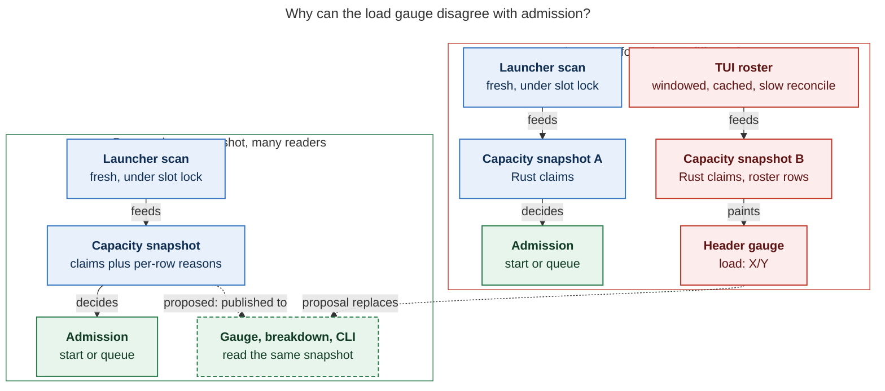

# Machine load gauge: why it read `3/8` with 6 agents running, and how to make it legible

_Researcher: cld · 2026-10-26 · athena · sase v0.18.1+14/15 · sase-core `d14a32c8`_

## TL;DR

- **The screenshot was wrong, and your estimate of 5 was right.** Rebuilding athena's
  capacity holders from artifact start and stop times gives **5.0 occupied units at
  17:27:51**: three workers at 1.0 each, two monitor turns at 1.0 each, and the
  `sase-1n6` cutover monitor at an explicit 0. The TUI showed `3/8`, an undercount
  of 2.0.
- **Root cause: the header gauge has no authoritative source.** The launcher admits
  agents using a fresh, lock-held artifact scan. The TUI instead re-runs the same Rust
  formula over **its own Agents roster**. That roster is windowed, cached, takes about
  20 s per load on athena, and only gets a full-history reconcile after 30 s with no
  input. Rows the roster hasn't caught up on silently drop out of the load.
- **I reproduced the drift live.** I ran a private TUI next to a launcher snapshot
  taken every minute.
  - A freshly started TUI matched the launcher exactly.
  - Within minutes it diverged, by −1.0 to −2.0 and once by +2.0. For example, it
    showed `7/8` while the launcher was at `8.0`, i.e. full.
  - At 18:10–18:12 it was still 2.0 short after 8+ minutes with no input at all.
  - A newly started root agent, `sase-1oi.1`, was absent from **both the list and the
    gauge** for nearly 15 minutes. A fresh headless load saw it as `RUNNING`
    immediately.
- **The one existing explanation surface is broken.** The gauge's hover tooltip has a
  "Held by" list, but it labels holders with workflow step names (`checkout`, `diff`)
  instead of agent names. It's also mouse-only.
- **Other gaps make even a correct number hard to read:**
  - `N running` counts status buckets, not capacity.
  - Zero-weight and not-holding rows are never explained.
  - The `/8` is a six-week-old ACE override (config says 10), and nothing indicates
    that.
  - Compact density drops the `load:` label, so the gauge reads as a bare `7/8`.
  - Invalid weights silently *lower* the gauge while admission fails closed.
- **Recommendation.**
  1. Make every surface read one capacity snapshot: the launcher's projection, extended
     in sase-core with per-row reason codes.
  2. Fix the tooltip labels now.
  3. Add a per-row "holding" cell with clan rollups, so the visible rows sum to the
     header.
  4. Add a "Machine load" breakdown, reachable from the gauge and as
     `sase agent load`, that lists holders, rows holding nothing (with the reason),
     waiters, the limit's provenance, and diagnostics.

## 1. How load is computed today

The number is `occupied_capacity / effective_limit` from the Rust
`runner_capacity_snapshot` (`sase-core/crates/sase_core/src/runner_capacity/`).

- **Claims.** `claims.rs::build_claims` groups every *occupying* record into a claim by
  lineage:
  - an explicit `runner_claim_owner_key`, else
  - a parallel-member key, else
  - the `parent_timestamp` chain, else
  - `agent_session`, else
  - standalone.

  Each claim contributes the **maximum** weight among its records.
  `snapshot.rs::runner_capacity_snapshot` sums the claims with compensated summation.
  A serial session (worker → monitor → follow-up) therefore counts once, while parallel
  members count separately.
- **Occupying.** `records.rs::is_occupying_record` requires all of:
  - an `ace-run` workflow dir, no done marker, `agent_meta.json`, and
    `appears_as_agent`;
  - the process is live, with no pending question and no pending gate turn;
  - the record has started. That means `run_started_at` is set, except for real
    monitor members, which only need a `pid`.
- **Weight.** `queue_weight` defaults to 1.0. `%q(w=…)` sets it, and explicit `0`
  is allowed. The host epic-launch monitor and `sase monitor start -w 0` set an
  explicit 0.
- **Limit.** `get_max_running_agents()` returns the override in
  `~/.sase/max_running_agents_override.json` if present, else config. On athena right
  now the override is `limit: 8`, `source: ace`, created 2026-09-13, `expires_at: null`.
  The configured default is 10.

What a user sees in the Agents tab, and whether it adds load:

| Row the user sees | Adds load? | Why |
| --- | --- | --- |
| `RUNNING` worker (root or parallel member) | its weight (default 1.0) | started, live claim |
| `TESTING` / monitor turn (verify, CI watch) | the session's weight, usually 1.0 | real monitor member with a pid |
| `sase monitor start -w 0` wait / epic-launch monitor (e.g. `WAITING CUTOVER`) | **0** | explicit zero weight; the claim exists but holds 0 |
| `WAITING` on deps, beads, time, or epics (e.g. `*.land`, later waves) | 0 | not started (`run_started_at` unset) |
| `QUEUED` (slot waiter) | 0 (it *needs* its weight) | waiting at the admission gate |
| `QUESTION` / pending gate | 0 | gate turns yield capacity |
| Clan container, named proc, workflow step rows (`main`, `checkout`, …), axe Patch runners | 0 | not agent records, or no `agent_meta` |

None of these rules is visible in the TUI. The `[R2 W1 D3]` clan counters and the
header's `6 running` are status-bucket counts. They include zero-weight rows, such as
the `sase (WAITING CUTOVER)` clan, which sits in the **Running** group and counts as
`R1`.

## 2. What the screenshot should have said

The screenshot is `~/tmp/screenshots/20261026_172751.png` (17:27:51 EDT; the TUI process
was `app_instance 4a807695`). I rebuilt the holders from the full TUI-loader history using
`run_start_time`/`stop_time`. Clan containers and workflow step rows are excluded; monitor
rows are kept.

| Holder at 17:27:51 | Clan (row in screenshot) | Kind | Weight | Started | Ended |
| --- | --- | --- | --- | --- | --- |
| `sase-1oh.4.1.2` | sase-1oh.4.1 `[R1 W2 D1]` | worker | 1.0 | 15:45:06 | still running |
| `sase-1oh.5.1.2` | sase-1oh.5.1 `[R1 W4 D1]` | worker | 1.0 | 17:13:55 | still running |
| `bob-cli-ct.5` | bob-cli-ct `[R2 W1 D3]` | worker | 1.0 | 17:20:03 | 17:48:46 |
| `sase-1oe.3--mon-1` | sase-1oe `(TESTING)` | monitor turn | 1.0 | 17:21:02 | still running |
| `bob-cli-ct.3--mon` | bob-cli-ct `[R2 …]` | monitor turn | 1.0 | 17:25:32 | 17:29:57 |
| `sase-1n6.10--mon` | sase-1n6 `(WAITING CUTOVER)` | `-w 0` wait monitor | **0** | Oct 25 17:52 | still running |
| **Total** | | | **5.0 / 8** | | |

The six status-"running" rows map one-to-one onto the six `R` counts in the screenshot
(R2+R1+R1+R1+R1). The one row you suspected, the cutover monitor, correctly holds 0. The
gauge should have read `5/8`.

**Which 2.0 went missing?** I can't prove it from logs: the TUI doesn't log its
capacity inputs (see recommendation F7). The circumstantial evidence points at the two
1.0 monitor turns:

- The last full-history reconcile was at 17:13:33. From
  `~/.sase/logs/tui_agent_loads.jsonl`, the `input_quiet_tier2_reconcile` loads read
  1,306 rows.
- Every load after that until the screenshot was an `auto_refresh` or
  `roster_completion_retry` of only ~680 rows, each spending **19–25 s** on disk.
- Both monitors started after the 17:13:33 reconcile (at 17:21:02 and 17:25:32). Each
  is a session-member child row whose session root is old (08:37 and 15:39).
- In a headless replay of bounded viewport loads (§3.2), monitor rows under old roots
  are exactly the rows that fall out of the window. At a 200-row window, only the two
  monitors are missing.

The TUI was restarted at 17:29:10 (`app_instance 51d623c0`, `startup`), about a minute
after the screenshot.

## 3. Findings

### F1 — The gauge recomputes load from the TUI roster, not from what admission uses (accuracy, high)

There are two callers of the same Rust function, with different inputs:

- **Admission:** `axe/run_agent_wait_slots.py::_try_claim_runner_slot` runs
  `scan_runner_slot_records()`, a capacity-only `scan_agent_artifacts` over every
  project. It applies `record_liveness_probe()` and calls `runner_capacity_snapshot()`
  under `runner_slots.lock`.
- **Gauge:** `ace/tui/actions/agents/_loading_compute.py` →
  `refresh_runner_slot_context(prep.filtered_agents, capacity_agents=prep.capacity_agents)`
  → `capacity_record_from_agent(Agent)` for every **row in the TUI's roster** →
  `runner_capacity_snapshot_from_capacity_records()`.

So the gauge is only as fresh and complete as the roster. Four mechanisms make it
drift:

1. **Roster membership is windowed and cached.** Once a same-query roster-complete load
   has applied, refreshes request a growing-prefix viewport (`_loading_disk_viewport.py`;
   `requested_limit = start_row + visible_rows + 2×visible_rows`). They are patched over
   the cached roster by `merge_incomplete_load_after_complete_history`. Rows outside the
   window keep whatever state they had at the last load that covered them. Full history
   only reloads after `TIER2_RECONCILE_INPUT_QUIET_THRESHOLD_S = 30.0` seconds of no
   input (`_loading_refresh_polling.py`). An active user can go many minutes without one.
2. **Loads are slow, so capacity often goes stale mid-flight.** On athena, every
   `auto_refresh` load took 19–37 s of disk time this afternoon. When the capacity
   generation advances during a load (`capacity_inputs_stale` in `_loading_apply.py`),
   the previous snapshot is kept and recomputed from the *previous* roster.
3. **The TUI projects records differently from the launcher.** `capacity_record_from_agent`:
   - omits `runner_claim_owner_key`;
   - synthesizes `agent_session` from `parent_timestamp` (`_capacity_agent_session`);
   - takes liveness and `run_started_at` from cached row flags and status-bucket
     fallbacks.

   For today's data both projections produced the same claims (§3.2). But they're two
   implementations of one contract, and only one of them is what admission enforces.
4. **Freshness between full loads depends on watcher events.** With the inotify
   watcher active, the auto-refresh tick consumes artifact deltas
   (`event_refresh/_auto_refresh_surfaces.py`) and only forces a full pass every
   `FULL_SANITY_REFRESH_SECONDS = 300`. Any missed or unconsumed event leaves a row
   stale until something else reloads it. In §3.1 that was ~15 minutes for a brand-new
   root agent.
5. **There's no drift detector or provenance.** Nothing records which rows the gauge
   counted, so an incident like this one can't be diagnosed after the fact.

#### 3.1 Live reproduction

I launched a private TUI with `sase screenshot --keep`. Every ~60 s I captured its
gauge and, ~15 s later, ran the launcher's exact snapshot code read-only (`scripts/diag.py`
in the appendix). From 17:55 to 18:02 I sent `j`/`k` to that private window every 1.5 s
to imitate an active user and suppress the input-quiet reconcile.

| Time | TUI gauge | TUI "running" | Launcher load | Launcher claims | Note |
| --- | --- | --- | --- | --- | --- |
| 17:52:24 | `7/8` | 11 | 7.0 | 11 | fresh TUI: match |
| 17:53:36 | `7/8` | 10 | 7.0 | 11 | match |
| 17:54:36 | `7/8` | 10 | 7.0 | 11 | match (keypresses start 17:55) |
| 17:57:40 | `7/8` | 10 | **8.0** | 12 | `sase-1oi.1` started 17:57:18; launcher is **full**, TUI shows 1 free |
| 17:58:46 | `7/8` | 10 | **8.0** | 12 | still missing |
| 17:59:46 | `7/8` | 10 | 7.75 | 11 | |
| 18:00:51 | `6.75/8` | 9 | 7.75 | 11 | still −1.0 |
| 18:01:57 | `6.75/8` | 9 | 7.75 | 11 | still −1.0; `sase-1oi` clan absent from the list |
| 18:03:00 | `6.75/8` | 9 | 7.75 | 11 | keypresses stopped ~18:02:40; no input from here on |
| 18:04:04 | `6.75/8` | 8 | 7.75 | 11 | −1.0 |
| 18:05:06 | `6.75/8` | 8 | 4.75 | 9 | **+2.0**: finished holders still counted |
| 18:06:08 | `6.75/8` | 8 | 5.75 | 10 | +1.0 |
| 18:07:11 | `5.75/8` | 7 | 5.75 | 10 | match (coincidental: see next rows) |
| 18:10:30 | `4.75/8` | 7 | 6.75 | 11 | **−2.0** after 8 min with no input |
| 18:12:07 | `4.5/8` | 6 | 6.5 | 10 | −2.0; `sase-1oi.1` still absent, 14m49s after it started |

The first missing 1.0 was `sase-1oi.1`, a new root agent of a new epic clan: artifact dir
created 17:56:19, `run_started_at` 17:57:18.

- **18:02:07.** The private TUI showed every other holder (`14p`, the five `@epic`
  running clans, three research agents at 0.25), but no `sase-1oi` row at all.
  6.75 + 1.0 = 7.75 exactly.
- **18:10:30.** The TUI was also missing `sase-1nv.5.1.1`, which started at 18:08:11.
  It rendered the `sase-1nv` clan as `WAITING`.
- **Cross-check.** A fresh headless `load_tiered_agents()` at 18:11 returned both rows
  as `RUNNING`, unhidden, in the default tab. So nothing filtered them out; the
  long-lived TUI's roster was simply stale.
- **The error goes both ways.** At 18:05 the TUI *over*-counted by 2.0, because holders
  that had already finished were still counted.

This private TUI ran in an unfocused tmux window with the inotify watcher active. Its
fallback is `FULL_SANITY_REFRESH_SECONDS = 300`, yet it missed a running root agent for
nearly 15 minutes, longer than two sanity intervals. The synthetic keypresses (every
1.5 s, harsher than a human because they also block the 2 s quiet thresholds) were
**not** required: the −2.0 at 18:10–18:12 came after 8+ minutes with no input. It's the
same failure mode as the real 17:27 incident. The gauge, and here the list too, lags the
launcher for minutes, in either direction.

#### 3.2 Offline replays (same inputs, different windows)

These are read-only scripts against the live artifact store at ~17:47
(`scripts/tui_emul.py`, `window_diff.py`, `tier1.py`).

| Roster fed to the TUI capacity path | Load computed | Holders missing |
| --- | --- | --- |
| Full history (1,161 rows) | 7.25 | none (matches launcher 7.25) |
| Tier 1, unbounded (1,162 rows) | 7.25 | none |
| Bounded prefix 200 | 6.25 | `sase-1oe.3--mon-1`, `sase-1n6.10--mon` (w0) |
| Bounded prefix 100 | 3.25 | + `sase-1oh.5.1.2`, `sase-1oh.4.1.2` |
| Bounded prefix 50 | 2.25 | + `bob-cli-ct.3--2` |
| Bounded prefix 25 | 2.0 | + `research.5e.gem` |

The Rust math is fine. Given a complete roster, the TUI path and the launcher agree to
the hundredth. The **input set** is what varies.

### F2 — The "Held by" tooltip labels holders as workflow step names (transparency, high, trivial fix)

`agent_runner_slots.py::_apply_runner_capacity_snapshot` builds
`source_agent_by_artifact_dir = {capacity_artifact_dir(a): a for a in capacity_agents}`.
Workflow step rows (`main`, `setup`, `prepare`, `checkout`, `diff`) share the agent's
`artifacts_dir`, and the dict comprehension is last-wins. `_capacity_holders` then
labels the claim with the step row's `cl_name`.

On today's roster, all 12 holders came out as `checkout` or `diff` (verified in
`tui_emul.py` output). So the only per-holder explanation in the TUI names no agent.
It's also only reachable by mouse hover. Fix: skip `is_workflow_child` rows when
indexing, or prefer the row with `agent_name`. Add a regression test where step rows
share the artifact dir.

### F3 — "running" and "load" measure different things, and the docs say they don't (semantics, medium)

- `N running` (header) and `[R…]` (clans) come from
  `_agent_clan.py::_status_counts_for_projections`. They count status-bucket
  "Running" rows, including zero-weight monitors, `WAITING CUTOVER`, and projected
  Starting rows.
- `load` is the sum of claim weights.
- `docs/reference/runner-slots.md` says the header "summarizes the same global capacity
  state as `load: 8/10` … with `8 [8 running · 1 queued]`". That implies they match.

They match only when every running row has weight 1.0. Fractional weights (today's
research swarm runs at 0.25), zero-weight monitors, and serial-session dedup all break
the equality. So "6 running, load 5" is *expected* whenever a w0 monitor is up. Neither
the UI nor the docs say so.

### F4 — Invalid live weights lower the gauge while admission fails closed (correctness of display, medium)

In `claims.rs`, a claim group with an invalid weight is `continue`d: dropped from
`claims`, so it doesn't count toward `occupied_capacity`. Separately,
`invalid_live_claim` sets `fail_closed`, which blocks every waiter. The TUI ignores
`diagnostics` entirely.

The result is the most confusing state possible: the gauge shows *more* free capacity
than normal while nothing can launch, with no visible reason.

### F5 — Gauge presentation gaps (UX, medium)

- **Compact density drops the label.** `_build_agent_load_text(density="compact")` emits
  a bare `7/8 ·`, which sits next to `gpt-6-astra@xhigh` with no indication of what it
  means (seen in my private TUI at 160 columns).
- **The limit's provenance is invisible.** `/8` here is a 2026-09-13 ACE override with
  no expiry, on top of a configured 10. `models_panel_runner_limit*` knows this; the
  gauge doesn't show it.
- **It isn't labeled per machine.** The value is computed from local rows only, but the
  Agents header has `athena 174 | apollo 23` machine tabs. Nothing says the gauge is
  athena's.
- **It's hidden in the Archive view** (`_archive_column.py`). That's fine, but it
  reinforces that the header is the only place load appears.
- **Row badges show authored weight, not holding state.** The `wN` badge appears only
  for non-default authored weights, and only on rows that would hold capacity. A
  running 1.0 row and a waiting 1.0 row look identical; the `w0` monitor badge is the
  only "holds nothing" signal.

### F6 — Three implementations of "who holds capacity" (maintainability, medium)

1. Rust claims over the launcher scan (authoritative).
2. Rust claims over the TUI roster projection (F1).
3. A Python predicate: `_running_listing_common.py::runner_slot_holder_dirs` /
   `is_runner_slot_occupying_record`. It feeds `holds_runner_slot` and
   `runner_slot_holders` in `sase agent list -j`. It groups by agent session rather than
   Rust claim lineage, and it has lane semantics: a w0 monitor "holds a slot".

There's no CLI that prints the load breakdown. `runner_slot_holders` appears only on
queued waiters, as bare names.

### F7 — The snapshot can't say why a live row holds nothing (observability, medium)

`RunnerCapacitySnapshotWire` returns `claims`, `waiters`, and `diagnostics`. A live
record that is neither claimed nor waiting just disappears. The reason ("not started:
dependency wait", "pending gate", "explicit w0", "invalid weight", "not live") is
re-derivable only by re-implementing `is_occupying_record`. That's what my `diag.py`
had to do, and per the Rust-core boundary, the TUI shouldn't.

### Non-findings, checked

- **The cutover monitor's 0 is correct.** `sase-1n6.10--mon` has `queue_weight 0`,
  `explicit` (a `-w 0` / epic-launch-style wait monitor).
- **Dependency-waiting rows correctly hold nothing.** These are the `*.land` rows,
  later waves, and `14k.w0`.
- **Lineage dedup didn't hide anyone today.** Every live worker had its own
  `runner_claim_owner_key`. Monitors resolved to their session root's claim. With a
  complete roster, the TUI's synthesized `agent_session` produced the same claims as
  the launcher.
- **A briefly live failed monitor doesn't double-count.** `bob-cli-ct.3--mon-0` was
  still occupying with monitor state `failed` while its follow-up spun up. It was in
  the same serial-session claim (max, not sum), so nothing was counted twice.

## 4. Today's data flow versus the proposal



_Both paths read the same artifact markers (`agent_meta.json`, `waiting.json`, done
markers). Today the gauge's input is the TUI's eventually consistent roster. The
proposal makes every display read the snapshot that admission itself uses._
Rendered with mermaid-cli 12.0.0 at 614 × 1160 px (77% PDF fit).

## 5. UX options considered

The design target is a common one: the `kubectl describe node` pattern. One capacity
line comes with an "allocated" table listing each consumer's request, so the reader can
**sum the parts to the whole** and see who isn't counted. The other two options trade
cost against that property.

| Option | What it shows | Pros | Cons |
| --- | --- | --- | --- |
| A. Fix the tooltip only | Correct "Held by" names on hover | Hours of work; no layout change | Mouse-only in a keyboard-first TUI; doesn't explain non-holders; still lies if F1 isn't fixed |
| B. Per-row holding cell + clan rollup | `⚖1`, `⚖0.25`, `⚖0` on rows that hold a claim now, summed on clan rows | You can audit the header by eye; the w0 cutover monitor is obvious | Takes a column; needs a glyph distinct from the authored `wN` badge |
| C. "Machine load" breakdown (panel or modal + CLI) | Holders, not-holding-with-reason, waiters, limit provenance, diagnostics, snapshot age | Complete answer to "what error are we making"; scriptable | One more surface; depends on F7's reason codes for quality |
| D. Gauge chrome | Machine name, freshness, override marker, `!` on diagnostics, never-unlabeled compact form | Cheap; prevents misreading | Doesn't explain the composition by itself |

**Recommended: D + B + C, with A folded into C.** The tooltip becomes a summary that
points at the breakdown.

## 6. Recommended UX

### 6.1 Header gauge (D)

```
full:     athena load 5/8* · …            (* = limit is an override; dim)
compact:  ⚖5/8* · …                       (never a bare "5/8")
stale:    athena load 5/8 ⟳41s            (snapshot older than ~2 refresh cycles)
problem:  athena load 5/8 !               (any capacity diagnostic, e.g. invalid weight)
```

- **Value.** It must come from the authoritative snapshot (§7, fix 1).
- **Free-capacity colour.** Keep the existing colour; it's good.
- **Running count.** Change the left summary to state the relationship instead of
  implying equality, e.g. `174 [6 running (5 holding) · 23 waiting · 145 done]`. A
  smaller alternative is to keep the summary and have the breakdown's first line read
  `6 running = 5 holding 1.0 + 1 holding 0`.

### 6.2 Per-row holding cell (B)

- **Agent rows.** Every row that is part of a live claim gets a dim, right-aligned
  holding cell: `⚖1`, `⚖0.25`, or `⚖0` (dim, for zero-weight claims). It's the claim's
  counted weight, not the authored request. Rows that hold nothing get no cell.
  `WAITING`, `QUESTION`, and queued rows keep their existing badges.
- **Clan rows.** Show the sum of member claims, e.g.
  `bob-cli (RUNNING) ×6 [R2 W1 D3] ⚖2`.
  - For the screenshot that would have read `⚖2`, `⚖1`, `⚖1`, `⚖1`, `⚖0`.
  - The visible rollups sum to the header's 5, and the zero-weight `WAITING CUTOVER`
    clan explains itself.
- **Glyph.** `⚖` is a placeholder. Pick a single-cell glyph that renders in the TUI
  font stack and the visual-snapshot renderer, and make it visually distinct from the
  authored `wN` / `cN` / `pN` badges.

### 6.3 Machine-load breakdown (C)

- **TUI.** Open it from a click on the gauge, a leader-mode key, and the command palette.
  Almost every single letter is taken in `bindings.py`. Whatever key is chosen must
  also be added to `src/sase/default_config.yml`.
- **CLI.** The same content as `sase agent load [-j]`. Read the `cli_rules` memory
  before adding the subcommand.

```
athena  load 5.0 / 8   (limit: ACE override since 2026-09-13, no expiry · config 10)
source: capacity snapshot · scanned 17:27:49 (2s ago) · token 1793… · 0 diagnostics

HOLDING CAPACITY                         weight  project  since
  sase-1oh.4.1.2      worker              1.0     sase     15:45  (1h42m)
  sase-1oh.5.1.2      worker              1.0     sase     17:13  (14m)
  bob-cli-ct.5        worker              1.0     bob-cli  17:20  (7m)
  sase-1oe.3--mon-1   monitor · session sase-1oe.3       1.0  sase  17:21
  bob-cli-ct.3--mon   monitor · session bob-cli-ct.3     1.0  bob-cli 17:25
  sase-1n6.10--mon    wait monitor (-w 0)  0.0     sase     Oct 25   holds no capacity
                                          ─────
                                          5.0

LIVE, HOLDING NOTHING (23)               reason
  sase-1oh.land, sase-1oe.land, … (11)   waiting on dependencies (not started)
  sase-1oh.5.1.3 … .5 (3)                waiting on earlier wave
  14o, 14k.w0 (2)                        waiting on bob-cli-ct
  …
QUEUED FOR CAPACITY (0)
```

- **Rows.** Rows are selectable and jump to the agent.
- **Counted sum.** Under the weight column, so the parts visibly add up to the whole.
- **Reasons.** Taken verbatim from the snapshot's reason codes (§7, fix 3); never
  re-derived in Python.
- **Debug mode (optional, Python-only).** Show the TUI's last roster-derived number next
  to the authoritative one while F1's migration is in flight.

## 7. Recommended fixes for the load calculation

Fixes are in priority order. "Core" means the change belongs in sase-core per the
Rust-core boundary memory, with the `sase-core-revision.txt` pin moved afterwards.

1. **P0 — One source for every display.** Stop deriving the gauge from
   `prep.capacity_agents`.
   - **Near-term (Python).** Compute the TUI's capacity snapshot in a worker from
     `scan_runner_slot_records()` + `record_liveness_probe()` + `runner_capacity_snapshot()`
     — the launcher's exact call. Trigger it on `runner_slots.token` changes; claims,
     releases, waiting-marker edits, and index lifecycle mutations already bump that
     token. Also poll every ~10 s, because a process death doesn't bump it.
     - It reuses `runner_slots.scan.json` (`load_or_refresh_runner_slot_scan`) so waiters
       and the TUI share one scan.
     - Measured cost on athena right now: the raw capacity scan took **13.9 s for 95
       records**, plus 0.13 s for the Rust projection. So this must stay off the event
       loop, and sharing the host-wide cache matters.
   - **Durable (core + host).** Have the service host (or whichever process wins the
     slot lock) publish the snapshot JSON keyed by token. The TUI, `sase agent list`,
     the mobile gateway, and any web frontend then read the same file. The litmus test
     in the boundary note applies: a web UI would need the identical number.
   - **Acceptance test.** With a recorded artifact fixture, the TUI gauge, `sase agent
     load -j`, and `_try_claim_runner_slot`'s snapshot must report the same
     `occupied_capacity` and the same claim set, regardless of viewport, query, or
     roster completeness.
2. **P0 — Fix the holder labels (F2).** Index only non-step rows in
   `source_agent_by_artifact_dir` (skip `is_workflow_child`, or prefer
   `agent_name`). Add a regression test with step rows sharing the artifact dir.
3. **P1 (core) — Per-record accounting in the snapshot (F7).** Add an `accounting` list
   to `RunnerCapacitySnapshotWire`: one entry per live `ace-run` user record.
   - **Fields:** `artifact_dir`, `agent_name`, `project_name`,
     `state ∈ {holding, riding_claim, waiting, not_holding, excluded}`,
     `counted_weight`, `claim_owner_key`, and `reason_code`.
   - **Reason codes:** `not_started`, `queued`, `pending_question`, `pending_gate`,
     `explicit_zero_weight`, `invalid_weight`, `not_live`, `done`,
     `not_agent_record`.
   - This makes the breakdown and the per-row cell pure rendering. It also replaces the
     Python `runner_slot_holder_dirs` predicate (F6), so `holds_runner_slot` and a new
     per-entry `runner_counted_weight` in `sase agent list -j` come from Rust.
4. **P1 (core) — Invalid weights (F4).** Keep fail-closed admission. For *display*,
   count an invalid live claim at the default 1.0 (or its last valid lineage weight),
   mark it `invalid_weight` in accounting, and surface the diagnostic. The TUI should
   render `!` on the gauge and a diagnostics section in the breakdown, instead of
   showing spare capacity while everything is blocked.
5. **P1 — Gauge chrome (F5).**
   - Never drop the label in compact density (`⚖5/8`).
   - Prefix the machine name.
   - Mark an active override, with the expiry or "no expiry" in the tooltip and
     breakdown.
   - Consider warning when an override has outlived N days. Today's `/8` has been in
     force since 2026-09-13.
6. **P2 — Telemetry (F1, item 4).**
   - Append a compact `capacity_gauge` record to `tui_agent_loads.jsonl` whenever the
     displayed value changes: token, occupied, limit, and claim owner keys.
   - While both numbers exist during migration, log a `capacity_drift` event when the
     roster-derived value differs from the authoritative one for more than one refresh.
   - With this, today's "which 2 were missing?" question would be answerable from logs.
7. **P2 — Docs (F3).** Update `docs/reference/runner-slots.md`'s header paragraph to
   say that `running` counts status rows while `load` counts weighted claims, and list
   what holds 0. Read the `docs_writing` memory before editing.
8. **Adjacent (not load math) — Refresh latency.** `auto_refresh` disk time of 19–37 s
   per load on athena (load average ~15) is what turns a roster-freshness design into
   minutes of drift. Fix 1 removes the gauge's dependence on it. But the *list* still
   hid `sase-1oi.1` for ~15 minutes in the reproduction: longer than two
   300 s sanity intervals, and with no input for the last 8+ minutes. That's a separate
   Agents-roster bug in the watcher, delta, and sanity path, and it deserves its own task
   (see the `tui_perf` memory).

### Related tracked work

- **`sase-124` — Agents tab freshness on large-archive hosts.** This in-progress epic's
  stated goal is that the Agents tab reflects "load/capacity … within seconds".
  - Its 2026-09-17 landing audit already listed capacity-gauge defects in the same
    family: the gauge omitting a hidden runner, and a delayed cached-roster result
    overwriting newer capacity. The first is fixed in current code
    (`_agents_capacity_with_children`).
  - I appended this report's evidence to it as a `DISCOVERED ISSUE` note rather than
    filing a duplicate task.
  - Fix 1 above is the structural alternative to tightening roster freshness for
    capacity. It's worth deciding there whether the gauge should stay a roster
    projection at all.
- **`sase-1ob` — `sort_and_reorder` TypeError on mixed `None`/datetime session-member
  start times.** This bug is open and could freeze a roster apply. I tested today's
  live roster and it does **not** trigger the bug, so it isn't the cause here.

## 8. Open questions and limits

- **The exact 17:27 cause is inferred, not proven.** The 5.0 total is solid: it comes
  from on-disk start and stop times and is cross-checked against the screenshot's `R`
  counts. Which two holders the TUI dropped isn't logged. The monitors are the best
  fit, but a stale-capacity retention (`capacity_inputs_stale`) could have played a
  part. Fix 6 closes this gap for next time.
- **The reproduction wasn't your exact setup.** It ran in an unfocused private tmux TUI,
  with synthetic keys from 17:55 to 18:02. The −2.0 drift at 18:10–18:12 happened with
  no input, so the keys aren't required to trigger it. I didn't find why that TUI's
  sanity passes failed to pick up `sase-1oi.1`. Load logs record only slow (>2 s)
  loads, and that TUI logged none after 17:52:49Z.
- **The `tui_agent_loads` "agents" counts (~680) are lower than my headless Tier-1 load
  (~1,160).** I attribute the gap to dismissal and query filtering in the live app, but
  didn't pin it down.
- **Freshness versus cost of the authoritative scan.** 14 s under load means the gauge
  will lag by one scan in the worst case. That's still bounded and *correct-as-of* a
  stated time, unlike today's unbounded roster drift. A published snapshot from the
  claiming process removes even that lag for claims, though not for silent process
  deaths.

## Appendix — method and reproducibility

All scripts are read-only and ran against the live athena store with the installed
interpreter (`~/.local/share/uv/tools/sase/bin/python -I`). They aren't committed.

- **`diag.py`** — `scan_runner_slot_records()` + `record_liveness_probe()` +
  `runner_capacity_snapshot(effective_limit=get_max_running_agents())`. Prints claims and,
  for every live record, why it does or doesn't occupy (a mirror of
  `records.rs::is_occupying_record`).
- **`tui_emul.py N|full`** — `load_tiered_agents()` → `refresh_runner_slot_context()`,
  the TUI path. Prints load and holder labels.
- **`window_diff.py`, `tier1.py`** — which started rows each roster shape omits.
- **`reconstruct.py 2026-10-26T17:27:51`** — sums weights of non-container,
  non-step rows with `run_start_time ≤ T < stop_time`.
- **Live sampler** — `sase screenshot --keep` (private tmux window, not the user's TUI)
  plus `diag.py` every ~60 s. Synthetic `j`/`k` presses went only to that private window.
- **Logs** — `~/.sase/logs/tui_agent_loads.jsonl` (load sources, sizes, durations;
  slow loads only) and `~/.sase/max_running_agents_override.json`.
- **Code read**
  - TUI: `ace/tui/widgets/agent_load_indicator.py`,
    `ace/tui/models/agent_runner_slots.py`, `_agent_runner_slot_capacity.py`,
    `ace/tui/actions/agents/_loading_{compute,compute_merge,apply,filter,disk_viewport,refresh_polling}.py`.
  - Admission and runner slots: `axe/run_agent_wait_slots.py`, `core/runner_slots/*`,
    `agent/_running_listing_common.py`, `integrations/agent_list_entries.py`.
  - sase-core: `crates/sase_core/src/runner_capacity/{claims,records,snapshot,capacity_math,wire}.rs`.
  - Docs: `docs/reference/runner-slots.md`.
