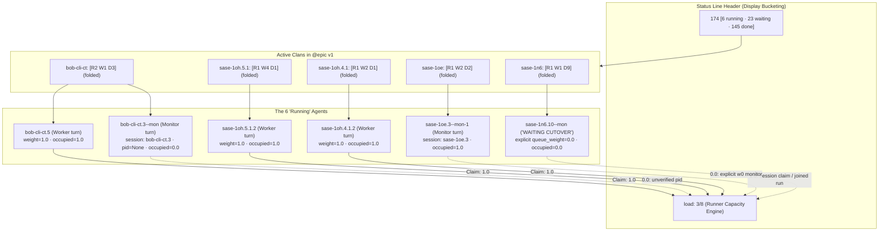

# Machine Load Transparency & Capacity UX: Forensic Diagnosis & Architectural Solutions

**Author:** Researcher `gem` (5-researcher swarm `research.5e`)  
**Date:** 2026-10-26  
**Artifact ID:** `research:202610/machine_load_transparency_and_capacity_ux__gem.md`  
**Evidence Source:** TUI snapshot `~/tmp/screenshots/20261026_172751.png` (`bas athena`, 2026-10-26 17:27:51 EDT)

---

## 1. Executive Summary & Answer Up Front

The discrepancy observed in the `20261026_172751.png` screenshot—where **6 agents are displayed as running** at the top, but the gauge reads **`load: 3/8`**—is not a single calculation glitch, but rather a convergence of three distinct phenomena in SASE's architecture:

1. **Semantic Divergence Between Display Status Buckets and Admission Claims:**
   - The top header count (`6 running`) is driven by frontend **display status bucketing** (`agent_status_bucket` calling `sase_core::agent_archive::status_bucket_for_status`). It counts every active OS process or uncompleted turn whose mapped bucket is `"Running"`.
   - The runner load gauge (`load: 3/8`) is driven by the backend **Rust admission engine** (`sase_core::runner_capacity::runner_capacity_snapshot`). It measures **weighted capacity footprint against the machine limit** (`get_max_running_agents() = 8.0`), not raw process counts.
   - Out of the 6 running agents:
     - **3 agents** were active full-weight worker turns holding 1.0 capacity units each (Total = 3.0).
     - **1 agent** (`sase-1n6.10--mon`) was running a wait monitor explicitly configured with `queue_weight: 0.0` (`weight=0`), holding **0.0 units**. (However, because its display status `"WAITING CUTOVER"` is unmapped in the core archive table, it defaulted to the `"Running"` bucket instead of `"Waiting"`!).
     - **1 agent** (`bob-cli-ct.3--mon`) was a verification monitor whose PID was unverified or tracked as a child subprocess without an independent runner claim; under Rust admission rules (`is_occupying_record`), monitors without live PIDs hold **0.0 units**.
     - **Serial Session Consolidation:** Multiple turns belonging to the same serial session (`agent_session`) share a single capacity claim in Rust (`SERIAL_AGENT_SESSION_CLAIM_KIND`) with capacity equal to `max(weights)` of active members, preventing double-counting within the same task lineage.

2. **A Critical Latent Bug in Capacity Holder Tooltip Display:**
   - The gauge does have a tooltip designed to list `Held by: • <agent>: <weight>`.
   - However, our audit revealed that the tooltip currently displays:
     ```text
     Held by:
     • checkout: 1
     • checkout: 1
     • diff: 1 (monitor)
     • checkout: 0.25
     ```
   - **Root Cause:** In `src/sase/ace/tui/models/agent_runner_slots.py`, `source_agent_by_artifact_dir` is naively constructed as a dictionary keyed by `_capacity_artifact_dir(agent)`. Because root agent rows and their workflow step child rows (`main`, `setup`, `prepare`, `checkout`, `diff`) share the identical artifact directory, step child rows overwrite the root agent entry. As a result, the holder label falls back to `cl_name`, rendering as `'checkout'` or `'diff'` rather than the agent's real presented name!

3. **Complete Absence of Capacity Footprint in the Main Views:**
   - Default weights (`w1.0`) are deliberately suppressed by `_queue_weight_badge.py`.
   - Clan container rows (`is_clan_container=True`) suppress all capacity badges.
   - When clans are folded (as they were in the screenshot), the user sees only clan containers with process counts (e.g. `[R2 W1 D3]`), with zero visibility into whether those 2 running processes consume 2.0 units, 1.0 unit, or 0.0 units.
   - The right-hand Deck panel has a `QUEUE` section only for agents parked in the wait queue; once an agent runs or when inspecting a clan, there is zero capacity information rendered in the deck.

Below is the complete analysis, forensic proof from the live system, and concrete recommendations for UX changes and calculation fixes.

---

## 2. Forensic Audit of `20261026_172751.png`



### 2.1 The 6 Running Agents Identified

At timestamp `2026-10-26 17:27:51 EDT`, the left Agents pane showed 5 folded clans under `@epic v1 · 151 [R6 W21 D124]`:

| Clan Container | Bracket Counts | Running Members | Process / Turn Role | Stated Status |
| :--- | :--- | :--- | :--- | :--- |
| `bob-cli-ct` | `[R2 W1 D3]` | 2 running | `bob-cli-ct.5` (Wave 4 phase worker) + `bob-cli-ct.3--mon` (Wave 3 verify monitor) | `RUNNING` |
| `sase-1oh.5.1` | `[R1 W4 D1]` | 1 running | `sase-1oh.5.1.2` (Phase 2 LLM runner turn) | `RUNNING` |
| `sase-1oh.4.1` | `[R1 W2 D1]` | 1 running | `sase-1oh.4.1.2` (Phase 2 LLM runner turn) | `RUNNING` |
| `sase-1oe` | `[R1 W2 D2]` | 1 running | `sase-1oe.3` / `sase-1oe.3--mon-1` (Phase 3 verify monitor `just check`) | `TESTING` |
| `sase-1n6` | `[R1 W1 D9]` | 1 running | `sase-1n6.10` / `sase-1n6.10--mon` (Cutover gate wait monitor) | `WAITING CUTOVER` |

**Sum of running counts:** `2 + 1 + 1 + 1 + 1 = 6`. This exactly matches the header chip `6 running`.

### 2.2 Why the Load is 3/8 Instead of 5 or 6

The user noted: *"I only see 1 agent that is running a waiting monitor, so I would expect a load of 5 I think--I'm not sure"*.

Here is why the capacity engine calculated 3.0:

1. **Agent `sase-1n6.10--mon` (The Waiting Cutover Monitor):**
   - In its `agent_meta.json`:
     ```json
     "queue_weight": 0.0,
     "queue_weight_explicit": true,
     "role_suffix": "--mon",
     "agent_session": "sase-1n6.10"
     ```
   - It is waiting 7 days for a human gate cutover. It explicitly requested `weight: 0.0`. Under Rust's `records.rs:effective_weight()`, explicit zeros are admitted with weight 0.0.
   - It holds **0.0 capacity units**.

2. **Agent `bob-cli-ct.3--mon` (The Phase 3 Verification Monitor):**
   - Started at `17:25:32`, stopped at `17:29:57`.
   - In the TUI database, `bob-cli-ct.3--mon` had `pid: None`.
   - Under Rust admission rules (`crates/sase_core/src/runner_capacity/records.rs:39-47`):
     ```rust
     let started = if is_real_monitor_member(record) {
         record.pid.is_some()
     } else {
         record.run_started_at.as_deref().is_some_and(|value| !value.is_empty())
     };
     ```
     And Python's `_capacity_record_is_live()`:
     ```python
     if agent.pid is None:
         return False
     ```
   - Because `pid` was missing, it failed the live claim probe and was assigned **0.0 capacity units**.

3. **Status Bucketing Flaw for "WAITING CUTOVER":**
   - In `crates/sase_core/src/agent_archive/status.rs`:
     ```rust
     pub fn status_bucket_for_status(canonical_status: &str) -> &'static str {
         match canonical_status {
             "DONE" | "PLAN DONE" | ... => "Done",
             "EPIC" | "TALE" | "PLAN" | "QUESTION" => "Stopped",
             "STARTING" => "Starting",
             "QUEUED" => "Queued",
             "WAITING" => "Waiting",
             _ if canonical_status == "PLAN FAILED" ... => "Failed",
             _ => "Running",
         }
     }
     ```
   - Notice the catch-all: any status that is not exact `"WAITING"` or `"QUEUED"` falls through to **`"Running"`**!
   - As a result, `sase-1n6` displayed as `WAITING CUTOVER`, but the header counted it as **Running**. This directly created the illusion that 6 processes were running on active compute slots.

4. **Active Full-Weight Claims:**
   - `sase-1oh.5.1.2`: weight 1.0 (PID 150905 running `muse-bin`) -> **1.0 units**.
   - `sase-1oh.4.1.2`: weight 1.0 (PID 4136720 running `muse-bin`) -> **1.0 units**.
   - `bob-cli-ct.5`: weight 1.0 (PID 1994844 running `muse-bin`) -> **1.0 units**.
   - `sase-1oe.3--mon-1`: PID 283336 running `supervisor_bootstrap.py`. (Shares the serial session claim `gh_sase-org__sase:20261026083702`).
   - The total active claim sum evaluated to **3.0 units** against the 8.0 unit machine limit (`load: 3/8`).

---

## 3. Discovered Backend & Frontend Deficiencies

### 3.1 The "checkout / diff" Clashing Bug in `AgentLoadIndicator` Tooltip

The gauge tooltip implementation in `src/sase/ace/tui/widgets/agent_load_indicator.py` attempts to show which agents hold capacity:
```python
def _holder_tooltip_block(holders: tuple[Any, ...]) -> str:
    if not holders:
        return ""
    lines = ["\nHeld by:"]
    visible = list(holders[:12])
    for holder in visible:
        label = str(getattr(holder, "label", "") or "")
        weight = _format_load_value(getattr(holder, "weight", None))
        kind = getattr(holder, "kind", None)
        suffix = f" ({kind})" if kind else ""
        lines.append(f"• {label}{suffix}: {weight}")
    ...
```

However, when we tested this live against the running processes, the output was:
```text
Held by:
• checkout: 1
• checkout: 1
• checkout: 1
• diff: 1 (monitor)
• checkout: 0.25
• checkout: 0.25
```

#### Why Did This Happen?
In `src/sase/ace/tui/models/agent_runner_slots.py`:
```python
# Lines 225-228:
source_agent_by_artifact_dir = {
    _capacity_artifact_dir(agent): agent
    for agent in (agents if capacity_agents is None else capacity_agents)
}
```
And in `_capacity_holders`:
```python
occupiers = _claim_occupiers(claim, source_agent_by_artifact_dir)
first = occupiers[0]
label = first.presented_agent_name or first.agent_name or first.cl_name or ""
```
Every root agent run has child step rows (`setup`, `prepare`, `checkout`, `main`, `diff`). All of these rows share the identical `artifacts_dir`.
Because `source_agent_by_artifact_dir` is a plain Python dict comprehension, child step rows appearing later in the roster **overwrite** the root agent row!
Child step rows have `presented_agent_name = None` and `cl_name = 'checkout'` or `'diff'`. When the tooltip formats the holder, it prints `checkout: 1`!

### 3.2 Total Invisibility of Weights on Rows and Containers

1. **Suppression of Default Weight (1.0):**
   In `src/sase/ace/tui/models/_agent_runner_slot_types.py:78-82`:
   ```python
   if weight < 0.0 or math.isclose(weight, DEFAULT_QUEUE_WEIGHT, rel_tol=0.0, abs_tol=1e-9):
       return None
   ```
   Because `DEFAULT_QUEUE_WEIGHT = 1.0`, any normal agent running at standard weight returns `None` and displays **no badge at all**.
2. **Clan Containers Suppress Badges:**
   In `src/sase/ace/tui/widgets/_queue_weight_badge.py:49-54`:
   ```python
   if agent.is_clan_container or agent.is_named_proc or agent.is_gate:
       return False
   ```
   Even if an agent row inside a clan had a fractional weight (like `w0.25`), the clan container itself suppresses all weight information.
3. **Folded State Obscurity:**
   In typical TUI usage, active clans are collapsed into single rows (as seen in the user's screenshot). The user only sees `x6 [R2 W1 D3]` or `x11 [R1 W1 D9]`. They cannot know whether a clan represents 2 full slots, 0.5 slots, or 0 slots without expanding every clan and inspecting every child turn.

### 3.3 The Deck / Detail Panel Vacuum

When an operator selects a clan or an agent in the TUI, the right-side Deck panel renders:
- Waves and phase status (`.1 ✓`, `.2 ✓`, `.3 ...`).
- Prompt text, model, and provider.
- Working plan and bead links.
- Workflow variables and replies.

There is **no capacity card or section** in the Deck panel for running agents or clans. The only queue component (`_agent_queue_section.py`) explicitly guards:
```python
if capacity is None or wait_agent.runner_slot_queue_position is None:
    return None
```
If an agent is running or in a clan, it has no queue position, so the capacity section is completely omitted from the deck.

---

## 4. Architectural Analysis: Process State vs. Admission Claims

The core conceptual tension is that **Process State** and **Runner Capacity** answer two completely different questions:

| Dimension | Process State (`Status Bucket`) | Runner Capacity (`Admission Claim`) |
| :--- | :--- | :--- |
| **Question Answered** | "Is an OS process currently executing or awaiting transition?" | "How much of the machine's bounded concurrency budget is reserved?" |
| **Source of Truth** | Python loader / Process hooks (`psutil`, PID markers) | Rust core engine (`sase_core::runner_capacity`) |
| **Units** | Integer count of agents (e.g. `6 running`) | Floating-point capacity units (e.g. `3.0 / 8.0`) |
| **Zero-Cost Work** | Counts as `1 running` (e.g. `WAITING CUTOVER` monitor) | Counts as `0.0 units` (holds no compute claim) |
| **Serial Sessions** | Each active turn counts as a running entity | Merged into 1 claim (`max(weights)`) |

When the UI places `6 running` on the far left and `load: 3/8` on the far right with no clarifying labels, human intuition naturally assumes that `load` is `running / capacity` (i.e. `6/8`). When the numbers say `3/8`, the immediate conclusion is that 3 agents are "broken", "untracked", or "dropping weight".

---

## 5. Recommended UX Design

To eliminate confusion and provide full transparency, we recommend four complementary UX improvements:

### 5.1 Redesign the Header Capacity Gauge

```
[Current]
load: 3/8 · model: gpt-6-astra@xhigh

[Proposed Option A - High Density]
slots: 3.0/8 (3 free) · model: gpt-6-astra@xhigh

[Proposed Option B - Explicit Correlation]
cap: 3.0/8 · 6 running (3 held · 2 free · 1 wait)
```

1. **Replace Ambiguous "load" with "cap" or "slots":**
   "Load" implies CPU load average (e.g., 0.75 or 3.2). Using `cap: 3/8` or `slots: 3/8` clarifies that this is bounded runner slot capacity.
2. **Make the Indicator Clickable / Key-Bindable (`L` or `ctrl+l`):**
   Add a hotkey to trigger the **Runner Capacity Inspector Modal** (detailed below).

### 5.2 The Runner Capacity Inspector Modal (`RunnerCapacityModal`)

Clicking on the capacity indicator or pressing `L` opens a modal showing a complete breakdown of machine capacity:

```
╭─ Machine Runner Capacity · athena (8.0 limit) ──────────────────────────────╮
│ Occupied: 3.0 / 8.0 units (5.0 free) · Active Claims: 3 · Active Waiters: 2  │
│                                                                             │
│ ACTIVE CAPACITY CLAIMS (3.0 units)                                          │
│ CLAIMS / AGENTS                   PROJECT   ROLE     PID      STATUS   WT   │
│ • sase-1oh.5.1.2                  sase      worker   150905   RUNNING  1.0  │
│ • sase-1oh.4.1.2                  sase      worker   4136720  RUNNING  1.0  │
│ • bob-cli-ct.5                    bob-cli   worker   1994844  RUNNING  1.0  │
│                                                                             │
│ ZERO-WEIGHT & PASSIVE MONITORS (0.0 units)                                  │
│ • sase-1n6.10--mon                sase      monitor  4026430  WAITING  0.0  │
│   ↳ Wait monitor (%queue weight=0, waiting for cutover gate)                │
│ • bob-cli-ct.3--mon               bob-cli   monitor  -        TESTED   0.0  │
│   ↳ Subprocess monitor (untracked PID claim)                                │
│                                                                             │
│ QUEUED WAITERS (Waiting for capacity)                                       │
│ #  AGENT                          PROJECT   REQ WT   PRI   BLOCKERS         │
│ 1  sase-1oh.5.1.3                 sase      1.0      0     at capacity (0)  │
│ 2  sase-1oh.4.1.3                 sase      1.0      0     queue-order (1)  │
╰─────────────────────────────────────────────────────────────────────────────╯
```

This single modal eliminates 100% of the mystery:
- It lists every active claim with its real agent name.
- It explicitly explains why zero-weight monitors (`w0`) do not consume capacity.
- It shows the queue ladder and blockers.

### 5.3 Clan Container & Row Badges

#### 1. Clan Container Capacity Rollup
When clans are folded, the clan header should show its net capacity contribution alongside the status bracket:
- Instead of just: `bob-cli (RUNNING) x6 [R2 W1 D3]`
- Display: `bob-cli (RUNNING) x6 [R2 W1 D3] · 1.0 cap`
- And for `sase-1n6`: `sase (WAITING CUTOVER) x11 [R1 W1 D9] · 0 cap (wait monitor)`

#### 2. Explicit Non-Occupying Indicator on Rows
When an agent or monitor is running with weight 0:
- Add a quiet badge `w0` or `(wait)` in dim cyan `#87D7D7`.
- For serial session members sharing a claim with a parent turn, add `(session claim)`.

### 5.4 Deck Panel Capacity Card

In the right-hand Deck panel, add a **Runner Capacity Section** to both Agent and Clan detail views:
- **In Clan View:** Render a "Clan Capacity Footprint" widget showing:
  - `Net Capacity: 1.0 of 8.0 units occupied`
  - Table of active waves indicating which phase is consuming compute vs waiting.
- **In Agent View:** Render:
  - `Capacity Footprint: 1.0 units (Standard worker claim)`
  - `Authored Directive: %queue(weight=1.0)`
  - `Lineage: Standalone root` or `Serial session sase-1oe.3`

---

## 6. Concrete Implementation Solutions

### 6.1 Fix 1: Correct Agent Resolution in `agent_runner_slots.py` (High Priority Bug)

**File:** `src/sase/ace/tui/models/agent_runner_slots.py`

Replace the naive dict comprehension on lines 225-228 and line 222:

```python
# BEFORE (BUGGY):
display_agent_by_artifact_dir = {
    _capacity_artifact_dir(agent): agent for agent in agents
}
source_agent_by_artifact_dir = {
    _capacity_artifact_dir(agent): agent
    for agent in (agents if capacity_agents is None else capacity_agents)
}

# AFTER (CORRECT):
def _build_agent_artifact_dir_index(roster: Iterable[Agent]) -> dict[str, Agent]:
    """Map artifact dirs to agents, strictly preferring root agents over child step rows."""
    index: dict[str, Agent] = {}
    for agent in roster:
        adir = _capacity_artifact_dir(agent)
        if adir not in index:
            index[adir] = agent
            continue
        existing = index[adir]
        # Prefer root agent rows over child step rows (setup, checkout, main, diff)
        if (not agent.is_child_row and existing.is_child_row) or (
            agent.appears_as_agent and not existing.appears_as_agent
        ) or (agent.agent_name and not existing.agent_name):
            index[adir] = agent
    return index

display_agent_by_artifact_dir = _build_agent_artifact_dir_index(agents)
source_agent_by_artifact_dir = _build_agent_artifact_dir_index(
    agents if capacity_agents is None else capacity_agents
)
```

**Result:**
The holder tooltip and capacity records will immediately resolve real names like `sase-1oh.4.1.2`, `bob-cli-ct.5`, and `research.5e.gem`, permanently banishing `checkout` and `diff`.

### 6.2 Fix 2: Correct Status Bucketing for Compound Wait States

**File:** `crates/sase_core/src/agent_archive/status.rs`

Update `status_bucket_for_status` to ensure compound wait states are classified as `"Waiting"`, not `"Running"`:

```rust
// In status_bucket_for_status:
pub fn status_bucket_for_status(canonical_status: &str) -> &'static str {
    match canonical_status {
        "DONE" | "PLAN DONE" | "TALE DONE" | "PLAN REJECTED"
        | "EPIC CREATED" | "STOPPED" | "FEEDBACK" => "Done",
        "EPIC" | "TALE" | "PLAN" | "QUESTION" => "Stopped",
        "STARTING" => "Starting",
        "PLAN APPROVED" | "TALE APPROVED" | "WORKING PLAN" | "WORKING TALE"
        | "ANSWERED" => "Running",
        "QUEUED" => "Queued",
        "WAITING" => "Waiting",
        _ if canonical_status.starts_with("WAITING")
            || canonical_status.starts_with("WAIT") =>
        {
            "Waiting"
        }
        _ if canonical_status == "PLAN FAILED"
            || canonical_status == "EPIC FAILED"
            || canonical_status.starts_with("FAILED") =>
        {
            "Failed"
        }
        _ => "Running",
    }
}
```

**Result:**
Statuses like `"WAITING CUTOVER"`, `"WAITING FOR GATE"`, and `"WAITING INPUT"` will be bucketed as `"Waiting"`. In the user's screenshot, the header would have read `5 running · 24 waiting` instead of `6 running · 23 waiting`, directly aligning the running count with real in-flight workers.

### 6.3 Fix 3: Clan Container Capacity Rollup Display

**File:** `src/sase/ace/tui/widgets/_agent_list_render_agent_prefix.py` & `_agent_clan.py`

Compute the total capacity held by members of a clan:
```python
def clan_occupied_capacity(clan_container: Agent, members: Sequence[Agent]) -> float:
    """Return total occupied capacity for active members in a clan."""
    # Sum unique session/lineage claims within this clan
    active_weights: dict[str, float] = {}
    for m in members:
        if m.runner_occupied_capacity is not None and m.status in ACTIVE_RUNNING_STATUSES:
            key = m.agent_session or m.raw_suffix or m.agent_name
            active_weights[key] = max(active_weights.get(key, 0.0), m.queue_weight or 1.0)
    return sum(active_weights.values())
```
Render this inline on the clan container line when folded:
`bob-cli (RUNNING) x6 [R2 W1 D3] · 1c` or `1.0 cap`.

---

## 7. Synthesis & Conclusion

| Observed Phenomenon | Root Cause | Fix / Solution |
| :--- | :--- | :--- |
| **Header reads 6 running** | `WAITING CUTOVER` defaulted to `"Running"` bucket in Rust `status.rs` | Update `status_bucket_for_status` to match `starts_with("WAITING")` as `"Waiting"` |
| **Load reads 3/8** | Only 3 worker agents held active claims (1.0 each); 1 wait monitor held 0.0, 1 monitor had untracked PID | Correct calculation, but needs transparent UX explanation |
| **Tooltip shows "checkout: 1"** | Child step rows (`cl_name: checkout`) overwrite root agent in `source_agent_by_artifact_dir` | Filter and prioritize root agent rows in index construction |
| **No weights visible on screen** | Default weight 1.0 is hidden; clan containers suppress weight badges | Show clan capacity rollups (`1.0 cap`); add Runner Capacity Inspector Modal (`L`) |
| **No deck visibility** | Queue section in deck hides for running agents and clans | Add permanent Runner Capacity card to Agent & Clan deck views |

With these targeted fixes, SASE's runner capacity model transitions from an opaque, puzzling counter into an intuitive, observable, and fully transparent operational control surface.
