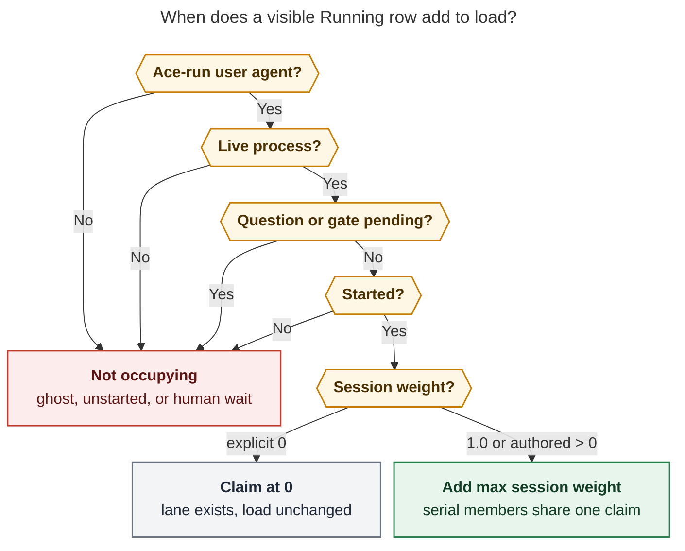
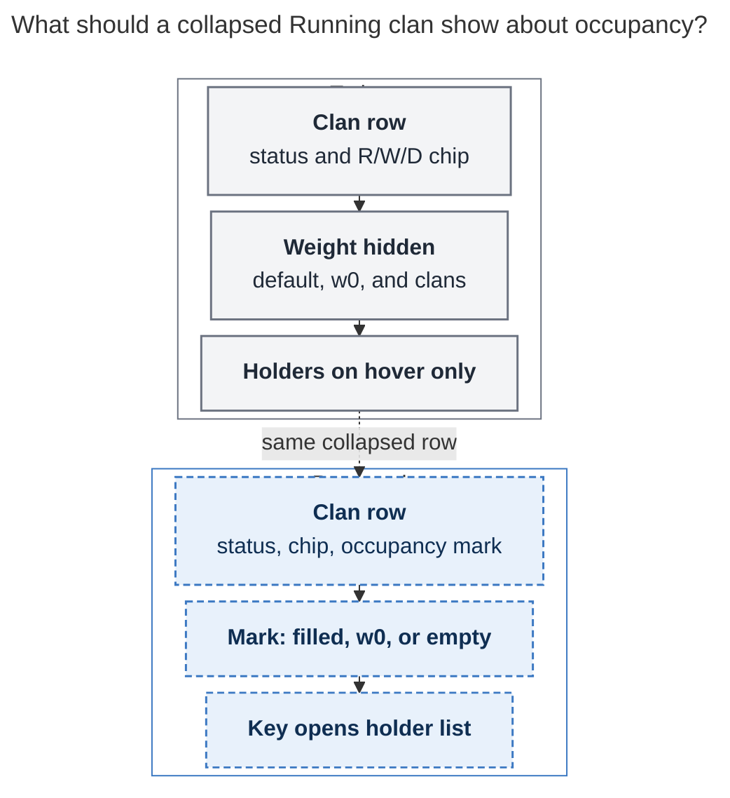

# Machine load vs running count: occupancy math and a clearer Agents-tab UX

Author: `research.5e.grk` (grk). Independent swarm report. I did not read peer reports
from `research.5e.cdx`, `research.5e.cld`, `research.5e.mus`, or `research.5e.gem`.

Motivating screenshot: `~/tmp/screenshots/20261026_172751.png` (athena, 2026-10-26
17:27:51 local). Header `174 [6 running · 23 waiting · 145 done]` with `load: 3/8`.
Five collapsed clans sit in the Running group, including `WAITING CUTOVER` and
`TESTING`. The visible wait monitor is easy to spot; the other non-occupying Running
sessions are not.

## Answer up front

**The `3/8` gauge is weighted runner occupancy, and the screenshot's arithmetic
matches that definition.** Capacity `8` is a persistent ACE override. Occupied `3` is
three independent `1.0` session claims: `sase-1oh.5.1.2`, `sase-1oh.4.1.2`, and the
`sase-1oe.3` verify monitor (`TESTING`, `sase tool run check`). The `WAITING CUTOVER`
monitor already used `sase monitor start -w 0` and occupies none. `bob-cli-ct`'s two
Running sessions also contributed `0` to the gauge.

**The error the screenshot feels like is a UX error.** `6 running` counts sase-agent
nodes in the Running bucket (sessions and standalones). Monitors, gates, and clan
containers are omitted from that count; custom statuses such as `TESTING` and
`WAITING CUTOVER` still land in Running. Collapsed clan rows hide every occupancy
signal: default `1.0` is invisible, `w0` is suppressed on clan containers, and the
holder list lives on a mouse tooltip. A clan with two in-flight wait sessions shows
as `RUNNING [R2]` and looks like two LLM workers.

**Do not change the occupancy formula to equal the running count.** Keep weighted
session claims, keep verify monitors at the starter's weight, keep `-w 0` occupying
none. Make occupancy a first-class row mark and a keyboard-reachable inspector so
the next `6 running · load: 3/8` screen names the three claims and the three
non-occupying Running nodes.

## What the screenshot actually shows

Crop of the Running group under `@epic` / epic `151`:

```
▶ Running                                          32 agents · 6 running
  bob-cli (RUNNING) ×6  [R2 W1 D3]  bob-cli-ct      7m46s / 1h42m   ← selected
  sase    (RUNNING) ×6  [R1 W4 D1]  sase-1oh.5.1    13m54s / 2h09m
  sase    (RUNNING) ×4  [R1 W2 D1]  sase-1oh.4.1    1h41m / 2h43m
  sase    (TESTING) ×5  [R1 W2 D2]  sase-1oe        7h21m / 8h40m
  sase    (WAITING CUTOVER) ×11 [R1 W1 D9] sase-1n6 23h44m / 31h19m
```

Five clan rows, six running agent nodes. Clan chips count direct agent-node members
(`clan_member_counts`); a monitor is not an agent node (`is_agents_tab_agent_node`
returns false for monitors, gates, and clan containers). Chip `R` values
`2+1+1+1+1` equal the header's `6 running`.

The right-hand CLAN panel for the selected `bob-cli-ct` row reports `9 agents · 2
sessions` and waves 3 and 4 in flight. That is the `R2`.

`load: 3/8` sits in the Agents status row, local to the machine running this TUI
session. The denominator is `~/.sase/max_running_agents_override.json`
(`limit: 8`, `source: "ace"`, no expiry). Package default is `10`.

### Occupancy reconstruction

Screenshot local 17:27:51 is 21:27:51 UTC on this host. `sase agent list -j` later
in the same evening still contained every occupier that had already started by
21:27, plus newer work (this research swarm at `w=0.25`, `bob-cli-ct.3--2`, `14p`,
`sase-1nv.5`). Restricting to processes that were alive at 21:27:

| Visible Running unit | Agent node in the `6` | Weight | Occupies | Why |
| --- | --- | --- | --- | --- |
| `sase-1oh.5.1` `[R1]` | `sase-1oh.5.1.2` | implicit `1.0` | `1.0` | Live phase worker, started 21:13 UTC |
| `sase-1oh.4.1` `[R1]` | `sase-1oh.4.1.2` | implicit `1.0` | `1.0` | Live phase worker, started 19:45 UTC |
| `sase-1oe` `TESTING` `[R1]` | session `sase-1oe.3` | explicit `1.0` | `1.0` | Verify monitor `sase-1oe.3--mon-1` (`sase tool run check`), started 21:21 UTC. Clan mirrors the single running member's label. |
| `sase-1n6` `WAITING CUTOVER` `[R1]` | session `sase-1n6.10` | explicit `0.0` | `0` | `sase monitor start -w 0` poll loop on `RELEASE_STEWARD_MERGE_ENABLED` / pypi branch policies, started 2026-10-25 21:52 UTC |
| `bob-cli-ct` `RUNNING` `[R2]` | two sessions | unknown at capture | `0` | Gauge `3` already equals the three `1.0` claims above. These two Running nodes added no capacity. |

Sum: `1.0 + 1.0 + 1.0 + 0 + 0 + 0 = 3.0`. Capacity `8`. Gauge `3/8`.

The user's mental model `6 running − 1 waiting monitor ≈ 5` treats the cutover row
as extra relative to the `6`. It is already one of the six: the session counts, the
monitor member does not. Subtracting it leaves five. Two of those five are the
`bob-cli-ct` sessions, which the clan label `RUNNING` does not distinguish from LLM
workers. `5 − 2 = 3`.

Best explanation for those two zero claims, given the clan shows aggregate
`RUNNING` (mirroring requires exactly one running member) and the wave rail shows
two in-flight sessions: they were non-occupying in-flight work — most likely `-w 0`
wait monitors or Running-bucket handoff/ghost rows. A live default-weight LLM
worker in that clan would have pushed the gauge to `4` or `5`. I could not recover
those two PIDs after they exited (the later `bob-cli-ct.3--2` follow-up started at
21:48 UTC). Treat that pair as **display-hidden non-occupancy**, and keep a
reproduction note if a future dump shows live `1.0` PIDs omitted from the snapshot.

### What `TESTING` is doing here

`TESTING` is the verify-monitor start label (`-p verify` / `sase tool run check`).
It inherits the starter's weight; `-w 0` is refused with verify, `-f`, `-J`, and
`sase tool run`. Occupying `1.0` during `just check` is the intended policy.
Zeroing it would let the host overcommit during real local work.

## How load is computed

Two different projections share the Agents header.

**Running count** (`sase_agent_status_counts` / `_lane_summary_projections`):
deduplicated Agents-tab agent nodes. One standalone agent or one sequential session
is one node, folded or not. Clan containers contribute no node; each direct
agent-node member does. Monitors and gates are members of a session, not extra
nodes. Status bucket comes from `sase_core::agent_archive::status_bucket_for_status`.
Exact `WAITING` is Waiting. Exact `QUEUED` is Queued. `TESTING`, `WAITING CUTOVER`,
`WATCHING MASTER GATE`, `UNKNOWN`, and every other unmatched label fall through
`_ => "Running"`.

**Load** (`AgentLoadIndicator`): `occupied_capacity / effective_limit` from the
Rust admission snapshot (`runner_capacity_snapshot` in sase-core).

A record occupies when all of these hold (`is_occupying_record` /
`is_runner_slot_occupying_record`):

1. `ace-run` user agent, appears as an agent, no done marker.
2. Live PID (TUI re-probes unverified PIDs so a stamped ghost does not keep a claim).
3. No `pending_question.json`, and no pending gate turn.
4. Started: ordinary turns need `run_started_at`; a real monitor member needs a
   recorded supervisor pid (the starter is already dead across that handoff).

Claims group by session lineage. Serial members, the monitor, and the `--next`
follow-up share one claim at **max** weight. Parallel clan members each claim.
Standalone agents each claim. Explicit `0.0` is a valid weight only when authored
(`%q(w=0)`, epic-launch monitor, `sase monitor start -w 0`). Implicit zero is
rejected. A zero-weight claim still counts as `occupied_lanes += 1` and is **not**
reusable by a successor (`claim_is_reusable` is `occupied_capacity != 0.0`), so the
follow-up re-enters admission at the starter's weight.

The gauge uses `occupied_capacity`, never `occupied_lanes`. Integer formatting
drops `.0` (`3/8`, not `3.0/8.0`). Hover text lists up to twelve holders with
weights and `(monitor)` / `(gate)` kinds. Compact density drops the `load:` label.



*A Running-bucket row adds to `load:` only after it is a live started ace-run
session claim; explicit zero keeps a lane and leaves occupied capacity unchanged.
Rendered with mermaid-cli 12.0.0; SVG 778.5 × 1152 px, fit 77.5%.*

Docs already state this split (`docs/reference/tui/agents-tab-grouping.md` lines
254–276, `docs/reference/runner-slots.md`, `docs/reference/automation/monitors.md`
§ Runner slots). The screenshot is what you get when those rules are true and
almost none of them are visible on a collapsed Running row.

## Transparency gaps (the real problem)

These are the mistakes the UI currently lets you make.

### 1. `running` and `load` look like the same quantity

Left: `6 running`. Right: `load: 3/8`. Both are integers in `n/m`-shaped slots
(counts vs budget). The docs example even writes `8 [8 running · 1 queued]` next
to `load: 8/10`, which is the coincidental full-weight case. Fractional swarms
(`research.5e.*` at `w=0.25`) and `-w 0` waits make the coincidence fail. Help `?`
does not define the gauge. The word `load:` is the only hint, and in compact
density it disappears.

### 2. Collapsed clans hide every occupancy signal

The screenshot's Running group is entirely clan containers. Badge and detail
rules then strip the rest:

- `append_queue_weight_badge` / `_append_agent_queue_weight_badge`: no `wN` on
  clan containers, gates, named procs, or serial children. Monitors may show `w0`
  when explicit; a collapsed clan never does.
- `format_queue_weight_badge_value`: implicit `1.0` returns `None` even when
  explicit. Default-weight occupiers and non-occupiers look identical.
- `_suppress_capacity_fields`: the detail pane omits `Weight:` for clans,
  monitors, gates, and serial children.

So `WAITING CUTOVER` at explicit `w=0` — the one row whose occupancy the user
correctly guessed — still shows no `w0` on the clan row. `bob-cli-ct` at `R2`
shows no mark that those two sessions occupy nothing. `sase-1oe TESTING` shows
no mark that it occupies `1.0`.

Prior research `research:202610/zero_weight_wait_monitors.md` already asked for
`w0` on monitor rows. The monitor-row exception landed. The screenshot is the
collapsed-clan view, which undoes it.

### 3. Holder list is hover-only

`AgentLoadIndicator` is a `Static` with a tooltip. The tooltip is the only
in-product list of claim holders. This TUI is keyboard-first. There is no click
or key handler on the gauge, no Capacity pane, and no `?` help entry. Caps at
twelve holders with `… +N more`.

### 4. Custom `WAITING *` labels fight the Running bucket

`status_bucket_for_status` matches exact `WAITING`. `WAITING CUTOVER`,
`WAITING FOR CORE`, `WATCHING MASTER GATE`, and similar monitor start labels are
Running. That is why a 24-hour poll loop sits in the Running group with a gold
elapsed clock. Clan mirroring then copies the custom label only when the clan
has exactly one running member. Two wait sessions collapse to the word
`RUNNING`. Wave pips still treat them as in flight (`◐`).

Moving `WAITING CUTOVER` into the Waiting bucket would mix live monitors with
dependency waits and would not by itself explain occupancy. Occupancy marks
handle both the one-member custom-label case and the two-member `RUNNING` case.

### 5. CLI cannot reconstruct the gauge

`sase agent list -j` on this host left `runner_occupied_capacity` and
`runner_slot_holders` empty on running rows. Holder attachment is waiter-centric.
The fallback `_holds_runner_slot` treats exact status `RUNNING` as holding a
slot, so `TESTING` and `WAITING CUTOVER` miss that fallback. You cannot audit
`3/8` from the CLI listing without going through the TUI snapshot path.

### 6. Several Running-bucket states occupy nothing, on purpose

These are correct occupancy exclusions that currently look like load bugs:

| State | Header running | Load |
| --- | --- | --- |
| Sequential session with a live monitor | 1 (the session) | session weight (or `0` if `-w 0`) |
| Two serial members of one session | 1 | max weight, once |
| Parallel clan members | 1 each | 1.0 each (or authored) |
| `PLAN APPROVED` / `TALE APPROVED` with a dead PID | yes, Running bucket | excluded after PID probe |
| Pending `QUESTION` / pending gate | Stopped / asking | none |
| Explicit `w=0` monitor | yes, if the session is Running | none |
| `%proc` | hidden from header | none once running |

Without a "running, not occupying" list, every one of these is an invisible
subtraction from `running` toward `load`.

## Calculation issues: keep, fix, or verify

**Keep (working as designed)**

- Weighted `occupied_capacity` as the gauge numerator.
- Session max-weight collapse for serial members, monitors, and follow-ups.
- Verify / `sase tool run` / `-f` / `-J` remaining at the starter's weight.
- `-w 0` occupying `0` and forcing the follow-up through admission.
- Local-machine capacity; remote rows never add to this TUI's gauge.
- PID re-probe so stamped ghosts do not keep a claim
  (`test_stamped_ghost_with_dead_pid_is_excluded`).
- Denominator `8` from the ACE override file.

**Fix (product bugs / observability, not the sum)**

1. **Clan rows suppress `w0`.** A collapsed wait-monitor clan is the common case
   in `group: by status`. Show the clan's occupancy mark even when member badges
   stay quiet.
2. **No keyboard path to holders.** Add one. Hover can stay as a shortcut.
3. **`sase agent list -j` omits the snapshot summary on running rows.** Emit a
   top-level `runner_capacity` object (`effective_limit`, `occupied_capacity`,
   `occupied_lanes`, `holders[]` with artifact dir, label, weight, kind, session
   key) plus a per-row `occupies` / `occupying_weight` / `occupancy_reason`.
4. **`_holds_runner_slot` fallback `status == "RUNNING"`.** Use the occupying
   predicate, or at least the Running bucket plus live PID, so `TESTING` and
   custom wait labels participate.

**Verify (possible math bug, not proven on this screenshot)**

If a future dump shows two live default-weight `bob-cli-ct` PIDs while the gauge
stays at `3` with the three sase claims above also live, that is an undercount.
Reproduce with a TUI capacity-snapshot dump at capture time (artifact dirs,
`live`, `queue_weight`, `queue_weight_explicit`, session key, `run_started_at`,
pid liveness). I do not recommend changing claim grouping on the strength of
this screenshot alone.

**Do not retbucket custom `WAITING *` into Waiting as the occupancy fix.** Exact
`WAITING` is a dependency wait. A live monitor with a `WAITING CUTOVER` label is
still a started occupying-record candidate. Surface `w0` / `○` on that row
instead. A later, separate status-taxonomy pass can add authored monitor labels
to a dedicated display lane if we want them out of the Running group for
reasons other than load.

`WAITING INPUT` is a related taxonomy footgun (asking/HITL, catch-all Running in
Rust) and is outside this screenshot.

## Recommended UX

Ship occupancy as a visible property of Running work, at three depths: row, gauge
inspect, CLI. Keep the current formula.



*Same collapsed Running clan: today status plus an R/W/D chip; proposed adds an
occupancy mark and a key that opens the holder list. Rendered with mermaid-cli
12.0.0; SVG 580.7 × 800 px, fit 100%.*

### P0 — Occupancy mark on Running-group rows, including clans

After the count chip on every Running-bucket **clan container** and **agent
node**, render one occupancy token built from that subtree's claims:

| Token | Meaning |
| --- | --- |
| `●1` / `●0.25` | Occupying that many capacity units (always show the number; include default `1.0`) |
| `w0` | Occupying record at explicit zero (wait monitor, epic-launch monitor, `%q(w=0)`) |
| `○` | Running bucket, no occupying record (ghost, unstarted, pending human wait, serial rider whose claim sits on another row) |

Mixed clan: `●1 w0` when one member claims `1.0` and another is explicit zero;
`●1.25` when claims are `1.0 + 0.25`. Keep `wN` member badges as they are for
expanded rows; the clan token is the missing aggregate.

On the 17:27 screenshot this would have read:

- `bob-cli-ct` `RUNNING [R2 W1 D3]` **`○`** or **`w0`**
- `sase-1oh.5.1` `RUNNING [R1 W4 D1]` **`●1`**
- `sase-1oh.4.1` `RUNNING [R1 W2 D1]` **`●1`**
- `sase-1oe` `TESTING [R1 W2 D2]` **`●1`**
- `sase-1n6` `WAITING CUTOVER [R1 W1 D9]` **`w0`**

That is the answer to "which nodes do not have any weight associated with them"
without leaving the list.

Use a color distinct from the R/W/D chip and from wait-bead `○` tokens (those
are status-colored and mean bead waits). Occupancy `○` should be dim and sit
after the chip, with a tooltip/reason string (`wait monitor w0`, `dead pid`,
`pending gate`, `serial rider`).

### P0 — Keyboard capacity inspector on the load gauge

Bind a key (new Agents-tab binding, shown in the footer when the Agents list is
focused; `L` is readable if free) and activate-on-gauge. Open a small pane or
modal:

```
Runner load  3 / 8   (5 free)   athena
Occupying (3.0)
  sase-1oh.5.1.2              1.0
  sase-1oh.4.1.2              1.0
  sase-1oe.3--mon-1           1.0  monitor  TESTING
Running, not occupying
  bob-cli-ct  (2 sessions)    0    in-flight, no claim
  sase-1n6.10--mon            0    wait monitor w0  WAITING CUTOVER
```

This is the existing tooltip, plus the missing non-occupying list, plus keyboard
access. Keep the hover tooltip as a short copy of the occupying list. Jumping
from a pane row to the matching Agents row should work the way other inspect
panes already jump.

Do not add a second integer on the left strip (`3 occupying` next to `6
running`). The gauge already is that integer. Teaching `load:` plus the inspector
avoids a third competing count.

### P1 — Help, docs example, and compact density

- `?` help: one line, "Load is this machine's occupied runner-capacity units
  against `max_running_agents`. The running count is Running-bucket agent nodes.
  Serial sessions share one claim. `w0` waits occupy none."
- Replace the docs coincidence `8 running` / `load: 8/10` with a split example
  (`6 running` / `load: 3/8`) in `agents-tab-grouping.md`.
- Compact density: keep a one-character occupier hint (`●`/`○`) or refuse to
  drop `load:` while occupied ≠ running.

### P1 — Detail pane `Occupying:` line

Stop suppressing weight on monitors and on clan containers for this one line.
`Occupying: 0 (wait monitor w0)` / `Occupying: 1.0 (session sase-1oe.3, verify
monitor)` / `Occupying: none (dead pid)`. Leave the rest of the capacity fields
quiet on serial children so a follow-up does not look like a second claim.

### P1 — CLI snapshot

`sase agent list -j` top-level `runner_capacity` as above. Optional
`sase agent load` human table for the same object. This is also the reproduction
hook for the unverified `bob-cli-ct` case.

### P2 — Adoption and taxonomy (after P0)

- Measure `-w 0` on wait-shaped monitors (follow-up from
  `research:202610/zero_weight_wait_monitors.md`). The cutover row is live
  evidence the flag is in use; `bob-cli-ct`'s unlabeled Running pair is evidence
  the list still cannot show it.
- Optional `sase monitor start` hint on bare `sleep` / `gh run watch` when `-w`
  is omitted, as that report suggested.
- Do not auto-zero verify monitors.

### Suggested implementation slices

1. **Marks + inspector + help** in one TUI change (P0/P1 list surfaces). Reuse
   `RunnerCapacityHolder` and the Rust `claims` array; add a parallel
   `non_occupying_running` list from agent nodes in the Running bucket whose
   session key is absent from positive claims (and whose weight is not explicit
   `0`). Tests: clan `w0` visible when collapsed; inspector lists verify monitor
   at `1.0` and cutover at `0`; keyboard path without hover.
2. **CLI snapshot** with parity tests against the TUI refresh
   (`tests/test_capacity_snapshot_parity.py` already compares TUI vs admission).
3. **Docs example** in `agents-tab-grouping.md` and a sentence in
   `agent-row-glyphs.md` naming the occupancy token.

No sase-core admission change is required for slices 1–3. A core change would
only be justified by a reproduced undercount.

## What this screenshot says about `-w 0`

`research:202610/zero_weight_wait_monitors.md` argued that pure waits should
free capacity, and that TUI visibility of `w0` was optional follow-up. The flag
landed. This screenshot is the first live cutover-style adoption I could pin:
`sase-1n6.10--mon` at explicit `0.0`, 24 hours in, load correctly excluding it.
The remaining hole is exactly that optional visibility item, now on collapsed
clans rather than on expanded monitor rows.

`TESTING` staying at `1.0` is the other half of that design: local heavy work
keeps the claim. The UX must show both halves, or `6 running / 3 load` will keep
looking like an off-by-N bug.

## Sources

- Screenshot `~/tmp/screenshots/20261026_172751.png`; OCR plus direct crop of the
  Running group.
- Live `sase agent list -j` (38 agents) after 21:27 UTC; occupancy fields for
  `sase-1oh.5.1.2`, `sase-1oh.4.1.2`, `sase-1oe.3--mon-1`, `sase-1n6.10--mon`,
  `bob-cli-ct.3--2`, `research.5e.*`.
- `~/.sase/max_running_agents_override.json` (`limit: 8`, `source: "ace"`).
- sase-core `crates/sase_core/src/runner_capacity/{snapshot,claims,records}.rs`,
  `crates/sase_core/src/agent_archive/status.rs`.
- TUI: `agent_load_indicator.py`, `agent_runner_slots.py`,
  `_agent_runner_slot_capacity.py`, `_queue_weight_badge.py`, `_agent_clan.py`,
  `agent_nodes.py`, `_agent_display_header_metadata_identity.py`,
  `status_buckets.py`.
- Docs: `docs/reference/runner-slots.md`,
  `docs/reference/automation/monitors.md` § Runner slots,
  `docs/reference/tui/agents-tab-grouping.md`,
  `docs/reference/tui/agent-row-glyphs.md`,
  `docs/reference/tui/agent-statuses.md`,
  `docs/reference/tui/launch-control.md`.
- Tests: `tests/ace/tui/widgets/test_agent_load_indicator.py`,
  `tests/ace/tui/test_agent_runner_slots_agent_sessions.py`,
  `tests/ace/tui/test_agent_runner_slots_capacity.py`,
  `tests/ace/tui/models/test_agent_summary_status_counts.py`.
- Prior research (not a peer of this swarm):
  `research:202610/zero_weight_wait_monitors.md`.
