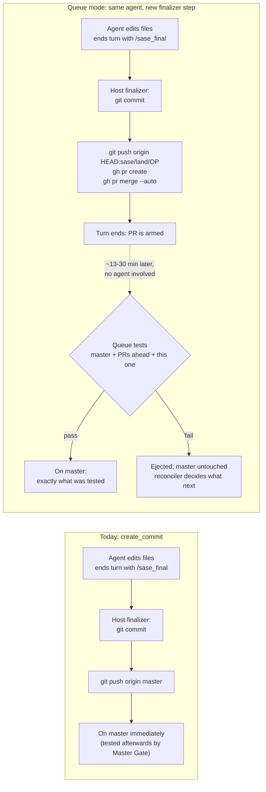
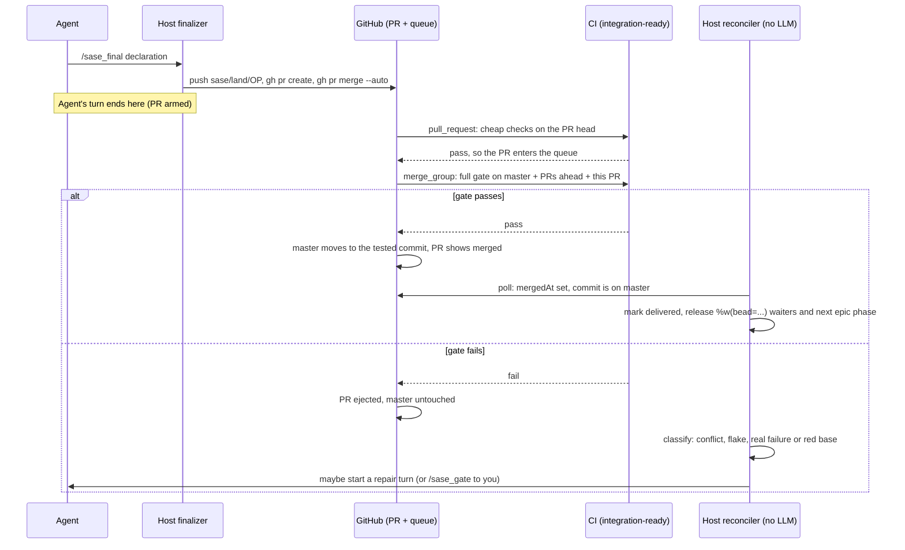
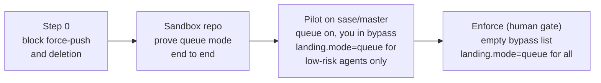

---
tags:
  - pypi-release-reliability
---

# Do sase agents have to start creating PRs to use a GitHub merge queue?

> **Research query:** I still don't understand how GitHub merge queues will work unless
> sase agents all start creating PRs (they currently all commit to `master`). Would I
> need them to start creating PRs to use the merge queue? See
> [`github_native_merge_queue_primer.md`](github_native_merge_queue_primer/github_native_merge_queue_primer.md)
> for context.

## Bottom line

- **Yes, every change has to reach `master` as a PR.** GitHub's queue is a *pull
  request* merge queue, and a PR is the only thing it accepts. You can't queue a push or
  a commit. Once `master` requires the queue, a plain `git push origin master` is refused
  for everyone not on the bypass list.
- **No, the agents don't create the PRs, and the agents don't change at all.** The
  host's commit finalizer creates each PR, in the same step that runs `git push` today.
  An agent still edits files and ends its turn with `/sase_final`. Under
  `decisions:host-owned-completion`, agents never commit, push or open PRs anyway.
- **The PR is an envelope, not a review request.** It needs zero approvals. Auto-merge
  is armed seconds after the PR is created, and nobody has to read it. Think of it as
  the form GitHub makes you fill in to put a commit in line.
- **The real change is timing, not PRs.** Today, "agent finished" means "on `master`"
  within seconds. With a queue, the turn ends once the PR is *armed*. The commit lands
  about 13 min later at p50 and about 30 min at p95, per the earlier report's
  simulation. Or the queue ejects it. Handling that gap is the real work: a landing
  watcher, a `delivered(bead)` check, and an ejection policy.
- **Most of the PR plumbing already exists.** The `#pr` macro's `create_pull_request`
  method already creates a branch, pushes it and runs `gh pr create`. Queue mode adds
  three things on top: arm auto-merge, watch for the outcome, and reset the workspace.

## Today vs. with a merge queue

Everything left of the finalizer stays the same. Only the transport changes: "push to
`master`" becomes "push to a throwaway branch and open an auto-merging PR".

## What the finalizer does differently

| Step | Today (`create_commit`) | Queue mode |
| --- | --- | --- |
| Commit | `git commit` with the agent's message and footers | Same |
| Sync | Rebase onto `origin/master` before pushing | Keep it. It catches conflicts early, though the queue re-bases anyway |
| Publish | `git push` to `master` | `git push origin HEAD:sase/land/<op>` |
| Open a PR | — | `gh pr create`. The title is the commit subject; the body is the full message |
| Arm it | — | `gh pr merge --auto --match-head-commit <sha>`. The queue rule supplies the merge method |
| Turn ends when | The push succeeds | The PR is armed |
| "Landed" means | The push succeeded | The reconciler sees the PR merged and proves it is on `master` |

Where this lives in code today:

- **Push to `master`:** `vcs_create_commit` in
  `src/sase/vcs_provider/plugins/_git_commit_dispatch.py:467` commits, syncs with origin,
  then pushes the current branch.
- **PR path (already built):** `vcs_create_pull_request` (same file, line 528) runs
  `checkout -b`, commit and push. sase-github's override in
  `src/sase_github/plugin.py` then runs `gh pr create`.
- **Method selection:** `SASE_COMMIT_METHOD`, set by the `#commit`, `#pr` and `#propose`
  macros (`src/sase/commit_methods.py`).
- **Known bug to fix:** sase-github's `_submit_via_pr_merge`
  (`src/sase_github/workspace/submit.py:219`) treats a successful exit from
  `gh pr merge` as "merged". On a queue-protected branch, it only means "queued" or
  "auto-merge armed".

## One landing, end to end

## Why not keep pushing and skip the PRs?

- **GitHub has no queue for pushes.** The merge queue only takes PRs.
- **Required checks alone won't work for pushes.** A required status check refuses a
  push of a brand-new SHA, because that SHA has no statuses yet. Without PRs, you would
  need your own two-hop lander:
  1. push a candidate branch;
  2. wait for its CI;
  3. fast-forward `master`.

  That means rebuilding the queue yourself, across two hosts (athena and apollo). About
  40% of today's pushes land while the previous gate is still running, so a DIY lander
  would keep retesting.
- **You can't exempt only the agents.** Bypass is granted per GitHub actor, and agents
  push as you. Exempting the agents would exempt about 43 landings a day, nearly all
  traffic. The fence would then guard almost nothing.

## What changes for whom

| Who | What changes |
| --- | --- |
| **Agents** | Nothing. They don't use new prompts or skills, and they don't run `gh` |
| **Host finalizer** | Pushes a `sase/land/<op>` branch, opens the PR and arms it, instead of pushing `master` |
| **New reconciler** | Watches each PR to merged or ejected, proves the landing, releases dependents and handles ejections |
| **You** | The PR list fills with about 43 bot PRs a day, auto-merged and auto-deleted. After enforcement, your own direct pushes to `master` are refused too: open a PR and arm auto-merge. Break-glass is disabling the ruleset, which GitHub's audit log records |
| **CI** | The gate listens for `merge_group` and reports one event-aware required check, `integration-ready` |
| **Bots** | No change. The ratchet workflows already land through PRs |
| **Other repos** | No change. Only `sase/master` is fenced; sase-core and the sidecars keep pushing |

## The `#pr` macro is a different thing

`#pr` already makes the host open a PR. That PR is for **human review**: it starts as a
draft and lands when you submit it from ACE. Queue mode reuses the same plumbing, but
its PR is **armed immediately** and never waits for a person. Once the queue is
enforced, `#pr` PRs land through the queue too. Their submit path needs the
`_submit_via_pr_merge` fix above.

## The real cost: landing becomes asynchronous

- **Dependents wait for "delivered", not "closed".** A bead still closes when the agent
  finishes. Anything that builds on the change waits for a new core check,
  `delivered(bead)`. That covers `%w(bead=…)`, the next epic phase and the ready list.
- **Ejections need an owner.** The reconciler handles each failure class:
  - a conflict goes to the existing conflict-repair turn;
  - a known flake is re-enqueued once;
  - a real failure gets at most two repair turns;
  - if `master` itself is red, a circuit breaker stops new admissions and starts one
    build-cop turn.

  Anything still stuck goes to you through `/sase_gate`.
- **The landed SHA is not the agent's SHA.** The reassessment chose the rebase method,
  so the queue rewrites each commit onto the current `master`. Stitch and COMMITS
  records must be re-pointed when the PR lands.
- **The workspace must not keep the unlanded commit.** *This is my inference; the
  earlier reports don't mention it.* After pushing the land branch, the finalizer should
  return the workspace to `origin/master`. Otherwise the next agent in that workspace
  builds on a commit that might be ejected.
- **Flakes turn into ejections.** Each false red bounces a good PR and restarts the
  builds behind it. Enforce only once false reds stay under 3%.

## How it rolls out

- **Opt-in per project.** Landing mode is a per-project setting,
  `landing.mode: push | queue`, defaulting to `push`. Most SASE projects never need a
  queue.
- **The pilot can run beside today's flow.** You stay on the bypass list, so push-mode
  agents keep landing directly while a few low-risk agents go through the queue. Expect
  each direct push to restart queue builds in flight. Measure that during the pilot.
- **Not started yet.** I found no bead for queue-aware landing (Epic C in the
  reassessment). The release-side epics are E1 `sase-1my` (closed) and E2 `sase-1n6`
  (in progress).

## Sources

- [GitHub's native merge queue primer](github_native_merge_queue_primer/github_native_merge_queue_primer.md):
  queue mechanics, `gh pr merge` semantics, bypass rules
- [Merge-queue-fenced `master` and exact-SHA releases](merge_queue_fenced_master_and_exact_sha_releases/merge_queue_fenced_master_and_exact_sha_releases.md):
  host-created PRs as admission tickets, the two-hop-lander argument, landing volume
- [Merge-queue reassessment, explained](merge_queue_fence_reassessment_explained.md)
  and the [full reassessment](merge_queue_fence_reassessment_and_epic_split/merge_queue_fence_reassessment_and_epic_split.md):
  the rebase method, turn ends at "armed", `delivered(bead)`, `landing.mode`, Epic C
- sase code, read on 2026-10-23:
  - `src/sase/vcs_provider/plugins/_git_commit_dispatch.py`;
  - `src/sase/commit_methods.py`;
  - `src/sase/macros/{commit,pr}.yml`.
- sase-github code, read on 2026-10-23:
  - `src/sase_github/plugin.py`;
  - `src/sase_github/workspace/submit.py`.
- `sase bead list`, checked on 2026-10-23 for queue-landing and epic beads.
