---
tags:
  - pypi-release-reliability
---

# The merge-queue reassessment, explained simply

> **Research query:** Summarize and simplify the work described by
> `merge_queue_fence_reassessment_and_epic_split.md` in the research sidecar repo, with
> good visuals.

This is a plain-language guide to
[`merge_queue_fence_reassessment_and_epic_split.md`](merge_queue_fence_reassessment_and_epic_split/merge_queue_fence_reassessment_and_epic_split.md)
("**the reassessment**"). That report reviews an earlier report from the same day,
[`merge_queue_fenced_master_and_exact_sha_releases.md`](merge_queue_fenced_master_and_exact_sha_releases/merge_queue_fenced_master_and_exact_sha_releases.md)
("**the original**").

This guide adds no new research. Every number comes from the reassessment, which measured
them on 2026-10-17 against sase `master` at `2cae86a1aa`. A [glossary](#glossary) at the
end defines the jargon.

## The 30-second version

1. **The problem.** sase's `master` branch is broken most of the time. No release has
   reached PyPI in 49 days. Today `pip install sase` gives you **version 0.1.0**, a
   version from June.
2. **The original plan.** Put a GitHub **merge queue** in front of `master`, so a change
   lands only after it passes tests on top of everything ahead of it. Publish **exactly
   the commit that passed**. Fix flaky tests before enforcing any of it.
3. **The reassessment's verdict.** The plan is right. **Six things change**, and the work
   should ship as **four projects (epics) called A, B, C and D**. Two smaller items sit
   outside the epics: one admin setting to change today, and a release fix that existing
   beads already own.

**An analogy.** Today `master` is a stage anyone can walk onto mid-show. We check
afterwards whether they ruined the performance. A merge queue is a stage door with a
bouncer. Each performer rehearses with everyone already waiting in line, and only a
performer who passes the rehearsal goes on.

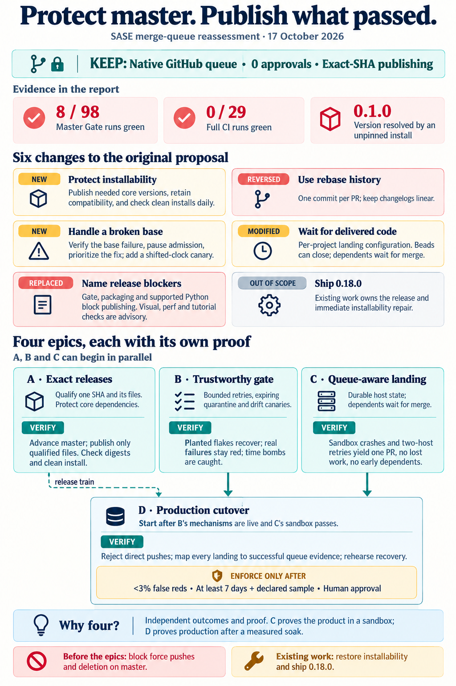

## Part 1 - What's broken today

### How code reaches `master` and PyPI today

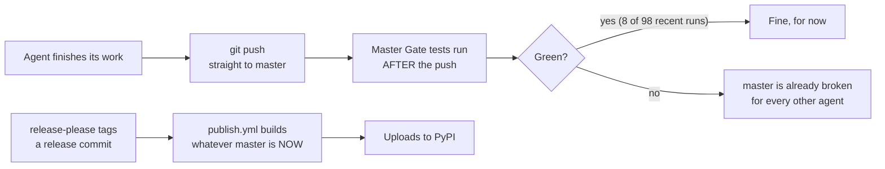

Nothing stops a broken change from landing. The tests only report breakage after the
damage is done.

### The scoreboard

| Signal | Today | What it means |
| --- | --- | --- |
| **Master Gate**: fast tests after every push | **8 green** of the newest 98 runs, in a 22-run red streak | `master` is red over 90% of the time |
| **Full CI**: the exhaustive test matrix, on a schedule | **0 green** of the last 29 runs | No commit qualifies for a release |
| **Last PyPI release** | 0.17.1, on Aug 29 | 49 days without a release; it used to ship every ~3 days |
| **`pip install sase`** | Resolves to **0.1.0** | Users silently get a release from June |
| **Release PR #299** (0.18.0) | Open since Aug 30 | Stuck behind the problems above |

### Three separate problems

These are easy to blur together, but each needs its own fix.

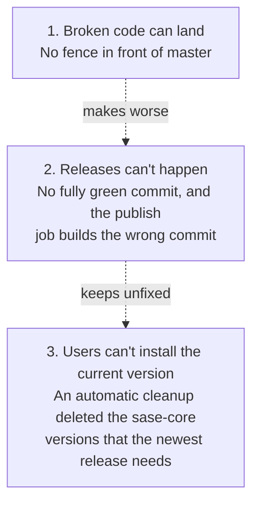

The original mostly addressed problems 1 and 2. **The reassessment's biggest discovery is
problem 3.**

## Part 2 - The original plan in one picture

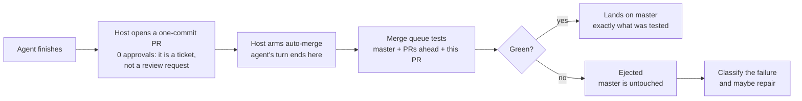

The plan has three pillars:

1. **A fence.** GitHub's native merge queue guards `master`. PRs are pure plumbing: the
   host creates them automatically and nobody approves them. Agents push as the
   maintainer, and GitHub won't let you approve your own PR, so any required review would
   deadlock.
2. **Honest releases.** Build and publish *exactly* the release commit that passed
   testing.
3. **Trust before enforcement.** Today 30–40% of builds fail falsely, because of flaky
   tests. A queue would then bounce a third of good changes, so the flakes come first.

### How a merge queue "stacks" changes

```text
master:  ──●───────────────────────────────────────────►

queue:     [ master + PR1 ]               ← tested together
           [ master + PR1 + PR2 ]         ← tested together, at the same time

If "PR1 + PR2" fails but "PR1" passes:  PR1 lands, PR2 is ejected.
master only ever moves to a state that was actually tested.
```

During the pilot, the reassessment limits each group to **one PR** (merge limit 1),
with up to **two groups** tested at once (K = 2).

### The publishing bug, drawn out

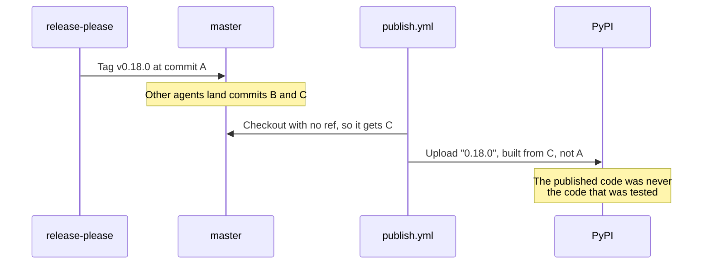

**The fix ("exact-SHA publishing"):** check out commit A by its SHA, test A, record the
digests (fingerprints) of the built files, and upload *those exact files*. Then download
them back from PyPI and compare.

## Part 3 - What the reassessment keeps

All four reviewers agreed on the core:

- **A native GitHub merge queue with zero approvals.**
- **Exact-SHA publishing.**
- **A trustworthy gate before enforcement.**
- **The same code placement.** The landing record lives in the Rust core (`sase_core`).
  The GitHub-specific code lives in the `sase-github` plugin. The reconciler that decides
  "did this land?" is deterministic, with no LLM judgment.

Four alternatives stay rejected:

| Rejected idea | Why it fails |
| --- | --- |
| A host-side "landing lane" (a local lock plus local tests) | Local `check` passes only about 4% of the time, and a lock on athena cannot order landings from apollo |
| Required PRs without a queue | Each PR is tested against an outdated `master` |
| "Branch must be up to date" | At ~43 landings a day, every merge invalidates every other open PR, so PRs rebase and retest endlessly |
| Human approvals | Agents push as the maintainer, who can't approve their own PRs |

## Part 4 - The six big changes

This is the heart of the reassessment.

| # | Change | Status vs. original |
| --- | --- | --- |
| 1 | Make `pip install sase` work, and keep it working | 🆕 **New** |
| 2 | Land with rebase (linear history), not merge commits | 🔄 **Reversed** |
| 3 | Handle a `master` that breaks with no landing ("drift") | 🆕 **New** |
| 4 | Make landing mode a per-project setting; beads close as today, dependents wait for the merge | ✏️ **Modified** |
| 5 | Name exactly which checks block releases | 🔁 **Replaced** |
| 6 | Move "ship 0.18.0" out of this program | 📦 **Out of scope** |

### Change 1 - Installability comes first (new)

**What's wrong:** sase 0.17.1 depends on a narrow range of sase's compiled Rust core
package, `sase-core-rs`. An automatic PyPI cleanup in sase-core keeps only the newest
versions. It deleted the whole range that 0.17.1 needs.

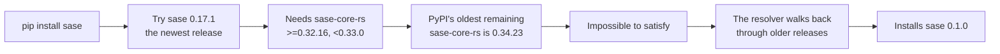

**The next release is blocked too.** `master` pins sase-core commit `916d5e3a`, which adds
`mobile_pairing_issue`, and no published sase-core release contains that commit yet. A
sase release therefore needs a sase-core release first.

**What the reassessment adds:**

- **A retention rule.** The cleanup must never delete a `sase-core-rs` version that one
  of the last 2 or more published sase releases needs. If the cleanup can't work out which
  versions those are, it deletes nothing.
- **A daily install canary.** A clean `uv tool install sase` must install the latest
  version, and `sase core health` must pass. If it fails, a bead or notification goes out.
- **A release train that fixes, not just detects.** When a release needs an unpublished
  core, the train *requests the sase-core release* instead of stopping at a
  "blocked" status.

### Change 2 - Rebase, not merge commits (this reverses the original)

The original chose merge commits for the queue. The reassessment found that merge commits
**already corrupted sase's changelog** back in June.

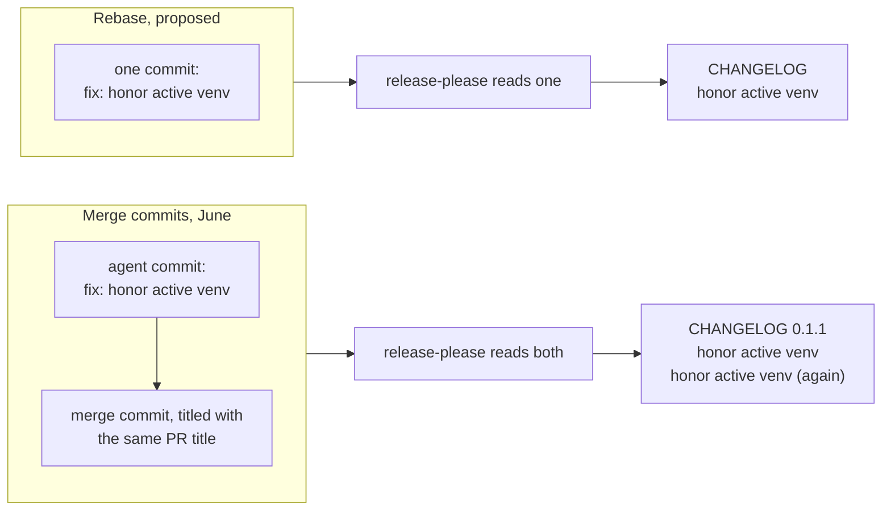

**The evidence:**

- **Duplicates.** Three changes appear twice in the 0.1.x changelogs: in 0.1.1, 0.1.2
  and 0.1.4.
- **A drop.** In 0.1.2, one entry appears only under its merge commit, and the agent
  commit was dropped.
- **Linear history today.** All 294 commits since Oct 10 have a single parent, and some
  tools, such as `triage_inputs.py`, read only first parents.

**The new rule:** use the rebase method with one commit per PR, and turn on "require
linear history". Squash is the fallback, and merge commits are rejected. A repair turn
amends and force-pushes the PR so that it stays one commit.

The original worried that a GitHub incident in April affected rebase. That incident hit
groups of **more than one PR**, and merge limit 1 during the pilot avoids it. A permanent
changelog defect outweighs an incident GitHub fixed within hours.

### Change 3 - Handle a `master` that breaks with no landing (new)

A queue fences **landings**. But `master` can also turn red with nobody landing anything:

- a **"time bomb" test** that depends on today's date (the healer-fixture bug fixed in
  `f2a7b802f9` was one);
- a new upstream package release;
- a change to GitHub's runner images.

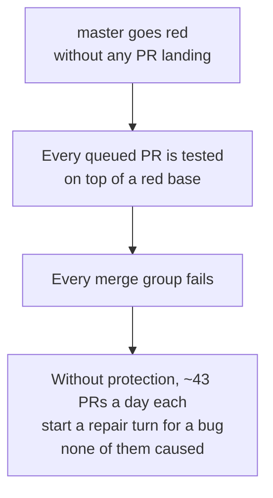

**The four additions:**

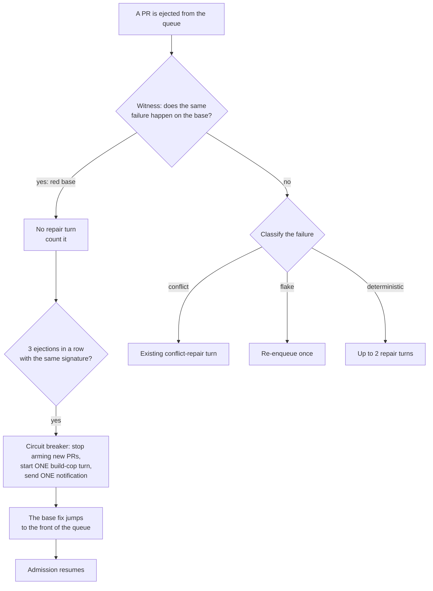

The fourth addition is a **shifted-clock canary**: a nightly gate run with the clock
pushed about **30 days into the future**. It catches time bombs before the calendar
does.

### Change 4 - Landing mode is a setting, and beads close as today (modified)

There are two parts to this change.

**(a) Landing mode is per-project config, not a feature flag.** Each project gets a
setting like `landing.mode: push | queue`, with `push` (today's behavior) as the default.
SASE's own rules say a choice users keep forever is a config field, not a flag. Most SASE
projects will never use a queue.

**(b) Don't change when beads close; change what waits on them.** The original said
"beads close only once the merge is proven". But agents and the commit finalizer already
close beads *during* the turn, and several templates depend on that. So:

- **The bead closes as today.** Closed means "the work is done".
- **A new core check, `delivered(bead)`,** means: the bead is closed *and* every landing
  it produced has merged.
- **Everything that depends on a bead waits for `delivered`:** `%w(bead=…)`, the next
  epic phase, the ready list, and land-agent checks.

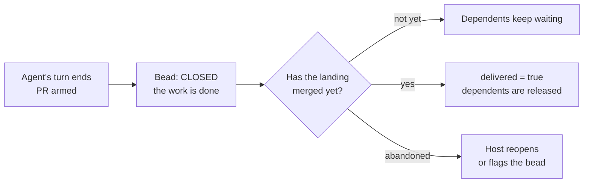

**When does the agent's turn end?** At **"armed"**, meaning auto-merge is enabled. It
does not wait for "queued": GitHub admits a PR to the queue only after the PR's own checks
pass, and a single-turn agent can't wait for that. From there, a host-side **reconciler**
tracks the landing through these states:

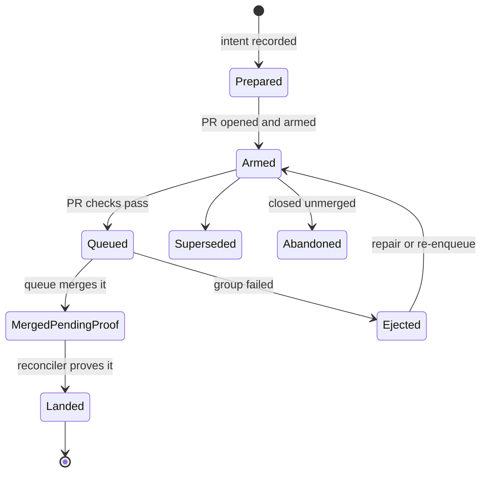

The protocol is **crash-safe**. It records the intent before any network call, and it
looks PRs up by operation ID, so that both hosts (athena and apollo) can reconcile without
duplicate effects.

### Change 5 - Name exactly which checks block releases (replaced)

The original's rule was "anything that can block a release must also block merges". Read
literally, that puts 30–76-minute jobs on every landing, which contradicts the original's
own "no Full CI in the queue". The reassessment replaces it with **three buckets**:

| Bucket | Blocks merges? | Blocks releases? | Checks |
| --- | --- | --- | --- |
| **1. Admission** | ✅ Yes | ✅ Yes | Everything in Master Gate |
| **2. Release-blocking** | ❌ No | ✅ Yes | Install smokes on the built wheel *and* sdist, the core-floor smoke, `test (3.13)` and `test (3.14)` |
| **3. Advisory** | ❌ No | ❌ No | `visual-test`, `perf-floors`, `tutorial-tests`, `ace-page-group-isolation`. Each failure files a bead with an owner and starts a 48-hour build-cop clock |

A check moves between buckets only through an explicit edit, backed by measured runtime
and false-red data.

**Why `visual-test` stays out of the gate:** it takes about 30 minutes, and the gate has a
20-minute-per-job limit. It can be promoted later, but only if it is sharded down to 20
minutes or less *and* its false-red rate is low enough.

### Change 6 - "Ship 0.18.0" leaves this program (out of scope)

Shipping 0.18.0 and restoring installability belong to **Track 0**: the existing beads
`sase-16p` and `sase-10d`, plus the `sase-1lh` chain. This program builds the *system*
that makes releases routine. It does not own one specific release.

### The smaller fixes, in one table

The original's requirements were lettered A–J, and the reassessment adds N1–N13. The table
below covers everything not explained above.

| Item | Plain-language meaning |
| --- | --- |
| **A**: release goal | Two tiers. First, the newest PyPI release installs, checked daily. Second, release lag is at most 7 days, later 1–3. "A qualified SHA under 24 h" becomes a long-term objective |
| **C**: service levels | "Zero bad changes admitted" is unprovable. Instead, every landing carries passing evidence. New metrics: days with broken installs (target 0) and core lag. Every rate is published with its numerator and denominator |
| **E**: exact publishing, sharpened | One "candidate record" (version, tag, SHA, core pin, run IDs, file digests) threads through every build step. Retries reuse the same files, and tags never move |
| **G**: gate trust | The **pilot** needs Epic B's mechanisms live. **Enforcement** needs under 3% false reds over at least 7 days, on a declared minimum sample |
| **J**: every writer | List every code path that pushes to `master`: the finalizer on both hosts, revert, TUI saves, `sase stitch create`, `ci_watch`, ratchet PRs, sase-github, and humans. Each must respect the landing mode |
| **N5**: one required check | `integration-ready` knows which event it runs on. On the PR it runs cheap checks only, and in the queue it requires everything. The original's version would have failed on every PR, so nothing could ever enter the queue |
| **N6**: separate CI lanes | Release qualification runs under its own `qualify-<sha>` group, so it can't cancel Full CI or be cancelled by it |
| **N8**: merge limit 1 | During the pilot, each queue group holds one PR. Raise the limit only after the landed-SHA mapping is proven on real traffic |
| **N9**: rollback keeps the fence | In an outage, pause admission instead of disabling protection. An unprotected direct push is a rehearsed, human, audited emergency step |
| **N10**: scope | Enforcement covers `sase/master` only. A linked sase-core commit lands before the sase PR that pins it |
| **N11**: human gates | Rulesets, queue enablement, auto-merge and sandbox-repo creation go through `/sase_gate`. Agents never apply them unasked |
| **N12**: one owner per goal | 0.18.0 belongs to Track 0. The tag ruleset waits, because every agent holds the maintainer's credentials and the rule would be theatre |
| **N13**: acceptance, not calendars | Drop "this week" and "7 days, then enforce". A soak is evidence for a human decision, not automatic approval |

## Part 5 - The delivery plan: four epics

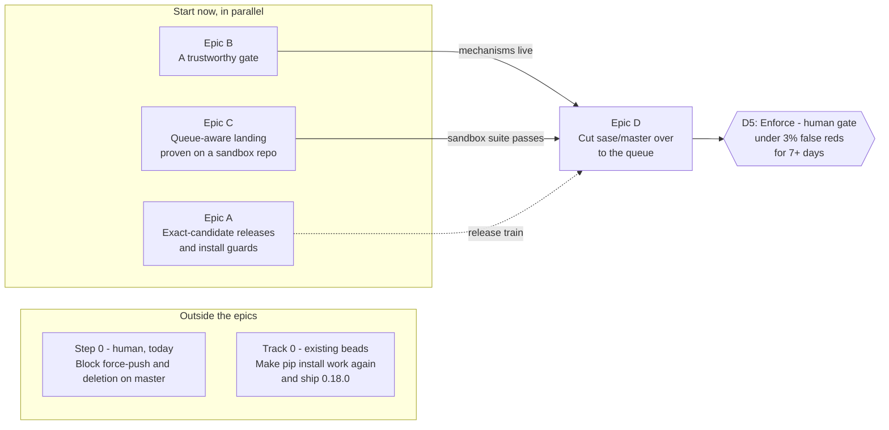

**A, B and C start now, in parallel.** D starts once B's mechanisms are live and C passes
its sandbox suite. Plan D *now*, with those dependencies, so the cutover has an owner from
day one.

### The four epics at a glance

| Epic | In one sentence | Proven where | Size |
| --- | --- | --- | --- |
| **A** | Publish exactly the commit that passed, and never break `pip install` again | Test fixtures and TestPyPI, then one real release | Medium–large |
| **B** | Make the test gate believable: retry flakes once, quarantine them with an expiry, and catch time bombs | sase's own CI | Medium |
| **C** | Teach SASE to land through a PR and a queue, as an opt-in per-project mode | A throwaway sandbox GitHub repo | Extra-large |
| **D** | Turn the queue on for the real `sase/master` | Production | Medium, plus 2 human gates and a soak |

### Before the epics

- **Step 0 (a human, today).** Add a `master` ruleset that blocks force pushes and
  deletion. Nothing in sase force-pushes `master`, so nothing breaks. Verify it by reading
  the rules back through the API. **Do not** test it by trying to delete `master`.
- **Track 0 (existing beads).** Cut a sase-core release that contains `916d5e3a`, ratchet
  the floor, get one gate-green release commit, and publish. It is done when a clean
  `uv tool install sase` reports the new version.

### Epic A - exact-candidate releases and install guards

**It builds:**

- a `publish.yml` that builds the tagged SHA, checks that tag = SHA = version, and builds
  the wheel and sdist **once**, recording their digests;
- qualification of that exact SHA against the release-blocking checks (bucket 2);
- uploads that resume with the same files, accept an existing PyPI file only on a digest
  match, and never move a tag;
- honest release states in `release_watch`, from "qualifying" through "published and
  confirmed";
- the sase-core retention rule and core-lag reporting;
- the daily install canary.

**How we'll know it works:**

- **A moving tip.** `master` moves to commit B while commit A is being released, and the
  published files still match A.
- **Failure blocks publishing.** Any failing release-blocking check stops the publish.
  A failing advisory check only files a bead.
- **Interrupted uploads.** These resume safely, and a mismatched file is refused.
- **The canary.** Run today, it **fails**, because it resolves 0.1.0. That proves it
  detects the outage. It passes after the next release.

### Epic B - a trustworthy gate

**It builds:**

- a **bounded rerun**: if 3 or fewer tests fail, rerun them once. A pass on rerun is
  marked `FLAKY:` and files a flake bead. Collection errors never rerun;
- an **expiring quarantine**: each entry has a bead, an owner and an expiry of 14 days or
  less. Quarantined tests still run in a non-required job;
- **parity fixes**: commit `.python-version` = 3.12, and fail fast when the local core
  differs from CI's pin;
- the **drift canaries**: a nightly run on the tip, plus the +30-day clock run;
- a weekly **false-red digest**;
- a **study** of whether `visual-test` can be promoted into the gate.

**How we'll know it works:**

- **A planted flake** goes green and gets flagged.
- **A real failure stays red.** Neither more than 3 failures nor a collection error
  triggers a rerun.
- **The time bomb is caught.** Re-introduce the old one, and the shifted-clock run
  catches it.

The 7-day false-red soak is **D's entry ticket, not B's exit**, because it depends on the
whole project's traffic.

### Epic C - queue-aware landing, as a SASE product feature

**It builds:**

- **C1.** The landing record and the `delivered(bead)` check, in sase-core.
- **C2.** The sase-github adapter: create the PR, arm it, poll for the outcome. It also
  fixes a bug where `gh pr merge` exiting 0 was treated as "merged" when it only means
  "armed".
- **C3.** The finalizer's `queue` mode. It pushes a `sase/land/<op>` branch, opens a
  one-commit PR, arms it, and ends the turn.
- **C4.** A deterministic reconciler, with no LLM, that proves each landing, updates
  references and releases dependents.
- **C5.** Drift-safe ejection handling, as in [Change 3](#change-3---handle-a-master-that-breaks-with-no-landing-new).
- **C6.** The sandbox repo, a toy gate with tests that pass, fail, flake or explode, and an
  end-to-end harness.

**How we'll know it works** (everything on the sandbox; nothing touches `sase/master`):

- **The happy path.** The turn ends at "armed". The bead closes, but its dependents wait
  until the merge. The changelog shows one entry per change.
- **Crashes.** Inject a crash at each step, then restart: there is exactly one PR, no lost
  work and no duplicate effect. Kill a host, and the other host finishes the landing.
- **Combined failures.** PRs X and Y each pass alone but fail together. Y is ejected and
  X lands.
- **Drift.** Detonate the time bomb. No repair turn starts, the breaker trips, the fix
  jumps the queue, and admission resumes.
- **Push mode is untouched.** Push-mode projects behave exactly as today.
- **GitHub's open questions.** The sandbox settles them, for example what a bypass
  actor's direct push does and whether a skipped job satisfies a required check.

### Epic D - cut `sase/master` over to the queue

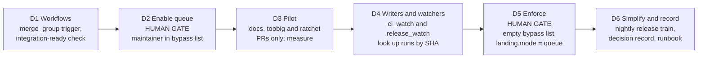

**How we'll know it works** (in production):

- **The rules are right.** The exported effective rules match the plan: PRs required with
  0 reviews, the queue required, linear history, force pushes denied, and an empty bypass
  list.
- **Safe canaries.** A direct push is refused, and a failing PR doesn't move `master`.
- **Every commit was tested.** A script maps every post-cutover `master` commit to a
  successful queue run. **Zero exceptions.**
- **Service levels hold.** Landing p50 is under 30 min and p95 under 60 min, false reds
  stay under 3%, and no dependent is released before its merge.
- **The release train ships.** At least one release goes out with no human action, and
  the install canary stays green.

## Part 6 - Why four epics, not one or three

| Option | Verdict | Reason |
| --- | --- | --- |
| **One epic** | ❌ | The urgent release fixes would be held hostage to the riskiest piece, the queue migration. Week-long soaks and human approvals would keep one giant epic open for 4–6 weeks |
| **Three epics** (merge C and D, as two reviewers proposed) | ❌ | C is proven on a sandbox and D only in production. C is a reusable product feature for any SASE project; D is a one-time cutover. Merged, any temporary scaffolding would linger through weeks of pilot |
| **More than four** (for example, C split by repo) | ❌ | It leaves pieces nothing can verify, such as a core record with no adapter |
| **Four**, plus Step 0 and Track 0 | ✅ | Each epic has its own proof, its own venue and its own failure boundary |

The worry behind merging C and D was "the cutover never gets an owner". The cheaper fix is
to **plan D now**, with dependency edges on B and C.

## Part 7 - Where the reviewers disagreed

Four independent research agents (cdx, cld, grk and gem) reviewed the original. The lead
researcher resolved their disagreements like this:

| Question | Positions | Decision |
| --- | --- | --- |
| How many epics? | cdx and cld: 4. grk and gem: 3 | **4** |
| Merge method? | The original, cdx, grk and gem: merge commits. cld: rebase | **Rebase** (sase's own changelog settles it) |
| `visual-test` in the gate? | Fold in, measure first, no, or shadow mode | **Not by default.** Only a measured study can promote it |
| What blocks a release? | The full matrix, or the gate plus packaging | **Gate + packaging + 3.13/3.14 tests**; the rest is advisory |
| Landing mode? | A flag (the original, grk) or config (cld) | **Per-project config** |
| When do beads close? | On merge, deferred, or as today | **As today**, but dependents wait for the merge |
| When does the agent's turn end? | At "queued", or at a durable submission | **At "armed"** |
| 0.18.0 in scope? | The original and gem: yes. The rest: no | **Out** (Track 0) |
| Full CI cadence? | Nightly early, or later | **In D, only if runner waits warrant it** |

**Ideas the lead rejected:**

- **Integration branches per epic** (gem): intermediate phases would land ungated.
- **Testing by deleting production `master`** (gem): if the ruleset is wrong, `master` is
  gone.
- **Folding `visual-test` in now** (cld): it is too slow for the 20-minute limit.
- **Retrying only known flake signatures** (cdx): at a 30–40% false-red rate, that barely
  helps.

## Part 8 - What could change the plan

| If the sandbox or pilot shows... | Then... |
| --- | --- |
| A bypass actor can't push to a queue-protected branch | D2 and D5 merge into one hard cutover, and the pilot moves entirely to the sandbox |
| Rebase misbehaves in the queue | Use squash. Return to merge commits only if the changelog tooling and the first-parent tools are fixed |
| False reds stay above ~10% after Epic B | Delay D. A, B and C are still worth having on their own |
| The automatic sase-core release step is unreliable | Use a stricter rule: the gate refuses any change whose core pin is unpublished |
| Queue waits slow epics down badly | Revisit batching phases as a new decision |

## What happens next

The reassessment changed nothing itself. It touched no rulesets, workflows, beads or
plans, and it ran no CI. The concrete next steps are:

1. **You, today:** add the Step 0 ruleset (block force pushes and deletion on `master`).
2. **Track 0:** the existing beads get `pip install sase` working again.
3. **Start Epics A, B and C in parallel**, and plan Epic D now.
4. **Human approvals along the way:** creating the sandbox repo, enabling the queue (D2),
   and enforcing it (D5, after the soak).

## Glossary

| Term | Meaning |
| --- | --- |
| **`master`** | sase's main branch. Every landing goes here |
| **Landing** | A change reaching `master` |
| **Merge queue** | A GitHub feature that tests a PR on top of `master` *and* every PR ahead of it, then merges exactly that tested result |
| **Merge group** | The temporary combined commit the queue tests |
| **Merge limit** | The number of PRs allowed in one merge group (1 during the pilot) |
| **K (build concurrency)** | The number of merge groups tested at the same time (2) |
| **Armed** | Auto-merge is enabled on the PR. The agent's turn ends here |
| **Ejected** | The queue removed a PR because its group failed. `master` is unchanged |
| **Landed / delivered** | The merge is proven. `delivered(bead)` = the bead is closed *and* its landings merged |
| **Reconciler** | A deterministic host job (no LLM) that tracks each landing to its final state |
| **SHA** | A commit's unique ID |
| **Exact-SHA publishing** | Build, test and upload one specific commit, never "whatever `master` is now" |
| **Digest** | A file's fingerprint (sha256), used to prove that PyPI holds exactly the tested files |
| **Master Gate** | The fast test workflow that runs after every push to `master` (p50 ≈ 12.5 min) |
| **Full CI** | The exhaustive, slower test matrix (all Python versions, visual, perf), run on a schedule |
| **`integration-ready`** | The single required check the queue will wait on |
| **False red / flake** | A test failure that isn't a real bug, such as a timing glitch |
| **Quarantine** | A list of known-flaky tests that run but don't block, each with an expiry |
| **Drift** | `master` turning red with no landing, for example from a date-based "time bomb" test |
| **Witness** | A check that the failure also happens on the base, which proves the PR didn't cause it |
| **Circuit breaker** | After 3 identical ejections, pause admission and start one build-cop turn |
| **Canary** | A small, regular test run whose only job is to detect a problem early |
| **Soak** | A measured waiting period (here, at least 7 days) that gathers evidence before enforcing |
| **Ruleset** | GitHub's branch-protection rules |
| **Bypass list** | Accounts that are allowed to skip the rules (used during the pilot, emptied at enforcement) |
| **Sandbox repo** | A throwaway GitHub repo for testing the whole flow safely |
| **release-please** | The tool that opens release PRs, writes `CHANGELOG.md`, and tags releases |
| **Rebase / squash / merge commit** | Three ways GitHub can land a PR. Rebase keeps one linear commit; a merge commit adds an extra commit on top |
| **`sase-core-rs`** | sase's compiled Rust core, published as its own PyPI package |
| **Core floor / core lag** | The minimum `sase-core-rs` version a sase release needs, and the gap between what `master` needs and what PyPI has |
| **Retention** | sase-core's automatic deletion of old PyPI versions (this is what broke installs) |
| **Epic / bead** | SASE's units of planned work: a bead is one task, and an epic is a group of phases |
| **Step 0 / Track 0** | The two non-epic items: a human admin change today, and the existing installability work |

## Sources

- **The reassessment** (the report summarized here):
  [`merge_queue_fence_reassessment_and_epic_split.md`](merge_queue_fence_reassessment_and_epic_split/merge_queue_fence_reassessment_and_epic_split.md),
  read via `sase artifact read`.
- **The original proposal:**
  [`merge_queue_fenced_master_and_exact_sha_releases.md`](merge_queue_fenced_master_and_exact_sha_releases/merge_queue_fenced_master_and_exact_sha_releases.md),
  read for background via `sase artifact read`.
- **The infographic:**
  [`merge_queue_fence_reassessment_and_epic_split_infographic.png`](merge_queue_fence_reassessment_and_epic_split/merge_queue_fence_reassessment_and_epic_split_infographic.png),
  from the reassessment.
- **Related primer:** [`github_native_merge_queue_primer`](github_native_merge_queue_primer/github_native_merge_queue_primer.md)
  explains GitHub's merge queue in more depth.
