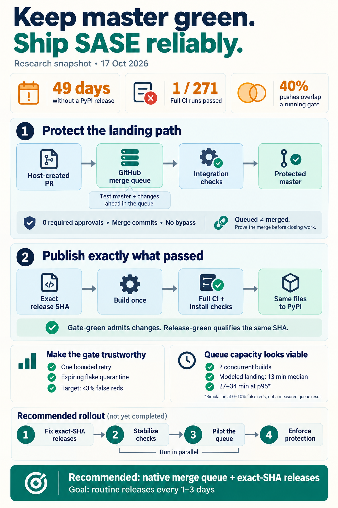

# Merge discipline for SASE: a merge-queue-fenced `master` and exact-SHA PyPI releases

> **Research query:** After reading the `gastown_vs_sase_lessons_to_borrow.md` report in
> the research sidecar repo, sase seems to need better merge discipline: how should it
> keep `master` green so new sase versions can be published to PyPI more often, and does
> that require a PR-only (protected `master`) workflow, is one recommended anyway, or is
> there another way? Is the plan a good idea, or would a different approach be better?
> Critique it, adjust the requirements where justified (calling each adjustment out
> clearly), and end with a recommended solution.

## Bottom line

1. **The instinct is right, but the framing needs three corrections.** See
   [the critique](#the-plan-as-posed) and the
   [requirement adjustments](#requirement-adjustments).
   - **The goal is a releasable, published SHA on a steady cadence.** That is not the
     same as "HEAD is always green".
   - **"Protected `master`" and "PR-only" are separate GitHub settings.** A PR rule by
     itself does not keep `master` green.
   - **Better landing discipline alone would not have shipped anything since August.**
     Other blockers sit outside the landing path.
2. **Protect `master`, and land through GitHub's native merge queue.** The host creates
   the PRs, and no approvals are required. Each PR is an admission ticket the queue
   needs, not a request for review. The queue tests each change on top of `master` plus
   every change ahead of it, and only that tested result lands.
   - **Without a queue, required PRs do not keep `master` green.** Each PR is tested
     against a stale base.
   - **A [host-side landing lane](#the-host-landing-lane) cannot be the gate either.**
     Local `check` passed 6 of 168 runs on apollo in 14 days (p50 12 min, p90 59 min).
     Landings also come from two machines, so a lock on one host does not order them.
3. **Fix the release path first.** It is small, and it unblocks PyPI soonest
   ([Phase 0](#phase-0---cheap-fences-and-honest-releases)).
   - **The wrong code gets published.** `publish.yml` builds whatever `master` is when
     the job runs, not the release commit.
   - **The published commit is never tested in full.** Nothing requires the full test
     matrix on that exact commit.
   - **The fix:** build the release commit exactly, run the full matrix on that SHA, and
     publish those exact files.
   - **What has really blocked 0.18.0 for 49 days is Full CI, not Master Gate.** Full CI
     has passed 1 of 271 runs since Aug 27.
4. **Make the gate trustworthy before enforcing it.** Most green→red flips are TUI timing
   flakes; the newest red on `master` today is one of them. With 30–40% of builds failing
   falsely, a queue would bounce a third of good changes. Add one bounded rerun and a
   quarantine list whose entries expire, and aim for under 3% false reds per build
   ([Phase 1](#phase-1---a-trustworthy-gate)).
5. **The capacity objection does not hold up against measured data.** I
   [replayed real arrivals through a model queue](#will-a-merge-queue-keep-up): 42.9
   pushes a day, 40% of them landing while the previous gate is still running, with real
   gate durations. With build concurrency 2, changes land in about 13 min at p50 and
   27–34 min at p95, provided false reds stay at or below 10%.
   - **The account already runs about two gates at once.** Even so, the slowest test
     shard waited only 2.5 min for a runner at p90.
   - **Revisit the merge-queue rejection.** `decisions:ci-two-speed-split` rejected a
     merge queue in August. Its own reopen trigger has been met, so a
     [new decision record](#decision-records-to-write) should replace that clause.

**In one line:** add the cheap GitHub fences now, then make releases build and test the
exact SHA (and ship 0.18.0), then make the gate trustworthy, then pilot the merge queue,
then enforce it. See the [Recommended solution](#recommended-solution).

## Requirement adjustments

Each adjustment is called out against the requirement as posed or implied, with the
reason for it and the input reports it came from.

- **Adjustment A**
  - *As posed or implied:* "`master` stays green"
  - *Adjusted requirement:* **A release-qualified SHA under 24 h old exists and gets
    published on a cadence.** A green `master` is the means, not the goal
  - *Why:* A perfectly green Master Gate would still have released nothing since Aug 29,
    because Full CI was never green
  - *From:* all
- **Adjustment B**
  - *As posed or implied:* Green is one thing
  - *Adjusted requirement:* **Two tiers.** *Gate-green* is the admission check for every
    landing. *Release-green* is the full matrix plus the core-floor check plus install
    smokes, **all on the same SHA**
  - *Why:* Release already needs both signals; nothing makes them agree on one SHA
  - *From:* mus, cdx
- **Adjustment C**
  - *As posed or implied:* Always green
  - *Adjusted requirement:* **Service levels instead of "always":** under 3% false reds
    per gate build; zero deterministic failures admitted; landing p50 under 30 min and
    p95 under 60 min; release lag at most 7 days at first, then 1–3 days
  - *Why:* "Always" cannot be measured, and it is not achievable with flaky tests
  - *From:* cld, mus
- **Adjustment D**
  - *As posed or implied:* Maybe PR-only
  - *Adjusted requirement:* **One admission path that the server enforces and that tests
    the integrated result.** Here that means a native merge queue, which needs PRs as
    plumbing. **Zero approvals**
  - *Why:* PRs alone test a stale base. Also, agents push under the maintainer's account,
    and **GitHub won't let you approve your own PR**, so any required review would
    deadlock
  - *From:* all; the self-approval point is new
- **Adjustment E**
  - *As posed or implied:* (implicit)
  - *Adjusted requirement:* **Publish exactly what was tested:** build once from the
    release SHA, qualify that SHA, and upload those exact files
  - *Why:* `publish.yml` currently builds the tip at the moment it runs
  - *From:* cdx, mus
- **Adjustment F**
  - *As posed or implied:* (implicit)
  - *Adjusted requirement:* **Anything that can block a release must also block merges.
    If it doesn't, it needs an owner and a deadline**
  - *Why:* Checks only the scheduled lane runs (visual, 3.13/3.14, perf floors) have
    drifted red and stayed red for weeks
  - *From:* cld
- **Adjustment G**
  - *As posed or implied:* (implicit)
  - *Adjusted requirement:* **The gate must be trustworthy before it is enforced**
  - *Why:* A flaky gate is a random-rejection engine (see the
    [queue simulation](#will-a-merge-queue-keep-up))
  - *From:* cld, mus
- **Adjustment H**
  - *As posed or implied:* (implicit)
  - *Adjusted requirement:* **"Landed" is its own state, separate from "agent
    finished".** Beads close and `%w(bead=…)` waiters resolve only on proof of merge
  - *Why:* Under a queue, merging happens asynchronously. Gas Town's merged-only
    dependency resolution
  - *From:* cdx, cld, grk
- **Adjustment I**
  - *As posed or implied:* (implicit)
  - *Adjusted requirement:* **"Releasable" includes the sase-core dependency:** the
    `sase-core-rs` range a SHA needs must already be published
  - *Why:* Release watches have ended in `CORE_FLOOR_BLOCKED`
  - *From:* cld, grk
- **Adjustment J**
  - *As posed or implied:* (implicit)
  - *Adjusted requirement:* **Admission control must cover every writer:** every host,
    every credential, every tool
  - *Why:* Two hosts land today, and every agent pushes as the maintainer
  - *From:* **new** (lead)

## Critique

### The plan as posed

**What is right:**

- **It goes after the actual hole.** Nothing refuses a red landing, and Master Gate only
  reports breakage after the push.
- **Promises have been tried, and they don't hold.** Eight repair epics have shown that
  without a fence, green lasts about a day and a half. The Gas Town lesson applies:
  "fences beat promises".
- **It is aimed at a real business cost.** PyPI has been stalled for seven weeks after
  months of releases every three days.

**What is off:**

1. **It treats "green HEAD" as the release precondition.** In fact the release blockers
   are three:
   - Full CI, which is not on the merge path;
   - the core floor;
   - a publish job that builds the wrong commit.

   Landing discipline fixes none of these directly.
2. **It conflates "protected" with "PR-only".** GitHub's protections are independent
   knobs:
   - block force pushes and deletion;
   - restrict who can push;
   - require status checks;
   - require PRs;
   - require a merge queue.

   Required PRs without a queue add process without testing the combination. Adding
   strict "must be up to date" on top makes every merge invalidate every open PR. At about
   43 landings a day, that churns: PRs rebase and retest over and over.
3. **It leaves out the cost side.** Under any real pre-merge gate, landing becomes
   asynchronous, and a change can be ejected. Two costs follow:
   - Epic phases wait for the merge, adding roughly 13–30 min per wave.
   - An ejected change needs a repair loop.

   This host-side machinery is the real engineering work. The GitHub setting is not.

**Is it a good idea?** Yes, with the [adjustments above](#requirement-adjustments). Once
`master` is fenced, a red local `check` again means "you broke it". That restores the
agents' own verification signal, and removes most of the reason for the KNOWN/UNKNOWN
triage machinery that exists only to cope with an always-red base.

### The host landing lane

This is Gas Town's R1, the venue grk and gem adopt.

The *mechanisms* are right: test the integrated tree, prove the push, resolve dependents
only after the merge. The *venue* is wrong, for four reasons:

- **The signal is bad.**
  - Local `check` passes 3.6% of the time (lead), 2.5% (cld) or 7% (mus), depending on
    the sample.
  - Local runs differ from CI on Python version (no `.python-version`) and on the core
    binary.
  - Lint stages such as symvision fail far more often locally.
- **The host is the scarce resource** (`decisions:two-speed-verification`).
  - A serial lease around a check with a 12 min p50 and a 59 min p90 holds the lane for
    roughly 9 h a day at today's volume.
  - Its tail latency would be measured in hours, not the queue's 27–34 min p95.
- **It is not a fence.**
  - A per-host lock cannot order athena against apollo.
  - It does not stop a push made by any other path.
  - Making it global means writing a distributed queue with durable state, recovery and
    UI. That is the experience of Homu, which was "hard to maintain" and is being
    rewritten, and of Gas Town, whose batching was never wired up.
- **Failure-set ratchets are fragile.**
  - "No new failures compared with a red baseline" depends on equal coverage, equal
    environments and independently witnessed failure signatures.
  - A broken test collector produces *fewer* failures.
  - A new bug can share an old signature.
  - Use the ratchet as a recovery tool only (cdx). For bootstrapping, ratchet *whole
    required checks* (cld) instead.

grk makes a correct point that matters *if* you skip PRs. GitHub's required status checks
reject a direct push of a new SHA, because that SHA has no statuses yet. A no-PR fence
therefore needs a two-hop lander: push a candidate, wait for its checks, then
fast-forward `master`. Under 40% overlap, that lander re-tests in the same churn loop as
"must be up to date". This is one more reason to let the native queue do the stacking.

## Evidence

### State of master and of releases

- **PyPI `sase`**
  - *Value:* **0.17.1**, uploaded 2026-08-29; 49 days without a release
  - *Source:* all
- **Release cadence before the stall**
  - *Value:* 28 releases from Jun 11 to Aug 29, about one every 2.8–2.9 days
  - *Source:* cld, mus
- **Release PR #299 (0.18.0)**
  - *Value:* Open since Aug 30. `release-core-floor-smoke` was red on Oct 16 (grk) and is
    **green as of 02:48Z Oct 17** (lead)
  - *Source:* grk, lead
- **Master Gate pass rate**
  - *Value:* 62 of 1,000 runs (Sep 27 → Oct 17); 27 of the newest 100
  - *Source:* cld, cdx
- **Master Gate green time**
  - *Value:* 50% time-weighted (Oct 13–17). Of 16 red episodes, the 5 longest held **93%
    of red minutes**
  - *Source:* mus
- **Full CI**
  - *Value:* **1 green in 271 runs since Aug 27**, and that one was the 0.17.x release
    day. `visual-test` was red in every run sampled
  - *Source:* cld, mus
- **Gate wall time**
  - *Value:* p50 12.5 min, p90 18.6 min, p99 28 min (200 runs). cld's 1,000-run sample
    gives p50 12.7, p90 26.2
  - *Source:* lead, cld
- **Landing cadence**
  - *Value:* About 43 a day. **40–44%** of pushes land before the previous gate finishes
  - *Source:* lead, cld, mus
- **Failure mix**
  - *Value:* About 12 of 15 recent green→red flips were flake-shaped (mus). 30 of 112 red
    runs failed on one or two shards only, which puts the false-red rate on a healthy
    tree at about 30–40% per build (cld)
  - *Source:* mus, cld
- **Repair history**
  - *Value:* At least eight "green CI, then ship 0.18.0" epics since late September. Each
    gave a green window that decayed in about 36 h
  - *Source:* cld
- **Repo merge settings**
  - *Value:* Merge commits only; squash and rebase are disabled
  - *Source:* cdx, mus
- **Plan**
  - *Value:* Public repo, Free-plan organization, 20 concurrent hosted jobs
  - *Source:* cld, mus

### New evidence from this consolidation

- **Runner queue waits are already small.** I measured 200 Master Gate runs (Oct 12 →
  Oct 17), taking for each the delay before its slowest test shard started after
  `core-wheel` finished:
  - p50 **4 s**, p90 **149 s**, p99 **533 s**;
  - 15% of runs waited more than 60 s.

  This load already includes two gates overlapping 40% of the time and Full CI every
  2 h. So mus's "one Master Gate at a time" hypothesis is false. cld's "concurrency 1
  on Free" is overly conservative.
- **Landings come from two hosts.** Since Oct 1, 649 commits carry an athena
  `SASE_AGENT` footer and 73 carry an apollo one. A per-host flock, the lease grk and gem
  propose, cannot order the two machines' landings.
- **The local check is slow and almost always red.** `sase tool stats -t check -d 14`
  on apollo:
  - 168 runs, **6 OK**;
  - p50 12 min, p90 59 min;
  - the scoped `test` stage alone is p50 **41.6 min**;
  - the symvision lint stage failed 84 of 113 runs.

  This refutes gem's "2–4 min local check… catches 95%+ of breaks". It also matches
  cld's figure (10 of 405) and mus's (4 of 57).
- **Today's newest red is a flake.**
  - `4cb33feae9` ("test(axe): split runner bead claim tests") failed on one node in
    shard 7: `tests/ace/tui/modals/test_new_project_configure_review.py::test_review_back_restores_draft_and_y_stores_model_submission`.
  - Its two parent SHAs were green.
  - The change does not touch that modal.
- **The `publish.yml` defect is confirmed.** The `build` job uses `actions/checkout@v4`
  with no `ref:`, so a scheduled or manual run builds whatever the default branch's tip
  is at that moment. The fix is easy: `release-please-action` documents a `sha` output,
  "SHA that a GitHub release was tagged at" (checked in its README at `0b6b3fc`).
- **The watcher would go blind under a queue.** `tools/_release_watch_api.py` looks up
  Master Gate with `_run_list("master-gate.yml", branch="master")`.
  - Under a merge queue, gate runs execute on `gh-readonly-queue/master/…` refs.
  - Once the push trigger is dropped, a lookup by branch finds nothing.
  - Lookups must change to be by SHA.
- **sase-github treats "queued" as "merged".** `_submit_via_pr_merge` runs
  `gh pr merge --merge --delete-branch` and calls `finalize_submission` whenever the
  command exits 0. Against a queue-protected branch, exit 0 means *queued or auto-merge
  enabled*, not merged. This confirms cdx's finding.
- **The April 2026 merge-queue incident was real, and the merge method decides
  exposure.**
  - **What happened:** on 2026-04-23, from 16:05 to 20:43 UTC, queue groups built
    commits from the wrong base. Earlier changes appeared reverted.
  - **Scale:** GitHub's blog counts 2,092 PRs in 658 repos. Its COO later gave 2,804.
  - **Which methods were affected:** GitHub's blog names squash groups and says groups
    using the merge or rebase methods were not affected. The status page names rebase
    too.

  Either way, **groups using merge commits were unaffected.** That, plus three other
  reasons, settles the merge method in favour of merge commits:
  - merge commits keep the agent's commit SHA, so the post-merge proof stays trivial;
  - they are the repo's only enabled method today;
  - cdx already preferred them.

  cld wanted rebase so that footers survive. Agent commits keep their footers under merge
  commits too. Set the merge-commit message to "PR title and description", and the merge
  commit carries them as well.
- **Every bot already lands through PRs.** `core-pin-ratchet.yml` and
  `shard-timings-ratchet.yml` push their own branches and open PRs. The only direct
  pushers to `master` are the agents' finalizers, so a protected `master` breaks nothing
  else.

### Will a merge queue keep up

**A simulation on real arrivals.**

**Model:**

- **Arrivals:** the 200 real Master Gate push times from Oct 12 10:53Z to Oct 17 02:48Z.
- **Service times:** sampled from the measured gate wall times.
- **Queue rules:**
  - Each PR gets its own cumulative build, because "merge limits do not combine
    `merge_group` builds" (GitHub docs).
  - When the PR at the head of the queue fails, every build behind it restarts.
  - A flaked PR re-enters the queue once.
  - 2% of changes are real breaks, and these are ejected.

Each line gives landing latency in minutes (p50, p95 and max) for a build concurrency
*K* and a false-red rate per build, followed by the number of gate builds run per landed
change.

- **K = 1, false-red rate 0%:** p50 19 · p95 54 · max 87 · builds per landing 1.02
- **K = 1, false-red rate 10%:** p50 25 · p95 78 · max 145 · builds per landing 1.13
- **K = 1, false-red rate 30%:** p50 37 · p95 139 · max 217 · builds per landing 1.44
- **K = 2, false-red rate 0%:** p50 **13** · p95 **27** · max 35 · builds per landing
  1.03
- **K = 2, false-red rate 3%:** p50 **13** · p95 **28** · max 44 · builds per landing
  1.07
- **K = 2, false-red rate 10%:** p50 13 · p95 34 · max 58 · builds per landing 1.19
- **K = 2, false-red rate 30%:** p50 19 · p95 52 · max 90 · builds per landing 1.66

**What it shows:**

- **Capacity is not the binding constraint. Flakiness is.** At K=2, a gate with under
  3% false reds adds almost nothing to landing latency.
- **The same queue degrades at today's flake rate.** At about 30% false reds, p95
  roughly doubles and every landing costs 1.66 gate builds.
- **Many good changes would need repair.** At 30% false reds, about 9% of good changes
  would also fail their single retry and need a repair turn.

**Why gem's "19–47 h a day" figure is wrong.** It multiplies the *peak* rate (90 a day)
by the *p90* gate time and assumes no parallelism. The mean load is about 43 × 13.5 min ≈
9.7 gate-hours a day, spread across K builds at once.

## Options compared

Each option is rated on whether it keeps `master` green, whether it helps PyPI releases,
its main cost or risk, and a verdict.

- **Status quo plus repair epics**
  - *Keeps `master` green?* No; green decays in about 36 h
  - *Helps PyPI?* No
  - *Main cost or risk:* An endless treadmill
  - *Verdict:* Reject
- **Required PRs and checks, no queue (stale base)**
  - *Keeps `master` green?* No; two PRs can each pass and still break each other
  - *Helps PyPI?* No
  - *Main cost or risk:* Process with no integration test
  - *Verdict:* Reject
- **Required PRs, "must be up to date", no queue**
  - *Keeps `master` green?* Yes
  - *Helps PyPI?* Indirectly
  - *Main cost or risk:* Re-test churn at 40% overlap
  - *Verdict:* Reject
- **[Host landing lane](#the-host-landing-lane) (lease, re-check, ratchet)**
  - *Keeps `master` green?* Partly
  - *Helps PyPI?* Indirectly
  - *Main cost or risk:* Slow, unreliable local signal; one host only; no fence
  - *Verdict:* Pre-flight only
- **Custom lander that fast-forwards a protected `master` without PRs**
  - *Keeps `master` green?* Yes
  - *Helps PyPI?* Indirectly
  - *Main cost or risk:* You own a distributed queue
  - *Verdict:* Only if the native queue fails
- **[GitHub native merge queue plus ruleset](#phase-2---merge-queue-pilot)**
  - *Keeps `master` green?* **Yes**, for the gate's contents
  - *Helps PyPI?* Indirectly; makes the release commit gate-green by construction
  - *Main cost or risk:* Asynchronous landing; sensitive to flakes; depends on GitHub
  - *Verdict:* **Adopt**
- **Third-party queue (Mergify, Trunk, Aviator)**
  - *Keeps `master` green?* Yes
  - *Helps PyPI?* Indirectly
  - *Main cost or risk:* Cost and another vendor; more than ~43 a day needs
  - *Verdict:* Revisit if the native queue's limits bite
- **Post-merge auto-revert bot**
  - *Keeps `master` green?* Bounds red time
  - *Helps PyPI?* Indirectly
  - *Main cost or risk:* Hard to find the culprit amid flakes and overlap
  - *Verdict:* Optional backstop for the scheduled lane
- **[Exact-SHA release qualification](#phase-0---cheap-fences-and-honest-releases)**
  - *Keeps `master` green?* n/a
  - *Helps PyPI?* **Yes, directly**
  - *Main cost or risk:* Builds once; adds about 100 min before publishing
  - *Verdict:* **Adopt first**
- **[Tag-on-green (hatch-vcs)](#risks-and-what-would-change-the-recommendation)**
  - *Keeps `master` green?* n/a
  - *Helps PyPI?* Yes, even while the tip is red
  - *Main cost or risk:* Replaces release-please's version bumps
  - *Verdict:* **Fallback**

## Recommended design

### Phase 0 - cheap fences and honest releases

*When: this week. Size: S.*

1. **Fences that don't touch today's flow.**
   - Add a `master` ruleset that blocks force pushes and branch deletion.
   - Add a tag ruleset so that only the release identity can create `v*` tags. This only
     helps once the release identity differs from the credentials agents push with.
2. **Make Publish build and qualify the exact SHA.**
   1. In `build`, set `ref: ${{ needs.release.outputs.sha }}`. Assert that the tag,
      SHA, `pyproject.toml` version and `__version__` all agree.
   2. Add a `qualify` job: call `ci.yml` as a reusable workflow on that SHA, which needs
      a `ref` input. It covers the full matrix: visual, 3.13 and 3.14 (the wheel claims
      support for both), and perf floors.
   3. Make `publish` depend on `qualify` and both install smokes.
   4. Build once. Pass the files between jobs and record their digests.
3. **Replace the broad `publish_existing` option** with an explicit tag input. It
   resolves the tag to the same SHA and checks the file digests before any partial
   re-upload.
4. **Relax the release watcher's pre-merge rule.** Today it requires a fresh green Full
   CI on *some recent* SHA before merging. Replace that with post-merge qualification of
   the exact release commit. Keep "Master Gate green at HEAD" until the queue makes it
   true by construction.
   - **A GitHub tag/release may exist before PyPI has the version.** Show that state
     explicitly rather than treating a GitHub release as a published package.
   - **Check in a spike whether release-please's `draft` option fits.**
5. **Ship 0.18.0.**
   1. Finish `sase-1lh`'s deterministic Full CI repairs: the stale `visual-test` golden,
      the project-label audit, and the launch-approval, completion-snapshot and perf-floor
      failures.
   2. Merge #299 while HEAD is gate-green. Its core-floor smoke is now green.
   3. Qualify the release commit and publish it.

   If the commit fails only on a lane the gate doesn't run, fix forward and ship 0.18.1
   the next day. Don't restart the hunt for a perfect tip.

### Phase 1 - a trustworthy gate

*When: 1–2 weeks. Size: S–M.*

1. **Rerun failed tests once, inside the CI job.** After the sharded run, rerun only the
   failed node IDs, once and serially. Skip the rerun if more than about 3 nodes failed.
   - A pass on rerun emits a `FLAKY:` annotation and files or `+1`s a `flake` bead by
     failure signature.
   - This is a CI policy, separate from local ToolRun triage. Record it as its own
     decision, beside `triage-annotates-does-not-change-exit-codes`.
2. **Quarantine flakes in a list whose entries expire.** Each entry names a node, a bead,
   an owner and an expiry of at most 14 days. Quarantined tests still run, in a
   non-required job, and an expired entry fails lint.
   - **Start with the repeat offenders:**
     - `test_mounted_arrival_then_clear_name_keeps_selection` (`sase-1ls`);
     - `test_filter_and_enter_advance_the_modal_…`;
     - the `test_next_word_*` / mid-word prompt tests;
     - `test_link_follow_seam`;
     - today's `test_review_back_restores_draft_…`.
3. **Close the parity gaps from Oct 1.**
   - Commit `.python-version` = `3.12`.
   - Fail fast when the local core differs from `sase-core-revision.txt`.
   - Add `if: always()` to the Master Gate steps that a red `just lint` currently skips.
4. **Make the release gate part of the merge gate.**
   - Fold `visual-test` (check mode, sharded) into the gate.
   - Move Full CI from every 2 h to nightly plus every release candidate. That frees
     about 10 runner slots for most of the day.
5. **Exit criterion:** under 3% false reds per gate build for 7 days, measured from the
   `FLAKY:` annotations.

### Phase 2 - merge-queue pilot

*When: 2–3 weeks, starting alongside Phase 1. Size: L.*

**Rehearse on a scratch public repo in `sase-org` first.** Use it to verify four
behaviours the docs leave unstated or that need testing on a real repo:

- `master`'s new SHA equals the tested queue commit;
- whether "require merge queue" alone blocks direct pushes;
- whether a check skipped by `if:` satisfies the requirement on `pull_request` (the
  docs say it reports "Success");
- how PRs that use the maintainer's credentials trigger workflows.

**Workflows:**

- **`master-gate.yml`:**
  - Add `pull_request` and `merge_group: types: [checks_requested]`.
  - Add one aggregate job, `integration-ready`, with `needs:` on every gate job and
    `if: always()`. It fails unless every dependency actually succeeded.
  - On `pull_request`, skip the expensive jobs with job-level `if:`. The PR enqueues
    cheaply, and the real build runs on the merge group.
  - Use no path filters, because a workflow skipped by a filter leaves the required check
    "Pending".
- **`ci.yml`:** drop the `pull_request` trigger for agent PRs, or every landing starts
  the roughly 100-min heavy lane. Keep `workflow_call` for Full CI and for release
  qualification.
- **The release PR:** CI jobs that are skipped or special-cased by the release branch's
  name don't apply under `merge_group`. Keep `release-core-floor-smoke` as an explicit
  part of the release PR's required checks.
- **Watchers:** look up gate results **by SHA, not by branch**. `release_watch` and
  `ci_watch` currently query `--branch master`.
- **The push-triggered Master Gate:** keep it during the pilot as an independent audit.

**Host integration:**

- **Where the code lives:**
  - the landing-record state machine goes in `sase_core`;
  - the GitHub adapter goes in `sase-github`;
  - Python and the TUI only consume the result.
- **A queue landing mode for the commit finalizer, behind a feature flag.**
  - The finalizer commits, pushes `sase/land/<agent>`, and runs `gh pr create`. The title
    is the commit subject and the body is the full message, footers included.
  - It then runs `gh pr merge --auto --merge --match-head-commit <sha>`.
  - It proves the PR is *queued*, and the agent's turn ends there.
- **A deterministic landing watcher.** It runs as an axe chop or a service and uses no
  LLM. Each landing record moves from `queued` to `merged`, `ejected` or `superseded`.
  - **When the queue merges a PR:**
    1. Prove that `master` contains the agent's SHA, which merge commits preserve.
    2. Prove that `master`'s tree equals the tested queue commit's tree.
    3. Only then close the bead, resolve `%w(bead=…)` waiters, and update STITCHES.
  - **When the queue ejects a PR:**
    - A *conflict* goes to the existing conflict-repair turn.
    - A *known flake signature* re-enqueues once.
    - A *deterministic failure* gets one or two repair turns, forked from the original
      with the failing log excerpt.
    - If those fail, open a `/sase_gate` for the human. Agents never wait
      (`gates-never-block`).
  - **Never close a bead without proof of merge.**
- **Fix `sase-github`'s `_submit_via_pr_merge`:** exit 0 means queued, not merged.
- **Epic waves:** each phase starts once the previous one has *merged*.
- **Repo settings:**
  - enable auto-merge;
  - delete branches on merge;
  - set the merge-commit message to "PR title and description".
- **Pilot traffic:** low-risk agents first (`toobig` splits, docs). Measure ejection
  classes, latency and runner waits for a week.

### Phase 3 - enforce and simplify

**The ruleset on `master`:**

- **PRs:** required, with **0 approvals**.
- **Merge queue:** required, with these settings:
  - method **merge**;
  - **build concurrency 2**;
  - group size minimum 1, maximum 5, with a 0–1 min wait;
  - **only merge non-failing PRs: on**;
  - status-check timeout **60 min**.
- **Required check:** `integration-ready`, from GitHub Actions.
- **Force pushes and deletion:** blocked.
- **Bypass list: empty.** Agents push with the maintainer's credentials, so any bypass
  the maintainer holds would also be every agent's.
  - **Break-glass:** an admin disables the ruleset, a deliberate act that GitHub's audit
    log records.
  - **Later:** move landings to a GitHub App identity. The maintainer can then hold a
    bypass that agents don't inherit.

**Before flipping the default, prove the contract:**

- a failing candidate does not move `master`;
- two changes that pass separately but fail together are rejected;
- a direct push by an agent is refused;
- a host restart while a PR is queued reconciles without duplicate PRs.

**Cutover:**

1. Make queue mode the default.
2. Keep push mode behind the flag as an outage fallback, used only with the ruleset
   disabled.
3. Drop the push-triggered Master Gate once SHA lookups work.
4. Shrink `tools/release_watch`. Under the queue, "HEAD is gate-green" holds by
   construction, so a release becomes three steps:
   1. each night, enqueue the release PR if there are `feat`/`fix` commits;
   2. qualify the exact SHA;
   3. publish and confirm the install.

**Heavy lane: give it an owner and a clock.**

- A red nightly or candidate run files or `+1`s a `ci` bead by failure signature, and
  launches one build-cop repair turn.
- If the lane stays red for 48 h, send a high-severity notification.
- Keep stop-the-line opt-in only, because combined with a flaky lane it turns into a
  permanent freeze.

**Expected release cadence:** a nightly chance to release, giving a release every 1–3
days. That matches the pre-August rhythm, with "at most 7 days" as the service level.

### Decision records to write

*Through `/sase_memory_write`; not done here.*

1. **"`master` lands only through the merge queue."**
   - It supersedes the merge-queue clause of `ci-two-speed-split`. The rest of that
     record holds: a per-SHA fast gate, and the heavy lane off the landing path.
   - It refines `host-owned-completion`: *queued* completes the turn, and *merged*
     completes the landing.
2. **"PyPI publishes exactly the qualified release SHA."**
3. **"CI reruns a failed node once, and quarantines flakes with an expiry."**

### Metrics

Publish these in a weekly digest built from the landing records and the GitHub API:

- **Days since the last PyPI release:** Today 49 · Target ≤ 7 now, then 1–3
- **Full CI / release qualification passing on the exact candidate:** Today 1 of 271 ·
  Target ≥ 2 of 3 nightly candidates
- **False-red rate per gate build:** Today ~30–40% · Target < 3%
- **Red minutes per day on required checks:** Today ~50% of time · Target 0; any red
  means a check isn't really required
- **Landing latency:** Today n/a (pushed directly) · Target p50 < 30 min, p95 < 60 min
- **Runner wait for the slowest shard, p90:** Today 149 s · Target < 5 min
- **Ejections by class (conflict, flake, deterministic):** Today n/a · Target Tracked;
  the flake share should fall
- **Human interventions per day for routine landings:** Today n/a · Target 0

## What I would not do

- **Require human approvals.** It caps throughput at the maintainer's attention, and it
  deadlocks on self-authored PRs anyway.
- **Use "require up to date" without a queue,** or a no-PR two-hop lander. Both churn at
  40% overlap.
- **Make a host-side check the gate.** Keep `just check` as the agent's pre-flight.
- **Accept failures on a red base indefinitely.** No permanent no-new-failures ratchet,
  and no LLM-judged merge verdicts.
- **Put Full CI in the queue.** Each candidate would block the queue for about 100 min.
- **Use squash or rebase merges for now.** The incident evidence and SHA provenance both
  favour merge commits.
- **Adopt a third-party queue, or a batch-then-bisect queue, at about 43 changes a day.**
- **Put release-please on a `stable` branch.** It needs a merge back to `master` after
  every release bump.
- **Launch more repair epics without a fence.**

## Risks and what would change the recommendation

- **False reds stay above about 10% after Phase 1.** Queue p95 then exceeds 35 min and
  repair turns pile up. Delay enforcement. Consider turning "only merge non-failing PRs"
  off as a flake tolerance, which costs some attribution.
- **Runner waits grow at K=2.** If the p90 wait passes about 5 min, buy the Team plan
  (60 jobs, roughly $4 per user per month; check the current price) or fall back to K=1.
- **The landed SHA differs from the tested queue commit.** Rely on the tree-equality
  proof, and keep the push-triggered audit gate.
- **GitHub queue outages or regressions.** These are not hypothetical (see the
  [2026-04-23 incident](#new-evidence-from-this-consolidation)). Use the flagged
  push-mode fallback, with the ruleset disabled, plus the post-merge proof.
- **Exact-candidate qualification fails in more than 1 of 3 nightly runs for 2 weeks.**
  Switch to tag-on-green, cld's design:
  - pick the newest SHA that is green on the gate *and* the full matrix;
  - tag it, and take the version from the tag (hatch-vcs);
  - generate the changelog.
- **Landing volume grows past about 120 a day.** Raise K, which needs the Team plan.
  Consider integration branches per epic to batch phases.

## Recommended solution

**Protect `master` and land every change through GitHub's native merge queue.** The host
opens the PRs, approvals stay at zero, and the queue uses merge commits with build
concurrency 2. Make PyPI publish exactly the release commit it qualified. Sequence the
work so that releases resume first:

1. **This week: fences and honest releases.** See
   [Phase 0](#phase-0---cheap-fences-and-honest-releases).
   - Block force pushes and deletion on `master`, and protect `v*` tags.
   - Make `publish.yml` build `release-please`'s `sha` output.
   - Make it run the full matrix on that SHA, and publish only those qualified files.
   - Finish the deterministic Full CI repairs and ship **0.18.0** from #299. Its
     core-floor smoke is already green.
2. **Weeks 1–2: a trustworthy gate.** See [Phase 1](#phase-1---a-trustworthy-gate).
   - Rerun a failed node once inside the job, and keep an expiring, still-running
     quarantine.
   - Commit `.python-version`.
   - Fold `visual-test` into the gate, and move Full CI to nightly plus candidates.
   - Exit when false reds are under 3%.
3. **Weeks 1–3, in parallel: the queue pilot.** See
   [Phase 2](#phase-2---merge-queue-pilot).
   - Rehearse on a scratch repo.
   - Add `merge_group` and an aggregate `integration-ready` check, and take the heavy
     `ci.yml` lane off PRs.
   - Add the flagged queue landing mode and the deterministic landing watcher: proof of
     merge before beads close, plus ejection classification and repair turns.
   - Fix sase-github's queued-means-merged bug, and switch watchers to SHA lookups.
   - Route `toobig` and docs agents through it first.
4. **Then enforce.** See [Phase 3](#phase-3---enforce-and-simplify).
   - Require the queue with an empty bypass list, and make queue mode the default.
   - Drop the push-triggered gate.
   - Run the nightly release train.
   - Write the three decision records.

**The expected outcome:** no deterministic break can reach `master` by any path. The
tip's state no longer gates releases, which become routine every 1–3 days. And a red
local check means something again.

## How the input reports compared

### Where the reports agreed

**All five agree on these points:**

- `master` has no protection on the server. `…/branches/master/protection` returns 404,
  and `…/rulesets` returns `[]`.
- The `builtin@commit` finalizer rebases and pushes **without testing the combined
  tree**. Master Gate runs only after the push, so it reports breakage rather than
  preventing it.
- Requiring human approvals would be a mistake.
- Releasing and keeping the tip green are separate goals.
- Borrow Gas Town's *mechanisms*: test the integrated tree, prove the merge, and release
  dependent work only once its prerequisite has merged.
- Do not borrow its LLM-judged merge or its bisecting queue, which was never wired up.

### Where the reports split

**They split on six questions.** Each question lists every report's position and the
lead's resolution.

- **Where the gate runs**
  - *cdx:* GitHub merge queue
  - *cld:* GitHub merge queue
  - *grk:* Host landing lane plus GitHub fences
  - *mus:* Host guard now; queue later, if triggers fire
  - *gem:* Host landing lane
  - *Resolution:* **GitHub merge queue** (see
    [the host landing lane](#the-host-landing-lane))
- **PR-only?**
  - *cdx:* Yes, host-created PRs
  - *cld:* Yes, as queue entries
  - *grk:* No
  - *mus:* Only together with a queue, later
  - *gem:* No
  - *Resolution:* **Yes, as plumbing for the queue, with zero approvals**
- **Merge method**
  - *cdx:* Merge commit
  - *cld:* Rebase
  - *grk:* n/a
  - *mus:* Squash
  - *gem:* n/a
  - *Resolution:* **Merge commit** (see
    [new evidence](#new-evidence-from-this-consolidation))
- **What gets released**
  - *cdx:* The exact release commit
  - *cld:* The newest fully green commit (tag-on-green)
  - *grk:* A last-known-green ref
  - *mus:* A last-known-green release branch
  - *gem:* A `stable` branch
  - *Resolution:* **The exact release commit now; tag-on-green as the fallback**
- **Capacity**
  - *cdx:* Measure it
  - *cld:* Concurrency 1 on Free, 3–4 on Team
  - *grk:* "9–19 gate-hours a day", so reject
  - *mus:* "Only one gate at a time" (hypothesis)
  - *gem:* "19–47 h a day", so reject
  - *Resolution:* **Concurrency 2 fits Free (measured)**
- **No-new-failures ratchet**
  - *cdx:* A recovery tool only
  - *cld:* Ratchet the *required checks*
  - *grk:* Yes, while the tip is red
  - *mus:* No
  - *gem:* Yes
  - *Resolution:* **Ratchet whole checks, not failure sets**

### Weaker claims in the input reports

- **gem**
  - The capacity math is wrong (see the
    [queue simulation](#will-a-merge-queue-keep-up)).
  - The "2–4 min, 95%+ catch" figure for the local check is contradicted by the
    measurements.
  - Pointing release-please's default branch at a fast-forwarded `stable` branch does
    not work. The version-bump commit lands on `stable` and is never on `master`, so the
    next fast-forward fails unless every bump is merged back to `master`.
- **grk** reads `ci-two-speed-split` as settling the matter. That record rejected
  alternatives that "failed to produce an attributable per-SHA signal or consumed the
  account's capacity". A queue that builds one candidate per PR *does* produce a
  per-SHA signal, because every `master` SHA is a tested queue commit. The runner-wait
  data show the capacity exists, and the record's reopen trigger ("fast gate p50 stops
  fitting the commit cadence") is met.
- **mus**'s red-HEAD freeze, which parks deferred landings and drains them later, *is* a
  queue built on the host. Its idea of waiting four weeks for metrics before
  reconsidering a queue spends effort on throwaway machinery. Keep its real insight:
  build-signal hygiene and release decoupling pay off whether or not a queue arrives, so
  do them first.
- **cld**'s concurrency of 1 on Free is too conservative. Two gates already run together
  routinely (see [new evidence](#new-evidence-from-this-consolidation)). cld's preference
  for rebase loses to merge commits, given the incident and SHA provenance.

## About this report

**Consolidated report** · lead researcher · 2026-10-17 · sase `master` at `4cb33feae9`

**Inputs:** five independent reports
([cdx](merge_queue_fenced_master_and_exact_sha_releases__cdx.md),
[cld](merge_queue_fenced_master_and_exact_sha_releases__cld.md),
[grk](merge_queue_fenced_master_and_exact_sha_releases__grk.md),
[mus](merge_queue_fenced_master_and_exact_sha_releases__mus.md),
[gem](merge_queue_fenced_master_and_exact_sha_releases__gem.md)), plus my own
measurements and checks. The new evidence is in
[New evidence from this consolidation](#new-evidence-from-this-consolidation) and
[Will a merge queue keep up](#will-a-merge-queue-keep-up).

**The question, as the lead researcher restated it:**

> After reading `gastown_vs_sase_lessons_to_borrow.md`, it seems sase needs better merge
> discipline. We need a way to keep `master` green so we can publish new versions of sase
> to PyPI more often. Do we need a PR-only (protected `master`) workflow, is one
> recommended anyway, or is there another way? Critique the plan, adjust the requirements
> where justified (calling the adjustments out), and end with a recommended solution.

## Method, confidence, and limits

**Read through audited channels:**

- the five reports, the Gas Town comparison, and the decisions `ci-two-speed-split`,
  `host-owned-completion` and `receipts-prove-before-they-skip`;
- `sase-github`, opened as a linked repo;
- `googleapis/release-please-action`, opened as an external repo.

**Measured directly (high confidence):**

- runner queue waits and gate wall times for 200 Master Gate runs;
- live Master Gate, Full CI and #299 check state, and the PyPI version;
- `sase tool stats -t check -d 14` on apollo;
- the landing host for each commit, from `SASE_AGENT` footers;
- source reads: `publish.yml`, the workflow push sites, `release-please-config.json`,
  `pyproject.toml`, `_release_watch_api.py` and `_release_watch_engine.py`,
  `submit.py`.

**Medium confidence:**

- the queue simulation, which assumes FIFO order, independent service times and a 2%
  real-break rate;
- the flake shares, which come from cld and mus classifying by failure signature rather
  than by rerunning.

**To verify in the pilot:**

- that `master`'s SHA equals the tested queue commit;
- direct-push behaviour under "require merge queue" alone;
- how PRs using the maintainer's credentials trigger workflows;
- the release-please `draft` / tag-creation behaviour.

**Not done:** no rulesets, workflows or memory files were changed, and no pilot was run.
Local ToolRun stats are per machine; I measured apollo, and most landings come from
athena.

## Sources

**SASE (checkout at `4cb33feae9` and live APIs):**

- `.github/workflows/{publish,master-gate,ci,full,core-pin-ratchet,shard-timings-ratchet}.yml`
- `release-please-config.json`, `pyproject.toml`, `CHANGELOG.md`
- `tools/_release_watch_api.py`, `tools/_release_watch_engine.py`
- `sase-github` `src/sase_github/workspace/submit.py`
- `gh run list` and `gh api …/actions/runs/{id}/jobs` (200 runs), `gh pr view 299`, PyPI
  JSON
- `sase tool stats -t check -d 14`

**Prior research:**

- `research:202610/gastown_vs_sase_lessons_to_borrow/gastown_vs_sase_lessons_to_borrow.md`
- The five input reports linked in [About this report](#about-this-report).

**External:**

- GitHub Docs:
  - [Managing a merge queue](https://docs.github.com/en/repositories/configuring-branches-and-merges-in-your-repository/configuring-pull-request-merges/managing-a-merge-queue):
    `merge_group` is required; "merge limits do not combine `merge_group` builds";
    failure removes the PR; methods are merge, squash or rebase.
  - [About protected branches](https://docs.github.com/en/repositories/configuring-branches-and-merges-in-your-repository/managing-protected-branches/about-protected-branches)
    and [Troubleshooting required status checks](https://docs.github.com/en/pull-requests/collaborating-with-pull-requests/collaborating-on-repositories-with-code-quality-features/troubleshooting-required-status-checks):
    a job skipped by `if:` reports Success; a workflow skipped by a filter stays
    Pending; direct pushes fail without passing checks.
  - [Available rules for rulesets](https://docs.github.com/en/repositories/configuring-branches-and-merges-in-your-repository/managing-rulesets/available-rules-for-rulesets)
- [GitHub changelog: merge queue GA (2023-07-12)](https://github.blog/changelog/2023-07-12-pull-request-merge-queue-is-now-generally-available/):
  available on public org-owned repos.
- The 2026-04-23 merge-queue incident:
  - [GitHub status](https://www.githubstatus.com/incidents/zsg1lk7w13cf)
  - [GitHub blog, availability update](https://github.blog/2026-04-28-an-update-on-github-availability/)
  - [The Stack](https://thestack.technology/github-bug-messed-up-customer-code-coo-plays-down-incident/)
- [release-please-action README](https://github.com/googleapis/release-please-action):
  the `sha` output, `target-branch`, `draft`.
- Industry practice:
  - Uber, Keeping master green at scale (EuroSys 2019)
  - [Aspect, Keeping main green](https://aspect.build/blog/keeping-main-green)
  - [GitLab quarantine process](https://handbook.gitlab.com/handbook/engineering/testing/quarantine-process)
  - [Trunk-based development: short-lived branches](https://trunkbaseddevelopment.com/short-lived-feature-branches/)
  - [Mergify, the origin of merge queues](https://mergify.com/blog/the-origin-story-of-merge-queues)
