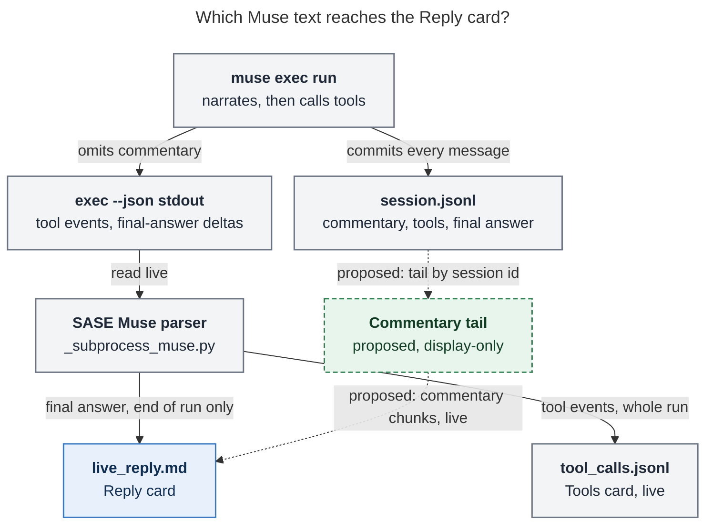

# Muse's Reply Card Stays Empty Because `muse exec --json` Drops Commentary

_Consolidated report · 2026-10-26 · sase `master` @ `60832648be` (the athena TUI build in
the screenshot) · Muse Code `1.4.13-R6996.1` on athena and apollo_

Sources: five independent researcher reports in this directory (`__cdx`, `__cld`,
`__grk`, `__mus`, `__gem`), plus my own verification. I re-read the Muse adapter, stream
loop, and Reply-card render paths. I re-inspected the finished `bob-cli-cn.1` run and its
Muse session log on athena (read-only), spot-checked when commentary started, scanned the
installed Muse binary, and checked whether `sase-core` owns any provider stream parsing.

## Bottom line

**The Reply card is empty because the text it needs never reaches `live_reply.md`. The
TUI, stdout buffering, and the delta parser are not at fault.**

Since about October 4–5, Muse models write a short **commentary** message before most
tool calls, such as *"Plan is clear — building the additive typical field now."* That is
the same kind of narration Claude and Codex write. Muse records each message in its
private session log (`session.jsonl`) as a `runtime.session` /
`assistant_message_committed` event with `"phase": "commentary"`. **`muse exec --json`
does not put those messages on stdout**, and stdout is the only stream SASE reads.

On stdout, Muse sends tool lifecycle events throughout the run. Reply text arrives only
as `run.output.delta` fragments of the **final answer**, after the last tool call.
SASE's Muse adapter writes `live_reply.md` only from those deltas. So the file stays at 0
bytes for nearly the whole run, and the Reply card correctly shows `Waiting for agent
response...`.

**Why only Muse:** every other adapter gets its between-tool narration on the
machine-readable stream it already parses:

- Claude: assistant `text` blocks.
- Codex: `agent_message` items.
- Grok: its own stream events.

Muse's narration exists, but only in a log SASE reads after the run, and only for token
usage.

**Recommended fix:** while `muse exec` runs, have the Muse adapter tail the session log
it already names with `--session-id`. Write each root-run `phase == "commentary"` message
to `live_reply.md` as its own timestamped chunk. Keep the stdout delta and terminal path
unchanged for the final answer. This is display-only and fail-soft, and it needs no TUI
change. Also fix the test fixture that hid the gap, and ask upstream to put commentary on
`exec --json` so the tail can be deleted later. Details are in
[Recommended solution](#recommended-solution).



_Figure: Muse's mid-run narration goes only to its session log, so the Reply card gets
text only when the final answer streams. The dashed path is the proposed fix._

## The reported agent, end to end

`bob-cli-cn.1` ran on athena with model `muse-spark-1.3-contributor`. Its artifacts are
in `~/.sase/projects/gh_bobs-org__bob-cli/artifacts/ace-run/202610/26/20261026131420/`.
Its `run_metadata.json` records Muse session `66b7ac36-396c-49f1-a3ef-58d4e1a43008`.

cdx, cld, and grk observed the run while it was still going. I re-checked the finished
artifacts and the full session log afterwards.

| Time (UTC) | Event | Source |
| --- | --- | --- |
| 17:23:56 | Main step starts; `live_reply.md` is created empty | cld, grk (file mtime) |
| 17:24:00.69 | First commentary: *"Fixing your phase bead — reading scope and landing the work."* | session log, seq 51 |
| 17:45:21 | Screenshot: 131 tools, Reply card on the placeholder; about 20 commentary messages already logged | cld |
| 17:52:55 | `live_reply.md` and `live_reply_timestamps.jsonl` both 0 bytes; 25 commentary messages logged | cdx (live) |
| 18:01:48.88 | Last of **31** commentary messages: *"Committed — recording parity and follow-ups, then closing."* | session log (my count) |
| **18:02:36.05** | **First and only `live_reply.md` chunk opens**: the final answer streams until 18:02:39.27 (1,588 bytes, one timestamp row) | `live_reply_timestamps.jsonl`, file mtime |
| 18:02:39.32 | Final answer committed (`phase` absent): *"Done. Phase `bob-cli-cn.1` is complete…"* | session log |
| 18:03:08 | Muse parse finished; `run_metadata.json` written | artifact mtime |
| 18:03:50 | `done.json` | artifact mtime |

The Reply card was blank for **about 38½ minutes**, while 31 user-facing progress
messages sat in a file SASE never read during the run. All 31 were top-level lines
carrying this run's session `stream.id` and its single `run_id`. None came from a child
or reminder session. The whole log has 6,439 lines, about 6.5 MB.

A raw commentary record (compact JSON, abridged):

```json
{"schema_version":1,"stream":{"kind":"session","id":"66b7ac36-…"},"sequence":51,
 "recorded_at":1793035440691534,"record_type":"event","durability":"durable",
 "payload_type":"runtime.session",
 "payload":{"kind":"run","run_id":"01a1793d-…",
            "event":{"kind":"assistant_message_committed","message_id":"fbb3630d-…",
                     "phase":"commentary","response_id":"resp_…",
                     "text":"Fixing your phase bead — reading scope and landing the work."}}}
```

## Proof that stdout carries no commentary

Three researchers checked this independently. Their results agree.

- **cdx: deterministic probe.** cdx ran the installed `1.4.13-R6996.1` binary against
  a loopback fake model provider that returned one `phase: "commentary"` message plus a
  tool call, then a final answer. The session log held both messages. Stdout held
  **one** `run.output.delta`, with the final answer only, plus the terminal event. It
  also had no MSP `{method, params}` notifications.
- **cld: live probe.** cld ran a real model on a four-step shell task. The session log
  had four commentary messages, one before each tool call. The 143 stdout envelopes had
  none of them. `run.output.delta` appeared only at 17.5–17.8 s, carrying the final
  answer.
- **mus: timed live probe.** In a 65.6 s tool run, the first `run.output.delta` arrived
  at 49.2 s. All 47 deltas were fragments of the final summary, and they concatenated
  byte-for-byte into the terminal text.
- **My binary scan.** The installed binary's `run.*` vocabulary is `run.output.delta`,
  `run.terminal.*`, and `run.usage`. There is no message or commentary event.
  `muse exec --help` has no flag that adds one. `1.4.13-R6996.1` is also the current
  `muse-stable` release in `.muse-release-info.json`, so upgrading Muse does not fix
  this today.

## Proof that the rest of SASE works

- **The parser does what it says.** `_process_muse_json_line` in
  `src/sase/llm_provider/_subprocess_muse.py` sends `run.output.delta` to
  `_stream_output_delta`. That function is the **only** writer of `live_reply.md`. It
  writes `payload.text` with `append_stream_delta` and flushes on every delta.
  `_capture_run_terminal` stores the authoritative text in memory only. Other payload
  types are ignored on purpose. The session log is opened only after the process exits,
  to sum `model_completed` usage (`_muse_session_usage.py`).
- **The transport is live.** `stream_json_lines` uses nonblocking descriptor reads and a
  `select` loop that wakes at least every 0.1 s. Tool events reach `tool_calls.jsonl`
  throughout the run. cdx replayed captured Muse stdout through the real parser with
  the child held alive. The reply stayed empty, but an early-delta control appeared at
  once.
- **The TUI follows correctly.** The running-agent render
  (`_agent_display_render_main.py`) shows timestamped chunks, then the raw live reply,
  then `Waiting for agent response...`. On athena, cld loaded the real `bob-cli-cn.1` row:
  - `is_live_reply_agent()` was true;
  - the follow was armed on the right directory.

  The follow was watching a file with nothing in it.
- **Other providers stream fine in the same TUI.** This is cld's athena corpus, Oct
  5–26, counting runs with at least 5 tool calls:

| Provider | Runs | Median `live_reply.md` chunks per run | Runs with ≥3 chunks |
| --- | --- | --- | --- |
| claude | 579 | 9 | 97% |
| codex | 943 | 6 | 98% |
| grok | 498 | 9 | ~100% |
| **muse** | **1,015** | **1** | **2%** |

## Why the earlier fixes didn't help

Two earlier studies covered this symptom: `202610/muse_live_reply_streaming` (Oct 3) and
`202610/muse_reply_card_follow_skips_workflow_agents` (Oct 9). Both found and fixed real
problems:

- `2307212bcd`: selected-agent live-reply follow.
- `392983091d`: incremental JSONL draining.
- `8150a76d46`, Oct 10: follow workflow rows via `is_agent_entry`.

Both studies relied on one premise: **"Muse writes no text alongside tool calls."** That
premise held for Muse 1.4.2 and stopped holding a day later. My spot check of athena's
session logs, files containing `"phase":"commentary"`:

| Session-log date | Sessions | With commentary |
| --- | --- | --- |
| Sep 30 – Oct 3 | 635 | **0** |
| Oct 4 | 1 | 1 |
| Oct 5 | 70 | 70 |
| Oct 6 | 137 | 137 |
| Oct 20 | 43 | 43 |
| Oct 25 | 108 | 108 |

cld's full scan agrees: 0 of 1,918 tool-using sessions had commentary from Aug 7 to Oct 3,
and all 1,377 had it from Oct 5 to Oct 26, with 18,903 messages. The exact Muse release
that started this falls between `1.4.2-R4684.1` and `1.4.4-R5419.1`. The Oct 9 study
inspected stdout and SASE's own artifacts, and neither can show commentary, so the change
went unnoticed. The fixes made the TUI follow the file correctly, but the file had
nothing to show.

The tests did not catch it either. `gated_muse_script()` in
`tests/ace/tui/_live_reply_follow_mounted_helpers.py` emits `run.output.delta`
**mid-run**, which real Muse never does during tool phases. The committed stdout fixtures
(`R708.1`, `R3401.1`) predate commentary, and their assertions check the artifact only
after replay finishes.

## How much the user is missing

These are cld's measurements for 217 athena Muse runs, Oct 20–26, joined to their
session logs:

- 2,705 commentary messages were written (median 7 per run), and **0** reached
  `live_reply.md`.
- The first commentary arrives a median 3.1 s after start.
- The Reply card is empty for a median **84%** of each run (p90 93%). For runs over
  60 s, that is a median **17.9 minutes** (p90 46.6, max 84.4).
- From the first reply text to `done.json` is a median 178 s. The final answer does
  appear before DONE, but only after Muse's work is over, so it reads as "after it
  completes".

A prototype tailer polling every 0.2 s read the commentary line **54 ms** after Muse's
`recorded_at`, before the matching tool call was committed. The log is flushed promptly
enough to drive a live display.

## Where the researchers disagreed, and how I resolved it

| Question | Positions | Resolution |
| --- | --- | --- |
| Does Muse produce mid-run text? | **cdx, cld, grk:** yes, `phase: "commentary"`, in the session log. **mus, gem:** no, Muse is "silent" during tools. | **Yes.** mus and gem looked only at stdout, which is correct as far as it goes. I counted 31 commentary messages in `bob-cli-cn.1`'s log. Every session since Oct 5 has them. |
| What should fill the card? | **cdx, cld, grk:** the real commentary. **mus, gem:** synthetic "Running tool: …" breadcrumbs from `task.lifecycle.*`, or a TUI tool-count fallback. | **Real commentary.** Breadcrumbs repeat the Tools card. They would also add non-model text to `live_reply.md` permanently, and DONE replies still render those chunks. A TUI fallback changes nothing about the empty file. |
| Accuracy of gem's code evidence | gem quotes `_handle_muse_envelope`, `payload.get("delta")`, `append_stream_text(live_reply_path, …)`, `state.seen_output_delta`. | **None of these exist.** The real parser dispatches in `_process_muse_json_line`, reads `payload.text`, and calls `append_stream_delta`. gem's conclusions about the gate are right, but its excerpts are reconstructions. Its claim that the process exits "milliseconds" after the first delta is wrong: `bob-cli-cn.1`'s final answer streamed for 3 s, its parse finished 32 s after the first reply byte, and `done.json` landed 74 s after it. |
| Rust core or Python? | **cdx:** put normalization and dedup in `sase_core` behind `sase_core_rs`. **cld, grk:** Python adapter only. | **Python adapter.** `sase-core` has no provider stream parsing. Its Muse-specific code is quota normalization (`provider_usage/muse.rs`). Every `_subprocess_*.py` that writes `live_reply.md` is Python. The cross-frontend contract is the `live_reply.md` / timestamps artifact, which every frontend already reads. Reopen this if provider stream parsing ever moves to core as a whole. |
| Thread or same-thread poll? | **cld:** daemon thread plus write lock. **grk:** poll from the stream loop. **cdx:** share the stdout writer. | **Same-thread tick (preferred).** `stream_json_lines` already wakes at least every 0.1 s (`select` timeout), even when stdout is quiet. An optional `on_tick` callback avoids a lock and orders commentary and delta writes deterministically. A thread with a lock is an acceptable alternative. |
| `retained_frame` containers | **cdx:** the log wraps records in `retained_frame` children. | **Tolerate them, but don't rely on them.** In `bob-cli-cn.1`, all 31 commentary records were top-level lines: a raw `grep` count matched a frame-aware parse. |

## Recommended solution

### 1. Commentary tail in the Muse adapter (the fix)

All of this is provider-adapter code in `src/sase/llm_provider/`. The `live_reply.md`
contract does not change, so **no TUI change and no `sase_core` change** are needed.

1. **A new module, for example `_muse_commentary_tail.py`.** It holds the session id,
   byte offset, partial-line buffer, and a set of seen `message_id`s.
   - **Locate.** Call `find_muse_session_log(session_id)`, rate-limited, until the
     file exists. The existing glob already handles runs that cross midnight.
   - **Read only new bytes.** Logs reach many MB of tool output, so never rescan from
     the start.
   - **Prefilter cheaply before parsing.** Check
     `b'"assistant_message_committed"' in line and b'"phase":"commentary"' in line`.
     The log is compact JSON, so this matches every record in `bob-cli-cn.1`.
   - **Accept a record only when all of these hold:**
     - `payload_type == "runtime.session"`;
     - `payload.kind == "run"`;
     - `event.kind == "assistant_message_committed"`;
     - `event.phase == "commentary"`;
     - `stream.id == session_id`;
     - `text` is a non-empty string;
     - its `message_id` has not been seen before.

     Look inside `retained_frame` children too, if present.
   - **Never write the unphased final message.** Stdout deltas already stream it.
     Never write `reasoning_summary_delta` either: that is thinking, not reply text.
2. **Drive it from the stream loop.** Add an optional `on_tick: Callable[[], None]`
   parameter to `stream_json_lines`, called once per loop pass. The tail polls the
   filesystem at most every ~0.25 s. In `stream_and_parse_muse_json_output`:
   - pass the tick when `session_id` is set and `live_reply_file` is open;
   - after `stream_json_lines` returns, do one final drain **before** the reply files
     are closed.
3. **Write each message as its own chunk.** Add `_append_commentary(text, state)`, which:
   - calls `_close_delta_chunk(state)`;
   - calls `append_stream_delta(text, …, new_chunk=True)`;
   - closes the chunk again, so the next delta opens a fresh one.

   The result is one timestamp divider per message, the same shape Codex and Claude
   produce. **Do not** add commentary to `terminal_texts` or `streamed_texts`. These must
   stay exactly as they are:
   - `InvokeResult.content`;
   - delta salvage;
   - the wait-claim guard;
   - what host finalizers see.
4. **Fail soft and say so.** A missing log, an unreadable line, or a schema surprise
   produces one bounded diagnostic, for example `muse_commentary_tail_unavailable`,
   through `append_tool_call_collector_diagnostic`. It never raises. At worst, the card
   looks exactly as it does today. SASE must also never pass `--no-session-log`; usage
   recovery already depends on the log.
5. **Behavior to expect.**
   - Retries and wait-continuations start a fresh `muse exec` with a new `--session-id`,
     and each cycle gets its own tail. `live_reply.md` is opened in append mode, so
     chunks accumulate across cycles as they do now.
   - After completion, `render_agent_reply_content` still prefers timestamped chunks.
     DONE Muse replies will therefore list the commentary chunks above the final answer,
     as Codex and Claude replies already do.
   - Optionally, write `muse_session_id` to `run_metadata.json` at launch rather than
     after exit (cdx), so other tools can find the live log mid-run.

### 2. Tests that would have caught this

- **Unit.** Run the tail against a sanitized `1.4.13` session-log excerpt containing:
  - commentary records;
  - an unphased final message;
  - `retained_frame` and marker records;
  - a partial last line;
  - a duplicate `message_id`;
  - a foreign `stream.id`.

  Assert that only the commentary comes out, in order, once each. Add a second case
  where the log never appears: one diagnostic, no exception.
- **Integration (temporal).** A fake `muse` writes commentary into a session log under
  a temporary `XDG_DATA_HOME`. On stdout it emits only `task.lifecycle.*` and then blocks
  on a handshake. Assert:
  - before the handshake releases, `live_reply.md` already holds the commentary;
  - after release, the final deltas follow;
  - the returned content equals the terminal text alone;
  - the final answer is not duplicated.
- **Fix the fixture.** Change `gated_muse_script()` to match real Muse: no mid-run
  `run.output.delta`, with commentary in the session log only. Then the mounted TUI tests
  exercise the production shape. Recapture stdout and session-log fixtures at
  `1.4.13-R6996.1`.

### 3. Small hardening (optional)

If a run stream reaches `run.terminal.*` without writing any delta to `live_reply.md`,
append the terminal text there (grk, gem). This has never been observed. It only
protects against a future build that drops deltas.

### 4. Upstream request (in parallel)

Ask Muse Code to export assistant message phase on `exec --json`. Either of these would
work:

- a `phase` field on `run.output.delta`;
- a durable `run.output.message.committed` event.

The point to make: headless exec currently exports less than the interactive surfaces
do. When a release ships it, parse that event in `_process_muse_json_line`, dedupe by
`message_id` against the tail during the transition, and then delete the tail.

### Options not chosen

| Option | Verdict |
| --- | --- |
| TUI repaint or follow changes | **Reject.** The follow works, but the file is empty. |
| Synthetic tool breadcrumbs in the Reply (mus, gem) | **Reject.** They duplicate the Tools card and are not the model's words. The real commentary exists. |
| Show reasoning summaries in the Reply | **Reject for Reply.** That is thinking content; it could go to a thinking pane in a separate follow-up. |
| Prompt Muse to narrate on stdout via shell, or in the final answer | **Reject.** It costs tokens on every run, duplicates existing text, and earlier probes found it unreliable. |
| Migrate to `muse serve` (MSP, with `agentMessage` items and `messagePhase`) | **Defer.** This is the credible long-term single transport, and SASE already calls `muse serve` for `usage/read` quota probes. But it changes launch, cancellation, and session lifecycle. Also, the official SDK schema says exec shares `{method, params}` notifications, while the installed binary still emits the older envelope. Validate before committing to it. |

### Fit with project decisions

- **`decisions:adapters-normalize-harnesses`.** That decision rejected parsing Muse's
  private session log for **wait semantics**, where correctness would depend on a format
  that changes with each release. This tail is different:
  - it is display-only;
  - it is fail-soft;
  - SASE already reads the same log for token usage.

  The cost is one more consumer of a private format, retired once the upstream request
  ships.
- **Rust core boundary.** No conflict. Provider stream parsing is adapter glue that
  lives in Python today, and every frontend consumes the resulting artifact. See the
  disagreement table above.
- **Docs.** Once the tail lands, update the event-stream contract in
  `docs/reference/providers/muse.md`, around line 171. Today it says live reply comes only
  from `run.output.delta`.

## How to verify after the fix

1. New agent launches pick up the adapter change once it is installed. The TUI itself
   needs no change.
2. Launch a tool-heavy Muse agent and select it. Within about a second of each commentary
   message, starting a few seconds into the run, a one-line chunk with a timestamp
   divider should appear. The Tools count keeps climbing alongside it.
3. During the run, `tail -f $SASE_ARTIFACTS_DIR/live_reply.md` grows, and
   `live_reply_timestamps.jsonl` gains one row per message.
4. The final answer appears once, not twice, and the returned content is unchanged.
5. Muse's chunk count per run should move from a median of 1 toward the 6–9 that the
   other providers show.

## Limits

- I did not tap the live agent's stdout pipe, because reading it would consume its
  data. The stdout claim rests on the cdx, cld, and mus probes plus the binary scan.
- Commentary density varies with model and effort. One probe produced a message before
  every tool call, and another produced only one.
- The exact Muse release that started emitting commentary is unknown; it is within
  `1.4.2`–`1.4.4`.
- Corpus statistics cover athena only.
- No mounted TUI has been driven against real commentary yet. The proposed integration
  test closes that gap.
