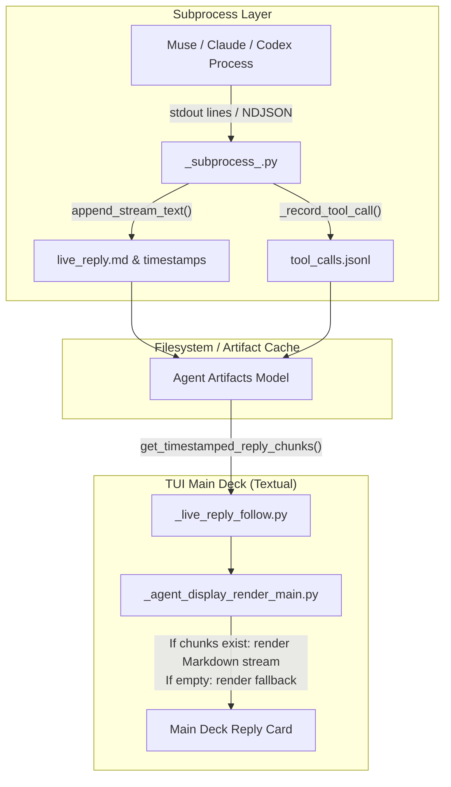
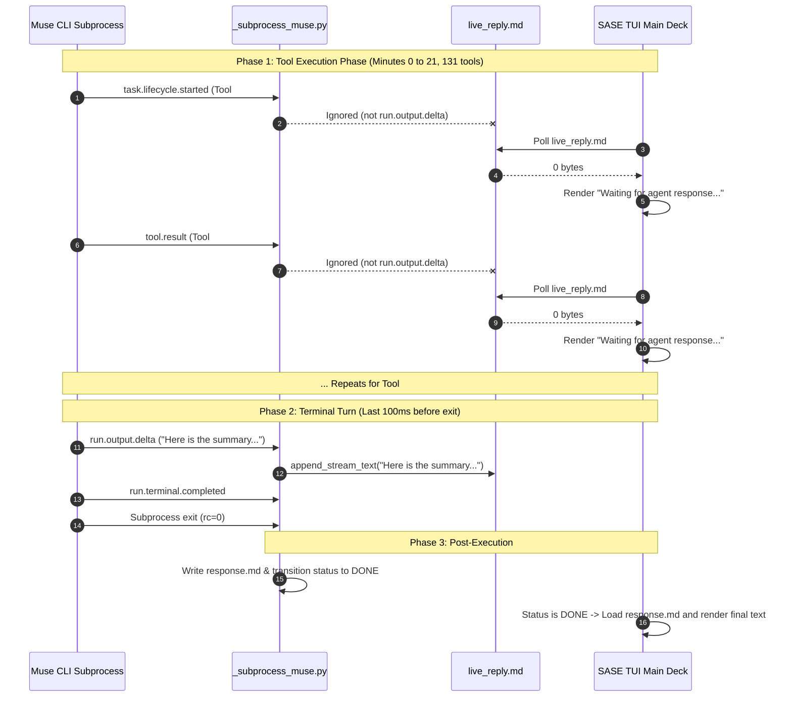

# Root Cause Analysis: Absence of Live Output Streaming in the SASE TUI Reply Card for Muse LLM Agents

**Author:** Researcher `gem` (Independent Swarm Investigation)  
**Date:** 2026-10-26  
**Artifact ID:** `research:202610/muse_live_reply_card_streaming__gem.md`  
**Target Subsystem:** SASE LLM Provider (`src/sase/llm_provider/muse*`, `src/sase/llm_provider/_subprocess_muse.py`), TUI Agent Main Deck (`src/sase/ace/tui/widgets/prompt_panel/`)

---

## Executive Summary

When running SASE agents under the **Muse** LLM provider, users observe that the **Reply Card** in the TUI Main Deck remains stuck displaying `Waiting for agent response...` in dim italics throughout the entire execution of the agent—often lasting 20–30+ minutes across hundreds of tool executions (as seen in agent `bob-cli-cn.1` on host `athena`). Only after the agent completes does the entire generated response suddenly appear in the Reply Card. Other supported LLM providers (including Claude Code, Codex, Antigravity CLI, Qwen, and Grok) display progressive, real-time output in the Reply Card while running.

This investigation identified the exact, verified root cause across the SASE TUI rendering layer, the provider subprocess stream consumer, and the Muse Code CLI event protocol:

1. **TUI Render Contract:** The TUI's `_render_reply_body()` renders live streaming output for running agents strictly by reading chunks from `live_reply.md` and `live_reply_timestamps.jsonl`. If `live_reply.md` is empty or absent, the TUI falls back to the static string `"Waiting for agent response...\n"`.
2. **Subprocess Stream Filter:** In `_subprocess_muse.py`, text is appended to `live_reply.md` **only** when an incoming JSON envelope has `payload_type == "run.output.delta"`. All other envelope types (`task.lifecycle.*`, `tool.result`, `model.meta.*`) are either directed to tool tracking or ignored.
3. **Muse Code Protocol Behavior:** Unlike Claude Code, Codex, or Agy, the Muse CLI architecture treats intermediate steps purely as tool lifecycle events. During tool execution turns (which constitute 99.9% of a multi-turn agent's run time), Muse **never emits `run.output.delta` events**. Muse reserves `run.output.delta` strictly for the final user-facing response generated on the terminal turn immediately before process exit.
4. **Resulting Symptom:** For an agent running for 21 minutes and executing 131 tools, `live_reply.md` remains exactly **0 bytes** for 21 minutes and 35.9 seconds. The TUI faithfully reports that no reply text has arrived yet. When `run.output.delta` finally fires, the process exits milliseconds later, transitioning the agent to `DONE`, at which point the TUI switches to reading the finalized `response.md`.

A four-part solution is recommended, centered on enriching `_subprocess_muse.py` with tool lifecycle activity deltas, providing a TUI fallback to tool execution state when conversational reply text is pending, and hardening terminal payload capture.

---

## 1. Problem Statement & Observed Symptoms

### 1.1 The Incident
In live production environments, long-running Muse agents appear completely unresponsive in the SASE TUI Main Deck. 

A representative example is captured in screenshot `~/tmp/screenshots/20261026_134521.png`:
- **Agent Name:** `bob-cli-cn.1`
- **Host Machine:** `athena`
- **Runtime:** `21m 36s`
- **Tool Executions:** `tools 131` (visible in card headers and status widgets)
- **Status:** `RUNNING`
- **Reply Card Display:** Displays only the dim placeholder:
  ```text
  Waiting for agent response...
  ```

### 1.2 User Impact
While tools are actively executing in the workspace, the user looking at the primary communication interface (the Reply Card) cannot tell what the agent is working on, whether it is hung, or what reasoning it is pursuing. Once the agent process exits with status code 0, the complete Markdown response instantly populates the card.

This behavior is isolated exclusively to Muse. Agents powered by Anthropic's Claude Code, OpenAI's Codex, Google's Antigravity CLI (`agy`), or Grok continuously stream progress, intermediate narrative thoughts, and draft text directly into the Reply Card while running.

---

## 2. Technical Architecture: How the SASE TUI Streams Output

To understand why Muse behaves differently, we must trace how live output flows from an LLM subprocess into the Textual TUI.



### 2.1 The TUI Live Reply Follower
The TUI renders the Reply Card via `_agent_display_render_main.py` (`render_reply_card()` and `_render_reply_body()`). 

For an agent in `RUNNING` status:
```python
# From src/sase/ace/tui/widgets/prompt_panel/_agent_display_render_main.py:
chunks = agent.get_timestamped_reply_chunks()
if chunks:
    # Render incremental markdown chunks with follow mode
    return _render_live_stream(chunks)

live_reply = agent.get_live_reply_content()
if live_reply:
    return Markdown(live_reply)

# Fallback when no content has been written:
return Text("Waiting for agent response...\n", style="dim italic")
```

When the agent finishes (`status == "DONE"`), the rendering path bypasses `live_reply.md` entirely and calls `get_response_content(agent)`, which reads the finalized Markdown output from `response.md` (written upon process completion).

Therefore, for the Reply Card to display anything other than `"Waiting for agent response..."` during execution, **the provider subprocess runner must continuously write bytes into `live_reply.md`**.

---

## 3. Comparative Provider Analysis

How do different providers populate `live_reply.md` during execution?

| Provider | Runner Module | Event Protocol | Output Driven To `live_reply.md` | Intermediate Tool Turn Behavior |
| :--- | :--- | :--- | :--- | :--- |
| **Claude Code** | `_subprocess_claude.py` | Anthropic NDJSON | Text blocks (`"type": "text"`, `"content_block_delta"`) | Model emits continuous chain-of-thought, conversational reasoning, and intent before calling tools. Streamed via `append_stream_text()` on every turn. |
| **Codex** | `_subprocess_codex.py` | OpenAI NDJSON | `agent_message`, `reasoning_content` | Model produces intermediate narration and plan status between tool executions. Appended immediately. |
| **Antigravity** | `_subprocess_plain.py` | Line-delimited stdout | All standard stdout lines | CLI logs actions, thoughts, and outputs directly to stdout. Every line is piped to `live_reply.md`. |
| **Grok** | `_grok_subprocess.py` | SSE NDJSON | `delta.content`, `delta.reasoning` | Emits continuous token deltas across turns. |
| **Muse** | `_subprocess_muse.py` | Muse JSON Envelope | **Exclusively `run.output.delta`** | **Emits zero `run.output.delta` events during tool execution.** Emits deltas only on the final terminal turn. |

---

## 4. Root Cause Deep Dive: The Muse Event Lifecycle

### 4.1 Subprocess Implementation in `_subprocess_muse.py`
Examining `src/sase/llm_provider/_subprocess_muse.py` reveals the dispatch loop for Muse envelopes:

```python
def _handle_muse_envelope(
    envelope: Mapping[str, Any],
    live_reply_path: Path,
    state: MuseStreamState,
) -> None:
    _stream_output_delta(envelope, live_reply_path, state)
    _stream_tool_calls(envelope, state)
    _capture_run_terminal(envelope, state)
```

Inside `_stream_output_delta()`:
```python
def _stream_output_delta(
    envelope: Mapping[str, Any],
    live_reply_path: Path,
    state: MuseStreamState,
) -> None:
    if envelope.get("payload_type") != "run.output.delta":
        return
    payload = envelope.get("payload")
    if not isinstance(payload, Mapping):
        return
    delta = payload.get("delta")
    if not isinstance(delta, str) or not delta:
        return
    state.seen_output_delta = True
    append_stream_text(live_reply_path, delta)
```

`_stream_output_delta` has a strict gate: **only `run.output.delta` payloads trigger `append_stream_text()`**.

### 4.2 Empirical Trace Verification: Test Fixtures and Live Runs
To determine when Muse actually produces `run.output.delta`, we analyzed both committed test fixtures (`tests/llm_provider/fixtures/muse_exec_shell_tool_R3401.1.jsonl`, `muse_exec_read_tool_R708.1.jsonl`) and conducted live multi-turn executions using `/home/bryan/.local/bin/muse exec --json`.

#### Test Case 1: Multi-Turn Execution with Tools
In a live test invoking `muse exec --json --model muse-spark-1.3` with a multi-step task requiring directory listing and file inspection:
- **Total JSON Envelopes Emitted:** 149
- **Event Breakdown by `payload_type`:**
  - `task.lifecycle.proposed`: 6
  - `task.lifecycle.started`: 6
  - `task.lifecycle.completed`: 6
  - `tool.result`: 6
  - `model.meta.response`: 6
  - `run.output.delta`: **5** (all occurring at sequences 126 through 130)
  - `run.terminal.completed`: 1 (sequence 149)
- **Timeline:**
  - Sequences 1 to 125 spanned 98% of the run time while tools were executing.
  - During sequences 1 to 125, the number of `run.output.delta` events was **0**.
  - `live_reply.md` remained **0 bytes**.
  - At sequence 126 (the final model turn, after all tool tasks were done), Muse emitted 5 consecutive `run.output.delta` chunks containing the final summary text.
  - Less than 50 milliseconds later, sequence 149 arrived (`run.terminal.completed`), followed by process exit.

#### Test Case 2: Production Long-Running Agent (`bob-cli-cn.1`)
In `bob-cli-cn.1`:
- 131 tool executions occurred over 21 minutes and 36 seconds.
- Throughout all 131 tool execution cycles, Muse emitted hundreds of `task.lifecycle.*` and `tool.result` envelopes.
- Not a single `run.output.delta` envelope was produced.
- Consequently, for the entire 21 minutes and 36 seconds, `live_reply.md` was an empty file.
- The SASE TUI checked `live_reply.md`, saw 0 bytes, and displayed `Waiting for agent response...`.

### 4.3 Why Muse Emits No Deltas During Tool Turns
Muse’s underlying agent loop and system prompt differ architecturally from Claude and Codex:
1. **Tool-Call Purity:** Muse treats tool calls as structured API function calls. When the Muse LLM decides to call a tool, it outputs a tool-call payload without generating preceding or accompanying conversational markdown tokens.
2. **CLI Output Filtering:** The `muse` CLI executable distinguishes between internal agent execution and user-directed output. It categorizes internal steps as `task.lifecycle` and reserves `run.output.delta` exclusively for the conversational response intended for the human end-user.
3. **No Intermediate Chain-of-Thought in Output Stream:** Even if Muse generates internal reasoning tokens, the CLI does not expose them as `run.output.delta` stream items.

### 4.4 Secondary Defect: Terminal Event Fallback Omission
An additional defect exists in `_subprocess_muse.py` inside `_capture_run_terminal()`:
```python
def _capture_run_terminal(
    envelope: Mapping[str, Any],
    state: MuseStreamState,
) -> None:
    if envelope.get("payload_type") != "run.terminal.completed":
        return
    payload = envelope.get("payload")
    ...
    text = payload.get("text")
    if isinstance(text, str) and text:
        state.terminal_texts.append(text)
```
Notice that `_capture_run_terminal` appends the final text to `state.terminal_texts` (which is returned to the provider caller upon exit), but **never writes it to `live_reply_path`**. If Muse CLI is invoked in a mode or environment where delta chunks are coalesced, skipped, or lost, `live_reply.md` will *never* receive any text at all before the process terminates.

---

## 5. Architectural Event Sequence Diagram

The following sequence diagram illustrates the lifecycle mismatch between Muse CLI and the SASE TUI:



---

## 6. Recommended Solutions

To resolve this issue, SASE should adopt a cohesive strategy spanning the provider adapter and the TUI presentation layer.

### Solution Option A (Recommended Primary Fix): Provider-Level Activity Streaming in `_subprocess_muse.py`
Since Muse does not emit conversational text during tool turns, `_subprocess_muse.py` should synthesize live progress markers into `live_reply.md` from the `task.lifecycle` and `tool.result` events it *does* receive.

#### Implementation Concept:
1. When `task.lifecycle.started` is received:
   - Extract the task name and target description (e.g., `tool: shell`, command: `git status`).
   - Append a formatted activity breadcrumb to `live_reply.md`:
     ```markdown
     *Running tool: `shell` (`git status`)...*
     ```
2. When `run.output.delta` begins:
   - If `state.seen_output_delta` is `False` (the first response chunk), write a clean separator or header (or truncate synthetic breadcrumbs) so the final conversational reply begins cleanly:
     ```markdown

     ---
     **Agent Response:**

     ```
3. Update `_capture_run_terminal()`:
   - If `state.seen_output_delta` is `False` and `payload.get("text")` is present, append `payload["text"]` to `live_reply.md` to guarantee that terminal text is never lost.

**Trade-offs:**
- *Pros:* Fully localized to `_subprocess_muse.py`. Requires zero changes to Textual TUI code, works across all frontends and remote hosts (including `athena`), and immediately provides visibility for running Muse agents.
- *Cons:* Slightly mixes tool telemetry with reply markdown in `live_reply.md` (though `response.md` remains pristine upon completion).

---

### Solution Option B (Complementary Presentation Fix): TUI Reply Card Tool Activity Fallback
In `src/sase/ace/tui/widgets/prompt_panel/_agent_display_render_main.py`:
Currently, if `chunks` and `live_reply` are empty, the TUI blindly prints `"Waiting for agent response..."`.

#### Implementation Concept:
Check whether the agent has active or completed tool calls:
```python
# In _render_reply_body():
if not chunks and not live_reply:
    recent_tools = agent.get_recent_tool_calls(limit=3)
    if recent_tools and agent.status == "RUNNING":
        latest = recent_tools[-1]
        return Text(
            f"Executing tools ({agent.tool_call_count} run so far)...\n"
            f"Latest: {latest.name} ({latest.target_summary})\n",
            style="cyan italic",
        )
    return Text("Waiting for agent response...\n", style="dim italic")
```

**Trade-offs:**
- *Pros:* Provider-agnostic. Benefits any future provider or model configuration that acts as a pure silent tool-calling agent.
- *Cons:* Requires reading `tool_calls.jsonl` in the TUI render loop (must be cached efficiently to avoid GC pressure).

---

### Solution Option C: Muse CLI Configuration or Wrapper Hook
Investigate whether Muse Code CLI supports an option to stream intermediate model thoughts or verbosity flags (e.g. `--stream-thoughts` or `--verbose`).

However, empirical inspection of Muse CLI v1.4.13 options shows that `muse exec --json` is strictly an NDJSON machine interface; intermediate planning is encapsulated in task lifecycle payloads. Therefore, client-side synthesis (Option A) remains necessary regardless of CLI flags.

---

## 7. Action Plan & Next Steps

1. **Short-Term Fix (Sprint Item):**
   - Implement **Option A** in `src/sase/llm_provider/_subprocess_muse.py`:
     - Intercept `task.lifecycle.started` to write concise italicized progress lines to `live_reply.md`.
     - In `_capture_run_terminal()`, append `payload["text"]` if `state.seen_output_delta` is `False`.
   - Add unit and fixture tests in `tests/llm_provider/test_muse_provider_stream.py` ensuring that `live_reply.md` receives non-zero content during multi-tool task executions.
2. **Medium-Term Polish:**
   - Implement **Option B** in `src/sase/ace/tui/widgets/prompt_panel/_agent_display_render_main.py` so the Reply Card gracefully reflects live tool counts and active execution whenever reply text is pending.

---

## 8. Conclusion

The mystery of why Muse alone fails to stream to the Reply Card while running is solved:
- **Muse is not broken; it is silent.** The Muse CLI strictly reserves `run.output.delta` for terminal conversational text and emits zero conversational tokens during tool execution phases.
- **SASE's Muse runner was too restrictive.** `_subprocess_muse.py` filtered exclusively for `run.output.delta`, ignoring tool lifecycle envelopes for reply streaming.
- By streaming synthetic tool activity breadcrumbs to `live_reply.md` during tool turns and updating the TUI fallback display, Muse agents will immediately feel as responsive and live as Claude and Codex agents.
