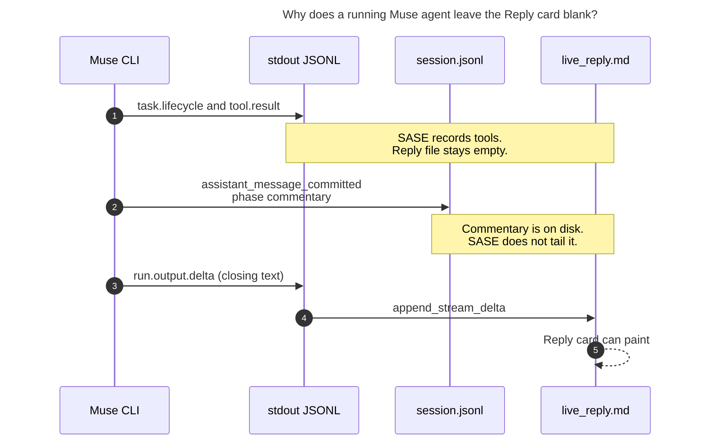

# Muse Reply card stays empty until the agent completes

**Researcher:** grk (independent swarm report)  
**Symptom:** On the Agents-tab main deck, a running Muse agent shows `Waiting for agent response...` in the Reply card for the whole turn. The reply appears only after the agent finishes. Other providers stream into that card while they run.  
**Exhibit:** screenshot `~/tmp/screenshots/20261026_134521.png` — agent `bob-cli-cn.1` on athena, `MUSE(muse-spark-1.3-contributor)`, 21m36s elapsed, Tools card at 131, Reply card still on the waiting placeholder.

## Verdict

This is a Muse provider live-reply gap, not a TUI follow bug.

Muse Code `1.4.13-R6996.1` writes mid-turn assistant narration to the on-disk session log as `runtime.session` / `assistant_message_committed` (`event.phase: "commentary"`). The headless `--json` stdout stream that SASE actually parses does not carry those lines. SASE only appends `live_reply.md` from stdout `run.output.delta` events, and Muse emits that payload once, at the end of the whole turn, with the closing summary. The Reply card follows `live_reply.md`, so it stays on the waiting placeholder until that closing delta (or until the completed-chat view replaces the follow).

The Tools card updates because tool records come from a different stdout vocabulary (`task.lifecycle.*`, `tool.result`) that Muse does emit throughout the turn.

## Evidence

### 1. The screenshot matches an empty `live_reply.md` on a busy Muse run

On athena, while `bob-cli-cn.1` was still in `muse exec --json` (pid 2223096 / muse-bin pid 2469869, session `66b7ac36-396c-49f1-a3ef-58d4e1a43008`):

| Artifact | Observation |
| --- | --- |
| `live_reply.md` | size `0`, mtime at process start (`13:23:56`) |
| `live_reply_timestamps.jsonl` | empty |
| `tool_calls.jsonl` | 319–321 lines, ~250 KB, mtime still advancing (`13:57`) |
| `run_metadata.json` / `usage.json` / `done.json` | absent (subprocess still running) |
| Muse CLI | `muse-bin-1.4.13-R6996.1 exec --json ... --enable-shell-tool --session-id 66b7ac36-...` |

The deck strip `main 2 · files 1 · tools 131 · final running · record` is the MAIN-deck card switcher. `tools 131` is live tool-call count. `final running` is the FINAL deck's in-flight badge for a still-RUNNING agent, not proof that the commit finalizer has taken over.

The TUI follow in `src/sase/ace/tui/widgets/prompt_panel/_live_reply_follow.py` paints `Waiting for agent response...` when `live_reply.md` has no timestamp chunks and no stripped body. That is the observed card.

### 2. The same hole reproduces on apollo while this report was written

Two in-flight Muse agents on apollo showed the same split:

| Agent | `live_reply.md` | `tool_calls.jsonl` |
| --- | --- | --- |
| `ab--code` (`20261026134424`) | 0 bytes | 109+ lines, still growing |
| `research.2i.mus` (`20261026134819`, while running) | 0 bytes | 81 lines, still growing |

After `research.2i.mus` exited, `live_reply.md` jumped to 1111 bytes with **one** timestamp row. That is the end-of-turn delta, not a stream of mid-turn chunks.

### 3. Muse still emits `run.output.delta` — only at the end, and only on stdout

A headless probe against the same CLI (`muse exec --json --model muse-spark-1.3 --reasoning-effort low`, prompt *Reply with exactly the two words: streaming probe. Do not use any tools.*) exited 0. Stdout payload types:

```
runtime.command.accepted
session.run.linked
run.model.configured
turn.input.user
run.lifecycle.started
task.lifecycle.*          (reminder / model.meta.response bookkeeping)
run.output.delta          ×1, ephemeral, text = "streaming probe"
run.usage                 ×1, new in 1.4.13, unused by SASE
run.terminal.completed    ×1, durable, text = "streaming probe"
```

The delta envelope is unchanged from the R708.1 fixtures:

- `payload_type`: `run.output.delta`
- `durability`: `ephemeral`
- `record_type`: `status`
- `payload.text`: the fragment
- `payload.kind`: `run_output_delta`

A no-tool turn finishes in seconds, so the delta and the Reply card appear almost together. A tool-heavy turn (131–321 tool events) holds that delta until the model is done with every tool step.

Shipped fixtures already document this shape. `tests/llm_provider/fixtures/muse_exec_{read_tool_R708.1,write_bash_tools_R708.1,shell_tool_R3401.1}.jsonl` each contain **one** `run.output.delta` immediately before `run.terminal.completed` (`"bravo"` / `"DONE"`). The mid-word fragment tests in `tests/llm_provider/test_muse_provider_stream.py` are synthetic. They prove SASE *can* coalesce fragments; they do not show Muse emitting fragments during a tool loop.

### 4. Mid-turn narration is already on disk, under a payload SASE never reads for live reply

`$XDG_DATA_HOME/muse/sessions/YYYY/MM/DD/<session-id>/session.jsonl` is written live (athena's `bob-cli-cn.1` log was 6.5 MB and growing). It does **not** contain `run.output.delta`. It does contain the missing Reply-card text:

```json
{
  "payload_type": "runtime.session",
  "payload": {
    "event": {
      "kind": "assistant_message_committed",
      "phase": "commentary",
      "text": "Approved plan in hand — pulling the spec to implement it.",
      "message_id": "...",
      "response_id": "..."
    },
    "kind": "run",
    "run_id": "..."
  }
}
```

Phase discriminator, observed across live and completed sessions:

| Session | `phase: "commentary"` | unphased (closing summary) |
| --- | --- | --- |
| `819fa1af-...` (`ab--code`, still running) | 8 lines (*"Confirmed the build break — now applying the fixes."*, *"Build is green — now verifying the repaired tests."*, …) | 0 (turn not finished) |
| `4901f8d5-...` (short completed run) | 1 (*"Listing files, then running your two reads one by one."*) | 1 (final answer; this is what `run.output.delta` later copies) |
| `a7f2b0d9-...` (completed Muse research agent) | 5 commentary lines | 1 closing summary, identical to the single `live_reply.md` chunk |

Commentary is durable (`record_type: "event"`, `durability: "durable"`) and lands as soon as that model step commits — minutes to tens of minutes before the closing delta.

The same log also carries `reasoning_summary_delta` (thinking snippets) and `tool_batch.effect.{started,terminal}`. Those are useful for a thinking pane and for schema recapture; they are not the Reply-card text.

### 5. SASE's Muse parser only feeds `live_reply.md` from stdout deltas

In `src/sase/llm_provider/_subprocess_muse.py`:

- `_process_muse_json_line` handles `run.output.delta`, `run.terminal.*`, `run.model.configured`, and a handful of task-failure diagnostics. Every other `payload_type` is ignored.
- `_stream_output_delta` is the **only** writer into `live_reply.md` / `live_reply_timestamps.jsonl`.
- `_capture_run_terminal` stores `payload.text` in `state.terminal_texts` for `InvokeResult.content` and does **not** write the file. After the process exits, the completed-chat view can show that content; the in-flight follow cannot.
- Session-log I/O (`src/sase/llm_provider/_muse_session_usage.py`) runs **after** `muse exec` exits, and only to sum `runtime.session` / `model_completed` usage. It never tails commentary.

Claude's parser (`_subprocess_claude.py`) calls `append_stream_text` on every assistant `text` block, including the "I'll look at X" messages that precede tools. That is why Claude fills the Reply card during a tool loop. Muse has the equivalent text; it is in the session log, not in the stdout events SASE subscribed to.

### 6. The TUI follow is doing what it was told

`LiveReplyFollowMixin` watches `live_reply.md` and `live_reply_timestamps.jsonl` (watcher + 1 s stat backstop, 0.3 s throttle). An empty pair keeps the waiting placeholder. Tool-call JSONL updates do not refresh the Reply card, by design (`docs/reference/tui/agents-main-deck.md`). No TUI change is required for the first fix.

Rich `FileProxy` flush behavior (documented next to `append_stream_delta`) affects how deltas print on a Live console. It does not explain an empty file.

## Causal chain



**Caption:** Muse publishes mid-turn narration on the session log and the closing summary on stdout. SASE's live-reply path only reads the stdout delta, so the Reply card stays on the waiting placeholder until that last event.

## What this is not

- **A broken TUI follow.** Follow, throttle, and placeholder match an empty `live_reply.md`.
- **Stdout buffering of the whole JSONL stream.** Tool events reach `tool_calls.jsonl` throughout the turn, so the pipe is live.
- **A renamed `run.output.delta`.** The 1.4.13 probe still emits that payload type with `payload.text`.
- **Attempt rotation wiping the file mid-turn.** `bob-cli-cn.1` had no `attempts/` snapshot; the empty file is the original handle opened at start.
- **Muse failing to produce narration.** Eight commentary lines were already in `ab--code`'s session log while its Reply card was blank.

## Recommended solution

**Stream `assistant_message_committed` commentary into `live_reply.md` while `muse exec` is running, by tailing the session log SASE already names with `--session-id`.** Keep the existing stdout `run.output.delta` path for the closing summary.

### Primary change (this is the fix)

1. In `stream_and_parse_muse_json_output`, after creating `session_id` and opening `live_reply.md`, start an incremental tail of  
   `$XDG_DATA_HOME/muse/sessions/*/*/*/<session-id>/session.jsonl`  
   (`find_muse_session_log` already resolves that glob). The file appears shortly after Muse starts; retry the glob on the existing 0.1 s stream-loop timeout until it exists.
2. Read **new bytes only** (byte offset). The live athena log was 6.5 MB; a full rescan on every tick is too expensive.
3. For each newly completed JSONL envelope where  
   `payload_type == "runtime.session"` and  
   `payload.event.kind == "assistant_message_committed"` and  
   `payload.event.text` is a non-empty string and  
   `payload.event.phase == "commentary"`:  
   call `append_stream_text` (new timestamped chunk). That matches Claude's one-chunk-per-assistant-message shape and is what the Reply card already renders.
4. Leave unphased `assistant_message_committed` events (the closing summary) to the existing `run.output.delta` handler so the final answer is not duplicated. If a turn ever lacks a delta, fall through: if `live_reply.md` does not already end with that text, append it.
5. Drive the tail from the Muse stream loop (on each stdout line and on the 0.1 s `select` idle). Commentary is committed when a `model.meta.response` step finishes, which is also when stdout emits the matching `task.lifecycle.completed` / status events, so a same-thread poll is timely. A small lock around `live_reply_file` writes is enough if a helper thread is used instead.
6. SASE does not pass `--no-session-log`; usage recovery already depends on that file. The tail is the same handle.

No TUI change. Once `live_reply.md` grows, `LiveReplyFollowMixin` will replace the waiting placeholder.

### Defense in depth

- In `_capture_run_terminal`, if `live_reply.md` is still empty when `payload.text` arrives, write it with `append_stream_text`. That covers a missing delta so the Reply card fills at subprocess exit (including the commit-finalizer window, while the agent row is still in-flight).
- Recapture stdout **and** session-log fixtures at Muse `1.4.13-R6996.1`. Current fixtures are `0.1.0-R708.1` / `1.3.0-R3401.1`. Add a tool-using capture that includes several `phase: "commentary"` commits plus a closing delta.
- Tests: grow a fake session log while a fixture stdout still has only tool events; assert `live_reply.md` contains the commentary **before** the process writes `run.output.delta`. Assert the closing unphased message is not duplicated when the delta arrives.

### Do not do this

- Do not invent Reply-card prose from tool-call records (*"Running Bash…"*). The real assistant commentary is already in the session log.
- Do not dump `reasoning_summary_delta` into the Reply card. That is thinking; if it is surfaced, it belongs on the thinking path (`codex_thinking.jsonl` / thinking pane), as a follow-up.
- Do not treat this as a TUI or FileProxy bug.

### Optional follow-ups (out of scope for the blank card)

- Stdout now includes `run.usage` (allowance percents, call counts). SASE still waits until process exit to read usage from the session log. Parsing `run.usage` is a separate improvement.
- Session-log `tool_batch.effect.*` is a parallel tool vocabulary. Stdout `task.lifecycle.*` / `tool.result` still work; recapture should record both.

## How to verify after the fix

1. Launch a Muse agent that will make several tool calls and speak in between (*"I'll read X, then edit Y"*).
2. On the Agents tab, open MAIN → Reply. Commentary lines should appear as timestamped chunks within a second of each model step completing, while Tools continues to increment.
3. `tail -f $SASE_ARTIFACTS_DIR/live_reply.md` should show those lines during the run, not only at the end.
4. Confirm the closing summary appears once (delta path), not twice.
5. Compare a Claude agent on the same deck: chunk cadence should feel similar (one divider per assistant message, not per token).
6. Re-check `bob-cli-cn.1`-class long runs: Reply non-empty while `run_metadata.json` is still absent.

## Key paths

| Path | Role |
| --- | --- |
| `src/sase/llm_provider/_subprocess_muse.py` | Stdout parser; only delta writes `live_reply.md` |
| `src/sase/llm_provider/_muse_session_usage.py` | Session-log locator; usage-only today |
| `src/sase/llm_provider/_subprocess_artifacts.py` | `append_stream_delta` / `append_stream_text` |
| `src/sase/ace/tui/widgets/prompt_panel/_live_reply_follow.py` | Reply-card follow; waiting placeholder |
| `docs/reference/providers/muse.md` | Event-stream contract to update after the tail lands |
| `~/.local/share/muse/sessions/YYYY/MM/DD/<id>/session.jsonl` | Live commentary source |
)
