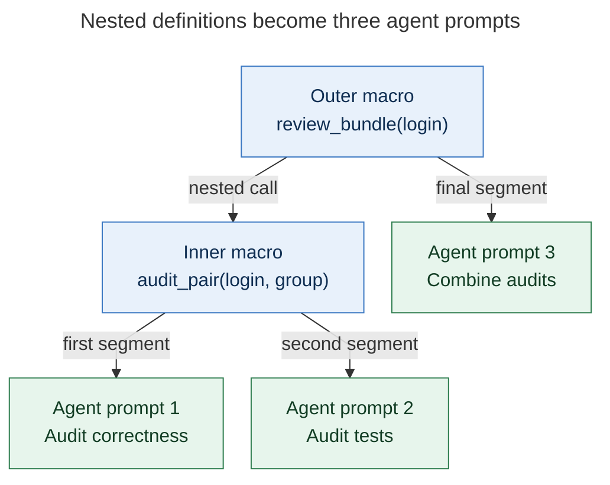
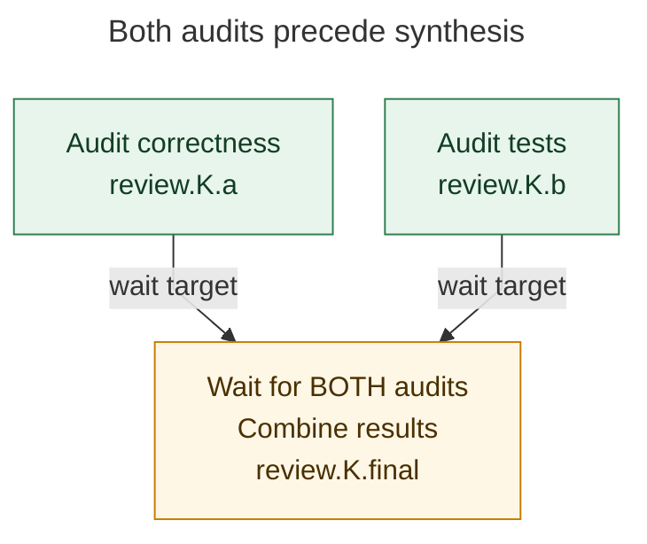

# Nested macro swarms: supported today

**Yes. A macro swarm can call another macro swarm, recursively, with no implementation changes required.** SASE expands the nested definitions before launch into a flat list of agent prompts. The outer macro contributes any ordinary segments of its own; nesting does not create an extra supervising agent or automatically wait for the inner agents. This describes the checkout at `2648c7cddf2e` on 2026-10-20. [Expansion implementation](https://github.com/sase-org/sase/blob/2648c7cddf2e644d73fd1cacdc81d59a3c5466ff/src/sase/agent/macro_swarm.py#L166)



*Arrows show template expansion. The two blue macro definitions produce the three numbered green agent prompts, in order; execution dependencies are specified separately.*

The launcher first splits the submitted prompt on `---`. For each recognized swarm, it substitutes arguments, splits the rendered body on separators outside fenced code, and recursively expands swarm references in those segments. This works for both a standalone `#inner(...)` segment and a call embedded in prose. Each resulting prompt retains its outer-to-inner macro provenance. [Launch expansion](https://github.com/sase-org/sase/blob/2648c7cddf2e644d73fd1cacdc81d59a3c5466ff/src/sase/agent/launch_cwd_segments.py#L31), [composition tests](https://github.com/sase-org/sase/blob/2648c7cddf2e644d73fd1cacdc81d59a3c5466ff/tests/test_macro_swarm_composition.py#L107)

Here is a reusable example. Save these two definitions under `sase/macros/`.

**`audit_pair.md`** — the inner swarm:

```markdown
---
input:
  target: word
  group: line
---
%id:{{ group }}.a
Audit correctness of {{ target }}.
---
%id:{{ group }}.b
Audit tests for {{ target }}.
```

**`review_bundle.md`** — the outer swarm:

```markdown
---
input:
  target: word
---
#audit_pair(target={{ target }}, group=review.{@1})
---
%id:review.{@1}.final
%wait:review.{@1}.a,review.{@1}.b
Combine both audits of {{ target }}.
```

Invoke it with `sase run '+sase #review_bundle(login)'`. The outer call explicitly passes both the target and a shared name prefix into the inner call. The leading project reference reaches all three prompts. The two audits can run concurrently, subject to available capacity; the final agent waits for both.



*Arrows identify prerequisites declared by the final agent's `%wait`. `K` represents one allocated name token, shared by all three names. Removing `%wait` removes these dependencies.*

The name marker is the important composition detail: each swarm invocation gives its own unqualified `{@1}` a distinct internal key. Reusing the spelling `{@1}` independently inside the inner definition therefore would not link it to the outer definition. In this example, the outer marker is qualified **before** the child receives `group`, so the child preserves the same key. All keys resolve to concrete names before agents start. An explicit `{@shared!}` also shares a key across nested bodies, but deliberately shares it throughout that dispatch; passing an outer-owned prefix keeps separate outer invocations isolated. [Qualification](https://github.com/sase-org/sase/blob/2648c7cddf2e644d73fd1cacdc81d59a3c5466ff/src/sase/agent/_macro_swarm_rendering.py#L28), [name resolution](https://github.com/sase-org/sase/blob/2648c7cddf2e644d73fd1cacdc81d59a3c5466ff/src/sase/agent/agent_name_keys.py#L90)

| Detail | Current behavior |
| --- | --- |
| Nesting depth | Up to **8 swarm expansions along a branch**, including the outermost call. A ninth raises a depth error; self-reference reaches the same guard. |
| Single-segment wrapper | A macro containing only `#inner` and **no body separator** is not detected as a swarm. Later ordinary expansion keeps only the inner swarm's first segment. Give the outer definition its own top-level `---` when it should compose a swarm. |
| Inheritance | Leading project/workspace references propagate unless a generated segment supplies its own. Call-site directives such as `%id` or `%wait` attach to the **first generated segment only**; put required dependencies in every relevant leaf segment. |
| Embedded calls | One embedded swarm preserves surrounding prose in its first prompt. With multiple swarm calls in one segment, only leading prose survives; text between calls and after the last is discarded. Prefer separate segments for clarity. |

These limits follow from [swarm detection](https://github.com/sase-org/sase/blob/2648c7cddf2e644d73fd1cacdc81d59a3c5466ff/src/sase/macro/segment_separators.py), [ordinary expansion](https://github.com/sase-org/sase/blob/2648c7cddf2e644d73fd1cacdc81d59a3c5466ff/src/sase/macro/processor.py#L237), and the [documented composition rules](https://github.com/sase-org/sase/blob/2648c7cddf2e644d73fd1cacdc81d59a3c5466ff/docs/reference/macros/multi-agent-prompts.md#rules-and-limitations). The single-segment wrapper restriction does not prevent the two-swarm pattern above.

**Verification:** 79 existing tests passed across swarm composition, expansion, edge cases, workspace inheritance, local helpers, and keyed names. Additional expansion-only probes confirmed the example's three prompts and shared key, the wrapper limitation, and the eight-versus-nine-level boundary. No real agents were launched. Both Mermaid figures were rendered and visually inspected locally with Mermaid CLI 11.4.2; final GitHub/PDF rendering was not tested. Diagram design follows the recent [design-contract report](research_swarm_mermaid_design_contract__cdx.md) and [diagram-quality report](research_swarm_mermaid_diagram_quality__cld.md).
