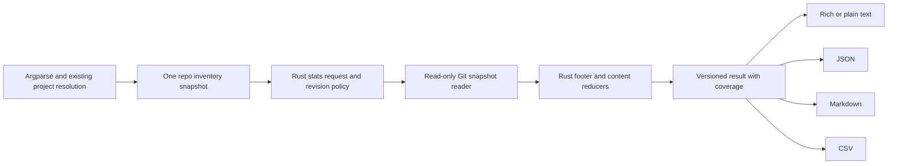

# Project stats that users can trust: repository snapshots, useful metrics, and a small, polished CLI

Independent research by **cdx**, 2026-10-16. Scope: design research and implementation recommendations; no feature implementation. I did not consult the other reports or researchers in this swarm.

## Recommendation in brief

Add `sase project stats [PROJECT]` as a **local repository measurement command**. Its main value is a trustworthy, exportable account of each configured repository, including why a number is missing. Use committed trees and a single resolved commit per repository by default. Ship a compact terminal view, versioned JSON, Markdown, and CSV, all rendered from the same result.

Keep the initial release focused on repository size and observed history. Build measurement semantics in Rust `sase_core`, reuse the existing project and repo inventory, and keep argparse/Rich presentation in Python. Prefer an embedded, pinned Tokei library over writing a language counter or requiring a separate executable. Treat provenance, classification policy, and coverage as part of the result, not incidental debugging information.

This is a good addition if it stays this small. It is less attractive as an all-purpose analytics dashboard. Commit counts and lines describe activity and maintenance surface; they do not demonstrate quality, user value, or agent productivity. The launch post should use a few dated figures with their scope, backed by the saved JSON.

## 1. What the launch-post context actually needs

I read the requested outline through the audited command:

```text
sase artifact read research:202610/sase_launch_post_outline/sase_launch_post_outline.md "Understand launch post measurement and evidence needs for independent stats command design"
```

The outline asks for a short opening strip, including commit volume, recorded agent attribution, and elapsed months. It explicitly asks for numbers to be recalculated on publication day and paired with an acknowledgement that activity is not progress. It parks a fuller work ledger for a later post. Therefore:

- Make **agent-attributed commit counts** a first-release metric; generic LOC tools alone do not cover the concrete use case.
- Make Markdown useful for a small factual table, while leaving the post's interpretation and voice to Bryan.
- Save the JSON and selected revisions with the post's supporting material. Rerunning a command later is not enough if its default refs have advanced.
- Do not transplant the outline's October 7 figures into an October 16 measurement or claim an ecosystem-wide number from a primary-repo measurement.

The command is also useful outside publishing: seeing how much of a repo is tests, distinguishing research from product docs, noticing stale repos, and comparing snapshots generated under the same policy.

## 2. Critique and explicit adjustments to the requirements

**Keep the command name and optional project argument.** It fits the existing `project` group and avoids inventing a separate analytics namespace.

I recommend these adjustments:

| Requirement adjustment | Reason |
| --- | --- |
| Omitted `PROJECT` means **all enabled user projects**; `--state all` also includes disabled projects. | Matches `sase project list`, avoids surprising scans of abandoned projects, and makes the meaning explicit in help and the header. This narrows the literal interpretation of “all”; it is a deliberate recommendation. |
| Include configured **primary, linked, and sidecar** repos, with separate groups. Exclude merely opened external research checkouts. | A repo someone once browsed is not part of the project's maintained footprint. Sidecars are relevant, but their transcripts and generated pages must not inflate software size. |
| Measure committed snapshots, independent of the caller's current directory. Defer a working-tree mode. | Agent clones, ignored files, virtual environments, and uncommitted edits otherwise make publication numbers unstable. |
| Replace ambiguous “time active” with **age since first recorded commit, history span, days with commits, and most recent commit**. | A year-old repo with two commits has not necessarily been actively developed for a year. |
| Expose missing repos and partial metrics; do not automatically clone, fetch, build, or install counters. | A report about all configured repos can be useful even when some are unavailable. Read-only inspection should be predictable and offline. |
| Omit an unqualified grand total and productivity score. | Shared histories, cross-project associations, private config repos, and sidecars make casual totals misleading. Users can deliberately select the repos relevant to a public claim. |
| Use four focused formats rather than a different data product for every audience. | A stable JSON contract is the full machine interface; the other formats are projections. YAML, HTML, SVG badges, and streaming formats can wait. |

The main risk is spending more effort debating definitions than the command saves. Resolve that with a small, versioned metric policy and a realistic fixture suite. Do not add dozens of switches to let every invocation mean something different.

The SPACE research is a useful boundary: developer productivity spans multiple dimensions and cannot be represented by one activity metric. This command should describe repository facts rather than rank people or models. [Microsoft Research: The SPACE of Developer Productivity](https://www.microsoft.com/en-us/research/publication/the-space-of-developer-productivity-theres-more-to-it-than-you-think/).

## 3. What the current SASE implementation already supplies

I inspected the primary checkout at `881f44477864bdb876d4747645e9dfd3da1c9907` and the opened `sase-core` checkout at `594faf31d80af79a148cb67968318b2bfb1a5770`. These are evidence snapshots, not a promise that these files will remain unchanged.

| Existing surface | Implementation implication |
| --- | --- |
| `src/sase/main/parser_project.py` and `project_handler.py` | Register `stats` alphabetically, extend the explicit command metavar/usage, and lazy-load a focused stats handler. The group already defaults to `list`; do not change that. |
| `src/sase/core/project_lifecycle_facade.py` | Project discovery is already Rust-backed. Use existing resolution for names, aliases, keys, and `+project` spellings. Display the effective project name, not its directory key. |
| `src/sase/repo_inventory.py:141` | Reuse `collect_repo_inventory()` rather than walk `sase/repos/` or independently parse config. It already handles explicit disabled projects, repo roles, and inventory issues. |
| `src/sase/_repo_inventory_models.py` | `RepoRecord` supplies `kind`, project identity, configured name, slug, clone candidates, presence, and `revision_pin`. Clones are observations of one logical repo, not separate repos to sum. |
| `repo_inventory_session()` | Build one inventory snapshot per command, rather than repeatedly discovering every project for every metric. |
| `src/sase/main/repo_handler_list.py` | Rich tables/panels, repo-kind styles, and inventory diagnostics provide a nearby presentation pattern. Reuse project accent resolution as well. |
| `sase_core::commit_footer::parse_commit_footer` | Reuse the terminal structured footer grammar, including `AGENT` / `SASE_AGENT` normalization and linked tag values. Do not introduce a separate attribution regex. |
| `sase_core::vcs_log` | There is already origin classification and provider-neutral history vocabulary. Reuse semantics, but avoid the timeline aggregator's result limit and parsers that silently drop malformed records. Statistical collection must report omissions. |
| `sase-core-revision.txt` and core binding rules | New shared behavior belongs in Rust; expose and test its PyO3 binding, then advance the Python repo's core pin beyond the implementing core commit. |

The repo inventory adapter explicitly says that linked-repo configuration and sidecar store inputs are still Python-owned. There is no need to migrate that whole subsystem to ship stats: pass its resolved inventory into Rust. Keep new classification, revision policy, reductions, and completeness rules in Rust.

Two local observations show why the design details matter:

- At the primary checkout's recorded `HEAD`, `git rev-list --count HEAD` returned **16,181**, while `git rev-list --count --all` returned **16,370**. Both are legitimate Git queries; they answer different questions.
- That tree contained **14,369 regular-file entries**, including **12,284 `.py` files**: **5,951** under `src/` and **6,310** under `tests/`. It contained **573 `.md` files**, of which **357** were under `docs/`. These are raw path counts, before the proposed classification and exclusions; neither “all Python files are application code” nor “all Markdown is published documentation” is a safe label.

The repo inventory also showed many clone records per logical repo, missing configured clones in this workspace, hidden sidecars, a linked personal configuration repo, and opened external repos. A filesystem walk or an indiscriminate sum over the inventory would produce a particularly misleading result here.

Reproduction for the first observation:

```bash
git rev-parse HEAD
git rev-list --count HEAD
git rev-list --count --all
```

These observations characterize the research checkout. They are not proposed launch-post statistics or measurements of the canonical mainline.

## 4. A precise measurement contract

### Project and repo scope

A named project resolves through existing project identity rules, including aliases and `+sase`. Explicitly naming a disabled project is allowed. With no argument, enumerate enabled true projects; exclude system-managed `home` and internal sibling lifecycle records. `--state` is only valid without a named project.

For each project include one logical row per configured primary, linked, or sidecar repo. Use the inventory's effective repo configuration, including global linked entries, but identify these clearly. Show the configured name and, where helpful, its provider slug. Filter opened `external` rows out of the default scope.

The repository boundary is the tracked tree of that repo. Never recursively count a sidecar, nested checkout, or submodule's working directory as part of its parent. Represent a gitlink as a submodule entry; measure its contents only if it is also an explicitly configured repo. Ordinary vendored source copied into a tree needs the exclusion policy below.

### Revision selection

Choose a **canonical committed basis**, not the active agent clone's `HEAD`:

1. Use inventory-designated canonical storage: primary workspace 0, canonical linked checkout, or the hidden sidecar clone for hidden stores. If absent, use an existing registered clone in deterministic workspace order, validating repository identity and recording the fallback. Do not choose whichever clone has the newest timestamp.
2. Resolve each primary/unpinned repo's default branch using existing provider metadata or local symbolic remote-HEAD metadata. Prefer its local default-branch ref; otherwise use the corresponding remote-tracking ref. Record which one was selected. This is locally known mainline state, not guaranteed remote freshness.
3. For a pinned linked repo, read the pin file **from the selected primary commit's tree**, and measure the pinned commit. `revision_pin` is a relative filename, not the revision itself. Do not read a dirty pin from the workspace. Record the pin path, pin blob ID, and resolved target commit.
4. If a default branch cannot be resolved, mark `ref_unresolved`; do not silently substitute detached `HEAD`. An explicit revision override is the escape hatch. An unborn empty repo is a separate, valid zero-content case.
5. Resolve each ref to a full commit ID once at the start and use that ID for both tree and history. Identify the object-hash algorithm; do not assume every full ID has 40 characters.

A pinned dependency describes what the selected project revision uses. A user who wants that dependency's latest mainline can deliberately override it. These are different, useful questions; the result must say which was answered.

Capture one UTC `observed_at` for age and activity windows. Multiple repos are independent snapshots collected in one invocation, not an atomic cross-repo transaction. Store the selected inventory membership/configuration fingerprint too: saving revisions alone does not preserve which repos were selected.

No implicit network refresh. State “local refs; remote freshness unknown” in the human provenance footer. An available default-branch commit is complete for the stated local snapshot even when its relationship to the server is unknown.

### Commit and time semantics

- **Commits:** distinct commit objects reachable through all parents from the selected commit, including merge commits. Exclude unrelated refs, stashes, and reflogs. Show merge count separately in details; do not pretend a merge equals an additional feature.
- **History completeness:** a shallow repo's observed reachable count is a lower bound, and first-commit/age data is incomplete. Surface this even if the Git command exits successfully. Git exposes shallow status through `rev-parse --is-shallow-repository`. [Git rev-parse](https://git-scm.com/docs/git-rev-parse#Documentation/git-rev-parse.txt---is-shallow-repository).
- **Clock:** use committer timestamps for the activity contract, and say so. The existing VCS-log wire uses author time; do not accidentally inherit it. Git exposes these separately as `%at` and `%ct`. [Git log](https://git-scm.com/docs/git-log).
- **First/last recorded commit:** numeric minimum/maximum committer timestamp over the reachable set, not the first row of a particular log ordering. Dates can be skewed, imported, or rewritten. Preserve anomalous timestamps and flag them; do not invent an origin date.
- **Age:** elapsed whole days from the earliest valid recorded commit to `observed_at`. **History span:** elapsed seconds between first and last recorded commits. **Days with commits:** cardinality of UTC calendar dates in the observed history. None of these estimates hours worked.
- **Recent activity:** count commits and UTC days with commits in the exact interval `[observed_at - 30 days, observed_at]`. Test boundaries. Commits dated in the future remain in the ancestry count but are excluded from this window and produce a diagnostic.
- **Project age:** use the primary repo's history. Do not give a new project the age of an older linked framework or personal dotfiles repo. Do not sum ages or active-day counts across repos.

`rev-list` explicitly defines reachability and the meaning of `--all`. For custom date windows later, either filter a complete timestamp stream in core or use Git's `--since-as-filter`; plain `--since` can stop traversal at an old-dated ancestor. [Git rev-list](https://git-scm.com/docs/git-rev-list).

## 5. Metrics worth shipping

| Metric | Use and presentation |
| --- | --- |
| Reachable commits, merge commits | Default headline count; merge breakdown in details. |
| First/last recorded commit, age, history span | Makes scale and recency interpretable; primary project age in header, repo dates in details. |
| Days with commits; commits in last 30 days | Distinguishes sustained activity from long calendar existence. |
| Agent-attributed commits and attribution share | Directly supports the launch outline. Display the numerator, denominator, and precise label. |
| SASE origin counts | Details: stitch, automatic, and unmarked/manual classification using existing semantics. An unmarked commit is not proof of human authorship. |
| Source files, physical source lines, source SLOC, comments, blanks | Default view shows SLOC and source file count; details expose the other units. |
| Test source files and test SLOC | A subset of source, never added again to source totals. A maintenance indicator, not test-case count or test coverage. |
| Docs files, total physical docs lines, nonblank docs lines | Includes documentation formats wherever they live, with subtype breakdown such as published docs, prompts/specifications, and research where identifiable. |
| Config/data and other-text files/lines | Prevents YAML, JSON, lockfiles, logs, and unknown languages from disappearing or being called code. |
| Selected blob bytes, binary asset files, excluded files/bytes, unknown-language files | Useful diagnostics and maintenance context; keep off the default headline strip. Bytes describe selected blob content, not disk usage or compressed Git history. |
| Per-language source breakdown | Details; sort by descending SLOC with name as tie-breaker. |
| Coverage and diagnostics | Always visible: repos configured, measured, unavailable, history partial, content partial, classification unknown. Missing is never zero. |

Do **not** ship guessed test-case counts, a coverage percentage without a coverage report, tokens, dollar cost, “hours saved,” model rankings, commit streak trophies, or effort estimates in this version. They require different data contracts. Unique contributor identities, release counts, churn, and historical growth curves can be later opt-ins if a concrete use case warrants their cost.

If contributors are added, count identities with the selected snapshot's `.mailmap`, not raw author names; Git supports canonical identity mappings. People can still share accounts, so call the result author identities rather than humans. [Git mailmap](https://git-scm.com/docs/gitmailmap).

### Agent attribution deserves a narrow label

Count a commit once when `parse_commit_footer()` finds a nonempty canonical `AGENT` tag in the **terminal structured footer**. Accept its established legacy spelling and linked-value grammar. Count duplicate tags once. Body examples containing `SASE_AGENT=` do not qualify. Derive the percentage from the same reachable commit set and carry the denominator.

Keep this distinct from `origin=stitch`: current origin inference can also use BEAD/PLAN tags and TYPE values. Neither a stitch nor a bot author necessarily means an agent wrote the change. Label the metric **“Commits with recorded agent attribution”**, never “AI-written code” or “percent automated.” Missing historical tags are unknown attribution; absence is not proof of human work.

This metric needs commit messages, not chat archives. It should neither read every transcript nor require the agent sidecar. Old provider/model breakdowns are not reliably reconstructible from agent names.

## 6. Classification and exclusions: the unavoidable policy

Use two independent concepts: **content category** and **inclusion reason**. Include a version and digest for the effective policy in every export.

Content categories partition included regular files into `source`, `docs`, `config_data`, `other_text`, and `binary_asset`. Tests are a source subset. Excluded regular files remain accounted for separately. Symlinks and submodules have separate entry counts. A useful invariant is:

```text
regular_files = included_regular_files + excluded_regular_files + unavailable_regular_files
included_regular_files = source + docs + config_data + other_text + binary_asset  [file counts]
tracked_leaf_entries = regular_files + symlinks + submodules
```

Line metrics apply to text only. Binary docs such as PDFs belong to assets with a documentation subtype; a PDF is not zero lines of Markdown.

Use this order:

1. Resolve a versioned built-in policy plus declarative repo-local overrides from the selected snapshot. No executable hooks. A candidate config shape is `project_stats.classification` and `project_stats.exclude` in existing repo configuration; validate the schema before scanning. Global effective overrides, if supported, must be included in the policy digest.
2. Apply explicit generated/vendor/excluded path rules before computing headline source/docs metrics. Report the excluded counts and reason. Do not assume that every `vendor/` is third-party or that all generated files identify themselves: these are documented defaults with overrides, not an authorship detector.
3. Detect documentation by supported format plus purpose overrides. A Markdown file in SASE macros or memory is a prompt/specification subtype; `.md` alone does not mean public product documentation. Arbitrary `.txt` files are other text unless their purpose is known. Do not label HTML source as docs solely because of its extension.
4. Recognize languages by extension, established special basenames such as `Dockerfile`, and shebang bytes from the blob. Treat common serialization/build metadata as config/data even if the counter knows its syntax. Unknown text remains measured and visible.
5. Detect LFS pointers and count them as pointer entries/assets, not the size or lines of the absent target. Never hydrate them. Do not follow symlinks.

Count physical lines directly from blob bytes: empty content has zero lines; a final unterminated nonempty line counts; CRLF is one line ending. Specify and test lone-CR handling and supported encodings. Support UTF-8 and explicitly decoded BOM-marked UTF-16 at minimum; do not silently decode invalid bytes with replacement and then call the result exact. Record unavailable line metrics or an unsupported-encoding diagnostic when necessary. Binary detection must account for encoding before treating NUL bytes as a binary signal.

For source SLOC, comments, and blanks, embed a pinned Tokei dependency. It offers language classification and parsing directly from bytes, so it can consume Git blobs without a checkout walk. Some path/shebang helpers read the filesystem; use the blob-based path instead. [Tokei LanguageType API](https://docs.rs/tokei/latest/tokei/enum.LanguageType.html).

Set Tokei options explicitly, including `treat_doc_strings_as_comments = true`; record that choice. Do not read a user's ambient Tokei config or inherit its default filesystem ignore rules. [Tokei Config API](https://docs.rs/tokei/latest/tokei/struct.Config.html).

Count docs with raw physical/nonblank lines, **not Tokei's `code` field for Markdown**. Embedded fenced snippets remain part of their documentation file and are not added to source totals. For mixed-language source files, define one roll-up over child language blobs and count the file once. Tokei exposes child `blobs` and a `summarise()` method, so blindly adding the parent, summarized parent, and children would double count. [Tokei CodeStats API](https://docs.rs/tokei/latest/tokei/struct.CodeStats.html).

Two identical files at different paths are two files and contribute twice to the repository footprint. Reuse cached parsing of the blob, but do not deduplicate the reported file/line counts by content.

## 7. The CLI should be small and unsurprising

Proposed first-release interface:

```text
sase project stats [PROJECT]
  -d, --details
  -f, --format {table,json,markdown,csv}
  -j, --json
  -r, --repo NAME                 repeatable
  -R, --revision REPO=REV         repeatable; requires PROJECT
  -s, --state {enabled,disabled,all}
```

The listed format values should appear alphabetically in actual help. Public options need short aliases under SASE's CLI rules. `--json` is shorthand for `--format json`; reject supplying both. `--details` changes table/Markdown presentation only; reject it with JSON/CSV so it cannot imply a second machine schema. JSON always contains the full result; CSV always has its documented fixed summary columns.

`--repo` matches configured repo names, including the primary name, and accepts repeated names to form a union. With all projects it applies the same names across projects; include only matching project/repo associations and error if the whole selection is empty. `--revision` matches an exact repo name within one named project and accepts one commit-ish, not a revision range. Duplicate overrides or selectors that match no selected repo are usage errors. Resolve refs with an argv API and explicit option termination, never shell interpolation.

Examples:

```bash
sase project stats sase
sase project stats
sase project stats --state all --format csv > project-stats.csv
sase project stats +sase --json > sase-stats.json
sase project stats sase --repo sase --repo sase-core --format markdown
sase project stats sase --revision sase=v0.9.0 --format json
```

No `--output` option is needed; redirection works. Defer `--since`, `--until`, `--worktree`, arbitrary sorting, field selection, and an interactive pager until needed. `jq` already solves many agent/script projections.

No-argument behavior is explicitly all enabled projects even when invoked inside one project. Do not silently switch to the current project based on CWD. The header and help examples should teach this distinction.

## 8. What each output should look like

The examples below are **invented design fixtures**, not measurements of SASE. Actual counts must come from the collector.

### Terminal / plain text

A default view needs the repo identity, useful numbers, units, and coverage. Use the established project accent for the title, restrained repo-kind labels, right-aligned numbers, and dim provenance. Warnings need a word as well as a color.

```text
sase · project stats                         observed 2026-10-16 UTC
Primary history: 244 days old · 180 days with commits
Committed snapshots · local mainline / dependency pins

PRIMARY & LINKED
Repo          Commits   Source SLOC / files   Docs lines / files   Last commit
sase            1,200        48,000 / 300          9,000 / 60      2026-10-15
sase-core         180        12,000 /  80            800 /  6      2026-10-15
sase-nvim         —               —                      —        unavailable

SIDECARS
research          240             0 /   0         40,000 / 90      2026-10-14

Coverage: 3/4 repos measured · 1 unavailable
sase-nvim: no registered local clone; no clone or fetch attempted
Source SLOC excludes comments, blanks, and policy exclusions; tests included.
Docs lines include blanks. Local refs; remote freshness unknown.
```

Add a compact agent-attribution line for the primary repo when available, e.g. `Recorded agent attribution: 720/1,200 commits (60.0%)`. Details show per-repo dates, selected full revision/ref/pin, history completeness, physical source lines, tests, language breakdown, docs subtypes, other categories, and exclusions.

At narrow widths, switch to vertical repo cards; never truncate numbers or quietly hide missing-repo status. At normal widths prefer simple rules over heavy nested boxes. No abbreviated `48k` values in factual exports. Make the view readable with no color and an ASCII fallback. Check TTY state, `NO_COLOR`, and `TERM=dumb`; keep progress on stderr. These choices follow established command-line guidance. [Command Line Interface Guidelines](https://clig.dev/).

For multiple projects, repeat this compact section per project and finish with coverage across unique repository measurements. Do not introduce a global rank or source-code leaderboard. A repo associated with two projects can be shown under both, with a shared measurement identifier rather than counted twice in unique coverage.

### JSON: full, stable, lossless result

Use an object envelope, not a bare array, even for one project. Fields use `snake_case`. Integers are unformatted numbers, timestamps are RFC 3339 UTC, durations have explicit units, unknowns are `null`, lists are deterministic, and an empty selection remains a valid document.

Illustrative abbreviated document; the final wire schema should include all metrics defined above:

```json
{
  "schema_version": 1,
  "observed_at": "2026-10-16T00:00:00Z",
  "selection": {
    "project_names": ["sase"],
    "state": "enabled",
    "repo_names": ["sase", "sase-nvim"]
  },
  "policy": {
    "version": 1,
    "digest": "sha256:example",
    "content_basis": "committed_tree",
    "history_basis": "selected_commit_ancestors",
    "timestamp_basis": "committer_utc",
    "activity_window_days": 30,
    "counter": {"name": "tokei", "version": "pinned-at-build"}
  },
  "coverage": {
    "expected_repo_associations": 2,
    "complete_repo_associations": 1,
    "partial_repo_associations": 0,
    "unavailable_repo_associations": 1,
    "complete": false
  },
  "projects": [
    {
      "project_key": "gh_sase-org__sase",
      "project_name": "sase",
      "state": "enabled",
      "repos": [
        {
          "repo_name": "sase",
          "kind": "primary",
          "measurement_id": "example-primary-measurement",
          "status": "complete",
          "snapshot": {
            "requested_ref": "refs/heads/main",
            "commit_id": "aaaaaaaaaaaaaaaaaaaaaaaaaaaaaaaaaaaaaaaa",
            "object_format": "sha1",
            "selection_reason": "local_default_branch",
            "remote_freshness": "unknown"
          },
          "history": {
            "complete": true,
            "commits": 1200,
            "merge_commits": 10,
            "agent_attributed_commits": 720,
            "attribution_denominator_commits": 1200,
            "active_days_utc": 180
          },
          "content": {
            "complete": true,
            "source": {"files": 300, "physical_lines": 60000, "code_lines": 48000},
            "tests": {"files": 100, "code_lines": 16000},
            "docs": {"files": 60, "physical_lines": 9000, "nonblank_lines": 7000}
          },
          "diagnostics": []
        },
        {
          "repo_name": "sase-nvim",
          "kind": "linked",
          "measurement_id": null,
          "status": "unavailable",
          "snapshot": null,
          "history": null,
          "content": null,
          "diagnostics": [{"code": "clone_missing", "message": "No registered local clone"}]
        }
      ]
    }
  ],
  "diagnostics": []
}
```

Record collector/SASE/core versions, inventory/config fingerprints, per-repo policy digests, selected tree IDs, clone provenance, and component completeness in the complete schema. Keep absolute checkout paths and remote credentials out of the portable/default export; internal collector requests can carry paths. Use opaque logical storage identifiers for portable provenance. File-by-file output and raw commit messages are unnecessary here.

Version the public document separately from the internal binding contract. Additive optional fields are compatible; changed units, defaults, or counting rules need a policy change, and changed required structure needs a schema change. Publish a checked-in JSON Schema and representative fixtures. Tests should compare semantic JSON, not depend on object key order.

A pipeline can use:

```bash
sase project stats sase --json > stats.json
jq -e '.coverage.complete' stats.json
jq '.projects[].repos[] | select(.kind == "primary") | .history.commits' stats.json
```

### Markdown: portable, publication-ready facts

Emit a real Markdown document with a short scope/date introduction, one section per project, and separate repo-kind tables. Include exact numbers, units in column headings, and selected revisions in a provenance table. Put missing-repo diagnostics and exclusions underneath. Escape pipes/backticks/newlines in names. Do not copy terminal borders or ANSI codes.

```markdown
## sase

Observed 2026-10-16 UTC. Committed snapshots; local refs. Coverage: 1/2 repos complete.

| Repo | Kind | Commits | Source SLOC | Source files | Docs lines | Docs files |
| --- | --- | ---: | ---: | ---: | ---: | ---: |
| sase | primary | 1,200 | 48,000 | 300 | 9,000 | 60 |
| sase-nvim | linked | — | — | — | — | — |

Source includes tests; comments, blanks, and policy exclusions are excluded from SLOC.
Docs lines are physical lines including blanks. `sase-nvim`: clone unavailable.

| Repo | Selected commit | Basis |
| --- | --- | --- |
| sase | aaaaaaaaaaaaaaaaaaaaaaaaaaaaaaaaaaaaaaaa | local default branch |
```

This output supplies factual material for the post; it should not generate boastful narrative or infer what the numbers prove. `--details` appends the same category/language/exclusion details shown by the terminal.

### CSV: fixed repo rows for spreadsheets and scripts

Use a header and one row per project/repo association, including missing repos. No summary rows, footers, comment preamble, thousands separators, or JSON blobs in cells. Repeat the observed time, policy digest, selected commit, and status in each row. A documented initial fixed column set should include source/docs counts, physical lines/SLOC units, attribution numerator/denominator, first/last commit dates, age, active days, 30-day commits, completeness, and a diagnostic code.

Minimal projection illustrating the shape:

```csv
schema_version,observed_at,project,repo,kind,commit_id,status,commits,source_code_lines,source_files,docs_physical_lines,docs_files,diagnostic_code
1,2026-10-16T00:00:00Z,sase,sase,primary,aaaaaaaaaaaaaaaaaaaaaaaaaaaaaaaaaaaaaaaa,complete,1200,48000,300,9000,60,
1,2026-10-16T00:00:00Z,sase,sase-nvim,linked,,unavailable,,,,,,clone_missing
```

Use a real CSV writer with proper quoting and fixed field counts. Empty numeric fields mean unavailable; `0` means measured zero. The format's common quoting and record rules are documented in [RFC 4180](https://www.rfc-editor.org/rfc/rfc4180.html). JSON remains the full interface for multiple diagnostics, languages, and nested categories. Avoid a second long-form metric-row CSV and a separate TSV option in v1.

## 9. Collection architecture and tool choice



**Rust domain:** add a `project_stats` module with request/result/error wire types, classification policy, revision decisions, content counting, footer attribution, date reductions, deduplication, coverage, and aggregation semantics. Keep the module facade small and tests beside the implementation. Expose one batch-oriented binding rather than one Python-to-Rust call per line or file.

**I/O boundary:** reuse existing process and provider plumbing where possible. Python may assemble the currently Python-owned inventory and supply process results through a thin adapter; shared policy must not live in a Python handler. A Rust Git reader behind an internal interface is also reasonable if existing subprocess facilities fit. The important constraint is one owner of semantics and a fakeable snapshot reader, not a new general VCS framework.

**Git first, with explicit capability status.** This is a reasonable first backend because the checked implementation and concrete use case are Git-based. A provider adapter can later expose equivalent snapshots/history. Unsupported VCS repos stay in the result with `unsupported_vcs`; they must not be silently omitted or assigned zeroes. Do not invent file/commit semantics for another provider without fixtures.

**Use Git plumbing and Tokei as a library.** The collector needs no temporary checkout:

```text
resolve ref once -> full commit ID
ls-tree -r -z --full-tree <commit ID> -> modes, blob IDs, paths
cat-file --batch -> selected raw blob bytes
walk selected ancestry -> timestamps, parents, messages
```

NUL-terminated tree paths support spaces, tabs, newlines, and non-UTF-8 names. For blob requests send object IDs, not `revision:path` strings; parse batch content by the returned byte length. Avoid text conversion, smudge/clean filters, archive extraction, and one subprocess per file. The documented primitives support these access patterns. [Git ls-tree](https://git-scm.com/docs/git-ls-tree), [Git cat-file](https://git-scm.com/docs/git-cat-file).

| Approach | Assessment |
| --- | --- |
| Embedded Tokei + Git snapshots | Recommended. Reuses language parsing, fits Rust ownership, avoids external-counter availability, and preserves SASE's scope/completeness policy. Validate its added dependency/build cost before landing. |
| Shell out to Tokei, cloc, or scc over a checkout | Useful as an independent spot-check. As the product backend it adds installation/version/ignore-policy variance and needs special handling to measure a committed tree. Do not silently switch counters when one is missing. |
| Handwritten extension counter | Fine for raw lines and a few path categories; poor foundation for SLOC across strings, multiline comments, docstrings, and mixed languages. |
| GitHub/API-only metrics | Adds credentials, network, rate limits, and provider coupling; does not answer the same source/docs/pin questions or cover local repos. Reserve for future explicitly remote metrics. |
| Dedicated Git library (`gix`/`git2`) | Can be appropriate if already standardized or benchmarks justify it. The inspected core manifest did not show these dependencies. A new Git engine is not necessary for the first version. |

Tokei's current published documentation identifies version 15.0.0; this research did not compile or benchmark it in SASE. Pin the chosen reviewed version at implementation time and test its mixed-language behavior against the metric contract. Do not claim a dependency integration is validated merely because its API looks suitable. [Tokei published crate documentation](https://docs.rs/crate/tokei/latest).

### Operational details that prevent bad numbers

- Validate each repo candidate's root/identity. Git run in a nonexistent nested repo path can accidentally discover an ancestor repository; existence alone is insufficient.
- Clear inherited `GIT_DIR`, `GIT_WORK_TREE`, index and alternate-object overrides before running a target repo query; preserve ordinary registered object alternates required by that clone. Do not let the calling agent's environment redirect a scan.
- Disable replacement-object interpretation or record it explicitly; prefer raw stored ancestry. Detect unsupported graft/replace/shallow conditions rather than quietly report a synthetic complete history.
- Enforce the offline contract for partial/promisor clones. Current Git documents `--no-lazy-fetch` / `GIT_NO_LAZY_FETCH`, but this machine's **Git 2.43.0 rejects the global option**. Capability-gate the mechanism. On an older Git, refuse content queries in a promisor repo if the implementation cannot guarantee no lazy fetch. Do not assume an unknown environment variable is honored. [Git environment and global options](https://git-scm.com/docs/git).
- Mark missing objects, unavailable encodings, oversized text limits, timeouts, and malformed records at component level. A repo can have exact content metrics and partial history, or the reverse. Intentional policy exclusions do not mean a partial scan; skipped required content does.
- Distinguish missing clone, wrong identity, invalid requested ref, unborn repo, unsupported backend, shallow history, content failure, and timeout with typed codes. Render recovery hints without executing them.
- Bound concurrency, subprocess lifetime, memory, and total work. Start with two repo workers and streaming reductions; avoid nesting an unrestricted file worker pool inside an unrestricted repo pool. Cap huge blob work with a visible limit/diagnostic.
- Escape untrusted names for Rich/Markdown/terminal display. Preserve exact logical names in JSON and properly quoted CSV. Do not export raw commit messages or author emails by default.

## 10. Deduplication and totals

The unit is a logical repo, not a clone. Reuse one measurement for identical repo identity + selected commit + effective policy across projects. Do not equate repos by basename; `owner-a/core` and `owner-b/core` differ. Normalize repository identity using existing provider rules, not a new ad hoc remote-URL regex. If identity cannot be established, preserve separate rows and state that uncertainty.

A shared repo measured at different pins must produce distinct observations. Identical blob IDs can share parsing work even across observations, but their files still count in each measured tree.

Avoid a default project/global commit total. Summing repo counts counts shared ancestors twice; summing each repo's “contributors” or age is worse. A future explicit unique-commit total can union `(object_format, full_commit_id)` across a named set of repos and state that policy. Until then, per-repo counts meet the request without pretending to answer an ill-defined ecosystem total.

For the launch post, explicitly select public software repos. A globally linked dotfiles repo may legitimately appear under the project but is not automatically part of SASE's public product size. Separate sidecar activity from software history even when all the rows are visible.

## 11. Error behavior, reproducibility, and performance

Recommended exits:

| Exit | Meaning |
| ---: | --- |
| 0 | Every requested measurement is complete under the reported policy; or the enabled-project set is validly empty. |
| 1 | Fatal collection/internal failure with no trustworthy report. |
| 2 | Invalid arguments, unknown project/repo, or invalid explicit revision. |
| 3 | A useful report exists, but one or more required repo/component measurements are partial or unavailable. |

Emit the useful result on stdout even for exit 3, and diagnostics on stderr as well as in structured JSON. Prevalidate explicit selections/refs before expensive work. Once collection starts, isolate failures to their repo and continue. JSON output must remain one parseable document without progress lines or tracebacks in it. A shallow count can be represented as an observed lower bound with `history.complete=false`; human output should label it, e.g. `≥500 observed`, rather than print `500` as a complete total.

“Complete” means complete for the selected local snapshots and measurement policy, not knowledge of the current server or proof that the language classifier understood every semantic purpose. Unknown-language counts remain visible, even on an otherwise complete scan.

Do not silently serve stale TTL-based results. For v1, use per-invocation memoization only. Benchmark before adding a durable cache. If caching is needed, immutable keys should include object format, commit/tree/blob IDs, effective classification, policy version/digest, counter version, footer-parser version, and relevant mailmap/input versions. Relative ages and recent windows must be recomputed from the invocation's `observed_at`; a cached tree count alone is not a cached report.

For publication, archive the full JSON, selected repo set, policy, tool versions, revisions, and Markdown. A reproducible payload should be stable for identical inputs; the observation envelope changes with time. Historical replay can be a later feature. Do not imply that a simple `--as-of DATE` would reconstruct historical repository membership, default-branch state, or deleted commits.

Performance acceptance should be measured rather than promised: record cold/warm elapsed time, peak memory, Git subprocess count, and worker count for SASE primary/core plus a large sidecar. Suggested design target: ordinary selected repos finish within a few seconds on the user's machine and show a stderr progress indication for longer scans. Treat it as a target until measured. No archive walk, blame scan, diff-per-commit, transcript scan, or remote lookup is needed for the chosen metrics.

## 12. Implementation sequence and verification

These are implementation recommendations, not an executed plan or authorization to modify the feature in this research turn.

1. **Approve the metric contract with fixtures.** Lock down default scope, pin semantics, line units, date clock, attribution definition, and component statuses. Create an example result and terminal/Markdown mockup first so the intended behavior is reviewable.
2. **Implement the Rust collector and policy.** Add small synthetic Git fixtures and blob-counter tests, including strict failure reporting. Reuse the footer parser; do not copy it.
3. **Expose the binding and thin Python adapter.** Follow core's request/response wire and binding round-trip conventions. Update the binding validation surface and core revision pin as required.
4. **Add the parser/handler and four renderers.** Keep collection separate from presentation. Reuse project accent/name handling and standard Rich behavior. Add sorted help, examples, completions, and documentation; follow the relevant generated-skill/docs memory before updating those surfaces.
5. **Verify and benchmark.** Run focused tests plus each changed repo's required `just check` through its prescribed `sase tool run` path. `just check-full` is not the default agent verification. Independently spot-check a few pinned files/counts with Git and a second counter, accounting for policy differences.

Meaningful cases for tests:

| Area | Essential fixtures/assertions |
| --- | --- |
| Scope | Optional project, enabled/disabled selection, alias/`+name`, hidden/sibling exclusions, primary/linked/sidecar grouping, opened external exclusions. |
| Identity | Same repo in many clones; same repo under two projects; different repos sharing basename; one repo at two pins; no canonical clone but valid registered fallback. |
| Snapshots | Dirty worktree and dirty pin cannot change committed results; detached agent `HEAD`; default branch named something other than main/master; pin blob read from selected primary tree; missing explicit revision. |
| History | Merge DAG, unrelated branches/stash, multiple roots, nonmonotonic timestamps, shallow history, future timestamps, UTC/day-window boundaries, empty repo. |
| Attribution | Canonical/legacy footer keys, linked values, repeated tags, empty values, misleading body example, BEAD-only stitch, auto TYPE; numerator never exceeds denominator. |
| Content | Tracked hidden files, generated/vendor exclusions, docs/prompts, unknown extensions, shebangs and special basenames, same-content files, CRLF/final partial line/empty file, BOM encodings, binary assets, LFS pointers, symlink, gitlink. |
| Mixed languages | Markdown fence stays docs; embedded language source roll-up counts each file/line as defined; docstring policy is explicit. |
| Failure isolation | Missing repo and ancestor-repo discovery, missing object, unsupported provider/encoding, timeout and blob cap; exact component metrics survive unrelated failures. |
| Exports | JSON Schema and exit-3 JSON parseability, stable CSV columns and quoting, unknown versus zero, Markdown escaping, narrow/plain/no-color terminal output, all formats agree on values. |
| Offline behavior | No fetch/clone/hydration, including a promisor clone and a Git version lacking the no-lazy-fetch flag; no state/ref/worktree mutation. |

Property checks should cover count partitions, test subset relationships, attribution bounds, and invariance under file traversal order and caller CWD. These catch real mistakes that string snapshots alone miss.

## 13. Evidence and limits

Repository evidence was read locally after opening linked repos through `sase repo open`. Useful immutable entry points:

- [SASE project parser](https://github.com/sase-org/sase/blob/881f44477864bdb876d4747645e9dfd3da1c9907/src/sase/main/parser_project.py), [handler](https://github.com/sase-org/sase/blob/881f44477864bdb876d4747645e9dfd3da1c9907/src/sase/main/project_handler.py), and [repo inventory](https://github.com/sase-org/sase/blob/881f44477864bdb876d4747645e9dfd3da1c9907/src/sase/repo_inventory.py).
- [Repo inventory models](https://github.com/sase-org/sase/blob/881f44477864bdb876d4747645e9dfd3da1c9907/src/sase/_repo_inventory_models.py) and [linked pin validation](https://github.com/sase-org/sase/blob/881f44477864bdb876d4747645e9dfd3da1c9907/src/sase/_linked_repo_config_defaults.py).
- [Rust footer parser](https://github.com/sase-org/sase-core/blob/594faf31d80af79a148cb67968318b2bfb1a5770/crates/sase_core/src/commit_footer.rs), [origin classifier](https://github.com/sase-org/sase-core/blob/594faf31d80af79a148cb67968318b2bfb1a5770/crates/sase_core/src/vcs_log/origin.rs), and [history wire](https://github.com/sase-org/sase-core/blob/594faf31d80af79a148cb67968318b2bfb1a5770/crates/sase_core/src/vcs_log/wire.rs).
- The launch outline is shared input at `research:202610/sase_launch_post_outline/sase_launch_post_outline.md`; this report uses its statistics/publication requirements, not its unrelated external product claims.

External sources are linked next to the claims they support. All feature decisions, interface sketches, and implementation targets in this report are recommendations, not statements that SASE already supports them. I did not compile a Tokei integration, measure performance, collect every linked repo's stats, or verify a non-Git backend. The observed Git counts are intentionally limited to the recorded research checkout.

## Recommended solution

**Build `sase project stats [PROJECT]` as a small, Rust-owned repository snapshot collector with a polished Python CLI.** Default to all enabled projects, or one explicitly resolved project; include every configured primary, linked, and sidecar repo as a separate row; exclude incidental external checkouts. Use canonical local mainline commits and committed dependency pins, never arbitrary active workspaces. Measure source/test/docs footprint, reachable commit history, clear age/activity fields, and terminal-footer agent attribution. Emit table, JSON, Markdown, and CSV from one versioned result, including exact revision provenance and explicit partial coverage.

**Ship the definitions and offline failure behavior with the feature.** Defer working-tree analytics, cost/usage ledgers, historical dashboards, and broad totals. For the launch post, select the intended public software repos, save the complete JSON as evidence, publish only a few well-labeled figures, and interpret those figures in the post rather than in the command.
