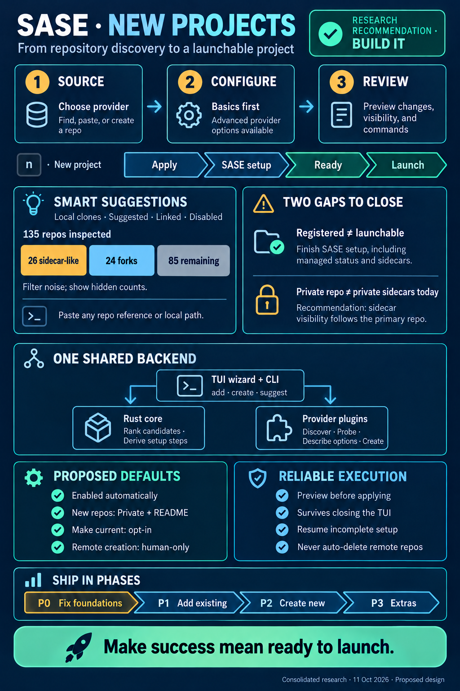

# New Projects from the Admin Center Projects Tab — Consolidated Design

> **Research query:** What is the best way to add project creation to the Projects tab of
> the SASE Admin Center panel, with new projects enabled by default, a prompt to choose a
> VCS, a menu of repos the user is likely to add for that VCS (e.g. GitHub repos in their
> configured organizations that are not yet SASE projects), and an option to create a new
> repo from scratch through the VCS plugin with all of the provider's options
> (public/private, description, etc.), designed to be intuitive, reliable, and beautiful?
> Is this a good idea, would a different approach be better, which requirements should be
> adjusted (called out clearly), and what is the recommended solution?



## Bottom line

- **Build it.** All five researchers agree, and so do I. The Projects tab can enable,
  disable, delete, alias, and initialize projects, but it can't add one. Today a project
  only comes into existence as a side effect of an agent launch that uses a `#gh:owner/repo`
  or `#git:name` macro. That path has no preview, can't create a remote repository, and
  is easy to miss unless you already know it exists.
- **Your plan misses one fact that changes its shape.** For GitHub, a registered project
  is not the same as a launchable one. `#gh` setup refuses to materialize SDD sidecars
  unless the repo's own `sase/sase.yml` has `is_sase_managed: true`. Creating a missing
  sidecar also needs a fresh interactive `y` that `--yes` can't grant. So "create the
  project record" isn't the finish line. The wizard has to hand off to SASE setup (I
  verified this in code; see [What exists today](#what-exists-today)).
- **A second gap that no researcher caught:** sidecars default to **public**
  (`repos.sidecar.*.<role>.visibility: public`). If you create a private repo and set it
  up with the defaults, its `--plans`, `--beads`, and `--research` sidecars go public.
  The wizard must close this gap ([A9](#requirement-adjustments)).
- **Recommended shape:** a three-stage [**New Project** modal](#flow-and-look) on `n`:
  **Source → Configure → Review**, followed by a live progress checklist and a **Ready**
  screen.
  - It sits on top of a [**CLI that is the real product**](#cli-contract):
    `sase project add | create | suggest`, each with a `--check --json` plan and a
    resumable `--yes` apply.
  - [**Four additive workspace-provider hooks**](#architecture) cover provider-specific
    work: local candidates, a read-only probe, a creation schema, and remote creation.
  - **Two pure sase-core functions** keep every frontend in agreement: candidate
    classification and onboarding-plan derivation.
  - The apply runs as an **argv-backed durable proc**, so it survives closing the TUI.
- **[Adjusted requirements](#requirement-adjustments), summarized:**
  - The provider choice is a tab strip on the first screen, not a screen of its own.
  - All `gh repo create` options are reachable through progressive disclosure, minus the
    ones SASE owns (`--clone`) and the "publish a local dir" mode, which is deferred.
  - Suggestions are classified and ranked rather than just listed.
  - Success means "launchable", not "the record exists".
  - Creating a remote repo is human-only.
  - New repos default to Private with a README.
  - Making the new project current stays opt-in.

The full recommendation closes this report under
[Recommended solution](#recommended-solution).

---

## Is this a good idea

**Yes.** The status quo is the strongest argument for it:

1. **Not discoverable.** You can't create a project from the place that manages projects.
2. **It conflates two acts.** Registering a project is mixed with launching an agent. A
   failed launch (auth, an unmanaged repo, missing sidecars) leaves a half-registered
   project *and* a failed agent.
3. **No preview.** You find out the key (`gh_owner__repo`) and display name (`repo_1`?)
   only after the fact.
4. **No creation story.** "Start something new" means leaving SASE for `gh repo create`,
   then coming back to type a macro.

**Where I'd change the request as written:**

- **Aim at "launchable", not "record exists".** Because of [F5 and F6](#verified-facts),
  "Add project" on an unmanaged GitHub repo produces something agents can't use. The
  wizard must include (opt-out) SASE setup.
- **Make the CLI the product and the TUI its most beautiful frontend.** This satisfies the
  Rust/CLI boundary litmus test, gives you tests without Textual, and matches how
  `i`/init already works.
- **Don't build a stack of sequential prompts.** Use one modal with a visible stepper,
  Back at every stage, and the destination always on screen.
- **"All provider options" should mean all are reachable**, not all prompted. A flat form
  with 13+ fields is neither intuitive nor beautiful.
- **"Likely projects" needs classification, not just subtraction.** Naively, 50 of your
  135 repos are noise (26 sidecars + 24 forks), and existing projects and linked repos
  add more.

---

## Requirement adjustments

Each adjustment to your requirements is called out explicitly below.

| # | Your requirement | Adjustment | Why |
| --- | --- | --- | --- |
| **A1** | Prompt for the VCS | The prompt becomes a **provider tab strip** at the top of the Source stage (`GitHub · Git (local)`). It's focused first and preselected to the last-used provider, falling back to the current project's provider. Each tab carries a health chip (`✓ gh · bbugyi200` / `⚠ not signed in` / `plugin not installed`). | It's still an explicit choice, but you see its consequence (the repo list) immediately, and repeat use skips a screen. Say "provider", not "VCS": GitHub and bare Git are both git (`vcs_family` vs `workflow_type`). Driving the strip from `ws_get_workflow_metadata` keeps a future `#gl:` plugin free. |
| **A2** | Menu of repos from configured orgs not yet in a project | **Classified, ranked groups:**<br>- ON THIS MACHINE (unregistered clones)<br>- SUGGESTED (by recency)<br>- LINKED TO YOUR PROJECTS<br>- DISABLED PROJECTS (Enter re-enables; never creates a duplicate)<br><br>**Hidden but counted:** sidecars, forks, archived repos, numbered clone copies, and already-enabled projects. They stay searchable, so typing `sase` shows "already a project → jump". | Your live noise ratio ([live data](#live-data)). "Nothing disappears silently": a footer row states the hidden counts and the keys that reveal them. |
| **A3** | Prompt for all provider options | **Every option is reachable, the essentials are shown.** Basics: owner, name, description, visibility, README, `.gitignore`, license. Advanced (one key away): template plus all-branches, homepage, team, issues, wiki. Conflicts grey out live, with gh's own reason. **Excluded:** `--clone` (SASE owns the checkout) and `--source/--push/--remote` (a different product, "publish a local dir", deferred to P3). | gem's alternative is "80/20 plus a suspended interactive `gh`". It loses registration, recovery, and styling, and you don't need it once everything is reachable. |
| **A4** | *(implicit)* the record is the end | Add a **"Set up SASE in this repo"** step: mark the repo managed, then chain the **existing** init preview.<br>- **Default on** for new repos.<br>- **On, with commit/push disclosure,** for unmanaged existing repos you can push to.<br>- **Off with an amber explanation** without push rights.<br>- **Skipped** for repos that are already managed (sidecars auto-connect on first launch). | [F5/F6](#verified-facts): otherwise GitHub projects aren't launchable. |
| **A5** | *(implicit)* a TUI feature | **CLI first.** `sase project add REF`, `sase project create PROVIDER NAME`, and `sase project suggest`, each with `-c/--check -j/--json` and `-y/--yes`. The TUI renders the plan JSON and submits the apply argv. | Every frontend (Telegram, mobile, editors, future web) gets the same behavior. The flow is testable headlessly, and it's the same proven shape as init. |
| **A6** | Pick from a menu | The filter box also takes **anything you paste**: `owner/repo`, `gh:owner/repo`, an https or ssh URL, `git:NAME`, or a local path. A parsed ref becomes a synthetic top row (`↵ Add sase-org/foo`). | It covers repos outside `github_orgs`, past the 200-row cap, or from failed owners. It's also the power-user fast path. |
| **A7** | Enabled by default | Keep it **implicit**: omit `PROJECT_STATE`, and show `● enabled` as a fact rather than a toggle. A matching *disabled* project offers **Re-enable** instead. | This is already the storage default (F4). A "start disabled" toggle adds nothing. |
| **A8** | Create the repo through the VCS plugin | Agreed. In addition, **remote repo creation is human-only.** `sase project create` refuses inside SASE agents and monitors unless `SASE_PROJECT_CREATE_BYPASS=<reason>`, and agents propose it through `/sase_gate`. `add` stays agent-callable, since `#gh:` already lets agents do it. | Modeled on `decisions:global-install-is-human-only`. It also keeps the sidecar invariant consistent: `--yes` alone must not mint remote repos from an agent. It needs a new decision record. |
| **A9** | *(new — no report caught it)* | **Sidecar visibility follows the primary repo.** When the primary is private, the manage step writes `visibility: private` for the remote-backed sidecar roles into the new repo's `sase/sase.yml` (`repos.sidecar.builtin.<role>`). Review shows each sidecar's visibility, and PUBLIC renders in warning color. | [F7](#verified-facts): default setup of a private repo would otherwise create public plans, beads, and research repos. |
| **A10** | *(unstated)* defaults | **Owner:** last used, then the current project's owner, then the `gh` login.<br>**Visibility:** **Private** the first time for each owner, then remembered per owner. Review always spells it out, and PUBLIC renders in warning color.<br>**README:** on (gives the repo a default branch and a non-empty clone).<br>**Make current:** **off**; offered as `c` on Ready. | You can't un-leak a public repo, but your norm is 62 public to 23 private, so per-owner memory removes the friction. Changing the current project silently alters your active context. grk's default-on is overruled. |
| **A11** | *(unstated)* scope | **Out of v1:** bulk add via marks, publishing a local dir (`--source --push`), a `＋ New project…` entry in the `+` launch picker, a template browser, and registering on apollo/mac via fleet dispatch. | Each one is a good v2 delighter, and each adds a failure surface. |

---

## What exists today

_Lead researcher consolidation · 2026-10-11 · Sources: five independent reports (cdx, cld,
grk, mus, gem) plus my own verification against `sase` @ `e926d41`, `sase-github` @
`b3f827d`, `sase-core` @ `21ef6d1`, and live `gh 2.100.0` on athena._

### Verified facts

Verified facts every design must respect. ✔ marks facts I re-verified myself this
turn. The other rows are corroborated by at least two reports.

| # | Fact | Where | Consequence |
| --- | --- | --- | --- |
| F1 ✔ | No create action or key on the Projects pane. **`n` is unbound** in `ace.keymaps.projects`; only `ctrl+n` is used, as `next_option`. | `src/sase/default_config.yml:716-739`, `projects_pane.py:_PROJECT_ONLY_ACTIONS` | `n` (`new_project`) is free. Gate it like the other project-only actions. |
| F2 ✔ | `sase project` has alias/current/disable/enable/list/set-current/set-state/show. **There's no create**, and sase-core's `project_spec.rs` has only pure content transforms (`apply_project_*_update`) plus listing. | `src/sase/main/parser_project.py`, `sase-core:crates/sase_core/src/project_spec.rs` | Creation logic is new. ProjectSpec file writes happen in Python today (`set_workspace_dir`). |
| F3 | Creating a GitHub project is a side effect of `ws_resolve_ref`. The path clones to `~/projects/github/<owner>/<repo>/`, adopts an existing clone, allocates `gh_<owner>__<repo>` (with a `-2` suffix on collision), and writes `WORKSPACE_DIR` and `PROJECT_NAME`. Bare git uses `init_bare_git_project`, which also seeds SDD, commits, and pushes. | `sase-github:workspace/refs.py`, `workspace/projects.py`; `src/sase/workspace_provider/plugins/bare_git_init.py` | Reuse it for the apply step only. Never call it from a preview or keystroke path (TUI perf rule 11). |
| F4 | A missing `PROJECT_STATE` means enabled (`state_explicit=false`). | `project_spec.rs:read_project_lifecycle_from_content`; glossary `Sase Project` | **"Enabled by default" is already true.** Don't write `PROJECT_STATE: enabled`; gem's blueprint does, and it shouldn't. |
| F5 ✔ | **Unmanaged GitHub repos can't launch.** For the `separate_repo` storage policy (sase-github's), `_resolve_sdd_creation_authorization` raises "SDD materialization refused: repository is not SASE-managed…". `#gh` setup calls `materialize_sdd_store` before it claims a workspace, and GitHub projects never fall back to local storage. Bare git uses `in_tree` storage and isn't affected. | `src/sase/sdd/_store_materialization.py:353-378`; `sase-github:scripts/gh_setup.py:59,187`; `docs/sdd_storage.md:152-158` | Success must mean **launchable**. The wizard has to mark the repo managed and chain into init. |
| F6 ✔ | `--yes` can't approve creating a missing sidecar. Each one needs an interactive `y` that names the host, repo, and visibility. `sase init -M` (mark managed) can't be combined with `-p`/`--all`/`--check`. | `docs/init.md:41-45, 76-86`; `docs/sdd_storage.md:160-164` | Keep the existing init preview and its `t` terminal valve for sidecar creation. The wizard can't use the existing `i` path to mark a new repo managed. |
| F7 ✔ | **Sidecar visibility defaults to public.** This applies to every role except `attachments-private` and the project-local `agents` override. | `docs/configuration.md` (`repos.sidecar.*.<role>.visibility`); `sase-github:workspace/sdd_repo.py:58-72` | Setting up a private primary repo leaks its plans, beads, and research sidecars publicly unless the wizard handles it ([A9](#requirement-adjustments)). |
| F8 | Provider seams already in place: `ws_get_workflow_metadata` (catalog: `gh`/"GitHub", `git`/"Git (bare)"), `ws_list_ref_namespaces` (local owners: `github_orgs` ∪ owners of existing projects), `ws_list_repo_candidates` (`gh repo list --limit 200`, 10 s timeout, typed `auth`/`network`/`not_found`/`tool_missing` errors), `ws_peek_ref` (contract: no network, no writes), `ws_preflight_sdd_sidecar`, `ws_create_sdd_remote`. Hook **argument names are a frozen cross-repo boundary**. | `src/sase/workspace_provider/_hookspec.py`; `tests/test_workspace_provider_hookspec.py` | About 70% of the listing already exists. New hooks must be additive. |
| F9 | The candidate cache is a memo plus a disk TTL cache (600 s) keyed by `(workflow_type, namespace)`. It is **not keyed by host or account** and doesn't report truncation at 200. | `src/sase/macro/vcs_repo_completion.py` | Usable for v1 with one host and one account. Add `host` to the key and a `truncated` flag. |
| F10 ✔ | Only sidecars can be created remotely today. `create_github_sdd_repo` runs a noninteractive `gh repo create` with an already-exists probe and a rights error. | `sase-github:workspace/sdd_repo.py:238-298` | Reuse the plumbing (env, `GH_HOST`, error classifiers), not the sidecar policy. |
| F11 ✔ | Two TUI proc paths exist. `_submit_session_worker` runs thread-backed, "true UI-session-local work", and init uses it. `_submit_durable_proc` runs **argv-backed and supervisor-owned**, with `request_fingerprint` and `concurrency_keys`, and patch ops and agent launches use it. | `src/sase/ace/tui/actions/_proc_action_submission.py`; `projects_pane_init_actions.py:105,215` | Remote creation and clone should use the durable argv path ([Execution and recovery](#execution-and-recovery)). |
| F12 ✔ | Form primitives: `TypedInputForm` is driven by `InputArg` (typed fields, enums with choices). `SchemaObjectForm` is a **config-layer sparse editor** that emits set/unset ops against `ConfigField`. | `src/sase/ace/tui/widgets/typed_input_form.py`; `src/sase/macro/models.py:InputArg`; `src/sase/ace/tui/modals/schema_object_form.py` | Base the creation form on `InputArg` plus group and constraint metadata. `SchemaObjectForm`'s overlay semantics are the wrong abstraction for a create form. |
| F13 | Init is the gold-standard mutation flow: off-thread `sase init --check --json`, then `InitPlanModal` with the `+ ~ − ●` glyphs, diffs on `d`, a `t` terminal valve, and the exact apply argv, then one apply proc. | `projects_pane_init*.py`, `init_plan_modal*.py` | Copy its vocabulary and shape. |

### Live data

✔ Re-measured:

- Your `github_orgs` = `bbugyi200, sase-org, bobs-org`, holding **135 repos**:
  - **26 sidecar-like** (`*--*`);
  - **24 forks**, all in `bbugyi200`;
  - 0 archived.
- 3 enabled projects.
- Non-sidecar, non-fork repos are **62 public / 23 private**.
- `gh repo license list` = 13 and `gh repo gitignore list` = 162. gem's "~60 / ~100" is
  wrong.
- From cld: `gh repo list` takes ≤1.6 s cold per owner, and `gh repo view` probes take
  ~0.2–0.3 s.

### Repo creation constraints

✔ I verified these `gh repo create` constraints by running each combination against
an unroutable host, so nothing could be created:

- `--template` excludes `--license` and `--gitignore`, and it excludes `--add-readme` and
  `--team`.
- `--include-all-branches` requires `--template`.
- `--source` excludes `--clone`, `--template`, `--license`, and `--gitignore`.
- `--push` requires `--source`.
- In non-interactive mode you must pass one of `--public`, `--private`, or `--internal`.
- `--add-readme --license --gitignore --team --disable-* -h -d` together is valid.

### Side findings worth fixing regardless

These are P0 items; see [Phased delivery](#phased-delivery).

- ✔ `clone_gh_repo` runs `git clone` with **no timeout**, so a hung clone hangs setup
  forever.
- ✔ The sase-github docs (`configuration.md`, `architecture.md`, README) say
  `github_orgs` chooses SSH vs HTTPS. In reality the code always tries SSH and then
  HTTPS. `github_orgs` actually seeds owner completion and **gates PR submission**
  (`submit.py:227-235`). grk repeated the stale claim.
- ✔ `projects_base()` hard-codes `~/.sase/projects` and ignores `SASE_HOME`.
- ✔ `ws_detect_workflow_type` returns `gh` for *any* http or ssh origin, including GitLab.
  That matters once users can paste a URL.
- (cld) The Projects hints row already clips at default width, so `n new` needs a layout
  decision.

---

## Recommended design

### Principles

1. **Plan, then apply.** Every mutation is previewed with the exact argv. The apply step is
   one durable proc, visible in Admin Center → Procs.
2. **Converge, don't replay.** Each step is "ensure postcondition X". Re-running the same
   argv re-derives the plan from fresh facts and resumes at the first unmet postcondition.
   Nothing remote is ever deleted automatically.
3. **Each layer owns its own concerns.** The provider owns provider behavior, core owns
   the shared rules, and the TUI owns presentation.
4. **Show cached data first, then revalidate.** Each owner refreshes independently, and
   one failing owner never blanks the list.
5. **Never surprise.** Commits, pushes, created repos, and sidecar visibility are all
   named before they happen, using the init preview's glyph vocabulary.

### Flow and look

The modal reuses the Admin Center visual language:

- the teal frame, the `#FFAF5F` active strip, bordered boxes with border titles, and
  `●`/`○` state glyphs;
- VCS chips `#87D7FF` (gh) and `#00D7AF` (git);
- the init preview's `+ ~ − ●` glyphs;
- the new project's **accent swatch**, computed with `project_accent(key, among=…)`, so
  you see the color the Projects list will use.

Provider strings (names, descriptions) are rendered as literal `Text`, never as Rich
markup, with control characters stripped.

There are three entry points:

- `n` on the Projects sub-tab;
- a **New project…** entry in the command palette;
- an empty-state card ("No projects yet — press `n`").

**Stage 1 — Source.** The provider strip, the paste-anything filter, the classified list,
and a live detail card. **"Create new" is a pinned first row.** It has a distinct glyph,
stays put when sorting changes, and is present even while the list loads or is empty.

```
╭──────────────────────────────── New Project ─────────────────────────────────╮
│                 ● Source ──────── ○ Configure ──────── ○ Review              │
│   GITHUB   Git (local)                          ✓ gh · bbugyi200 · 3 owners  │
│ ╭──────────────────────────────────────────────────────────────────────────╮ │
│ │ ⌕  Filter — or paste owner/repo, a GitHub URL, or a local path           │ │
│ ╰──────────────────────────────────────────────────────────────────────────╯ │
│ ╭─ Repositories ───────────────────────────────────────── cached 2m · R ───╮ │
│ │ ✚  Create a new GitHub repository…                                    n  │ │
│ │ ON THIS MACHINE                                                          │ │
│ │ ⌂  bbugyi200/dotfiles         public    1d    cloned · not a project     │ │
│ │ SUGGESTED   bbugyi200 · sase-org · bobs-org                              │ │
│ │ ○  bobs-org/bob-plugins       public    4h    bob | Plugins Monorepo     │ │
│ │ ○  bobs-org/bob               private   4h    Bugyi's Obsidian           │ │
│ │ LINKED TO YOUR PROJECTS                                                  │ │
│ │ ⇄  sase-org/sase-core         public    0d    linked by sase             │ │
│ │ ┄  26 sidecars · 24 forks · 3 projects hidden          f forks · . all   │ │
│ ╰──────────────────────────────────────────────────────────────────────────╯ │
│ ╭─ bobs-org/bob ───────────────────────────────────────────────────────────╮ │
│ │ private · main · pushed 4h ago · you can push                            │ │
│ │ Checkout  ~/projects/github/bobs-org/bob/                   will clone   │ │
│ │ Project   bob   key gh_bobs-org__bob   ■ accent   ● enabled              │ │
│ │ SASE      ○ not yet managed — will be set up (sidecars private)          │ │
│ ╰──────────────────────────────────────────────────────────────────────────╯ │
│  enter add · n new repo · [ ] provider · / filter · f forks · R refresh · esc│
╰──────────────────────────────────────────────────────────────────────────────╯
```

How the Source stage behaves:

- **Loading.** Rows stream in per owner. An owner that hasn't been fetched yet shows a dim
  `◌ fetching bobs-org…` row. A failed owner shows a badge row such as `⚠ bobs-org: gh
  auth expired — t runs gh auth login`, and its stale cached rows stay visible.
- **The detail card.** It fills instantly from `ws_peek_ref` (local). It then fills from
  `ws_probe_repo` (debounced through `DetailPanelDebouncer`, off-thread, cached per ref):
  `◌ checking…` → `✓ managed` / `○ will be set up` / `? unknown`. The highlight itself is
  never debounced.
- **Empty states.**
  - **No `github_orgs`:** a card offers "add `bbugyi200` (your gh login)" through the
    Config Center edit path.
  - **No `gh`:** the GitHub tab is disabled with an install hint, and Git (local) still
    works.
  - **Plugin missing:** the row stays visible with a pointer to Updates (`sase plugin
    install github`). Hiding it would hide how users discover it.
- **Truncated at 200.** The footer reads `showing 200 · type to filter or paste
  owner/repo`.

**Stage 2a — Configure (existing repo).** A project identity card and a SASE setup card.
Name and aliases are editable inline, and collision checks show the allocator's suggestion
(`bob_1`) *before* confirmation.

```
│ ╭─ Project ────────────────────────────────────────────────────────────────╮ │
│ │ Name       bob                                    ✓ unique               │ │
│ │ Aliases    —                                                             │ │
│ │ Checkout   ~/projects/github/bobs-org/bob/        will clone             │ │
│ │ State      ● enabled                                                     │ │
│ ╰──────────────────────────────────────────────────────────────────────────╯ │
│ ╭─ SASE setup ─────────────────────────────────────────────────────────────╮ │
│ │ [x] Make bob SASE-managed and initialize it                recommended   │ │
│ │     Needed before agents can launch here. Commits + pushes sase/sase.yml │ │
│ │     to main, then previews init; creating sidecars bob--plans · --beads  │ │
│ │     (private, matching the repo) asks you in a terminal.                 │ │
│ │ [ ] Make it the current project when done                                │ │
│ ╰──────────────────────────────────────────────────────────────────────────╯ │
```

**Stage 2b — Configure (new repo).** The provider-declared form has Basics, plus an
Advanced section behind `a`. Live checks cover:

- name normalization (`sase forge → sase-forge`, matching gh);
- availability (`gh repo view`, debounced 300 ms, off-thread);
- SASE name, key, and alias uniqueness;
- checkout path collisions.

**Delight:** a taken name turns into `✗ sase-org/sase-forge exists — enter to add it
instead`, which jumps to 2a. Choosing a Template greys out README, `.gitignore`, License,
and Team live, each with its reason. Internal visibility only appears when the probe says
the owner is an enterprise org. Otherwise it renders disabled, with "enterprise orgs only".

```
│ ╭─ Repository ─────────────────────────────────────────── GitHub options ──╮ │
│ │ ▸ Owner         sase-org                    ▾    you can create here     │ │
│ │   Name          sase forge  →  sase-forge        ✓ available             │ │
│ │   Description   Forge for SASE plugin scaffolds                          │ │
│ │   Visibility    ( ) Public  (•) Private  ( ) Internal  enterprise only   │ │
│ │   README        [x] Initialize with a README                             │ │
│ │   .gitignore    Python                      ▾                            │ │
│ │   License       MIT License                 ▾                            │ │
│ │ ADVANCED · 6   template · all branches · homepage · team · issues · wiki │ │
│ ╰──────────────────────────────────────────────────────────────────────────╯ │
```

**Stage 3 — Review.** It uses the init preview's vocabulary. Remote creation uses
**danger styling** with the visibility in the title. "Add existing" omits the REMOTE line
and uses a neutral confirm.

```
╭──────────────────── Review · Create private repo sase-forge ─────────────────╮
│  REMOTE   +  github.com/sase-org/sase-forge   private · README · MIT · Python│
│  LOCAL    +  clone → ~/projects/github/sase-org/sase-forge/                  │
│  PROJECT  +  sase-forge  (gh_sase-org__sase-forge)   ● enabled   ■           │
│  SASE     +  sase/sase.yml  is_sase_managed · sidecars private  commit+push  │
│           ●  then the init preview (sidecar creation asks in a terminal)     │
│  ⚠ Creates a repository on github.com. A failed later step keeps it;         │
│    retrying resumes from the first incomplete step.                          │
│  ▸ command   sase project create gh sase-org/sase-forge -v private …  -y     │
│              [ Create  y ]      [ Back  b ]      [ Cancel  esc ]             │
╰──────────────────────────────────────────────────────────────────────────────╯
```

**Stage 4 — Progress → init preview → Ready.** NDJSON step events from the apply proc
drive a checklist with elapsed times, never a fake percentage (gem's progress bar is
dropped). Closing the modal doesn't cancel anything, because the proc keeps running and
shows in Procs. With setup on, the modal then submits the **existing** init check for the
new key and shows the **existing** `InitPlanModal`, with `t` available for sidecar TTY
prompts. It ends here:

```
│                        ✓  sase-forge is ready          (in its accent)      │
│                github.com/sase-org/sase-forge  ·  ● enabled                  │
│        +  launch an agent in +sase-forge        c  make current              │
│        enter  show it in Projects               esc  close                   │
```

On failure, the context is kept and the next move is named:

```
│  ✓ Created github.com/sase-org/sase-forge                            1.1s    │
│  ✗ Clone failed — ssh: Permission denied (publickey); https: auth required   │
│      hint: run `gh auth setup-git`, then retry                               │
│  The repository exists on GitHub and was kept.                               │
│        r finish setup (resumes at clone) · t terminal · b back · esc close   │
```

When you return to the Projects list, it reloads with `preferred_project=<new key>` and
calls `_notify_lifecycle_changed()` and `_refresh_launchable_mru_snapshot()`, as the
existing mutations do. If the active filter would hide the new row, it offers "Show new
project" instead of silently clearing the filter.

### Candidate discovery and classification

**Inputs** are assembled in Python and classified in Rust:

- the namespaces from `ws_list_ref_namespaces`;
- the cached `fetch_repo_candidates` result for each namespace;
- the new local candidates;
- **all** project records, in any state;
- the repo inventory (`sase repo list --all --json`), which gives the exact sidecar remotes,
  linked repos, and external opens.

**Identity** is `(host, owner.casefold(), repo.casefold())`, plus the stable GitHub repo
ID when known. Existing records resolve their identity from the key *and* the checkout's
origin URL. Don't match on `WORKSPACE_DIR` alone, which `find_project_record_for_workspace`
does. Keys get `-2` suffixes, and clones can live elsewhere (cdx).

**Classification**, first match wins:

1. Already a project. Enabled ones are hidden but searchable. Disabled ones go to the
   DISABLED group.
2. A sidecar: an inventory sidecar remote, *or* `<base>--<role>` where the role is a known
   sidecar role (`plans|beads|research|agents|attachments|attachments-private|sdd`). This
   is tighter than cld's "any `--`" heuristic, so a user repo that happens to contain `--`
   isn't hidden.
3. Archived repos are hidden, and forks are hidden behind `f`.
4. Linked repos show a "linked by N projects" chip.
5. Local clones in your owners go to ON THIS MACHINE. Third-party clones are behind `.`.
6. Everything else is SUGGESTED.

**Ranking within a group:**

1. external-open count;
2. then the last open;
3. then `pushedAt` descending;
4. then name.

**Network hygiene:**

- Owners load serially or with bounded parallelism.
- Typing filters only in memory.
- Remote lookup happens only on an explicit paste or a new owner.
- Every subprocess runs with `GH_PROMPT_DISABLED=1`, `GIT_TERMINAL_PROMPT=0`,
  `stdin=DEVNULL`, and a bounded timeout.
- Before any mutation, the selected repo and its identity are re-validated.
- Add `host` to the cache key. Add an account discriminator before you support multiple
  accounts.

### Architecture

```
┌─ sase TUI (presentation only) ──────────────────────────────────────────────┐
│ NewProjectModal + pure (Textual-free) models: stage machine, source rows,   │
│ form state, review rows from plan JSON                                      │
│   worker: suggest / probe (read-only)    durable proc: sase project … -y -j │
└───────────────┬─────────────────────────────────────────┬───────────────────┘
                ▼                                         ▼
┌─ sase (Python): sase.project_onboarding + CLI handlers ─────────────────────┐
│ gather facts via hooks → sase_core_rs.plan_project_onboarding(req, facts)   │
│ → execute effects → ownership journal → NDJSON events                       │
│ classification → sase_core_rs.classify_project_candidates (pure)            │
└───────────────┬─────────────────────────────────────────────────────────────┘
                ▼
┌─ workspace-provider plugins ────────────────────────────────────────────────┐
│ existing: ws_list_ref_namespaces, ws_list_repo_candidates, ws_peek_ref,     │
│           ws_resolve_ref (apply only), ws_preflight_sdd_sidecar             │
│ NEW: ws_list_local_repo_candidates, ws_probe_repo,                          │
│      ws_describe_repo_creation, ws_create_repo                              │
│ sase-github: gh  ·  bare_git (built-in): init_bare_git_project              │
└─────────────────────────────────────────────────────────────────────────────┘
```

**sase-core (Rust).** Pure functions over `*Wire` structs with PyO3 bindings. Move the
`sase-core-revision.txt` pin past the core commit.

- `classify_project_candidates(input) -> ProjectCandidateListWire`: grouping, hide
  reasons, ranking, identity normalization.
- `plan_project_onboarding(request, facts) -> ProjectOnboardingPlanWire`: steps, blockers,
  warnings, and a plan fingerprint, derived from observed facts. The facts are: remote
  exists or is owned by this operation, checkout matches origin, record exists and its
  state, managed, can push, and sidecar visibilities.

  Because the plan is re-derived from facts, resuming is just replanning. That's the
  "converge, don't replay" property.

**Shared logic stays out of the TUI.** Name, key, and alias allocation reuse the existing
`allocate_project_name` (sase) and `allocate_canonical_project_name` (sase-github) in
preview mode. Moving those rules into core is a reasonable follow-up, but it isn't a
blocker.

**Provider hooks.** All additive and `firstresult`. Pin the argument names in
`tests/test_workspace_provider_hookspec.py` the day they land.

```python
ws_list_local_repo_candidates(workflow_type) -> VcsRepoCandidates | None
    # filesystem only; gh: ~/projects/github/<owner>/<repo>/ with matching origin,
    # excluding *_\d+ numbered copies; git: ~/.sase/repos/*.git, ~/projects/git/*/
ws_probe_repo(workflow_type, ref) -> RepoProbe | None
    # read-only, bounded network; exists/visibility/default_branch/is_empty/
    # is_archived/can_push/sase_managed/repo_id   (never on keystroke paths)
ws_describe_repo_creation(workflow_type, namespace) -> RepoCreationForm | None
    # fields: tuple[InputArg-like field + group("basics"|"advanced")
    #         + excludes/requires + reason], defaults, enum sources
ws_create_repo(workflow_type, request) -> RepoCreateResult | None
    # remote only — never clones; returns ref, web_url, repo_id, created/adopted
```

Also extend `VcsRepoEntry` with `repo_id`, `viewer_permission`, and `is_empty`, and
extend `VcsRepoCandidates` with `host` and `truncated`. Use additive defaulted fields.

**sase-github notes:**

- **`ws_describe_repo_creation`.** Licenses and gitignore templates come lazily from
  `gh repo license list` and `gh repo gitignore list`, cached for the session. Teams come
  from `gh api orgs/{o}/teams`, for org owners only. Internal is offered only when the
  org plan is enterprise. The constraints encode the
  [verified rules above](#repo-creation-constraints) **exactly**. Never parse `gh --help`
  at runtime.
- **`ws_create_repo`.** It runs `gh repo create OWNER/NAME --<visibility> [-d] [-h]
  [--add-readme] [-g] [-l] [-p [--include-all-branches]] [-t] [--disable-issues]
  [--disable-wiki]`, always passing an explicit visibility, with
  `non_interactive_gh_env()`, explicit `GH_HOST`, `stdin=DEVNULL`, and a timeout. It then
  verifies the result with `gh repo view --json` and records the repo ID. If the result
  doesn't match the requested settings, it reports a partial outcome. It never silently
  drops a setting and never falls back to public.
- **Bare git.** `ws_create_repo` maps to `init_bare_git_project`. Its form is just a name,
  plus optional bare and checkout paths under Advanced. Its side effects (SDD seed, commit,
  push) show up in Review.

**Form rendering.** The form uses `InputArg`-shaped fields (typed, enum choices) rendered
by a `TypedInputForm` variant that adds a disclosure group and live constraint greying.
cdx's warning applies: this is a small declarative vocabulary (text, enum, bool,
searchable choice, group, excludes/requires), **not** a general JSON-Schema form engine,
and providers ship no executable UI callbacks. Searchable selectors still accept typed
values, so a failed enum lookup never removes an option.

### CLI contract

The CLI follows `cli_rules`: alphabetical ordering, a short alias for every long option,
and colored human output.

```
sase project add REF [-a ALIAS]... [-c] [-j] [-m] [-n NAME] [-s | -S] [-y]
    REF: owner/repo | gh:owner/repo | https://host/owner/repo[.git] |
         git@host:owner/repo.git | git:NAME | PATH
sase project create PROVIDER NAME [-a ALIAS]... [-c] [-d TEXT] [-j] [-m] [-n NAME]
                    [-O KEY=VALUE]... [-o OWNER] [-s | -S] [-v VISIBILITY] [-y]
sase project suggest [PROVIDER] [-a] [-j] [-r]
```

What the options mean:

- **`-c/--check`** produces a read-only plan. Read-only probes are allowed. It exits 0 when
  the plan is ready and 1 when it's blocked.
- **`-j/--json`** emits one plan document with `--check`. With `--yes`, it emits NDJSON
  step events instead.
- **`-m`** makes the new project current. It is off by default.
- **`-s/-S`** turns setup on or off. The default is *auto*, following A4.
- **`-O`** sets provider options, which are validated against
  `ws_describe_repo_creation`. Only owner, description, and visibility are promoted to
  first-class flags.
- **`-y` without a TTY** prints the plan and exits 1. On a TTY, it shows a Rich preview and
  asks `[y/N]`.

The plan document mirrors `sase init --check --json`, which has `schema_version`,
`status`, `steps[{id, op, label, detail, requires_tty}]`, `warnings`, `blockers`, and
`apply_argv`. That lets Review reuse `init_plan_modal_rendering`. `create` carries the
human-only guard ([A8](#requirement-adjustments)). `add` stays agent-callable.

Two decisions behind this shape:

- **Two verbs, not grk's single `create --adopt`.** The semantics stay clear, and the
  guard can attach to exactly the remote-minting verb.
- **No `sase github create` plugin command.** Project lifecycle is a built-in group, and
  plugins extend it through hooks.

### Execution and recovery

**Submission.** The TUI submits `sase project add|create … -y -j` through
`_submit_durable_proc`, the argv-backed, supervisor-owned path, with:

- `concurrency_keys` = [`project-onboard:<host>/<owner>/<repo>`, `checkout:<path>`];
- a `request_fingerprint` over the reviewed plan.

A double press, two TUIs, or a TUI racing a CLI run reattach or conflict instead of
duplicating effects. Discovery and probes stay in cancellable read-only
`run_worker(thread=True)` workers ([F11](#verified-facts), tui_perf rules 1, 3, and 11).
A modal-owned thread is the wrong owner for remote creation, because Textual workers die
with their DOM node.

**Steps, each an "ensure" step:**

1. `create_remote`
2. `clone`, with the **new timeout**, staged beside the destination and published only if
   the destination is absent or a matching clone
3. `register`, under the existing lock, re-checking identity
4. `manage`, which writes `is_sase_managed` and sidecar visibility, then commits and pushes
5. hand-off to `init`

**The ownership journal.** It's a small JSON file at
`~/.sase/projects/.onboarding/<op-id>.json`, written by the Python orchestrator.

- Before `create_remote`, it records the intent: target, fingerprint, and timestamp.
- After `create_remote`, it records the repo ID.

Replanning uses the journal only to answer one question: "did *this* operation create the
remote that now exists?" Everything else is re-observed. A lost response or a killed
runner leaves the outcome *unknown*. Recovery re-probes. It adopts only when the repo ID
matches the journal, or when the repo is empty, created after the intent, and matches the
requested visibility. Anything else becomes a blocker that offers "Use existing".

**Failure matrix:**

| Situation | Behavior |
| --- | --- |
| `gh` missing / not signed in | The tab is disabled, or a card offers `t` to run `gh auth login` in a suspended terminal, then refreshes. |
| One owner fails (403/429/network) | That owner's stale rows stay, with a badge. Other owners are unaffected. Retry and reset headers are respected. |
| No create rights or an org policy | The owner shows `⚠ can't create here` and Review is disabled. A failure is never "fixed" by flipping visibility. |
| Name taken | "Add it instead" (2a). Create intent is never silently converted. |
| Remote created, then clone or register fails | "Repository created; setup incomplete". `r` reruns the same argv, adopts, and resumes. |
| Checkout dir exists | A matching origin is adopted. Anything else is a blocker naming the path. Dirty matching clones are preserved, never reset. |
| Repo is already a disabled project | Re-enable through `set_project_state_locked`. |
| TUI closed mid-run | The proc finishes. The next `n` shows a "Resume setup of X" row when a journal is incomplete. |
| Init or sidecar step fails | The project stays registered and enabled. Only init is retried. |

**Not rollback.** Remote repos are never auto-deleted (gem's "Delete Remote Repo" button
is rejected). Deleting needs a scope most tokens lack, and it destroys what the user just
asked for.

### Keys and touchpoints

**Projects pane.** Add `ace.keymaps.projects.new_project: "n"` in
`src/sase/default_config.yml` (per the gotcha), `ProjectsPaneKeymaps`,
`_PROJECT_ONLY_ACTIONS`, the bindings builder, the `?` help modal, and the pane hints row.
Lead the hints row with `n new`, and wrap it or truncate by priority.

**In the modal:**

- **Source:** `j/k`, `enter` add, `n` new repo, `[`/`]` provider, `/` filter, `f` forks,
  `.` all, `R` refresh, `t` terminal, `esc`.
- **Configure:** `tab`/`j/k`, `space` toggle, `a` advanced, `y` review, `b` back.
- **Review:** `y` apply, `b` back, `esc`. Unlike `InitPlanModal`, `n` is **not** cancel
  here.
- **Ready:** `+` launch, `c` make current, `enter` show, `esc`.

Printable keys never fire while an input has focus.

**Docs:**

- `docs/ace.md`, with a new "Add or create a project" section;
- `docs/project_spec.md`;
- `docs/workspace.md:13-15` ("# refs create projects" becomes stale);
- `docs/plugins.md`, for the new hooks;
- the CLI reference;
- the sase-github README and configuration docs (also fixes the stale `github_orgs`
  claim).

**Memory.** The glossary strand `glossary:sase_project` ("created only when a new VCS
macro argument resolves…") must change. Route that through `/sase_memory_write` in the
implementing plan. Add the new decision record **"Remote repository creation is
human-only"**.

---

## Design decisions and alternatives

### Where the researchers disagreed

Each topic ends with its resolution and the reason for it.

| Topic | Positions | Resolution (and why) |
| --- | --- | --- |
| Where orchestration lives | **cdx:** a Rust-owned coordinator and journal (Rust returns the next effect, Python performs it).<br>**cld:** a Python orchestrator, with Rust handling pure classification and validation.<br>**grk / mus / gem:** Python only; "don't port `gh` into core". | **Python orchestrator behind the CLI. Rust owns pure classification and fact→plan derivation, and the journal is a small ownership record.** The effects run through Pluggy plugins, so they can't live in Rust without inverting the call direction. Every frontend shares the state machine by going through the CLI, and the litmus-test logic (what "likely" means, what the plan is) sits in core. cdx's Rust journal is heavier than v1 needs. |
| Provider prompt | **Separate screen:** cdx, grk, mus (skipped when there's one provider), gem (merged with a mode choice).<br>**Tab strip:** cld. | **Tab strip** (A1). It's still explicit and focused first, and switching shows the consequence immediately. |
| Option parity | **Full via disclosure:** cdx, cld, grk, mus.<br>**80/20 plus a terminal escape:** gem. | **Full via disclosure**, minus `--clone` and the `--source` family. The escape hatch loses registration and recovery. |
| Make current | **Default on:** grk.<br>**Opt-in / offered:** cdx, cld, mus. | **Opt-in.** `c` on Ready, and `-m` on the CLI. |
| Sidecars and init | **Create the SDD sidecar during progress:** gem.<br>**Offer init afterwards:** grk, cdx.<br>**Chain the init preview with the `t` valve:** cld. | **Chain the existing init preview with the `t` valve**, on by default for new repos ([A4](#requirement-adjustments)), plus private sidecars for private repos ([A9](#requirement-adjustments)). gem's approach breaks a deliberate invariant (F6). |
| Partial failure | **Offer "Delete remote":** gem.<br>**Print the `gh repo delete` command:** mus.<br>**Never delete; finish setup:** cdx, cld, grk. | **Never delete. Offer "Finish setup".** |
| Apply runtime | **Session worker:** mus, cld (perf section).<br>**Durable supervisor proc:** cdx; grk (tracked proc). | **`_submit_durable_proc` with argv** (F11). It survives closing the TUI and gets concurrency keys for free. |
| Form widget | **`SchemaObjectForm`:** cld.<br>**`TypedInputForm` / `InputArg`:** grk, mus.<br>**Small declarative vocabulary:** cdx. | **An `InputArg`-shaped declarative vocabulary rendered by a `TypedInputForm` variant.** `SchemaObjectForm` is a config-overlay editor (F12). |
| Adopting an existing repo | **Reuse `ws_resolve_ref`:** grk, mus.<br>**Factor registration out first:** cdx. | **Reuse it inside the apply proc only**, after the clone-timeout fix. It already adopts clones and allocates names. Revisit when macro and wizard creation need a shared reservation path. |
| `github_orgs` meaning | **SSH vs HTTPS selector:** grk, plus the sase-github docs.<br>**Not used for cloning:** cld. | **cld is right** (✔ `remotes.py`). It seeds owners and gates PR submission. |
| Internal visibility | **Show only when the host isn't github.com:** grk.<br>**Org-plan probe:** cld.<br>**Contextual:** cdx. | **Org-plan probe.** Enterprise Cloud orgs on github.com support internal, so grk's rule is wrong. |
| Local directory adoption | **A separate third mode:** gem.<br>**Local clones as candidates plus a pasted path:** cld. | **Candidates plus paste.** There's no third mode. Publishing an unpushed local dir is deferred (A11). |
| `PROJECT_STATE` | **Write `enabled`:** gem.<br>**Omit:** everyone else. | **Omit** (F4). |
| Phasing vs. shipping together | **Ship existing and create together:** cdx.<br>**Phase them:** cld, grk, gem. | **Land in phases, but don't show the "Create new" row until P2 lands.** No dead affordances. |

### Alternatives considered and rejected

| Alternative | Why not |
| --- | --- |
| Improve `#gh:` completion only | It still conflates registration with launch, and you get no preview, no creation, and no setup. Keep it as a complement; grk is right that power users keep typing. |
| Suspend into interactive `gh repo create`, then `#gh:` | Cheap, but it uses two tools, it's ugly, and it loses SASE naming, setup, and resumability. |
| A TUI-only modal calling `gh` and `resolve_ref` directly | Violates the CLI/Rust litmus test, can't be tested headlessly, and leaves no recovery story. |
| Hard-code a GitHub form in sase core | Breaks the plugin architecture. A future `#gl:` plugin would need core changes. |
| Treat the TUI confirm as sidecar authorization | Nicer UX, but every flag the TUI passes is forgeable by an agent. If you want it, it needs a superseding decision record first ([open question 1](#open-questions-for-you)). |
| A universal provisioning framework or a JSON-Schema form engine | Too much machinery for two providers. |
| Bulk auto-import of all org repos | It would create dozens of enabled projects and clones you never asked for. Later, a multi-mark extension of the same picker can cover it. |

---

## Phased delivery

| Phase | Contents | Value |
| --- | --- | --- |
| **P0 — hygiene** (small, independent) | `git clone` timeout; `projects_base()` honors `sase_projects_dir()`; host check in `ws_detect_workflow_type`; fix the stale `github_orgs` docs; fix the hints-row overflow. | Removes traps the wizard would hit. |
| **P1 — add existing** | sase-core `classify_project_candidates` and `plan_project_onboarding` with bindings and a pin bump. Hooks `ws_list_local_repo_candidates` and `ws_probe_repo` (gh and bare git). `sase project add` and `suggest`, with the plan, the journal, and NDJSON. The manage step, including sidecar visibility (A9). TUI stages 1, 2a, 3, and 4 with the init hand-off. Keymap, help, and docs. The "Create new" row stays hidden. | Covers the common case: your ~75 genuinely addable repos plus local clones. |
| **P2 — create new** | Hooks `ws_describe_repo_creation` and `ws_create_repo` (`gh repo create`; `init_bare_git_project`). `sase project create` with the human-only guard and its decision record. Stage 2b. The "Create new" row appears. | The "start something new" story. |
| **P3 — delight** | Bulk add via marks; `＋ New project…` in the `+` launch picker; publishing a local dir (`--source --push`); a template browser (`isTemplate` repos); "also register on apollo/mac" via fleet dispatch. | Polish and reach. |

---

## Test strategy

- **Pure models (no Textual).** Cover:
  - stage transitions and back-navigation that preserves drafts;
  - source rows and the hidden-count footer;
  - one constraint case per verified `gh` rule;
  - review rows built from plan JSON.

  This follows the precedent of `projects_pane_init.py` and `axe_entry_sheet.py`.
- **sase-core table tests:**
  - a sidecar matched by inventory, and one matched by `--<role>`;
  - a user repo with `--` in its name that is *not* a role;
  - a fork, an archived repo, a numbered clone;
  - a disabled project, a linked repo;
  - case folding, and host separation;
  - planning from facts: each partial state resumes at the right step, and a remote with
    an unknown outcome is not adopted without ownership evidence.
- **CLI tests:**
  - a golden `--check --json` per scenario;
  - the NDJSON event sequence;
  - injected failure at each step, then a rerun converges;
  - the agent-env refusal for `create`;
  - double submission produces no duplicate effects.
- **Plugin tests:**
  - argv-exact `gh repo create` with the conflicts rejected before any subprocess runs;
  - the error-kind table;
  - `ws_probe_repo` and local candidates never write or clone;
  - hookspec argument-name pins.

  Use a fake `gh` on `PATH`, and never create live repos in tests. A manual disposable
  GitHub smoke test before release is still worthwhile.
- **TUI tests:**
  - PNG goldens for each stage, including the empty, loading, error, failure, and Ready
    states, extending `test_ace_png_snapshots_config_center_projects.py`;
  - a perf guard: typing in the filter spawns no subprocess (patch `subprocess.run` to
    raise);
  - the stage is usable at 80×24 with the footer reachable;
  - `n` typed into a focused input never opens a second wizard.

---

## Open questions for you

1. **Sidecar authorization.** Keep the `t` terminal valve for sidecar creation (my
   recommendation for v1)? Or should a resource-naming TUI confirm count as the "fresh
   interactive y"? The second option needs a superseding decision record.
2. **Visibility default.** Should it be Private the first time per owner, then remembered
   (my pick)? Or Public, which is your actual norm (62:23)?
3. **Setup on existing unmanaged repos you can push to.** Should it default on, with the
   commit and push disclosed (my pick)? It commits to that repo's default branch, which
   matters for shared org repos.
4. **Private sidecars for private repos (A9).** Should it happen automatically (my pick),
   or only as a warning?
5. **Agents.** Should `sase project add` stay agent-callable (yes, for parity with `#gh:`)
   and `create` stay human-only?

---

## Recommended solution

Build a **CLI-backed, plugin-declared, three-stage "New Project" modal** on `n` in Admin
Center → Projects:

1. **The [CLI](#cli-contract) is the source of truth.**
   - `sase project add REF`, `sase project create PROVIDER NAME`, and `sase project
     suggest`, each with a `--check --json` plan in the init plan vocabulary.
   - A `--yes` apply that converges idempotently and streams NDJSON.
   - `create` is human-only, enforced by an agent-env guard plus a decision record.
   - New projects are implicitly enabled (no `PROJECT_STATE` written). A matching
     disabled project is re-enabled rather than duplicated. Making the project current is
     opt-in.
2. **Providers own provider behavior.** Four additive [hooks](#architecture):
   - `ws_list_local_repo_candidates`;
   - `ws_probe_repo`;
   - `ws_describe_repo_creation`: `InputArg`-shaped Basics and Advanced fields that encode
     gh's verified conflict rules;
   - `ws_create_repo`: remote only. Private and README by default, always an explicit
     visibility, verification after creation, and bounded timeouts.

   They sit on top of the existing `ws_list_ref_namespaces`, `ws_list_repo_candidates`
   (whose cache gains `host` and `truncated`), `ws_peek_ref`, and `ws_resolve_ref` (apply
   only, with a new clone timeout).
3. **Core owns the shared rules.** Two pure sase-core functions:
   - `classify_project_candidates`: what "likely to add" means, with sidecars, forks,
     archived repos, numbered copies, and existing projects grouped or hidden, and their
     counts always shown;
   - `plan_project_onboarding`: facts → steps, so resuming is just replanning.
4. **The TUI is the beautiful frontend.**
   - **Source:** the provider tab strip with health chips, the paste-anything filter,
     classified groups with a pinned ✚ Create row, and a live detail card.
   - **Configure:** the identity and setup card, or the provider form with live name,
     availability, and collision checks.
   - **Review:** init-style glyphs, the exact argv, and danger styling for remote creation.
   - The apply runs as a **durable argv proc** with concurrency keys. Its live checklist
     hands off to the **existing init preview**, with the `t` valve for sidecars and
     sidecar visibility matching the repo.
   - It ends on a **Ready** screen in the project's accent, with `+` to launch the first
     agent.
5. **Ship in order** (see [Phased delivery](#phased-delivery)):
   - **P0** hygiene;
   - **P1** "add existing", which delivers most of the value (with the Create row hidden);
   - **P2** "create new";
   - **P3** delighters.

That version is **intuitive** (one obvious key, likely repos first, nothing hidden
silently), **reliable** (preview first, durable, convergent, never deletes, launchable
by definition), and **beautiful** (native Admin Center language, a stepper, the project's
accent, and first-class empty, error, and recovery states).
