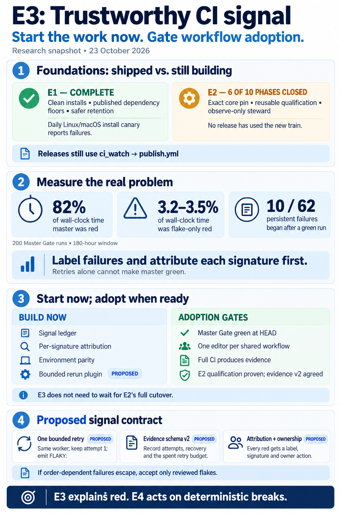
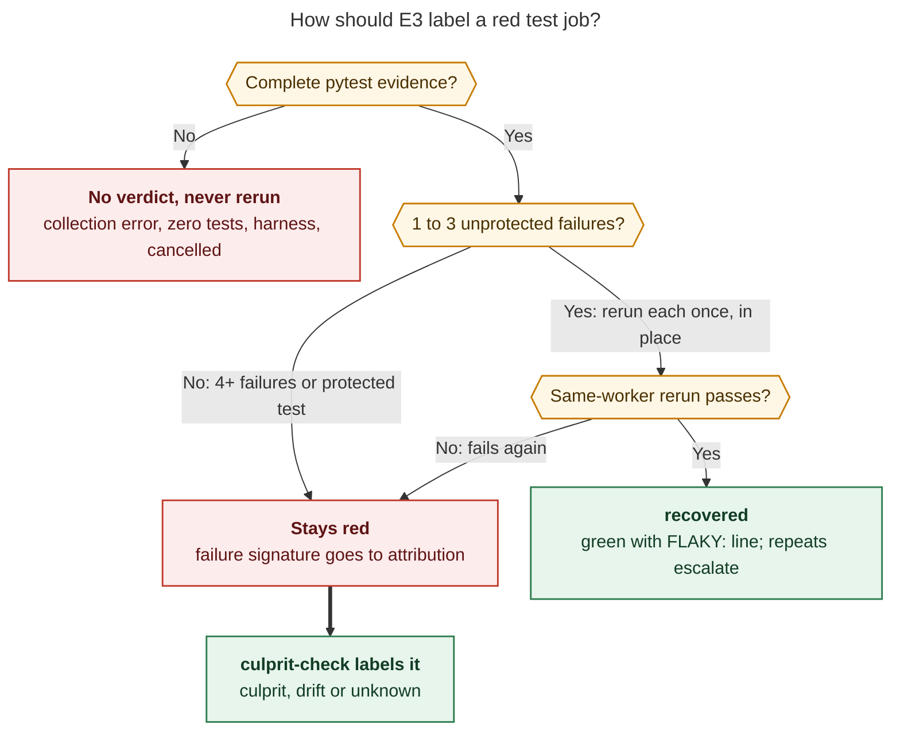

# E3 "Trustworthy signal": readiness, what E1 and E2 changed, and a starting design

> **Research query:** Before moving forward with the E3 epic described in
> `pypi_release_reliability_design_and_work_split.md` (in the research sidecar repo), are
> we ready for it? Describe the work done so far (e.g. E1 and E2) and the
> developer-facing behavior it changed, and start the design for the E3 epic.

## Bottom line

1. **Start E3 now. Start with the phases that add new files and edit no shared
   workflows. Gate workflow adoption on the named conditions in
   [the readiness gates](#readiness-gates).**
   - All five reports agree E3 can be planned now. They split on how much can land
     immediately, from gem's "zero blockers" to cld's "read-only phases only".
   - The evidence supports the middle position:
     - the setup defect that had made Full CI 100% red is fixed;
     - Master Gate is still red at HEAD;
     - both shared workflows still have in-flight editors (`sase-1nn` and E2's
       `sase-1n6.5`/`.6`/`.9`).
2. **E1 is done, and E2 is about 60% landed but has shipped nothing.**
   - **E1** (`sase-1my`) closed on 2026-10-19 with live proofs. The 7-day soak and the
     TestPyPI drill were declined, not done. See
     [what E1 changed for developers](#what-e1-changed-for-developers).
   - **E2** (`sase-1n6`) closed six of ten phases:
     - the tag build and sealed manifest;
     - the exact core pin;
     - the Linux/macOS exercise;
     - an observe-only steward;
     - release metrics;
     - core-cut resilience.
   - What is still open:
     - qualification's live acceptance;
     - digest-checked publish;
     - the cutover;
     - the first steward release.
   - Every release still goes through the legacy `ci_watch` → `publish.yml` path.
     `sase-1nn` is pushing 0.18.1 through it today. See
     [what E2 changed and what it has not](#what-e2-changed-for-developers-and-what-it-has-not).
3. **The CI data reframes what E3 is for.** I re-measured independently and reproduced
   cld's numbers to within a few tenths of a point
   ([the CI signal](#what-the-ci-signal-actually-looks-like)).
   - Master was red **82% of wall-clock time** over the last 200 Master Gate runs.
   - **Flake-only reds were 3.2–3.5%** of that time.
   - **Only 10 of 62** persistent failure episodes began on a green parent.
   - So a perfect rerun barely moves red time, and the design's "first red SHA with a
     green parent" culprit rule would attribute about one break in six.
   - E3's leverage is **labeling and per-signature attribution**, which feed E4's
     revert-first loop. Flake absorption comes second.
4. **The design has three internal contradictions to resolve in the plan. None are
   blockers.**
   - **(a) Its rerun rule can't meet its own acceptance case.** The case says "a test
     that fails only in order stays red". But xdist runs in `worksteal` mode, so order
     is not reproducible. The fix is an in-place, same-worker rerun
     ([bounded rerun](#bounded-rerun-and-why-it-reruns-in-place)).
   - **(b) E2's plan says qualification "inherits [E3.1] with no change".** That's
     false: the E2 evidence validator calls any failed node red and rejects unknown
     fields, so E3.1 needs an evidence schema v2 in E2-owned files
     ([evidence schema v2](#evidence-schema-v2-and-the-e2-handoff)).
   - **(c) Attribution must be per signature, not per run**
     ([attribution](#attribution-per-signature)).
5. **Several E2 defects must be fixed (as E2 work) before E3 builds on them**
   ([gate 5](#readiness-gates)):
   - the `release_metrics green` predicate;
   - the steward's rerun executor, which ignores `job_ids`;
   - the source-containment check.

   v0.42.2 clears today's *instance* of the containment gap but not the code gap.
6. **E3 will not make `master` green by itself.** The dominant pattern:
   - deterministic breaks land and linger: median **2.5 h**, p90 **9.3 h**;
   - the next break then lands on red.

   That is E4's loop plus an unowned "red-HEAD landing refusal". E3's job is to make
   every red *mean something and name its owner*.

## Report context and naming

Lead consolidation, 2026-10-23. It merges five independent reports (cdx, cld, grk, mus,
gem; siblings in this directory, listed under
[method, confidence and sources](#method-confidence-and-sources)) with my own
verification. That verification covered code reads, live GitHub and PyPI checks, and an
independent re-measurement of 200 Master Gate runs.

The researchers worked from sase `35e593bcc0`. **Since then, master has moved to
`1a3a7022d1`, and three things changed that matter here:**

- the Full CI `build-core` fix landed (`b2a4c380cf`, `sase-1nn.3` closed);
- the modal-sizing fix landed (`1a3a7022d1`, `sase-1nn.4` closed);
- sase-core **v0.42.2 was tagged**. It contains both sase's pinned core source revision
  and the steward's Rust policy.

Live observations below are as of about 16:50 UTC.

The design of record is
[`pypi_release_reliability_design_and_work_split`](../pypi_release_reliability_design_and_work_split/pypi_release_reliability_design_and_work_split.md).
"E3" there means Promise 3's first epic. It is **not** `sase-1ko` (instruction-migration
E3, closed) and **not** `sase-18j` (ToolRun failure-triage E3, closed). Title the bead
so searches can't confuse them. Suggested title: **"E3: Trustworthy CI signal (PyPI
release reliability)"**.

The full request:

> I'm thinking about moving forward with the E3 epic described by the
> `pypi_release_reliability_design_and_work_split.md` file in the research sidecar repo.
> Can you do some research with the goal of making sure we are ready for this epic,
> describing the work that has been done so far (e.g. E1 and E2) and what
> developer-facing behavior has been changed by that work, and starting the design for
> the E3 epic?

## Where the program stands

- **T0 `sase-1mk` ship 0.18.0**
  - *State:* closed 10-19
  - *Notes:* 0.18.0 on PyPI (uploaded 10-19 11:09 UTC); declares
    `sase-core-rs>=0.42.0,<0.43.0`
- **E1 `sase-1my` installable family**
  - *State:* closed 10-19
  - *Notes:* All six phases closed; soak, drill and `decisions:installable-releases`
    declined by owner
- **E2 `sase-1n6` release train + steward**
  - *State:* in progress
  - *Notes:* Closed: .1, .2, .3, .4, .7, .8. Open: .5 qualify, .6 publish/confirm, .9
    cutover, .10 first steward release
- **`sase-1nn` green gates, ship 0.18.1 via `ci_watch`**
  - *State:* in progress (opened 10-23)
  - *Notes:* Closed: .1, .3, .4. Open: .2 (raise pin to 0.42.2), .5 (UTC visual), .6
    (other Full CI reds), .7 (watch). Auto-decided `gate_rerun = yes` (whole-gate rerun)
- **E3 trustworthy signal**
  - *State:* **no bead**
  - *Notes:* No rerun helper, quarantine file, `culprit-check.yml` or `.python-version`
    exists
- **E4–E6**
  - *State:* no beads
  - *Notes:* E4's entry depends on E3

**Live state, 2026-10-23 ~16:50 UTC**

- **PyPI**
  - *Observation:* sase 0.18.0; core 0.42.1 newest (v0.42.2 tagged 16:29 UTC, not yet on
    PyPI at check time); 0.1.0 yanked
  - *E3 consequence:* When 0.42.2 publishes and `sase-1nn.2` raises the pin, the
    published core finally contains the source pin *and* the steward binding
- **Master Gate**
  - *Observation:* `1a3a7022d1`: 7/8 shards green; shard 8 failed 1 node,
    `test_custom_gate_modal_sizing.py::test_compact_scroll_refits_after_resize`
    (`wait_for` timed out after 5 s). The parent had 3 modal failures; `35e593bcc0` had 4
  - *E3 consequence:* Still red after `sase-1nn.4` closed. This is a live case for E3's
    rerun policy ([bounded rerun](#bounded-rerun-and-why-it-reruns-in-place))
- **Full CI**
  - *Observation:* Every run since 10-20 died in about 55 s at `build-core` `setup-uv`.
    Run `39987573569` at `1a3a7022d1` passed `build-core` and lint; tests were still
    running
  - *E3 consequence:* The entry gate "Full CI produces evidence" is half cleared
- **`release.yml`**
  - *Observation:* No run since the two 10-20 failures. The identity fix `ba7ab4e96b`
    landed 10-22 but has never been exercised
  - *E3 consequence:* Qualification acceptance (`sase-1n6.5`) is still unproven
- **Steward**
  - *Observation:* Observe-only. Cron is `*/15`, but over the last day it fired every
    2.5–5 h
  - *E3 consequence:* Scheduled-run delay is real; drift canaries need a staleness
    detector
- **Install canary**
  - *Observation:* Scheduled greens 10-20 → 10-23. Cron is 07:26 UTC; runs fire about
    12:40–13:00
  - *E3 consequence:* Four of the originally intended 7 days
- **Legacy Publish**
  - *Observation:* Scheduled runs red at `sync-release-metadata` through 10-23 11:39 UTC;
    `b2a4c380cf` adds auth
  - *E3 consequence:* Not yet proven by a run

## What E1 changed for developers

All of this is live.

- **Installing sase**
  - *Before:* Resolvers fell back silently to February's 0.1.0
  - *Now:* `uv tool install sase` gets 0.18.0. 0.1.0 is yanked, so a future broken
    window fails loudly instead of installing an ancient build
- **Public install check**
  - *Before:* None; backtracking could look green
  - *Now:* Daily `install-smoke.yml` on ubuntu + macOS (`fail-fast: false`) runs a clean
    family install and asserts newest **and** exact versions. It checks
    `sase core health`, completion and doctor, and loads all 9 plugin entry points.
    Green requires both OS artifacts. A red opens or updates one `install-canary` issue,
    mirrored into a task bead. It is a **detector, not a merge gate**
- **Plugin release PRs**
  - *Before:* Could declare a floor absent from PyPI (sase-github 0.2.24 did)
  - *Now:* Reusable `release-dependency-floor.yml` fails with `DEPENDENCY_UNPUBLISHED`,
    and `ci_watch` refuses the PR. A scheduled recheck (hourly on day 1, then every 4 h,
    up to 50 attempts) clears it after the sibling publishes, with no new push
- **Deleting core files**
  - *Before:* Newest-N retention, blind to consumers
  - *Now:* `pypi_retention.py` protects what at least 10 supported consumer releases
    need, with complete platform sets, and fails closed on unreadable metadata.
    `pypi_delete` refuses protected versions before touching credentials. Weekly
    headroom check: 4.09 of 10 GiB
- **Recovery**
  - *Before:* Ad hoc
  - *Now:* `docs/contribute/release-safety.md`: yank, then fix forward; core backfill
    from an old tag; "recovery is never blocked". The TestPyPI drill workflow is
    dispatch-only and has never run

**Caveats for E3:**

- The canary is a severity signal for E2's `INSTALL_BROKEN`. E3's quarantine and rerun
  must never suppress it.
- The retention code's "confirmed-working baseline" means the two newest sase releases
  whose dependency windows contain a complete core. That is a resolver-completeness
  proxy, not proof that tests passed (cdx). Do not reuse the phrase as an attribution
  baseline.

## What E2 changed for developers and what it has not

**Changed now (on `master`, even though no release used it):**

- **Exact core pin.**
  - `pyproject.toml` and `uv.lock` declare `sase-core-rs==0.42.0`.
  - A linked core checkout *behind* the pin stops `just install-venv` and
    `rust-install` unless `SASE_ALLOW_STALE_CORE=1`. That guard predates E2; E2 kept it.
  - A checkout *ahead* of the pin, the normal cross-repo case, only prints a note.
  - The published 0.18.0 still declares a range. The next release is the first exact
    one.
- **`just ratchet-core-window` is gone; use `just ratchet-core-pin`.**
  - It writes `==X.Y.Z` for the newest *complete* published core whose tag contains
    `sase-core-revision.txt`.
  - It refuses backward moves, and reports `CORE_LAG` without changing anything.
- **`tools/release_watch` is now a stateless steward client.**
  - New flags: `-o/--once` (read-only default), `-t/--tick` with `-l/--live`, `-j`,
    `-u/--until-released [VERSION]` with `-d`/`-p`, and `-r`.
  - Removed: the old `--version`, `--fixed-sha`, `--dry-run` and `--close-bead`
    surface.
  - It needs the `release_steward_decide` binding. A source-built dev venv has it, and
    published cores will have it from 0.42.2. To watch a release, run `--until-released`
    under `/sase_monitor`.
- **`ci.yml` is a reusable qualifier.**
  - New inputs: `ref`, `core-source: source|published`, `core-version`,
    `manifest-artifact`, `caller-job` and `probe-core-version`.
  - Called with a ref, it uses concurrency `qualify-<ref>` and never cancels.
  - Test steps load `-p tests._pytest_qualify_evidence` and upload
    `qualify-evidence-<job>-attempt-<n>` under `always()`.
  - **For test authors:** a nested pytest cannot overwrite the outer evidence (an
    exclusive `.owner` claim), and xdist workers never write.
- **`setup-sase` has an `expected-core-version` input** and refuses a mismatched core.
- **New tooling** (repo-local, not `sase <cmd>`):
  - `release_candidate` (seal, verify, observe, evaluate, …);
  - `exercise_release`;
  - `collect_qualification_jobs`;
  - `write_qualification_evidence`;
  - `release_metrics` (`green <sha> --json`).
- **New workflows:**
  - `release.yml`: dispatch-only, with modes release/resume/rehearse. It ends in a
    deliberate "not yet qualified" red job.
  - `release-steward.yml`: observe-only unless dispatched with `live`.
- **N1 inventory** `.github/release-qualification.json`.
  - Blocking: lint, tests on 3.12/3.13/3.14, and four exercise legs.
  - Advisory: visual, perf-floors, tutorial, page-group.
- **Docs:** `docs/contribute/release-train.md` is new. The `rust-backend.md` section
  "Watching a release" now points at the steward.

**Not changed yet:**

- `ci_watch` still merges sase's release PR, with the Full-CI freshness rule.
- `publish.yml` still builds and publishes, with `publish_existing` and `skip-existing`.
- release-please `draft`/`force-tag-creation` are unset, and
  `RELEASE_STEWARD_MERGE_ENABLED` is unset.
- No release has gone through `release.yml`.
- `decisions:exact-release-pair` is unwritten, and `release-safety.md` still describes
  `publish_existing` recovery.
- The steward's scheduled ticks take no action.

**Corrections to claims in some reports:**

- gem says E2 ".1 through .8 landed". In fact .5 and .6 are open.
- gem says "failures burn versions safely". Not yet: nothing abandons drafts or
  publishes from `release.yml`.
- gem calls the flake baseline "470+ lines of suppressions". It is 471 lines but **86
  entries**; the rest are comments.
- mus calls the identity repair "unlanded". It landed as `ba7ab4e96b` on 10-22.

## What the CI signal actually looks like

This is the preliminary E3.6 baseline.

**Window:** the last 200 completed Master Gate push runs, 2026-10-16 03:20 →
2026-10-23 15:23 UTC (180 h). cld parsed `--log-failed` for all red runs. I had a fresh
helper re-derive everything from raw job logs, without seeing cld's figures. Small
differences come from episode-boundary conventions.

**Definitions:**

- An **episode** is a maximal run of consecutive gate runs in which one node fails.
- A **one-run** episode is a flake candidate.
- A **persistent** episode lasts two or more runs.

cld's figures and the lead re-measure, metric by metric:

- **Red runs**
  - *cld:* 162/200
  - *Lead re-measure:* 162/200 (first attempts 163; one rerun turned green)
- **Wall-clock with master red**
  - *cld:* 82%
  - *Lead re-measure:* 82.3% (82.1% using final conclusions)
- **Consecutive runs differing by exactly one first-parent commit**
  - *cld:* 199/199
  - *Lead re-measure:* 199/199, no duplicate SHAs
- **Red runs that are flake-only**
  - *cld:* 9
  - *Lead re-measure:* 9
- **Flake-only share of wall-clock**
  - *cld:* **3.2%**
  - *Lead re-measure:* **3.5%** (3.2% using final conclusions)
- **Failure episodes (one-run / persistent)**
  - *cld:* 118 (55 / 63)
  - *Lead re-measure:* 123 (61 / 62)
- **Persistent episode duration, median / p90**
  - *cld:* 2.5 h / 9.3 h
  - *Lead re-measure:* 2.53 h / 9.25 h
- **Persistent episodes starting right after a green run**
  - *cld:* 10/63
  - *Lead re-measure:* 10/62. By distinct incident: 5/24
- **Failing nodes per red test run (1 / 2–3 / 4–9 / ≥10)**
  - *cld:* 58/35/51/6
  - *Lead re-measure:* 57/38/51/6
- **Failed lint recipes**
  - *cld:* toobig 21, mypy 18, validate 13, fmt-docs-check 10, docs-lint 5
  - *Lead re-measure:* identical

**New observations from the re-measure:**

- **Flakes ride along.** 55 of 163 red runs contain at least one flake-candidate node.
  Removing deterministic reds (E4) will *expose* flakes, so flake share will rise
  afterwards.
- **The heuristic is reliable.**
  - Only 1 of 60 resolved one-run episodes had its test file changed by the clearing
    commit.
  - In the 8 manual reruns, 6 of 7 flake-candidate instances passed, and all 15
    persistent-node instances failed again.
- **CI flakes and host flakes are different populations.** The top recurring CI flake,
  `test_link_follow_seam.py::test_beads_sync_reports_visible_and_missing`, had **14
  separate one-run episodes in 7.5 days**. Neither it nor the next three recurring ones
  appear in `tests/reproducible_flake_baseline.txt`. That confirms grk and cdx: keep
  E3's CI registry separate from the host `selection_health` baseline.

**What this means for E3:**

1. **A bounded rerun can recover at most about 3.5% of red time.** It is still needed:
   - qualification runs the whole suite on three Pythons and must not burn a candidate
     on a one-off flake;
   - it is the only planned producer of `FLAKY:` lines;
   - it turns "red" into "red because of X";
   - flake share will rise once E4 lands.
2. **Attribution must be per signature.** Most breaks start while master is already red.
3. **The biggest red-time lever is landing policy, not test infrastructure.** That means
   E4 plus the never-built red-HEAD refusal from `master_ci_red_why_and_how_to_stay_green`
   §5A, which has no owner.
4. **CI-only red has concrete sources, and parity should target them:**
   - `toobig` is deliberately not a `check` stage (21 lint reds);
   - fail-fast inside the lint job hides later stages;
   - load-sensitive TUI geometry passes locally and fails on runners;
   - repo-wide audits escape scoped selection (`sase-1mv`, READY).

## Readiness gates

1. **Full CI produces evidence**
   - *State now:* **Half cleared.** `b2a4c380cf` landed; the first post-fix run passed
     `build-core` and lint, and tests are running
   - *What it blocks:* Baselines for 3.13/3.14, `ci.yml` adoption
   - *Owner:* `sase-1nn.3` (closed), `.6`
2. **Master Gate green once at HEAD**
   - *State now:* **Not yet**: 1 node at `1a3a7022d1`
   - *What it blocks:* Only the start of the before/after measurement clock, not E3's
     mechanics
   - *Owner:* `sase-1nn.6` (or reopen `.4`)
3. **No concurrent editor of `master-gate.yml` / `ci.yml`**
   - *State now:* `sase-1nn` .5/.6 and E2 .5/.6/.9 in progress
   - *What it blocks:* Any E3 workflow adoption (the design's "two agents never rewrite
     one workflow" rule)
   - *Owner:* Sequencing
4. **Evidence contract for recovered flakes**
   - *State now:* **Open.** The validator classes any `failed + errors > 0` as `tests`
     (red), requires outcome counts to sum to `collected`, and rejects unknown keys
     (`tools/_release_qualification_evidence.py`)
   - *What it blocks:* Qualification inheriting reruns
   - *Owner:* E3, with a written handoff to E2
     ([evidence schema v2](#evidence-schema-v2-and-the-e2-handoff))
5. **E2 defects E3 would build on**
   - *State now:* **Open; file them on `sase-1n6`.** (a) `assess_release_green` counts
     exercise legs by name prefix and count, so four copies of one leg pass; it requires
     aggregate Full CI success, so an advisory failure vetoes; and it needs
     `release.yml` runs, which only tags get. (b) The Rust `GATE_RED` policy selects
     failed test jobs, but the Python executor runs `gh run rerun <id> --failed` (reruns
     lint too). (c) `release.yml` derives `--core-source-pin` by grepping
     `pyproject.toml`, and evaluate never checks tag ancestry
   - *What it blocks:* E3.5 release-lane bisection; trusting the job-level backstop
   - *Owner:* E2
6. **Overlapping owners**
   - *State now:* `sase-1jz` (green gates, host-independent goldens) is IN_PROGRESS and
     overlaps E3.7. `sase-16p` (0.17.1 uninstallable) is moot but READY
   - *What it blocks:* Clean ownership
   - *Owner:* Supersede or close, as Track 0's exit directed

**Verdict:**

- **File the epic now.**
- **Start the "now" phases** in [the phase plan](#phases-in-recommended-order)
  immediately.
- **Adopt on Master Gate** once gates 2 and 3 clear for `master-gate.yml`.
- **Adopt in `ci.yml` and evidence v2** after `sase-1n6.5` closes. That needs a green
  rehearsal on a SHA whose pin is inside a published tag, which `sase-1nn.2`'s raise to
  0.42.2 makes possible.
- **Do not wait for E2 to close.**

## Where the reports disagreed and how I resolved it

- **Readiness**
  - *Positions:* gem: "completely ready, zero blockers". mus: "ready to start, not
    exit". grk: plan now, adopt later. cld: plan and read-only now. cdx: start with the
    evidence contract
  - *Resolution:* **Start now; gate adoption** ([readiness gates](#readiness-gates)).
    gem's claim is contradicted by live CI
- **What E3 buys**
  - *Positions:* gem and the design: the rerun recovers 73.6% and "instantly stabilizes"
    CI
  - *Resolution:* **Measured: flake-only red is 3.2–3.5% of time.** The 73.6% figure is
    external reading-list data on how often rerunning a failed job recovers it. It is
    not sase's share of red time. cld and cdx are right
- **Phase order**
  - *Positions:* Design, gem, grk, mus: rerun first. cld: ledger first
  - *Resolution:* **Ledger and attribution first; build the rerun plugin in parallel;
    adopt it after gate 3**
- **Culprit rule**
  - *Positions:* Design, gem, grk, mus: first red SHA with a green parent. cld: per
    signature
  - *Resolution:* **Per signature.** The per-run rule covers 10 of 62 episodes
- **Rerun acceptance vs order defects**
  - *Positions:* Design: "keep first attempt, emit `FLAKY:`", but "a test that fails
    only in order stays red". cdx: accept only reviewed signatures. cld: classify on the
    final attempt, rerun the whole file in order. grk, gem, mus: isolated rerun
  - *Resolution:* **In-place, same-worker rerun**
    ([bounded rerun](#bounded-rerun-and-why-it-reruns-in-place)), with cdx's
    reviewed-only acceptance as the fallback. With `worksteal`
    (`tools/run_pytest:191`), a fresh-process or file-level rerun can't reproduce the
    original order
- **Retry composition**
  - *Positions:* cdx: one shared budget. grk: keep E2's job backstop. cld: fix the
    executor bug
  - *Resolution:* **One budget.** The job-level backstop skips pytest jobs whose v2
    evidence shows the node budget was spent. It stays for non-pytest jobs (exercise,
    smokes)
- **Where policy lives**
  - *Positions:* cdx: retry, quarantine and verdict policy in `sase_core`. cld: tools,
    plus one core wire field. E2 plan: "release promotion is tooling"
  - *Resolution:* **Runner policy in Python** (stdlib, inside the runner) because
    qualification runs against an *older published* core that lacks new bindings.
    **Steward wire fields in `sase_core`.** `QualifyRed` already carries
    `recovered: bool`. Add the design's `GATE_RED(sha, culprit?)`, which the wire lacks
    today, then bump `sase-core-revision.txt`
- **Quarantine mechanism**
  - *Positions:* gem: `xfail(strict=False)`. Others: deselect plus an advisory lane
  - *Resolution:* **Deselect from blocking runs and run in an advisory lane.** An xfail
    looks like a pass in counts
- **The `if: always()` rule**
  - *Positions:* Design: "`always()` only on reporting steps". cld: its sources meant
    *unmask*
  - *Resolution:* **Both:** reporting steps use `always()`; independent gating steps use
    `if: ${{ !cancelled() }}`. Verified: Master Gate's `lint` job runs 8 gating steps in
    sequence with no `if:`, so one red hides the rest
- **Clock injection**
  - *Positions:* gem: `SASE_TEST_TIME_OFFSET_DAYS`. cld: `libfaketime`. cdx: injectable
    wall-clock seams
  - *Resolution:* **Spike `libfaketime` scoped to the pytest process.** It is the only
    option that reaches Rust `SystemTime`. Fall back to a Python seam for display tests.
    No freezegun or time-machine dependency exists today
- **Decision-record timing**
  - *Positions:* mus: at start. cld, grk: at exit
  - *Resolution:* **At exit**, matching E2's precedent
- **E4 entry**
  - *Positions:* Design: E3.1 and E3.5 live. cld: attribution only
  - *Resolution:* **Recommend attribution only.** `culprit-check`'s k-of-k already
    refuses to blame flakes, and the revert loop is the biggest lever. This changes the
    design and needs your decision
- **Size**
  - *Positions:* Design: M–L. cld, grk: L
  - *Resolution:* **L**: seven phases, a cross-epic schema change, two new workflows and
    a Rust wire field

## Starting design for E3

This is a starting point for the E3 design.

### Goal, labels and scope

**Goal.** Every red on `master` and on a release candidate carries three things:

- a typed label: `recovered`, `culprit=<sha>`, `drift`, `quarantined` or `unknown`;
- a failure signature;
- an owner action.

Red minutes, flake share, escape class and time-to-attribution are reported with
explicit numerators and denominators. Recovered flakes stop failing qualification, but
never silently.

**In scope:**

- Master Gate and `ci.yml` *test and lint steps*;
- `tools/run_pytest` and test infrastructure;
- a CI quarantine file;
- new `culprit-check.yml` and `drift-canary.yml`;
- new `tools/ci_signal*`;
- evidence schema v2 (under the
  [E2 handoff](#evidence-schema-v2-and-the-e2-handoff));
- one steward wire field.

**Out of scope:**

- reverts and landing refusal (E4);
- Master Gate *triggers* and the merge queue (E5/E6);
- ToolRun triage, receipts and `tests/reproducible_flake_baseline.txt`. The decision
  `triage-annotates-does-not-change-exit-codes` stands;
- fixing `sase-1nn`'s reds;
- burning down flake beads. The ledger ranks them; it doesn't fix them.

### Bounded rerun and why it reruns in place

*Figure 1. Only a complete pytest session with one to three failing unprotected test
nodes gets a rerun. The rerun happens in place on the same worker, so polluted state
survives and an order-dependent victim fails again. Everything else stays red and goes
to attribution. Attempt 1 is always kept as evidence.*

**Rules.** These are the design's rules, plus three refinements.

1. **Eligibility.** Rerun only if all of these hold:
   - the session's evidence is complete;
   - between one and three nodes failed, counting **first attempts**, and checked at
     session end;
   - every failure is a call-phase test failure. Setup and teardown errors don't
     qualify;
   - no failing node is on `tests/ci_no_rerun.txt`. That list covers release integrity,
     deletion safety, auth and similar tests.

   Never rerun a collection error, a zero-test session, an internal or harness error,
   a timeout, a cancellation or a coverage-threshold failure.
2. **Mechanism: rerun in place, immediately, on the same xdist worker, once.**
   - This is the key refinement. `tools/run_pytest` defaults to `--dist=worksteal`, so
     each run assigns tests to workers and orders them differently. A post-session
     rerun in a fresh process (grk, gem, mus) strips the predecessor state that caused
     an order-dependent failure, and so launders exactly the case the design says must
     stay red. A file-in-order rerun (cld) only covers same-file predecessors.
   - Rerunning in place keeps module- and session-scoped state, so a polluted-state
     victim fails again.
   - Because the cap needs the whole session, recoveries are only *provisional* until
     session end. If more than three nodes failed on their first attempt, every
     recovery is void and the session is red.
3. **Recovered means exit 0, attempt 1 retained, and a `FLAKY:` line.** The line looks
   like `FLAKY: <nodeid> signature=<sig> attempt1=failed attempt2=passed`.
   - **Recovered is not exonerated.** The ledger `+1`s a flake bead when a signature
     recovers twice in 7 days. After three recoveries, the node goes to `ci_no_rerun` or
     quarantine review.
4. **One retry budget.** v2 evidence records that the node rerun was spent. E2's
   job-level backstop must not rerun such a job, because a full re-execution under a
   new `worksteal` order could launder an order defect. It stays for non-pytest jobs.
5. **Record each worker's executed node sequence (as a digest plus artifact).** That
   makes a later order-preserving replay possible (cdx).
6. **Fallback.** If the adversarial cases in [the acceptance cases](#acceptance-cases)
   cannot be made to stay red in place, switch acceptance to cdx's **reviewed-only**
   rule. Under it, a recovery turns green only for a reviewed known-flake signature, and
   an unknown isolated pass stays red as diagnostic. The measured cost is at most about
   3.5% of red time.

**Where it lives.**

- A small custom pytest plugin, `tests/_pytest_bounded_rerun.py`, enabled only in CI
  through an env var that workflow test steps set. `sase tool run` and `just check`
  never rerun locally.
- No new dependency. `pytest-rerunfailures` has no session-level cap and doesn't emit
  the `FLAKY:` prefix (grk).
- Because the rerun is in-process, `run_pytest`'s `execv` hand-off and its worker-token
  leases need no change.
- The plugin must write each attempt into the evidence explicitly.
  `_pytest_qualify_evidence` keys outcomes by node ID, so a later report silently
  overwrites attempt 1.

**Live example.** At HEAD `1a3a7022d1`, shard 8 failed one node:
`test_compact_scroll_refits_after_resize`, which timed out waiting under runner load.
Its owner bead `sase-1nn.4` closed this morning.

- **Today:** the whole shard is red, and `sase-1nn`'s watcher will rerun the entire
  gate.
- **Under E3:** the node is rerun once in place.
  - If it fails again, the gate stays red and attribution names `1a3a7022d1` or its
    predecessor.
  - If it passes, the gate is green, but the `FLAKY:` line and escalation put a closed
    bead's test straight back in front of its owner.

  Either outcome is more honest than today's.

### Evidence schema v2 and the E2 handoff

E2's plan says qualification inherits E3.1 "with no change". The validator says
otherwise:

- `failed + errors > 0` is class `tests` (red);
- outcome counts must sum to `collected`;
- `_require_keys` rejects unknown fields;
- `schema_version` must equal 1.

**v2 adds these fields:**

- **Attempts:** `first_attempt` counts; `final` counts; `recovered_node_ids`;
  `flaky_lines`; `node_rerun_consumed`.
- **Ordering:** `worker_sequence_digest`.
- **Selection:** the digests of the selected, collected and deselected-by-quarantine
  sets; the signal-policy digest.

**The validator** classifies on `final`. A run whose only failures recovered is a pass
carrying an observation. v1 is still accepted, with fixtures for retained v1 manifests.

**Files and handoff:**

- E3's `rerun` phase edits two E2-owned files: `tools/_release_qualification_evidence.py`
  and `tests/_pytest_qualify_evidence.py`.
- Put that handoff in both plans, and serialize it after `sase-1n6.5` closes.
- Prove v2 on `release.yml -f mode=rehearse` before any real release depends on it.

### Attribution per signature

**Suspect rule (E3.5).** A signature *s* first seen at Master Gate run *i* (commit *c*)
is attributed to *c* only when all of these hold:

- run *i−1* is *c*'s first parent;
- run *i−1* completed every shard;
- *s* was absent in run *i−1*.

Use whole-run completeness, not "same shard", because shard assignment drifts: 27 nodes
failed in more than one shard. Anything else is `unknown`. So are lint signatures hidden
by fail-fast, until unmasking lands.

**Guard both assumptions with tests:**

- **One commit per run** held for 199 of 199 runs. A push carrying several commits
  falls back to bisecting the push range.
- **The merge queue (E6) will break this property.** Attribution must then bisect the
  batch.

**`culprit-check.yml`** is dispatched with `suspect`, `parent`, `nodes` and `k`
(default 3).

- It runs only the named nodes, *k* times serially, at both SHAs, in the gate's exact
  environment.
- It runs the target code under a trusted diagnostic harness taken from current master,
  so old commits don't need today's tooling (cdx).
- It has no publication credentials and no issue-write rights. A separate reporter
  posts sanitized facts.

Each outcome maps to a label:

- **Suspect fails k/k, parent passes k/k:** `culprit=<sha>`
- **Suspect passes:** `recovered`
- **Both fail:** Walk back one parent. Call it `drift` only if the source and
  environment comparison shows an external or time change; parent-also-red alone is not
  proof
- **Mixed, mismatched environment, missing parent test or exhausted budget:** `unknown`

**Release lane:**

- **Separate three meanings of green:** admission-green (Master Gate), source-CI green
  (N1 blockers) and candidate-qualification green.
- Bisect from the newest *source-lane* green only after `release_metrics green` is
  repaired ([gate 5a](#readiness-gates)).
- Don't require an ordinary commit to have a tag-only exercise run.
- Until the containment code gap is closed, label a candidate red as `unknown`, not a
  bisect baseline.

**Wire.**

- Add `culprit: Option<{sha, signature, confirmed}>` to the steward's `GateRed`
  (`sase-core crates/sase_core/src/release_steward/wire.rs`).
- Fill `QualifyRed.recovered`, which already exists.
- Then move sase's core-revision pin, per `rust_core_backend_boundary`.

### Phases in recommended order

The design's E3.x numbers are in parentheses.

**Signal ledger** (E3.6 instrument; start now, read-only)

- **Work:** `tools/ci_signal` (stdlib plus `gh`) recomputes everything statelessly from
  Master Gate, Full CI and `release.yml` runs and failed-job logs.
  - **Signatures:** extracted with the existing Rust `tool_run_triage_extract`, so CI
    and ToolRun triage share one signature space. The ledger runs in a source-core
    environment, so the binding is available.
  - **Episodes:** grouped per signature.
  - **Digest:** JSON plus Markdown, with figures as in [the metrics](#metrics).
  - **Escape class** per culprit, joined to landing ToolRun records:
    - selection miss;
    - selected-and-failed-but-landed;
    - CI-only;
    - no check;
    - combined-tree race.
- **Verification:**
  - fixture histories with known answers, including zero denominators;
  - re-deriving [the CI signal baseline](#what-the-ci-signal-actually-looks-like)
    within rounding.

**Attribution** (E3.5; start now, new files)

- **Work:** [attribution per signature](#attribution-per-signature), plus the wire
  field.
- **Verification:**
  - a planted break is labeled `culprit=<sha>` even when the parent was red for
    another signature;
  - a one-off flake is labeled `recovered`;
  - a cancelled parent shard gives `unknown`.

**Parity** (E3.3; start now)

- **Work:**
  - add `.python-version = 3.12` (the 3.12/3.13/3.14 CI matrix stays);
  - in source mode, `setup-sase` compares `sase-core-sha.txt` with
    `sase-core-revision.txt` and fails fast naming both. Today it only echoes the SHA;
  - locally, error only when the linked core does **not contain** the pin;
  - decide `toobig_home` ([decisions](#decisions-for-the-plan-frontmatter)).
- **Verification:**
  - a mismatched core revision fails before tests;
  - an ahead-of-pin local checkout is not refused.

**Rerun plugin** (E3.1a; start now, not adopted)

- **Work:** [the bounded rerun](#bounded-rerun-and-why-it-reruns-in-place), plus
  `tests/ci_no_rerun.txt`.
- **Verification:** the [acceptance cases](#acceptance-cases) run on local fixtures.

**Unmask and adopt** (E3.3 + E3.1b; after [gates 2 and 3](#readiness-gates) clear for
`master-gate.yml`)

- **Work:**
  - Master Gate's lint job: the independent gating steps run under `!cancelled()`, and
    `just lint` reports every failing stage without changing its exit code;
  - enable the rerun plugin in Master Gate's test step;
  - add a Master Gate evidence upload (`if: always()`). Today the gate uploads none, so
    node IDs exist only in logs.
- **Verification:** with a planted lint error, `validate` and `build-check` still
  report; the contract test that pins Master Gate lint == `ci.yml` lint holds.

**Quarantine** (E3.2; after the rerun plugin)

- **Work:** `tests/ci_quarantine.toml`. Each entry has:
  - a node;
  - an open bead;
  - an owner;
  - a kind (`drift`, `ci-only` or `flaky`);
  - a reason;
  - an added date;
  - an expiry of 14 days or less.

  How it behaves:
  - entries are deselected from blocking runs and run in an advisory `quarantine` job;
  - expiry fails only a non-required hygiene check (on real time, excluded from the
    shifted clock), raises the bead and appears in the digest;
  - renamed or missing nodes need a reviewed resolution;
  - start **empty**. Refuse the modal-sizing tests, which already have an owner.
- **Verification:**
  - an expired entry fails hygiene while the gate stays green;
  - a bead-less or overbroad entry fails lint;
  - a protected test can't be quarantined.

**Drift canary** (E3.4; after unmask and adopt)

- **Work:**
  - extract the gate's core-wheel and test matrix into a reusable `gate-tests.yml`;
    Master Gate calls it unchanged;
  - nightly `drift-canary.yml`, **never named "Master Gate"**: `ci_watch`, the
    steward's `GATE_RED` and `release_metrics` all read Master Gate runs by SHA, so a
    canary run under that name would block releases;
  - an ordinary run and a +30-day run on the same captured SHA;
  - a staleness detector, because schedules slip by hours.
- **Verification:**
  - a planted time bomb fails the +30-day run while the gate stays green;
  - the canary never appears in `release_metrics green`.

**Evidence v2 and `ci.yml` adoption** (E3.1c; after `sase-1n6.5` closes)

- **Work:** [evidence schema v2](#evidence-schema-v2-and-the-e2-handoff), then enable
  the plugin in `ci.yml`'s test steps.
- **Verification:** a recovered flake *passes* qualification while the observation
  keeps attempt 1.

**Visual study** (E3.7; after `sase-1n6.5`)

- **Work:** measure `visual-test`'s false-red rate and wall time. Record a keep-or-promote
  decision by editing only the N1 inventory; the default is advisory. Coordinate with or
  supersede `sase-1jz`.
- **Verification:** a recorded decision.

**Exit**

- the mechanisms are live;
- the baseline is published next to
  [the CI signal baseline](#what-the-ci-signal-actually-looks-like);
- `docs/contribute/ci-signal.md` is written, per the `docs_writing` memory;
- the decision record is written.

The under-3% soak is E6's entry bar, not E3's exit.

**Sequencing:**

- **Serialize `master-gate.yml` edits:** unmask and adopt → drift (extraction).
- **Serialize `ci.yml` test-step edits:** evidence v2 → quarantine lane → visual.
- **Run the ledger, attribution, parity and the plugin build in parallel.**

### Metrics

These merge cdx's definitions with cld's ledger figures. Every figure states its window,
numerator and denominator. "0 of 0" reads as "not observed", never 0%.

- **Red minutes/day:** Union of intervals when the latest completed verdict is red,
  clipped per UTC day; unknown gaps reported separately
- **Initial test-red rate:** First attempts with test failures / complete first attempts
- **Accepted recovery rate:** Recovered under policy / rerun-eligible reds
- **Flake-only share:** Red time from runs whose every failure is a one-run episode /
  window
- **Episode duration:** p50/p90 per signature, with censored (unresolved) episodes
  counted
- **Attribution coverage and latency:** Reds labeled `culprit` / all new signatures;
  time from first failure to label
- **Escape class mix:** Culprits by escape class
  ([signal ledger phase](#phases-in-recommended-order))
- **Quarantine debt:** Active and expired entries, age, recurrence, per owner
- **Retry cost:** Extra runner minutes / first-attempt minutes
- **Escape rate:** Confirmed culprits reaching a release / releases, with horizon

**Deduplicate by SHA, policy digest and attempt.** Repeated dispatches on one SHA must
not inflate the sample.

**Reporting cadence.** Publish a digest every week. Store compact evidence past Actions'
90-day artifact expiry.

### Acceptance cases

1. A planted transient fails once, recovers in place, and emits `FLAKY:`. Attempt 1
   survives in the evidence.
2. A predecessor that pollutes module state makes a victim fail in-suite. The victim
   **fails again in place and stays red**. This is design case 9.
3. Four failures get no rerun. Nor does an error plus one assertion failure. Today's
   HEAD-shaped shards are the fixtures.
4. These all withhold green, and none is ever `FLAKY:`:
   - a collection error;
   - zero tests collected;
   - a cancelled shard;
   - a worker crash;
   - a truncated report;
   - a setup failure like Full CI's `setup-uv` glob.
5. A spent node budget blocks the job-level backstop. A second workflow attempt cannot
   reset it.
6. Nested pytest and xdist workers cannot overwrite attempt 1.
7. Duplicate matrix legs, a wrong core SHA or policy digest, and stale evidence are all
   refused.
8. An expired quarantine entry fails hygiene only. A protected or renamed node cannot
   disappear silently.
9. A +30-day injected run reveals a planted time bomb. TLS, OIDC, monotonic deadlines and
   quarantine expiry stay on real time.
10. Published-core qualification never falls back to a source-built wheel to get a newer
    binding.
11. A planted culprit is labeled `culprit=<sha>` within one gate run plus one check.
    Parent-also-red, a missing parent test or an exhausted budget gives `unknown` or
    evidenced `drift`.
12. `sase tool run check`'s triage classification is unchanged.

### Decisions for the plan frontmatter

- **`phase_order`**
  - *Options:* `ledger_first` · `rerun_first`
  - *Recommendation:* **ledger_first**. It feeds E4, and the rerun moves red time by
    ≤3.5%
- **`rerun_mechanism`**
  - *Options:* `in_place` · `isolated` · `file_in_order`
  - *Recommendation:* **in_place**. The only option that keeps predecessor state under
    `worksteal`
- **`rerun_acceptance`**
  - *Options:* `recovered_is_green` · `reviewed_only`
  - *Recommendation:* **recovered_is_green**, with escalation; switch to reviewed_only if
    acceptance case 2 fails
- **`attribution_rule`**
  - *Options:* `per_signature` · `per_run`
  - *Recommendation:* **per_signature** (10 of 62 vs all 62)
- **`e4_entry`**
  - *Options:* `attribution_live` · `rerun_and_attribution_live`
  - *Recommendation:* **attribution_live**. This changes the design
- **`policy_home`**
  - *Options:* `python_runner_core_wire` · `core_everything`
  - *Recommendation:* **python_runner_core_wire**. Qualification runs against an older
    published core
- **`quarantine_authority`**
  - *Options:* `gate` · `agent_with_bead`
  - *Recommendation:* **gate** at first. It is a tolerance exception to the house rule
    "fix waits and fixtures, never tolerance"
- **`clock_seam`**
  - *Options:* `faketime` · `python_seam`
  - *Recommendation:* **faketime** after a spike, scoped to pytest, with a Python seam
    fallback
- **`toobig_home`**
  - *Options:* `check` (changed-files) · `hygiene` · `keep`
  - *Recommendation:* **hygiene** if toobig debt stays routine-owned; otherwise
    **check**. 21 of 67 lint reds came from it
- **`escape_class`**
  - *Options:* `include` · `defer`
  - *Recommendation:* **include**. It is the only data that says *why* reds land
- **`memory_ci_signal_record`**
  - *Options:* `yes` · `no`
  - *Recommendation:* **yes, at exit**: `decisions:ci-signal-labels`, a sibling of
    `triage-annotates-…`

## Risks and what would change this design

- **The ledger shows most culprits had a red local `check` and landed anyway.** That is
  landing policy. Push E4 and the red-HEAD refusal, which today has no owner.
- **Most culprits passed a scoped check that never selected the failing test.**
  Selection gaps dominate. Promote `sase-1mv`-style audit edges. This is the reopen
  trigger in `check-full-is-explicit`.
- **The in-place rerun fails acceptance case 2.** For example, cleanup between tests
  hides the pollution. Fall back to reviewed-only acceptance
  ([bounded rerun](#bounded-rerun-and-why-it-reruns-in-place), rule 6).
- **`libfaketime` is noisy with mtimes, monotonic time or xdist.** Restrict the shifted
  run to a marked subset, or use the Python seam.
- **E2 `.9`/`.10` stall on human gates.** Prove v2 on rehearsals. E3 never needs the
  cutover.
- **Readers mistake canary or culprit-check runs for gate verdicts.** Add a contract
  test: only `master-gate.yml` is named "Master Gate", and readers filter by workflow
  file.
- **Flake share rises after E4 cuts deterministic red.** This is expected (the
  ride-along data predicts it). The rerun and quarantine phases then carry more weight.
  Re-measure before E6.

## Method confidence and sources

**Audited inputs:**

- the design of record and the E2 plan (`plan:202610/e2_release_train_steward.md`),
  via `sase artifact read`;
- beads `sase-1n6`, `sase-1nn`, `sase-1jz`, `sase-16p`, `sase-1ko`, `sase-18j` and
  `sase-1mv`, via `sase bead read`;
- sase-core opened with `sase repo open` (`2dc08580`, tag v0.42.2).

**Verified by me:**

- **Code and tree:**
  - the evidence-validator semantics and strict keys;
  - the `assess_release_green` logic;
  - the executor's `gh run rerun --failed`, and the Rust `rerunnable_gate_jobs` it
    executes;
  - `release.yml`'s pyproject grep for the pin;
  - `setup-sase` printing the provenance SHA without comparing it;
  - Master Gate's lint steps (no `if:`) and the absence of a test-evidence upload;
  - `worksteal` as the default distribution mode;
  - no `.python-version` file;
  - flake baseline: 471 lines, 86 entries;
  - no rerun or time-faking dependency;
  - `tool_run_triage_extract` exists;
  - the `release_watch` CLI surface.
- **Tags:** v0.42.2 contains source pin `246e2874` and steward policy `dd817d56`.
- **The wire:** `QualifyRed { signature, recovered }` exists; `GateRed { sha }` has no
  culprit field.
- **Live state:**
  - PyPI JSON for sase and core;
  - recent runs of Master Gate, Full CI, `release.yml`, the steward, install-smoke and
    Publish, including HEAD shard 8's failing node.

**Independent re-measure
([the CI signal](#what-the-ci-signal-actually-looks-like)):** a helper re-derived every
Master Gate statistic from raw job logs: 432 failed-job logs, all parsed. It was given
the method but not the figures. It agrees with cld within episode-boundary conventions.

**Carried from reports (spot-checked, medium-high confidence):**

- E1 phase details and live proof run IDs (mus, grk, cdx);
- E2 commit-per-phase lists (cld, mus);
- cdx's in-memory probes of the release-green predicate (consistent with my code read);
- plugin-repo caller wiring.

**Not verified:**

- Full CI's final result at `1a3a7022d1` (tests still running at writing);
- whether v0.42.2 has reached PyPI since;
- `libfaketime` behavior on GitHub runners with xdist;
- `SASE_RELEASE_TOKEN` write scopes;
- the `release.yml` trusted-publisher entry.

**Not done:** nothing was dispatched, merged, filed or configured. No bead, workflow,
memory or code changed.

**Researcher reports:**

- [cdx](pypi_release_e3_trustworthy_signal_readiness__cdx.md): evidence envelope,
  retry budget, metric definitions, release-green defects;
- [cld](pypi_release_e3_trustworthy_signal_readiness__cld.md): the 200-run baseline,
  per-signature attribution, ledger-first, evidence v2, the unmask reading;
- [grk](pypi_release_e3_trustworthy_signal_readiness__grk.md): file ownership,
  helper-first adoption, the three-E3 name collision, the live snapshot;
- [mus](pypi_release_e3_trustworthy_signal_readiness__mus.md): the E1/E2
  phase-by-phase record;
- [gem](pypi_release_e3_trustworthy_signal_readiness__gem.md): the component sketch
  (several status claims corrected above).
