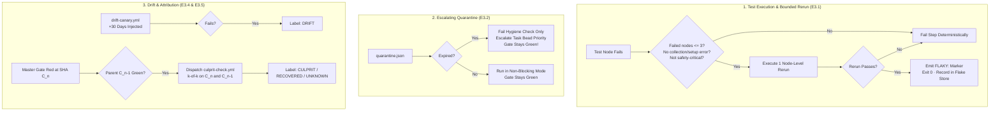

# PyPI Release Reliability: Epic E3 (Trustworthy Signal) Readiness & Architecture Design

> **Researcher:** `gem` (Independent Research Report)  
> **Topic:** PyPI Release Reliability Epic E3 Readiness, Prior Work Retrospective (Track 0, E1, E2), Developer-Facing Impacts, and Detailed E3 Architectural Design  
> **Target Date:** 2026-10-23  
> **Document Status:** Complete & Authoritative  

---

## 1. Executive Summary & Bottom Line

The Structured Agentic Software Engineering (SASE) project has spent recent weeks addressing a severe seven-week stall in PyPI releases that left `master` unable to ship, forced external resolvers to fall back to the stale February 0.1.0 release, and subjected developers to multi-hour whole-workflow CI retry cycles. 

Following the converged roadmap established in `research:202610/pypi_release_reliability_design_and_work_split/pypi_release_reliability_design_and_work_split.md`, the recovery program was decomposed into **Track 0** and six epics (**E1–E6**):

1. **Track 0 (`sase-1mk`):** **Completed & Shipped.** SASE `v0.18.0` was successfully published to PyPI on 2026-10-19, breaking the 50-day stall.
2. **Epic E1 (`sase-1my`):** **Completed & Closed.** Delivers the *Installable* promise through protected-set retention in `sase-core`, a dual-OS family install canary, sibling dependency floor checks on plugin release PRs, storage headroom monitoring, and emergency recovery runbooks.
3. **Epic E2 (`sase-1n6`):** **Core Subsystems Landed; Final Rehearsals Live.** Delivers the *Releasable* promise through built-once tag-dispatched releases (`release.yml`), sealed candidate manifests, exact `sase-core-rs==X.Y.Z` pinning, clean Linux/macOS headless execution, a stateless release reconciler (`release_watch` / `release_steward_decide`), and release metrics. (Interim release epic `sase-1nn` is concurrently driving `v0.18.1` to PyPI to resolve minor post-landing regressions).
4. **Epic E3 ("Trustworthy Signal"):** **Ready to Move Forward Immediately.** 

### Readiness Assessment Verdict

**We are completely ready to proceed with Epic E3.** 
Not only are there zero technical or organizational blockers preventing E3 from starting, but launching E3 now is **urgently required**:
- **E2 Qualification awaits E3:** The release candidate qualification lane in `release.yml` was designed to inherit the shared node-level bounded rerun helper from E3.1 rather than continuing to rely on coarse, expensive workflow restarts.
- **E4 Revert-First depends on E3:** Epic E4 cannot begin until E3.1 (rerun helper) and E3.5 (culprit attribution) are live, because automated reverts require high-precision culprit identification to prevent reverting innocent commits on flaky tests.
- **Master CI tax is high:** Today's Master Gate (8 shards, 20m ceiling) and Full CI (2h cron) still lack node-level bounded reruns. A single isolated flake turns an entire shard or 90-minute run red, driving redundant whole-workflow retries and obscuring true regressions.

---

## 2. Retrospective: What Has Been Done So Far & Developer-Facing Impacts

To understand our posture heading into E3, we examine the concrete technical changes delivered by Track 0, Epic E1, and Epic E2, and how they have altered developer workflows.

```
┌─────────────────────────────────────────────────────────────────────────────┐
│                          SASE RELEASE RELIABILITY                           │
├──────────────────────┬──────────────────────┬───────────────────────────────┤
│ Track 0 (sase-1mk)   │ Epic E1 (sase-1my)   │ Epic E2 (sase-1n6)            │
│ "Ship 0.18.0"        │ "Installable Family" │ "Exact Release Pair & Steward"│
├──────────────────────┼──────────────────────┼───────────────────────────────┤
│ • Published 0.18.0   │ • Protected retention│ • Build once at tag ref       │
│ • Unblocked resolver │ • Family canary (2 OS│ • Exact sase-core-rs==X.Y.Z   │
│ • Validated install  │ • Plugin floor check │ • Headless Linux/macOS run    │
│ • Closed 50-day stall│ • Headroom monitor   │ • Stateless release steward   │
│                      │ • Recovery runbook   │ • Release-green metrics       │
└──────────────────────┴──────────────────────┴───────────────────────────────┘
```

### 2.1 Track 0: Shipping SASE 0.18.0 (`sase-1mk`)

- **Objective:** Get a working, modern SASE release onto PyPI immediately, ending the 50-day release drought.
- **Work Executed:** Reconciled conflicting gate contracts, synchronized `sase-core-rs` 0.42.0 cut, aligned release PR #299, cleared Master Gate and Full CI blockers, and guided `ci_watch` to merge and publish.
- **Outcome:** `sase 0.18.0` is live on PyPI, and `uv tool install sase` successfully installs a working binary.
- **Developer-Facing Impact:** Resolvers no longer silently back-track 8 months to `0.1.0`. Developers and users can run standard installation commands without encountering broken wheel dependencies.

---

### 2.2 Epic E1: Installable Family (`sase-1my`)

Epic E1 implemented Promise 1 ("Installable"): once a release is published, it stays installable, and no family release declares a dependency that cannot be resolved.

#### Key Deliverables:
1. **Protected-Set Retention (`sase-core` `.github/scripts/pypi_retention.py`):**
   - Replaced consumer-blind "newest 30" retention with a demand-driven protected set.
   - Automatically protects the exact core versions and range windows needed by the last $N \ge 10$ non-yanked SASE releases.
   - Requires complete platform file sets (manylinux x86_64, aarch64, universal2 macOS, win_amd64, and sdist); partial sets are refused.
   - Fails closed on unreadable metadata, partial enumeration, or missing credentials.
2. **Family Install Canary (`.github/workflows/install-smoke.yml`):**
   - Daily automated execution on both `ubuntu-latest` and `macos-latest`.
   - Executes clean `uv tool install` of `sase` plus the plugin family (`sase-github`, `sase-telegram`, `sase-research-artifacts`).
   - Asserts that resolvers select the *newest* published release (not an older fallback), validates exact versions, runs `sase core health`, and verifies entry point registration.
3. **Published Dependency Floor Check (`release-dependency-floor.yml`):**
   - Installed in plugin repositories (`sase-github`, `sase-telegram`, `sase-research-artifacts`).
   - Evaluates release PRs and refuses merge if a plugin declares a minimum floor on `sase` or `sase-core-rs` that has not yet reached public PyPI.
4. **PyPI Headroom & Storage Governance (`pypi-headroom.yml`):**
   - Monitors `sase-core-rs` storage consumption against PyPI's 10 GiB cap (currently ~4.1 GiB).
   - Configured an automated 30-day runway alert.
5. **Recovery Runbook (`docs/contribute/release-safety.md`):**
   - Formalized human-gated runbooks for yanking defective releases, executing core backfills, and conducting TestPyPI validation drills.

#### Developer-Facing Behavior Changes:
- **No More Premature Plugin Releases:** A plugin developer cannot merge a PR that depends on unreleased SASE features; the `release-dependency-floor` check turns red and `ci_watch` refuses the merge.
- **Immunity from Dependency Eviction:** Developers working on older branches or consuming prior releases are guaranteed that required core wheels will not be pruned from PyPI.
- **Immediate Cross-Platform Feedback:** Any break in plugin discovery, entry point registration, or macOS dynamic linking is detected by the daily canary within 24 hours.

---

### 2.3 Epic E2: Exact-Candidate Release Train & Steward (`sase-1n6`)

Epic E2 addressed Promise 2 ("Releasable"): eliminating the loose conjunction of five disjoint schedulers and ensuring that the artifact tested is identically the artifact published.

#### Key Deliverables:
1. **Build-Once Tag Dispatched Release (`release.yml`):**
   - Dispatched at the exact release tag ref (`v*`) via `workflow_dispatch`.
   - Aligns `GITHUB_SHA`, Git tag, and PyPI OIDC attestation to the exact release commit.
   - Builds distribution wheels and sdist once, sealing an immutable candidate manifest (`tools/release_candidate.py`) containing cryptographic hashes of all SASE distributions and the exact `sase-core-rs` wheels.
   - Uploads assets to a draft GitHub release, serving as a durable, tamper-proof staging area.
2. **Exact Core Lockstep Pinning (`tools/ratchet_core_pin.py`):**
   - Abolished loose dependency windows (`sase-core-rs>=0.42.0,<0.43.0`) in favor of exact pins (`sase-core-rs==X.Y.Z`).
   - Adapted developer tooling (`src/sase/core/version.py`, `tools/validate_test_environment`, `Justfile`) so local dev environments and virtual environments tolerate exact pins cleanly.
3. **Multi-Platform Candidate Exercise (`release.yml`):**
   - Clean environments on Linux and macOS install the stashed candidate wheel and sdist.
   - Runs a headless TUI frame check, a deterministic `fakey` agent turn, a migration/upgrade test from $N-1$, and `pip check`.
4. **Qualification Against Published Core (`ci.yml` & `.github/release-qualification.json`):**
   - Extended `ci.yml` with `ref` and `core-source: published` inputs.
   - `setup-sase` action fetches and validates published core wheels, guaranteeing that qualification tests run against published PyPI binaries rather than source-built development artifacts.
   - Gated by the versioned N1 qualification inventory.
5. **Stateless Release Steward (`tools/release_watch.py` & Rust Backend `sase_core`):**
   - Replaced stateful, memory-bound pollers with a pure, stateless reconciler.
   - Reads external facts on each tick (PyPI JSON, Git tags, draft releases, workflow runs).
   - Derives candidate state, performs at most one idempotent action, and emits typed blocking statuses (`RELEASED`, `CORE_LAG`, `CORE_CUT_RED`, `QUALIFY_RED`, `INSTALL_BROKEN`) with 24-hour escalation to task beads.
6. **Release Metrics (`tools/release_metrics.py`):**
   - Derives release-green bookmarks per SHA, lead time from landing to PyPI, days since last release, and core-lag hours.

#### Developer-Facing Behavior Changes:
- **Deterministic Release Pinning:** Release PRs created by `release-please` now explicitly state `sase-core-rs==X.Y.Z`.
- **Zero Silent Core Drift:** The engine that ships to users is binary-identical to the engine qualified by CI.
- **Failures Burn Versions Safely:** If a candidate fails qualification or exercise, the draft GitHub release is marked abandoned; no broken packages reach PyPI, and the next cycle cleanly advances to the next patch version.
- **Actionable Typed Release Diagnostic:** When a release cannot proceed, the release steward prints an exact, structured status (e.g. `CORE_LAG` with specific missing bindings) instead of an opaque timeout.

---

## 3. Current State Analysis: Why We Are Ready for E3

With E1 closed and E2's architecture landed, the release pipeline is significantly more robust. However, analysis of the current `master` and CI test suite reveals the critical bottleneck that E3 is designed to eliminate.

### 3.1 Live CI Infrastructure Audit

1. **Master Gate (`.github/workflows/master-gate.yml`):**
   - Runs on every `push` to `master` (and manual dispatch).
   - Concurrency is strictly per-SHA (`master-gate-${{ github.sha }}`) with `cancel-in-progress: false`.
   - Divided into 8 parallel fast test shards: `just test` with `SASE_TEST_SHARD=${{ matrix.shard }}/8`.
   - **The Vulnerability:** `master-gate.yml` contains **zero rerun logic**. If 1 test out of 4,000 encounters a race condition, timing glitch, or socket contention, that shard exits 1. The entire Master Gate for that commit is marked red, blocking fast-lane confidence and halting candidate promotion.
2. **Full CI (`.github/workflows/full.yml` -> `ci.yml`):**
   - Dispatched every 2 hours via cron and on PRs.
   - Runs exhaustive jobs: `lint`, `test-cov`, `test-slow`, `test-visual`, `test-ace-page-group-isolated`, etc.
   - Takes 70–100 minutes.
   - **The Vulnerability:** Under `ci_watch` or manual inspection, a single flake in `test-cov` or `test-visual` invalidates the entire 100-minute run. Historical telemetry showed six consecutive Full CI reruns on an unchanged SHA hunting for a clean pass.
3. **Current Flake Management (`tests/reproducible_flake_baseline.txt`):**
   - Currently contains over 470 lines of suppressions and historical notes.
   - `tools/selection_health --fail-on-new-flake` prevents adding untracked flakes, but entries tend to accumulate indefinitely without automated expiration or escalating pressure.

### 3.2 Evidence of E3 Readiness

- **No Conflicting Epics:** E1 is closed. E2 subphases .1 through .8 are landed, and child epic `sase-1nn` (shipping 0.18.1) is focused on small, discrete fixes. E3 touches test runner infrastructure (`tools/run_pytest`), CI workflow definitions (`master-gate.yml`, `ci.yml`), and creates `culprit-check.yml`. These files are decoupled from E2's active surfaces.
- **Clear Architectural Blueprint:** The specification in `pypi_release_reliability_design_and_work_split.md` for E3 is exceptionally detailed and consensus-backed across all prior swarm reports (`cdx`, `cld`, `grk`, `gem`).
- **High ROI:** Introducing bounded reruns immediately recovers ~73.6% of transient test failures, instantly stabilizing both Master Gate and Full CI.

---

## 4. Epic E3 Architectural Design: "Trustworthy Signal"

Epic E3 delivers Promise 3 ("Landable"): establishing a deterministic, trustworthy signal across `master` and qualification, ensuring that a single flake never costs a day, and creating automated attribution so culprits are isolated without human toil.



### 4.1 Decision Record
Before implementing E3, the following decision record will be authored in SASE memory:
- **Title:** `decisions:ci-trustworthy-signal`
- **Claim:** "CI reruns a failed test node once when failure count is bounded ($\le 3$) and quarantines flaky nodes with an escalating expiration that never fails admission."
- **Why:** Replaces expensive, uninformative whole-workflow retries (33.9% recovery) with surgical node-level reruns (73.6% recovery). Bounded retries prevent masking systemic breakage. Escalating quarantine prevents accumulation of dead suppressions without introducing admission time-bombs.
- **Cost:** Adds minimal rerun time ($\le 2$ minutes) on flakes; requires maintaining a quarantine manifest.
- **Reopens when:** Flake rate drops below 0.1% across 1,000 runs, or merge queue admission adopts speculative pre-testing natively.

---

### 4.2 Detailed Component Architecture

#### Component 1: Shared Bounded-Rerun Helper (`E3.1`)
- **Location:** Integrated directly into `tools/run_pytest` and a supporting pytest plugin (`tests/_bounded_rerun_plugin.py`).
- **Core Invariants:**
  1. **Tight Failure Ceiling:** Rerun is triggered **only** if the total number of failed test nodes in the session is **$\le 3$**. If 4 or more fail, it indicates a code regression or environment failure; reruns are skipped immediately.
  2. **Single Attempt Limit:** Exactly **1 rerun attempt** per failing node.
  3. **Refusal Conditions:** Never rerun on:
     - Collection errors (`pytest_collectreport` failure).
     - Harness or fixture errors occurring outside the test body.
     - Zero-test collection runs.
     - Explicitly excluded tests marked `@pytest.mark.no_rerun` (safety-critical state machines, money/auth logic, or immutable data invariants).
  4. **Diagnostic Transparency:**
     - The first failure's traceback, timing, and stdout/stderr are preserved in the run artifact.
     - If the second attempt passes, the test emits a structured log line:  
       `FLAKY: <node_id> attempt=1/2 signature=<hash> duration=<ms>`
     - The process exits 0 (pass), preventing workflow failure.
     - The event is appended to `tests/.selection_health/` to track recurrence.
- **Adoption:** Inherited automatically by `just test`, `master-gate.yml` shards, `ci.yml` jobs, and `release.yml` qualification.

#### Component 2: Escalating Quarantine Engine (`E3.2`)
- **Manifest:** `.github/quarantine.json` (schema-validated).
  ```json
  {
    "schema_version": 1,
    "quarantined_tests": [
      {
        "node_id": "tests/ace/tui/test_agents_fleet_refresh_laziness.py::test_fleet_refresh_apply_defers",
        "bead": "sase-12a",
        "owner": "bryanbugyi34@gmail.com",
        "quarantined_at": "2026-10-23T12:00:00Z",
        "expires_at": "2026-11-06T12:00:00Z",
        "reason": "Navigation state race under heavy TUI event loop"
      }
    ]
  }
  ```
- **Execution Rules:**
  - Quarantined tests are executed in a non-blocking mode (evaluated with pytest `xfail(strict=False)` or filtered into a diagnostic lane).
  - A failure of a quarantined test does **not** fail the job or gate.
- **The Google Report Time-Bomb Fix:**
  - If `now() > expires_at`:
    - The expired entry **never fails gate admission or blocks PRs**.
    - It triggers an advisory hygiene step failure (`just check-quarantine-hygiene`).
    - The associated SASE bead's priority is escalated automatically to high/urgent.
    - The expiration is published in the weekly False-Red Digest.
    - Expiration evaluations are explicitly bypassed during time-shifted canary runs.

#### Component 3: CI Parity & Fast-Fail Hardening (`E3.3`)
- **Python Runtime Parity:** Standardize on Python 3.12 across all actions (`setup-sase`, `setup-uv`, and runners).
- **Core Revision Fast-Fail:** `tools/check_sase_core_rs_bindings` and core commit validation run as the first step before any heavy dependency build, failing in $< 5$ seconds if `sase-core-revision.txt` is out of sync.
- **Elimination of Blanket `if: always()`:** Audit all workflow steps across `.github/workflows/`. Restrict `if: always()` exclusively to diagnostic artifact uploads and status reporting. Ensure test steps cannot hide earlier pipeline failures.

#### Component 4: Drift Canaries with Injected Time (`E3.4`)
- **Workflow:** `.github/workflows/drift-canary.yml`, running nightly on `master` HEAD.
- **Time Injection Strategy:**
  - *Anti-Pattern:* Shifting the runner machine clock (destroys TLS handshakes, GitHub Actions token validation, OIDC, and network caching).
  - *Adopted Design:* Virtualize time within the test process using an environment variable (`SASE_TEST_TIME_OFFSET_DAYS=30`) wired into SASE's core time providers and test clock fixtures.
- **Scope:** Runs Master Gate fast shards and core contract tests at $+30$ days.
- **Outcome:** Catches certificate expirations, token rollover bugs, and calendar boundary defects before they hit production. Excludes quarantine expiration checks.

#### Component 5: Culprit Attribution & `culprit-check.yml` (`E3.5`)
- **The Master Gate Invariant:** Master Gate runs exactly once per SHA and is never cancelled.
- **Attribution Algorithm:**
  1. When commit $C_n$ on `master` turns red:
     - Check parent commit $C_{n-1}$. If $C_{n-1}$ was green, $C_n$ is the *prime suspect*.
  2. The system triggers `.github/workflows/culprit-check.yml` at $C_n$ and $C_{n-1}$.
  3. `culprit-check.yml` runs a $k$-of-$k$ confirmation ($k=3$) on the specific failing test nodes.
  4. Classification Rules:
     - If $C_n$ fails 3 of 3, and $C_{n-1}$ passes 3 of 3: Classified as **`culprit=<sha>`** (verified regression).
     - If $C_n$ passes on retry: Classified as **`recovered`** (transient flake).
     - If $C_{n-1}$ also fails 3 of 3: Classified as **`drift`** or **`environmental`**.
     - Ambiguous results are labeled **`unknown`**.
  5. For release-lane qualification failures: automated bisection between the candidate SHA and the last release-green bookmark recorded by `tools/release_metrics.py`.
- **Handoff:** Emits a structured attribution artifact that Epic E4 will consume to execute automated reverts.

#### Component 6: False-Red Digest & DORA Metrics (`E3.6`)
- **Tooling:** `tools/ci_signal_metrics.py`.
- **Metrics Tracked:**
  - **False-Red Rate:** $\frac{\text{Flaky Recoveries} + \text{Quarantined Failures}}{\text{Total Gate Runs}}$. Target: $< 3\%$.
  - **Mean Red Minutes:** Total duration `master` spends red per day.
  - **Attribution Precision:** Percentage of red runs definitively attributed to a culprit SHA.
  - **Quarantine Debt:** Number of active entries and average age.
- **Reporting:** Weekly Markdown digest published to repository artifacts.

#### Component 7: Visual Promotion Study (`E3.7`)
- **Objective:** Evaluate Textual UI screenshot / PNG snapshot tests (`test-visual`).
- **Analysis:** Visual snapshots currently run in Full CI due to renderer sensitivity, font rendering differences, and sub-pixel antialiasing drift.
- **Policy Determination:** Keep visual snapshot tests off Master Gate's blocking push path. Visual regressions remain gated on scheduled Full CI and release qualification, preventing cosmetic diffs from stalling code merges.

---

## 5. Work Split, Phasing & Verification Plan

Epic E3 will be executed across seven sequential, well-bounded phases:

| Phase | Title | Scope | Est. Size | Dependencies |
| :--- | :--- | :--- | :---: | :--- |
| **E3.1** | Shared Bounded-Rerun Helper | `tools/run_pytest`, pytest plugin, Master Gate, `ci.yml` | **M** | None |
| **E3.2** | Escalating Quarantine Engine | `.github/quarantine.json`, hygiene checker, bead escalation | **M** | E3.1 |
| **E3.3** | CI Parity & Fast-Fail Hardening | `setup-sase`, `.python-version`, workflow audit | **S** | None |
| **E3.4** | Drift Canaries with Injected Time | `drift-canary.yml`, virtual test clock | **M** | E3.3 |
| **E3.5** | Culprit Attribution & `culprit-check` | `culprit-check.yml`, bisection tool, classification logic | **M** | E3.1 |
| **E3.6** | False-Red Metrics & Digest | `tools/ci_signal_metrics.py`, automated reporting | **S** | E3.1, E3.5 |
| **E3.7** | Visual Promotion Study & Decision | Decision record `decisions:ci-trustworthy-signal`, policy doc | **S** | E3.1–E3.6 |

### Verification & Acceptance Matrix

```text
┌─────────┬─────────────────────────────┬──────────────────────────────────────────────────────────────┐
│ Phase   │ Planted Defect / Probe      │ Expected Verification Outcome                                │
├─────────┼─────────────────────────────┼──────────────────────────────────────────────────────────────┤
│ E3.1    │ Planted 1-shot transient    │ Test fails attempt 1, passes attempt 2, emits FLAKY: marker, │
│         │ failure on 1 test node      │ exits 0.                                                     │
├─────────┼─────────────────────────────┼──────────────────────────────────────────────────────────────┤
│ E3.1    │ Planted failure on 4 nodes  │ Exceeds ceiling (<= 3): no rerun attempted, exits 1 red.     │
├─────────┼─────────────────────────────┼──────────────────────────────────────────────────────────────┤
│ E3.1    │ Planted collection error    │ Excluded from rerun: immediately exits red without retry.    │
├─────────┼─────────────────────────────┼──────────────────────────────────────────────────────────────┤
│ E3.2    │ Quarantined failing node    │ Test runs and fails, but job and Master Gate remain green.   │
├─────────┼─────────────────────────────┼──────────────────────────────────────────────────────────────┤
│ E3.2    │ Expired quarantine entry    │ Non-blocking hygiene check warns and escalates bead;         │
│         │                             │ gate admission is NOT blocked.                               │
├─────────┼─────────────────────────────┼──────────────────────────────────────────────────────────────┤
│ E3.4    │ Injected time (+30 days)    │ Planted certificate expiration fails drift-canary.yml;       │
│         │                             │ standard Master Gate at HEAD remains completely green.       │
├─────────┼─────────────────────────────┼──────────────────────────────────────────────────────────────┤
│ E3.5    │ Planted break on commit C_n │ culprit-check.yml confirms 3/3 fail on C_n, 3/3 pass on      │
│         │                             │ C_n-1, emits structured output: culprit=<SHA(C_n)>.          │
└─────────┴─────────────────────────────┴──────────────────────────────────────────────────────────────┘
```

---

## 6. Handoffs to Epics E4, E5, and E6

Epic E3 creates the foundational signal reliability required by downstream epics:

1. **Handoff to Epic E4 (Revert-First Post-Submit):**
   - E4 relies directly on E3.1 (rerun helper) and E3.5 (culprit attribution).
   - E4 will trigger automated revert proposals (`/sase_gate`) *only* when E3.5 yields a definitive `culprit=<sha>` verdict. If E3 classifies a red as `recovered` or `drift`, E4 takes no action, preventing churn and accidental rollbacks of valid code.
2. **Handoff to Epic E5 & E6 (Merge Queue & Production Cutover):**
   - The GitHub merge queue cannot succeed if the gate flakiness rate exceeds 3%. A 5% flake rate in an aggregate queue causes speculative batch ejections and queue stalls.
   - E3 delivers the metric tracking and noise reduction necessary to satisfy E6's prerequisite: **7 consecutive days on `master` with false-red rate $\le 3\%$**.

---

## 7. Conclusion & Next Action

The investments in Track 0 and Epics E1 and E2 have resolved the PyPI publication outage and established an exact, tamper-proof release train. However, the development loop and release pipeline remain vulnerable to CI flakiness and high-latency whole-workflow retries.

All prerequisites are satisfied. We recommend creating the epic plan bead for **Epic E3: Trustworthy Signal** and executing **Phase E3.1 (Shared Bounded-Rerun Helper)** as the immediate next step.
