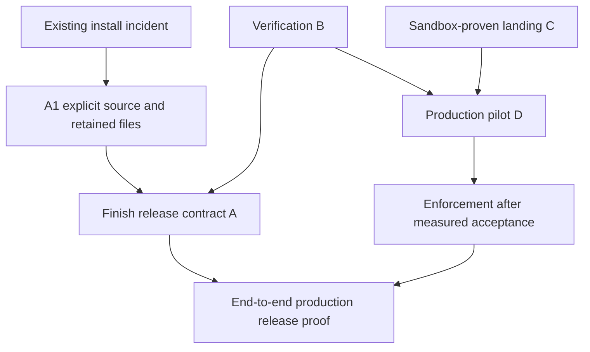

# Reliable SASE releases: qualify immutable candidates, preserve installability, and fence landings

Independent research by **cdx**, 2026-10-18. This report reviews the twelve documents tagged by research commit `dcbfd0dc` and checks their central claims against current code and live service metadata. It does not consult the reports or findings of the other researchers in the current swarm.

**Recommendation:** retain the reassessment's four-epic structure: **A, release promotion and installability; B, trustworthy verification; C, durable asynchronous landing; D, production queue rollout.** Start the public-install repair immediately under its existing owner. Build A and B before demanding that the queue solve release problems. Keep GitHub's native merge queue, zero required approvals, linear history, and host-owned completion. Make the release candidate—not a branch name, a green badge, or a successful upload command—the unit of promotion.

The most important changes to the accumulated proposals are:

1. Keep slow release qualification **outside** the merge queue, including for release PRs. A failed candidate must not hold up unrelated integration.
2. Treat dependency preservation and tested public core binaries as release requirements. Source CI against a pinned Rust commit does not establish that a public install works.
3. Carry a durable manifest from build through confirmation, including exact files, dependency evidence, workflow identity and policy version.
4. Apply bounded failure handling to both admission and qualification, preserving original failures and test context. A pass when a test runs alone is not proof that its earlier failure was harmless.
5. Make dependency waits require a **sealed set of landing obligations**. Closed work with missing landing records must never look delivered.
6. Preserve the Google comparison's improvements to behavioral testing, recovery and post-submit ownership, but correct its provenance wording and avoid its install-outage recovery deadlock.

## What the twelve tagged documents contribute

The tag is a reading index, not a record of approved architecture. The initial tagging commit changed the following twelve canonical reports/notes. All were accessed through audited `sase artifact read` calls. For the broader comparison and documentation reports, this review concentrates on their release-reliability arguments; unrelated orchestration features, reading recommendations and documentation redesign details are not proposed as dependencies of this program.

| Source | Contribution to this design | Qualification or change |
| --- | --- | --- |
| [Gas Town comparison][R1] | Verify the integrated result, prove landing, use bounded recovery. | Its host-local landing lane and LLM-mediated judgments are superseded by the native-queue design. Do not import its orchestration stack. |
| [Original merge-queue/release proposal][R2] | Correctly separates admission from exact-candidate publishing; rejects repeated repair epics as the long-term solution. | Replace merge commits, broad `publish_existing`, and the original closure semantics. Its latency numbers are simulation results. |
| [GitHub queue primer][R3] | Event-aware checks, asynchronous merge completion and real queue mechanics. | Do not treat observed SHA equality on other repositories as a universal rebase guarantee. Avoid adding `Restrict updates` mechanically. |
| [Four-epic reassessment][R4] | Best organizing document: linear history, dependency-aware waits, explicit check inventory, drift handling, sandbox versus rollout. | Strengthen retention, evidence identity and recovery; use the corrections below. |
| [Reassessment explained][R5] | Useful explanation of the separation between integration, publication and installability. | Historical figures are dated; its statement that merge limit 1 makes a group contain one PR is incorrect. |
| [Google release-engineering comparison][R6] | Behavioral qualification, continuous release checks, build ownership, rollback planning, provenance and quarantine correction. | Do not move full release qualification into the queue. Publish attestations are narrower than build provenance. Do not forbid the repair release during an install outage. |
| [Agent-factory reading synthesis][R7] | Durable reconciliation, generation-aware identity, integrated-tree proof, correlated failures, distinction between green trunk and releasable artifacts. | A promotion pointer must reference qualified candidates, not make any ancestor of a green commit release-safe. A general workflow engine is unnecessary here. |
| [Gas City comparison][R8] | Missing evidence must not become success; budget CI and measure actual outcomes. | Its green default branch does not prove release quality; its own slow tier matters. Borrow the boundary, not its infrastructure. |
| [Step 0 ruleset instructions][R9] | Separate permanent force-push/deletion protection from the queue pilot's temporary bypass. | Step 0 is already present in the live effective rules observed during this research. |
| [Testing agent fixes with a queue][R10] | Landing status, notifications and an isolated preview path protect Bryan's feedback loop. | Measure from turn completion to usable code; do not promise the simulated 15–30-minute delay. |
| [Documentation redesign][R11] | Installation and first-run documentation must describe the shipped product. | Bring applicability tests into the release contract; the wider site redesign is a separate effort. |
| [0.18.0 release-status investigation][R12] | Explains the historic release-watch bottleneck and urgency of restoring public installation. | Its no-green-since-August claim is now stale. Its manual-merge suggestion is not a durable release policy. |

## Current facts, separated from historical evidence

The main checkout reviewed is `sase@f1c20a9f6b729aebbf47246294fe4185b4392ea2`. Linked checkouts opened through `sase repo open` were `sase-core@80dc704a4f2e1f640f7caa9e578957669c31367d` and `sase-github@8712c153aa969eef55bccbabe2e0e94a50764a68`. Research was read from `fe303347d2953241193abfa9ca937571545a4b9e`. Live metadata below was sampled on October 18, around 15:29 UTC; it is a snapshot, not a promise about later state.

**Installation is still broken in a particularly misleading way.** Direct PyPI JSON reports SASE 0.17.1, requiring `sase-core-rs>=0.32.16,<0.33.0`. The oldest core version with files is 0.34.23, across 51 versions with files; the latest is 0.41.0. A fresh, no-cache Python 3.12 resolver check selected `sase==0.1.0` for unconstrained `sase`. The same command with `sase==0.17.1` failed because no compatible core exists. These were resolution checks, not package installations. [SASE metadata](https://pypi.org/pypi/sase/json), [core metadata](https://pypi.org/pypi/sase-core-rs/json).

**Some earlier infrastructure findings are already outdated.** The effective `master` rules now contain `deletion` and `non_fast_forward`. The repository still permits merge commits only, with rebase, squash and auto-merge disabled. The latest ten Full CI runs returned by the API include four successes. Six runs on unchanged SHA `ae9f044bb39c22ab5702031b1507249e29a2d4da` include three successes and three failures. That supports a nondeterminism investigation; it does not establish a population-wide 50% false-red rate or prove each failure harmless. See [effective rules](https://api.github.com/repos/sase-org/sase/rules/branches/master), [repository settings](https://api.github.com/repos/sase-org/sase), and [Full CI runs](https://github.com/sase-org/sase/actions/workflows/full.yml).

**The core release-identity defect remains.** In the reviewed `publish.yml`, the release job exports only `release_created`; the build checkout has no explicit release ref. The default checkout uses the workflow event's revision. It does **not** continually chase `master` while the job runs, as some research diagrams imply. The defect is that the event revision is not explicitly tied to the release tag's peeled SHA. The publication job depends on build and two smokes, not qualification of that exact release commit. `skip-existing: true` does not compare remote and local file hashes. [Publish workflow](https://github.com/sase-org/sase/blob/f1c20a9f6b729aebbf47246294fe4185b4392ea2/.github/workflows/publish.yml).

**There is useful existing machinery.** Publishing already checks metadata, installs the built wheel with freely resolved dependencies and the exact core floor, probes core health, checks CLI behavior, and exercises the SVG renderer. The Google report's description of this as merely importing SASE is too weak for the current checkout. Missing pieces include sdist installation, the broader platform contract, an actual isolated workflow and durable candidate evidence. `release_watch` also already has an install-proof path; extend it instead of building a second competing watcher. Its workflow queries still filter by `master`. [Publish tests](https://github.com/sase-org/sase/blob/f1c20a9f6b729aebbf47246294fe4185b4392ea2/tests/test_github_actions_publish.py), [release watcher](https://github.com/sase-org/sase/blob/f1c20a9f6b729aebbf47246294fe4185b4392ea2/tools/_release_watch_engine.py).

**Source compatibility and public compatibility remain different.** SASE's source CI pins core `72bf9203758d7986da1cb6d14b5d13f00327de08`, while project metadata declares `>=0.35.0,<0.36.0`. No tag in the opened core checkout contains that pin. This is evidence of release lag, not by itself proof that every newer source change requires a newer binary. The release must demonstrate the bindings and behaviors it uses against the actual published core it installs. [Source CI](https://github.com/sase-org/sase/blob/f1c20a9f6b729aebbf47246294fe4185b4392ea2/.github/workflows/build-core.yml).

**Core retention is still consumer-blind.** The current planner retains the newest configured count, default 30, plus explicit `--keep-version` entries. It does not derive protection from published SASE requirements. Core publishing already has valuable expected-file-set and quota preflight checks, but its partial-release healing can rebuild missing distributions; that needs the same immutable-file discipline as SASE publishing. [Retention planner](https://github.com/sase-org/sase-core/blob/80dc704a4f2e1f640f7caa9e578957669c31367d/.github/scripts/pypi_retention.py), [core release workflow](https://github.com/sase-org/sase-core/blob/80dc704a4f2e1f640f7caa9e578957669c31367d/.github/workflows/release-plz.yml).

**Queue integration really is a product change.** `_submit_via_pr_merge` runs `gh pr merge`, prints success and finalizes submission after exit 0. Under a required queue, that command can mean only that auto-merge was enabled or the PR enqueued. [Current adapter](https://github.com/sase-org/sase-github/blob/8712c153aa969eef55bccbabe2e0e94a50764a68/src/sase_github/workspace/submit.py), [GitHub CLI contract](https://cli.github.com/manual/gh_pr_merge).

## Architecture: two protocols, one evidence vocabulary

The release and landing protocols should share evidence formats and failure classes, without becoming one inseparable state machine or a new general orchestration platform. Shared release-promotion rules, candidate state, support/retention decisions and landing reducers belong in `sase_core`, exposed through bindings. Workflows, release-watch commands and provider plugins gather evidence and execute effects through thin adapters; they should not become competing Python implementations of the same domain rules.

```mermaid
flowchart LR
    W[Agent work] --> L[Durable landing intent]
    L --> Q[GitHub queue and admission checks]
    Q --> M[Proven integrated revision]
    M --> C[Versioned release candidate]
    C --> B[Build and retain exact files]
    B --> T[Qualify source and installed artifacts]
    T --> P[Publish retained files]
    P --> V[Verify PyPI files and installation]
    V --> S[Supported release]
    S --> R[Retention and install monitoring]
    T -. failure .-> F[Bounded diagnosis and repair]
    R -. regression .-> F
    F --> C
```



A release may succeed without the queue being deployed. Queue admission must work without depending on the current public release being healthy. That separation permits recovery and gives A, B and C independently useful outcomes.

### Release candidates are immutable; observations accumulate

Use a small versioned candidate manifest with:

- Repository, package version, source commit and tree, tag and peeled tag SHA.
- Candidate ID and build generation; builder workflow revision, toolchain/build-input identities, and build run ID/attempt.
- Core source pin, selected published core version, wheel identities per target, and resolved dependency inventories for qualification environments.
- Complete expected distribution list with filename, size and SHA-256; immutable storage locator/artifact ID, not merely an artifact display name.
- Qualification policy digest, required check inventory, environment dimensions, run IDs/attempts, collected-test evidence, failures/recoveries and explicit exceptions.
- Publication and confirmation observations, plus any later revocation, yank or supersession.

Do not make the candidate ID depend on a mutable list of later observations. Seal the build manifest when files exist; append qualification and publication evidence afterward. Embed source/build identity in the distribution so support can identify an installed package without a Git checkout.

The promotion predicate is conceptually:

```text
publishable(candidate) =
    source_and_version_identity_match
    AND exact_expected_files_retained_and_hashed
    AND every_required_check_has_acceptable_evidence_for_this_candidate
    AND public_dependency_contract_satisfied
    AND no_confirmed_release_veto
```

Missing, skipped-required, cancelled, stale, incomplete and unavailable evidence do not satisfy that predicate. An aggregate job must verify the declared matrix and collection, not just whether the jobs that happened to exist succeeded. CI caches accelerate work; they are not evidence of qualification.

Build once for a candidate generation. Test those files, then publish those files. A wheel built *from* the candidate sdist is a test output, not a replacement for the retained release wheel. If retained files expire, the record says unavailable. Rebuilding creates a new generation and requires qualification again. After any public upload, changed bytes under an occupied filename require a new version; retries must not silently assemble one release from different builds.

Store release artifacts durably before upload, with retention independent of routine CI log cleanup. Use a single publisher per package/version and an explicit expected-file set. Resume a partial upload only when every existing file matches its recorded digest. Confirm all expected files from the public index, then install the exact version and exercise it. Only then advertise a confirmed release. Schedule delays, runner starvation and failed confirmation remain visible states with deadlines.

### Keep the fast queue and slow release lane separate

Use an explicit, versioned policy inventory:

| Class | Initial role | Examples |
| --- | --- | --- |
| Admission | Blocks integration and release | Current bounded Master Gate contract, required source checks and collection integrity. |
| Release qualification | Blocks promotion | Supported Python behavior, built wheel and sdist installation, public core contract, packaging, essential isolated workflows, supported-platform checks. |
| Diagnostic/advisory | Runs and has an owner; does not automatically block by job name | Broad visual snapshots, expensive profiling and selected exploratory coverage. |
| Severity veto | Blocks promotion regardless of which lane found it | Confirmed data loss, corruption, broken supported installation or essential workflow failure. |

A minimum first-run exercise belongs in the required class even if the wider tutorial suite is advisory. A cosmetic screenshot mismatch can remain advisory; a missing or broken primary screen cannot hide behind that classification.

Use continuous source qualification to find promising revisions and regressions, and immutable candidate qualification to authorize publication. Reuse executable test definitions, not an unproven green result from another SHA. Keep the release-blocking continuous lane near its current two-hour cadence initially; measure dispatch delay as well as runtime. Advisory work can move to nightly. Reserve capacity so a candidate or recovery run cannot be starved indefinitely by background CI.

Retain release-please initially. Let its version commit create a candidate, qualify it outside the queue, and publish only on success. Prefer draft release presentation until confirmation, after proving the draft/tag behavior on a fixture. An unused version or private failed candidate is less costly than coupling every release attempt to queue progress.

I would **not adopt R6's full qualification inside the release PR's merge group**. It complicates release-PR membership detection, speculative rebuilds, rebase identity and exact-artifact reuse; it also puts the slow lane back in the integration path. Sharding may make that optional later, but it is not needed to achieve reliable releases. Likewise, do not replace release-please with tag-derived versioning now. Revisit candidate selection only if measured failures show that version-commit selection remains the bottleneck after qualification and repair improve.

A `release-green` reference is an optional projection of a candidate ledger. It must never authorize an arbitrary ancestor: green is not hereditary, and version metadata changes require qualification too. Record revocation separately from a forward-only historical bookmark.

### Qualify what users will install

Run fast source CI against the pinned Rust source as today. Run release qualification with the **publicly distributed core binaries**, without an editable source install masking the wheel. Minimum packaging checks are clean wheel installation, clean sdist-to-wheel installation, `pip check` or equivalent dependency validation, core binding/schema checks and a short behavior exercise in an isolated home/project. Use a deterministic test provider, temporary data and no real user credentials.

The exercise should create durable work, run a small command path, reload it, exercise the host/worker boundary, render a headless UI frame and shut down cleanly. Check upgrade from the previous supported release and either safe backward reading or a clear refusal of incompatible state. Do not promise that yanking makes migrations reversible.

Define supported targets concretely. Start with Python 3.12–3.14 and Linux/macOS targets already advertised, selecting a measured matrix rather than an accidental `ubuntu-latest` monoculture. Linux aarch64 and macOS architecture coverage must have an explicit test or documented limitation; existence of a wheel is weaker than executing it. The sdist test must prove its build inputs are included. The current `requires-python >=3.12` is not evidence that future Python versions have been qualified.

Install candidate files directly with dependencies from public PyPI. TestPyPI is useful for upload/yank drills, not the required staging dependency universe. Record the resolved dependency set and also run an unconstrained external-dependency canary: a lockfile used in source CI does not constrain an ordinary user's installer.

For the tightly coupled mandatory core, my preferred target is an **exact published core version per SASE release**, with automated release-PR updates. This binds the critical native component to the binary actually qualified and prevents a later core patch silently changing an existing SASE installation's resolution. The cost is that a core security fix needs a new SASE release, and plugins must resolve against that combination. Do not delay the immediate repair solely to change this policy. If the minor window is retained, explicitly accept the weaker guarantee, test floor and latest supported core, and make each new core release run consumer compatibility checks; endpoint testing cannot prove future versions safe.

### Installability must survive the next cleanup

Replace count-only core retention with a consumer-derived protected set. Initially protect dependencies of all supported SASE releases, the last two confirmed working releases, active candidates and the recovery baseline. A support horizon needs an explicit policy; keeping only the last two newest uploads can discard the last actually usable rollback version. Protect complete platform file sets, not just version labels.

For existing ranged dependencies, conservatively protect the available versions in those ranges until a narrower tested-retention policy is established. For exact core dependencies, protection becomes a simple mapping. Include other known core consumers and declared supported plugin combinations. Unknown metadata, partial enumeration or a support-manifest read failure stops deletion. Inspect a dry-run deletion plan against consumer resolution and file completeness before applying it.

Do not let quota pressure override preservation. Reduce wheel size and release frequency where appropriate, alert on headroom, and request a quota increase if necessary. PyPI explicitly warns that deleting distributions can break installations and filenames cannot be reused. [PyPI storage guidance](https://docs.pypi.org/project-management/storage-limits/).

The public canary should test both the exact current supported release and the documented unconstrained install command, then assert the expected installed version and first-run behavior. Otherwise resolver backtracking looks green. Run after publication and on a schedule, with an owner and a repair path.

An existing install outage should prioritize repair and constrain unrelated packaging churn. It must **not** prohibit building or publishing a separately qualified recovery candidate: the Google comparison's blanket “train doesn't cut” rule would block the very release needed to fix today's incident.

### Publisher identity and build provenance are separate evidence

The Google comparison correctly flags the mismatch between an event SHA and an explicitly checked-out release SHA. Its assertion that this automatically makes a PyPI publish attestation false is too strong. PyPI's publish predicate attests the trusted publisher's intent and identity; its predicate body is empty. It does not by itself assert all source/build inputs. GitHub's OIDC claims identify the executing workflow context. [Publish attestation specification](https://docs.pypi.org/attestations/publish/v1/), [GitHub OIDC](https://docs.github.com/en/actions/concepts/security/openid-connect).

Prefer executing the release workflow at the immutable tag ref, with a restricted publishing environment, so source and publisher context align naturally. Still verify the candidate manifest and file digests. Record builder workflow revision separately from source revision, and use explicit build provenance if making a source-to-binary claim. Trusted publishing alone is not that proof. Pin privileged actions and build tools; keep upload credentials confined to the publisher job. A reviewed old-version recovery workflow may have a different workflow revision from its source, provided the evidence states that truthfully.

### Durable landing: accepted, integrated and delivered are distinct

Keep `landing.mode: push | queue` as project configuration. The Rust core owns landing state, evidence validation, retry budgets and dependency satisfaction. `sase-github` owns GitHub transport; Python and the UI are adapters. Update the binding and core revision pin with any new API. GitHub remains the queue; SASE does not implement its own merge scheduler.

Persist intent before network effects. Use operation identity plus head generation to reconcile branch creation, PR creation, arming and completion. A retry after an uncertain API result looks up the existing operation before creating another. Store pending operations outside ephemeral workspaces. Use compare-and-swap/leases for concurrent reconcilers, idempotent effect keys and bounded attempts; do not promise exactly-once network calls.

End the agent turn after durable submission/arming. Confirm GitHub's merged state later, together with the tested integration candidate, run attempt, historical base update and resulting landed tree. Rebase rewrites identities: preserve submitted SHA and landed SHA separately, and compare against the immutable landing result, never today's moving tip. Tree equality does not prove behavior that depends on commit metadata, so release qualification still runs against the real release commit.

Keep work closure semantics, but make delivery stronger:

```text
delivered(work_generation) =
    work_closed
    AND completion_obligations_sealed
    AND every_required_obligation_proven_landed
```

The sealing condition is essential. Without it, a closed bead seen before its landing record arrives has an empty obligation set and can incorrectly satisfy “all landings merged.” Persist the complete obligation set before closure can release dependencies, or use an explicit durable commit barrier. Non-code work seals an intentionally empty set; missing records are unknown. Canceled/superseded work needs explicit dependency semantics, not accidental success.

Apply the same predicate to readiness, waits, epic phase launch, land-agent checks and cross-repository dependencies. Multi-repo finalization is not atomic: persist each result, require the core change to be reachable before the dependent SASE pin lands, and keep bookkeeping sidecars out of the queue. If an obligation is abandoned, flag/reopen the work and prevent downstream launch.

Handle failures mechanically: conflict, witnessed base regression, code failure, infrastructure failure, pending and unknown. Auth errors do not launch code-repair agents. Base regressions trigger one deduplicated repair owner, not a repair for every queued PR. Repair and re-enqueue budgets survive restarts and head changes, so repeated amendments cannot reset an infinite retry loop. Supply landed notifications and an isolated preview route before production enforcement, as R10 recommends.

## Corrections that should be explicit in the implementation plan

| Accumulated proposal | Recommended correction |
| --- | --- |
| Merge limit 1 proves a single-PR build | It limits a landing batch. A speculative build still includes entries ahead. Test reorder/ejection with several simultaneous PRs. [GitHub queue documentation](https://docs.github.com/en/repositories/configuring-branches-and-merges-in-your-repository/configuring-pull-request-merges/managing-a-merge-queue). |
| Any required check can be skipped on the PR | Use an event-aware aggregate: cheap eligibility on PRs, all mandatory integration evidence on `merge_group`. Missing matrices and collection failure fail closed. |
| Add `Restrict updates` plus an empty bypass list | Do not copy this blindly: GitHub defines that rule in terms of bypass actors allowed to update the ref. Prove the complete rule combination in the sandbox so normal queue merges are not blocked. [Rules reference](https://docs.github.com/en/repositories/configuring-branches-and-merges-in-your-repository/managing-rulesets/available-rules-for-rulesets). |
| Under three failed nodes, rerun alone and call them flakes | Bound retries, but preserve shard/order/environment context. Isolated success is diagnostic evidence. Critical safety checks need stricter treatment than cosmetic tests. |
| Quarantine expiry fails admission lint | Escalate expiry through hygiene/ownership; keep executing quarantined tests. Schema errors can fail lint, but passage of time alone should not break every PR. |
| Raise a notification after 48 hours red | Start a bounded repair/culprit investigation immediately after reliable attribution; reserve 48 hours for escalation. Record acknowledgment, diagnosis and restoration times. |
| Automatic bisect and revert from a small pass/fail sample | Repeated paired evidence is useful but not a mathematical proof. Check nondeterminism, interactions, dependent commits and migration safety. Start by generating a revert proposal; automate landing only under an explicit narrow policy. |
| Shift the whole CI machine clock forward | Inject time into relevant tests. Do not invalidate TLS, OIDC, caches and unrelated expiry mechanisms. |
| Stop every release while public installation is red | Permit a recovery candidate that independently passes qualification; hold unrelated risky changes, not the remedy. |

The ordinary queue pilot can start with rebase, one commit per PR, `ALLGREEN`, build concurrency 2 and merge maximum 1. Treat those as starting settings, not proven capacity. Keep permanent branch-integrity protection in a separate ruleset. A passing sandbox must establish the tested-to-landed mapping and normal merge behavior before enforcement. A later production audit verifies every ordinary landing; any documented emergency exception remains explicit.

## Work breakdown: four epics with concrete, independent exits

Keep the four-epic split from R4. The boundaries are different promises with different tests. Splitting C by repository leaves an unusable half-protocol; merging C with D holds a reusable feature open through operational rollout. A single mega-epic would make the urgent release work wait on the riskiest migration.

**Immediate incident track, outside the four epics.** Reconfirm the existing install-repair owner before opening duplicate work. Publish the necessary core, reconcile the SASE release metadata, qualify a specific candidate and confirm installation. Bring A's minimal explicit-source and file-identity protection forward where practical. No manual merge alone establishes release safety. Step 0 needs verification, not recreation: its two rules were already present during this review.

| Epic | Owns | Independently useful result | Exit evidence |
| --- | --- | --- | --- |
| **A — Qualified releases that remain installable** | Candidate schema, build/qualify/publish/confirm, public dependency contract, retention, canary and recovery. | Releases can be issued safely with today's push-based integration. | A real release is confirmed from PyPI with matching files and working installs; interrupted/mismatched upload drills fail safely; supported dependency deletion is refused. |
| **B — Trustworthy verification and timely repair** | Shared CI attempt policy, deterministic fixtures, quarantine, parity, matrix coverage, continuous qualification and repair ownership. | Both queue candidates and release candidates receive usable, attributable evidence. | Planted deterministic failures remain blocking, recoveries remain visible, expired quarantine does not stop unrelated work, and an attributed post-submit regression is repaired within the pilot objective. |
| **C — Queue-aware landing as a complete product capability** | Rust domain/API, GitHub adapter, finalizer, sealed obligations, reconciliation, dependency consumers, status and preview. | A project can opt into asynchronous queue landing without losing work or releasing dependents early. | Sandbox end-to-end and crash/concurrency suite; one PR per operation, no early delivery, mapped landing evidence, push mode regression coverage. |
| **D — Enforce and operate the SASE queue** | Workflow triggers/aggregate, all writer routes, external watchers, settings, pilot, capacity, production audit and runbook. | Ordinary SASE landings are actually fenced, while releases and previews remain usable. | Effective rules, harmless rejected-push canary, measured soak, restart reconciliation, every landing accounted for, and a confirmed release through the operating system. |

**A should contain six bounded slices:** (A1) candidate/source identity and immutable artifacts; (A2) public-core and installed-artifact qualification; (A3) idempotent publication and confirmation; (A4) retention and install canaries; (A5) recovery/hotfix and state-compatibility drills; (A6) release-watch integration and production proof. Land A1 and A4 early rather than postponing all value to the final slice. Give the core retention portion a named owner inside A. It is a small cross-repository consumer contract, not justification for a fifth orchestration program.

**B should contain five slices:** (B1) evidence schema and raw-attempt capture; (B2) bounded rerun policy shared by both CI lanes; (B3) deterministic fixtures, time injection and environment parity; (B4) accountable quarantine and qualification matrix/cost work; (B5) continuous release health, attribution and bounded repair. Full automatic bisect/revert is an optimization after trustworthy evidence, not a prerequisite for A.

**C should contain six slices:** (C1) state/obligation contracts and migration behavior; (C2) idempotent GitHub adapter; (C3) finalizer submission and cross-repo ordering; (C4) reconciler plus all dependency consumers; (C5) bounded recovery, notifications and preview; (C6) complete sandbox proof. The first slice must specify generation, closure/sealing and idempotency before separate agents implement adapters.

**D should contain five slices:** (D1) writer/credential inventory and workflow policy; (D2) sandbox-validated settings and reversible pilot; (D3) real traffic from both hosts and capacity measurement; (D4) enforcement with no ordinary bypass; (D5) operational proof and retirement of redundant push work. Assign its owner at planning time even though enforcement starts later.



A, B and C can start together after a short shared contract review. They are not dependency-free: A consumes B's attempt/evidence mechanism; D consumes B and C; the final operating proof consumes A and D. Safe A publication can temporarily require strict first-pass evidence while B is unfinished. Do not relax the existing release watcher's protection until exact-candidate qualification and publication checks replace it.

**Repository/file ownership:** A owns `publish.yml`, candidate inputs/checkouts in reusable CI, release-watch behavior and core release/retention integration. B owns test execution/evidence helpers, matrix implementation and fixture/quarantine work; coordinate changes to `ci.yml` through its agreed input contract. C owns core domain/bindings, `sase-github`, host finalizers and dependency consumers. D owns Master Gate event routing and aggregate, watcher configuration outside SASE, project landing mode and GitHub rollout. Do not give different agents simultaneous ownership of the same workflow rewrite.

## Acceptance cases that expose the real failure modes

1. **Wrong source:** event SHA B differs from release SHA A; every nested checkout, wheel identity and qualification reports A, and the publisher records the correct workflow context separately.
2. **Incomplete evidence:** cancel a shard, remove a matrix entry, collect zero tests or skip a required job. Neither merge admission nor publication reports success.
3. **Wrong public core:** source-built P passes, public V lacks a required binding or schema. Candidate publication is refused, naming V and the missing contract.
4. **Partial publication:** interrupt after one upload; restart on another runner. Identical files resume; different hashes, extra files, missing retained artifacts or conflicting publishers fail safely.
5. **Retention regression:** propose deleting the only compatible core or one required platform wheel for a supported release. Planning/application refuses; an unavailable metadata service also prevents deletion.
6. **Real-use packaging:** import succeeds but an isolated workflow, sdist build, restart or supported-platform execution fails. Publication is refused.
7. **Flake versus order defect:** a transient failure can recover under policy with the initial result retained; a failure caused by test order is not erased by running the node alone.
8. **Closure race:** close work while delaying obligation publication and crash the finalizer. A dependent never starts until the sealed obligation set is complete and proven.
9. **Queue interactions:** enqueue three PRs, eject the first, reorder another and change a head. Stale successful evidence never authorizes a new generation; rebase mappings use historical results.
10. **Two hosts:** kill the originating host after each external effect and recycle its workspace. The other host reconciles without lost code, duplicate PRs or duplicate dependent launches.
11. **Base drift:** independently reproduce a failure on the base. One repair owner is activated, ordinary retries are bounded, and a valid repair can still enter the queue.
12. **Public recovery:** public installation is red, but a recovery candidate passes. It can publish and restore the canary. A yank/hotfix drill verifies resolver behavior and explicit version pins without assuming state downgrade is safe.

Use fixtures and a sandbox for destructive/adversarial cases. TestPyPI drills need their own project/publisher setup. Production protection tests use harmless changes, never deletion or history rewrites. This research has not performed any of those mutations.

The existing pilot targets—landing p50 below 30 minutes, p95 below 60, and residual false ejections below 3%—are reasonable initial objectives, not forecasts. Measure from turn completion to usable landed code. Require at least seven days and a declared sample size; roughly 100 independent zero-failure observations only give an approximate 3% upper bound, and correlated runs weaken that inference. Report raw reds, accepted recoveries, unknowns and confirmed false ejections separately.

For releases, track supported-install success, age of the newest confirmed usable release, landing-to-release lead time, time to restore release-green, change-failure rate, core lag and remaining storage headroom. Target a daily opportunity and a 1–3-day normal cadence after recovery, while preventing skipped/no-change train runs from gaming the metric. Evidence failures should create owned work with bounded follow-up, not only another dashboard.

## Recovery and scope limits

Use yank plus fix-forward for a harmful published release, with a rehearsed maintenance-branch path when trunk is unsuitable. A yank does not uninstall deployed code and exact pins can still request it. Preserve the last working release and dependencies before relying on it as a fallback. Never overwrite a published version or move its tag to conceal a failure. [PyPI yanking](https://docs.pypi.org/project-management/yanking/).

Do not make this program depend on a monorepo migration, a custom queue, a new generic workflow engine, every optional plugin, a documentation-platform replacement, percentage rollouts or a permanent fleet of dogfood hosts. They can have value independently. A required automated artifact exercise and documented supported-plugin combinations are enough to start.

The queue remains a conditional rollout: if it cannot preserve evidence, dependency semantics and an acceptable feedback loop, keep improving A/B while fixing C. Conversely, a working queue does not close the program if PyPI still resolves an obsolete release. The durable outcome is that ordinary landings carry appropriate integration evidence, each public release is attributable to the files qualified, and those supported releases continue to install.

## Method and limitations

This was a read-only architecture investigation plus creation of this report. It used the tagging commit's exact twelve-file list, audited artifact reads, local workflow/adapter/retention inspection, read-only GitHub API calls, public PyPI metadata and two no-cache resolver probes. It also consulted the current SASE decisions on two-speed CI, host-owned completion, verification receipts and failure triage. The proposed CI attempt policy is separate from local ToolRun triage; this report does not suggest changing failed tool exit codes or turning receipts into execution skips.

No CI run was dispatched, no release or ruleset was changed, no packages were globally installed, no current-swarm peer report was read, and no new task beads were created. Historical measurements and external-company claims remain attributed to the tagged sources rather than independently reproduced wholesale. The relevant public guidance was checked directly: [GitHub queue behavior](https://docs.github.com/en/repositories/configuring-branches-and-merges-in-your-repository/configuring-pull-request-merges/managing-a-merge-queue), [GitHub merge CLI](https://cli.github.com/manual/gh_pr_merge), [Google release engineering](https://sre.google/sre-book/release-engineering/), and the PyPI/GitHub documentation linked beside the relevant claims.

Open implementation questions should be settled by small contract experiments: rebase mapping under reorder, draft/tag behavior, exact-core pin compatibility with supported plugins, platform matrix cost, candidate storage lifetime, and safe maintenance-version allocation. These are bounded acceptance questions, not reasons to postpone explicit release identity or consumer-safe retention.

[R1]: gastown_vs_sase_lessons_to_borrow/gastown_vs_sase_lessons_to_borrow.md
[R2]: merge_queue_fenced_master_and_exact_sha_releases/merge_queue_fenced_master_and_exact_sha_releases.md
[R3]: github_native_merge_queue_primer/github_native_merge_queue_primer.md
[R4]: merge_queue_fence_reassessment_and_epic_split/merge_queue_fence_reassessment_and_epic_split.md
[R5]: merge_queue_fence_reassessment_explained.md
[R6]: google_release_engineering_vs_sase_release_plan/google_release_engineering_vs_sase_release_plan.md
[R7]: agent_factory_merge_discipline_reading_list/agent_factory_merge_discipline_reading_list.md
[R8]: gascity_advantages_over_sase_and_what_to_borrow/gascity_advantages_over_sase_and_what_to_borrow.md
[R9]: master_ruleset_step0_setup_steps.md
[R10]: merge_queue_impact_on_testing_agent_fixes.md
[R11]: sase_sh_docs_redesign/sase_sh_docs_redesign.md
[R12]: sase_v0_18_0_pypi_release_status.md
