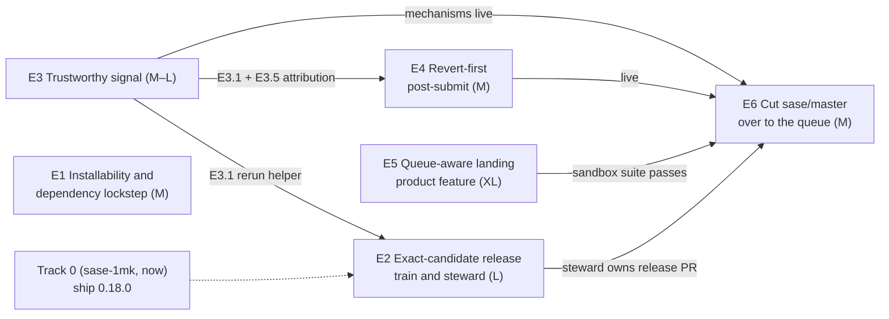

# PyPI release reliability: the converged architecture and how to split the work

> **Research query:** Review every research file the previous agent tagged
> `pypi-release-reliability` in the research sidecar (sase's effort to make its PyPI
> releases much more reliable). Then think hard about the best possible solution and how
> the work should be split up. Borrowing heavily from the tagged reports is fine;
> converging on the best design and architecture is the priority.

**Swarm report (cld)** · 2026-10-18, about 15:45 UTC · sase `master` at `f1c20a9f6b` ·
sase-core `master` at `80dc704a`

## Bottom line

1. **Keep what the tagged reports converged on.** Nothing I measured today reopens any
   of it:
   - GitHub's native merge queue, with zero approvals and rebase landing (linear
     history);
   - exact-SHA, build-once publishing with a candidate record;
   - the admission / release-blocking / advisory check inventory (N1);
   - a trustworthy gate before enforcement;
   - drift handling, and dependents that wait for the landing;
   - the Google comparison's flake-aware qualification and post-submit discipline.
2. **The program aims its heaviest machinery at the wrong bottleneck.**
   - **The heaviest pieces are about landings.** The reassessment's largest epics, C
     (extra-large) and D, fence `master`.
   - **Today none of the blockers is a landing problem:**
     - Master Gate has been green for its last 5 runs (13 of the last 100).
     - Release PR #299 has exactly one red check. `sase_core_rs 0.41.0 is missing 1 of
       866 required binding(s): mobile_pairing_issue`.
     - `pip install sase` resolves to 0.1.0, because retention deleted the core versions
       0.17.1 needs.
     - Every sase plugin also resolves to an ancient version.
   - **The fix is to plan around three separate promises,** each with its own fence,
     detector and owner: *installable*, *releasable* and *landable*. The queue serves
     *landable*. It is the end state, but it is **off the PyPI critical path**.
3. **Five findings the tagged reports did not have** (all measured today; details in
   [What today's evidence adds](#what-todays-evidence-adds)):
   1. **Core lag is structural, not an incident.**
      - sase `master` changed its sase-core pin **137 times in 29 days**.
      - The pin pointed at a core commit that no published `sase-core-rs` contained
        about **85% of that time**.
      - Core releases are cut once a day, all or nothing, and today's cut failed.
      - `ci_watch` merges release PRs for sase and its plugins, but **not for
        sase-core**.
   2. **What ships is not what was tested.**
      - Master Gate and Full CI test sase against a core wheel **built from the pinned
        source**.
      - Users get the **PyPI `sase-core-rs` wheel**, which is usually built from a later
        core commit.
      - The full suite never runs against the pair that ships. Exact-SHA publishing as
        planned covers only the sase half.
   3. **Installability is a whole-family problem.**
      - The newest `sase-github` (0.2.24) requires `sase>=0.18.0`, which does not exist.
      - A clean resolve today gives `sase==0.1.0`, `sase-github==0.1.0` and
        `sase-telegram==0.4.9`.
   4. **The release path is a chain of five independent cron schedulers,** each with
      single-shot checks:
      - the core daily cut;
      - `Publish` every 3 hours;
      - Full CI every 2 hours, with a 6-hour freshness rule;
      - `ci_watch` every 5 minutes;
      - `Publish` again.

      Five successive epic chains failed to ship 0.18.0. The active epic's plan says why:
      each "only observed" reds it called "externally owned".
   5. **Retention deleted the versions a release needed while storage sat far below the
      cap.**
      - `sase-core-rs` uses **3.88 of 10 GiB**, about 102 MB per release, room for about
        105 releases.
      - Each sase release accepts exactly one core minor, and core shipped six minor
        series in about 17 days.
4. **Six changes to the planned program**, all detailed under
   [Changes to the planned program](#changes-to-the-planned-program):
   1. **Ship the release train first, not last.**
      - Today it sits in Epic D6, after the queue cutover.
      - Make it **one deterministic steward**: an orchestrated, resumable run with
        *typed* blocking reasons, each with an owner action. It replaces a chain of
        crons and observer epics.
   2. **Release sase and sase-core in lockstep.**
      - The train cuts the core release it needs.
      - Each sase release pins the **exact** `sase-core-rs` version it was qualified
        against, and qualification installs that published wheel.
   3. **Make installability a family invariant** across sase-core-rs → sase → plugins:
      - a retention rule keyed to what published releases actually pin;
      - no release may name an unpublished sibling as its floor;
      - a family install canary on Linux and macOS.
   4. **Use one bounded-rerun mechanism everywhere a single red can block a release:**
      the gate, qualification, the core cut and the publish smokes.
   5. **Bound red time before preventing it.**
      - Add *revert-first* post-submit before the queue: a deterministic culprit finder
        plus auto-revert, proven first in propose mode.
      - The same machinery serves the release-blocking lane and drift, and survives into
        the queue era.
   6. **Keep the queue as the end-state fence, gated on measured data.** Do not let it
      compete with the release work for attention.
5. **The split: Track 0 plus six epics.**
   - **Track 0** is the existing epic `sase-1mk`.
   - **E1.** Installability and dependency lockstep (M, start now).
   - **E2.** Exact-candidate release train and steward (L, start now).
   - **E3.** Trustworthy signal (M–L, start now).
   - **E4.** Revert-first post-submit (M, after E3's rerun and attribution phases).
   - **E5.** Queue-aware landing as a SASE product feature (XL; the reassessment's C).
   - **E6.** Cut `sase/master` over to the queue (M; D without the train).

   E1–E3 run in parallel; E4 follows E3's first phases; E5 is off the critical path; E6
   comes last. See [How to split the work](#how-to-split-the-work).
6. **Next 24 hours (human-gated, outward-facing, not done by me):**
   1. Cut `sase-core-rs` 0.42.0 now. Its release PR #331 has been green and mergeable
      since this afternoon. Run
      `gh workflow run release-plz.yml --repo sase-org/sase-core -f dry_run=false`,
      unless `sase-1mk.2`'s watcher does it first.
   2. Let #299's floor ratchet and `ci_watch` merge it.
   3. Dispatch `Publish` right after the merge, to shrink the moving-tip window, then
      verify the wheel against the tag.
   4. File the PyPI project-size request for `sase-core-rs`.

## What I reviewed: the twelve tagged files

All twelve were read in full through `sase artifact read`. The two broad comparisons
were read for their release-relevant sections. Listed here in dependency order, with
what each still contributes.

1. **`sase_v0_18_0_pypi_release_status.md`** (Oct 13). The first diagnosis.
   - `ci_watch` needs green Full CI ≤ 6 h old *and* Master Gate green at HEAD.
   - Full CI had been red since Aug 29, and `sase-16p` (uninstallable 0.17.1) was
     already known.
   - *Status:* superseded by today's facts. The visual lane is no longer the blocker;
     the core floor is.
2. **`gastown_vs_sase_lessons_to_borrow`** (Oct 16). The seed of the effort.
   - Its useful findings: "fences beat promises"; test the integrated tree; prove the
     merge; resolve dependents only on merge.
   - Its R1, a host-side landing lane, was later rejected with good evidence. The
     local check passed 6 of 168 runs, and a per-host lock cannot order athena against
     apollo.
3. **`gascity_advantages_over_sase_and_what_to_borrow`** (Oct 17).
   - Gas City is live proof that a queue works at SASE's cadence: 37 of 38 queue runs
     green.
   - It adds two ideas: "missing evidence counts as red", and a gate budget.
   - Its broader R2/R3 point matters for the release steward. Gas City's controller
     owns a durable graph; SASE runs workflows in prompts and crons.
4. **`merge_queue_fenced_master_and_exact_sha_releases`** (Oct 17). The original
   design.
   - Its findings: `publish.yml` builds the wrong commit; Full CI, not Master Gate,
     blocked releases; a replay simulation shows K=2 fits capacity; flakiness, not
     capacity, binds.
   - *Status:* the architecture holds. Several details were reversed later: the merge
     method, beads closing only on merge, and `visual-test` in the gate.
5. **`github_native_merge_queue_primer`** (Oct 17). The mechanics:
   - `merge_group`;
   - the event-aware aggregate check;
   - "queued is not merged";
   - landed SHA = tested SHA, observed but not documented;
   - bypass is all-or-nothing per actor.

   *Status:* accurate. Its "MERGE" suggestion is superseded by the rebase decision.
6. **`agent_factory_merge_discipline_reading_list`** (Oct 17). The best external
   evidence:
   - Stovepipe's last-green bookmark and promotion ref;
   - Mergify's TLA+ invariants for the landing watcher;
   - rerunning the failed *job* turns a failure into a pass 73.6% of the time,
     against 33.9% for rerunning the whole workflow;
   - a base-drift case study (a11ign #5125);
   - LiteLLM's supply-chain lesson: trusted publishing only, and verify the
     attestation.
7. **`merge_queue_fence_reassessment_and_epic_split`** (Oct 17). The program of
   record.
   - Its changes: installability first; rebase; drift handling (N3); config-driven
     landing mode; `delivered(bead)`; the N1 inventory; four epics A–D plus Step 0 and
     Track 0.
   - *Status:* the right skeleton. My changes reorder it and add the core and family
     dimension.
8. **`merge_queue_fence_reassessment_explained.md`**. A faithful plain-language
   summary of item 7, with good diagrams. It adds no new claims.
9. **`master_ruleset_step0_setup_steps.md`**. The Step 0 how-to.
   - *Status:* **done.** The `master-integrity` ruleset (deletion and
     non-fast-forward, empty bypass list) has been active since 2026-10-17 22:54Z
     (checked today).
10. **`merge_queue_impact_on_testing_agent_fixes.md`**. The cost to the maintainer's own
    testing loop under the queue: about 15 to 30 minutes.
    - It names two gaps: no "landed" notification, and no preview path.
    - *Status:* correct, and it belongs in E5's requirements.
11. **`google_release_engineering_vs_sase_release_plan`** (Oct 18). The sharpest
    critique. Its eleven ranked changes:
    1. flake-aware qualification;
    2. post-submit discipline, revert first;
    3. exercise the exact files on Linux and macOS;
    4. no required check that depends on the calendar;
    5. draft releases;
    6. yank;
    7. truthful provenance;
    8. release-health consequences;
    9. a downgrade contract;
    10. hermeticity;
    11. DORA metrics.

    *Status:* I adopt all eleven. It missed the core and family coupling, and it left
    the train in D.
12. **`sase_sh_docs_redesign`** (release section only). A working install that matches
    the docs is a launch prerequisite.
    - *Status:* partly built. `install-smoke.yml` (`sase-1le.3`) has run daily since
      Oct 15 and is red by design until 0.18.0 ships.

**Context outside the tag that changes the picture:**

- **`sase-1mk`** (created today) is the active Track 0 owner: "Own every release
  blocker…". Its plan diagnoses the observer failure mode, and it has already decided
  `core_cut = yes`. Phase `.2` teaches `release_watch` to dispatch the core cut.
- E2's steward should grow out of that watcher, not duplicate it.

## Where the corpus has converged (keep all of this)

- **The fence, as the end state, is the native GitHub merge queue.**
  - Zero required approvals. Agents push as the maintainer, and GitHub refuses
    self-approval.
  - Rebase method, one commit per PR. Squash is the fallback; merge commits are
    rejected (sase's June changelog showed duplicates and drops).
  - K=2, merge limit 1 during the pilot.
  - An event-aware `integration-ready` aggregate, and no path filters.
- **Rejected for good:**
  - a host-side landing lane;
  - required PRs without a queue;
  - "must be up to date";
  - required human review;
  - LLM-judged merges;
  - bisecting batch queues at about 43 landings a day.
- **Exact candidates:**
  - build once from the release SHA, and record digests;
  - accept an existing PyPI file only when its digest matches;
  - never retag; a rebuild is a new candidate;
  - SHA-keyed qualification (`qualify-<sha>`, never cancelled).
- **Check inventory (N1):**
  - admission = Master Gate;
  - release-blocking = 3.13/3.14 tests, the wheel and sdist smokes, and the core
    floor;
  - advisory = visual, perf, tutorial and page-group isolation, each with an owner;
  - plus a severity veto above N1 (Google report).
- **Gate trust:**
  - one bounded in-job rerun of at most 3 failed nodes, never for collection errors,
    keeping the first attempt;
  - an expiring quarantine that *escalates* rather than failing admission;
  - `.python-version` and core-revision parity;
  - drift canaries: a nightly run on the tip, and one under a clock shifted +30 days.
- **Landing semantics:**
  - landing mode is per-project config (`push | queue`), not a flag;
  - beads close as today, and `delivered(bead)` gates dependents;
  - the turn ends at *armed*;
  - a deterministic reconciler with a durable protocol (intent before effect,
    idempotent by operation ID, two-host safe).
- **Governance:**
  - GitHub changes are proposed through `/sase_gate`;
  - acceptance, not calendars;
  - verification is never deferred to a later epic;
  - `just check` through `sase tool run` only.

## What today's evidence adds

All figures are from the live APIs, PyPI and checkouts on 2026-10-18 between 15:10Z
and 15:45Z, unless stated otherwise.

### The release is blocked by core lag, not by `master`

- **Master Gate is green.** The last 5 runs (`9526d3bae3` → `f1c20a9f6b`) are green,
  13 of the last 100. Traffic is light today, though: 5 landings in 13 hours against
  about 43 a day, so don't over-read the streak.
- **Full CI on unchanged `ae9f044bb3`:** 3 green and 3 red, each red a different flake.
  Only 4 of the last 30 runs are green.
- **#299's only failing check** (head `572431efe0`) is `release-core-floor-smoke`:
  `sase_core_rs 0.41.0 is missing 1 of 866 required binding(s): mobile_pairing_issue`.
  Its window has already been ratcheted to `>=0.41.0,<0.42.0`.
- **The binding exists only in unpublished core.**
  - sase pins sase-core `72bf9203`. That is 8 commits past `v0.41.0`, and no tag
    contains it.
  - The binding came from `916d5e3a` (`fix!: issue mobile pairing challenges only from
    the owner-local CLI`), pinned at 2026-10-17 14:09Z.
  - So sase has been in core lag for about **26 hours**.
- **The core release that would fix it has been ready but uncut.**
  - sase-core PR #331 (`chore: release v0.42.0`) opened 2026-10-17 12:30Z. All its
    checks are green, and it is `CLEAN`.
  - It merges only from the daily cut (`41 7 * * *`) or a `dry_run=false` dispatch.
  - Today's cut fired at **12:10Z, not 07:41Z**, and its `Merge release PR` job failed
    at 12:34Z. The cause was a deterministic macOS-only fixture failure on core
    `master`, which `sase-1mk.1` has since fixed (`80dc704a`).
  - The next automatic cut is tomorrow morning, if GitHub fires it on time.
- **`ci_watch` does not cover sase-core.** In `sase_athena.yml`, `release_repositories`
  is `[sase, sase-github, sase-telegram]` and `merge_order` is
  `[sase-github, sase-telegram, sase]`. Core releases are cut only by its own daily cron
  or a human dispatch.
- **Core `master` is unfenced too.** Its CI was red on 14 of its last 30 pushes. The
  release path depends on it, but N10 scopes enforcement to sase only.

### Core lag is the normal state, not an incident

I replayed `sase-core-revision.txt` on sase `master` (first parent) since 2026-09-18
against sase-core tags and PyPI upload times:

- **137 pin changes in 29 days**, about 4.7 a day.
- **About 85% of the time**, the pin pointed at a core commit that no published
  `sase-core-rs` contained yet.
- This is an upper bound on *binding* lag. Not every unpublished commit adds a binding
  sase uses, which is why the floor smoke is green on some days.
- The tagged reports already recorded `CORE_FLOOR_BLOCKED` watch endings (original
  report) and a red floor smoke on Oct 16 (grk), on top of today's.

**Why it matters:** under release-please, the candidate is "HEAD plus a bump". A
release then needs, *at the same moment*:

- Master Gate green at HEAD;
- a fresh green Full CI;
- every binding HEAD uses already published.

Each holds a minority of the time, and the three are only loosely correlated. That
conjunction, not any single red lane, explains a 50-day stall.

### What ships is not what was tested

- **CI tests a source-built core.**
  - `master-gate.yml` (`core-wheel` job) and `ci.yml` (`build-core.yml`) both build
    the core wheel from `sase-core-revision.txt`.
  - `build-core.yml` is *skipped* for release-please PRs, so #299 runs only the floor
    smoke and the PR-title check.
- **Users get the PyPI wheel.** `publish.yml`'s smokes install the PyPI `sase-core-rs`
  (latest-in-window and exact floor), but run only imports and a handful of commands.
- **So the full suite never runs against the shipped pair.** For 0.18.0, the core
  floor will be 0.42.0, built from core `master` at cut time. That includes
  `99b10bd0` and `80dc704a`, beyond sase's pin `72bf9203`, code sase's suite never
  exercised.

### Installability is a family property

- **PyPI today:** `sase` 0.17.1 (requires `sase-core-rs>=0.32.16,<0.33.0`, all
  deleted); `sase-github` 0.2.24 (requires `sase>=0.18.0`, unpublished); `sase-telegram`
  0.4.29 (requires `sase>=0.17.0`).
- **A clean resolve on Python 3.12 (`uv pip compile`):**
  - `sase` → **0.1.0**;
  - `sase` + `sase-github` → **0.1.0 + 0.1.0**;
  - `sase` + `sase-telegram` → **0.1.0 + 0.4.9**.

  Nothing errors; everything silently goes back to February.

### Retention pressure is lower than the deletion implied

- **Usage:** `sase-core-rs` holds 51 releases using **3.88 GiB of the 10 GiB** project
  limit. Each release is about 102 MB (four platform wheels plus the sdist), so the
  limit fits about 105 releases.
- **Cadence:** 1.5 releases a day over the last 34 days. The daily cut targets 1 a day.
- **Why one release's window is so short:**
  - Each sase release accepts **one core minor** (`ratchet_core_window` writes
    `>=X.Y.Z,<X.(Y+1).0`).
  - Core shipped the 0.36–0.41 minors between Oct 1 and Oct 17.
  - So a sase release's compatible window holds one to three core releases. The
    newest-30 retention rule therefore deletes a release's dependency within weeks,
    which is exactly what happened to 0.17.1.
- **The retention script plans; humans delete.** `pypi_retention.py` keeps the newest
  30 plus `--keep-version`. Deletion itself is a human-gated `pypi-cleanup` run.

### The release path is a chain of schedulers

From "the core fix lands" to "sase is on PyPI", with every step green:

1. The core daily cut: up to 24 h, plus GitHub's schedule delay (4.5 h today).
2. The next `Publish` cron (every 3 h), whose `sync-release-metadata` job ratchets
   #299's window.
3. The floor smoke on #299.
4. A `ci_watch` tick (every 5 min). It needs Master Gate green at HEAD *and* a Full CI
   green within 6 h; it dispatches Full CI (70–100 min) when the last run is over 2 h
   old.
5. The merge.
6. The next `Publish` cron (every 3 h): tag, build, smokes, upload.

That is roughly **15–38 hours with every step green.** Any single red (a flake in one of
about 56k tests, a macOS-only core fixture) resets that link's clock.

`sase-1mk`'s plan names the human failure mode on top of this. Five chains (`sase-1c1`,
`sase-1i5.9.1`, `sase-1jz`, `sase-1kx`, `sase-1lh`) "repaired the reds it had caused,
then labeled the remaining ones 'externally owned'… then only observed."

## The recommended design

### Principles

1. **Three promises, separately owned and measured.**
   - *Installable:* users get the newest release family and it works.
   - *Releasable:* a qualified release ships at least every 3 days.
   - *Landable:* `master` is gate-green.

   Each needs its own fence, detector and recovery. **A promise may not depend on a
   weaker one:** installability must survive a release failure, and a release must not
   need `master` green at a particular instant.
2. **A release is a pair of artifacts.** The sase wheel and sdist, plus the exact
   `sase-core-rs` wheels they run on. Qualify and record the pair, not half of it.
3. **One decider per outcome.** A single deterministic steward owns the release train,
   and a single reconciler owns landings. Two actors deciding the same merge is the Gas
   Town lesson ("deduplicate concurrent actors").
4. **A single red never costs a day.** Every check that gates a release gets one
   bounded rerun of failed nodes, and a typed outcome: pass, recovered, deterministic,
   or no-verdict.
5. **Bound before you prevent.** Revert-first post-submit makes red time short within
   weeks. The queue later makes it zero for the gate's contents.
6. **Agents stay single-turn; the host owns completion.** Everything that waits is a
   deterministic host component or a GitHub workflow, never an agent's promise
   (`single-turn-agents`, `host-owned-completion`, `gates-never-block`).

### Promise 1: installable

- **Retention by need.** `pypi_retention.py plan` computes a *keep set* from PyPI's
  `requires_dist` for the last N ≥ 10 published, non-yanked sase releases. It keeps:
  - the exact core version each release pins (see the exact pin below);
  - until exact pins exist, the newest version satisfying each release's window;
  - every version a candidate record says was qualified;
  - the newest 30, as today.

  It fails closed when PyPI metadata can't be read. It costs about 100 MB per protected
  release.
- **Storage headroom.** File the PyPI project-size request for `sase-core-rs` now. It is
  human-gated. At 3.88 GiB and about 100 MB a day, the next forced cleanup is roughly
  two months away.
- **Family floors are published floors.** A release PR for sase or any plugin carries a
  `release-dependency-floor` check that fails when a declared floor on a sibling
  (`sase-core-rs`, `sase`) is not on PyPI.
  - `ci_watch` already refuses release PRs with a red check, so this needs no
    `ci_watch` change.
  - It would have held `sase-github` 0.2.24 until sase 0.18.0 existed.
  - #299's `release-core-floor-smoke` is already the sase→core instance of this check.
- **The family canary.** Extend the existing daily `install-smoke.yml`:
  - clean `uv tool install sase` **plus** `sase-github` and `sase-telegram`;
  - assert that each installs *the newest PyPI version*, not just one at or above a
    documented floor;
  - run on `ubuntu-latest` **and** `macos-latest`;
  - run `sase core health` and the documented first commands.

  A red canary is the steward's `INSTALL_BROKEN` state (severity 1).
- **Recovery primitives**, documented and human-gated:
  - yank, then fix forward;
  - optionally yank 0.1.0, so that a future broken window *fails loudly* instead of
    installing February's build;
  - **core backfill:** publish a new patch inside a deleted window from the old core
    tag. A filename can't be reused, but a new version number can. For example, a
    0.32.17 cut from `v0.32.16` would make 0.17.1 installable again. Not needed now
    that 0.18.0 is one cut away.

### Promise 2: releasable (the train and its steward)

```mermaid
flowchart LR
    S["select candidate<br/>release PR at HEAD<br/>(gate-green)"] --> C{"newest published core<br/>has every binding?"}
    C -- "no: CORE_LAG" --> K["dispatch core cut<br/>(rerun failed checks once)"] --> W["wait for PyPI"] --> P
    C -- "yes" --> P["pin sase-core-rs==X.Y.Z<br/>on the release PR"]
    P --> M["merge release PR<br/>(today: ci_watch rule;<br/>after E6: merge_group)"]
    M --> B["build once at tag SHA<br/>record candidate pair"]
    B --> Q["qualify: N1 release-blocking set<br/>against the PUBLISHED core wheel<br/>bounded rerun"]
    Q --> X["exercise exact files<br/>Linux + macOS"]
    X --> U["upload at tag ref<br/>(trusted publishing)"]
    U --> F["confirm: digests, attestation SHA,<br/>family canary"] --> G["un-draft GitHub release"]
```

- **The steward.** `tools/release_watch` grows from a bounded monitor into a scheduled,
  deterministic chop. It runs nightly and on demand, and it is the *only* decider for
  the sase family's releases.
  - It drives the steps above in order. It is resumable at every step and idempotent by
    candidate ID.
  - `Publish` stays a GitHub workflow, because trusted publishing and the `pypi`
    environment live there. The steward dispatches it with the candidate.
  - Once the steward merges releases, set `ci_watch`'s `merge_enabled` to false for
    sase and the plugins (a human-gated chezmoi change). `ci_watch` keeps its incident
    notifications.
- **Typed status, with an owner action for each reason.** The steward publishes exactly
  one status, in one notification thread:
  - `RELEASED(v)` / `RELEASABLE` / `NOTHING_TO_RELEASE`.
  - `CORE_LAG(bindings)` → dispatch the core cut.
  - `CORE_CUT_RED(check)` → rerun once, then one build-cop bead on sase-core.
  - `CORE_INCOMPATIBLE` → the candidate fails against the newest core; a bead.
  - `GATE_RED(sha, culprit?)` → E4's revert when live, otherwise a bead naming the
    culprit.
  - `QUALIFY_RED(signature, recovered?)` → after the bounded rerun, a culprit search
    on the release lane.
  - `EXERCISE_RED(platform)` / `DEPENDENCY_UNPUBLISHED(pkg)` / `PUBLISH_PARTIAL` (resume
    by digest).
  - `INSTALL_BROKEN(member)` → severity 1, the installability hold.
  - `WATCHER_BROKEN` / unknown → fail closed.

  Time-in-state is shown on every status. After 24 h in one blocked state the steward
  files or `+1`s a single typed task bead at high severity, so ownership never decays
  into observing. Launching repair agents automatically waits for a launch-budget
  autonomy rule (Gas Town R6); until then, beads and gates are the action.
- **Lockstep core and an exact pin.**
  - The release PR's metadata step writes `sase-core-rs==X.Y.Z`. This replaces the
    current `>=X.Y.Z,<X.(Y+1).0` window from `ratchet_core_window`. X.Y.Z is the newest
    published core that has every binding the candidate needs.
  - Qualification installs exactly that wheel from PyPI (`ci.yml` gets a
    `core-source: pin | published` input) instead of building the pin.
  - **What this buys:**
    - tested = shipped, for both halves;
    - the floor smoke and the latest-core smoke collapse into one;
    - retention protects one exact version per release;
    - a core patch can never silently change a released sase.
  - **The cost:** core fixes reach users only through a sase release. A train that
    runs every 1–3 days makes that acceptable. Plugins depend on `sase`, not on
    `sase-core-rs` (checked on PyPI), so there is no resolver conflict.
- **The candidate record:** version, tag, peeled SHA, tree, core pin, *core version and
  wheel digests qualified against*, policy version, run IDs and attempts, and sase
  artifact digests.
- **Truthful provenance.** The upload job runs *at the tag ref*, and the `pypi`
  environment is restricted to `v*` tags. After upload, verify that every attestation
  names the candidate SHA.
- **Claiming the version.** Set release-please to `draft: true` and
  `force-tag-creation: true` now. Under the queue (E6), qualify inside the release PR's
  own `merge_group`, so a failed candidate burns nothing.
  - Tag-on-green (version from the tag, via hatch-vcs) stays *designed, not adopted*.
  - Measure its trigger, "fewer than 2 of 3 nightly candidates qualify over 2 weeks",
    only **after** core lockstep and flake-aware qualification are live. Before then,
    the measurement would mostly count core lag and flakes.
- **The release-green record (Stovepipe).** The steward records release-blocking
  evidence per SHA, and keeps `release-green` as the newest SHA with complete evidence.
  It is the baseline for the culprit finder, the basis of the "time to release-green"
  SLO, and the selection input if tag-on-green is ever adopted.
- **Release health with consequences:**
  - a severity veto: confirmed lost work, corruption, a broken install or a broken
    essential workflow blocks promotion, whichever suite found it;
  - while `INSTALL_BROKEN`, the train does not cut, and (after E6) packaging landings
    are held.

### Promise 3: landable

- **Gate trust (E3).** Everything in the reassessment's Epic B, with the Google
  report's quarantine fix (expiry escalates and never fails admission). The rerun
  helper is shared with qualification.
- **Culprit attribution (E3)** turns every red into one of: *recovered flake*,
  *culprit = SHA*, *drift*, or *unknown*.
  - Master Gate already runs once per SHA and is never cancelled, so the first red SHA
    with a green parent is the candidate culprit.
  - A dispatchable `culprit-check` workflow (inputs: SHA, failing node IDs, k) confirms
    it k of k at the suspect and k of k passing at its parent.
  - For the release lane, the same workflow bisects the commits since `release-green`.
- **Revert-first (E4):**
  - **On a confirmed culprit:** revert it through the existing atomic
    `ace/revert_agent_transaction.py` path, reopen its bead with the failing excerpt,
    and notify.
  - **Never automatically:** release-please and ratchet PRs, reverts, or changes under
    `.github/workflows/`. These go to `/sase_gate`.
  - **Safety limits:** a daily cap and a per-bead circuit breaker; drift (the parent
    also fails) is never reverted.
  - **Rollout:** start in *propose* mode, one gate per revert. Switch to auto only after
    measured precision of at least 95% over at least 20 events, through a human gate.
  - **After E6,** a revert is a PR that jumps the queue.
- **The queue (E5, E6)** as designed, plus the testing-loop gaps: a "landed"
  notification, a visible landing state, and a preview command.

**Why bound before prevent?**

- **Time to value.** Revert-first ships in weeks. The queue needs an extra-large epic,
  a sandbox, two human gates and a soak.
- **It is needed anyway.** The Google report wants revert-first for the release-blocking
  lane, which the queue never covers. Drift needs a culprit-or-drift classifier either
  way.
- **It de-risks the queue.** A `master` that is already mostly green means few queue
  ejections at cutover.
- **The queue still earns its place.** Revert-first bounds damage (roughly one gate run
  plus the revert, about 30–45 min per deterministic break). The queue prevents it.

## Changes to the planned program

The baseline is the reassessment (Step 0, Track 0, Epics A–D) plus the Google report's
ranked list. Each change below lists the reason and the evidence.

1. **Move the train from D6 into the first release epic (E2), and make it a single
   steward.**
   - *Why:* the train is the highest-value piece, and it does not need the queue. Today
     it is scheduled after the cutover and a soak.
   - *Evidence:* the release path is a five-scheduler chain; five chains observed
     instead of owning; `sase-1mk.2` is already teaching the watcher to cut core.
2. **Release sase and core in lockstep, with an exact core pin, and qualify against the
   published wheel.**
   - *Why:* this replaces A5's "report `CORE_LAG` and request a core release", which is
     detection plus a request, not a design.
   - *Evidence:* the pin was unpublished about 85% of 29 days; tested ≠ shipped; #299 is
     blocked only by a binding; one-minor windows plus newest-30 retention gave 0.17.1 a
     shelf life of weeks.
3. **Make installability a family invariant: E1, split out of A.**
   - *What:* a retention keep-set by need; a `release-dependency-floor` check on every
     family release PR; a family canary on Linux and macOS (the existing
     `install-smoke.yml` already covers part of A6); the PyPI size request; a yank and
     backfill runbook.
   - *Evidence:* the plugins resolve to 0.1.0 and 0.4.9; `sase-github`'s floor names
     an unpublished sase. E1 is small and urgent, and its proofs are independent of the
     train's.
4. **Use one bounded-rerun mechanism for every release-gating check:** the gate, Full
   CI and qualification (E3's helper), the core cut's check wait (E1), and the publish
   smokes.
   - *Evidence:* Full CI went 3 of 6 on an unchanged SHA; one red macOS job cost a whole
     day of core cut; failed-job reruns beat workflow reruns 73.6% to 33.9%.
5. **Add revert-first (E4) and culprit attribution (in E3) before the queue.**
   - *Evidence:* the original options list called auto-revert an "optional backstop"
     and feared ambiguous culprits. Master Gate's never-cancelled per-SHA runs make
     attribution direct, and the bounded rerun separates flakes from real breaks.
     Google: "rolled back (the preferred solution)".
6. **Treat the queue (E5/E6) as the end state, sequenced behind the release work and
   gated on measured data.**
   - The enforcement entry bar stays: false reds under 3% over at least 7 days, on a
     declared sample.
   - **Add a go/no-go review** before E6's D2. Use E3/E4's red-minutes per day,
     time-to-revert and escape rate to confirm that the cutover's cost (about 13–30
     minutes per landing and per epic wave) buys a real reduction.

Smaller corrections:

- **Step 0 is done.** Read back today: rules `deletion` and `non_fast_forward` on
  `master`.
- **Track 0's owner is now `sase-1mk`,** not the `sase-16p` / `sase-10d` / `sase-1lh`
  chain. Its `core_cut = yes` decision is E2's core-ensure step in miniature.
  Generalize it; don't rebuild it.
- **Supersede two clauses of `decisions:ci-two-speed-split`, not one.**
  - The reassessment plans to supersede its merge-queue clause.
  - The record *also* says "`ci_watch` gates release on both signals… a recent green
    `Full CI` run". E2's exact-candidate qualification replaces that *release* clause,
    so E2's decision record must supersede it explicitly.
- **Pre-authorize publishing.** The E2 record should pre-authorize publishing a
  *qualified* candidate (an outward-facing act), so the train needs no human per
  release. Yanks stay gated (Google report).
- **Sharpen merge limit 1.** It caps how many PRs merge together. It does not make each
  tested candidate single-PR (cdx's correction in the Google report). E5's sandbox must
  prove the source → tested → landed mapping with several PRs queued.
- **Prove a merge without the agent's SHA.** Under rebase the agent's commit SHA does
  not survive landing. The proof is the PR → landed-commit mapping plus tree equality
  against the immutable landed commit (reading-list report).
- **Treat a red core `master` as a typed release blocker** (`CORE_CUT_RED`) with an
  owner. Fencing sase-core stays out of scope (N10); it gets E4's revert-first later if
  needed.
- **Defer two items to follow-up tasks, not epic phases:** the downgrade contract
  (Google rank 9) and the Rust toolchain pin in sase-core (rank 10). The exact pin and
  retained artifacts cover most of their risk.

## How to split the work

### Map and ordering

- **Start now, in parallel:** E1, E2 and E3. Land E2.1 (exact build) as early as
  possible. Track 0 will probably publish first, so verify it after the fact.
- **E4** starts when E3.1 (bounded rerun) and E3.5 (attribution) are live.
- **E5** is off the PyPI critical path. Start it once E1–E3 are moving, and don't let it
  compete for the maintainer's review attention. Its sandbox work is safe in parallel.
- **E6** starts after E3 and E4 are live, E5 passes its exit, and the go/no-go review
  passes.

**Mapping to the reassessment:**

- **E1:** A5 and A6, plus the new family and lockstep work.
- **E2:** A1–A4 and A7, D6's train, and Google ranks 3, 5, 7 and 8, plus the core and
  exact-pin changes. It consumes rank 1 (flake-aware qualification) through E3's helper.
- **E3:** B1–B6, plus Google ranks 1 (the mechanism), 2 (culprit finding), 4 and 11.
- **E4:** new; Google rank 2's revert-first.
- **E5:** C, plus the testing-loop gaps.
- **E6:** D without the train, plus merge-group qualification of the release PR.

### Track 0: ship 0.18.0 (existing epic `sase-1mk`; no new epic)

- **Critical path today:**
  1. cut core 0.42.0;
  2. `sync-release-metadata` ratchets #299's window;
  3. the floor smoke goes green;
  4. `ci_watch` merges (Master Gate green at HEAD, Full CI green ≤ 6 h);
  5. Publish.
- **Two additions:**
  - *Post-hoc verification.* E2.1 won't be in place, and Publish builds the tip at run
    time, so dispatch Publish right after the merge. Then download the PyPI wheel and
    compare its version and file manifest with `git archive v0.18.0`.
  - *A family check.* Re-resolve `sase` with each plugin, expecting 0.18.0 and the
    latest plugins.
- **Exit:** the family canary is green. `sase-github` 0.2.24 then becomes installable
  automatically.

### E1: Installability and dependency lockstep

**Scope:**

- **Repos:** sase-core, sase, sase-github, sase-telegram.
- **Size:** M.
- **Start:** now.
- **Decision record:** "A published release stays installable. Retention never deletes,
  and no release declares, a dependency that a supported release cannot resolve."

**Phases:**

1. **Keep-set retention** in `pypi_retention.py plan`, as described under
   [Promise 1](#promise-1-installable). It fails closed.
2. **PyPI size request** for `sase-core-rs`, proposed through `/sase_gate`, plus a
   runway line in `docs/pypi-retention.md`.
3. **The family canary.** Extend `install-smoke.yml`: newest-version assertions,
   plugins, macOS, and the core health check. Failures file or `+1` one `ci` bead.
4. **A `release-dependency-floor` check** on the release PRs of sase-github and
   sase-telegram. sase already has one, `release-core-floor-smoke`.
5. **Core-cut resilience** in sase-core's `release-plz.yml` `Merge release PR` job:
   - on a red check, rerun the failed jobs once before failing;
   - report a typed failure;
   - keep the `dry_run=false` dispatch as the steward's on-demand entry point.
6. **Recovery runbook:** yank then fix forward; core backfill; the yank-0.1.0 decision.
   All human-gated.

**Independent verification:**

- **V-E1a, retention.**
  - A dry-run plan protects 0.18.0's core (and 0.17.1's window, if backfilled).
  - A planted plan that deletes it fails.
  - An unreadable PyPI response fails closed.
- **V-E1b, canary.**
  - Run today, it **fails**, naming sase 0.1.0 and sase-github 0.1.0. That proves it
    detects the outage.
  - After Track 0 it passes on both OSes.
- **V-E1c, dependency floor.** A plugin release PR whose floor names an unpublished sase
  shows a red `release-dependency-floor` check, and `ci_watch` reports
  `release_pr_checks_not_green`.
- **V-E1d, cut resilience.** On a sase-core sandbox branch, or with an injected check, a
  single failed check is rerun and the cut merges. A deterministic red refuses with a
  typed reason.

**Exit:** V-E1a–d pass, and the family canary has been green for 7 consecutive days
after Track 0.

### E2: Exact-candidate release train and steward

**Scope:**

- **Repos:** sase (`publish.yml`, `ci.yml`, `build-core.yml`, `tools/release_watch*`,
  `tools/ratchet_core_window`), plus the chezmoi `ci_watch` config through a human gate.
- **Size:** L.
- **Start:** now.
- **Decision record:** "PyPI publishes exactly the qualified release pair." It
  supersedes `ci-two-speed-split`'s release-gating clause, and it pre-authorizes
  publishing qualified candidates.

**Phases:**

1. **Exact build and the candidate record (A1):**
   - export the SHA, tag and version from whichever release-please retry succeeded;
   - check out that SHA and assert tag = SHA = `pyproject` = `__version__`;
   - build once and record digests;
   - set `draft: true` and `force-tag-creation: true`.
2. **Exact core pin:** `ratchet_core_window` becomes `ratchet_core_pin`, writing
   `sase-core-rs==X.Y.Z` on the release PR. Both floor smokes collapse into one.
3. **Qualification against the published core (A2, N6):**
   - `ci.yml` gains `ref` and `core-source` inputs, threaded through every checkout and
     `build-core.yml`;
   - the qualify job runs the N1 release-blocking set with `core-source=published` and
     E3.1's bounded rerun;
   - it runs under `qualify-<sha>` and is never cancelled.
4. **Exercise the exact files** (Google rank 3): install the candidate wheel and sdist
   with public dependencies on Linux and macOS, then run a short no-LLM workflow and a
   headless TUI frame.
5. **Publish and confirm (A3, rank 7):**
   - upload at the tag ref, with the environment restricted to `v*`;
   - replace `publish_existing` with an explicit tag input;
   - resume uploads by digest;
   - verify digests and attestations, run the family canary, then un-draft.
6. **The steward (A4 plus D6):**
   - `release_watch` becomes the scheduled single decider, with the typed status, the
     24-hour escalation, the core-ensure step (generalizing `sase-1mk.2`), and the
     severity veto;
   - relax the "fresh Full CI on any SHA" merge rule *only after* phases 3–5 are
     deployed;
   - set `ci_watch`'s `merge_enabled` to false for the family (human gate).
7. **The release-green record and metrics:** days since release; lead time from landing
   to PyPI; time to release-green; core-lag hours; install-broken days; change-fail
   rate.

**Independent verification** (none of it needs the queue or a healthy gate):

- **The reassessment's A-epic checks still apply:** V-A1 (moving tip), V-A2 (retries),
  V-A3 (negative qualification, including skipped and cancelled jobs), V-A4
  (qualification and Full CI coexist) and V-A5 (partial upload). V-A5 needs TestPyPI
  projects and trusted publishers, a human-gated prerequisite.
- **V-E2a, published core.** A candidate whose source-built pin passes, but whose
  published core wheel fails a planted test, is refused with `QUALIFY_RED`.
- **V-E2b, exact pin.** The release PR declares `==X.Y.Z`. The qualified core digests
  in the candidate record equal the PyPI wheel digests.
- **V-E2c, provenance.** With `master` advanced past the release commit, every
  attestation still names the candidate SHA.
- **V-E2d, core lag.**
  - Against a HEAD that needs an unpublished binding, the steward reports
    `CORE_LAG(<binding>)`.
  - In dry-run mode it plans a core cut; in live mode it dispatches the cut, waits, and
    proceeds.
- **V-E2e, single decider.** With the steward live, `ci_watch` never merges a family
  release PR (its config is read back), and a steward restart mid-train resumes without
  a second dispatch or upload.
- **V-E2f, flake tolerance.** A planted flake in `test (3.14)` leaves qualification
  green, with `FLAKY:` recorded. A planted deterministic failure blocks publishing.

**Exit:**

- V-E2a–f and the inherited checks pass;
- at least one real release has gone through the steward with no human action beyond
  pre-authorized ones, with PyPI digests and attestation SHA equal to the candidate
  record;
- or a refusal names a typed reason and its owner action.

### E3: Trustworthy signal

**Scope:**

- **Repos:** sase (tests, Master Gate test steps, `ci.yml` test jobs, a new
  `culprit-check.yml`).
- **Size:** M–L.
- **Start:** now.
- **Decision record:** "CI reruns a failed node once and quarantines with an escalating
  expiry", next to `triage-annotates-does-not-change-exit-codes`.

**Phases:**

1. **The shared bounded-rerun helper (B1):**
   - rerun only when 3 or fewer nodes fail; never for collection or harness errors;
   - keep the first attempt and emit `FLAKY:`;
   - count recovered novel signatures separately.

   Adopt it in the Master Gate shards and the `ci.yml` test jobs, so qualification
   inherits it through `workflow_call`.
2. **Escalating quarantine (B2, Google rank 4):**
   - expiry fails a *non-required* hygiene check, raises the bead's priority and shows
     in the digest;
   - expiry is evaluated against real time and excluded from the shifted-clock run.
3. **Parity (B3):** `.python-version` = 3.12, a fast fail on a core revision mismatch,
   and `if: always()` only on the reporting steps.
4. **Drift canaries (B4):** a nightly gate run on the tip, plus one with the clock
   shifted +30 days.
5. **Culprit attribution:**
   - `culprit-check.yml` (inputs: SHA, node IDs, k);
   - an attribution job that labels each red Master Gate run as recovered, culprit,
     drift or unknown;
   - for the release lane, bisection from `release-green`;
   - files or `+1`s beads by signature, naming the culprit.
6. **False-red digest (B5)** plus gate escape rate and red minutes per day, each figure
   with its numerator and denominator.
7. **Visual promotion study (B6).** It runs after E2.3, because both touch `ci.yml`.

**Independent verification:**

- **The reassessment's B checks still apply:** V-B1, V-B2, V-B4, V-B5 and V-B6.
- **V-E3a, quarantine.** V-B3 is rewritten: an expired entry fails the hygiene check,
  the gate stays green, and the bead escalates. The shifted-clock run stays green while
  quarantine entries exist.
- **V-E3b, attribution.** A planted deterministic break is labelled `culprit=<sha>`
  within one gate run plus the culprit check. A planted flake is labelled `recovered`.
  A reintroduced time bomb is labelled `drift`, with no culprit.

**Exit:** the mechanisms are live, and the digest has a baseline. The under-3% soak is
E6's entry bar, not E3's exit.

### E4: Revert-first post-submit

**Scope:**

- **Repos:** sase (the revert path, a deterministic chop, bead reopen).
- **Size:** M.
- **Entry:** E3.1 and E3.5 are live.
- **Decision record:** "`master` is revert-first: a confirmed culprit is reverted, not
  fixed forward."

**Phases:**

1. **Propose mode.** Each confirmed culprit raises one `/sase_gate` carrying the exact
   revert command and the evidence. The gate's approval runs the atomic revert.
2. **Policy:**
   - exclusions (release and ratchet PRs, reverts, workflow files);
   - a daily cap and a per-bead circuit breaker;
   - drift is never reverted;
   - a conflict falls back to one fix-forward task bead.
3. **Effects:** reopen the culprit's bead with the failing excerpt, notify, and file a
   reland note. Under E2, the steward's `GATE_RED` and `QUALIFY_RED` point at the
   revert.
4. **Auto mode.** A human gate flips the mode once propose-mode precision is at least
   95% over at least 20 events.
5. **The release lane.** Bisected culprits from E3.5 go through the same path.

**Independent verification:**

- **V-E4a.** A planted break is reverted (proposed, then auto). Time from landing to
  green again is p90 ≤ 45 min.
- **V-E4b.** A planted flake, drift and an excluded path produce no revert.
- **V-E4c.** A revert conflict produces exactly one fix-forward bead.
- **V-E4d.** Restarting the chop mid-revert produces no second revert.

**Exit:** auto mode is live with measured precision, or propose mode is accepted as the
steady state and that is recorded.

### E5: Queue-aware landing, as a SASE product feature

This is the reassessment's Epic C, kept nearly intact. It is XL and proven on a
human-created sandbox repo. Changes:

- **Add the testing-loop gaps:** a "landed" notification; a landing state (armed,
  queued, landed, ejected) on the agent's row; a preview command that runs `sase` from a
  throwaway worktree at the PR head.
- **Proof of merge under rebase:** the PR → landed-commit mapping plus tree equality
  against the immutable landed commit. The sandbox suite proves it with several PRs
  queued, a failure and a reorder.
- **Evaluate GitHub's async merge API** (GA 2026-10-01) as the replacement for
  `gh pr merge` in sase-github.
- **Write the reconciler invariants down before coding:** candidate identity
  (repo, PR, head, generation); every submission accounted for until a terminal state;
  idempotent effects; failed, cancelled and missing checks never counted as success;
  a webhook is a trigger, never proof. These come from the reading list's TLA+ lesson.
- **Optional:** broadcast a short summary of each interface change that lands to
  sibling agents still running ("Passes Alone, Fails Together").

Verification and exit: V-C1–V-C10 as written. Add V-E5a: a landed notification fires
exactly once per landing, and the preview command runs the PR head without touching
the primary checkout.

### E6: Cut `sase/master` over to the queue

This is the reassessment's Epic D, **without D6's train**, which now lives in E2.
Changes:

- **Entry:** E3 and E4 are live, E5 has passed its exit, and the **go/no-go review**
  passes (red minutes per day, time to revert, escape rate).
- **Ruleset layout:** the queue rules go in a *separate* ruleset from
  `master-integrity`. A ruleset's bypass list exempts an actor from every rule in it,
  so a shared ruleset would let the pilot's maintainer bypass also relax the
  force-push and deletion protections (the Step 0 how-to's inference).
- **The release PR is qualified inside its own `merge_group`** (Google rank 5, step 2).
  The steward arms it, and a failure ejects it, leaving no tag and no bump.
- **Revert PRs from E4 jump the queue.** Jumping restarts every build in progress,
  which is acceptable for culprits.
- **The installability hold:** while `INSTALL_BROKEN`, hold landings that touch
  packaging, dependencies or retention through the N3 hold. The fix itself is exempt.

Verification and exit: V-D1–V-D7 as written, with V-D6's release-train check now
satisfied through E2's steward.

### Why six epics, not four or eight

**Why E1 is split out of A:**

- Installability is the promise users have lost, and it has been broken for about four
  weeks.
- Its proofs are independent of the train's (a retention dry-run, the canary, a
  dependency-floor check).
- It touches different repos: sase-core and the plugins.
- Bundled with the train (L), an urgent, small fix would wait on a large redesign. This
  is the reassessment's own "releases would be held hostage" argument, applied one
  level down.

**Why E4 is separate from E3:**

- They have different failure boundaries. E3 failing *masks* a real red; E4 failing
  *destroys good work*.
- Each has its own decision record and its own human-gated mode change.
- E4's propose-mode soak should not hold E3's exit.

**Why C and D stay separate (E5 and E6):** the reassessment's reasons still hold.
They prove different things in different venues, E5 outlives the cutover as a
product feature, and flag scaffolding should not live through a soak.

**Why not more:**

- Splitting E2 by repo or stage would leave a train with no steward, or a steward with
  no exact build, and neither is independently useful.
- The downgrade contract and toolchain pinning are follow-up tasks, not epics.

### File ownership, to avoid conflicts

- **E1:** sase-core's `.github/scripts/pypi_retention.py` and `docs/pypi-retention.md`,
  plus the `release-plz.yml` merge job; sase's `install-smoke.yml`; the plugins'
  release-PR checks.
- **E2:** `publish.yml`; `ci.yml` inputs and checkouts; `build-core.yml` ref plumbing;
  `tools/release_watch*`; `tools/ratchet_core_*`; `release-please-config.json`; the
  `ci_watch` merge config.
- **E3:** test infrastructure; Master Gate and `ci.yml` *test steps*; the quarantine
  file; `culprit-check.yml`. E3.7 (visual) follows E2.3.
- **E4:** `ace/revert_agent_transaction.py` callers; the revert chop.
- **E5:** the finalizer, waits, the sase-core landing record, sase-github.
- **E6:** Master Gate *triggers* and the aggregate check; `ci.yml`'s `pull_request`
  trigger; rulesets; the queue-era `ci_watch` and steward settings.

## What not to do

- **Don't build the queue first because it is the most visible fence.** No PyPI
  blocker today is a landing problem.
- **Don't add more cron jobs, or more watch-and-observe epics.** Add one steward with
  typed reasons and owner actions.
- **Don't widen sase's core window to dodge retention.** 0.x minors break. Pin exactly,
  and retain by need.
- **Don't qualify against a source-built core and call the release exact.**
- **Don't let a required check depend on the calendar,** or on world state (PyPI
  contents, today's date) without the drift classifier.
- **Don't auto-revert before propose mode has measured precision,** and never
  automatically revert workflow, release or ratchet changes.
- **Don't fence sase-core or the plugins with a queue in this program** (N10 stands).
  Give them typed blockers and, later, revert-first.
- **Keep the previously rejected options rejected:** human approvals, a host landing
  lane, "must be up to date", LLM-judged merges, batch-then-bisect queues,
  percentage rollouts, a release branch per release.

## Risks and what would change this recommendation

- **The exact core pin causes resolver conflicts.** That would happen if a plugin, or a
  user's tool, starts depending on `sase-core-rs` directly. Fall back to
  `>=X.Y.Z,<X.(Y+1).0`, keep qualification against X.Y.Z, and widen the retention
  keep set to the newest version in each window.
- **Core `master` is breaking-incompatible with the candidate when the train cuts.**
  sase's pin lags core HEAD, so the new core can carry a breaking change sase hasn't
  absorbed. The steward reports `CORE_INCOMPATIBLE` and waits for the pin ratchet. If
  this happens often, cut core releases *at the pinned commit*. That means a release-plz
  workflow change, or a tag created by the train.
- **Revert-first precision stays below 95% in propose mode.** Keep it in propose mode
  permanently, and move the effort into E6. The queue then becomes the only fence.
- **Full CI's flake rate stays high after E3.1.** For example, if fewer than 2 of 3
  nightly candidates qualify over 2 weeks even with lockstep. Design and adopt
  tag-on-green, as the Google report specifies.
- **The go/no-go review shows red time is already small.** For example, under 2% of
  minutes, with no deterministic break reaching a release over 4 weeks. Then E6's cost
  (13–30 minutes per landing and per epic wave) may not be worth paying soon. Keep E5 as
  a product feature, and defer the cutover with a reopen trigger.
- **The steward becomes a single point of failure on athena.**
  - Releases pause, but nothing breaks: Publish only uploads candidates the steward
    dispatches.
  - Keep a documented manual dispatch path.
  - If outages matter, move the steward's decision loop into a scheduled GitHub
    workflow, with the same typed status.

## Method, confidence and limits

**Read through audited channels:**

- the twelve tagged reports, and `sase-1mk`'s plan, via `sase artifact read`;
- the bead `sase-1mk`, via `sase bead read`;
- the memories `sase_beads.md`, `sase_artifacts.md`, `decisions:ci-two-speed-split` and
  `decisions:host-owned-completion`, via `sase memory read`;
- sase-core, chezmoi and `gh:bbugyi200/bugyi-chops`, via `sase repo open`.

**Measured directly (high confidence):**

- the PyPI JSON for `sase`, `sase-core-rs`, `sase-github` and `sase-telegram`, and
  storage per release;
- `uv pip compile` resolutions on Python 3.12;
- the rulesets and repo merge settings;
- #299's checks and the floor-smoke log (job 117587691936);
- sase-core #331's checks and the failed cut (run 39126180676);
- Master Gate (last 100), Full CI (last 30) and sase-core CI (last 30 pushes);
- the `ci_watch` config;
- the workflow sources: `publish.yml`, `master-gate.yml`, `ci.yml`, `build-core.yml`,
  `core-pin-ratchet.yml`, `install-smoke.yml` and sase-core's `release-plz.yml`.

**Computed (medium confidence):**

- **The 85% core-lag figure.** I replayed the first-parent history of
  `sase-core-revision.txt` since 2026-09-18 against tag containment and PyPI upload
  times.
  - Commit timestamps are not strictly push-ordered.
  - One pin (`041f53b8`) is no longer reachable.
  - It measures *pin* lag, an upper bound on binding lag.
- **The 15–38 h scheduler-chain estimate.** Derived from the configured cron and
  freshness values and today's observed delay; not measured end to end.

**Not done:**

- no workflows, rulesets, releases, configs, memories or beads were changed;
- nothing was dispatched, merged, yanked or filed.

The core cut and the PyPI size request are recommendations for a human, or for
`sase-1mk`.

**Not verified:**

- whether sase-core's on-demand cut releases a HEAD that is breaking-compatible with
  every pinned candidate;
- whether trusted publishing at a tag ref needs PyPI publisher configuration changes;
- how release-please behaves with an exact `==` dependency rewritten by the metadata
  step. That belongs to an E2.2 spike.

## Sources

**Tagged research** (`research:202610/…`):

- `sase_v0_18_0_pypi_release_status.md`
- `gastown_vs_sase_lessons_to_borrow/gastown_vs_sase_lessons_to_borrow.md`
- `gascity_advantages_over_sase_and_what_to_borrow/gascity_advantages_over_sase_and_what_to_borrow.md`
- `merge_queue_fenced_master_and_exact_sha_releases/merge_queue_fenced_master_and_exact_sha_releases.md`
- `github_native_merge_queue_primer/github_native_merge_queue_primer.md`
- `agent_factory_merge_discipline_reading_list/agent_factory_merge_discipline_reading_list.md`
- `merge_queue_fence_reassessment_and_epic_split/merge_queue_fence_reassessment_and_epic_split.md`
- `merge_queue_fence_reassessment_explained.md`
- `master_ruleset_step0_setup_steps.md`
- `merge_queue_impact_on_testing_agent_fixes.md`
- `google_release_engineering_vs_sase_release_plan/google_release_engineering_vs_sase_release_plan.md`
- `sase_sh_docs_redesign/sase_sh_docs_redesign.md`
- `TAGS.md` (tag scope)

**Plans and beads:**

- `plan:202610/ship_v0_18_0_owned_blockers.md`
- `bead:sase-1mk`

**sase** at `f1c20a9f6b`:

- Workflows: `.github/workflows/{publish,master-gate,ci,build-core,full,core-pin-ratchet,install-smoke}.yml`
- Config: `release-please-config.json`, `pyproject.toml`, `sase-core-revision.txt`
- Tools: `tools/render_applicability`, `tools/ratchet_core_window`

**sase-core** at `80dc704a`:

- `.github/scripts/pypi_retention.py`
- `.github/workflows/{ci,release-plz}.yml`
- `docs/pypi-retention.md`
- tags `v0.39.0`–`v0.41.0`

**Other repos:**

- chezmoi: `home/dot_config/sase/sase_athena.yml` (the `ci_watch` block)
- `bugyi-chops` at `5828753`: `src/bugyi_chops/ci_watch.py`

**Live data (2026-10-18):**

- `gh run list` for Master Gate, Full CI, Install smoke, sase-core CI and release-plz
- `gh pr view` for #299 and sase-core #331
- `gh api …/rulesets`, `…/rules/branches/master` and `…/actions/jobs/{117587691936,
  sase-core merge job}/logs`
- PyPI JSON for `sase`, `sase-core-rs`, `sase-github` and `sase-telegram`
- `uv pip compile` resolutions

**External** (as cited in the tagged reports):

- the Google SRE and SWE books (release engineering; CI chapter 23)
- PEP 592 (yanking)
- PyPI attestations and trusted publishers
- release-please `draft` and `force-tag-creation`
- Uber Stovepipe RFCs
- Huang & Lin (TOSEM 2026) on workflow reruns
- a11ign/a11ign#5125
