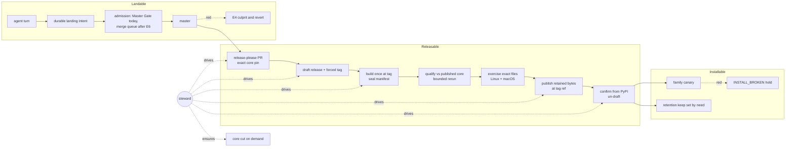
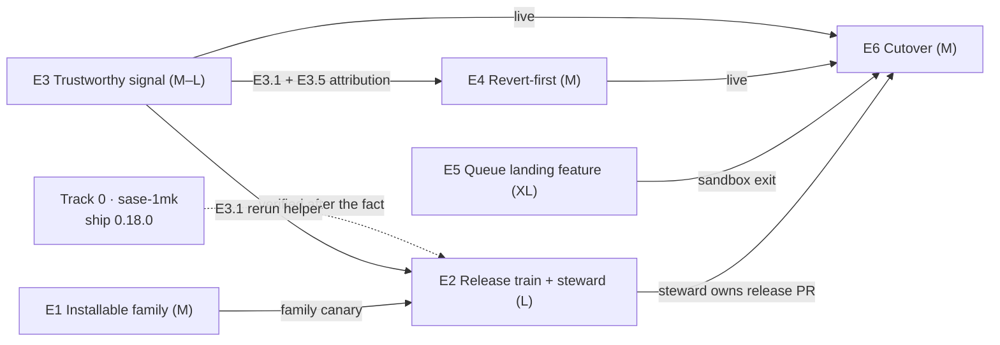

# PyPI release reliability: the converged design and how to split the work

> **Research query:** Review the files the previous agent just tagged in the research
> sidecar repo about making sase's PyPI releases much more reliable, then think hard
> about the best possible solution and how the work should be split up. Borrowing heavily
> from those files is fine; converging on the best design and architecture is the main
> priority.


## Bottom line

1. **Plan around three promises, not one "make `master` green" program.** Each promise
   gets its own fence, detector and owner:
   - *[Installable](#the-installable-promise):* `uv tool install sase` installs the
     newest family release, and it works.
   - *[Releasable](#the-releasable-promise):* a qualified release reaches PyPI at least
     every three days.
   - *[Landable](#the-landable-promise):* `master` stays gate-green.

   **No promise may depend on a weaker one.** Installability must survive a failed
   release, and a release must not need `master` to be green at one particular instant.
   This framing comes from [cld and grk](#how-the-four-reports-compare). The other two
   reports imply it.
2. **The release unit is a qualified *pair*:** the sase wheel and sdist, plus the exact
   `sase-core-rs` version and wheel digests they were tested against.
   - Build once, at the tag.
   - Qualify against the **published** core wheel, not a core built from the source pin.
   - Publish the retained bytes, confirm them from PyPI, then un-draft the GitHub
     release.
   - Each sase release pins `sase-core-rs==X.Y.Z` exactly (cld, and cdx's preferred
     target). This is the largest change to the plan of record, and the evidence for it
     is strong (see [Why exact core pinning](#why-pin-the-core-exactly)).
3. **One deterministic [release steward](#the-steward) replaces today's chain of five
   cron schedulers and observer epics.**
   - It grows out of `tools/release_watch`, which `sase-1mk.2` just taught to watch and
     dispatch the core cut.
   - It is a *stateless reconciler*. Every tick derives the state from GitHub and PyPI,
     takes at most one next action, and reports one typed blocking reason with an owner
     action.
   - This is the piece most likely to end the seven-week stall. Two of the four reports
     schedule it last, after the queue cutover. **Build it first.**
4. **The merge queue remains the end-state fence for *landable*, but it is off the PyPI
   critical path.** Keep everything the corpus converged on: the native queue, zero
   approvals, rebase, an event-aware aggregate, and a separate ruleset. **[Keep slow
   release qualification out of the
   queue](#why-slow-qualification-stays-out-of-the-queue)**, including for the release PR
   (cdx, against cld and grk).
5. **The split is Track 0 plus six epics.** E1–E3 start now; the queue epics come later.

   - **T0. [Ship 0.18.0](#track-0) (existing `sase-1mk`):** Size — · Start in flight
   - **E1. [Installable family](#e1-installable-family) (retention by need, floors,
     family canary):** Size M · Start now
   - **E2. [Exact-candidate release train and
     steward](#e2-exact-candidate-release-train-and-steward) (core lockstep):** Size L ·
     Start now
   - **E3. [Trustworthy signal](#e3-trustworthy-signal) (bounded rerun, quarantine,
     drift, attribution):** Size M–L · Start now
   - **E4. [Revert-first post-submit](#e4-revert-first-post-submit) (propose, then
     auto):** Size M · Start after E3.1 + E3.5
   - **E5. [Queue-aware landing as a SASE product
     feature](#e5-queue-aware-landing-as-a-product-feature) (sandbox):** Size XL · Start
     when E1–E3 move
   - **E6. [Cut `sase/master` over to the queue](#e6-cut-master-over):** Size M · Start
     E3 + E4 live, E5 exit, go/no-go

   This is cld's six-epic shape. cdx, grk and gem keep the reassessment's four (A–D).
   [Why six](#why-six-epics-and-not-four) explains the choice. In short, the four-epic
   plan puts the release train after the cutover and bundles a small, urgent
   installability fix with a large redesign.
6. **Today:** the `sase-core-rs` 0.42.0 cut is running (Release-plz run `39142943980`,
   started 15:59Z). The best thing to do with the next few hours is a three-line
   `publish.yml` patch so that 0.18.0 is built from its own tag commit (see
   [Next 24 hours](#next-24-hours)).

## Why releases stall: the merged diagnosis

1. **A release needs three things to hold at once.** Under release-please, the candidate
   is "HEAD plus a version bump". `ci_watch` merges it only if:
   - Master Gate is green at HEAD;
   - a Full CI run is green within the last 6 hours;
   - every core binding HEAD uses has been published.

   Each condition holds only part of the time, and they are only loosely correlated.
   That conjunction, not any single red lane, explains a 50-day stall (cld).
2. **The release path is a chain of five schedulers, each with single-shot checks:** the
   daily core cut, then `Publish` every 3 h (which ratchets the floor), then the floor
   smoke, then `ci_watch` every 5 min (which needs Full CI ≤ 6 h old), then `Publish`
   again. With every step green, that is about 15–38 h (cld's estimate from the
   configured crons). Any single red resets one link's clock.
3. **The retry strategy is the worst available one.** To satisfy the freshness rule,
   `ci_watch` keeps dispatching the entire 70–100 minute Full CI until a run comes back
   green: six runs on `ae9f044bb3` alone. The reading list's data says rerunning a
   failed job recovers 73.6% of failures, against 33.9% for rerunning the whole
   workflow. Bounded node-level reruns are both cheaper and more informative.
4. **Core lag is the normal state, not an incident.** sase's pin moved 137 times in 29
   days. About 85% of the time it pointed at a core commit that no published
   `sase-core-rs` contained (cld's replay; an upper bound on *binding* lag). Core is cut
   once a day, all or nothing, and `ci_watch` does not cover sase-core.
5. **What ships is not what was tested.** Master Gate and Full CI build the core wheel
   from the pinned source. Users get the PyPI wheel, which is built from a later core
   commit. The full suite never runs against the pair that ships (cld; cdx agrees).
6. **Retention is consumer-blind, and the windows are narrow.**
   - Core retention keeps the newest 30 versions plus manual `--keep-version` entries.
   - Each sase release accepts one core minor, and core shipped six minors in about 17
     days.
   - So a release's dependency could age out within weeks, while storage sat at 39% of
     the cap.
7. **Ownership decays into observing.** Five successive epics "repaired the reds [they]
   had caused, then labeled the remaining ones 'externally owned'… then only observed"
   (`sase-1mk`'s plan, quoted by cld). `sase-1jz`, `sase-1lh`, `sase-16p` and `sase-10d`
   are all still open next to `sase-1mk`.
8. **Landing is not today's blocker.** Master Gate has been green on recent SHAs.
   Nothing blocking 0.18.0 is a landing problem. The queue is still the right end state
   for *landable*, because green windows on an unfenced branch decay. But it cannot be
   the first thing built for *releasable*.

### Live state checked today

The lead researcher's checks at about 16:05Z.

- **PyPI `sase`**
  - *Observation:* 0.17.1 (2026-08-29), requires `sase-core-rs>=0.32.16,<0.33.0`
  - *Implication:* Still uninstallable; resolvers fall back to 0.1.0 (all four reports)
- **PyPI `sase-core-rs`**
  - *Observation:* 0.41.0, 51 versions with files, **3.88 GiB** total (82 MB average)
  - *Implication:* Storage is far below the 10 GiB limit, so deletion was not forced
- **PyPI plugins**
  - *Observation:* `sase-github` 0.2.24 requires `sase>=0.18.0`; `sase-telegram` 0.4.29
    requires `sase>=0.17.0`
  - *Implication:* A plugin shipped with a floor naming an unpublished sase
- **Core wheels per release**
  - *Observation:* universal2 macOS, manylinux x86_64 and aarch64, win_amd64, sdist
  - *Implication:* A "supported platform" contract must be written down
- **Release PR #299**
  - *Observation:* OPEN, `UNSTABLE`, head `e13283e585`
  - *Implication:* Waiting on the core floor (cld)
- **sase-core #331 (`v0.42.0`)**
  - *Observation:* OPEN; a Release-plz run has been in progress since 15:59Z
  - *Implication:* Track 0's critical path is moving right now
- **`pyproject.toml` / source pin**
  - *Observation:* `sase-core-rs>=0.35.0,<0.36.0` / `72bf9203`
  - *Implication:* `master`'s declared window is three minors behind PyPI
- **Repo merge settings**
  - *Observation:* merge commits only; rebase, squash and auto-merge off
  - *Implication:* E6 must flip these through a human gate
- **Rulesets**
  - *Observation:* only `master-integrity` (active)
  - *Implication:* Step 0 is done
- **`publish.yml` build**
  - *Observation:* `actions/checkout@v4` with no `ref`; `skip-existing: true` with no
    digest check
  - *Implication:* The exact-build and partial-retry defects are both still present
- **Full CI**
  - *Observation:* last 8 completed: 4 success, 4 failure; six runs on unchanged
    `ae9f044bb3`
  - *Implication:* Hunting for a "fresh green" is a whole-workflow rerun loop
- **Track 0 beads**
  - *Observation:* `sase-1mk` .1–.7 closed, .8 in progress; `sase-1jz`, `sase-1lh` in
    progress; `sase-16p`, `sase-10d` ready
  - *Implication:* Five overlapping owners for one outcome

## The design

### Principles

1. **Three promises, separately fenced, detected and owned.** A promise may not depend
   on a weaker one.
2. **The release candidate is the unit of promotion,** not a branch name, a green badge,
   or an upload command that exited 0 (cdx). The candidate is a pair: the sase files plus
   the exact core.
3. **One decider per outcome.** One steward decides releases, and one reconciler decides
   landings. Two actors deciding the same merge is the Gas Town failure mode.
4. **Missing evidence is red.** Skipped, cancelled, stale, zero-collected or unavailable
   evidence never satisfies a gate (Gas City, cdx).
5. **A single red never costs a day.** Every check that gates a release gets one bounded
   rerun of failed nodes and a typed outcome: pass, recovered, deterministic, or
   no-verdict.
6. **Bound red time before preventing it.** Revert-first ships in weeks; the queue later
   prevents red landings.
7. **Agents stay single-turn, and the host owns completion.** Anything that waits is a
   deterministic host component or a GitHub workflow, never an agent's promise
   (`single-turn-agents`, `host-owned-completion`, `gates-never-block`).



## The installable promise

*Promise 1, delivered by [E1](#e1-installable-family).*

- **Retention by need.** `pypi_retention.py plan` computes a protected set and refuses
  any plan that touches it. It fails closed on unreadable metadata, partial enumeration
  or a failed support-manifest read. The set includes:
  - the exact core version pinned by every supported sase release (once pins are
    exact);
  - until then, every available version in each supported release's window (cdx's
    conservative rule; cld keeps only the newest in each window);
  - every version an active or confirmed candidate record says was qualified;
  - the last two *confirmed working* releases and the recovery baseline (cdx);
  - **complete platform file sets**, not just version labels (cdx);
  - the newest 30, as today.

  "Supported releases" means the last N ≥ 10 non-yanked sase releases (cld), not N ≥ 2
  (grk, gem). Two releases can discard the last version that actually worked. With exact
  pins the cost is about 100 MB per protected release.
- **Published floors only.** Every family release PR (sase, sase-github, sase-telegram)
  carries a `release-dependency-floor` check that fails when a declared floor on a
  sibling is not on PyPI. This would have held `sase-github` 0.2.24. `ci_watch` already
  refuses release PRs with red checks. sase's `release-core-floor-smoke` is the existing
  sase→core instance of the check.
- **The family canary.** Extend the existing daily `install-smoke.yml`:
  - a clean `uv tool install` of sase plus each plugin, on `ubuntu-latest` **and**
    `macos-latest`;
  - assert that each package installs *the newest PyPI version*, not merely one at or
    above a floor;
  - also install the exact current release explicitly;
  - run `sase core health` and the documented first commands.

  Otherwise resolver backtracking looks green. A red canary is the steward's
  `INSTALL_BROKEN` state (severity 1).
- **Storage.** File the `sase-core-rs` PyPI size request as cheap insurance. It is
  human-gated and not urgent at 3.88 GiB of 10. Never let quota pressure override the
  protected set (cdx; PyPI warns that deleting files breaks installs and that filenames
  can't be reused).
- **Recovery runbook, all human-gated:**
  - yank, then fix forward;
  - **core backfill:** a new patch version cut from an old core tag (for example
    0.32.17 from `v0.32.16`) can restore an old window, because versions can be new
    even though filenames can't be reused;
  - optionally yank `sase` 0.1.0, so that a future broken window *fails loudly* instead
    of installing February's build.
- **Recovery is never blocked.** An install outage holds unrelated packaging churn. It
  must not block a separately qualified *recovery* candidate. The Google comparison's
  blanket "the train doesn't cut" rule would block the very release that fixes today's
  incident (cdx).

## The releasable promise

*Promise 2, delivered by [E2](#e2-exact-candidate-release-train-and-steward).*

### Workflow topology

1. **release-please stays** on its three-hourly cron, with `draft: true` and
   `force-tag-creation: true`.
   - `force-tag-creation` exists in release-please (#2627, January 2026). It makes the
     tag at once, so later runs can still find the previous release.
   - Confirm that the bundled `release-please-action@v5` honors it, using a fixture
     repo.
2. **The steward dispatches a new `release.yml` at the tag ref:**
   `gh workflow run release.yml --ref v0.18.0`.
   - For `workflow_dispatch`, `GITHUB_SHA` is the last commit of the dispatched branch
     or tag. The build checkout, the tag and the publisher's OIDC context then name the
     same commit, with no extra plumbing.
   - Also assert explicitly that tag = peeled SHA = `pyproject` = `__version__`.
3. **`release.yml` jobs**, in order:
   - **build:** build the wheel and sdist once, then seal the manifest.
   - **stash:** upload the dists and the manifest to the *draft GitHub release* as
     assets. This gives durable storage that does not depend on the 90-day artifact
     retention, and a natural place for "resume from retained bytes".
   - **qualify:** `workflow_call` into `ci.yml` with `ref` and `core-source: published`.
     It runs the N1 release-blocking set with the shared [bounded
     rerun](#trustworthy-signal), under the concurrency group `qualify-<sha>`, never
     cancelled.
   - **exercise:** install the stashed wheel *and* sdist into clean environments with
     public PyPI dependencies, on Linux and macOS. Run a short no-LLM workflow in an
     isolated home with a deterministic provider: create durable work, reload it, cross
     the host/worker boundary, render a headless TUI frame, then shut down. Add an
     upgrade check from the previous release and `pip check` (cdx and the Google
     report).
   - **publish:** run in the `pypi` environment, which is restricted to `v*` tags.
     Download the stashed assets and verify their digests against the manifest. Upload.
     On a retry, accept an existing PyPI file only when its digest matches (replacing
     bare `skip-existing`).
   - **confirm:** fetch the PyPI file list, compare every digest, install the exact
     version, run the family canary, then un-draft the release.
4. **`Publish` keeps only release-please and `sync-release-metadata`.**
   `publish_existing` is removed. Recovering an old version becomes a dispatch of
   `release.yml` at that version's tag, which is truthful by construction.

### The candidate manifest

The manifest is the union of the four reports' fields.

- **Sealed at build:**
  - repository, version, tag, peeled SHA and tree;
  - candidate ID and build generation;
  - builder workflow revision, run ID and attempt;
  - core source pin;
  - **the selected published core version, with its full wheel file set and digests;**
  - every distribution's filename, size and SHA-256, plus the asset locator.
- **Appended afterwards (observations):**
  - qualification policy digest (the N1 inventory version);
  - run IDs and attempts per required check;
  - collected-test counts;
  - `FLAKY:` recoveries and explicit exceptions;
  - publication and confirmation results;
  - any later yank, revocation or supersession.

The candidate ID never depends on later observations. A rebuild is a new generation and
must be qualified again. Tags never move.

The promotion predicate, from cdx:

```text
publishable(candidate) =
    source_and_version_identity_match
    AND exact_expected_files_retained_and_hashed
    AND every_required_check_has_acceptable_evidence_for_this_candidate
    AND public_dependency_contract_satisfied        # exact core pin is on PyPI, complete
    AND no_confirmed_release_veto                   # severity veto, whichever lane found it
```

### Why pin the core exactly

- **What it buys:**
  - tested = shipped, for both halves of the pair;
  - the floor smoke and the latest-in-window smoke collapse into one check;
  - retention protects exactly one core version per release;
  - a later core patch can never silently change an existing sase install.
- **It costs little:**
  - today's windows already span one core minor, and 0.x minors break;
  - plugins depend on `sase`, not `sase-core-rs` (cld checked PyPI metadata), so there
    is no resolver conflict;
  - a core security fix waits for the next sase release, which is acceptable at a
    1–3-day cadence.
- **The steward's core-ensure step** picks X.Y.Z as the newest *complete* published core
  (every expected platform file present) whose tag contains the candidate's source pin
  and which passes the existing required-bindings check.
  - If no such core exists, the state is `CORE_LAG`: dispatch the core cut, wait for
    PyPI, then continue. `sase-1mk.2` already built this behavior with
    `--await-core-version` and `--dispatch-core-cut`.
  - The metadata step (`ratchet_core_window` becomes `ratchet_core_pin`) writes `==X.Y.Z`
    on the release PR.
- **Spike first:** check how release-please, `uv.lock` and the dev install handle an
  exact pin on `master` between releases.
- **Core heals must not change what was qualified.** Core's partial-release "healing" can
  later add a platform wheel under an existing version. So the candidate records the
  full core file set, and the steward refuses to pin a core version whose file set is
  incomplete (cdx's immutable-file concern, applied to core).

### The steward

- **Shape:** `tools/release_watch` becomes the single decider for sase releases and the
  core cut. Its logic lives in the sase repo, with tests. An axe chop on athena runs it
  nightly and on demand, next to `ci_watch`.
- **Stateless by construction** (the lead researcher's addition, which settles cld's
  single-point-of-failure risk).
  - Each tick recomputes state from durable external facts: PyPI JSON, tags, draft
    releases and their manifests, workflow runs keyed by SHA, and the release PR.
  - It then takes at most one idempotent action, keyed by candidate ID.
  - Time-in-state comes from the timestamps of those facts, so a restart or a move to
    another host loses nothing, and `release_watch --once` anywhere reproduces the
    decision.
  - The only state it writes is the manifest on the draft release.
- **Typed status, one notification thread.** Each blocking reason has an owner action
  (cld's taxonomy):
  - `RELEASED(v)` / `RELEASABLE` / `NOTHING_TO_RELEASE`.
  - `CORE_LAG(bindings)` → dispatch the core cut.
  - `CORE_CI_RED` / `CORE_CUT_RED(check)` → rerun failed jobs once, then file one bead on
    sase-core.
  - `CORE_INCOMPATIBLE` → the candidate fails against the newest core; wait for the pin
    ratchet.
  - `GATE_RED(sha, culprit?)` → E4's [revert](#revert-first-post-submit).
  - `QUALIFY_RED(signature, recovered?)` → the culprit search from release-green.
  - `EXERCISE_RED(platform)` / `DEPENDENCY_UNPUBLISHED(pkg)` / `PUBLISH_PARTIAL` →
    resume by digest.
  - `INSTALL_BROKEN(member)` → severity 1.
  - `WATCHER_BROKEN` / unknown → fail closed.
- **Escalation, not observation.** After 24 h in one blocked state, the steward files a
  single typed task bead at high severity, or `+1`s the existing one. Repair agents are
  not launched automatically until a launch-budget rule exists.
- **Failure burns a version, cheaply.** A failed candidate leaves a draft release and an
  unused tag. The next release PR becomes 0.18.1, and nothing reached PyPI. The steward
  marks the draft "abandoned". This is the deliberate price of keeping qualification out
  of the queue.
- **Authority.**
  - E2's decision record pre-authorizes publishing *qualified* candidates, so a release
    needs no human approval. Yanks stay gated.
  - Once the steward merges sase release PRs, set `ci_watch`'s `merge_enabled` to false
    for sase through a human-gated chezmoi change. Plugins can stay on `ci_watch`, now
    protected by E1's floor check, until a later optional phase moves them over.
  - Relax "fresh Full CI on any SHA" **only after** qualification and publish
    confirmation are deployed (cdx, cld and grk all require this ordering).
- **Release-green bookmark (Stovepipe).** Record release-blocking evidence per SHA from
  the continuous lane. That is the culprit finder's baseline and the input to the "time
  to release-green" measure. It never authorizes an arbitrary ancestor, because green is
  not hereditary (cdx).

### Provenance from running the publisher at the tag

cdx and grk disagree, and both are partly right.

- **cdx's point:** PyPI's publish attestation has an empty predicate by specification. It
  attests the trusted publisher's identity at signing time, not the build inputs.
- **grk and gem's point:** the Sigstore certificate behind that identity carries the
  workflow's source repository ref and digest. That is how verifiers and PyPI's
  provenance objects tie a file to a commit.

Today the two coincide by accident: the scheduled run builds its own `GITHUB_SHA`, so the
attestation names what was built, which just isn't the release commit. Patch only the
checkout, and the attestation names a scheduled-trigger commit while the bytes come from
the tag. That is misleading rather than forged. **Dispatching `release.yml` at the tag
ref makes all three identical.** Keep the builder workflow revision as a separate
manifest field, and don't call trusted publishing "build provenance" (cdx).

## The landable promise

*Promise 3, delivered by E3–E6.*

### Trustworthy signal

*Epic [E3](#e3-trustworthy-signal).* Every report agrees on this content:

- **One shared bounded-rerun helper**, used by Master Gate shards, `ci.yml` test jobs,
  qualification and the publish smokes:
  - rerun only when 3 or fewer nodes fail, and only once;
  - never rerun collection errors, harness errors or zero-test runs;
  - keep the first attempt and emit `FLAKY:`.
  - **Refinement from cdx:** an isolated pass is diagnostic, not exoneration. Track
    recovered signatures and escalate repeats. Designate safety-critical tests that get
    no rerun.
- **Escalating quarantine.** Expiry fails a non-required hygiene check, raises the bead's
  priority and appears in the digest. It never fails admission. Expiry is excluded from
  the shifted-clock run. This fixes the Google report's time bomb.
- **Parity:** `.python-version` = 3.12, a fast fail on a core-revision mismatch, and
  `if: always()` only on reporting steps.
- **Drift canaries:** a nightly gate run on the tip, plus one with *time injected* +30
  days. Inject time into the relevant tests rather than shifting the machine clock,
  which would break TLS, OIDC and caches (cdx).
- **Culprit attribution.** Master Gate already runs once per SHA and is never cancelled.
  So the first red SHA with a green parent is the suspect, and a dispatchable
  `culprit-check.yml` confirms it k of k at the suspect and k of k passing at its
  parent. Every red is labeled recovered, culprit, drift or unknown. For the release
  lane, bisect the commits since release-green.
- **False-red digest and DORA-style metrics**, each with its numerator and denominator.

### Revert-first post-submit

*Epic [E4](#e4-revert-first-post-submit).* This is cld's design.

- **Rollout:**
  - Start in *propose* mode: each confirmed culprit raises one `/sase_gate` that carries
    the exact `ace/revert_agent_transaction.py` revert and the evidence.
  - Move to auto mode only through a human gate, after measured precision of at least
    95% over at least 20 events.
- **Never reverted automatically:** release and ratchet PRs, reverts, and
  `.github/workflows/` changes. Drift is never reverted.
- **Safety limits:** a daily cap and a per-bead circuit breaker. A conflict falls back to
  one fix-forward bead.
- **Effects:** the revert reopens the culprit's bead using the proper bead commands,
  never a hand edit of status.

Why it comes before the queue:

- it bounds red time within weeks, using today's push path;
- the release-blocking lane needs it anyway, because the queue never covers that lane;
- a `master` that is already mostly green means few ejections at cutover.

After E6, a revert is a PR that jumps the queue.

### Queue-aware landing proven on a sandbox

*Epic [E5](#e5-queue-aware-landing-as-a-product-feature), a product feature.* This is the
reassessment's Epic C, with these corrections:

- **Sealed obligations (cdx).** This is the most important correction to the landing
  protocol.

  ```text
  delivered(work_generation) =
      work_closed AND completion_obligations_sealed
      AND every_required_obligation_proven_landed
  ```

  Without the sealing condition, a closed bead seen before its landing record arrives
  has an empty obligation set, and it "delivers" early. Apply the predicate to
  readiness, `%w` waits, epic phase launches, land-agent checks and cross-repo
  dependencies.
- **Durable protocol.**
  - Persist intent before any network effect.
  - Use the operation ID plus the head generation as the identity.
  - Use compare-and-swap leases between reconcilers on the two hosts, and retry budgets
    that survive restarts and head changes.
  - A `gh pr merge` exit 0 means *armed*, not merged.
  - A webhook is a trigger, never proof.
  - Write these invariants down before coding (the reading list's TLA+ lesson).
- **Proof of landing under rebase.** Rebase rewrites the agent's SHA. Prove landing with
  the PR → landed-commit mapping plus tree equality against the *immutable* landed
  commit, never against today's moving tip. Test it in the sandbox with several PRs
  queued, an ejection and a reorder. Merge limit 1 caps how many PRs merge together. It
  does not make each speculative build single-PR (cdx; GitHub's docs say "merge limits
  do not combine `merge_group` builds").
- **Failure classes:** conflict, witnessed base regression, code failure,
  infrastructure, pending and unknown.
  - An auth error never launches a repair agent.
  - A base regression gets one deduplicated repair owner.
  - Three identical ejections trip a circuit breaker.
- **The testing loop.** Add a "landed" notification, an
  armed/queued/landed/ejected state on the agent row, and a preview command that runs
  sase from a throwaway worktree at the PR head. Measure from turn completion to usable
  code (the testing-impact note).
- **Configuration and placement.** `landing.mode: push | queue` is per-project
  configuration, not a flag. The landing domain and its bindings live in `sase_core`,
  the transport in `sase-github`, and Python and the TUI are adapters. Move the
  `sase-core-revision.txt` pin when the wire API lands.

### Cutting master over

*Epic [E6](#e6-cut-master-over): cut `sase/master` over.* This is the reassessment's
Epic D, without the train, which now lives in E2.

- **Workflow wiring:**
  - add the `merge_group` trigger and the event-aware `integration-ready` aggregate;
  - fail closed on missing matrix entries;
  - drop `ci.yml`'s ordinary `pull_request` trigger;
  - keep the push gate as a named audit until mapping is proven.
- **Queue rules go in a new ruleset, not `master-integrity`.** A bypass list exempts an
  actor from every rule in its ruleset, so a shared ruleset would let the pilot's
  maintainer bypass relax force-push and deletion protection. Prove the full rule
  combination in the sandbox, including any `Restrict updates` rule (cdx).
- **Starting settings, not proven capacity:** rebase, K=2, merge limit 1, `ALLGREEN`, 60
  minutes.
- **Sandbox-test the release-please PR under rebase.** It carries more than one commit
  (the release commit plus `chore: sync release metadata`). Either amend the sync step
  into a single commit, or prove that the tag lands on the final commit.
- **A pilot allowlist from both hosts,** then enforcement once false reds stay under 3%
  over at least 7 days on a declared sample.
  - About 100 independent zero-failure observations bound the rate near 3%, and
    correlated runs weaken that (cdx).
  - Add cld's **go/no-go review** first, using E3 and E4's red minutes per day, time to
    revert and escape rate.
- **Installability hold:** while `INSTALL_BROKEN`, hold landings that touch packaging,
  dependencies or retention. The fix itself is exempt.
- **The release PR goes through the queue like any PR,** with admission checks only.
  Qualification stays at the tag (see [Bottom line](#bottom-line), item 4).

### Why slow qualification stays out of the queue

cld wants the release PR qualified inside its own `merge_group`, so that a failed
candidate burns nothing. The cost is real, though:

- under merge limit 1, every PR behind the release PR waits for the release-blocking lane
  (70–100 min) once a day;
- detecting release-PR membership, speculative rebuilds and artifact reuse all get more
  complex;
- the slow lane returns to the integration path.

A burned version number costs nothing to users, while a daily 90-minute queue stall
costs every agent wave. Reopen this only if burned versions exceed about one a week. If
they do, first try a *pre-merge preflight* on the release PR head as a predictor, then
tag-on-green.

## Work split

### Why six epics and not four

- **The train moves out of D and into E2.** It is the highest-value piece, it does not
  need the queue, and grk and gem schedule it after a cutover and a soak. cdx already
  agrees by putting release-watch integration in A.
- **Installability is split out of A, as E1.**
  - It is the promise users have lost.
  - Its proofs are independent: a retention dry-run, the canary and the floor check.
  - It touches different repos (sase-core and the plugins).
  - It closes in days. Inside an L epic, it would wait on a redesign. This is the
    reassessment's own "releases held hostage" argument, applied one level down.
- **Revert-first is separate from E3, as E4.** E3 failing *masks* a real red; E4 failing
  *destroys good work*. Each has its own decision record and a human-gated mode change,
  and E4's propose-mode soak should not hold E3's exit.
- **C and D stay separate, as E5 and E6.** They prove different things in different
  places (a sandbox versus production). E5 outlives the cutover as a product feature,
  and its scaffolding should not live through a soak (all four reports agree).
- **No more than six:**
  - splitting E2 by repo or stage leaves a train with no steward, or a steward with no
    exact build;
  - splitting E5 by repo leaves an unverifiable half-protocol;
  - the downgrade contract and the Rust toolchain pin are follow-up tasks, not epics.



### Track 0

*Ship 0.18.0 (existing `sase-1mk`; no new epic).*

- **Critical path:**
  1. the core 0.42.0 cut (running now);
  2. the next `Publish` run's `sync-release-metadata` ratchets #299's window;
  3. the floor smoke goes green;
  4. `ci_watch` merges #299;
  5. Publish.
- **Additions:**
  - Land E2.1's minimal checkout fix *before* #299 merges, if possible (see
    [Next 24 hours](#next-24-hours)). Otherwise dispatch Publish immediately after the
    merge.
  - Verify after the fact: download the PyPI wheel and sdist, then compare the version,
    `__version__` and file list against `git archive v0.18.0`.
  - Re-resolve the family. Expect `sase` 0.18.0, `sase-github` 0.2.24 and
    `sase-telegram` 0.4.29.
- **Exit:** the family canary is green on both operating systems, and the stale epics
  (`sase-1jz`, `sase-1lh`, `sase-16p`, `sase-10d`) are superseded, as `sase-1mk`'s
  `stale_epics = supersede` decision already directs.

### E1 Installable family

**Scope:** sase-core, sase, sase-github and sase-telegram. Size M. Start now.

**Decision record:** "A published release stays installable. Retention never deletes,
and no release declares, a dependency that a supported release cannot resolve."

**Phases:**

1. **E1.1**
   - *Work:* Protected-set retention in `pypi_retention.py plan`, failing closed
     ([rules above](#the-installable-promise))
   - *Verification:* A dry run protects 0.18.0's core and full file set. A planted plan
     that deletes it, or one required platform wheel, fails. Unreadable PyPI fails
     closed
2. **E1.2**
   - *Work:* Family canary: plugins, macOS, newest-version and exact-version assertions,
     `core health`; failures file or `+1` one `ci` bead
   - *Verification:* Run today, it **fails**, naming 0.1.0. After Track 0 it passes on
     both OSes
3. **E1.3**
   - *Work:* `release-dependency-floor` check on plugin release PRs
   - *Verification:* A plugin PR whose floor names an unpublished sase shows red, and
     `ci_watch` refuses it
4. **E1.4**
   - *Work:* PyPI size request (`/sase_gate`) plus a runway line in
     `docs/pypi-retention.md`
   - *Verification:* Request filed; headroom alert configured
5. **E1.5**
   - *Work:* Recovery runbook: yank and fix forward, core backfill, the yank-0.1.0
     decision
   - *Verification:* A TestPyPI drill (needs human-created projects and publishers)

**Exit:** E1.1–E1.3 verified, and the family canary green for 7 consecutive days after
Track 0.

### E2 Exact-candidate release train and steward

**Scope:** sase (`publish.yml`, the new `release.yml`, `ci.yml` inputs, `build-core.yml`
ref plumbing, `tools/release_watch*`, `tools/ratchet_core_*`,
`release-please-config.json`), sase-core's `release-plz.yml` merge job, and the chezmoi
`ci_watch` config (human gate). Size L. Start now.

**Decision record:** "PyPI publishes exactly the qualified release pair."

- It supersedes the *release* clause of `ci-two-speed-split`, which reads "`ci_watch`
  gates release on … a recent green `Full CI` run" (cld).
- It pre-authorizes publishing qualified candidates.
- Write it with `/sase_memory_write`.

**Phases:**

1. **E2.1**
   - *Work:* Exact build: checkout the release-please `sha` output now. Then
     `release.yml` dispatched at the tag ref, the identity assertion, build once, stash
     dists and manifest on the draft release, `draft` + `force-tag-creation`
   - *Verification:* With `master` advanced past the release commit, the wheel, manifest
     and attestation all name the tag SHA
2. **E2.2**
   - *Work:* Exact core pin: `ratchet_core_pin`, [the core-ensure
     rule](#why-pin-the-core-exactly), collapse the two floor smokes into one; spike on
     lockfile and dev install
   - *Verification:* The release PR declares `==X.Y.Z`; the manifest's core digests
     equal PyPI's
3. **E2.3**
   - *Work:* Qualification: `ci.yml` gains `ref` and `core-source: published`; the N1
     blocking set with E3.1's rerun; `qualify-<sha>`, never cancelled
   - *Verification:* A source-built pin passes but the published core fails a planted
     test, so the steward reports `QUALIFY_RED`. Skipped or cancelled jobs or a
     zero-test collection block
4. **E2.4**
   - *Work:* Exercise the exact files on Linux and macOS (wheel and sdist, isolated
     home, headless frame, upgrade from N−1)
   - *Verification:* A planted macOS-only startup crash withholds publication
5. **E2.5**
   - *Work:* Publish and confirm: `pypi` environment restricted to `v*` tags,
     digest-checked resume, confirm from PyPI, un-draft; delete `publish_existing`. PyPI
     trusted publishers are keyed by workflow filename, so `release.yml` needs a new
     publisher entry (a human-gated PyPI change)
   - *Verification:* Interrupt after one upload and resume on another runner: identical
     files resume, a different hash fails safely
6. **E2.6**
   - *Work:* The steward: stateless reconciler, typed status, core-ensure (generalizing
     `sase-1mk.2`), 24 h escalation, severity veto; then turn off `ci_watch` merging for
     sase and relax the Full CI freshness rule
   - *Verification:* Restart mid-train: no second dispatch or upload. Against a HEAD
     that needs an unpublished binding, it reports `CORE_LAG` and then cuts. `ci_watch`
     never merges sase's release PR
7. **E2.7**
   - *Work:* Core-cut resilience in `release-plz.yml`: rerun failed jobs once, emit a
     typed failure, keep the dispatch entry point
   - *Verification:* One injected flaky check is rerun and merges; a deterministic red
     refuses with a reason
8. **E2.8**
   - *Work:* Release-green record and metrics: days since release, landing→PyPI lead
     time, time to release-green (p90 < 6 h), core-lag hours, burned versions,
     change-fail rate
   - *Verification:* Dashboard figures with numerators and denominators

**Exit:** at least one real release has gone through the steward with no human action
beyond pre-authorized ones, and its PyPI digests and attestation SHA equal the manifest.
Every refusal so far has named a typed reason and its owner. An optional final phase
moves the plugins' release merges from `ci_watch` to the steward.

### E3 Trustworthy signal

**Scope:** sase (test infrastructure, Master Gate *test steps*, `ci.yml` test jobs, the
quarantine file, `culprit-check.yml`). Size M–L. Start now.

**Decision record:** "CI reruns a failed node once and quarantines with an escalating
expiry", next to `triage-annotates-does-not-change-exit-codes`. It does not change
ToolRun triage or receipts.

**Phases:**

1. **E3.1**
   - *Work:* Shared bounded-rerun helper ([rules above](#trustworthy-signal)); adopted in
     Master Gate and `ci.yml`, so qualification inherits it
   - *Verification:* A planted flake recovers with `FLAKY:`. A deterministic failure, a
     collection error or a test that fails only in order stays red
2. **E3.2**
   - *Work:* Escalating quarantine
   - *Verification:* An expired entry fails hygiene only, the gate stays green, and the
     bead escalates
3. **E3.3**
   - *Work:* Parity
   - *Verification:* Mismatched core revision fails fast
4. **E3.4**
   - *Work:* Drift canaries with injected time
   - *Verification:* A planted time bomb fails the +30-day run while the gate stays
     green
5. **E3.5**
   - *Work:* Culprit attribution and `culprit-check.yml`; release-lane bisection from
     release-green
   - *Verification:* A planted break is labeled `culprit=<sha>` within one gate run plus
     the check. A flake is labeled `recovered`; a time bomb `drift`
6. **E3.6**
   - *Work:* False-red digest plus escape rate and red minutes per day
   - *Verification:* Baseline published
7. **E3.7**
   - *Work:* Visual promotion study, after E2.3 (both touch `ci.yml`); default is no
   - *Verification:* Recorded decision

**Exit:** the mechanisms are live and a baseline is published. The under-3% soak is E6's
entry bar, not E3's exit.

### E4 Revert-first post-submit

**Scope:** sase (callers of `revert_agent_transaction.py`, a deterministic chop, bead
reopen). Size M. **Entry:** E3.1 and E3.5 are live.

**Decision record:** "`master` is revert-first: a confirmed culprit is reverted, not
fixed forward."

**Phases:**

1. Propose mode.
2. Policy: exclusions, caps, the drift rule, conflict fallback.
3. Effects: bead reopen, notification, a reland note, and links from the steward's
   `GATE_RED` and `QUALIFY_RED`.
4. Auto mode through a human gate.
5. Release-lane culprits go through the same path.

**Verification:**

- A planted break is proposed and then auto-reverted, with p90 ≤ 45 min from landing to
  green.
- A flake, drift or an excluded path produces no revert.
- A conflict produces exactly one bead.
- A restart mid-revert produces no second revert.

**Exit:** auto mode is live with measured precision, or propose mode is recorded as the
steady state.

### E5 Queue-aware landing as a product feature

**Scope:** sase-core (landing domain and bindings), sase-github (adapter), sase
(finalizer, waits, UI), and a sandbox repo **created by a human**. Size XL. Start once
E1–E3 are moving; don't let it compete for review attention.

**Decision record:** "Landed is a host-owned state distinct from turn completion;
delivered requires sealed obligations", refining `host-owned-completion`.

**Phases:** the reassessment's C1–C6, with:

- C1 specifying generation, sealing and idempotency *before* the adapters split off;
- [the corrections above](#queue-aware-landing-proven-on-a-sandbox);
- the testing-loop gaps.

**Before writing the adapter:** cld reports that GitHub's asynchronous merge API reached
GA on 2026-10-01, as a candidate replacement for `gh pr merge`. Confirm that before
relying on it.

**Verification:** the reassessment's V-C1–V-C10, plus:

- with three PRs queued, the first ejected and one reordered, stale evidence never
  authorizes a new generation;
- kill the originating host after each external effect: the other host reconciles with
  no lost code, duplicate PRs or duplicate dependent launches;
- a closure race (close the work, delay obligation publication, crash the finalizer)
  never starts a dependent early;
- the landed notification fires exactly once.

`landing.mode` defaults to `push`, and nothing in E5 touches `sase/master`.

### E6 Cut master over

*Cut `sase/master` over to the queue.*

**Scope:** sase (triggers, aggregate), `bugyi-chops` and chezmoi (`ci_watch`), and GitHub
settings through `/sase_gate`. Size M, with two human gates and a soak.

**Entry:** E3 and E4 live, E5's exit passed, and the go/no-go review passed.

**Phases:** D1–D5 as the reassessment wrote them (workflow wiring, a new ruleset with the
maintainer on bypass, the pilot, the writer and credential matrix, enforcement with an
empty bypass and `landing.mode: queue`), plus:

- the installability hold;
- revert PRs jumping the queue;
- retiring the heavy push audit once the mapping holds.

**Decision record:** "`master` lands only through the merge queue." It supersedes the
merge-queue clause of `ci-two-speed-split` on the merits: a queue now produces a per-SHA
signal and fits capacity. Do not claim the old record's reopen trigger fired.

**Verification:** V-D1–V-D7, with V-D4 measured from agent finish to testable, plus a
harmless rejected-push canary.

### File ownership, to avoid conflicts

- **E1:** sase-core `pypi_retention.py`, `docs/pypi-retention.md`; sase
  `install-smoke.yml`; plugin release-PR checks
- **E2:** `publish.yml`, `release.yml`, `ci.yml` *inputs and checkouts*, `build-core.yml`
  ref plumbing, `tools/release_watch*`, `tools/ratchet_core_*`,
  `release-please-config.json`; sase-core `release-plz.yml` merge job; `ci_watch` merge
  config
- **E3:** test infrastructure, Master Gate and `ci.yml` *test steps*, the quarantine
  file, `culprit-check.yml`
- **E4:** `revert_agent_transaction.py` callers, the revert chop
- **E5:** the finalizer, waits, the sase-core landing domain, sase-github
- **E6:** Master Gate *triggers* and the aggregate, `ci.yml`'s `pull_request` trigger,
  rulesets, queue-era `ci_watch` and steward settings

Two different agents must never rewrite the same workflow at the same time. E3.7 waits
for E2.3. E2.3 and E3.1 meet at the rerun helper's input contract, which E3.1 defines
first.

## Acceptance cases that catch the real failures

1. **Wrong source (E2):** the event SHA differs from the release SHA. Every checkout,
   the wheel identity, the manifest and the attestation name the release SHA.
2. **Incomplete evidence (E2, E3):** cancel a shard, drop a matrix entry, collect zero
   tests, or skip a required job. Neither admission nor publication reports success.
3. **Wrong public core (E2):** the source-built pin passes, but the published core lacks
   a binding or behavior. The steward refuses and names the version and the missing
   contract.
4. **Incomplete core (E2):** the chosen core version is missing one platform wheel. The
   steward does not pin it.
5. **Partial publication (E2):** interrupt after one upload and resume elsewhere.
   Identical files resume. Different hashes, extra files or missing stashed assets fail
   safely.
6. **Retention regression (E1):** a plan deletes the only compatible core, or one
   required platform wheel. The plan is refused, and an unavailable PyPI also refuses.
7. **Unpublished sibling floor (E1):** a plugin release PR that names an unreleased sase
   is held.
8. **Real-use packaging (E2):** imports succeed, but the sdist build, an isolated
   workflow, a restart or the macOS run fails. Publication is withheld.
9. **Flake versus order defect (E3):** a transient failure recovers, and the first
   attempt is kept. An order-dependent failure is not erased by an isolated pass.
10. **Single decider (E2):** with the steward live, `ci_watch` never merges sase's
    release PR, and a restart mid-train causes no duplicate dispatch or upload.
11. **Closure race (E5):** no dependent starts until the sealed obligation set is
    complete and proven.
12. **Queue interactions (E5, E6):** under ejection, reorder and a head change, the
    tested → landed mapping comes from historical results.
13. **Two hosts (E5):** killing a host after each effect loses nothing and duplicates
    nothing.
14. **Public recovery (E1, E2):** with the public install red, a recovery candidate that
    passes can still publish and restore the canary.

Destructive and adversarial cases run on fixtures, a sandbox repo, or TestPyPI projects
with their own publishers. Production tests use only harmless changes.

## Next 24 hours

These steps are human-gated or for `sase-1mk`. None of them were done by this research.

1. **Let the 0.42.0 cut finish** (Release-plz run `39142943980`). Confirm that all five
   files are on PyPI. `sase-1mk.8` is already watching.
2. **If it can land and pass `tests/test_github_actions_publish.py` before #299 merges,
   land the minimal checkout fix.** In `publish.yml`, export `sha` from the successful
   release-please step and set `ref: ${{ needs.release.outputs.sha }}` on the build
   job's checkout.
   - This makes 0.18.0's bytes the release commit, even if the cron fires hours after
     the merge.
   - The attestation will still name the trigger commit. Accept that once and record it.
   - If the fix can't land in time, dispatch Publish immediately after `ci_watch`
     merges, so that `GITHUB_SHA` is the release merge.
3. **Verify after the fact:** the PyPI files against `git archive v0.18.0`, and a family
   re-resolve.
4. **File the `sase-core-rs` size request** (cheap insurance).
5. **After confirmation, supersede the stale epics** as `sase-1mk` already decided. Then
   turn E1, E2 and E3 into epic plans; they can start in parallel.

## What not to do

- **Don't build the queue first because it is the most visible fence.** No PyPI blocker
  today is a landing problem.
- **Don't add more crons or observe-and-report epics.** Build one steward with typed
  reasons and owner actions.
- **Don't widen sase's core window to dodge retention.** 0.x minors break. Pin exactly,
  and retain by need.
- **Don't qualify against a source-built core and call the release exact.**
- **Don't put the slow lane in the queue,** and don't let a required check depend on the
  calendar.
- **Don't auto-revert before propose mode has measured precision,** and never
  automatically revert workflow, release or ratchet changes.
- **Don't move release promotion into `sase_core`.** It is tooling. The landing domain
  belongs there.
- **Keep the rejected options rejected:**
  - human approvals, a host landing lane, "must be up to date";
  - LLM-judged merges, batch-then-bisect;
  - percentage rollouts, a release branch per release, a monorepo, a custom queue;
  - tag-on-green, for now;
  - fencing sase-core or the plugins with a queue in this program (N10).

## Risks and what would reopen this design

Each item names a condition in bold, then the response if it holds.

- **A plugin or a user tool starts depending on `sase-core-rs` directly and the exact
  pin conflicts:** Fall back to `>=X.Y.Z,<X.(Y+1).0`, keep qualifying against X.Y.Z,
  and protect every version in the window
- **`CORE_INCOMPATIBLE` recurs (the new core carries a break the pin hasn't
  absorbed):** Cut core releases *at the pinned commit*: a release-plz change or a
  train-created tag
- **Burned versions exceed about one a week:** Add a pre-merge preflight on the release
  PR head; if that is not enough, design tag-on-green
- **Fewer than 2 of 3 nightly candidates qualify over 2 weeks *after* lockstep and
  reruns:** Adopt tag-on-green (Stovepipe, Google "cut at green")
- **Revert precision stays below 95% in propose mode:** Keep propose mode permanently
  and lean on E6
- **The go/no-go review shows red time is already small (under about 2% of minutes, no
  deterministic break reaching a release in 4 weeks):** Defer E6 with a reopen trigger;
  E5 still ships as a product feature
- **False reds stay above about 10% after E3:** Delay E6 indefinitely; E1–E4 are still
  worth shipping
- **The sandbox shows a bypass actor cannot push to a queue-protected branch:** Merge
  E6's pilot and enforcement into one hard cutover; keep the whole pilot on the sandbox
- **Rebase misbehaves in the queue:** Squash
- **athena is down when a release is due:** Nothing breaks, because the steward is
  stateless. Run `release_watch --once` elsewhere, or move the loop into a scheduled
  workflow

## How the four reports compare

**Consolidated swarm report (final)** · 2026-10-18 · lead researcher plus four independent
reports ([cdx](pypi_release_reliability_design_and_work_split__cdx.md),
[cld](pypi_release_reliability_design_and_work_split__cld.md),
[grk](pypi_release_reliability_design_and_work_split__grk.md),
[gem](pypi_release_reliability_design_and_work_split__gem.md)) · live state re-checked at
about 16:05Z with sase `master` at `dabd231e82` and sase-core `master` at `80dc704a`.

All four reviewed the same twelve tagged files through audited reads and re-checked live
state on the same day. They agree on most of the design. The list below resolves the
places where they differ.

- **Epic structure**
  - *cdx:* 4 (A–D) + slices
  - *cld:* T0 + 6 (E1–E6)
  - *grk:* 4 + Track 0
  - *gem:* 4 + Step 0 + T0
  - *Resolution:* **Six.** See [Why six](#why-six-epics-and-not-four)
- **Where the release train lives**
  - *cdx:* A (A6 release-watch)
  - *cld:* E2, first
  - *grk:* D6, after cutover
  - *gem:* D6, after cutover
  - *Resolution:* **E2, now.** Nothing in it needs the queue
- **Core dependency**
  - *cdx:* exact pin preferred
  - *cld:* exact pin required
  - *grk:* window plus retention
  - *gem:* window plus retention
  - *Resolution:* **Exact pin**, with a [documented
    fallback](#risks-and-what-would-reopen-this-design)
- **Core used by qualification**
  - *cdx:* published binaries
  - *cld:* published wheel
  - *grk:* not addressed
  - *gem:* not addressed
  - *Resolution:* **Published wheel.** Tested = shipped
- **Release PR qualified in `merge_group`**
  - *cdx:* no
  - *cld:* yes (E6)
  - *grk:* optional (D4)
  - *gem:* not addressed
  - *Resolution:* **No.** It would stall the queue for about 90 minutes a day
- **Provenance defect**
  - *cdx:* "attestation false" is too strong
  - *cld:* run at tag
  - *grk:* attestation false
  - *gem:* attestation false
  - *Resolution:* Both partly right; **run at the tag ref**
    ([details](#provenance-from-running-the-publisher-at-the-tag))
- **Retention rule**
  - *cdx:* consumer-derived set, complete file sets
  - *cld:* keep set from last N ≥ 10
  - *grk:* window of last N ≥ 2
  - *gem:* window of last N ≥ 2
  - *Resolution:* **Merge cdx and cld**
- **Post-submit revert**
  - *cdx:* propose-first, in B
  - *cld:* E4, before the queue
  - *grk:* B7 culprit finder; revert after D
  - *gem:* D3, after the queue
  - *Resolution:* **E4, before the queue**, propose mode first
- **Queue ruleset**
  - *cdx:* don't copy `Restrict updates` blindly
  - *cld:* separate from `master-integrity`
  - *grk:* separate
  - *gem:* one ruleset, empty bypass
  - *Resolution:* **Separate ruleset**, sandbox-proven
- **Where the state machines live**
  - *cdx:* all in `sase_core`
  - *cld:* release in tools, landing in core
  - *grk:* landing in core
  - *gem:* landing in core
  - *Resolution:* **Landing in `sase_core`; release steward in `tools/`**
- **Track 0 owner**
  - *cdx:* the "existing owner"
  - *cld:* `sase-1mk`
  - *grk:* `sase-16p`, `sase-10d`
  - *gem:* `sase-16p`, `sase-10d`
  - *Resolution:* **`sase-1mk`** (verified; .1–.7 closed, .8 in progress)

### Stale or wrong claims to drop from any plan

- **gem:**
  - "Full CI passed 1 time in 271 runs" is stale. The last 8 completed runs went 4 of 8.
  - "Cut core with `916d5e3a`" is stale. The pin is now `72bf9203`.
  - "Step 0 today" is wrong: the `master-integrity` ruleset has been active since
    2026-10-17 22:54Z.
  - "Merge #299 manually" is unnecessary, and cdx correctly notes it is not a release
    policy.
  - "294 consecutive single-parent commits" is wrong. Release PRs still land as merge
    commits (`d64219f031` for 0.17.1), and the repo allows only merge commits.
  - A `sase release yank` command does not exist.
  - Putting queue rules in the same ruleset as `master-integrity`, with an empty bypass
    list, contradicts the pilot's need for a maintainer bypass.
- **grk** says `publish.yml` "checks out whatever `master` is when the job runs". cdx
  has it right: a scheduled run checks out `GITHUB_SHA`, the last commit on the default
  branch *when the run was triggered*. GitHub's events reference confirms this. The real
  defect is that this commit is never tied to the release tag. Commits that land between
  the release PR merge and the next three-hourly cron ship inside the wheel under the
  release's version number.
- **cdx** puts release promotion rules and candidate state in `sase_core`. Under the
  Rust-core boundary's litmus test ("would another frontend need this to match the
  TUI?"), release promotion is repository tooling, not product behavior. Landing state
  does pass that test: agent rows show it, and waits consume it.

## Method, confidence and limits

- **Inputs:**
  - the four swarm reports, read through `sase artifact read`;
  - the twelve tagged files, through those reports' citations rather than re-read;
  - `decisions:ci-two-speed-split`, read through `sase memory read`;
  - bead `sase-1mk` and its stale siblings, read through `sase bead read`;
  - sase-core and `googleapis/release-please`, opened through `sase repo open`.
- **High confidence (measured today):**
  - PyPI JSON for all four packages, and core storage (3.88 GiB, 51 versions, five files
    per release);
  - #299 and #331 status, the Release-plz run in progress, Master Gate and Full CI run
    lists;
  - repo merge settings and the rulesets;
  - `publish.yml` as it stands;
  - commit `3b78c03441` (`sase-1mk.2`'s core-cut dispatch);
  - release-please's `force-tag-creation` (source and docs);
  - GitHub's documented `GITHUB_SHA` for `schedule` and `workflow_dispatch`;
  - the merge-limit semantics;
  - the PyPI publish predicate being empty.
- **Medium confidence (taken from peers, not re-measured):**
  - cld's 85% core-lag replay and the 15–38 h chain estimate;
  - the 73.6% versus 33.9% rerun figures (from the reading list);
  - landed SHA = tested SHA under *rebase* (the primer observed it for merge and squash
    only; E5's sandbox must prove it);
  - the Sigstore certificate fields that carry the source ref and digest. They come from
    Fulcio's GitHub OIDC extensions, which this research did not re-fetch.
- **Not verified:**
  - whether `release-please-action@v5` bundles a release-please with
    `force-tag-creation`;
  - how release-please handles an `==` dependency rewritten by the metadata step;
  - GitHub's asynchronous merge API GA date.
- **Not done:** no workflow, ruleset, release, config, memory or bead was changed, and
  nothing was dispatched, merged, yanked or filed.

## Sources

**Swarm reports (this directory):**

- [cdx](pypi_release_reliability_design_and_work_split__cdx.md)
- [cld](pypi_release_reliability_design_and_work_split__cld.md)
- [grk](pypi_release_reliability_design_and_work_split__grk.md)
- [gem](pypi_release_reliability_design_and_work_split__gem.md)

**Tagged research (`pypi-release-reliability`):**

- [Original merge-queue and exact-SHA plan](../merge_queue_fenced_master_and_exact_sha_releases/merge_queue_fenced_master_and_exact_sha_releases.md)
- [Four-epic reassessment](../merge_queue_fence_reassessment_and_epic_split/merge_queue_fence_reassessment_and_epic_split.md)
  and [its explainer](../merge_queue_fence_reassessment_explained.md)
- [GitHub native merge queue primer](../github_native_merge_queue_primer/github_native_merge_queue_primer.md)
- [Google release engineering comparison](../google_release_engineering_vs_sase_release_plan/google_release_engineering_vs_sase_release_plan.md)
- [Agent-factory merge discipline reading list](../agent_factory_merge_discipline_reading_list/agent_factory_merge_discipline_reading_list.md)
- [Gas Town comparison](../gastown_vs_sase_lessons_to_borrow/gastown_vs_sase_lessons_to_borrow.md)
  and [Gas City comparison](../gascity_advantages_over_sase_and_what_to_borrow/gascity_advantages_over_sase_and_what_to_borrow.md)
- [Step 0 ruleset steps](../master_ruleset_step0_setup_steps.md)
- [Queue impact on testing agent fixes](../merge_queue_impact_on_testing_agent_fixes.md)
- [sase.sh docs redesign](../sase_sh_docs_redesign/sase_sh_docs_redesign.md)
- [0.18.0 release status](../sase_v0_18_0_pypi_release_status.md)

**Live and external (2026-10-18):**

- PyPI JSON for `sase`, `sase-core-rs`, `sase-github` and `sase-telegram`
- `gh pr view` #299 and sase-core #331; `gh run list` for Publish, Release-plz, Master
  Gate and Full CI; `gh api` for the repo settings and rulesets
- sase `master` at `dabd231e82`: `.github/workflows/publish.yml`,
  `release-please-config.json`, `pyproject.toml`, `sase-core-revision.txt`, commit
  `3b78c03441`
- sase-core `80dc704a`: `.github/workflows/release-plz.yml`,
  `.github/scripts/pypi_retention.py`
- release-please `45e6e20`: `docs/manifest-releaser.md`, `schemas/config.json` (#2627)
- [GitHub: managing a merge queue](https://docs.github.com/en/repositories/configuring-branches-and-merges-in-your-repository/configuring-pull-request-merges/managing-a-merge-queue)
- [GitHub: events that trigger workflows](https://docs.github.com/en/actions/reference/workflows-and-actions/events-that-trigger-workflows)
- [PyPI publish attestation v1](https://docs.pypi.org/attestations/publish/v1/) and
  [producing attestations](https://docs.pypi.org/attestations/producing-attestations/)
- [Trail of Bits: attestations on PyPI](https://blog.trailofbits.com/2024/11/14/attestations-a-new-generation-of-signatures-on-pypi/)
- [gitify #3108](https://github.com/gitify-app/gitify/pull/3108) (draft releases without
  tags confuse release-please)
