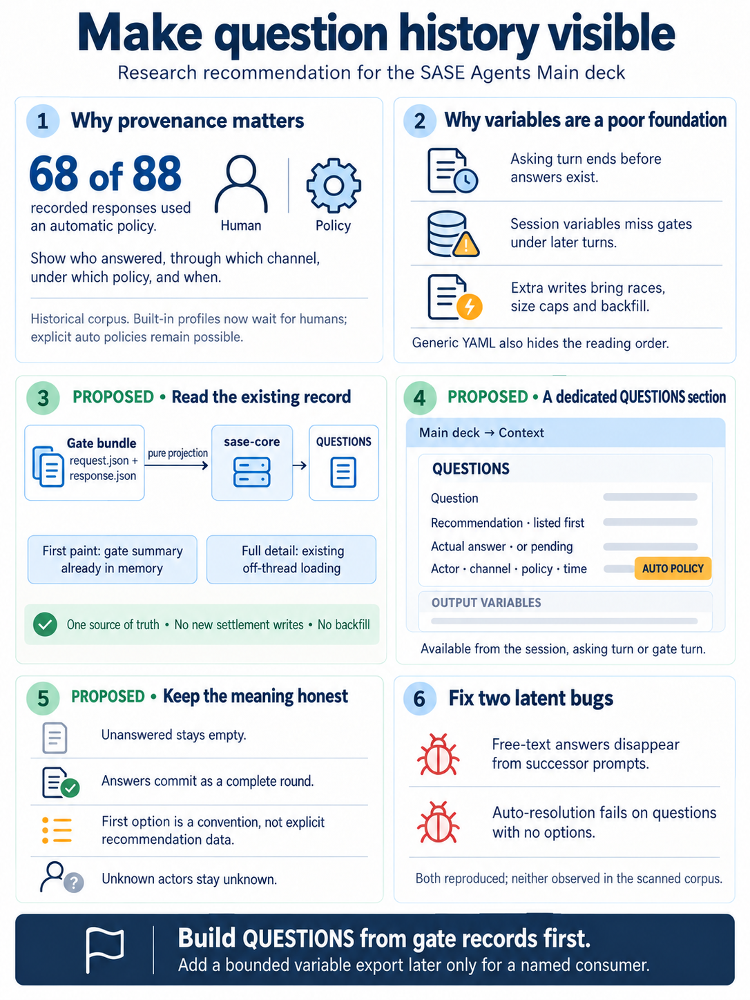

# Showing `/sase_questions` Q&A on the Agents Main Deck

> **Research query:** How should SASE set variables automatically whenever the
> `/sase_questions` skill is used, so that selecting an agent session on the Agents tab
> immediately shows, in the main deck, the questions that turn asked, their recommended
> answers, and any actual answers and how they were answered? Critique the plan, say
> whether it is a good idea or whether a different approach is better, clearly call out
> any justified requirement adjustments, and end with a recommended solution.



## Bottom line

- **The goal is right, and the corpus shows it matters.** Most recorded question rounds
  were answered by an automatic policy, not by a human. Nothing a human would glance at
  today says so. "How was this answered?" is the most valuable fact the feature can show
  ([Evidence from the corpus](#evidence-from-the-corpus)).
- **Having the skill set variables cannot work.** `sase questions` writes a marker and
  kills the asking agent's process group. It never returns. No step "after asking" can
  record answers, and answers do not exist before asking. All five reports agree.
- **Host-written variables are workable, but they are a poor foundation for this
  view.** Three problems:
  - **They are not visible.** The deck's OUTPUT VARIABLES section misses most gate turns
    (verified in [the gate-turn visibility check](#variables-on-a-gate-turn-are-usually-not-visible)).
  - **They read badly.** They render as alphabetically sorted YAML.
  - **They cost a lot to keep current.** Keeping them current means writing inside gate
    settlement, which rewrites `agent_meta.json` without the variable writer's lock.
    They also have size caps and leak into Jinja and `sase var` history
    ([costs of output variables](#critique-of-the-proposal)).
- **[Recommended](#recommended-design-in-detail):** add a dedicated **QUESTIONS** section
  to the Main deck's Context card. It reads the question gate bundles, which already hold
  the record, through a small pure projection in `sase-core`.
  - First paint uses gate fields already in memory.
  - Full details arrive through the Context card's existing off-thread "lane" system.
  - No settlement writes. No variables in v1. Works for all past sessions.
  - Add a bounded, host-managed variable export later, but only if a real consumer
    appears.
- **Found along the way:** two small, latent bugs in shared question code.
  - The Q&A renderer drops free-text answers, which also affects the successor agent's
    prompt.
  - Auto-resolution crashes on a question with no options.

  Neither has been hit in the corpus yet. Both are worth filing
  ([Two latent bugs found along the way](#two-latent-bugs-found-along-the-way)).

## Request and inputs

**Consolidated research report** · lead researcher (research swarm 58) · 2026-10-24

**Inputs:** five independent reports, kept beside this file as
`question_answers_in_agents_main_deck__{cdx,cld,grk,mus,gem}.md`. The grk report's two
figures moved with it. I also checked the points where the reports disagree against the
code and the on-disk question corpus. I used `sase` master at `87827788c2` (the reports
used `5e79f6405f`) and the linked `sase-core` checkout at `3d1d8c94`.

**The request:** set SASE variables automatically whenever `/sase_questions` is used.
Then selecting an agent session on the Agents tab would show, in the Main deck:

- the questions
- their recommended answers
- the actual answers, if any
- how they were answered

The reason given is that variables already render in the Main deck.

## How it works today (verified)

### The question lifecycle

- **Agent asks**
  - *Where:* `src/sase/main/questions_command_handler.py`
  - *What happens:* Validates the JSON and writes `.sase_questions_pending`. Then it
    SIGTERMs the runner group. It never returns to the agent.
- **Host adopts**
  - *Where:* `src/sase/axe/run_agent_exec_questions.py`
  - *What happens:* Resolves the earlier round in the chain and calls
    `create_question_gate_turn`. It records `question_gate_artifacts_dir`,
    `question_request_path`, `question_response_path`, and `question_session_id` on the
    asking turn.
- **Gate turn**
  - *Where:* `src/sase/question_gate_turn/create.py`
  - *What happens:* Creates session member `<session>--gate[-N]`. Its meta holds
    `gate_bundle_path`, `gate_state`, `gate_label`, `gate_creator_agent`,
    `question_round_index`, and `question_prev_artifacts_dir`.
- **Answer**
  - *Where:* `src/sase/user_question_actions.py` → `notification_gates/executor.py`
  - *What happens:* Every channel (TUI, Telegram, mobile, CLI) submits one **complete,
    validated, write-once** form. `response.json` holds
    `option_results[submit].result.answers[]`, `feedback`, `source`, `caller`, and
    `responded_at_unix`.
- **Auto policy**
  - *Where:* `notification_gates/service_creation.py`
  - *What happens:* Picks `options[0]` for every question, with
    `source: auto_resolution`. It can settle **inside** gate creation. Newer responses
    add a `policy` block.
- **Settlement**
  - *Where:* `src/sase/gate_turn/settlement.py`
  - *What happens:* Writes the decision record and done marker, pulses the refresh
    signal, and launches the successor. The successor's prompt is rebuilt by
    `question_rounds()` plus `build_merged_qa_markdown()`.

Every fact the user wants already exists on disk, in the gate bundle under
`~/.sase/interaction_requests/question/<gate_id>/`. The feature therefore only needs a
**projection** of existing data. It needs no new store.

### The four requested facts

- **Questions**
  - *Where it lives:* `request.json → payload.questions`
  - *Caveat:* Complete: header, text, options with descriptions, `multiSelect`.
- **Recommended answer**
  - *Where it lives:* **Nowhere as data.** The skill says "put your recommended option
    first", and auto-resolution picks `options[0]`.
  - *Caveat:* It is a convention. In multi-select questions, the first option is one
    recommended choice, not a recommended set.
- **Actual answer**
  - *Where it lives:* `response.json` (submit result plus `feedback` as a global note)
  - *Caveat:* Answers are atomic per round. "Partly answered" exists only across rounds.
- **How answered**
  - *Where it lives:* `response.source` (`tui`, `telegram`, `mobile`, `cli`,
    `auto_resolution`, …), `response.caller` (`human` or `agent`), and
    `response.policy`
  - *Caveat:* See the next paragraph for what older responses lack.

Older responses lack `caller` and `policy`. In my scan of all 88 `response.json` files,
only 21 had either field. The recorded value is `auto_resolution`, not `auto` as the gem
report says. No named person is recorded, so a provenance line like "Answered by Bryan"
(gem) cannot be produced. "Human via TUI" can.

### Variables on a gate turn are usually not visible

**Disagreement settled.** grk and gem said the session Context card already collects
variables from gate turns. cld and cdx said it does not. **cld and cdx are right.**

- `_output_variable_contributors` (`src/sase/ace/tui/widgets/prompt_panel/_agent_output_variables.py`)
  walks only `(agent, *agent.followup_agents)`.
- `followup_agents` is filled only when the parent is **not** a child row
  (`parent_by_suffix` in `_agent_status_apply.py`).
- A gate turn's `parent_timestamp` is the turn that asked. On disk, for session
  `bob-cli-1n.1`:
  - `--gate` has parent `--plan` (the root).
  - `--gate-0` has parent `--1`.
  - `--gate-1` has parent `--2`.
  - The agent turns `--1`, `--2`, `--3` all have parent `--plan`.
- A gate asked by a later turn therefore attaches as one of that turn's
  `runtime_children` (`_agent_ordering.py`). It never reaches the container's
  contributor list.
- **Result:** only gates asked by the root turn would show their variables. A variables
  design needs a traversal fix whatever else it does. `concrete_agent_session_turn_rows()`
  already provides the right walk (cld's fix).

### What the deck shows about questions today

- **Context card:** nothing.
- **Reply card:** each gate phase (`_agent_gate_section.py`) shows Kind, Status, State,
  and a branch line, then dumps `option_results` as **raw "Option JSON"**. The question
  text, options, recommendation, and policy provenance are all missing.
- **Successor prompt:** holds merged Q&A markdown, but only after an answer exists.

## Evidence from the corpus

The two scans count different things:

- **Auto policy (`auto_resolution`)**
  - *Gate-turn rounds since 2026-08-27 (cld):* **18**
  - *All 88 question response bundles (my scan; includes older layouts):* **68**
- **Human via TUI**
  - *Gate-turn rounds since 2026-08-27 (cld):* 3
  - *All 88 question response bundles (my scan; includes older layouts):* 19
- **Human via Telegram**
  - *Gate-turn rounds since 2026-08-27 (cld):* 1
  - *All 88 question response bundles (my scan; includes older layouts):* 1
- **Never answered (`lost`, `timeout`)**
  - *Gate-turn rounds since 2026-08-27 (cld):* 2
  - *All 88 question response bundles (my scan; includes older layouts):* —

Other facts from the corpus:

- **Recommendation as first option is reliable.** cld found 17 labels or descriptions
  that hand-mark "(Recommended)", and all 17 were the first option. Agents adding that
  marker by hand shows mild demand for an explicit field.
- **Humans do deviate.** In human-answered rounds, 2 of 7 questions got something other
  than the first option (cld). "Answer differs from recommendation" is worth flagging.
- **Sizes** (cld):
  - Question text: median 378 characters, max 1,237.
  - Up to 7 questions in a round and 6 rounds in a session.
  - The 7-question round renders as **70 lines** in the generic variable renderer.
- **No question has ever had zero options.** All 146 questions I scanned had 2–5. This
  is why the [two latent bugs](#two-latent-bugs-found-along-the-way) have not fired yet.
- **Case study** (`bob-cli-87.12--3--gate-2`):
  - The question said "Pick Done only if step 5 printed a number greater than 268."
  - Auto-resolution picked "Done" with `policy: standard · gates.question=first`.
    Nobody was at the keyboard.
  - The deck showed `[x] Submit answers` and a JSON blob.
- **Policy has since changed.** Commit `602ff33c1b` makes the built-in profiles wait for
  human answers. An explicit `%auto` question policy can still answer automatically, so
  provenance stays important.
- **Volume is low,** about 24 gate rounds in two months. That argues for a small
  mechanism, in line with `decisions:corpus-before-mechanism`.

## Critique of the proposal

**The goal deserves a yes.** A question gate is the human's move in the session. Today
it is the one move the session view hides. Showing pending questions inline also helps
**before** answering: you can read the recommendation without opening the modal.

**The mechanism rests on three assumptions that do not hold:**

1. **"The skill can set them."** It can't. The asking turn is dead before answers exist.
   Instructions added to the skill also depend on the model following them, cost tokens
   on every ask, and skip the other ways a question gate can be created and answered.
   Recording these facts is the host's job (`decisions:host-owned-completion`).
2. **"Variables are already visible in the deck."** Only for gates asked by the root
   turn ([the gate-turn visibility check](#variables-on-a-gate-turn-are-usually-not-visible)).
3. **"Variables are a fine display."** They render as YAML with sorted keys, so `answer`
   prints above `question` and `status` sinks to the bottom. They cannot mark a
   recommendation, a deviation, or an auto-policy answer.

grk adds a subtler trap. The session fold shows variable **values** by default. A
variables approach would therefore *technically* satisfy "immediately visible" while
failing the reading task.

**Costs of using output variables as the store, beyond display:**

- **Other consumers.** Variables feed Jinja `agents[...]` in `%wait` and other
  templates, `sase var list` and the history index, mobile list entries, and agents-sync
  pages. Copying human answer text into all of those should be a deliberate decision.
  Telegram completion messages are not affected for gate turns: they carry the finishing
  agent run's own variables, and gate turns have no agent runner.
- **Caps.**
  - Each string is limited to 8 KiB, each variable to 64 KiB encoded, depth 8, and
    1,024 nodes.
  - The question validator has no matching caps. cdx's probe: a 9,000-character question
    validates as a question but fails as a variable.
  - On read, `coerce_var_map` silently **drops** malformed entries.
- **Reserved names.** Names are reserved by convention only. `var_handler` does not
  enforce reserved names such as `artifacts`.
- **Write hazard.** Settlement does read-modify-write of `agent_meta.json` with
  `write_agent_meta_atomic`, which does not take the `.agent_meta.json.lock` flock that
  `update_agent_output_variable` takes. After launching the successor, it copies back only
  the `gate_followup_*`/`gate_next_*` fields from disk and rewrites the rest from memory. A
  variable written separately during that window is silently lost (cld, cdx; verified in
  `settlement.py`).
- **Backfill.** Past sessions show nothing until someone runs a backfill.

None of these rule variables out, but they make variables the more expensive option.

## Requirement adjustments called out explicitly

- **R1.** *Original:* "Whenever the `/sase_questions` skill is used"
  - *Adjusted:* **Whenever the host creates or settles a question gate**, whatever the
    path (skill, direct CLI, `%auto`, any answer channel). Better still, derive the view
    from those records at read time.
  - *Why:* The skill cannot see answers, and other paths bypass it.
- **R2.** *Original:* "Set sase variables"
  - *Adjusted:* **Keep the gate bundle as the only source of truth.** Show a projection
    of it. A variable export is optional and comes later
    ([If variable access is still wanted](#if-variable-access-is-still-wanted)).
  - *Why:* Avoids a second copy that can go stale, size caps, and leaks to other
    consumers.
- **R3.** *Original:* "Because variables are rendered in the main deck"
  - *Adjusted:* Render a **dedicated QUESTIONS section** on the Context card, not generic
    OUTPUT VARIABLES YAML.
  - *Why:* Readability, and
    [the gate-turn visibility check](#variables-on-a-gate-turn-are-usually-not-visible).
- **R4.** *Original:* "Selects an agent session"
  - *Adjusted:* Show it when the **session container**, the **asking turn**, or the
    **gate turn** is selected. Deduplicate rounds by gate ID.
  - *Why:* The user may highlight any of these rows.
- **R5.** *Original:* "If any questions have been answered yet"
  - *Adjusted:* Answers are **atomic per round**. Show every round, including pending,
    timed out, cancelled, failed, and lost. Saving unsubmitted modal drafts is out of
    scope.
  - *Why:* The schema requires a complete form. 2 of 24 rounds never got an answer.
- **R6.** *Original:* "Recommended answers"
  - *Adjusted:* Mark `options[0]` as **"recommended (listed first)"**. Show "no
    recommendation" for questions with no options. No schema change now.
  - *Why:* It is a convention, so label it honestly. An explicit `recommended` field can
    come later.
- **R7.** *Original:* "How the questions were answered"
  - *Adjusted:* Show **channel**, **actor** (human / auto policy / agent / unknown),
    **policy** when recorded, and **time**. Mark each answer as **followed the
    recommendation**, **chose another option**, or **wrote "Other"**. Make auto-policy
    answers loud. Never infer "automatic" from an answer that happens to match the
    recommendation.
  - *Why:* Auto-policy answers dominate the history, and older responses lack `caller`.
- **R8.** *Original:* "Immediately visible"
  - *Adjusted:* A compact summary on **first paint** (counts and pending state, from
    memory). Full details arrive with the Context card's other enriched sections. No
    modal, and no stealing focus or deck page on refresh.
  - *Why:* TUI rules forbid disk reads on the render path (`tui_perf` rules 1 and 8).
- **R9.** *Original:* (implicit) only new sessions
  - *Adjusted:* **Works for every past gate-turn round** with no migration. The old
    pre-gate `question_request.json` layout is best-effort.
  - *Why:* Reading at view time gets history for free.
- **R10.** *Original:* (new)
  - *Adjusted:* **Fix the shared Q&A renderer's free-text data loss**
    ([Two latent bugs found along the way](#two-latent-bugs-found-along-the-way)).
  - *Why:* It also corrupts what successor agents read.

## Options compared

- **A. Skill tells the model to run `sase var set`**
  - *Verdict:* **Reject**
  - *Main reason:* No answers exist yet, depends on the model complying, and leaves a
    stale "pending" snapshot.
- **B. CLI writes to the asking turn's variables; settlement updates them later (mus's
  status variable)**
  - *Verdict:* **Reject**
  - *Main reason:* Changes a finished turn's outputs, risks key collisions, and splits one
    round across two write paths.
- **C. Host writes a `questions` variable on the gate turn, plus the traversal fix (cld
  Phase 1)**
  - *Verdict:* Viable, not preferred
  - *Main reason:* Shows on first paint and gives `sase var` and Jinja access for free.
    Costs: writes in settlement, caps, backfill, leaks, and a renderer is still needed.
- **C+R. C plus a dedicated renderer over the variable (cld's full plan; grk's "D + C")**
  - *Verdict:* Viable, not preferred
  - *Main reason:* Best first paint. Costs everything in C, plus logic to choose between
    the variable and the bundle.
- **D. QUESTIONS section from bundles via an off-thread lane, with the projection in
  sase-core (cdx, gem, mus; grk's D)**
  - *Verdict:* **Recommended**
  - *Main reason:* One source of truth, no settlement writes, no caps, works for history.
- **E. Dedicated `agent_meta.json` field on the scan wire**
  - *Verdict:* Later, if ever
  - *Main reason:* Cheap first paint without variable semantics. It still needs every
    write point that C needs, plus a wire change.
- **F. Improve only the Reply card's GATE phase**
  - *Verdict:* Not sufficient
  - *Main reason:* Reply is the wrong card for discovery. Do it as a follow-up using the
    same presenter.

**Why D beats C+R, the strongest alternative.** C+R's advantages are first paint and
consumers that come for free.

- **First paint.** D gets most of the first-paint benefit at no cost. Gate rows already
  carry `gate_state`, `gate_label`, `gate_creator_agent`, and timing on the `Agent`
  model, so a summary line needs no I/O. The full details then arrive the way the
  plan, bead, and artifact sections already do.
- **Free consumers.** Nobody is asking for those consumers today, and they bring
  exposure risk.

C+R's costs are structural:

- It writes inside the gate-settlement critical section, across three code branches,
  plus the `%auto` path that settles during creation.
- It needs a backfill.
- It has to handle caps and reserved names.
- The renderer must still fall back to the bundle when the variable is missing or
  oversized.

cld rejected D partly because it "needs a new async summary lane". It doesn't. The
Context card already has one: `DetailHeaderSummary` with `ready_lanes`, built in a
`run_worker(..., thread=True)` worker and cached per agent identity
(`_agent_display_header_summary.py`, `_agent_display_async_agent.py`). D adds one lane
to that existing system.

**The Rust boundary.** cdx put the projection in sase-core; cld and grk kept it in
Python. I side with cdx. Normalizing request and response into a round, mapping status,
deriving the recommendation, and classifying who answered is domain behavior. Telegram,
mobile, the `sase gate` CLI, or a web view would have to match the TUI exactly, which is
the project's own test for core logic (`rust_core_backend_boundary`,
`decisions:rust-core-required`). There is precedent: gate-decision acceptance
(`sase_core::gate_decision`) and plan decisions (`sase_core::plan::decisions`) already
live in core as pure functions. The cost is one cross-repo change and a
`sase-core-revision.txt` pin bump. The older question helpers (`validate_user_questions`,
`question_rounds`) stay in Python for now. The new projection should not add to them.

## Recommended design in detail



**Figure 1.** The gate turn and its bundle stay the canonical record. The deck paints a
summary from gate rows already in memory. An off-thread lane then runs a pure sase-core
projection over the bundle to fill the full QUESTIONS section. Nothing writes during
settlement. Everything below the host records is proposed.

Rendered size: 673.8 × 1144.8 px; fit scale: 78.0%. Mermaid CLI 12.0.0.

### Product shape

A foldable section on the Main deck's **Context** card, placed **above OUTPUT
VARIABLES**. It is the human's move and usually what you came to check. Illustrative
mock, merged from the cdx, cld, and grk mocks:

```text
QUESTIONS · 3 rounds · 1 awaiting answer
 gate     ANSWERED  human via TUI · 3m after asking
   Q1 Memory edits      → Core memory: Final Declaration (+1)              ≠★
   Q2 Routing           → Yes, opt-in                                       ★
 gate-0   ANSWERED  ⚠ auto policy (standard · gates.question=first) · no human
   Q3 At the Mac        → Done — helper printed > 268, then synced          ★
 gate-1   QUESTION  awaiting answer · asked 14:02 · 23h left
   Q4 Ship flag default?
      ★ Off (recommended, listed first)  ·  On  ·  Remove flag
```

- Numbering runs across rounds (Q1…Qn), matching the successor prompt.
- `★` means the answer followed the recommendation. `≠★` means it did not.
- Auto-policy rounds get the warning accent.
- The pending or latest round is expanded. Older rounds take one line per question.
- `FULLY_EXPANDED` adds the full question text, option descriptions, "Other" text, and
  the global note.
- **Selection rules:**
  - The session container shows every question-gate row from
    `concrete_agent_session_turn_rows()`.
  - The asking turn shows its own rounds through its runtime children.
  - A gate row shows its own round.

### Data contract: a projection defined in sase-core

Add a pure function, `project_question_round(request, response, cancellation,
gate_facts) → QuestionRoundWire`, exposed through `sase_core_rs`. It does no file I/O,
mirroring `gate_decision`. Its fields are a merge of the cdx and cld shapes:

```json
{
  "schema_version": 1,
  "gate_id": "7afc19c8-…",
  "round_index": 4,
  "asked_by": "bob-cli-87.12--3--5",
  "asked_at_unix": 1792243165.0,
  "status": "answered",
  "data_state": "complete",
  "entries": [
    {
      "index": 0,
      "header": "At the Mac keyboard",
      "question": "…",
      "options": [{"label": "Done — …", "description": null}, "…"],
      "multi_select": false,
      "recommended_index": 0,
      "recommendation_basis": "option_order",
      "answer": {"selected": ["Done — …"], "custom_feedback": null},
      "followed_recommendation": true
    }
  ],
  "global_note": null,
  "provenance": {
    "channel": "auto_resolution",
    "actor": "auto_policy",
    "policy": "standard · gates.question=first",
    "responded_at_unix": 1792243226.0
  }
}
```

**Rules:**

- **Identity** is the gate ID plus the question index, never the question text: texts
  can repeat.
- **Unanswered** stays `null`. Never fill it with the recommendation.
- **Status mapping** (cld), `gate_state` → `status`:

  - **`pending`, `settling`:** `pending`
  - **`answered`, `completed`:** `answered`
  - **`timeout`:** `timed_out`
  - **`stopped`:** `cancelled`
  - **`failed`:** `failed`
  - **`lost`:** `lost`

- **Answer versus execution.** Keep the answer's state separate from the gate's
  execution state. A durable answer whose successor launch failed is still an answer
  (cdx). This matches `gate_decision`'s "visible once durably recorded" rule.
- **Actor:**
  - `source == auto_resolution` → `auto_policy`.
  - Otherwise use `caller`.
  - If `caller` is missing and `source` is `tui`, `telegram`, or `mobile` → `human`.
  - Anything else → `unknown`. Show it as unknown; don't guess.
- **Missing or malformed files** set `data_state: partial` or `unavailable`. Never show
  an answered round as pending, and never rebuild answers from the successor's prompt.
- **Multi-select:** the recommendation is "the first option is one recommended choice".
  It says nothing about a recommended set.

### Loading and refresh, within the TUI performance rules

1. **First paint (cheap path, no I/O).** From the in-memory session rows, count
   question-gate rows and their `gate_state`s. Render the heading, plus one line per
   round from `gate_label`.
2. **The `questions` lane.** Add a lane to `DetailHeaderSummary`. Its worker:
   - lists question-gate rows (a handful per session);
   - reads each `request.json` and `response.json` (and any cancellation file) through
     `get_global_cache().read_json`, which caches by mtime and size;
   - calls the core projection;
   - stores a tuple of rounds.

   It lives off the event loop and the message pump, like the plan, bead, and artifact
   lanes.
3. **Invalidation.** The summary cache key must change when any gate row's `gate_state`
   changes. Settlement already calls `touch_turn_refresh_pulse`, which drives the
   existing refresh path. Auto-resolution can **rewrite** an existing `response.json` to
   add `policy` (cdx), and the mtime/size signature catches that.
4. **Selection safety.** Use the existing selection-change cancellation
   (`_cancel_agent_detail_header_worker_for_selection_change`), so a late worker cannot
   paint the wrong session.

### Rendering details

- **Code layout.** The presenter is a Python module beside `qa_markdown.py` that turns
  `QuestionRoundWire` into Rich text. Mount it in
  `widgets/prompt_panel/_agent_display_header.py` with its fold heading.
- **Folding.** Follow the session fold scale that OUTPUT VARIABLES already uses. The
  default session fold shows the body, and `za` collapses it.
- **Follow-up in the same epic.** Have the Reply card's GATE phase use the same presenter
  for `gate_kind == "question"`, replacing the raw "Option JSON" dump.
- **Docs.** Update `docs/reference/tui/agents-main-deck.md` (new section) and
  `agent-statuses.md` if the wording changes. Read `sase/memory/docs_writing.md` first.
- **Snapshots.** Regenerate the affected visual snapshots per `sase/memory/tui.md`.

### Two latent bugs found along the way

File both as task beads.

1. **`build_merged_qa_markdown` drops free-text answers**
   (`src/sase/main/qa_markdown.py`).
   - **Cause:** it renders `custom_feedback` only inside the `if options:` block, and
     only when "Other" is selected.
   - **Probe:** an option-less question answered "Must run offline" and a "PG" pick with
     the comment "Need concurrency" both disappeared from the output.
   - **Impact:** this renderer builds the **successor agent's prompt** (`followup.py`,
     `create.py`). Free text from an option-less question, or a comment attached to a
     normal pick, never reaches the next agent. The TUI modal always adds "Other" when
     you type text, which narrows exposure to option-less questions and non-TUI clients.
     Neither shape appears in the corpus yet.
   - **Rule:** the new presenter must not reuse this renderer until it is fixed.
2. **Auto-resolution fails on an option-less question.** `automatic_question_response`
   produces `selected: []` with `custom_feedback: None`. The response schema's `anyOf`
   rejects that, so the call raises `incomplete_question_form` (probed). A `%auto`
   question policy would therefore fail on any question that has no options.

### If variable access is still wanted

Optional, later. Add this only for a **named consumer**, such as a `%wait` workflow that
branches on `agents["x--gate"].questions.status`. In that case:

- **Placement:** one host-managed `questions` variable **per gate turn**, never on the
  asking turn. Gate turns have no variables written by agents, so the name cannot
  collide.
- **Content:** the same core projection, kept small. Leave out option descriptions. Add
  a `truncated` flag and the gate ID when the projection exceeds the caps. Never raise
  the global caps, and never reject a valid question because the export is too large.
- **Write points:** write into settlement's **in-memory `meta`** dict next to
  `record_selected_options(meta, response)`. That call already sits in all three
  settlement branches: normal, already-settled, and terminal-publish. Also re-project at
  the end of `create_question_gate_turn` for the `%auto` path. Swallow errors, because an
  export failure must never fail a settlement.
- **Rendering:** hide the key from generic OUTPUT VARIABLES whenever QUESTIONS renders.
  Decide explicitly whether agents-sync pages and mobile entries may carry answer text.
- **Name reservation:** treat `questions` as reserved on gate turns. Better, enforce it
  in `var_handler`; `artifacts` is not enforced there either.

### The skill

Generated skills come from source templates and are deployed elsewhere, so don't
hand-edit the deployed copies. Change only the source, `src/sase/macros/skills/sase_questions.md`,
and only with one informational sentence: questions and answers appear in the session's
QUESTIONS section, and the first option is shown as the recommendation. Add no
bookkeeping steps. Deploy through the generated-skills workflow
(`sase/memory/generated_skills.md`).

### Implementation order and acceptance checks

1. **Core projection** in the linked `sase-core` checkout, with unit tests and the
   `sase_core_rs` binding. Then move sase's `sase-core-revision.txt` pin past that
   commit.
2. **Fix the renderer and the auto-resolution bug**
   ([Two latent bugs found along the way](#two-latent-bugs-found-along-the-way)). This is
   independent and can land first.
3. **Questions lane, cheap summary, and presenter** in sase, with tests next to
   `test_agent_display_output_variables.py` and the session-roster tests.
4. **Reply card GATE presenter** as a follow-up, then docs and visual snapshots.
5. **Variable export**
   ([If variable access is still wanted](#if-variable-access-is-still-wanted)) only if a
   consumer appears.

**Acceptance scenarios** (merged from all reports):

- One round with two questions pending. Then one submission containing a normal pick, an
  "Other" answer, and a global note.
- An answered round 1 followed by a pending round 2, viewed from the container, the
  asking turn, and the gate row. Each round must appear once, in causal order.
- `%auto` rounds, with and without a `policy` block. Older responses with no `caller`.
- Timeout, cancel, failed, and lost rounds. An answered round whose successor launch
  failed.
- Duplicate question text across rounds, multi-select, option-less questions, and
  1,000+ character questions.
- A response arriving while the session is selected. Fast j/k during loading, measured
  against the p95 < 16 ms target in `tui_perf`.

## Where the reports disagreed

- **Does OUTPUT VARIABLES collect gate-turn variables?**
  - *Positions:* grk and gem: yes. cld and cdx: no.
  - *Resolution:* **No**, except for gates asked by the root turn. Verified in code and
    on-disk parentage
    ([the gate-turn visibility check](#variables-on-a-gate-turn-are-usually-not-visible)).
- **Variables as the store**
  - *Positions:* cld: yes (Phase 1). grk: as a hidden cache. cdx and gem: optional. mus:
    status only, on the asking turn.
  - *Resolution:* **Not in v1.** An optional per-gate export later
    ([If variable access is still wanted](#if-variable-access-is-still-wanted)). Never on
    the asking turn.
- **Projection in sase-core?**
  - *Positions:* cdx: yes. cld and grk: no.
  - *Resolution:* **Yes**, for the pure projection ([Options compared](#options-compared),
    "The Rust boundary").
- **Does option D need a new async mechanism?**
  - *Positions:* cld: yes.
  - *Resolution:* **No.** The `DetailHeaderSummary` lanes exist
    ([Options compared](#options-compared)).
- **Telegram leak**
  - *Positions:* grk, mus, gem: yes. cld: gate turns send no completion message.
  - *Resolution:* It applies only when variables are on an **agent** run. Jinja, history,
    mobile, and agents-sync exposure remain.
- **Auto-path decision record lacks answers (cld)**
  - *Positions:* —
  - *Resolution:* **Partly.** Both auto records I opened contain the answers in their
    output tail, but not in a "Selected options" section. Treat it as an ordering hazard
    to test, not a confirmed defect.
- **Source value for auto answers**
  - *Positions:* gem: `auto`
  - *Resolution:* It is **`auto_resolution`**.
- **"Answered by Bryan" provenance (gem)**
  - *Positions:* —
  - *Resolution:* **Not possible.** Only the class `caller: human` is recorded.

## Open questions for Bryan

1. Is programmatic access (`sase var get`, Jinja) actually wanted? If so, for which
   workflow? That decides whether
   [the optional variable export](#if-variable-access-is-still-wanted) ever ships.
2. Should auto-policy answers get more than a deck badge, such as a toast or a Telegram
   line? Explicit `%auto` question policies can still answer without a human.
3. Should QUESTIONS sit above OUTPUT VARIABLES (my recommendation) or below?
4. Should the question schema get an explicit, optional `recommended` field, given that
   agents already hand-write "(Recommended)"? Not needed now. Revisit if neutral or
   multi-choice recommendations become common.

## Recommended solution

Don't set variables from `/sase_questions`, and don't make output variables the display.

1. **Data.** Add a pure `project_question_round` to `sase-core`. Its inputs are the
   question gate bundle, which is the canonical record.
2. **Deck.** Render a **QUESTIONS** section on the Main deck's Context card, above
   OUTPUT VARIABLES, for the session container, the asking turn, and the gate turn.
   - First paint comes from in-memory gate fields.
   - Full details come from a new `questions` lane in the existing off-thread
     `DetailHeaderSummary` system.
   - It shows every round's questions, the first option marked as the recommendation,
     the answers with ★ or ≠★, and provenance (channel, actor, policy, time), with
     auto-policy answers made loud.
3. **No writes.** Nothing new is written during settlement, and no backfill is needed.
4. **Bugs.** Fix the Q&A renderer's free-text loss and the option-less auto-resolution
   failure first.
5. **Later, only for a named consumer.** Add a bounded, host-managed `questions`
   variable on each gate turn, written into settlement's in-memory meta.
