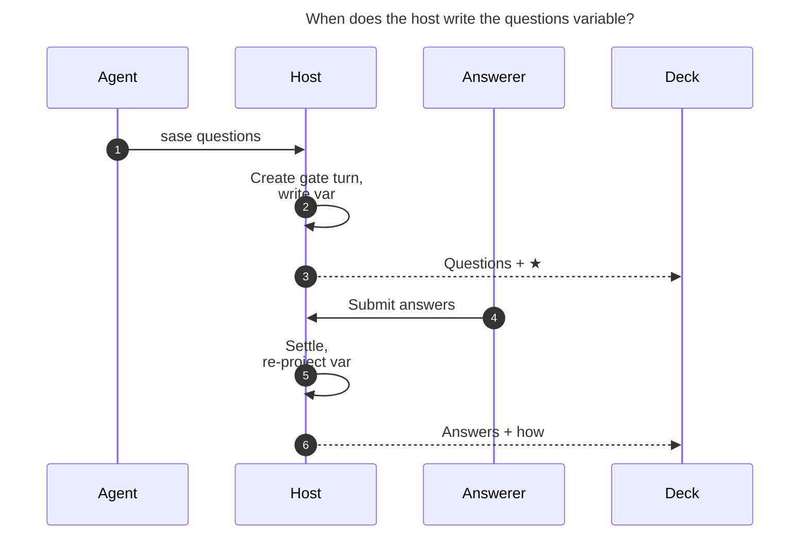

# Showing `/sase_questions` Q&A in the Agents Deck via Automatically Set SASE Variables

**Researcher:** cld (research swarm 58) · **Date:** 2026-10-24 · **Repo state:** `sase` master @ `5e79f6405f`

## TL;DR

- **The goal is worth doing, and the on-disk data shows why.** I found 24 question rounds since 2026-08-27.
  **18 of them (75%) were answered automatically by policy** (`source: auto_resolution`, first option picked).
  Only 4 were answered by a human (TUI ×3, Telegram ×1), and 2 never got an answer (one `lost`, one `timeout`). In
  one session (`bob-cli-87.12--3`), auto-resolution answered "Done" four rounds in a row. The question itself said
  *"Pick Done only if step 5 printed a number greater than 268"*, and nobody was at the Mac. Today's commit
  `602ff33c1b` ("make built-in questions wait for human answers") stops built-in profiles from doing this, but an
  explicit `%auto` question policy can still auto-answer. **How a question was answered** is the most useful thing
  this feature can show.
- **Keep SASE output variables as the storage and transport layer, but change who writes them and where.**
  - **Who:** the host writes them, not the agent. The LLM should never run `sase var set` for this.
  - **Where:** the variable goes on the **question gate turn**, not on the agent turn that asked. The gate turn
    owns the decision and has the matching pending → settled lifecycle.
  - **What:** one idempotent projection, rebuilt from the gate bundle (`request.json` / `response.json`) at gate
    creation and again at settlement.
- **Variables alone won't make it "immediately visible". You need one small TUI fix.** The deck's OUTPUT VARIABLES
  section only walks `(agent, *agent.followup_agents)`. Gate turns hang one level lower, as `runtime_children` of
  the turn that started them, so their variables would never reach the session container's Context card.
- **The generic variable renderer is a poor final display.** It sorts map keys alphabetically, so `answer` prints
  above `question`. It also renders a 7-question round as about 70 lines. I recommend a **two-phase** plan:
  - Phase 1 ships the variable plus the traversal fix. That is enough to see everything.
  - Phase 2 adds a compact QUESTIONS renderer that reads the same in-memory variable, and replaces the raw
    "Option JSON" dump in the question gate block.

## 1. The request, restated

When the user selects an agent session on the Agents tab, and one of its turns asked questions with
`/sase_questions`, the main deck should show the following right away:

1. the questions,
2. the recommended answers,
3. the actual answers, if any have been answered yet,
4. how they were answered.

The proposed mechanism is to set SASE variables automatically whenever `/sase_questions` is used. Variables already
render in the main deck's Context card, in the OUTPUT VARIABLES section.

## 2. How the pieces work today

### 2.1 The question flow, end to end

| Step | Code | What happens |
| --- | --- | --- |
| Agent asks | `src/sase/main/questions_command_handler.py` | Validates the JSON and writes the `.sase_questions_pending` marker. It then SIGTERMs the runner group. The agent never sees a return. |
| Runner adopts marker | `src/sase/axe/run_agent_exec_questions.py:handle_questions_marker` | Resolves the previous round in the chain, calls `create_question_gate_turn`, and records `question_*` relationships on the asking turn's `agent_meta.json`: `question_request_path`, `question_response_path`, `question_gate_artifacts_dir`, and `question_session_id`. |
| Gate turn created | `src/sase/question_gate_turn/create.py` | Builds the v3 question gate (`user_question_gate_spec`) with a `turn` block (`pending_status: QUESTION`, `settled_status: ANSWERED`). Writes chain metadata to the gate turn's meta: `question_round_index`, `question_prev_artifacts_dir`, `question_base_prompt_path`. |
| Answer submitted | `src/sase/user_question_actions.py:execute_user_question_response` → `notification_gates/executor.py:execute_gate_selection` | TUI, Telegram, mobile, and CLI all submit one **complete, write-once** form that is validated against `question_response_schema`. `response.json` records `source`, `caller` (`human`/`agent`), `responded_at_unix`, `feedback`, and `option_results[submit].result.answers[]`. |
| Auto-resolution | `notification_gates/service_creation.py:_resolve_auto_gate` | Runs `execute_gate_selection(..., source="auto_resolution")` with `automatic_question_response`, which picks **the first option**. It writes a `policy` block, then `settle_gate_turn(..., creator_live=True)`. This all happens **inside** gate creation. |
| Settlement | `src/sase/gate_turn/settlement.py:_settle_gate_turn_locked` | Writes `gate_decision.md` and the settlement chat, the done marker and index entry, and the refresh pulse. It then launches the follow-up, whose prompt is rebuilt by the `question` kind hook in `gate_turn/kind_next_action.py` → `question_gate_turn/followup.py`. |
| Follow-up prompt | `question_gate_turn/rounds.py` + `main/qa_markdown.py` | Walks `question_prev_artifacts_dir` back through every round and renders `### Questions and Answers` with `- [x]` checkboxes. |

**Every fact the user wants already exists on disk, durably.** It lives in the gate bundle under
`~/.sase/interaction_requests/question/<gate_id>/`, plus the chain links in each gate turn's `agent_meta.json`. The
feature is a **projection** of existing data, not new data. That matters for the design: a variable here is a
derived cache, and the bundle stays the source of truth.

### 2.2 Output variables: storage, limits, consumers

- **Storage.** `agent_meta.json["output_variables"]`, written through `core/agent_output_variables.py`
  (`set_agent_output_variables` / `update_agent_output_variable`, under an `fcntl` lock on `.agent_meta.json.lock`).
- **Limits.**
  - At most 256 variables per agent.
  - Each string leaf is at most 8 KiB.
  - Each variable is limited to depth 8, 1,024 nodes, and 64 KiB of encoded JSON.
  - Top-level keys must match `[A-Za-z_][A-Za-z0-9_]*`.
- **Consumers, all free once a value is stored:**
  - **Deck:** the Context-card OUTPUT VARIABLES section, via the Rust agent scan wire. `_meta_enrichment_wire.py`
    sets `agent.output_variables = coerce_var_map(meta.output_variables)`, so rendering does **no disk I/O**.
  - **CLI and later prompts:** `sase var get` / `sase var list` (through the artifact index) and Jinja
    `{{ agents["<name>"].<key> }}`.
  - **Other surfaces:** the mobile agent-list entry (`integrations/_agent_list_entry_build.py`), agents-sync
    published pages (`agents_sync/rendering_variables.py`), and the agent completion notification
    (`axe/run_agent_runner_finalize.py`). Gate turns never send that completion notification.
- **Precedents for host-written variables:**
  - the SASE-managed `artifacts` list, written by `sase artifact create` (`core/created_artifacts_variable.py`);
  - the runner writing `STOP` into a skipped `%repeat` slot's map (`axe/run_agent_runner_repeat.py`).

  So host-owned variables are already an established pattern. Reserved names are a convention plus a shape check;
  `var_handler.py` does not enforce them.

### 2.3 How the deck renders variables

- `widgets/prompt_panel/_agent_display_header.py` calls `append_agent_output_variables_section`. It sits after the
  session member roster and before WORKFLOW VARIABLES and SASE CONTEXT, so it is near the top of the Context card.
- Session containers use `AGENT_SESSION_FOLD_SCALE = (EXPANDED, FULLY_EXPANDED)`, so this section **is never
  collapsed by default**. Good: a variable there really is visible as soon as the session is selected.
- **Gap:** `_agent_output_variables.py:_output_variable_contributors` iterates only `(agent, *agent.followup_agents)`.
  - `followup_agents` is filled only for parents that are not child rows (`_agent_status_apply.py`).
  - Gate turns attach as `runtime_children` of the turn that started them (`_agent_ordering.py:_attach_runtime_children`).
  - `concrete_agent_session_turn_rows` documents this nesting: "A non-agent turn is emitted immediately after the
    turn that started it."
  - In the real sessions I checked, every gate's `parent_timestamp` is its asker. For example, `--gate-2` → `--5`,
    and `--5` → the root.
  - **Result:** variables stored on a gate turn are invisible on the session container unless this traversal changes.
- Values render as a YAML-like tree (`core/output_variable_display.py`), and **map keys are sorted**.

### 2.4 What the deck shows about questions today

The session Reply card has a block for each question gate turn (`_agent_gate_section.py:build_gate_phase`). It shows
Decision, Kind, Status, State, a `[x] Submit answers` branch line, and an **"Option JSON:"** dump of
`option_results`. The question text, the options, the recommendation, and the policy that auto-answered are all
missing, and the block is not where the Reply card lands. The follow-up agent's prompt does contain the merged
`### Questions and Answers` markdown, but only after an answer exists, and you have to know to look there.

## 3. What the corpus says

I scanned every `agent_meta.json` with `gate_kind == "question"` under `~/.sase/projects/*/artifacts/*/2026*` and
read each bundle.

| Outcome | Rounds |
| --- | --- |
| Auto-resolved by policy (`source: auto_resolution`, first option) | **18** |
| Human via TUI | 3 |
| Human via Telegram | 1 |
| Never answered (`lost` ×1, `timeout` ×1) | 2 |
| **Total** | **24** (40 questions) |

Other findings:

- **Recommended answer = first option. This is reliable.** Three sources agree:
  - the skill says "Put your recommended option first";
  - `automatic_question_response` picks `options[0]`;
  - agents hand-label options with "(Recommended)" (17 of 106 labels or descriptions mention "recommend"), and
    every such label (17/17) is the first option.

  So the recommendation can be derived without a schema change. Agents writing "(Recommended)" into labels by hand
  does suggest a small demand for an explicit marker.
- **Humans diverge from the recommendation often enough to matter.** In human-answered rounds, 2 of 7 questions got
  something other than exactly the first option. "Answer ≠ recommendation" is a signal worth highlighting.
- **Size.**
  - Question text: median 378 characters, max 1,237.
  - Questions per round: median 1, max 7.
  - Rounds per session: max 6 (`bob-cli-1n.1`), then 4.
  - A prototype projection of the 7-question round (`bob-cli-5k.7--gate`) is **3.8 KB JSON and 70 rendered
    lines** in the generic variable renderer. That is far below the variable limits, but long for a header section.
- **Volume is low,** about 24 rounds in two months. This argues for a small, cheap mechanism rather than a new
  subsystem, in the spirit of `decisions:corpus-before-mechanism`.
- **Case study: why "how answered" matters.** `bob-cli-87.12--3--gate-2` (round 4) has this `response.json`:
  - `source: auto_resolution` and `caller: agent`;
  - `policy: {profile: standard, rule: gates.question, value: first, outcome: auto, source: inherited}`.

  The asker's inherited autonomy record had `gates.question: "first"`. `gate_decision.md` says only "gate resolved
  automatically". The deck shows `[x] Submit answers` and a JSON blob. Nothing a human would scan says
  "a policy, not you, answered this, and it picked an option that asserts you did something".

## 4. Critique: is this a good idea?

**Yes, as a goal.** It gives the session view an audit trail for a human-in-the-loop checkpoint, and that checkpoint
can be bypassed silently. It also helps *before* answering: a pending round's questions and recommendations appear
inline, so the user can decide without opening the modal first.

**The mechanism needs four corrections:**

1. **"Whenever the skill is used" must mean host-side, not agent-side.** If the skill text tells the LLM to run
   `sase var set` before `sase questions`, the agent can record only the questions. It is dead before any answer
   exists, because a successful `sase questions` never returns. That approach would also depend on LLM compliance,
   cost tokens on every ask, and break the host-owned pattern behind `decisions:host-owned-completion` and the
   `artifacts` / `STOP` variables. The hook belongs in `sase questions` → `create_question_gate_turn` and in gate
   settlement. The skill text stays the same apart from one informational sentence.
2. **The variable should live on the gate turn, not on "the agent turn that asked".**
   - The answers are the gate's output. They arrive after the asker is terminal.
   - Writing them into the asker's map would mutate a completed agent's outputs after the fact. Anything that read
     `agents["<asker>"]` earlier would see a different map later, and the variable would compete with keys the
     agent chose itself. One historical agent already uses `answer`.
   - A gate turn's map has no agent-authored keys, so collisions are impossible, and it settles exactly once.
3. **Variables are acceptable storage but a mediocre display.** The generic renderer:
   - sorts keys (`answer` before `question`);
   - shows long question text in full;
   - has no way to flag "auto-picked" or "≠ recommendation" visually.

   Output variables are documented as "small handoff values, not report bodies". The projection fits the limits,
   but at 70 lines for a 7-question round it is on the edge of that spirit.
4. **Without the traversal fix, the plan does not achieve "immediately visible"** (§2.3).

**Why still use variables instead of a TUI-only renderer that reads bundles?**
- Variables are the only generic, structured slot in `agent_meta.json` that the Rust agent scan already carries. A
  new dedicated meta field would need a `sase-core` wire change and a `sase-core-revision.txt` pin bump.
- They render with zero render-path I/O. `tui_perf` rule 8 says "render paths never stat/glob", and the header
  builder's own docstring forbids discovering artifacts there.
- They reach `sase var get`, Jinja, mobile, and agents-sync with no per-frontend code. That matches the litmus
  test in `rust_core_backend_boundary`: one host producer persists the projection, and every frontend reads the
  same persisted data, so nobody reimplements Q&A projection logic.

## 5. Requirement adjustments (explicitly called out)

| # | Original | Adjusted | Why |
| --- | --- | --- | --- |
| A1 | Set variables "whenever the `/sase_questions` skill is used" | **The host sets them.** They are written at question-gate creation and re-projected at every gate settlement. The agent and skill do nothing new. | Answers arrive after the agent is gone, and host ownership is the SASE norm. |
| A2 | Variables belong to "an agent turn that asked questions" | **Store them on the question gate turn** (`<session>--gate[-N]`), one variable per round. The asker keeps its existing `question_gate_artifacts_dir` link. | The gate owns the decision and lifecycle, its map is collision-free, and the asker's outputs are not mutated after it is terminal. |
| A3 | "If any questions have been answered yet" | Answers are **atomic per round**: a write-once, complete form. "Partially answered" exists only **across rounds** (round 1 answered, round 2 pending), and the variable mirrors that. Persisting modal drafts is out of scope. | `question_response_schema` requires every answer, and `execute_gate_selection` writes `response.json` once. |
| A4 | "Recommended answers" | **Derive the recommendation as `options[0]`.** No schema change. A question with no options has no recommendation (`null`). An optional explicit marker can come later if needed. | The skill rule, auto-resolution, and 17/17 observed "(Recommended)" labels all agree. |
| A5 | "How the questions were answered" | Define it concretely: **channel** (`tui`, `telegram`, `mobile`, `cli`, `auto_resolution`), **actor** (`human`, `auto_policy`, `agent`), **policy** (profile and rule when automatic), **timestamps** (asked and answered), per-question **followed recommendation / chose another option / wrote "Other"**, and the round's **global note**. Also cover **non-answers**: `timed_out`, `cancelled`, `failed`, `lost`. | Auto-resolution is the dominant historical path, and unanswered terminal states are real (2 of 24). |
| A6 | (implicit) Variables already show on the session | **Add a TUI traversal fix**: OUTPUT VARIABLES on a session container walks every concrete session turn, including nested gate and monitor turns. | Gate turns are `runtime_children` of their asker (§2.3). |
| A7 | Variables are the display | **Phase 2:** a compact QUESTIONS renderer reads the same in-memory variable. It hides the raw variable from OUTPUT VARIABLES and replaces the question gate block's "Option JSON" dump. | Alphabetical keys, verbosity, and no visual "auto" / "≠ ★" flags. |
| A8 | (new) | **Optional backfill:** one idempotent re-projection pass over existing question gate turns (24 rounds today). | Gives history the same view. Cheap because the projection is a pure function of the bundle. |

## 6. Options considered

| Option | Summary | Verdict |
| --- | --- | --- |
| **A. Skill-driven** | Edit `sase_questions.md` so the LLM runs `sase var set questions=…` before `sase questions` | ✗ It cannot record answers (the agent is dead), depends on LLM compliance, costs tokens, and puts host facts in the agent's map. |
| **B. CLI writes to the asker map, settlement updates the asker** | `questions_command_handler` writes the questions into `$SASE_ARTIFACTS_DIR` before the SIGTERM, and settlement later merges answers into the asker's map | ~ Works with zero TUI changes, because the asker is a direct follow-up of the root. But it mutates a terminal agent's outputs, invites key collisions, and splits one round's data across two write paths. |
| **C. Host projection variable on the gate turn** | One idempotent `project_question_round()` from the bundle, written at creation and settlement, plus the traversal fix | ✓ **Phase 1.** It has clean ownership, one write path, no Rust change, and every frontend gets it for free. |
| **D. TUI-only renderer from bundles** | A new Context-card section that reads `request.json` / `response.json` | ~ One source of truth and it covers history immediately. But it needs a new async summary lane to stay off the render path, works only in the TUI, and offers no `sase var` / Jinja / mobile access. |
| **E. Dedicated meta field plus Rust wire** | `agent_meta.json["question_projection"]` projected by `sase-core`'s scan | ~ Keeps a semantic distance from "agent outputs", but needs a cross-repo wire change and pin bump and loses the free consumers. Revisit if output variables ever become agent-authored-only. |
| **F. C + dedicated renderer** | Phase 1 = C. Phase 2 = a QUESTIONS section and gate-block renderer over the same variable | ✓✓ **Recommended.** |

## 7. Recommended solution

### 7.1 Data contract: the `questions` variable on each question gate turn

There is one SASE-managed variable per round, keyed `questions` in the **gate turn's** `output_variables`. Because
gate turns carry no agent-authored variables, the name cannot collide. The list is named `entries` rather than
`items` because Jinja resolves `x.items` to `dict.items` before it tries the key.

```json
{
  "round": 4,
  "status": "answered",
  "asked_by": "bob-cli-87.12--3--5",
  "asked_at": "2026-10-17T13:19:25Z",
  "answered_at": "2026-10-17T13:20:26Z",
  "answered_via": "auto_resolution",
  "answered_by": "auto_policy",
  "policy": "standard · gates.question=first",
  "note": null,
  "entries": [
    {
      "header": "At the Mac keyboard",
      "question": "Q3 Done was false: …",
      "options": ["Done — helper printed > 268, then synced", "Highlighted, but helper still 268",
                  "Not at the Mac — keep open", "Could not complete"],
      "multi_select": false,
      "recommended": "Done — helper printed > 268, then synced",
      "answer": ["Done — helper printed > 268, then synced"],
      "other": null,
      "followed_recommendation": true
    }
  ]
}
```

How each field is derived:

- `status` maps from `gate_state`:

  | `gate_state` | `status` |
  | --- | --- |
  | `pending`, `settling` | `pending` |
  | `answered`, `completed` | `answered` |
  | `timeout` | `timed_out` |
  | `stopped` | `cancelled` |
  | `failed` | `failed` |
  | `lost` | `lost` |

- `answered_by`: `auto_policy` when `source == "auto_resolution"`; otherwise `caller`. Older responses lack
  `caller`; if `source` is `tui`, `telegram`, or `mobile`, use `human`; otherwise `unknown`.
- `asked_by` and `asked_at`: the gate meta's `gate_creator_agent` and the request's `payload.timestamp`.
- `policy`: only when `response.policy` exists.
- `answer`: always a list, for machine consumers, even for single-select questions.
- Option descriptions are deliberately left out. They are the biggest size driver, and the bundle still has them.
  If you want them, add them only at Phase 2's fully-expanded level, read from the bundle.

**What Phase 1 looks like in the deck.** This is the contract above, projected from the real round-4 bundle and
rendered with SASE's own `format_var_value_block`. The question text is truncated to 90 characters here; the stored
value keeps all of it:

```text
questions:
  answered_at: 2026-10-17T13:20:26Z
  answered_by: auto_policy
  answered_via: auto_resolution
  asked_at: 2026-10-17T13:19:25Z
  asked_by: bob-cli-87.12--3--5
  entries:
    - answer:
        - Done — helper printed > 268, then synced
      followed_recommendation: true
      header: At the Mac keyboard
      multi_select: false
      options:
        - Done — helper printed > 268, then synced
        - Highlighted, but helper still 268
        - Not at the Mac — keep open
        - Could not complete
      other: null
      question: Q3 Done was false: answering from the phone/TUI did not write Highlights. I just measured …
      recommended: Done — helper printed > 268, then synced
  note: null
  policy: standard · gates.question=first
  round: 4
  status: answered
```

All the data is there, and the important facts (`answered_by: auto_policy`, `followed_recommendation`) are visible
without opening anything, which is enough for Phase 1. But the sorted keys put the answer above the question and push
`status` to the bottom. That is the reason for Phase 2.

### 7.2 Write points



*Caption: The agent only runs `sase questions`. The host writes the `questions` variable once when it creates the
gate turn and again when the gate settles, and the deck reads it from the agent scan. Under an auto policy, steps 4
and 5 happen inside step 2, so the creation-time write must already read `response.json`.*

### 7.3 Phase 1 implementation sketch

1. **New pure projection** in `src/sase/question_gate_turn/projection.py`:
   - `project_question_round(meta, request, response, cancellation) -> dict`.
   - It reuses `validate_user_questions` and the answer alignment in `main/qa_prompt.build_qa_round`, which matches
     answers by index or by question text.
   - A wrapper reads the bundle via `meta["gate_bundle_path"]`, or via `creation.gate.request_path` /
     `response_path` when the meta path is not set yet.
   - It applies a size guard: truncate the longest strings first, so the 64 KiB variable cap can never fail a
     settlement.
2. **Creation write.** At the end of `create_question_gate_turn` (`question_gate_turn/create.py`), after
   `update_meta_fields`, call `set_agent_output_variables(artifacts_dir, {"questions": projection})`.
   - This must read `response.json` too. On the auto path, settlement already ran inside `create_gate_turn`
     (§2.1). At that point the gate meta had no `gate_bundle_path`, so settlement could not see the bundle.
   - Evidence: auto-resolved `gate_decision.md` files have no "Selected options" or "Option results", while
     human-answered ones do.
   - Writing the projection again at the end of creation fixes this for free.
3. **Settlement write.** Add a kind-keyed settle hook beside `_KIND_NEXT_ACTIONS` in `gate_turn/kind_next_action.py`
   (for example `resolve_turn_settle_fields(kind=…)`). Call it in `_settle_gate_turn_locked`,
   `_publish_gate_turn_terminal_locked`, and the `already_settled` branches, right after
   `record_selected_options(meta, response)`.
   - **Set it on the in-memory `meta` dict** (`meta.setdefault("output_variables", {})["questions"] = …`). Do not
     use the locked updater here.
   - Reason: settlement rewrites its `meta` dict several times with `write_agent_meta_atomic`, which does not take
     the `.agent_meta.json.lock` flock. `merge_followup_fields` copies back only `gate_followup_*` and
     `gate_next_*`. A separately locked write in between would be silently overwritten.
   - Writing before `write_done_marker_and_update_index` also keeps `sase var list` (which reads the index) current.
   - The hook must swallow its own exceptions, with the same "never turn a settlement into a crash" rule as the
     next-action hooks.
4. **TUI traversal fix.** In `widgets/prompt_panel/_agent_output_variables.py:_output_variable_contributors`, when
   `agent.is_agent_session_container_row`, iterate `concrete_agent_session_turn_rows(agent)` (already used for the
   session model summary) instead of `(agent, *agent.followup_agents)`. Keep the existing cache-key and
   artifacts-dir dedupe. This is presentation only and does no I/O. Contributor labels come from
   `compact_role_label`, so rounds read as `gate`, `gate-0`, and so on.
5. **Backfill (optional, A8).** Run a one-shot idempotent re-projection over `list_gate_turns()` where
   `kind == "question"`. If it becomes a CLI subcommand (for example under `sase gate`), read
   `sase/memory/cli_rules.md` first. A throwaway script is fine for 24 rounds.
6. **Docs and skills.**
   - Add a short "SASE-managed `questions` variable on question gate turns" section, parallel to the `artifacts`
     section in `docs/reference/agent-attachments.md`.
   - Add one informational line to `src/sase/macros/skills/sase_questions.md` ("SASE records your questions and the
     eventual answers on the question gate turn's `questions` variable; do not set it yourself").
   - Add a mention in `sase_var.md`.
   - These skills are generated, so follow `sase/memory/generated_skills.md`. Read `docs_writing.md` before
     touching `docs/`.
7. **Tests.**
   - Projection unit tests: pending, answered (single and multi), "Other" text, global note, auto-policy with a
     `policy` block, legacy response without `caller`, timeout, cancelled, lost, oversized strings.
   - A creation-path test for the `%auto` short-circuit, where the projection must contain answers.
   - A settlement test proving `output_variables` survive the multi-write sequence.
   - A TUI test that a nested gate turn's variables appear on the session container.
   - Possibly a visual snapshot (see `sase/memory/tui.md`).

### 7.4 Phase 2: a purpose-built QUESTIONS renderer (presentation only)

This phase uses the same data and adds no I/O. Here is an illustrative mock of the session Context card:

```text
QUESTIONS · 2 rounds
 gate     ANSWERED  human via tui · 3m after asking
   Q1 Memory edits       → Core memory: Final Declaration, lint_and_test.md (+1)   ≠★
   Q2 Routing            → Yes, opt-in                                             ★
 gate-0   ANSWERED  ⚠ auto policy (standard · gates.question=first) · no human answer
   Q3 At the Mac keyboard → Done — helper printed > 268, then synced                ★
 gate-1   QUESTION  pending · asked 14:02
   Q4 Ship flag default?  ★ Off (recommended)   ·  On   ·  Remove flag
```

- Numbering runs continuously across rounds, matching `build_merged_qa_markdown`.
- `★` means the answer is the recommendation. `≠★` means the user deviated. The auto-policy warning uses the
  failure accent color.
- Full question text, options, and "Other" text appear at `FULLY_EXPANDED`, behind the session fold scale that
  already exists.
- Skip the `questions` key in the generic OUTPUT VARIABLES list when this section renders, so nothing shows twice.
- Reuse the same renderer in `_agent_gate_section.py` for `gate_kind == "question"`, replacing the raw "Option JSON"
  dump in the Reply-card gate block.
- Optional: when the selected row is the asking agent turn (not the container), show its own round through the
  existing `question_gate_artifacts_dir` link.

### 7.5 Pitfalls to design around

| Pitfall | Mitigation |
| --- | --- |
| On the auto path, settlement runs before `gate_bundle_path` is in meta, so the bundle is invisible | Re-project at the end of `create_question_gate_turn` (step 2) |
| Settlement's unlocked read-modify-write overwrites separately written variables | Write the projection into settlement's in-memory `meta` dict (step 3) |
| Variables invisible on the container because gate turns nest under the asker | Traversal fix (step 4) |
| A variable over the size cap would raise inside settlement | Truncating guard plus exception swallowing in the hook |
| Variable duplicates the bundle (two sources of truth) | Document the bundle as authoritative. The projection is a pure function, so re-projection is always safe. |
| Answers can contain free text, which now also reaches agents-sync pages and mobile | Same exposure rules as any variable. The skill already says not to store secrets. Gate turns send no completion notification. |
| Legacy in-flight questions (`pending_question.json`, `question_request.json`) | Out of scope. Only gate-turn rounds are projected. |

### 7.6 What I would not do

- I would not ask the LLM to set these variables, or add steps to the skill (Option A).
- I would not write host facts into the asker's variable map (Option B).
- I would not change the question JSON schema now. `options[0]` already carries the recommendation. Revisit an
  explicit `recommended` marker only if neutral questions, with no recommendation, turn out to be common.
- I would not build a Rust-side projection or a new wire field yet (Option E). If gate settlement ever moves into
  `sase-core`, move the projection hook with it.

## 8. Open questions for Bryan

1. **Variable name.** `questions` reads best in the deck, and `qa` is shorter for Jinja. Both are free on gate
   turns. The only historical hits are `answer` and `open_questions`, both on agent turns.
2. **Should Phase 2 replace the variable display entirely,** or keep the raw variable visible at `FULLY_EXPANDED`
   for debugging?
3. **Backfill the 24 historical rounds,** or only project new ones?
4. **Should auto-policy answers get a louder treatment** than a deck badge, such as a toast or a Telegram line?
   Explicit `%auto` question policies can still answer without a human after `602ff33c1b`.

## Appendix: evidence and reproduction

- Corpus scan: every `~/.sase/projects/*/artifacts/*/2026*/*/*/agent_meta.json` with `gate_kind == "question"`,
  joined to `<gate_bundle_path>/{request,response}.json`.
- Case study: `~/.sase/projects/gh_bobs-org__bob-cli/artifacts/ace-run/202610/17/20261017091941/` (gate meta) and
  `~/.sase/interaction_requests/question/7afc19c8-de2b-411c-916f-1c8a0754ac26/` (bundle).
- Session parentage that shows the gate turns nesting under their askers: `bob-cli-87.12--3` members
  `20261017082328` through `20261017093307`.
- Prototype projection and render: a scratch script outside the repo that calls
  `sase.core.output_variable_display.format_var_value_block` and `normalize_var_value` on the real bundles.
  Results: 1,641 B for round 4, 3,822 B / 70 lines for the 7-question round, 2,407 B / 38 lines for the 3-question
  human round.
- Autonomy context: commit `602ff33c1b` (2026-10-24), "feat(autonomy): make built-in questions wait for human
  answers". `sase autonomy list` now shows `questions ✋` for every built-in profile.
