# Automatically publishing question-gate Q&A onto the Agents-tab deck

**Researcher:** grk · 2026-10-24
**Kind:** implementation-path research (host lifecycle, output variables, Agents-tab Context)
**Question:** Should SASE automatically set agent output variables whenever `/sase_questions` is used, so that selecting the associated agent session on the Agents tab immediately shows the questions, recommended answers, actual answers, and how they were answered?
**Evidence:** `/sase_questions` and `/sase_var` generated skills; `src/sase/main/questions_command_handler.py`; `src/sase/axe/run_agent_exec_questions.py`; `src/sase/question_gate_turn/{create,rounds}.py`; `src/sase/user_question_actions.py`; `src/sase/main/qa_markdown.py`; `src/sase/core/{agent_output_variables,created_artifacts_variable,output_variable_values}.py`; Agents-tab Context/Reply renderers under `src/sase/ace/tui/widgets/prompt_panel/`; fold scale in `src/sase/ace/tui/models/fold_scale.py`; sase-core `agent_scan/wire.rs`; sase-telegram output-variable completion formatting; glossary strands for agent session, turn, and gate turn.

---

## 1. Verdict

The **goal is right**. The **mechanism in the prompt is wrong**.

When you select an agent session whose chain asked questions, the Main deck's default **Context** card should show:

- the questions
- the recommended option (first option today)
- the actual answers, when any exist
- how those answers were submitted (`source` + `caller`)

That is a first-class session fact. A gate turn is the human's move in the session transcript. Hiding it until someone opens Reply, the notification modal, or the follow-up prompt is a real UX hole.

Automatically running `sase var set` from the `/sase_questions` skill does **not** fill that hole. Answers do not exist at skill time. `sase questions` writes a pending marker and SIGTERMs the asking turn. Output variables are a small, generic, multi-consumer JSON map with size caps, YAML rendering, Telegram completion leakage, and Jinja `agents[...]` pollution. The durable source of truth is already the question **gate bundle** (`request.json` / `response.json`), and `question_rounds()` plus `build_merged_qa_markdown()` already rebuild the Q&A for the follow-up prompt.

**Recommended solution:** keep the gate bundle canonical. Have the **host** (question-gate create + settlement), not the skill, publish a reserved projection. Render a dedicated **QUESTIONS** section on the session Context card. Optionally store that projection as a host-managed output variable on the **gate turn** so first paint stays cheap, the way `artifacts` already rides the scan wire. Do not teach agents to `sase var set` before they ask.

---

## 2. Critique of the proposed plan

The proposed plan, as stated: *set SASE variables automatically whenever the `/sase_questions` skill is used, so that selecting the agent session shows questions, recommended answers, actual answers, and how they were answered, because variables are rendered in the main deck.*

Three claims are mixed together. Only the last two survive.

### 2.1 The goal is a good idea

Selecting the **session container** currently shows:

| Surface | What Q&A you get |
| --- | --- |
| Context → OUTPUT VARIABLES | Nothing about questions, unless some agent happened to publish vars |
| Context → SASE CONTEXT | Bead / plan / artifacts / memory lanes; no Q&A |
| Reply → GATE phase | Generic gate fields (Decision, Kind, Status, State, Bundle, Branches) plus raw **Option JSON** |
| Asking-turn Reply | The asking turn's LLM transcript; the handoff killed it before answers existed |
| Follow-up prompt | Merged `### Questions and Answers` markdown, after settlement |

The human's answers live on the gate turn. The session's default card is Context (`docs/reference/tui/agent-statuses.md`). Output variables already appear there, including on the cheap first-paint path, because they travel on the agent-scan wire. That is why stuffing Q&A into variables *looks* like a shortcut: it would piggy-back a surface that is already visible when you highlight the session.

The glossary is on the goal's side. A sase turn is one executing member of a sase agent: an agent turn is the assistant speaking, a monitor turn is a tool result, and a **gate turn is the human's move**. The session Context card currently renders the assistant's published facts (`OUTPUT VARIABLES`) and not the human's.

Plan Decisions are the closest product analog. They are a dedicated sheet and inspector card, not a `sase var set` dump. Question-gate Q&A deserves the same dignity.

### 2.2 Hooking the *skill* is a bad idea

`/sase_questions` is a generated skill (`src/sase/macros/skills/sase_questions.md` → chezmoi `SKILL.md`). Its only durable side effect is `sase questions '<json>'`. That CLI:

1. Guards `SASE_AGENT` / `SASE_ARTIFACTS_DIR`
2. Validates the question list
3. Writes `.sase_questions_pending`
4. SIGTERMs the agent runner process group
5. **Never returns control to the asking turn**

There is no moment after `sase questions` in which the asking agent can write variables. There is no moment before it in which answers, `source`, or `caller` exist. A skill-template instruction of the form "also run `sase var set` first" would:

- be skipped by agents (optional pre-steps routinely are)
- be overwritten on the next `sase skill init`
- encode Q&A into the asking turn, which then dies
- freeze a *pending* snapshot that settlement never updates
- miss `%auto` short-circuit, Telegram, mobile, CLI, and any path that creates a question gate without the skill

The runner already creates the question gate turn during marker adoption (`src/sase/axe/run_agent_exec_questions.py` → `create_question_gate_turn`). That is the host-owned seam. Use it.

### 2.3 Output variables are the wrong *user-facing* renderer

Even a perfect host write into `agent_meta.json["output_variables"]` would show Q&A as a generic YAML-shaped block (`_output_variable_rich.py` / `format_var_value_lines`): sorted map keys, type colors, no recommended-vs-selected checkboxes, no `#### Q1` numbering, no "answered via Telegram" line. Session aggregation would attribute the blob to the gate-turn role (`compact_role_label`), which is better than losing it, and still a poor reading experience for a ballot.

Variables also leak:

- Telegram agent-completion messages (`sase-telegram` `_format_output_variables_section`; `STOP` is already stripped, everything else is shown, truncated)
- `%wait` Jinja as `{{ agents["session--gate"].questions }}`
- `sase var list` historical discovery
- indexed agent history

Q&A is sometimes what you want in those channels. It is not automatically what you want. A 2 KiB ballot is a reasonable Context section. It is a noisy completion ping.

Caps make the mapping brittle: 256 keys, 8,192 UTF-8 bytes per string leaf, depth 8, 1,024 nodes, 65,536 encoded bytes per value (`output_variable_values.py`). A multi-round ballot with long option descriptions can hit those limits; `coerce_var_map` then **drops** the malformed entry silently on read. A dedicated section that reads the gate bundle does not inherit that fail-open drop.

### 2.4 "Immediately visible" is already true for variables — and that is a trap

`panel_fold_level` defaults to `COLLAPSED` (`src/sase/ace/tui/app.py`). Session scale is `(EXPANDED, FULLY_EXPANDED)` (`AGENT_SESSION_FOLD_SCALE`). `effective_fold_level` maps a shared COLLAPSED up to EXPANDED. The test `test_agent_session_header_maps_shared_shallow_levels_to_preview` asserts that a collapsed session header still contains `▾ OUTPUT VARIABLES · 2` **and** the values (`plan_path: /tmp/plan.md`).

So: if the host stuffed Q&A into a variable, selecting the session would show the YAML blob by default. That satisfies the letter of "immediately visible" and still fails the reading task. Do not take "variables are rendered in the main deck" as proof that variables are the right document.

---

## 3. Requirement adjustments (called out)

These change the prompt's requirements. Each is justified by the architecture above.

1. **Trigger on the host question-gate lifecycle, not on the skill.** Adjustment: "whenever `/sase_questions` is used" becomes "whenever a question gate turn is created or settled," covering `%auto`, Telegram, mobile, CLI, and skill-driven `sase questions` equally.
2. **Keep the gate bundle as source of truth.** Adjustment: variables, if any, are a *projection*. Do not invent a second canonical store.
3. **Show Q&A on the session Context card as a dedicated QUESTIONS section**, not as generic OUTPUT VARIABLES YAML. Adjustment: "because variables are rendered in the main deck" is the visibility *constraint* (cheap, default card), not the widget.
4. **Also show it on the asking turn and the gate turn**, not only on the session container. Selecting `--gate` or the asking member should not hide the ballot.
5. **Treat "recommended answer" as the first option.** That is already the skill contract ("Recommended Option First") and what `automatic_question_response()` submits. Do not add a new `recommended` field unless the question schema grows one.
6. **Treat "how answered" as `response.source` + `response.caller`.** Observed values: source `tui` / `telegram` / `mobile` / `auto_resolution` / `host` (and related gate sources); caller `human` / `agent`. Stamp this at settlement (`notification_gates/executor.py` writes both onto `response.json`). Pending rounds have no how-answered line.
7. **Include unanswered / pending rounds.** `question_rounds()` currently skips a bundle with no `submit` result (timeout, cancel, still pending). The deck should show those questions with empty checks and a pending marker.
8. **Do not rely on OUTPUT VARIABLES fold heading as the UX.** Session fold already shows values at the default level; the problem is content shape, not fold.
9. **Do not leak full Q&A into Telegram completion or Jinja by default.** If a reserved variable is used for cheap paint, hide it from the generic OUTPUT VARIABLES renderer and from Telegram the way `STOP` is hidden, unless a later product decision opts in.
10. **Backfill existing question-gate sessions** by walking `question_prev_artifacts_dir` chains. Skill-time writes would have left history empty.
11. **Keep TUI disk/JSON off the event loop.** A Context QUESTIONS section that reads bundles must use the existing artifact-file cache (GATE Reply already does) or a scan-wire projection. Do not `json.load` in a keystroke handler.
12. **Do not require a rust-core wire change for the first landing** if the projection reuses `output_variables`. A new scan-wire field *would* be core-backend work.

---

## 4. How Q&A actually moves today

### 4.1 Handoff

```
asking agent turn
  → /sase_questions → sase questions '<json>'
  → .sase_questions_pending + SIGTERM
  → runner adopts marker (run_agent_exec_questions)
  → create_question_gate_turn(...)
  → session member `--gate` / `--gate-N`, no LLM
  → bundle under ~/.sase/interaction_requests/question/<id>/
```

`handle_questions_command` never publishes variables. `create_question_gate_turn` writes chain metadata (`question_round_index`, `question_session_id`, `question_prev_artifacts_dir`, `question_base_prompt_path`) onto the **gate turn's** `agent_meta.json`. The asking turn is finalized as completed/handoff. Session status is `QUESTION` until settlement, then `ANSWERED`, which launches the follow-up with merged Q&A.

`%auto` can settle inside creation (`automatic_question_response` picks option `[0]`). That path never visits the skill after the marker, and never has a human `source`.

### 4.2 Durable records

| Record | Holds |
| --- | --- |
| Asking turn `agent_meta.json` | Asking-turn vars, if any were set *before* the handoff |
| Gate turn `agent_meta.json` | Gate identity, chain links, (today) no Q&A projection |
| `request.json` `payload.questions` | Question text, headers, options, `multiSelect` |
| `response.json` | `option_results[submit].result` (selected labels, custom_feedback), `feedback` as global note, `source`, `caller` |
| Follow-up prompt | `build_merged_qa_markdown(question_rounds(...))` |

`question_rounds()` walks `question_prev_artifacts_dir` (oldest first, cap 200) and rebuilds `QARound`s. A round with no readable bundle or no `submit` result contributes **nothing**. That is correct for the follow-up prompt (do not inject a cancelled round into the next agent). It is wrong for a session inspector (the user still asked).

`build_merged_qa_markdown` already formats the reading document the deck should show: one `### Questions and Answers` header, `#### Qn` numbering, blockquoted question text, checkbox options, Other/custom feedback, last-non-empty global note. It does **not** currently print recommended-vs-selected distinction beyond "first option is convention," and it does not print `source`/`caller`.

### 4.3 Where the deck looks today

Context (`build_header_text`) appends OUTPUT VARIABLES from `(agent, *followup_agents)` via `append_agent_output_variables_section`. Session selection therefore already aggregates every member that published variables, including a gate turn, with `compact_role_label`. Cheap first paint includes this section: the values are on the `Agent` model from sase-core scan (`AgentMetaWire.output_variables`).

Reply for a session walks phases and, for a gate member, calls `build_gate_phase` → `_gate_field_parts` + `_response_summary`. `_response_summary` dumps `option_results` as indented JSON through `lazy_renderable(..., "json")`. Branches are shown as generic option-id combinations, not as question ballots. That JSON *contains* the answers. It is not readable as Q&A.



**Figure 1.** The asking turn hands off to a question gate bundle. Context's OUTPUT VARIABLES never receive that Q&A; Reply's GATE phase shows generic metadata and raw Option JSON.

Rendered size: 509.219 × 653 px; fit scale: 100.0%. Mermaid CLI 12.0.0.

---

## 5. How output variables actually work

`sase var set` merges JSON-shaped values into the **current run's** `agent_meta.json["output_variables"]`. Keys are Jinja identifiers. sase-core's artifact scanner copies a bounded map onto the agent-scan wire. The TUI reads `Agent.output_variables` with no extra disk. Session Context aggregates contributors. Telegram completion formats them. `%wait` consumers see `agents[<name>].<key>`.

Host-managed precedent: `sase artifact create` maintains the reserved `artifacts` list (`created_artifacts_variable.py`). Agents are told not to `sase var set artifacts`. The TUI still renders `artifacts` inside OUTPUT VARIABLES as a YAML list; the richer ARTIFACTS lane under SASE CONTEXT is a different dataset (commits/reads/files).

`STOP` is reserved for `%repeat` continuation. Telegram strips it from completion messages. The generic TUI renderer does not.

Implications for a `questions` variable:

- Writing it onto the **asking turn** before SIGTERM captures questions only, never answers, and never updates.
- Writing it onto the **gate turn** at create + settlement would session-aggregate for free, appear on cheap Context paint, and match the `artifacts` pattern.
- Rendering it through the generic YAML widget would still be the wrong document.
- Caps and silent drop-on-read remain.
- Telegram and Jinja would see it unless hidden.

---

## 6. Alternatives



**Figure 2.** Skill-time variable writes cannot include answers. Improving Reply GATE still puts Q&A on the wrong card. A host-managed variable on the gate turn reuses OUTPUT VARIABLES aggregation. A Context QUESTIONS section that reads the gate bundle is the recommended path.

Rendered size: 786.315 × 536 px; fit scale: 83.0%. Mermaid CLI 12.0.0.

### A. Skill-time `sase var set` (the prompt's plan)

**Reject.** Answers do not exist. Skill instructions are unreliable. Asking-turn vars go stale at settlement. No historical backfill. No `%auto`/Telegram coverage unless those paths also write.

A slightly less bad variant — `handle_questions_command` writes vars onto the asking turn before SIGTERM — still cannot record answers or how-answered, and still uses the wrong renderer.

### B. Improve Reply GATE only

Replace Option JSON with `build_merged_qa_markdown` in `_response_summary` / `_gate_field_parts`. Small, local, reuses the cache already used for `request.json`.

**Insufficient as the only change.** Reply is not the default card. A paged Main deck that prefers Context never shows it. Session selection is the stated user action. Do this as a Reply polish *in addition to* Context QUESTIONS.

### C. Host-managed `questions` variable on the gate turn, generic YAML only

At `create_question_gate_turn`, `update_agent_output_variable(..., "questions", pending_shape)`. At settlement (question adapter / `execute_user_question_response` after `response.json` exists), rewrite with answers + source + caller.

**Meets "immediately visible" on session Context** because of scan-wire + session aggregation + session fold. **Fails the reading task.** Also leaks to Telegram/Jinja unless filtered. Caps can drop the value.

Use this as a *projection*, not as the widget.

### D. Dedicated Context QUESTIONS section reading the gate bundle (no var)

New `append_session_questions_section` in `build_header_text`, after OUTPUT VARIABLES or before SASE CONTEXT. Discover question-gate members (`gate_kind == "question"` / request kind). Read bundles through `get_global_cache().read_json` (same as GATE Reply). Extend `question_rounds` with a `include_pending=True` path. Format with `build_merged_qa_markdown` plus recommended / source / caller lines. Fold like OUTPUT VARIABLES on session scale.

**Right document, right card.** First paint is the risk: GATE Reply already does cached JSON, which tui_perf treats as enrichment rather than keystroke work. Cheap header (`cheap=True`) currently still paints OUTPUT VARIABLES because they are in-memory; a bundle-reading QUESTIONS section should either skip on cheap and fill on debounce, or read a scan-wire projection.

### E. New sase-core scan-wire field

Add `questions` (or `question_rounds`) beside `output_variables` on `AgentMetaWire`, populated by the scanner from chain metadata + bundle files (or from a compact sidecar the host writes). TUI paints from the `Agent` model. True first-paint, no variable leakage, rust-core required.

**Heavier than the first landing needs.** Revisit if the reserved-var projection fights caps or consumers.

### F. Plan-Decisions-style inspector only (modal / sheet)

Beautiful for *answering*. The user asked for *inspecting a past or in-flight session* from the Agents list. A modal you must open is not "immediately visible." Keep the existing User Question modal for input; add Context QUESTIONS for review.

---

## 7. Recommended solution

**Ship D + a narrow C projection. Reject A. Do B as a follow-up polish.**

### 7.1 Product shape

On the Main deck **Context** card, for a session, asking turn, or question gate turn that participates in a question chain, render a foldable **QUESTIONS** section:

```
QUESTIONS · 2 rounds · pending
#### Q1: Approach
> Which database should we use?
- [x] **PostgreSQL** — Relational, mature   ← recommended
- [ ] **SQLite** — Embedded, simple
Answered via tui · human
```

Pending rounds keep empty checks and omit the "Answered via" line. Multiple rounds flatten with monotonic `Q1…Qn` numbering, matching the follow-up prompt. Last non-empty global note still wins.

Default session fold (EXPANDED) shows the section body, same as OUTPUT VARIABLES. `za` on the heading can collapse it.

Do **not** also dump the same structure under OUTPUT VARIABLES.

### 7.2 Source of truth and projection

Canonical: gate bundle + `question_prev_artifacts_dir` chain.

Host projection (cheap paint, no rust-core change): reserved output variable `questions` on the **gate turn** only, written by the host:

- **Create** (`create_question_gate_turn`): `{status: "pending", rounds: [...questions, recommended first option, answers: null, source: null, caller: null]}`. Include prior rounds from `question_rounds(parent)` so one gate turn's projection is the whole chain.
- **Settlement** (after `response.json` is write-once): rewrite this round's answers, `source`, `caller`, `status: "answered"|"timeout"|"stopped"|"failed"`.
- **Refuse** agent `sase var set questions` (same social contract as `artifacts`; enforce in `var_handler` if `artifacts` is not yet enforced, or document + overwrite).
- **Hide** `questions` from generic OUTPUT VARIABLES rendering and from Telegram completion (extend the `STOP` omission).

TUI QUESTIONS section prefers the in-memory `Agent.output_variables["questions"]` when present and well-shaped; otherwise synthesizes from the cached bundle (backfill + cheap-path fallback after debounce).

If the structured value exceeds output-variable caps, **keep the bundle** and skip/omit the variable rather than truncating the ballot. The Context section must still render from the bundle. Caps are why the variable is a projection.

### 7.3 `question_rounds` change

Add an explicit flag, default off so follow-up prompts stay unchanged:

```python
question_rounds(head, *, head_response=None, include_unsettled=False)
```

When `include_unsettled=True`, a missing `submit` result still yields a `QARound` with questions and empty answers. The Context section uses that. `build_merged_qa_markdown` already renders unanswered checkboxes.

Add a thin presenter (new helper next to `qa_markdown.py`, not in the TUI) that appends:

- recommended marker on `options[0]`
- `Answered via {source} · {caller}` when `response.json` has them
- round status for pending/timeout/cancelled

Keep markdown sharing with the follow-up prompt so the deck and the next agent cannot drift.

### 7.4 Where the host writes

| Event | Writer | What |
| --- | --- | --- |
| Marker adopted | `create_question_gate_turn` | pending projection on gate turn |
| Human/Telegram/mobile/CLI submit | gate executor after `response.json` | answered projection |
| `%auto` settle-inside-create | same create path, after auto response | answered + `source=auto_resolution` |
| Timeout / cancel / fail | gate settlement branches | status only; keep questions |

Do not write from the generated skill. Do not write onto the asking turn.

### 7.5 Surfaces in scope / out of scope

**In scope for this change:** Agents-tab Main Context (session, asking turn, gate turn); cheap first paint via the reserved projection; backfill via bundle; hide reserved key from generic var UI.

**Same-change polish if cheap:** Reply GATE `_response_summary` should call the same presenter instead of Option JSON (alternative B). Users who live on Reply then see the ballot too.

**Out of scope unless separately decided:** Telegram completion of Q&A; Jinja `agents[].questions` for `%wait`; rust-core scan-wire field; changing the User Question *input* modal; Plan Decisions (already a dedicated surface).

### 7.6 Implementation sketch (landing order)

1. **Presenter + `include_unsettled`** in `qa_markdown` / `question_gate_turn.rounds`, with unit tests against existing `tests/question_gate_turn/test_rounds_rebuild.py` fixtures.
2. **Host write** in `create_question_gate_turn` and settlement, plus `created_artifacts_variable`-style helper `record_questions_variable`. Tests: pending then answered; `%auto`; cap overflow leaves bundle intact.
3. **TUI QUESTIONS section** in `_agent_display_header.py` (session fold heading, cheap-safe: in-memory var first). Tests next to `test_agent_display_output_variables.py` and `test_agent_display_agent_session_roster.py`. Hide `questions` from `_agent_output_variables.py`.
4. **Reply GATE polish** using the same presenter.
5. **Docs:** `docs/reference/tui/agents-main-deck.md` (new QUESTIONS bullet beside OUTPUT VARIABLES); `docs/reference/agents/output-variables.md` (reserved `questions`, host-managed, hidden from generic UI).
6. **Visual snapshots** only if Context goldens include a question-gate session; run `just fix-tui-screenshots` with selectors when they do. This report does not land code.

No rust-core change on this path. Shared backend behavior is "host publishes a projection of the gate bundle"; that is the same class of Python helper as `record_created_artifact`. TUI presentation stays in this repo.

### 7.7 Why not skill-time, in one paragraph

`/sase_questions` is a generated instruction file that ends the asking turn. The user-visible Q&A document is completed later, on another session member, by TUI/Telegram/mobile/`%auto`. Only the host sees both halves. Output variables are a fine *transport* for a compact projection onto the scan wire. They are a poor *document* and a worse *API for agents to call while asking*.

---

## 8. Risks and non-goals

- **Duplication.** If QUESTIONS renders the reserved var *and* OUTPUT VARIABLES also lists `questions`, the deck double-prints. Hide the reserved key from the generic list.
- **Stale projection.** If settlement forgets to rewrite the var, Context shows pending forever. Prefer "var if well-shaped else bundle" so the bundle wins.
- **Cap overflow.** Long multi-round ballots must degrade to bundle-only, never silent drop of the Context section.
- **Event loop.** Bundle fallback must use `get_global_cache()` / debounce enrichment, never a synchronous glob on `j`/`k`.
- **Session vs member selection.** Aggregation already walks `followup_agents` for vars; the QUESTIONS section must walk question-gate members the same way when the session root is selected, and show the chain when a single asking/gate member is selected.
- **Historical sessions.** Without backfill, only new questions light up. Walking `question_prev_artifacts_dir` is mandatory.
- **Do not** make agents responsible for this. Do not add `sase var set` examples to `sase_questions.md`.

---

## 9. Decision table

| Option | Default-card visible | Includes answers | Cheap first paint | Readable ballot | Agent-proof | Historical backfill |
| --- | --- | --- | --- | --- | --- | --- |
| A Skill-time `sase var set` | Yes, as YAML | No | Yes | No | No | No |
| B Reply GATE markdown only | No | Yes | Enrichment | Yes | Yes | Yes |
| C Host var, YAML only | Yes, as YAML | Yes | Yes | No | Yes | If host backfills |
| D Context QUESTIONS from bundle | Yes | Yes | Enrichment unless projected | Yes | Yes | Yes |
| **D + C projection (recommended)** | **Yes** | **Yes** | **Yes** | **Yes** | **Yes** | **Yes** |
| E New scan-wire field | Yes | Yes | Yes | Yes | Yes | Yes, heavier |

---

## 10. Recommended solution (short)

Do not automatically `sase var set` from `/sase_questions`.

Have the question-gate host publish Q&A at create and settlement. Render a dedicated **QUESTIONS** section on the Agents-tab **Context** card (session, asking turn, and gate turn) using the existing markdown presenter, extended with recommended-first, pending rounds, and `source`/`caller`. Optionally persist that document as a reserved, hidden `questions` output variable on the **gate turn** so first paint stays cheap and session aggregation keeps working. Keep `request.json`/`response.json` canonical. Improve Reply GATE JSON as a follow-up, not as the main path.
