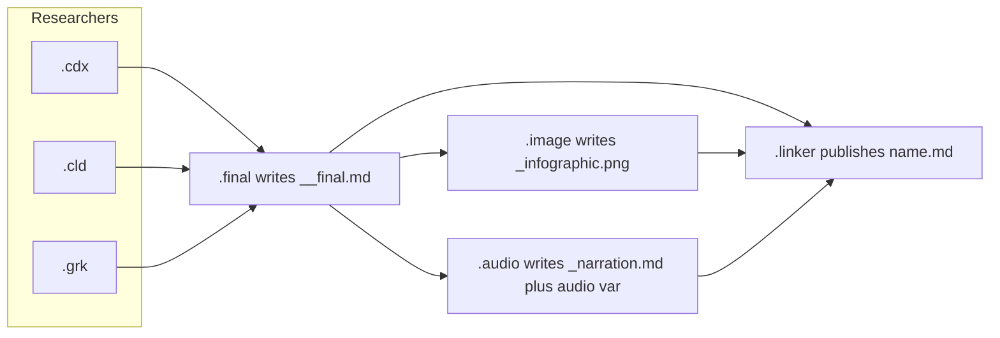
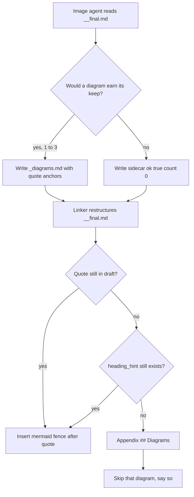
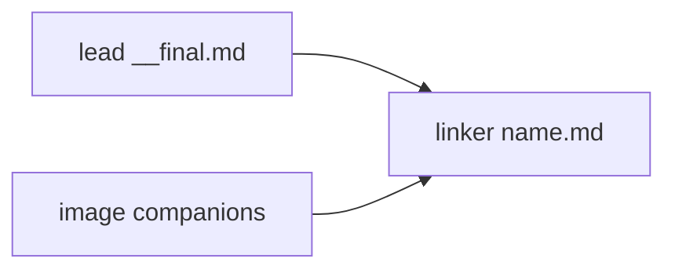

# Sidecar mermaid for the research-swarm image agent

**Bottom line:** Keep the split you sketched — the image agent may propose diagrams, it must not edit the lead's report or publish a second report, and the linker is the only agent that pastes diagrams into the canonical file. Do not have the image agent "just drop mermaid into the markdown." Give it a **sidecar + small output variable**, cloned from the audio companion, and give the linker a **quote-anchored insert** that survives the linker's own rewrite. Cap at three diagrams, prefer zero, fail open, and treat mermaid as a GitHub/Obsidian visual, not as a Highlights-PDF visual, until `bob highlights create` grows a mermaid filter.

This is a good idea if it stays a **second visual product** beside the infographic PNG. It is a bad idea if it turns `#research/image` into a second author of the report, if placement is by heading or line number, or if mermaid is stuffed into `sase var` bodies.

_Checked 2026-10-18 against `sase-research-artifacts` (`research_swarm.md`, `research_image.md`, `research_audio.md`, `provider.py`), sase output-variable limits, GitHub mermaid docs, prior research `research:202610/agent_image_generation_toolset.md` and `research:202605/markdown_to_html_rich_artifacts.md`, and a published swarm that already carries mermaid (`research:202610/agents_tab_inbox_and_history_views/agents_tab_inbox_and_history_views.md`). `mmdc` is not on PATH in this workspace._

---

## Research query

How should `#research_swarm`'s image agent decide whether a research file would benefit from mermaid diagrams, produce those diagrams **without** editing the lead's `__final.md` or writing its own report, and tell the linker **which parts of the research file they belong to**, so the linker can integrate them into the published `<name>.md`?

Also: is that plan sound, and what should change?

---

## Critique of the plan

The plan is directionally right. The swarm already has a three-role visual/publication pipeline:

| Role | Writes | Must not |
| --- | --- | --- |
| Lead (`.final`) | `<name>__final.md` | Publish `<name>.md` when a linker will run |
| Image (`.image`) | `<name>_infographic.png` | Edit the lead file, invent claims |
| Linker (`.linker`) | canonical `<name>.md` | Research, soften/strengthen conclusions |

Audio already proved the pattern you want for mermaid: a companion agent produces a **sidecar** (`<name>_narration.md`) plus a **small** `sase var set audio` object; the linker copies facts into the published file and never touches `__final.md`. Infographic embedding is the weaker analog, because it is **one** PNG pinned to a **fixed** slot (directly above `## Bottom line`). Mermaid is **zero-to-N** diagrams pinned to **section-local** ideas. That is a different integration job than "embed the poster at the top."

Four places the naive reading of the plan fails:

1. **The linker rewrites the document.** It merges duplicates, retitles sections, converts every table to a list, and reorders around reader questions. A placement of "after `## Architecture`" or "after line 240" is stale by the time the linker writes `<name>.md`. The correspondence format has to survive that rewrite.
2. **The lead already writes mermaid.** Independent researchers, especially Gemini, already emit ```` ```mermaid ```` fences. The published Agents-tab Inbox/History report keeps four mermaid blocks that were in `__final.md`, *and* a top infographic PNG, *and* extra PNG figures. An image agent that always "adds diagrams" will duplicate structure the lead already drew.
3. **`#research/image` is ten lines.** It says "generate an infographic" and names a PNG path. It does not tell the agent how to find `__final.md`, how to register an artifact, or how to decline. Dumping mermaid into that prompt without a contract will produce a second markdown report, in-place edits, or invalid fences.
4. **Highlights PDFs will not render mermaid.** The research-highlights hook is `bob highlights create`. For a sidecar Markdown file that is a "other Markdown file" route, Bob uses **pandoc then xelatex**. SASE's own markdown-PDF helper is also pandoc plus `wkhtmltopdf`/`xelatex`/`pdflatex`, with no mermaid filter. WeasyPrint-class pipelines print mermaid as a raw fence unless it is pre-rasterized (`research:202605/sase_sh_single_pdf_download.md`). GitHub and Obsidian preview *do* render mermaid. So mermaid is the right GitHub-native diagram, and a known PDF downgrade, unless you also ship PNGs.

The plan should stay. The implementation has to look like **audio's companion**, not like **the infographic's single top embed**, and not like **the image agent becoming a co-author**.

---

## Current pipeline (what we would be extending)

`#research_swarm(image=true)` already implies the linker. The image segment waits on and **forks** the lead, then expands `#research/image`. The linker waits on the lead **and** the image agent, does **not** fork, finds `__final.md` through `wait.artifacts`, and publishes `<name>.md`.



Facts that constrain mermaid:

- **`@image` is a text-model fallback chain**, not a paint-only model: `codex/gpt-6.1-sol@xhigh | grok/grok-4.6@xhigh | agy/gemini-3.8-flash-high` (`sase-research-artifacts` `default_config.yml`). That chain *can* write mermaid. It is also the chain that is supposed to make a poster PNG. Those are different jobs.
- **Exact labels belong in code, not in image models.** Prior research (`research:202610/agent_image_generation_toolset.md`) is blunt: documentation diagrams with many labels should be D2/HTML/Typst/mermaid, and GitHub needs **no renderer** for a ```` ```mermaid ```` fence. D2 is the stronger architecture tool, but GitHub still does not render D2 in Markdown (GitHub community discussion 176562, still unanswered as of mid-2026). For a public research sidecar whose canonical file is GitHub Markdown, mermaid is the diagram language that actually displays.
- **Companion Markdown is already a first-class exclusion.** `provider.py` drops `*_infographic.md` and `*_narration.md` from both the `@research` inventory and the Highlights hook, so those files never become "reports" and never mint a PDF. A diagrams sidecar **must** join that list the day it is born, or Highlights will try to typeset the sidecar as a research note.
- **Handoff channels already exist, with size limits.** `wait.artifacts` lists non-chat artifacts (`wait_name`, `label`, `kind`, `path`, `source_path`, `ref`, nullable VCS fields). `sase var set` publishes JSON under `agents["research.<n>.image"]`. Variables are for **small** values: 8 KiB per string leaf, 65,536 encoded JSON bytes per variable, 1,024 nodes, depth 8 (`sase var` skill / `docs/reference/agents/output-variables.md`). Mermaid bodies do not belong in a var. Audio already respects this: the MP3 is an artifact, the script is a sibling file, the var is a short `{ok, episode_id, duration_s, ...}` object.
- **The image prompt does not currently register the PNG.** The linker locates `<name>_infographic.png` **by convention** (and optionally `kind == image` artifacts). Mermaid should use the same belt: a sibling filename the linker can find even if registration is skipped, plus an optional var so the linker can distinguish "considered, zero diagrams" from "crashed."

---

## Why the image agent must not edit `__final.md`

The user constraint is correct, and it matches the existing swarm invariant:

- `__final.md` is the lead's immutable source. The linker is the only publisher of `<name>.md`.
- The Highlights hook already excludes `__final.md` and drafts (`!20*/*/*__*.md`). Editing it would either skip the PDF (if the hook still sees a `__final` name) or race the linker.
- The image agent forks the lead's **chat**, not a guaranteed on-disk read. Chat may summarize the report. Placement and dedup require `sase artifact read` of the registered `__final.md`.
- If the image agent writes its own `*_diagrams_report.md` and that file is inventory-eligible, the Research pane and Highlights hook treat it as a report. That is how `*_infographic.md` became an exclusion in the first place.

So the image agent's mermaid output has to be a **companion**, like `_narration.md`, not a report and not a patch on `__final.md`.

Standalone `#research/image` (no swarm, no linker) has **no consumer** for a sidecar. **Adjustment:** v1 mermaid is swarm-only. Leave the shared `#research/image` macro as the PNG infographic. Put the mermaid brief on the swarm image **segment** (or add a `diagrams` input defaulting off and have the swarm pass it true). Do not leave orphan `_diagrams.md` files next to one-off infographic runs.

---

## The hard problem: correspondence after the linker rewrite

The linker is an editor with a mandatory restructure. It is instructed to keep every claim, convert every table to a list, never number headings, and open the file in a rigid prefix: frontmatter, one `#` title, research-query blockquote, optional listen card, optional infographic, then `## Bottom line` / `## Overview`.

Placement strategies, ranked:

| Strategy | Survives rewrite? | Verdict |
| --- | --- | --- |
| Line numbers in `__final.md` | No | Discard |
| Heading text alone | Weak: headings are renamed, merged, un-numbered | Advisory only |
| HTML comment markers in `__final.md` | Requires editing the lead file | Forbidden |
| JSON Patch / CriticMarkup against `__final.md` | Breaks when the linker rewrites | Discard |
| **Unique quote from the lead, insert after that quote** | Yes, because the linker must keep every claim | **Primary** |
| Semantic hint ("the wait-graph", "the execution matrix") | Partial; useful when the quote moved | Secondary |
| Appendix `## Diagrams` | Always possible | **Fallback** |
| Gallery-only sidecar, jump links from the body | Survives, but diagrams sit away from the idea | Acceptable fallback, worse pedagogy |

Quote-anchoring is the same idea as `git apply` context lines. The image agent copies a **verbatim, unique** substring from `__final.md` (one or two sentences the linker cannot drop). The linker, after it has a restructured draft, searches for that substring and inserts the fence immediately after it. If the quote is gone, it tries `heading_hint`. If that is gone, it uses `fallback: appendix` or skips.

Do **not** put mermaid in the rigid opening prefix (title / query / listen card / infographic). A diagram that illustrates the recommended flow may sit **inside** Bottom line, after the answer prose, before the next `##`. Everything else belongs next to the section that already argues it.



---

## Recommended handoff contract

Clone audio. Three pieces, in this order of authority:

### 1. Sibling sidecar `<name>_diagrams.md`

Stem rule identical to the infographic and narration: strip a trailing `__final` from the source stem. `topic__final.md` → `topic_diagrams.md`, sitting next to `topic_infographic.png` and `topic_narration.md`.

YAML frontmatter is the machine index. The body holds the mermaid fences, one `## <id>` per diagram, so an LLM writes mermaid in the form it already knows.

````markdown
---
version: 1
ok: true
source: <name>__final.md
diagrams:
  - id: swarm-handoff
    caption: "From per-provider drafts to the published report"
    kind: flowchart
    after_quote: "You are an editor, not a researcher."
    heading_hint: Linker responsibilities
    fallback: appendix   # appendix | skip
    skip_if_lead_has_mermaid: true
---

## swarm-handoff


````

Rules for the image agent:

- `ok: true` and `diagrams: []` means **considered and declined**. That is a success. The linker publishes with no mermaid from this agent.
- Missing sidecar means the same as a missing PNG: publish without it and say so.
- `ok: false` plus a one-line `error` is for "I tried and produced nothing trustworthy." Still complete the agent so the linker is not parked.
- At most **three** diagrams. Prefer **zero**. One good flowchart beats four decorations.
- `after_quote` is required for every diagram. It must appear verbatim in `__final.md` and should be unique.
- `kind` is a GitHub-safe mermaid type: `flowchart` / `graph`, `sequenceDiagram`, `stateDiagram-v2`, `erDiagram`, `classDiagram`, `gantt`, `pie`, `mindmap`, `timeline`. No `%%{init ...}%%` as the first line (several previewers then report "Unsupported diagram type"). Quote labels that contain parentheses or punctuation. Never name a node `end`. Keep diagrams small; GitHub has been reported to fail large graphs around 50–100 nodes.
- Dedup: if `__final.md` already contains a mermaid fence that depicts the same relation, skip. `skip_if_lead_has_mermaid: true` is the default.
- Diagrams may **only restate structure already claimed in prose**. No new actors, no new arrows that the lead did not argue. That keeps the linker inside "editor, not researcher."
- Do not overwrite an existing `_diagrams.md`. Collision → stop, like the infographic PNG.

### 2. Tiny `sase var set diagrams`

Not the mermaid source. Index only, matching audio's `{ok, ...}` shape:

```json
{
  "ok": true,
  "count": 2,
  "path": "<YYYYMM>/<name>/<name>_diagrams.md"
}
```

Declined: `{"ok": true, "count": 0}`. Failed: `{"ok": false, "error": "..."}`. The linker already iterates `agents` entries rather than hard-coding keys (audio taught that lesson for clan names). Repeat that for `diagrams`.

Do **not** put mermaid text in the var. A single dense flowchart can approach the 8 KiB string-leaf cap; three diagrams plus quotes can approach the 64 KiB variable cap; vars also show up in Telegram completion messages.

### 3. Optional artifact registration

Label it **outside** the `research:` report filter, the way audio uses `audio:<episode_id>`:

```bash
sase artifact create -p "<abs-sidecar>" -l "diagrams:<repo-relative-path>"
```

Convention still wins if registration is skipped: the linker looks for `<name>_diagrams.md` beside the report, exactly as it looks for `<name>_infographic.png`.

Exclude the sidecar from inventory and Highlights on day one:

```text
!20*/**/*_diagrams.md
```

in `_COMPANION_MARKDOWN_EXCLUDE_GLOBS` (used by both the research ref provider and the highlights hook). Add `<name>_diagrams.md` to the linker's `tree()` file list when `image=true`.

---

## What the linker should do

Add one step between today's "embed the infographic" and "bottom-line section," but **do not** put mermaid in that opening prefix. Body insertion is a later-pass edit, after the restructure draft exists.

Linker algorithm:

1. Inventory mermaid fences **already in** `__final.md`. Those stay, as code blocks already do. The linker must not strip them while converting tables.
2. Read `agents["research.<n>.image"].diagrams` if present, else look for `<name>_diagrams.md` by convention, else skip.
3. If `ok` is false or `count` is 0 or the sidecar is missing, publish with no added diagrams and say so. Never write "diagrams pending."
4. For each sidecar diagram, skip it when `skip_if_lead_has_mermaid` is true and the inventory already has a fence of that `kind` near the quote.
5. After the restructure draft is built, locate `after_quote`. Insert a blank line, an italic caption (`*Figure. <caption>.*`, not a heading, so it is not numbered and not a TOC entry), a blank line, the mermaid fence, a blank line.
6. If the quote is missing: try `heading_hint`; then `fallback`. Appendix heading must be a legal pandoc/GitHub anchor (`## Diagrams`).
7. Re-check the step-2 inventory. Added mermaid is extra; it must not replace a lead fence.
8. Validate lightly. `mmdc` is **not** on PATH here and athena's copy was still 11.4.2 when last surveyed, while mermaid-cli 12 changed flags. Do not require `mmdc`. Cheap checks: first non-comment line is a known `kind`; fence closes; node id `end` is absent. On failure, drop that diagram and report it. Do not fail the publish.
9. Do not convert mermaid to a list. The table-to-list rule is for tables. A mermaid fence is a figure.

The linker prompt is already the largest segment in the swarm. Keep this algorithm short, test-backed, and fail-open. Resist adding a mermaid "style guide" novel.

---

## What the image agent should consider (decision tree)

"Consider whether the file would benefit" has to be a **gate that usually returns no**. Otherwise every `image=true` swarm grows three decorative flowcharts.

Create a diagram only when **all** of these hold:

- The report argues a **relation** (flow, sequence, state machine, ownership, wait graph, matrix of agents vs files) that a reader would otherwise reconstruct from several paragraphs.
- That relation is **not** already a mermaid fence in `__final.md`.
- The top infographic does **not** already show the same relation. The PNG is the synthesis poster; mermaid is the precise graph. If the poster is the wait graph, do not mermaid the wait graph.
- The diagram can be drawn from claims the lead already made, with **no new arrows**.
- Labels are short, exact project terms (`__final.md`, `.linker`, `wait.artifacts`), not marketing sentences.

Skip mermaid for:

- Prose recommendations, literature reviews, and reading lists with no structure to draw.
- UI mockups, screenshots, and TUI layout. Those are PNG/SVG (the Inbox/History report already does this).
- Tables the linker will turn into lists, unless the diagram shows a **relationship among rows** the list cannot (a cycle, a fork/join, a state machine).
- More than three candidates: keep the three that a first-time reader would miss hardest; delete the rest.

Infographic vs mermaid vs both:

- **Infographic PNG** — one overview, fixed slot above Bottom line, impressionistic, image-model native. Keep today's behavior.
- **Mermaid** — zero to three precise graphs, body-local, code, GitHub-native. New.
- **Both** — normal for architecture research (poster + one wait-graph). Unusual for a yes/no recommendation note.

This split also answers a prompt-design risk: asking one agent to "make a pretty poster" and "write exact diagrams" in the same breath. The swarm image segment should state the split in two short briefs, not one blended paragraph.

---

## Requirement adjustments (explicit)

These change the request. Each is justified.

1. **Mermaid is opt-out per report, not obligatory.** "Consider" must include "write `count: 0`." A swarm that always emits diagrams will add noise and duplicate the lead.
2. **v1 rides `image=true` and the existing implied linker.** Do not add a sixth agent. A future `diagrams=true` that runs mermaid without a PNG is reasonable, but it is not needed to prove the contract. Standalone `#research/image` stays PNG-only until it has a linker.
3. **Correspondence is quote-based, not heading- or line-based.** Headings are unstable under the linker. Quotes are claims the linker is already forbidden to drop.
4. **Fail open, like a missing PNG or a failed TTS render.** A crashed image agent still parks the linker (`%wait:research.{@1}.image` only releases on completion). A *completed* image agent with `count: 0` or a bad fence must not park or poison `<name>.md`.
5. **Do not store mermaid bodies in `sase var`.** Sidecar file plus a tiny index. Vars are the wrong size class and leak into Telegram.
6. **Exclude `*_diagrams.md` from inventory and Highlights on day one.** Copy the `_narration.md` / `_infographic.md` glob. Otherwise the sidecar becomes a report and a PDF.
7. **Cap at three diagrams, GitHub-safe types only.** Invalid mermaid is worse than no mermaid (GitHub shows an error card).
8. **Dedup against lead mermaid.** The image agent is additive. Several researchers already draw the swarm.
9. **Accept a Highlights-PDF gap in v1.** Inline mermaid is for GitHub and Obsidian preview. The PDF will show a listing until Bob/pandoc grows a mermaid filter or the image agent also rasterizes. Do not block the feature on `mmdc` (missing here; flag-incompatible v12 on athena).
10. **Diagrams must not add claims.** If the lead did not say A waits on B, the diagram must not draw A → B. That is the only way the linker remains an editor.
11. **Give the image segment a `wait.artifacts` listing of the lead report.** Do not rely on fork chat to identify `__final.md`. The linker already has this loop; copy it.
12. **Keep mermaid out of the opening prefix.** Infographic stays the one top visual. Mermaid goes in the body (or an appendix). Mixing them fights the linker's "exact open order" tests.

---

## Alternatives, and why not

**A. Have the lead write mermaid in `__final.md`.** Already happens, and the linker already preserves fences (Inbox/History: four mermaid blocks survived publication). Cheapest. It does not give you a visual specialist, and it does not run when the lead is tired or the report is a wall of prose. Keep allowing it; do not make it the *only* path.

**B. Have the linker invent mermaid while restructuring.** Placement would be easy because the linker knows the new headings. The linker prompt is already the swarm's largest failure surface (table conversion, listen card, infographic, link checks, inventory restore). Adding "also be a diagrammer" invites both missed claims and invented structure. Reject as the primary author; the linker only **pastes**.

**C. A new `.diagrams` agent.** Clean role split, extra quarter-weight queue slot, extra wait edge, extra crash parking the linker. The image agent is already the visual companion and already implies the linker. Do not add an agent until the sidecar contract is proven.

**D. Rasterize mermaid to PNG and embed images.** Works in Highlights PDFs and in GitHub. Loses diffability, theming, and accessibility. Conflicts with "exact labels belong in code" unless the PNG is a *fallback* next to the fence. Reasonable **follow-up** if PDF reading of mermaid-heavy reports hurts; not v1.

**E. D2 instead of mermaid.** Better layout (TALA/ELK, pinned seeds) per the image-toolset report. GitHub will not render it. You would commit `.d2` plus a PNG/SVG anyway, which is the infographic pipeline with extra steps. Use D2 for docs-site architecture later; use mermaid inside this public Markdown sidecar.

**F. Markers in `__final.md` (`<!-- diagram:swarm-handoff -->`).** Precise, and the linker could replace the marker. It **modifies the lead file**, which the user forbade, and it makes `__final.md` depend on a later agent. Reject.

**G. Gallery-only: linker always dumps diagrams into `## Diagrams` and jump-links from the body.** Simplest integrator, weakest reading experience. Keep it as the fallback when quote and heading both miss, not as the default.

I would not replace the user's split (image proposes, linker integrates, lead file untouched). I would replace the unstated "stick mermaid in the report somehow" with the sidecar contract above.

---

## Risks

- **Dual-job degradation.** One agent making a poster *and* three graphs may do both badly. Mitigate with the split brief and a hard cap of three. If quality is poor after a few swarms, promote mermaid to `diagrams=true` on `@xlarge` and leave `@image` on PNG.
- **Invalid mermaid.** LLMs still emit `end` as an id, unquoted `Foo(bar)`, and `init` directives. Cheap validation plus drop-on-fail is enough; do not add a Node toolchain to apollo for this.
- **Quote mismatch after rewrite.** The linker sometimes paraphrases while "keeping the lead's wording where it works." Instruct it that `after_quote` strings are **locked claims**: copy them byte-for-byte into the published file, the same way it must copy every URL.
- **Parked linker.** Same as a crashed image agent today. Completing with `ok: false` is mandatory even when mermaid fails.
- **PDF listings.** Readers of Highlights PDFs will see fences. Mention this in the linker final response when any mermaid was inserted, once, so it is not a surprise. Follow-up: Bob mermaid filter or PNG fallbacks.
- **Prompt size.** The linker segment cannot grow by another audio-sized novel. Put the long mermaid brief on the **image** segment; keep the linker to the algorithm in "What the linker should do."

---

## Implementation sketch (for whoever lands this)

All of this lives in `sase-research-artifacts`, not in sase core.

1. **`research_swarm.md` image segment.** After the existing `#research/image` expansion, add: a `wait.artifacts` loop filtered to the lead's `research:…/…__final.md`; the decision tree; the sidecar schema; `sase var set diagrams`; optional `diagrams:` artifact label; "do not edit `__final.md` or write `<name>.md`."
2. **`research_swarm.md` linker segment.** When `image=true`, list the sidecar in `tree()`, render a `diagrams` var / `diagrams:` artifact loop (mirror audio's `agents` iteration), and paste the insert algorithm. Do not change the opening-order tests except to keep mermaid **out** of that prefix.
3. **`provider.py`.** Append `!20*/**/*_diagrams.md` to `_COMPANION_MARKDOWN_EXCLUDE_GLOBS`. Tests already assert infographic and narration exclusions; add the new glob.
4. **`docs/macros.md` and the plugin README.** One short subsection: mermaid is an image-agent companion, linker-integrated, fail-open, GitHub-primary.
5. **Tests in `test_macro_loading.py`.** Image segment mentions `_diagrams.md` and `sase var set diagrams` only when `image=true`. Linker mentions quote insertion and appendix fallback only when `image=true`. `image=false` remains silent. Opening-order test still expects query → listen? → infographic? → bottom line, with no mermaid in between.
6. **Do not** wait on `mmdc`, a new agent, a `diagrams=true` flag, or a Bob mermaid filter for v1.

---

## Recommended solution

Implement mermaid as a **swarm image-agent companion**, not as in-place report editing and not as a new researcher.

- The image agent reads the lead's registered `__final.md`, decides whether any diagram would earn its keep, and either writes `<name>_diagrams.md` (0–3 GitHub-safe mermaid fences, each with a unique `after_quote`) plus `sase var set diagrams '{"ok": true, "count": N, "path": "..."}'`, or writes `count: 0`.
- It never modifies `__final.md`, never writes `<name>.md`, and never publishes a second research report.
- The linker, after restructuring, pastes each fence after its quote (heading hint, then appendix, then skip), dedups against mermaid the lead already wrote, and publishes without diagrams when the sidecar is missing or empty.
- The infographic PNG remains the single top visual. Mermaid lives in the body. Highlights PDFs remain a known gap.

That is the audio pattern, applied to diagrams, with placement that respects the linker's rewrite. I would not have the lead or the linker author these diagrams, and I would not rasterize mermaid until someone actually reads these reports as PDFs and complains.

---

## Sources

- `sase-research-artifacts` macros: `src/sase_research_artifacts/xprompts/research_swarm.md`, `research_image.md`, `research_audio.md`; inventory exclusions in `src/sase_research_artifacts/provider.py`; `@image` alias in `src/sase_research_artifacts/default_config.yml`; plugin `docs/macros.md`.
- SASE handoff: `docs/reference/macros/templating.md` (`wait.artifacts`), `docs/reference/macros/multi-agent-prompts.md` and `docs/reference/agents/output-variables.md` (`sase var` size and `agents` namespace).
- Highlights: file-hook command `bob highlights create` (pandoc + xelatex on Markdown); linker already documents pandoc `--number-sections` and table failure under XeLaTeX.
- GitHub mermaid: [Creating diagrams](https://docs.github.com/get-started/writing-on-github/working-with-advanced-formatting/creating-diagrams). D2 still unsupported in GitHub Markdown ([community discussion 176562](https://github.com/orgs/community/discussions/176562)).
- Prior research (audited): `research:202610/agent_image_generation_toolset.md` (exact labels in code; prefer inline mermaid on GitHub; `#research/image` is ten lines); `research:202605/markdown_to_html_rich_artifacts.md` and `research:202605/sase_sh_single_pdf_download.md` (mermaid is a fence unless pre-rendered for PDF).
- Existence proof that lead mermaid already survives the linker: `research:202610/agents_tab_inbox_and_history_views/agents_tab_inbox_and_history_views.md` (top infographic PNG, body mermaid, extra PNG figures).
