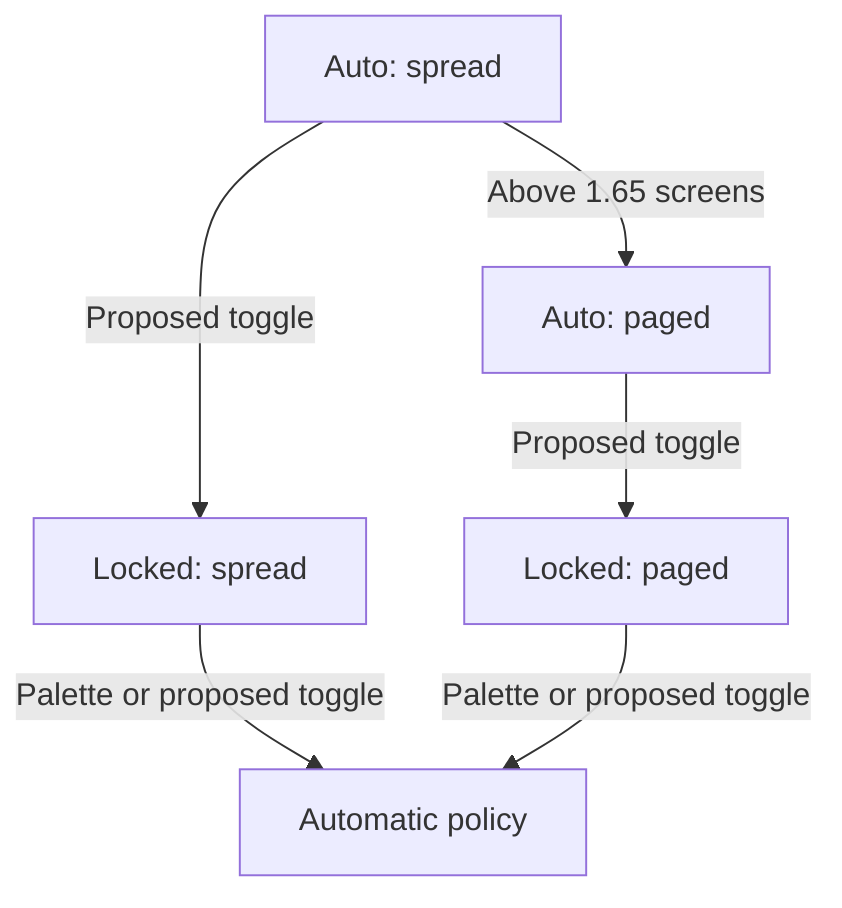
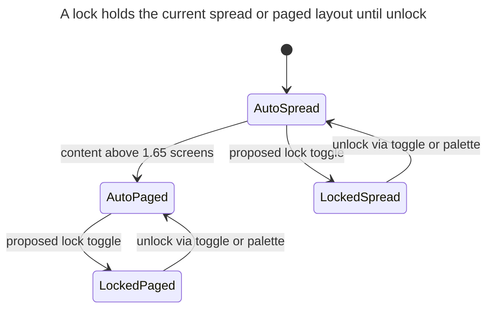

# Mermaid craft for `#research_swarm`: improve instructions, factor a shared macro, and stop asking CSS of the model

> **Research query:** The mermaid diagrams that the image agent in `#research_swarm` recommends are hard to understand in isolation, not very useful, and not visually appealing. How should we improve that agent's instructions — including factoring mermaid advice into its own macro — and is that plan a good idea?

## Bottom line

**Improve the diagrams-agent brief, yes. Relocate the current 11-line Draw section into a new macro and stop there, no.** The two real image-agent manifests already parse, fit the PDF column, and restated the report. They still fail the three qualities you named. The failure is in *what the Draw rules optimize for* (parse + half-page + four-word labels), in *who runs them* (`image_model`, in your `#rsa` alias `gpt-6-astra`), and in *what "useful" is allowed to mean* (any three-box flowchart that drills into an infographic panel). Packaging craft as `#research/mermaid` is the right *shape* for the instruction change. It is not itself the quality fix.

**Recommended solution.** Keep `#research/diagrams` as the workflow (candidates, fidelity, `mmdc`, manifest, `diagrams` variable). Add a new prompt-part `#research/mermaid` that `#research/diagrams` expands in its Draw step. Put *craft* in that part: type picking, an isolation cover-test, a title, slightly longer noun-phrase labels, semantic shapes, one-level subgraphs, and a visual pass over the rendered SVG/PNG. Leave beauty to bob's pinned `theme: "neutral"` (GitHub uses its own). Do not let the agent author `style` / `classDef` / `%%{init}%%` / `config.theme`. Do not split a `.diagrams` agent in this pass; require the image agent to *look at* its own renders first. Split the segment onto a text model only if that still fails after about ten swarms.

**Requirement adjustments** (justified below): raise the label budget from ~4 words to ~8; require a Mermaid YAML `title:`; allow one decision diamond *or* a `stateDiagram-v2`; allow one-level subgraphs and semantic shapes; add a visual isolation check; tighten "useful" so implementation-refresh fan-ins fail. Keep the dual-surface ban on agent-authored theme CSS. Keep fail-open, the 3–5 cap, fidelity, and linker-as-only-publisher.

## What exists today

The image segment of `#research_swarm` is one agent. When `image=true` it runs `#research/image` (PNG infographic) and then, unless `diagrams=false`, `#research/diagrams`. `diagrams=true` alone still launches that segment and skips the PNG. The model is `image_model` (plugin default `@image`, a pool of Codex / Grok / Gemini text-multimodal models). Chezmoi's `#rsa` overrides it to `gpt-6-astra`.

`#research/diagrams` is already a separate macro. It was split out of `#research/image` on purpose so standalone infographics would not mint diagram manifests ([research:202610/research_swarm_mermaid_handoff_to_linker/research_swarm_mermaid_handoff_to_linker.md](research_swarm_mermaid_handoff_to_linker/research_swarm_mermaid_handoff_to_linker.md)). Its job is a pipeline:

1. Read the lead report with `sase artifact read`.
2. List drill-down candidates from infographic panels (or from mechanism sections when there is no PNG).
3. Propose at most three diagrams, five on a complex report.
4. Draw under PDF-fit rules.
5. Render-check with `mmdc` (or `npx … mermaid-cli`), plus a 1300 px width cap.
6. Anchor, write `<stem>.diagrams.md`, register it as `diagrams:…`, set `sase var set diagrams`.

The Draw rules, in full, are:

- Types: `flowchart` (prefer `TD`; `LR` only for a short chain), `sequenceDiagram` (≤4 participants), `stateDiagram-v2`, `classDiagram`, `erDiagram`.
- No init directives, `click`, `style`, `classDef`, HTML, or icons.
- At most four boxes side by side and about five ranks. In `TD` flows, no decision diamonds; put the condition on a labelled edge.
- Labels of about four words or fewer, quoted, in the report's terms. Never use `end` as a node id.
- Size for a ~650 px PDF column and at most half a page.

Those rules are the 2026-10-18 handoff research's *legibility* guardrail, written after a corpus render found 37% of then-existing Mermaid blocks would print below half size, and after tall `TD` flows with diamonds wasted whole PDF pages. They were never a craft guide for isolation, usefulness, or beauty.

The linker is the only publisher. As of 2026-10-19 21:50 UTC it wraps each accepted fence in `<div id="figure-<id>">` and writes one reference sentence from `illustrates`. The two live diagram runs finished *before* that commit, so their published reports have the fence and an italic caption and no figure wrapper and no "the X diagram traces Y" sentence.

## Evidence from the only two live manifests

I read both image-agent manifests as artifacts (`file:explicit:1d57acc925152af43591c590`, `file:explicit:2277860e604afca965813226`) and the published reports they landed in.

| Swarm | Manifest | Check | Types used |
| --- | --- | --- | --- |
| `research.52.image` | three diagrams for deck scroll / layout lock | `mmdc 12.0.0 rendered 3 of 3` | all `flowchart TD` |
| `research.51.image` | one diagram for `#prj` child-scope | `mmdc 12.0.0 rendered 1 of 1` | `flowchart TD` |

That is the entire image-agent Mermaid corpus: **four diagrams, four flowcharts, zero `stateDiagram-v2`, zero `sequenceDiagram`.** The type list in Draw is unused.

### Isolation

The lock diagram is the strongest of the four, and it is still opaque without the surrounding section:



*The proposed toggle holds either layout; automatic streaming can change spread to paged.*

Cover the prose and the caption still helps, but `Automatic policy` is a lump, `Palette or proposed toggle` is an unlock path hiding in an edge, and nothing in the picture names the question ("what does the lock hold?"). The other two deck diagrams are worse: `Spread chrome refresh`, `Before/after active card`, `Show directional cues`, `Check at-bottom boolean`. Those are implementation nouns. A reader who has the infographic still cannot recover *what the cue is*.

The four-word cap is the direct cause. Information-design practice wants short labels, but "short" there means a noun phrase that answers "what is this?", not a telegram that assumes the panel title. SimpleMermaid's own convention is *noun phrases for nodes, verb phrases for edges, edges under five words* — nodes are allowed to be longer than the current Draw budget ([SimpleMermaid labeling](https://simplemermaid.com/guides/best-practices.html)).

There is also no in-diagram title. Mermaid 10.2+ / 12.x renders a YAML `title:` above the figure. GitHub's docs do not advertise it, but the syntax is core and bob's pinned bundle is Mermaid 12.2.0, which supports it. The italic linker caption is a title *under* the figure and is capped at ~15 words. Isolation wants a title *on* the picture.

### Usefulness

The pass test is "three or more connected parts" plus "at least two details the panel lacks" plus "the picture is faster than the prose." Models rubber-stamp that. Three of the four live diagrams are event-fan-ins of refresh logic:

- document apply / resize / active-card-change → chrome refresh → cues
- scroll / resize / content-growth → at-bottom boolean → bold vs normal cue

Those restated a paragraph of TUI performance detail. They did not answer a reader question. The infographic-drill-down mandate (`9fcd3de`, 2026-10-19) is why they exist: every panel *must* be considered, and "zero because the infographic already covers it" is forbidden. The agent then draws the leftover implementation.

The child-scope diagram is a decision tree with a dummy node `Choose one`. That is a classic flowchart anti-pattern: a labelled decision (or three labelled edges) was the content, and a box named "choose" was inserted because diamonds are banned.

### Beauty

"Not visually appealing" is mostly "default gray flowchart with uniform rectangles and no grouping." That is not a prompt-length problem. It is a *surface* problem:

- Bob Highlights initializes Mermaid with `theme: "neutral"`, DejaVu Sans, no drop shadow, and treats `theme`, `themeCSS`, `themeVariables`, and `fontFamily` as **secure keys**. Agent-authored theme in `%%{init}%%` or YAML `config:` is ignored in the PDF (`scripts/web_clip/diagram_render.py` in bob-cli).
- GitHub renders the same fence with *its* Mermaid pin and *its* site theme. GitHub's own example is four unlabeled lavender boxes (`A-->B`). Agent CSS that looked good in `mmdc` would drift on GitHub.
- The Draw ban on `style` / `classDef` / init is therefore correct for dual-surface consistency. Lifting it will not make PDF figures beautiful; bob will strip the theme.

Beauty that *will* survive both surfaces is structural: the right diagram family, semantic shapes (stadium for terminals, cylinder for stores, one diamond for a real decision), one-level labelled subgraphs, a title, and bob's neutral theme. Color coding is the renderer's job.

### The dual-job / wrong-model reopen condition already fired

The 2026-10-18 handoff report named this exact risk:

> Dual-job load. One agent making a poster *and* precise graphs may do one of them badly.
>
> Reopen the design if … `@image` models write weak diagrams: move `#research/diagrams` into its own segment on a strong text model.

Two live swarms later, the diagrams are weak in the three ways you named. Chezmoi's `#rsa` sends that work to `gpt-6-astra`. The plugin default `@image` is at least a text-multimodal pool; the override is an image-first model writing graph syntax.

The image agent still has one unique advantage: it can *see* the infographic and, if we ask it to, the rendered SVG/PNG. Today it only `grep`s `max-width` on the SVG. That is a wasted multimodal pass.

### Scale: the image agent is a small slice of research Mermaid

In this checkout of the research sidecar I counted Mermaid fences:

- 4 in `*.diagrams.md` (the image agent)
- 42 in published `<name>.md` files (mix of lead-authored and the four placed proposals)
- 140 in `__suffix` / `__final` drafts (researchers and the lead, unvalidated)

Leads already draw Mermaid unprompted. A craft macro that only the diagrams agent sees will not move the bulk of figures in Highlights PDFs. That is a justified scope expansion *later*, not a reason to skip the diagrams-agent fix.

## Critique of the plan

The plan as stated: improve the image agent's instructions, maybe by factoring mermaid advice into its own macro.

**What is right**

- The diagrams brief is the right file to change. The linker must not redraw. The lead is already the busiest agent.
- A named, testable prompt-part is the SASE way to share craft. `#research/diagrams` already includes `#research/image` as a mention and is itself the factored-out workflow. Macro bodies recurse, so `#research/diagrams` can expand `#research/mermaid` in Draw.
- Factoring craft *now* keeps a later `.diagrams` segment a one-line include, which is the move the 2026-10-18 report deferred.

**What is wrong if taken literally**

- The current Draw section is eleven lines. Moving it to `#research/mermaid` without changing the rules is a rename. Isolation, usefulness, and beauty will not move.
- More text in the same image-model context window, without a visual check, is how we got four flowchart-TD telegrams that pass `mmdc`.
- A generated skill (`SKILL.md` via `sase skill init`) is the wrong layer. Skills are opt-in reads, are generated from `src/sase/macros/skills/` in the *sase* repo, and are not auto-expanded into a swarm segment. This craft belongs in `sase-research-artifacts` next to the macros that will include it.
- A local `_mermaid` helper on `#research/diagrams` only is cheaper, but then researchers and a future `.diagrams` agent cannot include it. A public `#research/mermaid` with no inputs is the better default.
- Asking the agent to make diagrams "beautiful" with `style`/`classDef` fights bob's secure theme keys and GitHub's pin. That requirement should be rewritten: *structural* beauty in the source, *visual* beauty in the renderer.

**Would I take a different approach?**

I would still change the diagrams-agent instructions, and I would still factor craft into `#research/mermaid`. I would not treat that as the whole design. In order of leverage:

1. Change what Draw *asks for* (isolation, type, title, usefulness).
2. Make the image agent look at the render, not only grep width.
3. Stop inheriting `image_model` for graph syntax (flag, not a new wait-edge yet).
4. Optionally include `#research/mermaid` in the researcher template later, because that is where 140 of 186 fences come from.

A dedicated `.diagrams` agent on `@xlarge` is still the correct *escape hatch*, not the first patch. It costs another fork of the lead conversation, another queue slot, and another crash that parks the linker. Visual self-review plus a text-capable `diagrams_model` default is the cheaper experiment.

## Requirement adjustments

Call-outs, each with why.

1. **Raise the node-label budget from ~4 words to ~8, keep edge labels short.** Four-word nodes are why `Automatic policy` and `Spread chrome refresh` exist. Width is still gated by the 1300 px `max-width` check, so overflow still fails closed. Edges can stay ~5 words (verb phrases).
2. **Require a Mermaid YAML `title:` and no `config:` block.** Titles are the isolation feature Mermaid already has (`---` / `title:` / `---`). Bob's secure-key list will ignore a theme sneak in `config:`. Keep the italic caption as the spoken sentence under the figure; the YAML title is the on-figure heading. If a GitHub pin drops the title, the caption and linker sentence remain.
3. **Make type picking mandatory, not a menu.** Lifecycle / lock / mode → `stateDiagram-v2`. Timed exchange among ≤4 actors → `sequenceDiagram`. Pipeline or tree → `flowchart`. The live corpus used flowchart for a lock state machine and for a three-way policy choice.
4. **Allow one decision diamond per flowchart, or labelled edges, not a dummy `Choose one` box.** Diamonds were banned because they blew PDF height in the 2026-10-18 tests. One small diamond is the readable form of a decision. A five-diamond tree still fails the half-page / five-rank cap.
5. **Allow one-level subgraphs and semantic shapes; keep the CSS ban.** Subgraphs and stadium/cylinder/subroutine shapes are core syntax on GitHub and in Mermaid 12. Nested subgraphs and `look: neo` / `look: handDrawn` / `theme` frontmatter stay out (layout bugs, version skew).
6. **Add a visual isolation check after `mmdc`.** Render PNG as well as SVG. The agent reads the PNG with the caption only, and must be able to name the start, the decision, and the outcome. If it cannot, relabel or drop. This uses the image agent as a *viewer*, which is the one reason to keep diagrams in that segment.
7. **Tighten "useful".** A candidate fails if it is an event-fan-in of refresh/recompute/logging; if a short list already shows every branch; or if a reader who has the infographic panel still would not ask the question the diagram answers. Drill-down remains the *search* procedure. It is not a quota.
8. **Do not lift `style` / `classDef` / `%%{init}%%` / HTML / `click` / icons.** Dual-surface plus bob secure keys. HTML is also wrong under bob's `securityLevel: "strict"`, which encodes tags, so `<br/>` line-breaks will not print as breaks.
9. **Do not add a `.diagrams` swarm member in this pass.** Reopen after ~10 swarms if visual review plus `#research/mermaid` still yield flowchart-TD telegrams, or if the image agent becomes the linker's long pole.
10. **Do not inject `#research/mermaid` into every researcher in v1.** Five copies of an 80-line craft brief is a real token tax. Measure diagrams-agent quality first. A later opt-in on the lead only is the next cheapest experiment.
11. **Optional, but I would take it: `diagrams_model`, default a strong text-multimodal alias, not `image_model`.** Keep one segment and one wait-edge. When `image=true` and `diagrams=true`, the cheaper implementation is still one agent — so this flag only helps when diagrams run alone, unless you split the segment. If you will not split yet, skip the flag and rely on visual review plus craft. I would still stop sending `#rsa` diagrams through `gpt-6-astra` by not using that override for the diagrams brief; the practical way without a new agent is to stop folding diagrams into the image-model segment when the model is image-first. That *is* a split. Call it out as the larger change and do it only if adjustment 6 fails.

## Recommended `#research/mermaid` (prompt-part, no inputs)

Ship it in `sase-research-artifacts` as `src/sase_research_artifacts/xprompts/research_mermaid.md`, name `research/mermaid`. No inputs. Not a launch workflow. Body is craft only. `#research/diagrams` Draw becomes:

```text
## 4. Draw

#research/mermaid
```

plus the PDF size and `mmdc` constraints that stay in `#research/diagrams` because they are workflow (width cap, types allowed by the linker/PDF, five-round repair).

Craft the part should actually contain (sketch, not final wording):

**Pick the family first.** One sentence: what question the picture answers. Then pick `stateDiagram-v2` / `sequenceDiagram` / `flowchart TD|LR`. If you cannot name the question, drop the candidate.

**Cover-test.** A reader who has only the YAML title, the node labels, the edge labels, and the caption can state: who or what starts, what decision or transition happens, and what the outcomes are. Jargon that the report uses is fine; jargon that only the infographic panel used is not.

**Title.** First lines of every fence:

```text
---
title: <one sentence, report terms, no period needed>
---
```

No `config:` key.

**Labels.** Node labels are noun phrases, about eight words or fewer, quoted. Edge labels are verb phrases, about five words. No dummy nodes (`Choose one`, `Do stuff`, `Automatic policy` as a sink). Node ids are letters or short stems; they never appear as the visible label.

**Shapes, not CSS.** Stadium for start/end, rectangle for steps, at most one diamond for a real branch, cylinder only for a store the report names. One-level `subgraph Title` when two or more nodes share a phase or actor. No nested subgraphs.

**Layout.** Prefer `TD`. `LR` only for a chain of five or fewer short nodes. About five ranks, four boxes across. The 650 px / half-page budget still applies; the width grep still fails the diagram.

**Forbidden in source.** `%%{init`, `style`, `classDef`, `click`, HTML (including `<br/>`), icons, `look:`, `theme`, `config:`.

**After render.** Open the PNG. If crossing boxes, unreadably small labels, or a picture that fails the cover-test, relabel, change family, or drop. Do not "fix" it with `style`.

Worked rewrite of the lock diagram, using those rules:



*The proposed toggle holds either layout; automatic streaming can still change unlocked spread to paged.*

Same facts as the live flowchart. A reader who has never seen the infographic can still say what the lock does. It uses a type the current menu already allows and the live agent never picked.

## Implementation sketch (plugin only)

All of this lands in `sase-research-artifacts`. No `sase` / `sase-core` / bob-cli change is required for v1.

1. Add `research_mermaid.md` (`name: research/mermaid`). Tests: loaded by `load_macros_from_plugins()`, listed in wheel contract / `wheel_smoke.py`, contains the cover-test and the YAML-title rule, contains no `sase var` and no manifest path.
2. Change `#research/diagrams` Draw to expand `#research/mermaid`. Keep size, `mmdc`, width grep, five-round cap, fidelity, and the 3–5 proposal cap in `#research/diagrams`. Add: write PNG next to SVG; inspect the PNG; drop a diagram that fails the cover-test. Update the string tests in `tests/test_macro_loading.py` (they currently pin four-word labels, diamond ban, and the Draw bullet list).
3. Docs: `docs/macros.md` and the README grow a `#research/mermaid` section. State that it is a prompt-part, that `#research/diagrams` includes it, and that standalone `#research/image` still never mentions diagrams (`test_standalone_research_image_never_mentions_diagrams` stays).
4. Leave the linker alone in this pass. Figure wrappers and `illustrates` sentences already help isolation for swarms *after* 2026-10-19 21:50 UTC. Do not ask the linker to restyle fences.
5. Pilot ~10 `#research_swarm(..., image=true)` (or `diagrams=true`) runs. Record: family mix (flowchart vs state vs sequence), linker omissions, cover-test drops, `mmdc` rounds, and whether Bryan still finds them cryptic in Highlights. Reopen a `.diagrams` segment on a text model if the family mix is still all-`flowchart TD` or the cover-test is ignored.

**Out of scope for v1, worth a bob-cli follow-up:** a vault-free `bob ref diagrams check --json` that reports height as well as width (the 2026-10-18 report already asked for this; `#research/diagrams` currently approximates with `mmdc` + `max-width`). A research-specific bob theme is how to make figures more "beautiful" without touching agent source. Neither blocks the instruction change.

## Alternatives considered

| Approach | Verdict |
| --- | --- |
| Relocate current Draw text into `#research/mermaid` unchanged | Reject. Ceremony. |
| Longer Draw section inline in `#research/diagrams` | Acceptable short-term, worse than a named part the moment a second consumer exists. |
| Local `_mermaid` helper | Worse reuse. Use a public part. |
| Generated `/mermaid` skill | Wrong repo, not auto-expanded, not the swarm path. |
| Agent-authored `style`/`classDef`/`theme` | Reject. Bob secure keys + GitHub pin. |
| Pre-render PNG/SVG into the research repo | Rejected in 2026-10-18 (binaries, companions, lost vector text). Still rejected. |
| Linker redraws "beautifully" | Reject. Breaks editor-not-researcher. |
| Lead authors all diagrams | Already happens; no validation; lead is saturated. Keep skip-if-present. |
| New `.diagrams` agent now | Deferred, with a reopen after the pilot. |
| Include craft in every researcher prompt now | Deferred. Token cost, unmeasured benefit. |

## Sources

**Plugin and swarm (this checkout).** `sase-research-artifacts` `xprompts/research_diagrams.md`, `research_swarm.md` (image segment, Draw, linker placement), `research_image.md`, `docs/macros.md`, `docs/configuration.md`, `default_config.yml` (`@image` pool), `tests/test_macro_loading.py`. Git history: `c56e3f7` (macro born), `cf00e1e` (`mmdc` replaces bob check), `9fcd3de` (infographic drill-down), `cb95f3d` (five-cap), `6b56e47` 2026-10-19 21:50 UTC (figure anchors, *after* the two live runs).

**Live diagrams.** `diagrams:202610/deck_scroll_scope_tabs_and_layout_lock/deck_scroll_scope_tabs_and_layout_lock.diagrams.md` (`file:explicit:1d57acc925152af43591c590`); `diagrams:202610/bob_sase_task_portfolio_split/bob_sase_task_portfolio_split.diagrams.md` (`file:explicit:2277860e604afca965813226`); published `research:202610/deck_scroll_scope_tabs_and_layout_lock/deck_scroll_scope_tabs_and_layout_lock.md`; published `research:202610/bob_sase_task_portfolio_split/bob_sase_task_portfolio_split.md`.

**Prior research.** [research:202610/research_swarm_mermaid_handoff_to_linker/research_swarm_mermaid_handoff_to_linker.md](research_swarm_mermaid_handoff_to_linker/research_swarm_mermaid_handoff_to_linker.md) — handoff contract, four guardrails, dual-job warning, reopen-on-weak-`@image`-diagrams.

**Renderer.** bob-cli `scripts/web_clip/diagram_render.py` (`theme: "neutral"`, `MERMAID_SECURE_KEYS` includes theme keys, Mermaid 12.2.0); `docs/highlights-create.md` § Mermaid diagrams. Chezmoi `home/dot_config/sase/sase.yml` `#rsa` → `image_model=gpt-6-astra`.

**External.** [GitHub: Creating diagrams](https://docs.github.com/en/get-started/writing-on-github/working-with-advanced-formatting/creating-diagrams); [Mermaid frontmatter / title](https://github.com/mermaid-js/mermaid/blob/develop/docs/config/configuration.md); [Mermaid syntax reference (frontmatter, looks)](https://github.com/mermaid-js/mermaid/blob/develop/docs/intro/syntax-reference.md); [SimpleMermaid labeling and subgraphs](https://simplemermaid.com/guides/best-practices.html); [Beauty Diagram node shapes](https://www.beauty-diagram.com/diagram-types/flowchart); [Reliable Penguin, flowchart layout and shapes](https://blogs.reliablepenguin.com/2025/12/26/flowcharts-beyond-the-basics-with-mermaid); [Mermaid title support](https://github.com/mermaid-js/mermaid/issues/1433) (landed as YAML `title:`).

**Limits.** Two image-agent manifests is a small sample; it is also the whole production sample. I did not re-render the four fences through bob's Highlights path in this turn. I did not read this swarm's other researcher reports. I did not change plugin code.
