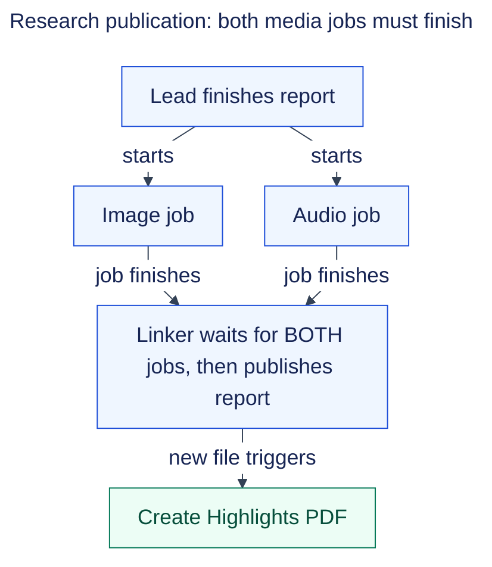

# Better Mermaid figures for research swarms

Independent research by **cdx**, 2026-10-20.

**Recommendation:** improve the existing `research/diagrams` workflow with a compact, reusable `research/mermaid` design macro, a clearer definition of a self-contained figure, and visual inspection at publication size. Keep the current manifest, artifact registration, and linker ownership. A new macro is a useful packaging choice; the substantive fix is changing what the agent optimizes and verifies.

This is a good idea with two qualifications. “Beautiful” should mean clear hierarchy, readable typography, deliberate spacing, and restrained emphasis. It should not reward decorative complexity. Also, instructions alone cannot establish that a figure is legible in the actual PDF or supported by GitHub. Use a small evaluation corpus and verify the real rendering surfaces before expanding the styling vocabulary.

## What I inspected and what remains uncertain

I independently inspected the installed macro's provenance and the `sase-research-artifacts` checkout at commit `6b56e4760cb83e8cd0873369752d04be2b317441`, its macro tests, and the chezmoi configuration at `d3ba1b3541483b07dcd999be06891f5600e3a10f`. I consulted primary Mermaid, GitHub, C4, W3C, and graph-readability sources and ran a small local rendering experiment. I did not consult another researcher's report, transcript, or findings.

The investigation supports a diagnosis of the **instruction contract**, not a measured failure rate across past research figures. No particular disappointing report was supplied, and I did not sample historical report contents. The proposed numeric budgets below are starting heuristics, not established universal limits.

The local tools report Mermaid CLI **11.4.2**, with Mermaid **11.6.0** beneath it. The live Mermaid documentation identifies itself as **12.2.0**. I did not verify the current GitHub runtime or render a final Highlights PDF. Those are explicit acceptance checks for implementation, not assumed successes.

## The current system already has most of the workflow machinery

The swarm's image segment runs after the lead and invokes `#research/image` when requested, then `#research/diagrams` when enabled. Diagrams can run without an infographic; by default the diagrams switch follows the image switch. The linker waits for the visual segment and publishes the report. Thus there is already a separate diagram macro and a diagram-only route. Changing `research/image` would target the wrong abstraction. [Swarm definition](https://github.com/sase-org/sase-research-artifacts/blob/6b56e4760cb83e8cd0873369752d04be2b317441/src/sase_research_artifacts/xprompts/research_swarm.md#L279)

The diagram macro already requires grounding in the registered lead report, candidate selection, syntax rendering, unique insertion anchors, an immutable companion manifest, and explicit `ready`/`none`/`failed` outcomes. It caps output at three diagrams normally and five for complex reports. The linker copies accepted Mermaid source and captions verbatim and adds figure references. Preserve these useful controls. [Diagram workflow](https://github.com/sase-org/sase-research-artifacts/blob/6b56e4760cb83e8cd0873369752d04be2b317441/src/sase_research_artifacts/xprompts/research_diagrams.md), [linker placement](https://github.com/sase-org/sase-research-artifacts/blob/6b56e4760cb83e8cd0873369752d04be2b317441/src/sase_research_artifacts/xprompts/research_swarm.md#L478)

The most consequential weaknesses are these:

| Current instruction or check | Likely consequence | Recommended change |
| --- | --- | --- |
| Rank candidates by how much report detail they reveal; seek extra detail behind infographic panels | Encourages coverage and detail over a specific reader benefit | Rank by the question answered and the ambiguity removed; panels are candidate hints |
| Labels about four words or fewer | Invites cryptic nouns and unexplained shorthand | Use the shortest unambiguous label; allow a short second line or extra words |
| No `style` or `classDef` | Removes useful visual emphasis as well as decoration | Allow a small, tested semantic palette through `classDef`; avoid arbitrary per-node styling |
| Avoid decision diamonds in top-down flows | Can obscure a genuine choice or test | Permit a diamond for a short real question when its rendered geometry works |
| Caption about fifteen words | Often insufficient for scope, assumptions, and takeaway | Permit one to three concise sentences where needed |
| Render, count SVGs, reject natural widths above roughly 1300 px | Validates syntax and a rough width bound, not comprehension or final legibility | Inspect the rendered figure and caption, including height and effective text size |
| No mandatory standalone reading exercise | A graph can depend on surrounding jargon or the infographic | Require comprehension with the report prose hidden |

These are reasoned hypotheses from the current rules, not proof that every output suffers from them. The example inside the macro illustrates the issue particularly well: arrows between “Lead report,” “Image agent,” “Audio agent,” and “Linker” do not say whether they mean invocation, input transfer, or waiting. Converging arrows alone also do not establish an AND condition. The final node combines a placeholder filename, a VCS operation, and a PDF hook. The drawing is syntactically compact but relies on knowledge of the workflow. [Drawing rules and example](https://github.com/sase-org/sase-research-artifacts/blob/6b56e4760cb83e8cd0873369752d04be2b317441/src/sase_research_artifacts/xprompts/research_diagrams.md#L77)

## What the external evidence supports

**Start with a message and a medium.** Rougier, Droettboom, and Bourne advise choosing the figure's message before drawing, adapting it to its display medium, and using captions to explain what the picture cannot carry alone. Applied here, the agent should state the question a figure answers before choosing Mermaid syntax. A screenshot detached from its report needs more explicit context than a figure explained by nearby prose. [Ten Simple Rules for Better Figures](https://journals.plos.org/ploscompbiol/article?id=10.1371/journal.pcbi.1003833)

**Titles and relationship semantics matter.** C4's notation guidance emphasizes scope, understandable terminology, meaningful relationship labels, and explicit notation. Borrow those principles without imposing C4's architecture-specific element taxonomy on every diagram. In particular, a dependency arrow and a data-flow arrow should not silently share a meaning. A legend is useful for custom encodings; it need not be a second miniature diagram when plain labels already explain everything. [C4 notation](https://c4model.com/diagrams/notation)

**Layout aesthetics help, but semantics and tasks matter too.** Graph-drawing experiments found strong preferences for reducing crossings and for alignment. Other work found that usability depends on the graph's semantic domain, making a blanket “this layout algorithm is best” claim unjustified. My inference is to simplify crossings and preserve reading order, then evaluate the reader's actual task. [Purchase, Pilcher, and Plimmer](https://pubmed.ncbi.nlm.nih.gov/21173454/), [Purchase, Carrington, and Allder](https://research.monash.edu/en/publications/empirical-evaluation-of-aesthetics-based-graph-layout/)

**Accessibility improves standalone interpretation.** Mermaid supports `accTitle` and `accDescr`, generating SVG title/description and ARIA associations. These are not a visible title or caption, and their presence does not prove a downstream PDF preserves accessibility metadata. W3C recommends a short identifying description and a fuller textual equivalent for complex images. Keep an intelligible visible caption as well. [Mermaid accessibility](https://mermaid.js.org/config/accessibility.html), [W3C complex images](https://www.w3.org/WAI/tutorials/images/complex/)

**Color should carry redundant, deliberate meaning.** Use text and shape to preserve meaning when color disappears. As design targets, normal text should reach 4.5:1 contrast and necessary graphical cues 3:1 against adjacent colors. These are useful palette checks, not a claim that passing two ratios makes a PDF fully accessible. [W3C text contrast](https://www.w3.org/WAI/WCAG22/Understanding/contrast-minimum.html), [W3C non-text contrast](https://www.w3.org/WAI/WCAG22/Understanding/non-text-contrast.html)

**Do not depend on the newest renderer feature.** GitHub explicitly recommends checking its Mermaid version using an `info` diagram. Mermaid supports per-diagram frontmatter configuration; its old init directives are deprecated. Theming documentation specifies `base` for custom theme variables and hexadecimal color values. A conservative preset is more defensible than asking the model to invent a new theme every time. [GitHub diagram support](https://docs.github.com/en/get-started/writing-on-github/working-with-advanced-formatting/creating-diagrams), [Mermaid directives](https://mermaid.js.org/config/directives.html), [Mermaid theming](https://mermaid.js.org/config/theming.html)

There is even a useful documentation discrepancy: the live layout page says ELK became bundled and default in version 12, while the theming page still describes Dagre defaults and separately registered ELK. Do not resolve this by guessing which paragraph governs every host. Name and test the chosen renderer profile; record the actual versions and layout. ELK can be an experiment for difficult graphs, not a universal requirement. [Layout documentation](https://mermaid.js.org/config/layouts.html), [theming defaults](https://mermaid.js.org/config/theming.html)

## Adjustments I would make to the requirements

1. **Make usefulness the first requirement.** Before drawing, identify a question such as “Which completion is required before publication?” or “What happens when validation fails?” A diagram should expose a relationship, branch, state change, or boundary that prose makes harder to inspect. A connected list of nouns is not enough.
2. **Define the unit of independence.** The default deliverable is a figure plus visible title, caption, and any needed key. Its essential subject and relation meanings should also survive in a cropped image. Do not require every qualifier from a long report inside the boxes.
3. **Select from the report, with the infographic as a secondary aid.** The infographic's panels are a presentation choice, not the authoritative decomposition of the topic. Continue reading the registered lead report and grounding every substantive relationship there. Existing instructions already admit mechanisms omitted from the infographic; make that freedom central.
4. **Replace restrictive geometry rules with readability outcomes.** Keep soft budgets, but allow an extra word, a diamond, a useful second line, or a different direction when it improves understanding. Do not make four words or five ranks into semantic constraints.
5. **Allow restrained, portable styling.** Start with one approved preset, two or three semantic classes, and explicit text labels. Keep interactive links, arbitrary HTML labels, external icon dependencies, and arbitrary CSS out of the initial profile. Colors are an enhancement; the graph must remain understandable without them.
6. **Allow “no diagram” as a successful editorial decision.** Preserve the existing caps initially, to avoid changing several policies at once. Raise the selection bar rather than adding a count target. Permit omission after visual review if simplification destroys the point.
7. **Treat visual verification as separate from parse verification.** A valid figure may still be ugly, misleading, or unreadable. If visual inspection cannot be completed, record that limitation; do not silently call it visually validated. Preserve publication without optional diagrams when tooling fails.

I would retain the existing prohibition on turning an already adequate comparison table into a diagram for this first iteration. I would soften the broader notion of duplication: expressing an important relationship both in prose and visually can aid understanding. The test should be whether the picture improves inspection, not whether it repeats any fact.

## A reusable macro with a narrow responsibility

Use **`#research/mermaid`**, initially packaged beside the other research macros. This name fits the plugin's existing namespace and avoids claiming a generic `#mermaid` name globally. It should be a prompt part, not a new agent, workflow, memory note, or generated skill.

`research/diagrams` should continue owning source selection, candidate caps, CLI invocation, insertion anchors, manifest structure, registration, and output variables. The new macro should own design and review rules only. Invoke it once in the diagram-design stage and remove conflicting duplicated guidance. Merely adding another block beneath the current bans would leave the agent with contradictory instructions.

A suitable draft of the reusable content follows. It is deliberately short enough to read as a working contract:

> Design each figure to answer one named reader question. In scratch notes, state the audience, scope, one-sentence takeaway, and source passages supporting the important entities and relationships. Keep proposed behavior, observed behavior, uncertainty, and optional paths distinct.
>
> Choose the representation that exposes that relationship: a flowchart for branching work, a sequence diagram for ordered exchanges between actors, a state diagram for a lifecycle, and ER or class notation only for actual structure. If a short list or table answers the question more clearly, propose no Mermaid figure.
>
> Give the figure a visible title identifying its subject and scope. Use concrete labels that remain intelligible without the report. Name the relevant actor or object. Expand unfamiliar abbreviations in the figure or caption. Use short phrases, but never shorten away meaning.
>
> Make arrow meanings explicit. Label important relationships with verbs or conditions. Do not mix data flow, execution order, and dependency without explaining the distinction. Show whether converging branches mean any input or all inputs. Preserve conditions and failure paths that affect the stated takeaway; do not invent them for completeness.
>
> Use a clear reading direction, a consistent abstraction level, and meaningful grouping. Start around 5–9 main elements, then simplify or divide by reader question when crowded. These are soft budgets. Never remove essential relationships merely to meet a count. Avoid decorative nodes, redundant legend structures, and layout-only semantic arrows.
>
> Use the approved renderer profile and restrained semantic colors. Every distinction must survive grayscale. Favor legible type, whitespace, and consistent geometry over novelty. Use decision diamonds for real short questions if they fit. Explain nonstandard notation.
>
> Supply a caption explaining the takeaway, scope, and essential assumptions. Add `accTitle` and `accDescr`; do not treat them as a substitute for visible context. Follow the caller's manifest contract.
>
> Render the exact source. Inspect the figure at the intended reading size with its title and caption, then hide the surrounding report. Check clipping, tiny type, crossed or ambiguous arrows, confusing groups, misleading emphasis, and unsupported statements. Confirm that the named question is answerable. Revise and rerender after edits; if the figure cannot be made useful, omit it and explain why.

The 5–9-element suggestion is an editorial starting point, not a claim about working-memory capacity. Sequence diagrams need budgets for participants and messages; a class diagram may reasonably have fewer boxes with more internal content. Do not apply one node-count rule to all types.

## Rendering experiment and what it actually demonstrated

I rendered the existing macro example and a more explicit version using local `mmdc` 11.4.2 / Mermaid 11.6.0. The existing example rendered at approximately **360 × 406** SVG units. Adding a visible title, verb labels, a separate AND-join explanation, accessible metadata, and a restrained palette produced a roughly **464 × 673** figure. Both initial variants rendered to SVG and PNG, and I inspected both PNGs.

The second was easier for me to interpret semantically, but much taller. That is an investigator judgment, not a blinded user result. It demonstrates why “add context” needs a simultaneous layout review. Both figures pass the current 1300 px width check; that check does not notice the height penalty.

A compact revision merged waiting and publication into one explicitly labelled responsibility and reduced inter-rank spacing. Its SVG measured roughly **412 × 476**. SVG generation succeeded, but the subsequent Mermaid PNG attempt stalled and I terminated it. A colon in an unquoted YAML title also caused a real parse failure during iteration, fixed by quoting the title. These outcomes reinforce the need for bounded render commands and actual inspection; an attractive-looking source block is not enough.

The example below is that compact revision's exact Mermaid source. Treat it as a prototype of the wording and structure, not an approved cross-renderer theme. It depicts the current publication ordering with **both image and audio enabled**; the graph is deliberately not a complete map of every swarm configuration.



*Scope: both optional media jobs are enabled. The linker waits for both jobs to finish, even if outputs are missing; adding the published report triggers PDF creation. Green emphasizes the final output.*

This removes opaque filename syntax and makes the join explicit without adding a separate visual subsystem. The accompanying caption carries the missing-output qualification; it is also present in `accDescr`. If that qualification is central to a figure's intended question, it should move into visible graph text rather than remaining only in its caption.

For a practical size estimate, use both dimensions:

```text
scale = min(1, available_width / rendered_width,
               available_height / rendered_height)
effective_font_size = rendered_font_size * scale
```

For example, with an illustrative 650 × 400 CSS-pixel budget, the first expanded figure's 18 px text would scale to about 10.7 px if fitted to that height; the compact revision would be about 15.1 px. These are calculations under an explicit scaling assumption, not measurements of the production PDF. The real PDF may use different physical sizing or page-breaking rules. Establish a physical text-size target in that pipeline and inspect a page at normal reading size. A source-level font size alone proves little.

Local environment note: the first smoke render failed because Chrome's Unix socket path exceeded its length limit under the inherited temporary-directory path. A command-local short `TMPDIR` allowed rendering to start; no sandbox change was needed. Classify browser startup failures separately from diagram syntax errors. Do not repeatedly rewrite a valid graph to fix an environmental failure.

## Concrete implementation surfaces

All initial prompt changes belong in the **sase-research-artifacts plugin**, not SASE's Python/Rust core and not a chezmoi override.

| Surface | Proposed change |
| --- | --- |
| `src/sase_research_artifacts/xprompts/research_mermaid.md` | Add the reusable design contract, with `name: research/mermaid`; include one small worked example if its benefit justifies the tokens |
| `src/sase_research_artifacts/xprompts/research_diagrams.md` | Invoke the contract; replace the conflicting drawing bans; rank candidates by reader benefit; require visual review; allow longer useful captions |
| `src/sase_research_artifacts/xprompts/research_swarm.md` | Change linker instructions only if new visible figure metadata is introduced; preserve byte-identical accepted source and caption |
| `tests/test_macro_loading.py` | Add discovery and recursive-expansion coverage, update changed contract assertions, preserve diagram-only/image-only and failure-status behavior |
| `tests/test_wheel_contract.py` | Include the new packaged macro in resource expectations; ensure a built distribution includes it |

The package tests already check an exact macro set and explicitly enumerate packaged resource files. Adding a macro requires updating those expectations. Existing prompt substring assertions establish that words are shipped; they do not establish diagram quality. [Macro tests](https://github.com/sase-org/sase-research-artifacts/blob/6b56e4760cb83e8cd0873369752d04be2b317441/tests/test_macro_loading.py#L213), [wheel tests](https://github.com/sase-org/sase-research-artifacts/blob/6b56e4760cb83e8cd0873369752d04be2b317441/tests/test_wheel_contract.py#L100)

**Keep the manifest small.** Existing `anchor`, `illustrates`, `caption`, and Mermaid body are enough for an initial implementation if the visible title is inside the fence. Do not require a schema migration just to introduce better questions and labels. Record review evidence in the existing check area or one optional field: renderer/version, source digest if available, tested dimensions, visual-review result, and any unsupported surface. A digest can tie evidence to the exact source; it does not prove comprehension.

**Coordinate any visible metadata change with the linker.** Adding a `title`, `legend`, or longer description outside the Mermaid fence without teaching the linker to copy it would silently discard that information. Preserve the rule that the linker may omit a bad figure but does not redraw a checked one. If the linker changes the diagram text, it would invalidate the producer's verification.

**Keep styling portable.** A light-background palette suitable for print is a reasonable first preset. Check it in the actual PDF and GitHub light/dark presentation. Avoid assuming a PDF-only CLI config will follow a fence onto GitHub: any essential settings must travel in a supported diagram configuration or be guaranteed by both hosts. Keep the first preset small; do not require newly introduced looks, icon packs, animation, or experimental syntax.

**Do not make ELK mandatory.** Try an alternative layout only when the same graph remains crowded after simplifying its message. Mermaid documents that a subgraph's requested direction can be ignored when internal nodes connect outside; adding more subgraphs is not a reliable way to force a layout. [Flowchart subgraph limitation](https://mermaid.js.org/syntax/flowchart.html#direction-in-subgraphs)

**Do not upgrade the global renderer as part of a prompt-only experiment.** Pick and record a known working CLI/engine pair. If an on-demand fallback remains, pin its tested version instead of relying on an unversioned `npx` download. A renderer upgrade should have its own compatibility evidence. The production hook is configured to invoke `bob ref create`, so a local Mermaid success is not a full test of the PDF pipeline. I did not inspect or change that renderer.

If repeated use later justifies a reusable render/check command, make it a small deterministic adapter with explicit inputs and outputs. A new shared SASE backend service, a new swarm agent, or a universal diagram framework is unnecessary for the first change.

## How to tell whether this works

Use a small fixed evaluation set before changing the default. Eight representative excerpts would be enough for an initial editorial experiment: a parallel workflow with an AND join, a fallback path, an actor exchange, a lifecycle, a dependency structure, a conditional migration, a comparison best kept as text/table, and a survey that should yield no diagram. Include source-supported uncertainty and long real names in several cases.

Compare four conditions on the same inputs, model, and inference settings:

1. Current instructions.
2. The new semantic and standalone-context contract, with existing styling.
3. The contract plus a controlled theme.
4. The contract, theme, and rendered-image revision loop.

This separates the benefit of writing and selection from the benefit of colors, and from the benefit of visual review. These are proposed evaluations; I did not run this experiment. Use a few repeated generations for promising conditions because a single output is an unreliable estimate of prompt behavior. Do not add a permanent evaluation agent to every production swarm.

For each figure, give a reader only the figure and caption and ask: What is it about? What does an arrow mean? What must happen before the outcome? What happens on the important alternative path? What is the figure's main point? For structural diagrams, substitute questions appropriate to that structure. Time and answer correctness are more informative than an aesthetic preference alone. Then separately ask which presentation looks clearer and more polished.

A reasonable initial acceptance rubric is:

- **Fidelity:** no unsupported actor, ordering, condition, causal claim, or implementation-status implication. Reject the figure if this fails.
- **Standalone clarity:** the reader identifies subject, scope, key relation, and takeaway without opening the report.
- **Utility:** the named question is faster or less error-prone to answer with the figure than with prose alone; a useless diagram is not rescued by style.
- **Legibility:** no clipped text, overlapping labels, tiny fitted text, or arrows whose endpoints are unclear at normal publication size.
- **Presentation:** coherent grouping and emphasis, limited color roles, and an acceptable monochrome reading.
- **Portability:** accepted source renders in the local supported profile and in the intended publication surfaces.
- **Cost:** record output count, render attempts, elapsed time, and tokens; more figures or longer generation is not itself progress.

Use syntax/render fixtures to catch mechanical regressions and a human review of representative outputs to judge communication. Avoid exact pixel goldens across unpinned fonts and browser versions. If image-based model review is used, treat it as a first pass rather than the sole quality oracle: a recent replication found AI and human graph-reading preferences need not match. [Di Bartolomeo and colleagues, 2026](https://onlinelibrary.wiley.com/doi/full/10.1111/cgf.70436)

For rollout, first establish an approved baseline example, then use the existing `diagrams=true` route on a few representative reports. Keep the current caps and workflow unchanged while measuring the new contract. Expand styling or automation only when the baseline still produces a specific observed defect.

## Recommended solution

Implement a **small `research/mermaid` design macro called by the existing `research/diagrams` workflow**, replacing its conflicting compression and styling rules. Require a named reader question, explicit relationship meanings, a visible subject and scope, a useful caption, restrained tested styling, and a rendered review at final reading size. Preserve grounding, artifact registration, the existing manifest and linker responsibilities, bounded repair attempts, and publication without optional diagrams when they fail. Validate the change on a small comparison set and the actual PDF/GitHub surfaces. Start there; add neither a new agent nor a different diagram engine unless this measured approach reveals a limitation Mermaid cannot reasonably solve.
