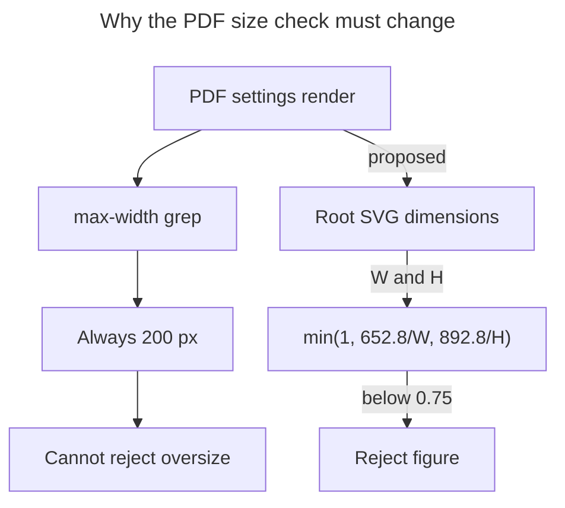

# Diagram proposals: Better Mermaid diagrams from the research swarm

Proposals for the swarm linker, not a report. Each diagram restates only what the source
report says.

```yaml
source: research:202610/research_swarm_mermaid_diagram_craft/research_swarm_mermaid_diagram_craft__final.md
producer: research.54.image
check: "mmdc 12.0.0 rendered 1 of 1 Mermaid diagrams"
```

## pdf-size-measurement

```yaml
anchor: |-
  Measure the root `<svg width height>`, not the `max-width` grep.
illustrates: |-
  Under the PDF settings, the max-width grep reads an internal 200 px value, while the proposed check uses root SVG dimensions to calculate PDF fit scale and reject figures below 75%.
caption: W and H are SVG dimensions in pixels; the proposed check rejects scale below 75%.
```


