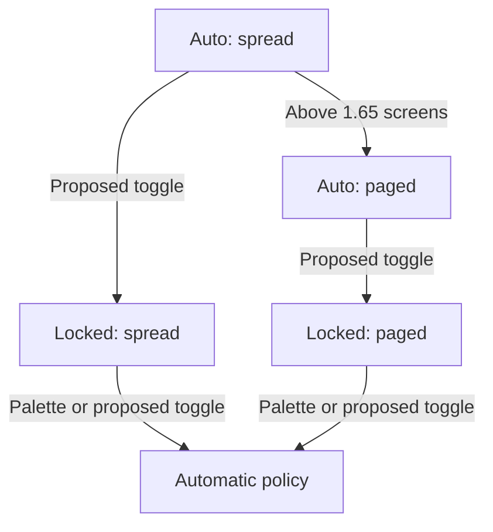
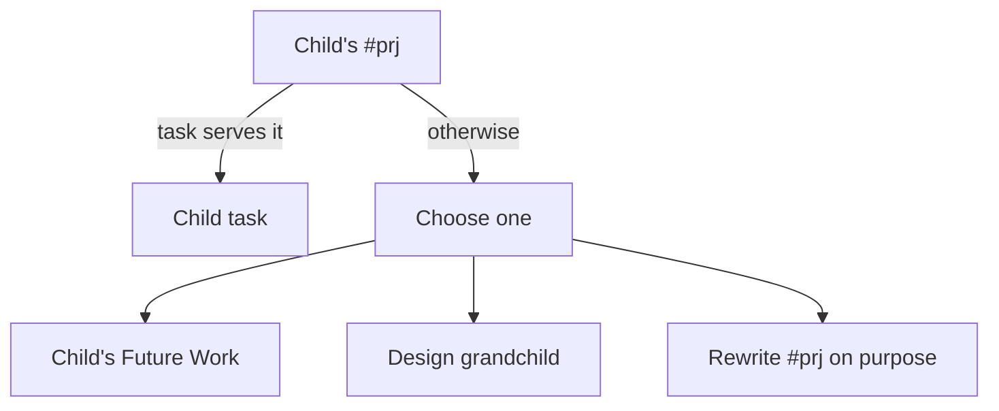
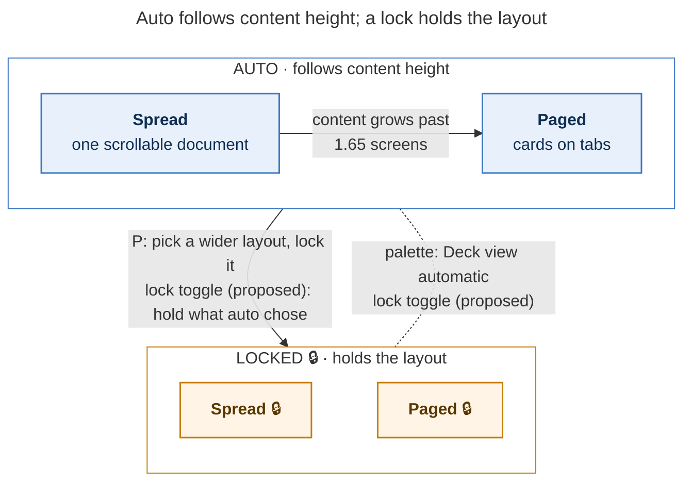
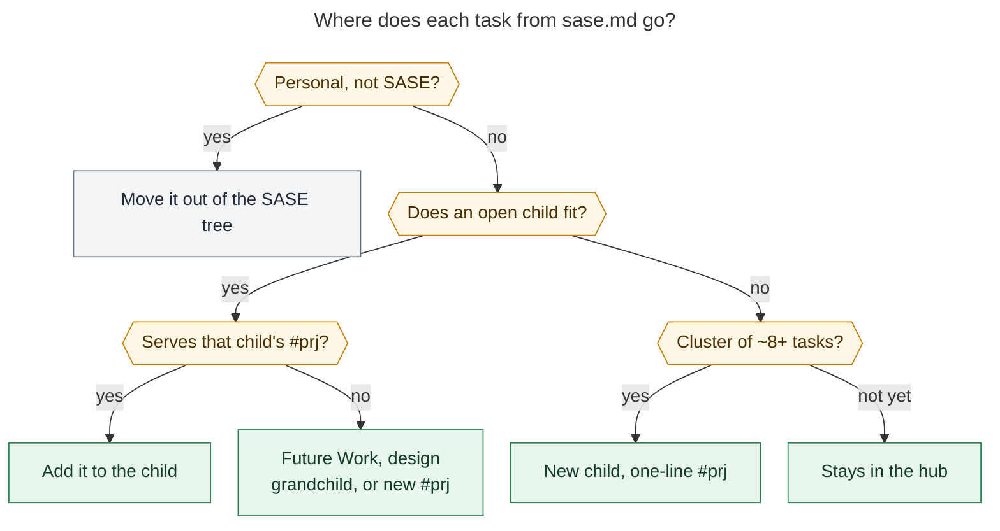
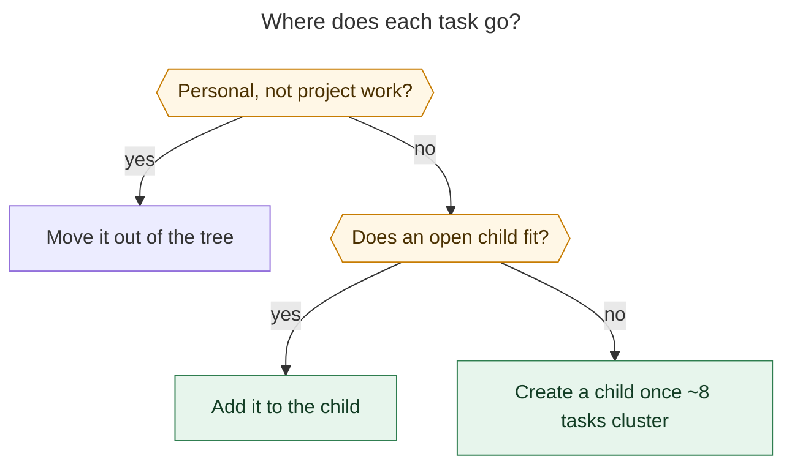

# Better Mermaid diagrams from the research swarm: what to change, and where the guidance should live

> **Research query:** The Mermaid diagrams that the `#research_swarm` image agent
> recommends are hard to understand on their own, not very useful, and not attractive.
> How should the agent's instructions change (possibly with Mermaid advice factored out
> into its own macro) so it produces more useful, easier to understand, and more
> beautiful diagrams? Critique the plan, call out justified requirement adjustments,
> and end with a recommended solution.

Researcher: `cld` (claude). Date: 2026-10-20. Sources inspected:
`sase-research-artifacts` `6b56e47`, `sase` `379040e699`, `bob-cli` `0e9f915a`, and every
diagram manifest the swarm has produced so far. All renders below used Mermaid 12.2.0,
the same version as the Highlights PDF renderer, with that renderer's settings.

## Bottom line

**Your instinct is right, but factoring the Mermaid advice out will not fix this on its
own.** The poor diagrams have four causes, and only one of them is missing advice:

1. **The agent is told to draw the wrong things.** `#research/diagrams` asks for
   *drill-downs* that add "at least two steps, branches, conditions, actors, or states
   the panel does not show". That rewards the most granular detail it can find, such as
   a refresh trigger or one sub-branch of one principle. It does not reward the picture
   the reader actually needs.
2. **The drawing rules forbid what makes a diagram readable and attractive.** Today's
   whole drawing brief is about ten lines, almost all of it prohibitions:
   - no `style` or `classDef`;
   - labels of "about four words or fewer, in the report's terms";
   - no decision shapes in `TD` flows.

   It never asks for a title, a legend, plain-language glosses, grouping, or visual
   hierarchy. The output is grey boxes with jargon labels.
3. **The agent never looks at what it drew.** The check is "does `mmdc` parse it, and
   is it under 1300 px wide". It also renders with Mermaid's *default* theme and font.
   The PDF uses a locked *neutral* theme and DejaVu Sans, so even the size check
   measures the wrong picture.
4. **The diagrams share an agent and a model with the infographic.** The `@image`
   alias puts `codex/gpt-6.1-sol` first because it can generate images. The diagrams
   are a text-and-taste job bolted onto that agent's fork.
   [The October 18 design research](#the-earlier-design-and-its-reopen-condition)
   named "`@image` models write weak diagrams" as a reason to reopen the design.

**What I recommend:**

- **Factor the craft out as a plugin-shipped *skill source*, not a plain macro.** Use
  `src/sase_research_artifacts/skills/mermaid_diagrams.md` with `skill: true`. One file
  then serves two uses:
  - `#research/diagrams` inlines it deterministically as `#skill/mermaid_diagrams`;
  - any agent on any provider (the lead, plan writers, docs agents) can load it on
    demand as `/mermaid_diagrams`.

  I verified that sase supports plugin `skills/` directories at the plugin's
  `sase>=0.18.0` floor.
- **Retarget selection** in `#research/diagrams` from "drill-downs" to "key figures":
  the decision, lifecycle, or mechanism that the bottom line depends on comes first.
- **Add a render-look-revise loop.**
  1. Render to PNG with a config that mirrors the PDF renderer.
  2. Look at the image and answer the figure's two or three "reader questions" from the
     picture alone.
  3. Check a short rubric, then revise. Stop after two rounds.
- **Then, as a measured follow-up, move diagrams into their own swarm segment** with an
  `@diagrams` model alias. It would run in parallel with the infographic. Do this if a
  small blind A/B on past reports shows the model matters.

The [prototypes below](#before-and-after-on-real-swarm-output) show the difference on
real swarm output. They also show why the look step matters: my own first drafts had
four layout defects and one fidelity slip, and I caught each one only by looking at the
render.

## What the swarm produces today

The diagrams feature landed on 2026-10-19, so the evidence is small: two swarms and four
diagrams.

- `deck_scroll_scope_tabs_and_layout_lock`: three flowcharts (`streaming-layout-lock`,
  `spread-direction-cue`, `bottom-emphasis-refresh`).
- `bob_sase_task_portfolio_split`: one flowchart (`existing-child-scope`).

All four are `flowchart TD`, unstyled, and five to eight nodes with two-to-four-word
labels. Here are two of them, exactly as published:



*Before: the published `streaming-layout-lock` diagram (432 × 616 px natural size in
the PDF renderer).*



*Before: the published `existing-child-scope` diagram (552 × 328 px).*

What a reader sees in the PDF, which renders them as grey neutral-theme boxes:

- **They don't stand alone.** "Automatic policy" is drawn as a fifth state that both
  locked states flow into. In fact it is the *container* of the two auto states, so
  the picture contradicts the model the report explains. "Choose one", "Child task",
  and "Child's #prj" mean nothing without the paragraph. No figure has a title, and
  none explains what solid or dashed lines mean.
- **They pick marginal content.** `bottom-emphasis-refresh` draws when an optional bold
  cue refreshes, which one sentence already says. `existing-child-scope` draws one
  sub-branch of principle 2 in a five-principle routing procedure. The procedure as a
  whole ("where does each task go?") is the useful picture, and nobody drew it.
- **They are visually flat.** Every node has the same shape and colour. There is no
  grouping, no emphasis on the main path, no difference between today's behaviour and
  proposed behaviour, and no start or end.

The infographic for the same deck report is clear and attractive. Its brief is a
10-line prompt. The diagrams' brief is 208 lines, most of it plumbing (manifest,
anchors, registration). Almost nothing in it describes what a good diagram *looks
like*.

## Why: the root causes in the current instructions

### Selection rewards granularity, not importance

Commit `9fcd3de` introduced the drill-down framing. It fixed a real problem: agents
were reaching zero by calling infographic overlap a repeat. But its pass test, "adds
detail its panel lacks: at least two steps … the panel does not show", plus ranking "by
how much report detail they reveal", points the agent at the finest-grained mechanisms.
Nothing asks the question that matters: *which picture would a reader most want while
trying to understand or act on this report?*

### The drawing rules produce cryptic labels and flat visuals

Section 4 of `research_diagrams.md` (lines 77-88) is the whole drawing brief:

- "No init directives, `click`, `style`, `classDef`, HTML, or icons."
- "Labels of about four words or fewer, in the report's terms."
- "In `TD` flows avoid decision diamonds."

Each rule has a reason. Width and height overflow in the PDF were real problems: the
earlier research measured 37% of the repo's Mermaid blocks printing below half size.
Together, though, the rules force jargon-dense, unstyled, unlabelled-structure
diagrams. The rules are also almost all negative. Anthropic's prompting guidance (as
summarized in [this write-up](https://prosperinai.substack.com/p/official-claude-prompting-everything))
is to say what to do and why, rather than only what not to do.

### No visual feedback, and the check measures the wrong render

The validation step proves only that Mermaid parses and that the width stays under
about 1300 px. Two problems:

- **The agent never views the image.** Every model on the `@image` chain can view a
  PNG, but the agent has no step that asks it to.
- **`mmdc` runs with default settings.** The Highlights PDF renderer forces
  `theme: neutral` and DejaVu Sans, and it locks `theme`, `themeCSS`, `themeVariables`,
  and `fontFamily` through Mermaid's `secure` list (bob-cli
  `scripts/web_clip/diagram_render.py`). The same diagram rendered 552 × 501 px under
  default settings but 552 × 552 px under the PDF settings, which is 10% taller.

The research literature is consistent on this. Rendering the output and critiquing the
*image* improves generated figures:

- MatPlotAgent's visual-feedback ablation scored 72.62 and 68.35 with feedback versus
  66.67 and 65.82 without it
  ([MatPlotAgent](https://arxiv.org/abs/2402.11453v3)).
- EvoDiagram uses a VLM critique of the rendered diagram to fix omissions and overlaps.
  It also splits *structure and type selection* from *visual style* into separate
  agents ([EvoDiagram](https://arxiv.org/pdf/2604.09568)).
- OmniDiagram's VIVA reward "interrogates" the rendered diagram with generated
  questions instead of matching code
  ([OmniDiagram](https://www.alphaxiv.org/abs/2604.05514)). That is the idea behind the
  reader-questions check below.

The same literature carries a caution: a weak critic can make things worse.
[VisJudge-Bench](https://arxiv.org/pdf/2510.22373) saw GPT-4o's score fall from 62.71 to
58.49 under feedback from a small untuned model. So the critique should come from the
strong drawing model itself, against concrete checks, and be capped at about two
rounds.

### The agent and model were chosen for a different job

The image agent forks the lead and runs `#research/image` and then `#research/diagrams`
in one turn. `@image` resolves to
`codex/gpt-6.1-sol@xhigh | grok/grok-4.6@xhigh | agy/gemini-3.8-flash-high`, which was
picked for image generation. Two consequences:

- The earlier design research flagged "dual-job load" as a risk.
- It made "`@image` models write weak diagrams" an explicit trigger for moving
  diagrams to "its own segment on a strong text model". The user's complaint is
  essentially that trigger firing.

The evidence cannot yet separate *model* from *instructions*, though. The instructions
alone explain most of what I see, which is why I sequence the split after the
instruction fix.

## What the PDF renderer actually allows

Bryan reads these reports as Highlights PDFs, so the PDF renderer is the binding surface.
I reproduced its Mermaid settings with `mmdc` 12.0.0, which bundles Mermaid 12.2.0, the
same version bob-cli vendors. I used theme `neutral`, DejaVu Sans, the extended
`secure` list, and `useMaxWidth: false`. Then I probed features one at a time.

**Works in the PDF render:**

- `classDef` + `class` statements, and `style` on nodes and subgraphs.
- Two separate `class` lines on one node stack (for example a colour class plus a
  dashed `proposed` class).
- Frontmatter `title:`.
- Frontmatter `config:` keys that are *not* in the secure list:
  `layout: dagre`, `flowchart: {rankSpacing, nodeSpacing}`.
- Markdown-string labels (`` "`**Paged**` cards on tabs" ``) with real bold, plus
  `<br/>` line breaks.
- Hexagon (`{{"…"}}`) and stadium (`(["…"])`) shapes, and the new `@{ shape: … }`
  syntax.
- Dotted (`-.->`) and thick (`==>`) edges.
- `stateDiagram-v2` composite states with `classDef`.
- `sequenceDiagram` `box`, `rect rgb(…)`, `autonumber`, and notes.

**Ignored:**

- `%%{init}%%` or frontmatter `theme`, `themeVariables`, `themeCSS`, and `fontFamily`.
  A probe that set `primaryColor: "#ff0000"` rendered neutral grey. Diagram-level
  theming therefore cannot reach the PDF, but `classDef` styling can.

**Gotchas I hit, which belong in the guidance:**

- `**bold**` inside an ordinary quoted label renders literally. Bold needs a backtick
  Markdown string.
- `class B focus,proposed` silently applies nothing (the comma list is for node IDs),
  and `B:::focus:::proposed` is a parse error. Use two `class` lines.
- `linkStyle` by index is fragile. With edges into subgraphs, my index-based colours
  landed on the wrong edges.
- An edge that ends on a subgraph border can hide its arrowhead.
- Mermaid 12's default layout is ELK. On one small flowchart it produced odd jogs that
  `layout: dagre` did not. I have only a couple of samples, so let the look step
  choose.
- `stateDiagram-v2` with `direction LR` composites rendered 1142 px wide. Wide
  side-by-side layouts overflow the ~650 px column quickly.
- The macro's width check, `grep -o 'max-width: [0-9.]*px' | head -1`, breaks under the
  PDF-mirroring config. With `useMaxWidth: false` the first match is an unrelated
  internal `max-width: 200px`. Read the root `<svg width=… height=…>` instead.
- PNG export occasionally failed with a Puppeteer `ConnectionClosedError`. A retry, or
  `-s 1.5` instead of `-s 2`, worked.
- On this host the global `mmdc` (11.4.2) cannot find its Chrome. The macro's `npx`
  fallback (12.0.0) works.

**Dark mode.** I re-rendered a styled diagram under Mermaid's `dark` theme as a proxy
for GitHub dark mode. Light fills with an explicit dark `color:` stayed legible.
Practitioners report that GitHub's dark mode makes text unreadable when a `classDef`
sets a light fill without a text colour
([GitHub discussion](https://redirect.github.com/orgs/community/discussions/35733)). So
every class must set `fill`, `stroke`, *and* `color`.

**GitHub's Mermaid version is unknown.** I could not confirm which version github.com
renders, and its docs tell you to check it yourself
([GitHub docs](https://docs.github.com/en/enterprise-server@3.16/get-started/writing-on-github/working-with-advanced-formatting/creating-diagrams)).
A ` ```mermaid ` block containing just `info` reports the version. Until someone checks,
prefer long-standing syntax (`classDef`, subgraphs, `{{ }}` hexagons, Markdown
strings) over `@{ shape: … }` and the newer diagram families.

## Before and after on real swarm output

I redrew the two diagrams above from the same report passages, following the guidance I
recommend, and iterated with the render-look loop. These are prototypes to show the
direction, not drop-in replacements.

### Layout lock: modes, not a five-node flow



*After: auto is one mode with two layouts, a lock holds either one, and only the palette
or the proposed toggle releases it (604 × 486 px, so it prints at full size).*

What changed and why:

- **Modes are containers.** The two auto layouts sit inside "AUTO" instead of flowing
  into a fake "Automatic policy" state.
- **Labels carry a gloss.** "Paged: cards on tabs" can be read without the report.
- **The title states the claim.** It sits inside the figure, so it survives a page
  break.
- **The `P` path is drawn.** The old diagram omitted it, even though the report's key
  insight is that `P` locks *as a side effect* while the toggle "holds what auto chose".
- **Colour separates the two modes,** and the text says "(proposed)" wherever a path is
  proposed.

The loop mattered here. Draft 1 drew LOCKED above AUTO, and its index-based
`linkStyle` coloured the wrong edges. Draft 2 still read bottom-up. Draft 3, above,
reads top-down.

What I would still fix: the dashed edge's arrowhead hides against the AUTO border. The
skill tells the next author to route such an edge node-to-node.

The emoji renders in my Chrome but depends on fonts. I recommend omitting emoji in
production; here it helps by echoing the TUI's own `🔒`.

### Task routing: the whole decision, not one branch of it



*After: the report's five principles as one routing decision; amber asks, green is where
the task lands (699 × 717 px, about 0.93 scale).*

What changed and why:

- **Scope.** It draws the decision the section exists to support, not one branch of
  principle 2.
- **Shapes.** Questions are compact hexagons, because diamonds made draft 1
  774 × 1172 px. Answers sit on the edges.
- **Size.** Dropping the start node and tightening the spacing took it from 1172 px to
  717 px tall without cutting content.

**The fidelity lesson.** My first draft had a "no → keep it in the hub" branch, which I
had inferred. I checked the report and found the hub keeps cross-cutting tasks and
small clusters "once there are about 8", so I changed the label to "not yet". I also put
"personal" first, an ordering the report's numbered principles do not state.

Bigger-picture diagrams invite this kind of invented structure. The fidelity check must
stay, and it needs teeth: trace every box and edge to a sentence.

### The third diagram should simply not exist

`bottom-emphasis-refresh` (refresh triggers for an optional bold cue) fails the test I
propose: one sentence in the report already says it, and the bottom line does not
depend on it. Under key-figure selection it would be rejected, and the deck report would
get two diagrams instead of three.

### Theme polish alone is not enough

I also rendered the old `bottom-emphasis-refresh` diagram unchanged under a curated
house theme: Mermaid `base` with a blue/amber palette. It looks noticeably more polished
than neutral grey, and every diagram in every PDF would get it free, including the
lead's own. But it is still a picture of the wrong thing with jargon labels. Theme is
polish, not meaning, so it is an optional extra rather than the fix.

## Critique of the plan

### What is right

- **Instructions are the main lever.** The current brief actively causes the flat,
  cryptic output, so rewriting it will help.
- **Factoring the Mermaid craft out is right.** It is general knowledge (types, layout,
  labels, styling, renderer quirks) that does not belong in a research-plumbing macro.
  The lead already writes Mermaid inline: the October 18 research counted 141 blocks in
  the repo, 37% of them printing below half size. The linker copies those verbatim. A
  shared skill would improve them too.
- **Keeping Mermaid as the medium is right.** It is text, renders natively on GitHub and
  in the PDF, and stays diffable. D2 and Graphviz look better but render in neither
  place. Raster diagrams from the image model cannot be checked for fidelity.

### What is missing or risky

- **A pure "more advice" change will under-deliver.** Without the look step the agent
  still cannot see what it drew, and without retargeting it will still draw marginal
  mechanisms beautifully.
- **A style guide stacked on 208 lines risks over-constraint.** The new guidance should
  *replace* the current drawing section, not sit beside it. It should be phrased
  positively, with reasons and two or three worked examples (models imitate examples
  more reliably than lists of bans).
- **"Beautiful" has a ceiling under a locked neutral theme.** Inside the plugin, beauty
  has to come from structure, grouping, emphasis, consistent shapes, and a small
  semantic palette. Theme-level beauty needs a change to the PDF renderer, which is
  Bryan's own tool, outside this plugin.
- **Colour is a fidelity and accessibility risk.** It can imply categories the report
  never stated, and it vanishes in grayscale. So meaning should always be carried in
  text as well, with at most about three classes per figure.
- **"Its own macro" is the wrong container.** A plain `#research/mermaid` macro is only
  reachable by prompts that inline it. A skill source is a macro *and* an on-demand
  skill. That matters because the lead and other agents should use it without paying
  its token cost on every turn.

### Would I take a different approach?

Partly. These are the alternatives I weighed:

- **Only add a Mermaid style macro.** Necessary, not sufficient (above).
- **Only change the PDF renderer's theme.** It is cheap and lifts every PDF diagram
  immediately, but it fixes neither selection nor labels, and GitHub does not get it.
  Worth doing later.
- **Have the image model draw diagrams as raster images.** Rejected: not searchable,
  garbled text risk, no fidelity check, and binary bloat in a public repo.
- **Switch to D2, Graphviz, or Excalidraw.** Rejected: bob renders only Mermaid, and
  GitHub renders only Mermaid inline.
- **Have the linker draw.** Rejected, as before: it breaks the linker's "editor, not
  researcher" contract.
- **A dedicated diagrams agent on a strong text-and-vision model.** I would do this, as
  a measured second step. It removes the dual-job load and lets diagrams use a
  different model from image generation. It also runs in *parallel* with the
  infographic, so the linker's critical path becomes max(image, diagrams) instead of
  image + diagrams. The cost is one more fork of the lead's conversation and one more
  wait edge on the linker.
- **A deterministic Mermaid lint.** Worth adding later: node count, label length,
  `classDef` completeness, banned directives, and measured size. The author of
  mermaid-sonar found that telling an agent a diagram is "too complex" does not work
  reliably, while numbers do
  ([mermaid-sonar](https://dev.to/entropicdrift/mermaid-sonar-detecting-hidden-complexity-in-diagram-documentation-3461)).
  For now the measured width and height in the look step cover the most important part.

## Requirement adjustments

These are changes to the request as stated. Each one is deliberate.

- **R1. Fix more than the instructions.** Add a render-look-revise loop and a check that
  matches the PDF renderer. Instructions cannot make an agent see its output, and the
  current check renders a different picture from the one Bryan reads.
- **R2. Make the factored-out guidance a plugin skill source, not a plain macro.** Use
  `skills/mermaid_diagrams.md` with `skill: true`: `#research/diagrams` inlines it as
  `#skill/mermaid_diagrams`, and other agents can load it as `/mermaid_diagrams`. Ship
  it in `sase-research-artifacts`, which is public and on PyPI. Do not use Bryan's home
  macros, because the published plugin cannot depend on them. Discovery is first-wins
  (project, then home, then plugin), so a home copy can still override it.
- **R3. Reverse an earlier explicit design choice.** Replace "drill-downs into
  infographic panels, ranked by revealed detail" with "key figures, ranked by how much
  the report's conclusion depends on them". Keep the anti-zero safeguards that motivated
  `9fcd3de`: the candidate list comes first, and infographic overlap is never by itself
  a reason to reject.
- **R4. Lift the blanket ban on `classDef` and `style`.** Replace it with a fixed
  semantic palette that always sets fill, stroke, and text colour. Keep the bans on
  theme directives (the PDF ignores them anyway), `click`, HTML other than `<br/>`, and
  icons. Add bans on emoji and index-based `linkStyle`.
- **R5. Replace "about four words" labels with a stand-alone standard.**
  - Require a title phrased as the figure's question or claim.
  - Allow a bold name plus a short gloss, up to about eight words on two lines.
  - Label every non-obvious edge.
  - Define every abbreviation.

  Legibility is still enforced, but by *measured* width and height rather than by word
  count.
- **R6. "Beautiful" means clean, consistent, and purposeful within the PDF's locked
  neutral theme.** Theme-level polish is a separate, optional change to the PDF
  renderer.
- **R7. Measure before scaling further.** Rate the next swarms' figures on the rubric
  before moving the cap toward five or splitting the agent.

## Recommended solution

### Phase 1: one `sase-research-artifacts` change

1. **Add `src/sase_research_artifacts/skills/mermaid_diagrams.md`** (`skill: true`).
   It holds roughly 120-160 lines of positive, reasoned guidance; see the
   [draft in Appendix A](#appendix-a-draft-skill-source):
   - takeaway sentence plus reader questions before drawing;
   - a type chooser keyed to the shape of the content;
   - stand-alone labelling rules;
   - fit rules measured in pixels;
   - the semantic palette;
   - the PDF-mirroring render config, written inline so it needs no package path;
   - the render-look-revise loop with its rubric;
   - two compact worked examples;
   - the gotchas listed above.

   Keep it renderer-generic in wording: the plugin's
   `tests/test_no_bob_dependency.py` forbids the word "bob" in sources and docs.
2. **Edit `xprompts/research_diagrams.md`:**
   - **Sections 2-3 (candidates and decision).** For each `##` section, and each
     infographic panel when one exists, record the reader's question that a picture
     answers faster than prose. Answers worth drawing are about order, branching,
     state, ownership, or before-versus-after. Rank candidates this way:
     1. what the bottom line depends on;
     2. the today-versus-proposed contrast;
     3. failure and fallback paths;
     4. drill-downs.

     Reject anything one sentence already explains, and short linear chains. Keep the
     candidate-list-first rule, the anti-zero rule, the fidelity rules, the
     no-repeat-of-tables rule, and the cap.
   - **Section 4 (draw).** Replace the bans with: follow `#skill/mermaid_diagrams`.
     Labels may gloss report terms in plain words but add no facts; proposed stays
     marked as proposed.
   - **Section 5 (validate).**
     - Keep the CLI probe and the `Found N mermaid charts` check.
     - Add `-c <scratch>/pdf.json` and the PNG look step.
     - Measure the root `<svg width height>` instead of grepping `max-width`.
     - Fail a figure above ~650 px wide unless it still prints at 0.75 scale or more,
       or above ~500 px tall.
   - **Section 7 (manifest).** The `caption` becomes the takeaway assertion, still at
     most about 15 words. Optionally add `review:` to the YAML, for example
     `review: "604x486 px; reader questions answered; 2 rounds"`.
3. **Update the tests** in `tests/test_macro_loading.py` that pin today's wording:
   - "drill-downs";
   - "adds detail its panel lacks";
   - the `max-width: [0-9.]*px` grep.

   Add a test that `#research/diagrams` references `#skill/mermaid_diagrams` and that
   the skill loads from the plugin's `skills/` directory.
4. **Authoring gotcha.** Macro bodies are Jinja templates. Fenced code blocks are
   protected from Jinja rendering (I checked `protect_fenced_blocks` in
   `sase/macro/_jinja.py`), but inline code is not. Mermaid's hexagon syntax `{{"…"}}`
   must therefore appear only inside fences in the skill, or inside
   `…`.
5. **Update the docs:** `docs/macros.md` and the AGENTS.md architecture line.

The linker needs no change. The manifest format, anchors, figure `<div>`s, and
byte-identical placement all still hold. A Mermaid fence that starts with `---`
frontmatter is still just a fence to pandoc and the PDF renderer.

### Phase 2: decide with a small blind A/B, then probably split the agent

- **Build a small eval set.** Take about five past `__final.md` reports that describe
  mechanisms, including the two above. Run the Phase 1 diagrams prompt over each with
  `@image` (codex first) and with a strong text-and-vision model such as
  `claude/opus@high`. Bryan rates each figure blind on three questions:
  1. Can I understand it without the report?
  2. Is it the picture I'd want here?
  3. Does it look good?
- **If the model matters, or the image agent becomes the linker's long pole, split.**
  1. Add a `research.{N}.diagrams` segment that forks the lead, waits on `.final`, and
     runs `#research/diagrams` with a new `diagrams_model` input. Its default would be
     a new `@diagrams` alias in `default_config.yml`, in the `researchers` bucket.
  2. The image segment then runs only for `image=true`.
  3. The linker waits on `.diagrams` and reads its `diagrams` variable.

  The new selection rule does not need the infographic, so the two can run in parallel.

### Phase 3: optional extras

- **Point the lead at the skill.** One sentence in the lead's step 4: "if you draw a
  Mermaid diagram, use your `/mermaid_diagrams` skill". This only works where the skill
  is deployed through `sase skill init`.
- **A deterministic lint** (`python -m sase_research_artifacts.mermaid_lint`) that
  prints node count, longest label, missing text colour in a `classDef`, banned
  directives, and measured size, so the loop gets numbers.
- **A `replaces:` manifest field** for redrawing a lead diagram that prints below half
  size (proposed in the earlier research).
- **A curated house theme in bob-cli's PDF renderer**: `base` plus a small palette
  instead of `neutral`. It lifts every PDF diagram's baseline and sits outside the
  plugin.

### How to tell whether it worked

After about five to ten swarms with diagrams, check:

- every published figure has a title, and its reader questions are recorded as
  answered;
- at least 80% of figures print at 0.75 scale or more, and none exceed half a page;
- Bryan's ratings on the three A/B questions improve over today's four diagrams;
- the linker's omission rate does not rise.

## The earlier design and its reopen condition

The October 18 research (`research_swarm_mermaid_handoff_to_linker`) designed this
feature around four guardrails: fidelity, legibility, restraint, and fail-open. Those
are still right. Its bans on `style` and `classDef` came from a portability caution
("GitHub pins its own Mermaid version … stay on core diagram types"). They did not come
from any test showing that styling breaks the PDF; my probes show styling renders
there.

Its rollout section named the reopen trigger this complaint matches: "`@image` models
write weak diagrams: move `#research/diagrams` into its own segment on a strong text
model". It also proposed a vault-free `bob ref diagrams check --json` for exact
renderer parity. That is still the ideal check. Until it exists, the inline
PDF-mirroring `mmdc` config is a close, dependency-free stand-in, because both use
Mermaid 12.2.0.

## Appendix A: draft skill source

This is a starting point, not final text. Note that the hexagon example sits inside a
fence, per the Jinja gotcha above.

````markdown
---
name: mermaid_diagrams
skill: true
description:
  Draw Mermaid diagrams that a reader understands without the surrounding text and
  that look clean on GitHub and in a pandoc PDF: choose the type, label it to stand
  alone, style it with a small semantic palette, then render it, look, and revise.
---

Use this whenever you write a Mermaid block a person will read.

## 1. Know the one thing the figure says

Before drawing, write down the takeaway, one sentence that asserts something (it
becomes the caption), and two or three questions a reader should answer from the picture
alone. If prose already delivers the takeaway in one sentence, do not draw.

## 2. Choose the type from the shape of the content

- Decision or routing rule: `flowchart TD`, questions as hexagons, answers on edges.
- Modes or lifecycle: a `flowchart` with one `subgraph` per mode, or `stateDiagram-v2`.
- Actors over time: `sequenceDiagram`, at most four participants, `autonumber`, and a
  `rect` to shade one phase.
- Today versus proposed: two subgraphs that reuse the same node names.
- Layers, ownership, architecture: `flowchart TB`, one `subgraph` per layer or owner.
- Phased plan: a `flowchart LR` chain of at most five phases.
Prefer these long-standing types; other renderers may lag.

## 3. Make it stand alone

- Start with frontmatter `title:` phrased as the question the figure answers or the claim
  it shows. It stays with the figure across page breaks.
- Label nodes so a newcomer can parse them: a bold name plus a short gloss, at most about
  eight words on two lines, using a Markdown string.
- Label every edge whose meaning is not obvious with a verb or a condition.
- Spell out abbreviations, file names, and project terms, or gloss them.
- Mark proposed, optional, and failure paths in words ("(proposed)") and in style (a
  dashed edge or class). Never let colour carry meaning alone.

## 4. Fit the page

- Aim for a natural size of at most about 650 x 500 px (half a PDF page): usually at most
  ten nodes, four side by side, five ranks.
- Add `layout: dagre` under frontmatter `config:` for small flowcharts.
- Use hexagons, not diamonds; diamonds grow tall. Tighten with
  `flowchart: {rankSpacing: 35, nodeSpacing: 25}` before cutting content.
- Draw edges node to node when the arrowhead matters; an edge to a subgraph border can
  hide it.
- Split into two figures rather than shrinking text.

## 5. Style with a small semantic palette

Paste only the classes you use, at most three per figure. Always set fill, stroke, and
text colour, so the text stays readable in light and dark themes:

```text
classDef focus    fill:#E8F1FB,stroke:#3B78C2,color:#0F2E52
classDef decision fill:#FFF7E6,stroke:#C77C02,color:#4A3000
classDef outcome  fill:#E7F5EC,stroke:#2E7D4F,color:#123D24
classDef risk     fill:#FDECEC,stroke:#C0392B,color:#5F1414
classDef muted    fill:#F3F4F6,stroke:#6B7280,color:#1F2937
classDef proposed stroke-dasharray:5 3
```

- Add a second class with its own line (`class B focus`, then `class B proposed`).
  `class B focus,proposed` applies nothing and `B:::a:::b` does not parse.
- Give subgraphs `fill:none` and the stroke of their class.
- Use `-.->` for proposed or optional paths and `==>` for the one main path.
- Leave the theme alone: `%%{init}%%` and frontmatter `theme`/`themeVariables` are
  ignored by the PDF renderer. Skip `click`, HTML other than `<br/>`, icons, emoji, and
  `linkStyle` by index (the indices shift).

## 6. Render, look, revise

1. Write the PDF renderer's settings to `<scratch>/pdf.json`:

   ```json
   {"theme": "neutral", "fontFamily": "DejaVu Sans",
    "themeVariables": {"fontFamily": "DejaVu Sans", "dropShadow": "none"},
    "themeCSS": "* { filter: none !important; }", "securityLevel": "strict",
    "secure": ["secure", "securityLevel", "startOnLoad", "maxTextSize",
               "suppressErrorRendering", "maxEdges", "theme", "themeCSS",
               "themeVariables", "fontFamily"],
    "flowchart": {"useMaxWidth": false}, "sequence": {"useMaxWidth": false},
    "state": {"useMaxWidth": false}, "class": {"useMaxWidth": false},
    "er": {"useMaxWidth": false}}
   ```

2. Render each figure: `<mmdc> -c <scratch>/pdf.json -i d.mmd -o d.png -s 1.5 -b white`
   and the same to `d.svg`. Retry once on a browser `ConnectionClosedError`.
3. Open the PNG. Using only the image, answer your reader questions. Then check:
   - The title or caption states the takeaway, and the picture visibly shows it.
   - Every label reads without the source text.
   - There is one reading direction, no crossed edges, no hidden arrowheads, no overlaps.
   - The root `<svg width=… height=…>` is within about 650 x 500.
   - Every box and arrow traces to a source sentence; conditional stays conditional;
     proposed stays marked.
4. Fix and re-render. Stop after two rounds; if it still fails, drop the figure.

## 7. Examples



(Add a modes example and a sequence example in the same style.)
````

## Appendix B: method and limits

- **Corpus.** Every `.diagrams.md` manifest in the research repo (2 swarms, 4
  diagrams), their published reports, and the deck report's infographic. The sample is
  small because the feature is one day old.
- **Rendering.** `npx -p @mermaid-js/mermaid-cli mmdc` 12.0.0 (Mermaid 12.2.0), with a
  config reproducing bob-cli `diagram_render.py`: neutral theme, DejaVu Sans,
  `dropShadow: none`, the filter-removing `themeCSS`, `securityLevel: strict`, the
  extended `secure` list, and `useMaxWidth: false`. The renderer itself was not run, so
  page-level effects (fit scaling, page breaks) are inferred from natural sizes.
- **Prototypes.** These are mine, made with the loop I recommend. They were not
  produced by the swarm agent, so they show what the guidance *can* produce, not what
  the agent *will* produce. The Phase 2 A/B is what would establish the latter.
- **Not verified:**
  - GitHub's current Mermaid version;
  - emoji rendering in the PDF renderer's offline page;
  - whether ELK or dagre is generally better (I only have a couple of samples);
  - EvoDiagram's and OmniDiagram's headline numbers (I relied on abstracts and
    excerpts).

## Sources

- `sase-research-artifacts` `6b56e47`:
  - `src/sase_research_artifacts/xprompts/research_diagrams.md`,
    `research_swarm.md`, and `research_image.md`;
  - `default_config.yml` (`@image` alias);
  - `tests/test_macro_loading.py` and `tests/test_no_bob_dependency.py`;
  - commits `9fcd3de`, `cb95f3d`, `6b56e47`, and `cf00e1e`.
- `sase` `379040e699`:
  - `src/sase/macro/loader_skills.py` (`load_skills_from_plugins`, also present at
    `v0.18.0`);
  - `src/sase/macro/_jinja.py` (fence protection);
  - `docs/reference/macros/fields.md` (skill field and plugin `skills/` scope).
- `bob-cli` `0e9f915a`: `scripts/web_clip/diagram_render.py` (forced neutral theme and
  secure keys), `scripts/web_clip/vendor/README.md` (Mermaid 12.2.0), and
  `docs/highlights-create.md`.
- Research reports: `research:202610/research_swarm_mermaid_handoff_to_linker/research_swarm_mermaid_handoff_to_linker.md`,
  plus the published `deck_scroll_scope_tabs_and_layout_lock` and
  `bob_sase_task_portfolio_split` reports and their manifests.
- [MatPlotAgent (ACL Findings 2024)](https://arxiv.org/abs/2402.11453v3): ablation of
  visual feedback.
- [VisJudge-Bench](https://arxiv.org/pdf/2510.22373): weak critics can degrade
  refinement.
- [EvoDiagram](https://arxiv.org/pdf/2604.09568): VLM critique of rendered diagrams,
  and structure and type selection separated from visual style.
- [OmniDiagram](https://www.alphaxiv.org/abs/2604.05514): visual-interrogation reward
  for Mermaid and PlantUML generation.
- [DiagrammerGPT](https://arxiv.org/pdf/2310.12128v1): planner-auditor loop for diagram
  generation.
- [C4 model notation guidance](https://c4model.com/diagrams/notation): titles, keys,
  labelled relationships, and diagrams understandable without narrative.
- [Assertion-evidence approach (Penn State)](https://writing.engr.psu.edu/research.html):
  sentence headlines improve comprehension. This is the basis for "title asks, caption
  asserts".
- [mermaid-sonar](https://dev.to/entropicdrift/mermaid-sonar-detecting-hidden-complexity-in-diagram-documentation-3461):
  quantitative complexity feedback for agents.
- [GitHub community: Mermaid unreadable in dark mode](https://redirect.github.com/orgs/community/discussions/35733).
- [GitHub docs: creating diagrams](https://docs.github.com/en/enterprise-server@3.16/get-started/writing-on-github/working-with-advanced-formatting/creating-diagrams).
- [Claude prompting guidance, secondary summary](https://prosperinai.substack.com/p/official-claude-prompting-everything).
