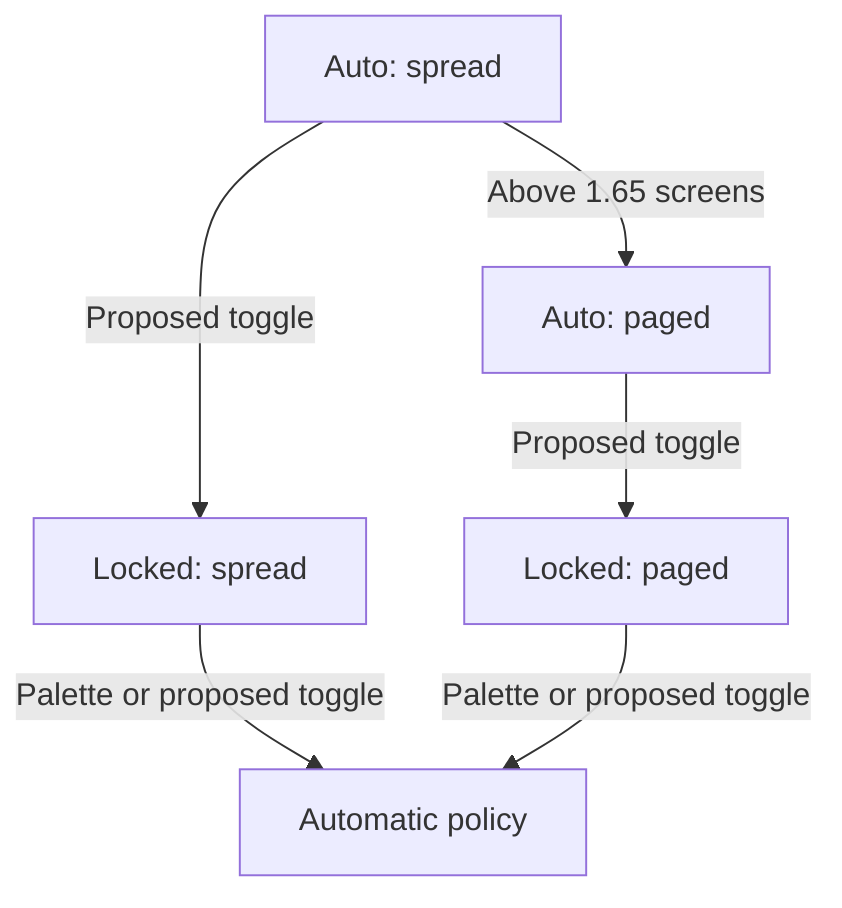
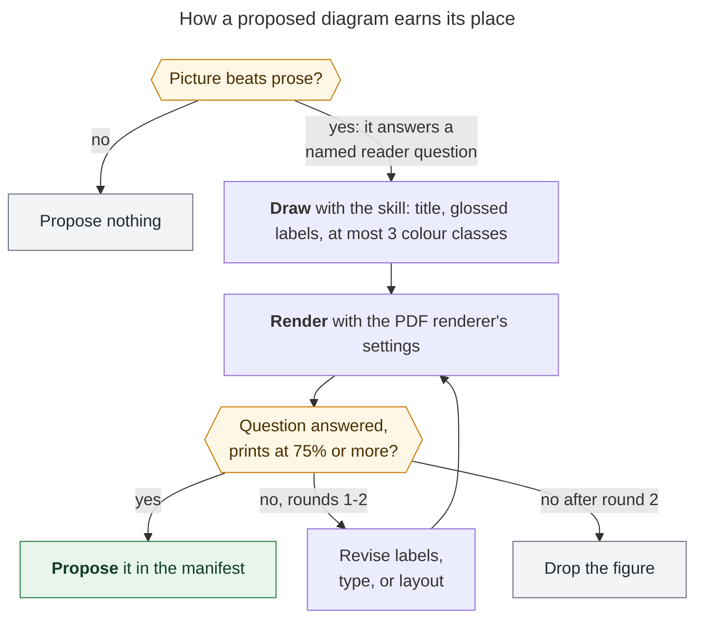
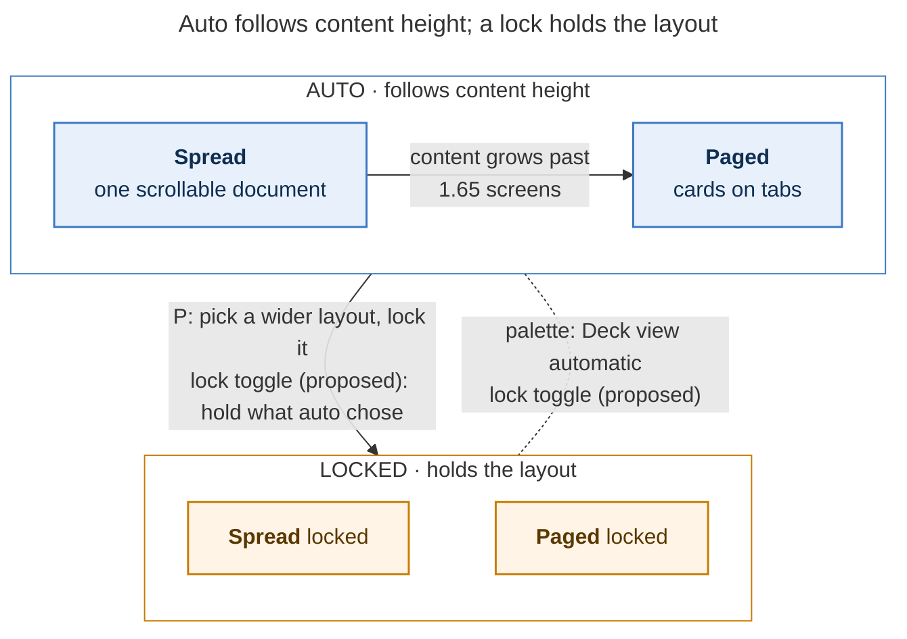

# Better Mermaid diagrams from the research swarm: what to change, where the advice should live, and how to know it worked

> **Research query:** The Mermaid diagrams that the image agent in the `#research_swarm`
> macro swarm recommends are hard to understand in isolation, not very useful, and not
> very visually appealing. How should this agent's instructions improve (perhaps with
> Mermaid advice factored out into its own macro) so it produces more useful, easier to
> understand, and more beautiful diagrams? Critique the plan, make and flag any justified
> requirement adjustments, and end with a recommended solution.

Lead researcher's consolidation of five independent reports (`cdx`, `cld`, `grk`, `mus`,
`gem`), plus my own checks against the plugin source, the Highlights PDF renderer, and
fresh renders. Date: 2026-10-20. Sources inspected: `sase-research-artifacts` `6b56e47`,
bob-cli `bfca3419` (`scripts/web_clip/diagram_render.py`, `src/native/highlights_ref/`),
the `sase` macro and skill loaders, and every diagram manifest the swarm has produced.
All renders below used `mmdc` 12.0.0 (Mermaid 12.2.0, the PDF renderer's version), with
the PDF renderer's exact Mermaid configuration.

## Bottom line

**Your instinct is right, but factoring the advice out is the smallest part of the fix.**
The poor diagrams have three main causes in the current `#research/diagrams` macro, and
better advice addresses only one of them:

1. **It asks for the wrong pictures.** Candidates are "drill-downs" into infographic
   panels, ranked "by how much report detail they reveal". That steers the agent toward
   the finest-grained mechanism it can find, not the figure a reader needs.
2. **Its drawing rules are a list of bans that guarantee flat, cryptic output.** The
   rules say: no `classDef`, labels of about four words, and no decision shapes in
   top-down flows. They never ask for a title, a gloss, grouping, or emphasis.
3. **It never looks at what it drew, and its one size check is wrong.** It checks
   that Mermaid parses and greps a width. It renders with Mermaid's defaults rather than
   the PDF's settings. Under the PDF's settings, that width grep reads an internal 200 px
   value for *every* diagram, so it can never fail one.

A fourth suspected cause, the wrong model, is weaker than two reports claim
([below](#is-the-model-the-problem)).

**Recommendation, in one paragraph.** Ship the Mermaid craft guidance in
`sase-research-artifacts` as a *plugin skill source* (`skills/mermaid_diagrams.md`,
`skill: true`). That is one file serving two roles: `#research/diagrams` inlines it as
`#skill/mermaid_diagrams`, and any agent can load it on demand as `/mermaid_diagrams`.
Rewrite the guidance as positive rules with reasons and worked examples. Retarget
candidate selection from "drill-downs ranked by detail" to "figures that answer a named
reader question, ranked by how much the report's conclusion depends on them". Replace the
styling ban with a small, verified `classDef` palette. Add a render, look, and revise loop
that uses the PDF renderer's own settings, with a two-round cap. Keep the manifest, linker,
caps, fidelity rules, and fail-open behavior unchanged. Measure on a small blind
before/after set before splitting the agent or touching the renderer's theme.

## What the swarm produces today

The diagrams feature landed on 2026-10-19, so the whole production corpus is two swarms and
four diagrams. All four are unstyled `flowchart TD` with five to eight nodes and two- to
four-word labels. The strongest of them, as published:

*Before: the published `streaming-layout-lock` diagram. "Automatic policy" is drawn as a
fifth state, but it is really the mode containing the two auto states.*

All five reports agree on the defects:

- **They do not stand alone.** There is no title. Labels such as "Choose one", "Child's
  #prj", and "Check at-bottom boolean" need the surrounding paragraph to make sense.
- **They pick marginal content.** Three of the four draw refresh-trigger fan-ins or one
  sub-branch of a five-principle procedure. The useful picture (the whole routing
  decision, or what the lock holds) was not drawn.
- **They are visually flat.** Every node has the same shape and grey fill. There is no
  grouping, no main path, no distinction between today and proposed, and no start or end.
- **The type menu goes unused.** All four drawings are flowcharts, including a state
  machine and a three-way choice. The second diagram uses a dummy "Choose one" box because
  diamonds are banned.

**Scope note.** The diagrams agent is a small slice of the Mermaid Bryan reads. Across
the 12 published directory reports with diagrams, 4 of 20 Mermaid figures came from the
diagrams agent; lead researchers wrote the other 16. This matters for where the guidance
lives ([Adjustment 7](#requirement-adjustments)).

## What the PDF renderer actually allows

Bryan reads these reports as Highlights PDFs, so the PDF renderer is the binding surface.
The reports disagreed most here, so I checked the renderer source and re-ran the probes
myself. The renderer initializes Mermaid 12.2.0 with `theme: "neutral"`, DejaVu Sans, and
`securityLevel: "strict"`. Its extended `secure` list locks `theme`, `themeCSS`,
`themeVariables`, and `fontFamily`. It renders each diagram at natural size and scales it
down only to fit a 652.8 × 892.8 px text box: scale = min(1, 652.8 / width, 892.8 / height).
It warns below 50%. At 100%, Mermaid's 16 px labels print at 12 pt; at 75% they print at
about 9 pt.

| Feature | In the PDF render | Who had it right |
| --- | --- | --- |
| `classDef` / `class` / `style` fills, strokes, text colour | **Works** | cld (grk and gem assumed it would be stripped) |
| `%%{init}%%` or frontmatter `theme` / `themeVariables` | **Ignored**: a red/dark override rendered neutral grey | cld, grk (mus and gem proposed init theme blocks; cdx a `base` preset) |
| Frontmatter `title:` | **Works**, drawn above the figure (flowchart, state) | all who proposed it |
| ` ` line breaks under `strict` | **Works** | cld (grk said it would print literally) |
| Backtick Markdown labels with `**bold**` | **Works**; `**` inside an ordinary quoted label prints literally | cld |
| Stadium, hexagon, dashed `-.->`, thick `==>` | **Work** | — |
| Frontmatter `config:` non-secure keys (`layout`, `flowchart.rankSpacing`, `nodeSpacing`, `wrappingWidth`) | **Work** | cld (I added `wrappingWidth`) |
| `timeline` | Renders, but **drops the frontmatter title** and printed 990 px wide (66%) for three dates | new finding; argues against mus's type expansion |
| `quadrantChart` | Renders cleanly at 500 × 500 px | — but needs coordinates (see below) |

Gotchas worth putting in the guidance, verified or reproduced:

- `class B focus,proposed` silently applies nothing, and `B:::a:::b` does not parse. Use
  two `class` lines.
- `linkStyle` by index colours the wrong edges once subgraph edges shift the indices.
- An edge that ends on a subgraph border can hide its arrowhead.
- Long text in a hexagon or diamond wraps at Mermaid's default 200 px `wrappingWidth`,
  so the shape balloons. My own first draft of the figure in this report was 1102 px tall
  for that reason.
- Diamonds versus hexagons on the same nine-node decision: 1018 px versus 778 px tall.
- On this host, the global `mmdc` 11.4.2 cannot find its Chrome. The `npx`
  `@mermaid-js/mermaid-cli` 12.0.0 fallback works and matches the PDF's Mermaid 12.2.0.
  Chrome can also fail on a long `TMPDIR` path (socket path limit); cdx and gem both hit
  that, and a short scratch `TMPDIR` fixes it.
- PNG export occasionally stalls or fails with a Puppeteer `ConnectionClosedError`. Bound
  it with a timeout and retry once.
- **Layout is not settled.** cld saw Mermaid 12's default layout add odd jogs where
  `layout: dagre` did not. On my figure below, the default produced cleaner orthogonal
  routing (652 × 834 px at 100%) than `dagre` (678 × 710 px with an overlapping edge
  label). Do not hard-code either; let the look step choose.

**GitHub is unverified.** Nobody could confirm GitHub's Mermaid version; GitHub's docs say
to check with an `info` diagram. Until someone does, prefer long-standing syntax
(`classDef`, subgraphs, `{{ }}` hexagons, Markdown strings) over `@{ shape: … }` and the
newer diagram families. Every class must set `fill`, `stroke`, and `color`, so text stays
readable if GitHub shows the diagram in dark mode.

## Critique of the plan

### What is right

- **Instructions are the main lever.** The current brief actively produces the
  output you dislike, so rewriting it will help.
- **Factoring the craft out is right.** Type choice, labelling, layout, palette, and
  renderer quirks are general knowledge. They do not belong in a 208-line macro that is
  mostly plumbing (manifest, anchors, registration). A named, testable part also makes a
  later dedicated diagrams segment a one-line include.
- **Keeping Mermaid is right.** It is text, renders in both the PDF and GitHub, stays
  diffable, and lets the agent trace every box to a source sentence. The alternatives
  fail at least one of those: raster diagrams from the image model, D2 or Graphviz
  (neither surface renders them), and having the linker redraw (that breaks its
  "editor, not researcher" contract).

### What is missing or risky if taken literally

- **"More advice" alone will under-deliver.** Moving today's 11-line Draw section into a
  new macro is a rename. Without retargeted selection, the agent will draw marginal
  mechanisms more prettily. Without a look step, it still cannot see what it drew.
- **Stacking a style guide beside the bans creates contradictions.** The new guidance
  must replace §4, not sit beside it. The macro's own manifest example in §7 (an
  untitled, unglossed "Lead report → Image agent → Linker" chain) must also be redrawn,
  because models imitate examples more than they follow rules.
- **"Beautiful" has a ceiling under the locked neutral theme.** Inside the plugin, beauty
  comes from structure, grouping, consistent shapes, and a small semantic palette.
  Theme-level beauty means changing the PDF renderer, which is a separate bob-cli decision.
- **Bigger-picture diagrams invite invented structure.** cld's own redraw first added an
  inferred branch. gem's redraw (rendered below) added start and end nodes the report
  never states. The fidelity check needs teeth: trace every box and edge to a sentence.
- **Mandating structure backfires.** gem proposes mandatory subgraphs and stadium start
  and end nodes on every flowchart. Rendered, its redraw of the task-routing diagram was
  721 × 1152 px (prints at 77%), grey on grey. It added two terminals the report does not
  contain and turned the dummy "Choose one" box into an equally empty "Select
  Alternative" diamond. Rules should name the outcome (clear start, real groupings) and
  let the content decide the shape.

### Would I take a different approach?

Partly. The weighed alternatives, consolidated:

| Approach | Verdict |
| --- | --- |
| Only move Draw into a new advice macro | Reject: a rename; changes nothing measurable |
| Revise `#research/diagrams` in place, no new file (mus) | Workable short-term; but leaves the lead (4 of every 5 published figures) without the guidance |
| Plain `#research/mermaid` prompt part (cdx, grk) | Good; reachable only by prompts that inline it |
| `#mermaid/advice` in the plugin now, `sase` core later (gem) | Core is the wrong home for advice tuned to one PDF renderer |
| **Plugin skill source `skills/mermaid_diagrams.md` (cld)** | **Recommend**: same cost as a prompt part, and also an on-demand `/mermaid_diagrams` skill for the lead and other agents |
| Lift the styling ban to free-form CSS or theme directives | Reject: theme keys are ignored in the PDF; free-form CSS drifts across surfaces |
| Keep the full styling ban (grk, gem) | Reject: rests on a wrong premise; `classDef` renders in the PDF |
| Widen the type list to `pie`, `mindmap`, `quadrantChart`, `timeline` (mus) | Mostly reject (see [Resolved disagreements](#resolved-disagreements)) |
| New `.diagrams` agent on a text model now | Defer; measure first (cld, grk, cdx agree) |
| Curated house theme in the PDF renderer | Optional later; lifts every PDF diagram, including lead-authored ones, but fixes neither selection nor labels |
| Deterministic Mermaid lint (node count, label length, `classDef` completeness, size) | Optional later; numbers steer agents better than "too complex" |

### Is the model the problem?

cld and grk both note that the October 18 handoff design named "`@image` models write
weak diagrams" as its trigger for moving diagrams to their own segment. grk adds that
`#rsa` overrides `image_model` to `gpt-6-astra`, calling it an image-first model. I
checked: the same `#rsa` alias also sets `codex_model=gpt-6-astra`, so it is the model
that writes the `cdx` research reports. It is a strong general text model, not an
image-first one. The plugin default `@image` chain is Codex, Grok, and Gemini. The
current instructions alone explain the four diagrams. The dual-job context load (an
infographic, then diagrams, in one turn) is still a plausible secondary factor, which is
why a measured split stays on the table.

## Resolved disagreements

| Question | Positions | Resolution and evidence |
| --- | --- | --- |
| Where should the advice live? | Revise in place (mus); prompt part (cdx, grk); `#mermaid/advice`, later core (gem); plugin skill source (cld) | **Plugin skill source.** I verified that `sase` loads plugin `skills/` directories, that `#skill/foo` expands what `/foo` invokes, and that `sase skill init` deploys plugin skills to all providers. grk rejected "a generated skill" because it assumed the source must live in the `sase` repo. It need not. |
| Styling | Keep ban (grk, gem); `init` theme plus `classDef` (mus); preset theme plus classes (cdx); `classDef` palette only (cld) | **`classDef` palette only**, at most three classes, each setting fill, stroke, and text colour. Theme directives are no-ops in the PDF (verified) and only make GitHub diverge. |
| Decision shapes | Keep the ban (current); restore diamonds (gem); one diamond (grk); hexagons (cld) | **Hexagons with short question text, answers on the edges.** They are 24% shorter than diamonds on the same graph. Keep the question to about five words, or the shape balloons. |
| Label budget | ~4 words (current); ~8 (grk, cld); 3–8 (gem); "shortest unambiguous" (cdx) | **Bold name plus short gloss, up to about eight words on two lines.** Enforce legibility by measured size, not word count. |
| Size budget | "half a page" (current); ≤ 650 × 500 px (cld) | **Hard floor: prints at 75% or more** (width ≤ ~870 px, height ≤ ~1190 px). **Soft target: ≤ ~650 × 700 px**, so the figure doesn't force a page break. cld's 500 px cap would reject its own good 717 px example. |
| Widen diagram types | Add `pie`, `mindmap`, `quadrantChart`, `timeline` (mus) | **Mostly no.** `timeline` loses its title and prints at 66%. `pie` and `quadrantChart` need numbers or coordinates, which the macro forbids inventing. `mindmap` is a nested list drawn with lines, the "not useful" failure. Allow `quadrantChart` only when the report itself places items on two axes. Zero diagrams for a survey is a good outcome, not a gap. |
| Mandatory subgraphs and start/end nodes | Required (gem) | **No.** Use a subgraph only for a real mode, owner, or phase (see the rendered gem redraw above). |
| `accTitle` / `accDescr` | Required (mus); recommended (cdx) | **Optional.** They are invisible in the PDF. The visible title and caption carry the meaning. |
| `TMPDIR` | Force `TMPDIR=/tmp` (gem) | **Use a short scratch `TMPDIR` for `mmdc`.** It is cheap insurance; the failure depends on path length, and my 73-character agent `TMPDIR` happened to work. |
| Visual review | Required (cdx, cld, grk); grep-only (mus); not discussed (gem) | **Required, using the PDF renderer's settings, capped at two revision rounds.** Rendered-image feedback measurably improves generated figures (MatPlotAgent's ablation). A weak critic can degrade them (VisJudge-Bench), so the drawing model critiques its own render against concrete checks. |

## Requirement adjustments

These change the request as stated. Each one is deliberate.

1. **Fix more than the instructions.** Add a render, look, and revise loop, and a size
   check that matches the PDF renderer. Instructions cannot make an agent see its output,
   and today's check measures a different picture from the one you read (and cannot fail).
2. **Make the factored-out guidance a plugin skill source, not a plain macro.** It is still
   "its own macro" (`#skill/mermaid_diagrams`), but it is also loadable on demand. Ship it in
   `sase-research-artifacts`, the public, PyPI-published plugin. Wording must stay
   renderer-generic, because `tests/test_no_bob_dependency.py` forbids the word "bob". A
   home-scope copy can still override it, since discovery runs project, then home, then
   plugin.
3. **Reverse an explicit earlier design choice.** Replace "drill-downs ranked by revealed
   detail" (commit `9fcd3de`) with "figures that answer a named reader question, ranked by
   how much the conclusion depends on them". Keep that commit's real fix: list the
   candidates first, and never reject a candidate only because the infographic overlaps
   it. Infographic panels become candidate *hints*, not the frame.
4. **Define "understandable in isolation" precisely.** The unit is the figure plus its
   in-figure title plus its caption. A reader with only those three can say what the
   figure is about, what an arrow means, and what its point is. Not every qualifier from
   the report has to fit in the boxes.
5. **Redefine "beautiful" as clean, consistent, and purposeful within the locked neutral
   theme.** That means structure, grouping, consistent shapes, and at most three semantic
   colour classes, with meaning always also carried in text. Theme-level polish is a
   separate, optional PDF-renderer change.
6. **"More useful" may mean fewer diagrams.** Keep the 3/5 caps, but raise the bar: reject
   anything one sentence already says, and refresh or recompute fan-ins. Zero for a survey
   is a success.
7. **Optional scope expansion: let the lead use the same guidance.** Lead researchers wrote
   16 of the 20 published figures. One sentence in the lead's instructions ("if you draw
   Mermaid, use your `/mermaid_diagrams` skill") reaches them without inlining the skill
   into every researcher's prompt.
8. **Do not split the agent yet.** Measure first. The evidence cannot separate model from
   instructions, and the model hypothesis is weaker than reported.

## Recommended solution

### The target workflow

*Each candidate must name a reader question, pass a look at its PDF-settings render, and
survive at most two revisions; otherwise it is dropped (652 × 834 px, prints at 100%).*

This figure follows the guidance below, and drafting it showed why the look step matters.
The first draft put full sentences in the hexagons and rendered 1102 px tall at 81%.
Shorter questions and `wrappingWidth: 260` fixed it; I would not have caught the problem
from the source alone. cld reported the same: four layout defects and one fidelity slip in
its drafts, each caught only by looking at the render.

### Phase 1: one `sase-research-artifacts` change

1. **Add `src/sase_research_artifacts/skills/mermaid_diagrams.md`** (`skill: true`), about
   100–150 lines of positive rules with reasons, plus two or three compact worked examples
   (draft outline below). Hatch already packages the whole package directory; update
   `tests/test_wheel_contract.py`'s file list.
2. **Edit `xprompts/research_diagrams.md`:**
   - **§2–3 (candidates and decision).** For each `##` section, and each infographic panel
     when one exists, record the reader question that a picture answers faster than
     prose. Pictures earn their place by showing order, branching, state, ownership, or
     before versus after. Rank candidates:
     1. what the bottom line depends on;
     2. today versus proposed;
     3. failure and fallback paths;
     4. drill-downs.

     Reject candidates that one sentence already explains, short linear chains, and
     refresh or recompute fan-ins. Keep the candidate-list-first rule, the anti-zero rule
     for infographic overlap, the fidelity rules, the no-table-redraw rule, and the 3/5
     cap.
   - **§4 (draw).** Replace the bans with "follow `#skill/mermaid_diagrams`". Labels may
     gloss report terms in plain words but add no facts. Proposed stays marked proposed.
   - **§5 (validate).** Keep the CLI probe and the `Found N mermaid charts` check, and
     make these changes:
     - Prefer the pinned `npx -y -p @mermaid-js/mermaid-cli@12.0.0 mmdc` for version
       parity with the PDF, falling back to a global `mmdc`.
     - Run it with `-c <scratch>/pdf.json` and a short scratch `TMPDIR`.
     - Also export a PNG (`-s 1.5 -b white`, one retry) and look at it.
     - Measure the root `<svg width height>`, not the `max-width` grep.
     - Fail any figure whose fit scale is below 0.75.
   - **§7 (manifest).** Redraw the example diagram in the new style. The `caption` becomes
     the takeaway assertion; allow up to about 25 words. Optionally add `review:` to the
     YAML, for example `review: "652x834 px, 100%; reader question answered; 2 rounds"`.
3. **Tests.** Update the `tests/test_macro_loading.py` assertions that pin today's wording:
   "drill-downs", "adds detail its panel lacks", the four-word labels, the diamond ban, and
   the `max-width` grep. Add tests that `#research/diagrams` references
   `#skill/mermaid_diagrams` and that the skill loads from the plugin's `skills/`
   directory. Keep `test_standalone_research_image_never_mentions_diagrams`.
4. **Authoring gotcha.** Macro and skill bodies are Jinja templates. `sase` protects
   fenced code blocks from Jinja rendering (`protect_fenced_blocks`), but not inline code.
   Mermaid's hexagon syntax `{{"…"}}` must therefore appear only inside fences, or
   inside `…`.
5. **Docs.** Update `docs/macros.md` and the README.

**The linker needs no change.** Anchors, figure `
`s, byte-identical placement, and the
`illustrates` reference sentence all still hold. A fence that starts with `---`
frontmatter is still just a fence to pandoc and the PDF renderer. Division of labour: the
in-figure title names the subject or question; the caption asserts the takeaway.

### Draft outline of the skill

This merges cdx's design contract, cld's draft, and grk's cover test, with the corrections
above.

1. **Know the one thing the figure says.** Write the reader question, a one-sentence
   takeaway (it becomes the caption), and the source passages that support every entity
   and relation. If you cannot name the question, or one sentence of prose already
   answers it, do not draw.
2. **Choose the type from the content's shape.**
   - Decision or routing rule: `flowchart TD`, questions as hexagons, answers on edges.
   - Modes or lifecycle: `stateDiagram-v2`, with `state "Readable name" as ID` so labels
     are not CamelCase IDs, or a flowchart with one subgraph per mode.
   - Actors over time: `sequenceDiagram`, at most four participants, `autonumber`.
   - Today versus proposed: two subgraphs reusing the same node names.
   - Ownership or layers: `flowchart TB`, one subgraph per owner.
   - `classDiagram` and `erDiagram` only for real structure.
   - `quadrantChart` only when the report itself places items on two axes.
   - If a list or table answers better, draw nothing.
3. **Make it stand alone.**
   - Frontmatter `title:` phrased as the question or claim.
   - Node labels as a bold name plus a short gloss (backtick Markdown string), at most
     about eight words.
   - Every non-obvious edge labelled with a verb or condition.
   - Never mix data flow, ordering, and dependency arrows without saying which is which;
     say whether converging arrows mean "all" or "any".
   - Abbreviations and project terms glossed.
   - No dummy nodes ("Choose one", "Automatic policy" as a sink).
   - Proposed, optional, and failure paths marked in words *and* style.
4. **Fit the page.**
   - Target ≤ ~650 × 700 px natural size; fail below 75% fit scale.
   - Tighten with `flowchart: {rankSpacing, nodeSpacing}` and `wrappingWidth: 260`
     before cutting content.
   - Keep question text short.
   - Split into two figures rather than shrinking text.
   - Try the default layout first and `layout: dagre` if it adds jogs.
5. **Style with a small semantic palette.**
   - At most three classes per figure, pasted from a fixed set (focus, decision, outcome,
     risk, muted, plus a dashed `proposed` stroke). Every class sets `fill`, `stroke`,
     and `color`.
   - Stack two classes with two `class` lines.
   - Use `-.->` for proposed or optional paths and at most one `==>` main path.
   - Never let colour carry meaning alone.
   - No theme directives, `click`, HTML other than ` `, icons, emoji, or index-based
     `linkStyle`.
6. **Render, look, revise.**
   - Render SVG and PNG with the PDF-mirroring config: neutral theme, DejaVu Sans,
     `securityLevel: strict`, the extended `secure` list, `useMaxWidth: false`. Write
     the config inline so no package path is needed.
   - Open the PNG and answer the reader question from the image alone.
   - Check for clipped or overlapping labels, hidden arrowheads, crossed edges, a single
     reading direction, and the measured size.
   - Trace every box and arrow to a sentence.
   - Revise at most twice, then drop the figure.
   - Treat a browser start failure as an environment problem, not a bad diagram.
7. **Examples.** A decision rule (cld's task-routing redraw) and a modes diagram (cld's
   lock redraw, below), each with its rendered size.

For the modes example, here is cld's redraw of the lock diagram with its emoji removed. It
prints at 100% (604 × 510 px):

*Prototype (cld): auto is one mode with two layouts; a lock holds either one; only the
palette or the proposed toggle releases it. The dashed edge's arrowhead still hides
against the AUTO border, a defect the look step should catch.*

### Phase 2: measure, then decide on a split

- **Small blind eval set.** Take about six past `__final.md` reports that describe
  mechanisms, including the two above, plus one survey that should yield zero. Run the old
  and new `#research/diagrams` prompts on each. If cheap, also run one strong text-and-vision
  alternative model to separate model effects from instruction effects. Bryan rates each
  figure, with the prose hidden, on three questions:
  1. Can I tell what it's about and what its point is?
  2. Is it the picture I'd want here?
  3. Does it look good?

  cdx's finer split (contract only, plus palette, plus look loop) is worth running only if
  the overall result is ambiguous.
- **Split only if the model matters or the image agent becomes the linker's long pole.**
  A `research.{N}.diagrams` segment would fork the lead, wait on `.final`, and run
  `#research/diagrams` on a new `@diagrams` alias. The image segment would then run only
  for `image=true`, and the linker would wait on both. Retargeted selection no longer
  needs the infographic, so the two segments can run in parallel.

### Phase 3: optional extras

- **Point the lead at the skill** (Adjustment 7).
- **Add a deterministic lint** (`python -m sase_research_artifacts.mermaid_lint`). It
  would report node count, longest label, classes missing a text colour, banned
  directives, and measured size, so the look loop gets numbers.
- **Add a curated house theme in the PDF renderer** (`base` plus a small palette instead
  of `neutral`). It lifts every PDF diagram, including lead-authored ones, but lives in
  bob-cli, outside this plugin.
- **Add a vault-free renderer-parity check** (`bob ref diagrams check --json`), as the
  October 18 research proposed. The PDF-mirroring `mmdc` config is a close stand-in until
  then.

### How to tell whether it worked

After five to ten swarms with diagrams:

- Every published figure has a title and a recorded reader question.
- At least 80% print at 100% scale, and none print below 75%.
- Blind ratings beat today's four diagrams on all three questions.
- The linker's omission rate does not rise.
- Not every figure is still a `flowchart TD`.
- Cost per swarm (render rounds, elapsed time) stays modest.

Do not use exact-pixel golden tests across unpinned fonts and browsers. If an image model
is ever used as a judge, treat it as a first pass only; a 2026 replication (Di Bartolomeo
et al.) found that AI and human graph-reading preferences need not match.

## Evidence and limits

- **Corpus.** Two swarms and four diagrams: the whole production sample, because the
  feature is one day old. The diagnosis rests on the instruction text plus these four,
  not on a measured failure rate.
- **Renders.** All my probes used `mmdc` 12.0.0 / Mermaid 12.2.0 with the PDF renderer's
  exact config, copied from `diagram_render.py`. I did not run the Highlights pipeline
  itself, so page-level placement is inferred from its fit formula and text-box constants
  in `src/native/highlights_ref/`.
- **Prototypes are not agent output.** The redraws show what the guidance *can* produce,
  not what the agent *will* produce. Phase 2 establishes that.
- **Not verified:** GitHub's Mermaid version and dark-mode rendering; ELK versus dagre in
  general (two conflicting samples); the headline numbers of EvoDiagram and OmniDiagram
  (cld relied on abstracts).

## Sources

- **`sase-research-artifacts` `6b56e47`:**
  - `xprompts/research_diagrams.md`, `research_swarm.md`, `research_image.md`;
  - `default_config.yml` (`@image`);
  - `tests/test_macro_loading.py`, `test_wheel_contract.py`, `test_no_bob_dependency.py`;
  - commits `9fcd3de` (drill-down framing), `cf00e1e` (`mmdc` check), `cb95f3d` (cap of
    five), `6b56e47` (figure anchors).
- **bob-cli `bfca3419`:**
  - `scripts/web_clip/diagram_render.py` (neutral theme, secure keys, `strict`,
    `useMaxWidth: false`);
  - `scripts/web_clip/vendor/README.md` (Mermaid 12.2.0);
  - `src/native/highlights_ref/diagrams.rs` (fit scale, 50% warning);
  - `src/native/highlights_ref/create.rs` (Letter, 0.85 in margins).
- **`sase`:**
  - `src/sase/macro/loader_skills.py` (plugin `skills/`, `#skill/<name>`);
  - `src/sase/macro/loader.py`;
  - `src/sase/main/init_skills_handler.py` (`sase skill init` includes plugin skills);
  - `src/sase/macro/_jinja.py` (fence protection).
- **Chezmoi `sase.yml`:** the `#rsa` alias (`image_model=gpt-6-astra`,
  `codex_model=gpt-6-astra`).
- **Research:**
  - `research:202610/research_swarm_mermaid_handoff_to_linker/research_swarm_mermaid_handoff_to_linker.md`
    (guardrails, dual-job warning, reopen trigger);
  - the published `deck_scroll_scope_tabs_and_layout_lock` and
    `bob_sase_task_portfolio_split` reports and their `.diagrams.md` manifests.
- **External:**
  - [MatPlotAgent](https://arxiv.org/abs/2402.11453v3) (visual-feedback ablation);
  - [VisJudge-Bench](https://arxiv.org/pdf/2510.22373) (weak critics degrade refinement);
  - [EvoDiagram](https://arxiv.org/pdf/2604.09568) and
    [OmniDiagram](https://www.alphaxiv.org/abs/2604.05514) (critique and interrogate the
    rendered diagram);
  - [Ten Simple Rules for Better Figures](https://journals.plos.org/ploscompbiol/article?id=10.1371/journal.pcbi.1003833);
  - [C4 notation](https://c4model.com/diagrams/notation) (titles, keys, labelled
    relationships);
  - [Purchase, Pilcher and Plimmer](https://pubmed.ncbi.nlm.nih.gov/21173454/) (crossings
    and alignment);
  - [Di Bartolomeo et al., 2026](https://onlinelibrary.wiley.com/doi/full/10.1111/cgf.70436)
    (AI versus human graph preferences);
  - [mermaid-sonar](https://dev.to/entropicdrift/mermaid-sonar-detecting-hidden-complexity-in-diagram-documentation-3461)
    (numeric complexity feedback);
  - [GitHub: creating diagrams](https://docs.github.com/en/get-started/writing-on-github/working-with-advanced-formatting/creating-diagrams);
  - [Mermaid theming](https://mermaid.js.org/config/theming.html) and
    [layouts](https://mermaid.js.org/config/layouts.html).
- **Contributors:**
  - `cdx`: design contract, evaluation design, effective-font arithmetic;
  - `cld`: PDF-renderer probes, the skill-source idea, the broken width grep, prototypes;
  - `grk`: cover test, usefulness tightening, the `#rsa` observation, fence counts;
  - `mus`: the case for in-place revision and genre types, mostly not adopted;
  - `gem`: shape semantics, a type decision tree, and the `TMPDIR` fix.
