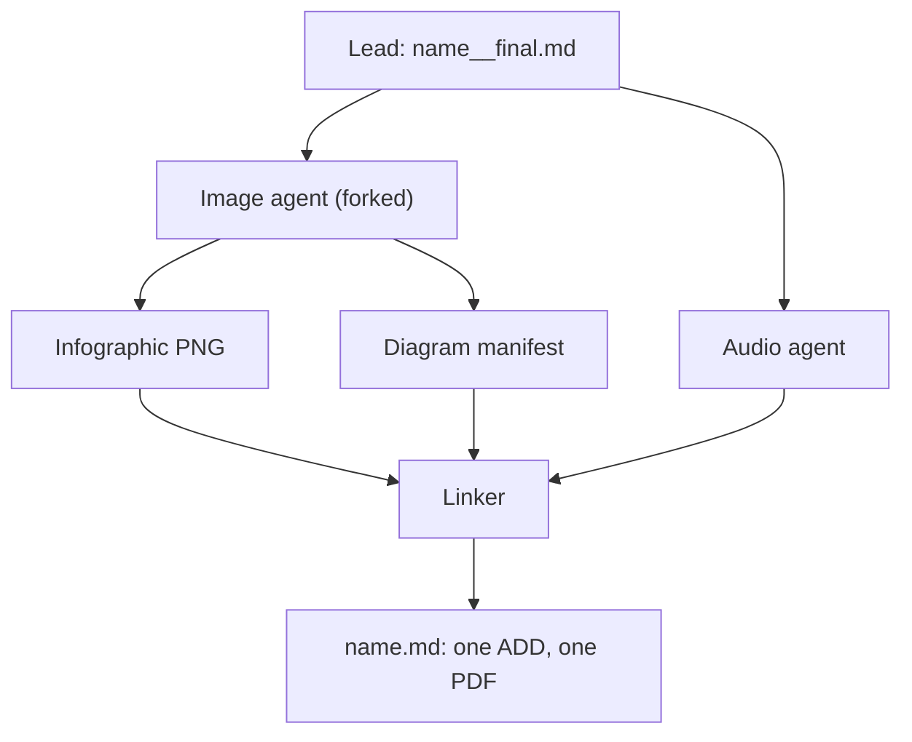
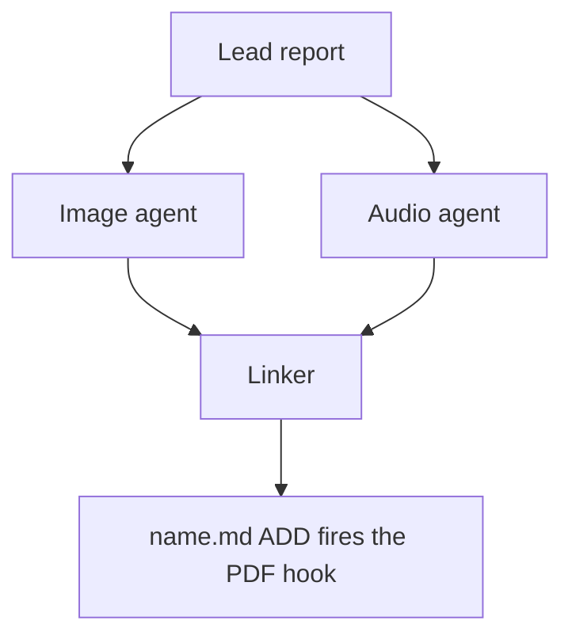
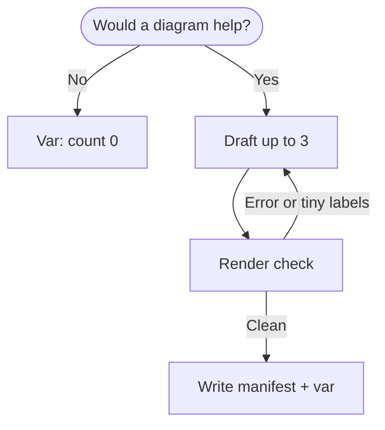

# Mermaid Diagrams in `#research_swarm` Reports: Image-Agent Proposals, Linker Placement

> **Research query:** Should the `#research_swarm` image agent decide whether a research
> report would benefit from Mermaid diagrams, and if so, how should it hand them to the
> linker without editing the lead's report or writing its own, including how each
> diagram names the part of the report it belongs to? Is the plan sound, what would I
> change, and what do I recommend?

## Bottom line

**Build it. The timing is right, and the plan's division of labor is sound. Four
guardrails decide whether the diagrams help readers or just add noise.**

- **Why now.** On 2026-10-17, bob's Highlights PDF pipeline learned to render Mermaid
  fences as fitted vector figures, using a pinned Mermaid 12.2.0 bundle. GitHub already
  renders them natively. A Mermaid block in the published `<name>.md` therefore works on
  both reading surfaces with no new rendering work. Before that change, it would have
  printed as source code in the PDF.
- **Handoff.** The image agent writes one committed companion file,
  `<name>_diagrams.md`. This is a *manifest of proposals*, not a report. For each diagram
  it gives:
  - an `anchor`: a verbatim excerpt from `<name>__final.md`, checked to occur exactly
    once;
  - a `section` path, used only as a tiebreaker;
  - an `illustrates` sentence, the fallback locator;
  - a `caption`;
  - the validated `mermaid` block itself.

  The agent registers the manifest with a `diagrams:` label and always sets a `diagrams`
  output variable, even when it proposes nothing. This mirrors the audio agent's
  artifact-plus-variable handoff.
- **Placement.** The linker places each diagram verbatim, directly after the block that
  holds its anchor text in the *restructured* file. If the linker reworded that passage,
  it uses the block that makes the point the `illustrates` sentence names instead. It
  skips, and reports, any diagram it cannot place or that contradicts the report.
  Anchoring to quoted text plus meaning survives the linker's reordering and heading
  renames. Line numbers, heading paths, and patches do not.
- **Guardrail 1: legibility, not syntax, is the main risk.** I rendered all 141 Mermaid
  blocks already in the research repo through bob's exact renderer configuration.
  - 136 parse. All 5 failures are in Gemini researcher drafts, and all 30 blocks in
    published reports parse.
  - But 50 of the 136 (37%) would print below 50% of natural size on the PDF page,
    which means about 6 pt labels. So would 12 of the 30 published blocks.
  - Sequence diagrams have a median scale of 0.33, and `flowchart LR` a median of 0.50.

  So the image agent must design for a page about 650 px wide and must pass a render
  check (parse plus fit) before it hands anything off.
- **Guardrail 2: fidelity.** A diagram makes claims through its arrows: order,
  causality, ownership. Every box and edge must show something the report states. The
  linker's "add nothing" rule gets one narrow, explicit exception: copy the manifest's
  diagrams verbatim.
- **Guardrail 3: restraint.** Allow zero to three diagrams. Zero is the expected answer
  for surveys, comparisons, and recommendation lists. Never duplicate the infographic, a
  diagram the lead already drew, or a table.
- **Guardrail 4: degrade, never block.** A diagram failure never fails the image agent
  and never holds back publication.

**Requirement adjustments (called out in [Requirement adjustments](#requirement-adjustments)):**

- The diagram instructions go in a new `#research/diagrams` macro, not inside
  `#research/image`.
- Add a `diagrams` swarm flag that defaults to the value of `image`.
- Validation and a fit check are mandatory.
- Cap proposals at three.
- The image agent *does* create one file, a companion manifest. It is not a report, and
  it is excluded from the Research pane and the PDF hook.
- Diagrams never go directly under a heading.

## How the swarm works today

All of this was verified against the plugin source (`sase-research-artifacts`,
`research_swarm.md`), bob-cli, and the research repo on 2026-10-18.

- **Topology.**
  - The lead writes `<name>__final.md` whenever a linker runs.
  - The image agent waits on the lead, *forks the lead's conversation*
    (`#fork:research.N.final`), and runs `#research/image`, which writes
    `<name>_infographic.png`.
  - The audio agent also forks the lead and runs in parallel with the image agent.
  - The linker waits on the lead, the image agent, and the audio agent, then publishes
    `<name>.md`.
  - `image=true` or `audio=true` implies the linker.
- **The linker is a faithful restructurer.**
  - It inventories every claim, number, table cell, code block, and link, then rebuilds
    the file in a fixed opening order: title, research query, listen card, infographic,
    `## Bottom line`.
  - It reorders sections by the reader's questions, merges duplicates, strips heading
    numbers, emoji, and code from headings, and converts every table into a list.
  - It must add no claims. The only prose it writes is the research-query summary.
  - Any handoff therefore has to survive heavy restructuring.
- **The PDF fires once.** The `research-highlights` file hook renders a Highlights PDF
  only on the `ADD` of `<name>.md`, and bob refuses to replace a library PDF. Everything
  the reader should see must already be in the linker's first commit. This is already
  true for anything the image agent produces, because the linker waits on it.
- **Image agents run on most swarms.** October 2026 has 103 published reports, 74
  infographics, and 73 linker `__final.md` intermediates. `image=true` (via the `rsa`
  snippet) is the common path, so diagrams tied to the image agent would be considered
  on most swarms.
- **Diagrams already appear, ad hoc.**
  - The repo has 141 Mermaid blocks in 92 files. Fifteen published reports contain
    them, 10 of October's 103.
  - By type: 103 flowcharts (97 `flowchart`, 6 `graph`), 16 `sequenceDiagram`, 13
    `stateDiagram-v2`, 4 `classDiagram`, 3 `gantt`, 1 `timeline`.
  - Linkers already carry lead diagrams through verbatim. For example,
    `memory_built_instruction_migration_epics` has an identical diagram in `__final.md`
    and in the published file.
- **The `@image` model alias** is `codex/gpt-6.1-sol@xhigh | grok/grok-4.6@xhigh |
  agy/gemini-3.8-flash-high`. These models were chosen for raster image generation. A
  Gemini Flash model can therefore end up authoring the Mermaid, and Gemini drafts
  produced every parse failure measured below.
- **Lazy companion hazard.** SASE gives a non-Markdown artifact a `<stem>.md` companion
  on its first link. In sase-core's `companion_md_path`, `x.json` becomes `x.md`, or
  `x.json.md` on a collision.
  - Plugin-side, `_COMPANION_MARKDOWN_EXCLUDE_GLOBS` keeps `*_infographic.md`,
    `*_narration.md`, and `*.png.md`-style companions out of the Research inventory and
    out of the PDF hook.
  - Any new file the image agent writes needs the same treatment, or it will produce a
    spurious "report" and a spurious Highlights PDF.
- **bob's Mermaid support** (bob-cli `docs/highlights-create.md`, `diagrams.rs`):
  - It renders only explicitly tagged fences (` ```mermaid `, `~~~mermaid`,
    `{.mermaid}`), including fences nested in lists and blockquotes.
  - It uses one offline browser launch per document and a neutral theme.
  - `securityLevel: strict` is set, and theme and font keys are protected from
    `%%{init}%%`.
  - Figures scale down to fit a 489.6 × 669.6 pt text box and are never split. A figure
    below 50% of natural size triggers a "labels may be small" warning.
  - A block that fails to parse stays as source under an italic note, and the import
    still succeeds.
  - In my timing, three diagrams added about 7 s to a render: 13.9 s versus 6.9 s with
    `BOB_HIGHLIGHTS_DIAGRAMS=off`. The hook's timeout is 120 s.

## Measured: how today's diagrams would print

**Method.**

1. I extracted all 141 fenced Mermaid blocks from the research repo.
2. I rendered each one in headless Chromium, using bob's vendored `mermaid.min.js`
   (12.2.0), its DejaVu Sans font, and its configuration: `neutral` theme, `strict`,
   `useMaxWidth: false`.
3. I computed bob's fit scale: `min(1, 489.6 / width_pt, 669.6 / height_pt)`.
4. I spot-checked the results end to end with
   `bob ref create <file>.md -o <scratch>.pdf -n -P sase` and by rasterizing the PDFs.

**Parse.**

- 136 of 141 blocks render.
- All 5 failures come from Gemini researcher drafts (4 files). Each fails on unquoted
  punctuation inside a label. Examples are `-->|User Click / [ / ]|`, `-->|@ / ,@|`,
  `Tabs[Stash | Trash | History]`, and a parenthesized edge label.
- All 30 blocks in published reports parse.
- The observed raw failure rate, 3.5%, sits at the low end of outside reports: 9% of 87
  AI-written documentation diagrams in the mermaid-sonar case study. The DIAGRAM-FAIL-BENCH
  abstract (NeurIPS 2026) says execution-feedback repair "eliminates most of the gap".
  That abstract also stresses a separate *render-constraint gap*: code that renders but
  violates the structure the task requires. A render check cannot catch that, which is
  why fidelity gets its own guardrail.

**Fit is the real problem.**

- Overall, 50 of 136 rendered diagrams (37%) fall below 0.5 scale, and 107 (79%) fall
  below 0.75. Mermaid's default label is 12 pt at natural size, so 0.5 means 6 pt text.
- In published reports, 12 of 30 fall below 0.5 and 23 of 30 below 0.75. The worst is
  `sase_listen_article_to_antennapod`, an LR flowchart 1,836 pt wide that prints at 0.27.
- Results by layout:
  - **`flowchart TD`:** n=53 · median scale 0.64 · 13 below 0.5
  - **`flowchart LR`:** n=36 · median scale 0.50 · 19 below 0.5
  - **`sequenceDiagram`:** n=16 · median scale 0.33 · 14 below 0.5
  - **`stateDiagram-v2`:** n=13 · median scale 0.72 · 2 below 0.5
  - **`classDiagram`:** n=4 · median scale 0.78 · 0 below 0.5
- Sequence diagrams by participant count, as median scale: 4 participants 0.51 (n=2),
  5 participants 0.37 (n=5), 6 participants 0.31 (n=9).
- Height matters too. 46 of the 136 (7 of the 30 published) fill at least 85% of the
  text-box height once fitted.
- **Blank-page quirk.** In a synthetic test, a heading *directly* above a diagram that
  nearly fills the page produced an empty PDF page before the figure. This happened in
  two of two heading-first variants. With one introductory paragraph between the heading
  and the diagram, there was no blank page. A real published report whose tall diagram
  follows a paragraph also rendered cleanly.

**What this means.** Validation must cover fit as well as syntax. The layout rules that
matter are concrete:

- Keep any row of boxes to four or fewer.
- Prefer TD.
- Give sequence diagrams at most four participants.
- Keep diagrams to about five ranks, so they stay well under a page tall.
- Never place a diagram directly under a heading.

The mermaid-sonar case study makes the same width point: "A 1302px diagram forced into
an 800px viewport gets scaled down to ~61%". Note that the PDF column, about 650 px, is
narrower than GitHub's.

## Critique of the plan

### What is right

- **The lead's report stays immutable, and the linker stays the sole publisher.** That
  matches how the swarm already works: `__final.md` is provenance, and `<name>.md` is
  written once, before the one-shot PDF hook.
- **The image agent is a good home.** It has three advantages:
  - It forks the lead's conversation, so it has the full research context, not just the
    final text.
  - It is already on the linker's critical path, so adding diagrams creates no new wait
    edge.
  - It already owns visual summarization, so the infographic and the diagrams can be
    planned together: the infographic gives the overview, and each diagram explains one
    mechanism.
- **Mermaid is the right medium.** It is text, so it is diffable, cheap, and
  reviewable on GitHub. It prints as vector text in the PDF and renders natively on
  GitHub. That is a good complement to the raster infographic, which cannot be searched
  and can garble text.
- **The topic mix suits diagrams.** Most reports here are about pipelines, agents, state
  machines, and rollouts. Researchers already draw diagrams unprompted in 92 files.

### What is wrong or risky

1. **Legibility.** Without fit rules and a fit check, diagrams become decorations with
   unreadable labels. This is the measured failure mode, not a hypothetical one (see
   [the measurements](#measured-how-todays-diagrams-would-print)).
2. **Fidelity.** A diagram can state more than the prose does. An arrow implies an
   order, a box implies a component, and a missing edge implies independence. The linker
   exists to guarantee "exactly the lead's meaning", so diagrams need explicit grounding
   rules and a contradiction gate.
3. **Anchoring under restructuring.** This is the core design problem. The linker
   renames, reorders, and merges sections, so "after line 140" or "under ### Storage"
   will often point at nothing.
4. **Over-diagramming.** Models like to draw. Making zero easy and normal matters as
   much as making diagrams possible.
5. **`#research/image` is also a standalone macro.** Adding diagram instructions to it
   would make every standalone infographic run write a manifest that no linker will ever
   integrate.
6. **New files trip the companion and hook globs.** A new file that is not on the
   exclusion list becomes a spurious Research-pane entry and a spurious PDF.
7. **Failure coupling.** If the image agent crashes, the linker stays parked. That
   exposure already exists. Diagram work adds runtime and steps, so its failures must
   degrade to "no diagrams" and must never fail the agent.
8. **Model mix.** `@image` can resolve to Gemini Flash, which produced every observed
   parse failure. Mandatory validation makes model choice a quality question rather than
   a correctness one.

### Would I take a different approach?

Mostly no. Here is how the alternatives compare.

**Who authors the diagrams:**

- **The lead, inline.** This already happens ad hoc and costs no plumbing. But the lead
  is the busiest agent, has no dedicated visual pass, and does no validation. It is
  rejected as *the* mechanism, though leads may keep drawing diagrams, and the image
  agent then adds none that duplicate them.
- **The linker.** Rejected. It would break the linker's fidelity contract, and its
  prompt is already the most complex in the swarm.
- **A separate `diagrams` agent.** This is viable: it gives an independent model choice
  (a strong text model) and independent failure. I defer it because it adds another
  agent and another linker wait edge. Putting the instructions in their own
  `#research/diagrams` macro makes this a one-segment move later.
- **The image agent.** Recommended, for the reasons above.

**How diagrams are handed off and anchored:**

- **Line-number, offset, or heading-path anchors.** Rejected. They break under the
  linker's restructuring. A heading path survives only as a tiebreaker.
- **A patch against `__final.md`.** Rejected. It will not apply after restructuring,
  and it amounts to editing the lead's report.
- **A full annotated copy of the report.** Rejected. That is a second report: two
  sources of truth that would confuse the linker's inventory, and it violates the
  requirement.
- **Placeholders written by the lead** (`<!-- diagram slot -->`). Rejected for v1. They
  couple the lead to the image agent and add work to the most expensive agent.
- **JSON or YAML manifests, or `sase var` alone.** Rejected as the main carrier:
  - multi-line Mermaid inside JSON strings invites escaping errors;
  - neither form is reviewable on GitHub;
  - variables are not durable in the repo;
  - a non-Markdown file gets a `<stem>.md` companion on first link.

  A variable is kept for status only.
- **Pre-rendered SVG or PNG files.** Rejected:
  - both reading surfaces render Mermaid natively;
  - raster loses vector text;
  - binaries bloat a public repo that already holds hundreds of infographics;
  - binaries create `.svg.md` companions.
- **A Markdown manifest anchored by a quote plus a meaning.** Recommended. This is the
  same idea as the W3C Web Annotation `TextQuoteSelector` and Hypothesis's "fuzzy
  anchoring": locate a target by its exact text, then fall back to context when the
  text has changed. Here the fallback is a semantic `illustrates` line, because the
  matcher is an LLM editor rather than a diff algorithm.

## Requirement adjustments

These are changes to the request as written.

1. **New: a separate `#research/diagrams` macro.** The swarm's image segment runs
   `#research/image #research/diagrams`. Standalone `#research/image` stays unchanged.
2. **New: a `diagrams` swarm input** (`bool`, `default: null`, meaning "follow `image`").
   - `image=true` gives both the infographic and diagrams.
   - `image=true, diagrams=false` gives the infographic only.
   - `diagrams=true` alone gives diagrams only: a cheap run with no raster image.
   - `diagrams=true` implies the image segment (agent id stays `research.N.image`) and
     the linker.
   - If a nullable `bool` turns out to be unsupported, use an `auto|on|off` enum.
3. **New: diagrams must pass a render check with the Highlights pipeline**, covering
   both parse and fit. If no check command is available, the agent proposes no diagrams.
4. **New: zero to three diagrams.** Zero is a normal outcome. Never duplicate the
   infographic, a lead diagram, or a table.
5. **Clarified: the image agent creates exactly one file, `<name>_diagrams.md`.** It is a
   companion manifest like `<name>_narration.md`, not a report. Its glob is excluded
   from both the Research inventory and the PDF hook.
6. **Clarified: the linker's no-new-content rule gets one scoped exception.** It copies
   manifest diagrams verbatim. It may *omit* a diagram that it cannot place or that
   contradicts the report, but it never edits, redraws, or invents one.
7. **New: placement constraints.**
   - No diagram goes above or inside the fixed opening sequence (title, query, listen
     card, infographic, bottom-line heading).
   - None goes directly under a heading, which also avoids bob's blank-page quirk.
   - None goes inside a list or blockquote.
   - An anchor that lands in the bottom-line section moves its diagram to the end of that
     section.
8. **New: degrade, never block.** Any authoring or validation failure leaves "no
   diagrams" plus a reason in the `diagrams` variable. The infographic and the diagrams
   fail independently.
9. **Unchanged:**
   - The audio agent still narrates `__final.md`, so diagrams never reach the narration.
   - The linker still converts tables to lists and never into diagrams.
   - Lead-authored diagrams are carried through untouched. Relayout is a follow-up.

## Recommended solution



*The image agent adds a diagram manifest beside the infographic, and the linker still
publishes once.*

### 1. The diagram manifest

`<YYYYMM>/<name>/<name>_diagrams.md` is committed beside the report. It uses the same
stem rule as `#research/image`, so `topic__final.md` gives `topic_diagrams.md`. It is
written only when at least one diagram passes the check. Example:

````markdown
---
source: research:202610/<name>/<name>__final.md
producer: research.<N>.image
diagram_count: 1
check: "bob: rendered 1 of 1 Mermaid diagrams, no warnings"
---

# Diagram proposals for <report title>

Proposals for the swarm linker, not a report. Each diagram shows only what the
source report states.

## D1: Publication order

```yaml
anchor: |-
  so the link must be in the linker's first commit.
section: How it works today > Facts that decide the design
illustrates: |-
  The linker waits for every companion agent because the PDF hook fires once,
  on the ADD of name.md.
caption: The linker publishes once, after every companion finishes.
```


````

Fields:

- **`anchor`** (required): 5 or more words copied verbatim from *one line* of the source.
  Reports are hard-wrapped, so one line keeps the check deterministic. It must come from
  a body section, not the research query or the bottom line. Check that it is unique
  with `grep -cF -- '<anchor>' <source>`, which must print `1`. It is a YAML literal
  block, so backticks and quotes are copied exactly.
- **`section`** (required): the heading path in `__final.md`. It is only a tiebreaker,
  because the linker renames headings.
- **`illustrates`** (required): one sentence, in the report's own terms, naming the
  point the diagram makes. It is the fallback locator and the basis for the linker's
  contradiction check.
- **`caption`** (required): at most about 15 words. It becomes one italic line under the
  diagram. No figure numbers: the linker would have to maintain them, and nothing
  cross-references them.
- **The `mermaid` block:** exactly the source that passed the check.

Why use Markdown with a small YAML block per diagram?

- GitHub renders the manifest, so a human can review the proposals as pictures.
- Each diagram is self-contained, so the linker handles one at a time.
- The anchor survives byte-for-byte.
- A Markdown file is its own artifact page, so no lazy companion is created.
- A future deterministic linter can parse it.

### 2. `#research/diagrams` (new macro in `sase-research-artifacts`)

Proposed body, condensed:

````markdown
---
name: research/diagrams
description: Propose validated Mermaid diagrams for a research report in a companion manifest that the swarm linker places.
---

Decide whether Mermaid diagrams would help a reader understand this research report. If
they would, write them to a companion manifest for the linker to place. Never edit the
report, and never write a report of your own.

Use the report the lead wrote: `<name>__final.md` if it exists, otherwise `<name>.md`.
Re-read the file; do not work from memory. Write `<stem>_diagrams.md` beside it (the
`#research/image` stem rule) without overwrite.

1. **Decide; zero is a normal outcome.** Propose a diagram only when all hold:
   - the report describes three or more connected parts: a flow, a lifecycle of states,
     an exchange between actors over time, a dependency or component structure, or a
     phased plan;
   - a reader would grasp it faster from the picture than from the prose;
   - every box, arrow, and label shows something the report states: no new steps,
     numbers, actors, orderings, or causal links;
   - it repeats neither the infographic, a Mermaid diagram already in the report, nor a
     clear short list. Never turn a table into a diagram.
   At most three. Comparisons, surveys, and recommendation lists usually need none.
2. **Draw for a PDF column about 650 px wide; diagrams shrink to fit.**
   - Types: `flowchart TD`, `stateDiagram-v2`, `sequenceDiagram`, `classDiagram`,
     `erDiagram`, `gantt`, `timeline`. No beta types, `%%{init}%%`, `click`, styles,
     `classDef`, colors, or HTML.
   - At most four boxes side by side; `LR` only for a chain of four or fewer; at most
     four sequence participants; at most about five ranks.
   - Labels of about five words or fewer, in the report's terms. Quote every label
     (`A["Lead report"]`, `-->|"on failure"|`). Never use `end` as a node id.
3. **Validate** with the Highlights renderer: put the diagrams in a scratch Markdown
   file outside the research checkout and run the check command. Every diagram must
   render with no small-label warning. Fix, simplify, or drop; stop after three rounds.
   If no check command works, propose no diagrams.
4. **Write the manifest** (format above). Confirm each anchor with
   `grep -cF -- '<anchor>' <source>` printing `1`.
5. **Register and report.**
   `sase artifact create -p "<abs-path>" -l "diagrams:<YYYYMM>/<name>/<stem>_diagrams.md"`,
   then always:
   `sase var set diagrams --json --value '{"count": N, "manifest": "<YYYYMM>/<name>/<stem>_diagrams.md"}'`.
   With no diagrams, write no file and set `{"count": 0, "reason": "<one line>"}`.
   A diagram failure never fails this agent; finish normally so the linker can publish.
````

**The check command.**

- **Today:** this works, and I verified it, including catching a parse error:
  `bob ref create <scratch>/diagrams_check.md -o <scratch>/render.pdf -n -P <note>`.
  - Success prints `diagrams: rendered N of N Mermaid diagrams`.
  - A failure prints `warning: Mermaid diagram k of N not rendered: …`.
  - A figure below 50% prints a small-label warning.
  - Two caveats. `-P` must name a real vault area or project note (the hook uses the
    project name). The output PDF's stem must differ from the Markdown file's stem,
    because bob's sidecar guard refuses a same-stem pair.
- **Better (bob-cli follow-up):** a vault-free `bob ref diagrams check <file.md> --json`
  that reuses the existing collect and render path. It would report per-diagram
  `ok`/`error`/`width_pt`/`height_pt`/`scale`, flag near-full-page heights, and exit
  non-zero on failure. Then the macro would not depend on a vault note. I recommend
  landing this first; it is a small command on top of code that already exists.

### 3. `research_swarm.md` changes

- Add the input, then three lines of logic:
  - ``
  - ``
  - `run_linker = linker or run_visuals or audio`
- **Image segment:** `%if(should_run={{ run_visuals }})`, keeping the `#fork` of the
  lead, with the body
  `#research/image #research/diagrams`.
- **Linker waits:** `%wait:research.{@1}.image` when `run_visuals`.
- **Linker inputs:** when `run_diagrams`, list the diagram artifacts and the variable:

  ```text
  
  - wait_name={{ a.wait_name }} label={{ a.label }} path={{ a.path }} ref={{ a.ref }}
  
  - agent={{ key }} diagrams={{ outputs.diagrams }}
  
  ```

- **Linker text changes**, kept short and mechanical:
  - **Preamble:** "The only prose you write yourself is the research-query summary, and
    the only other content you add is the image agent's diagrams, copied verbatim."
  - **Step 1:** "If a diagram manifest is listed, read it with `sase artifact read`."
  - **Step 2:** list each manifest diagram ID in the inventory.
  - **Step 3, new bullet "Place the diagrams":**
    - "For each `D<n>` in manifest order, find the block (paragraph, list, or code block)
      in your restructured file that contains its `anchor` text. If you reworded that
      passage, use the block that makes the point its `illustrates` line names. Use
      `section` only to choose between matches."
    - "Insert the `mermaid` block byte-for-byte directly after that block, then the
      caption as one italic line, with blank lines around both."
    - "Never place a diagram above the bottom-line heading, directly under any heading,
      or inside a list, blockquote, or listen card. If the block is in the bottom-line
      section, place the diagram at the end of that section."
    - "Skip a diagram, and name it in your final response, when no block matches or
      when it contradicts the report's text. Never edit, redraw, merge, or add a
      diagram."
  - **Table rule:** add "or a diagram" to the list of forbidden table substitutes.
  - **Step 6:** "Every manifest diagram appears exactly once, byte-identical, or is
    named as skipped."
  - **Final layout tree:** add `<name>_diagrams.md` when `run_diagrams`.

### 4. `provider.py` change

Add `"!20*/**/*_diagrams.md"` to `_COMPANION_MARKDOWN_EXCLUDE_GLOBS`, and update the
module docstring. This keeps the manifest out of the Research pane and stops it from
producing a Highlights PDF, just as `_narration.md` is handled. The linker still reads
it through the explicit `diagrams:` registration (`file:explicit:…`).

### 5. Tests and docs

- **`tests/test_macro_loading.py`:** render the swarm with `diagrams` unset, true, and
  false, each crossed with `image` true and false. Assert:
  - `#research/diagrams` is present or absent as expected;
  - the linker waits on `.image` when only diagrams run;
  - the linker text contains the placement rules;
  - the `__final` stem rule holds for `_diagrams.md`.
- **Wheel tests:** add `research_diagrams.md` and `research/diagrams` to
  `tests/test_wheel_contract.py` and `tests/wheel_smoke.py`.
- **`tests/test_provider_specs.py`:** the new exclude glob applies to both the inventory
  and the hook.
- **Docs:** update `docs/macros.md` (input table, segment description, final layout) and
  the README.

### Image-agent flow



*Validation runs before the handoff; a failed check means fewer or no diagrams, never a
blocked publication.*

### Rollout and follow-ups

1. **bob-cli: `bob ref diagrams check --json`.** This is the prerequisite I recommend.
   If you want to ship sooner, the interim `bob ref create … -o <scratch>.pdf -P <note>`
   form works today.
2. **bob-cli: fix the blank page.** When a heading directly precedes a near-page-tall
   figure, bob emits an empty page. Fit figures to the text height minus a heading
   allowance, for example 0.9 of the text height. The placement rule avoids this case,
   but lead-authored diagrams can still hit it.
3. **Plugin:** add the macro, the swarm flag, the linker text, the provider glob, tests,
   and docs, all in one `sase-research-artifacts` change. No `sase` or `sase-core`
   changes are needed: `wait.artifacts`, `sase var`, `#fork`, and nullable inputs
   already exist.
4. **Measure after about 20 swarms.** Track:
   - the share of runs with at least one diagram, and the distribution of skip reasons;
   - placement skips the linker reports;
   - bob's `diagrams: rendered N of M` lines and small-label warnings in hook output;
   - your Highlights annotations on diagram pages.

   Re-run this report's corpus measurement monthly.
5. **Later:**
   - **Lead-diagram relayout:** the manifest gains `replaces: L<n>`, offering a TD
     relayout with the same nodes and edges for a lead diagram the check reports below
     0.5 scale.
   - **Linker PDF preflight:** run the check on the final `<name>.md` before committing.
     This also catches LaTeX failures that would otherwise surface only in the one-shot
     hook.

**When to reopen this design:**

- If the image agent becomes the linker's long pole, or `@image` models write
  noticeably weaker diagrams, move `#research/diagrams` into its own segment with a
  strong text model.
- If placement skips exceed about 1 in 10 diagrams, have the lead emit stable section
  anchors.

## Sources and evidence

**Local evidence, read 2026-10-18:**

- `sase-research-artifacts`:
  - `src/sase_research_artifacts/xprompts/research_swarm.md`, `research_image.md`, and
    `research_audio.md`;
  - `src/sase_research_artifacts/provider.py` (exclude globs and hook filters);
  - `default_config.yml` (the `@image` alias).
- bob-cli:
  - `docs/highlights-create.md` ("Mermaid diagrams");
  - `src/native/highlights_ref/diagrams.rs` (fit and warning logic);
  - `create.rs` (`GENERIC_DIAGRAM_TEXT_WIDTH_PT` 489.6 and height 669.6);
  - `scripts/web_clip/diagram_render.py` and `vendor/README.md` (Mermaid 12.2.0);
  - commits `ad036f9b`, `58c96144`, `99b2ac40`, and `fd3f400b`, all dated 2026-10-17.
- sase-core `crates/sase_core/src/artifact_link/path.rs`: `companion_md_path`.
- sase `docs/reference/artifact-links.md` (lazy companions) and
  `docs/reference/macros/arguments.md` (`default: null`).
- Prior research `research:202610/research_swarm_listen_link/research_swarm_listen_link.md`
  (the one-shot ADD hook, the audio artifact-plus-variable handoff, and the lazy
  companion hazard).
- My measurement: all 141 Mermaid fences in the research repo, rendered with bob's
  vendored bundle and configuration in Playwright's cached headless Chromium, plus
  spot checks with `bob ref create -o <scratch>.pdf` and PDF rasterization.

**External:**

- [mermaid-sonar: detecting hidden complexity in diagram documentation](https://dev.to/entropicdrift/mermaid-sonar-detecting-hidden-complexity-in-diagram-documentation-3461):
  8 of 87 AI-written diagrams had syntax errors, and width scaling cuts readability.
- [DIAGRAM-FAIL-BENCH, NeurIPS 2026 listing](https://neurips.cc/virtual/2026/173008):
  630 Mermaid tasks; execution-feedback repair closes most of the render gap, but a
  render-constraint gap remains.
- [W3C Web Annotation Data Model: Text Quote Selector](https://www.w3.org/TR/annotation-model/#text-quote-selector)
  and [Hypothesis: Fuzzy Anchoring](https://web.hypothes.is/blog/fuzzy-anchoring/), the
  precedent for anchoring by quoted text with context fallback.
- [Apache Annotator DOM API](https://annotator.apache.org/docs/api/modules/dom.html):
  quote prefix and suffix extended only as far as needed to disambiguate.
- [GitHub blog: include diagrams in your Markdown files with Mermaid](https://github.blog/developer-skills/github/include-diagrams-markdown-files-mermaid/),
  native rendering since 2022. GitHub pins its own Mermaid version, which may lag bob's
  12.2.0, so stay on core diagram types.
