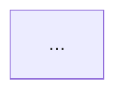

# Mermaid Diagram Generation and Integration in `#research_swarm`

**Author:** `research.21.gem`  
**Date:** 2026-10-18  
**Topic:** Instructing the `#research_swarm` image agent to consider and author Mermaid diagrams, with linker agent integration into canonical research reports.

---

## 1. Executive Summary & Bottom Line

The proposal to equip `#research_swarm` with inline Mermaid diagrams to visually illustrate complex technical concepts is **fundamentally sound and high-value**, but executing it through the image agent and linker requires addressing several architectural and mechanical friction points.

### The Bottom Line
1. **Mermaid is the right diagramming format for SASE research**: `bob highlights create` already includes native Mermaid support in its PDF compilation pipeline (via headless Chrome / mermaid.js into Pandoc / XeLaTeX), and GitHub renders ```` ```mermaid ```` code blocks natively as interactive SVG. It scales cleanly, maintains git friendliness, and avoids binary bloat.
2. **The hand-off mechanism must use a semantic companion Markdown file (`<name>__diagrams.md`)**, *not* JSON, diffs, or line numbers:
   - Fenced Markdown prevents JSON multi-line string escaping errors (a notorious LLM failure mode).
   - Filenames matching `!20*/*/*__*.md` are automatically ignored by the `research-highlights` file hook, preventing accidental PDF generation for the draft diagram file.
   - Targeting must be based on **semantic concept anchors** rather than line numbers or exact section headings, because the linker agent actively reorganizes, merges, and rewrites the lead's report.
3. **The image agent's role must be expanded to "Visuals" (or diagramming decoupled)**:
   - Gating Mermaid diagrams behind `image=true` means default research swarms (`rs`, where `image=false`) never receive diagrams, despite diagrams being pure text and zero-cost in terms of binary assets.
   - Forcing the image agent to produce *both* a macro-level raster infographic (`<name>_infographic.png`) and inline technical Mermaid diagrams in a single turn increases cognitive load and token latency. We recommend introducing an explicit or implied `visuals` contract where the agent can generate diagrams independently or alongside the infographic.
4. **Linker integration must enforce strict PDF-safe Mermaid rules**:
   - `bob-cli` warns or degrades when Mermaid diagrams are overly wide (`flowchart LR` with >4 horizontal nodes) or contain syntax errors (unquoted parentheses/brackets).
   - The linker must be instructed on diagram hygiene: prefer vertical flow (`TD`/`TB`), quote node labels containing punctuation, and limit diagram count to 1–3 high-impact figures.

---

## 2. Critique of the Proposed Plan

### 2.1 What Works Well

- **Preservation of the Immutability Invariant:**
  Requiring that the image agent *neither* edits the lead researcher's `<name>__final.md` *nor* authors its own standalone report adheres strictly to SASE's architecture. `<name>__final.md` remains the clean, audited synthesis baseline produced by `research.<N>.final`.
- **Pipeline Topology Alignment:**
  In `#research_swarm`, the pipeline order is:
  $$\text{Researchers} \longrightarrow \text{Lead} \ (\texttt{.final}) \longrightarrow \text{Image} \ (\texttt{.image}) \longrightarrow \text{Linker} \ (\texttt{.linker}) \longrightarrow \texttt{<name>.md}$$
  Because `image` already waits on `final` (`%wait:research.{@1}.final`) and `linker` already waits on both `final` and `image` (`%wait:research.{@1}.final %wait:research.{@1}.image`), the image agent runs at the exact right moment: the synthesis is frozen, and the final document layout has not yet been authored.
- **Editorial Separation of Concerns:**
  Separating conceptual diagram generation (content creation) from layout placement and link validation (editorial publishing) maintains the linker's core purpose: it remains an editor rather than an illustrator, deciding how visual figures best fit the final reading hierarchy.

### 2.2 Critical Flaws & Architectural Risks

#### Flaw 1: The `image=false` Default Blindspot
In `sase-research-artifacts/src/sase_research_artifacts/xprompts/research_swarm.md`:
- `image` defaults to `false`.
- The common shorthand `#research_swarm:: <topic>` (`rs`) runs only the researchers, lead, and linker (when enabled), leaving `image` skipped.
- Only the `rsa` alias (`image=true, gemini=true, grok=true, muse=true`) launches the image agent.

If Mermaid diagrams are only considered when the image agent runs:
1. Standard research runs will never get Mermaid diagrams.
2. Users who want clear architectural diagrams must also pay for the `@image` model tier (`codex/gpt-6.1-sol@xhigh | grok/grok-4.6@xhigh | agy/gemini-3.8-flash-high`) and generation of a 1.5 MB raster PNG infographic, even if they only wanted lightweight vector diagrams.

#### Flaw 2: The "Restructuring Collision"
The linker agent's prompt explicitly instructs it to:
> *"Restructure the lead's report into a well-thought-out organization... Organize the body under ##/### sections that follow the reader's questions, merging duplicated passages."*

If the image agent references insertion points using rigid structural references (e.g., `"Insert after Section 2.1, paragraph 3"` or `"Place under ## Architecture Details"`), that heading or paragraph order may not exist after the linker restructures the text. A mechanical diff or line-based patch will fail 100% of the time. The hand-off must be semantic and landmark-oriented.

#### Flaw 3: Image Agent Cognitive & Modality Overload
Today, `#research/image` has a very narrow brief:
> *"Generate an infographic that illustrates the main points made in this research markdown file. Write the image to `<stem>_infographic.png`..."*

The agent typically achieves this by synthesizing high-level themes, generating Python/matplotlib/PIL/browser scripts, and emitting a single PNG.
Asking the same agent in the same single turn to:
1. Brainstorm and render a full-page raster infographic PNG;
2. Do a deep, granular code-and-architecture pass over the 500-line report;
3. Identify 1–3 specific mechanisms where a flowchart, sequence diagram, or state machine would clarify prose;
4. Author syntactically strict Mermaid code blocks;
5. Write metadata specifying where each diagram belongs;
risks split focus, output truncation, or hallucinated Mermaid syntax.

#### Flaw 4: Mermaid Syntax Fragility and PDF Scale Degradation
Mermaid code generated by LLMs frequently suffers from syntax edge cases:
- Unquoted special characters: `A[Parse (AST) and Validate] --> B` (parentheses break Mermaid node parsing).
- Reserved keywords in labels: `Node --> End` or `style` / `subgraph` syntax errors.
- Oversized horizontal graphs: A `flowchart LR` with 7 consecutive wide stages renders well on widescreen GitHub viewports, but in `bob highlights create` (pandoc $\to$ XeLaTeX on letter/A4 PDF pages), wide diagrams either get scaled down until text is unreadable (<6pt font) or trigger scale warnings in `bob-cli/tests/cli/highlights/diagrams.rs`.

---

## 3. Comparative Evaluation of Approaches

| Criteria | Approach A: Image Agent + Companion File (Proposed) | Approach B: Lead Researcher Authors Diagrams Directly | Approach C: Decoupled / Visuals Agent (`visuals=true`) |
| :--- | :--- | :--- | :--- |
| **Pipeline Simplicity** | Medium (requires cross-agent handoff file) | **High** (authored in-place in `__final.md`) | Medium-Low (requires new flag or macro parameter) |
| **Availability on Default Runs** | Low (only runs when `image=true`) | **High** (works on every swarm dispatch) | Medium (opt-in or configurable) |
| **Editorial Polish** | High (linker fits diagram into restructured layout) | High (linker preserves/improves diagram in layout) | High |
| **Restructuring Robustness** | Medium (depends on semantic landmark matching) | **High** (diagram is already in context with its surrounding text) | Medium (semantic landmark matching) |
| **Token & Run Cost** | High (coupled to `@image` model run) | **Lowest** (no additional agent run needed) | Flexible (can run lighter model like `@large`) |
| **Separation of Concerns** | Clear visual vs. synthesis separation | Lead handles both synthesis and visual design | Clear visual vs. synthesis separation |

### Why not Approach B (Lead Researcher Directly)?
It is tempting to have the lead researcher write Mermaid diagrams directly in `__final.md`. The lead is the subject-matter expert who understands the nuances best. However:
- The lead's primary job is synthesizing 4 independent reports, resolving conflicts, verifying sources, and cutting duplication. Adding visual diagramming increases the lead's prompt length and turn latency.
- When an image agent is already requested, offloading diagram design to an illustration pass allows the lead to stay focused on technical rigor.
- Therefore, **Approach A with key refinements (Approach C features)** is the most extensible architecture.

---

## 4. The Hand-off Mechanism: Specifying Diagrams & Placement

The prompt asks to *"think hard about the best way to do this."* We evaluated three potential inter-agent protocols:

### Evaluation of Candidate Protocols

1. **Structured JSON File (`<name>__diagrams.json`):**
   *Format:* `[{"topic": "...", "placement": "...", "mermaid": "..."}]`
   *Verdict:* **Rejected.** Multi-line strings in JSON require escaping newlines (`\n`), quotes (`\"`), and backslashes. LLMs frequently botch multi-line code block JSON escaping, resulting in unparseable JSON files.
2. **Inline Git / Diff Patch (`<name>__diagrams.patch`):**
   *Format:* Unified diff against `<name>__final.md`.
   *Verdict:* **Rejected.** Diffs fail completely because the linker does not apply patches; it performs holistic rewriting and restructuring.
3. **Structured Companion Markdown File (`<name>__diagrams.md`):**
   *Format:* Clean Markdown with structured metadata bullets and native ```` ```mermaid ```` code blocks.
   *Verdict:* **Recommended.**

### The Recommended Specification: `<name>__diagrams.md`

#### Why `<name>__diagrams.md` is Optimal:
1. **Zero JSON Escaping:** Mermaid diagrams are authored in native fenced code blocks (` ```mermaid `), preserving formatting, newlines, and quotes without syntax corruption.
2. **Automatic File-Hook Exclusion:**
   In `sase-research-artifacts/src/sase_research_artifacts/provider.py`, the file-hook path filter excludes:
   ```python
   "!20*/*/*__*.md"
   ```
   Because the file has a double underscore (`__diagrams.md`), it is **automatically excluded** from the `research-highlights` hook. No PDF will accidentally be compiled for the diagram sheet!
3. **GitHub Previewability:** Developers can open `<name>__diagrams.md` directly in the GitHub web interface or Obsidian, and all Mermaid diagrams render interactively.
4. **Natural LLM Comprehension:** The linker agent is an LLM reading Markdown via `sase artifact read`. It parses Markdown structure effortlessly.

#### The `<name>__diagrams.md` Format Template

The image agent should write `<name>/<name>__diagrams.md` using this exact structure:

````markdown
# Visual Diagrams for <topic>

## Diagram 1: [Descriptive Diagram Name]
- **Target Section / Topic:** [Name of the section or topic in __final.md]
- **Anchor Passage:** [1-2 sentences quoted from __final.md near the intended insertion point]
- **Placement:** [Directly after the anchor passage | Preceding the section breakdown]
- **Caption:** [Figure 1: Concise 1-sentence caption explaining what this illustrates]



## Diagram 2: [Descriptive Diagram Name]
...
````

---

## 5. Linker Agent Integration Rules

When the linker agent runs, it must integrate diagrams from `<name>__diagrams.md` (if present) into the published canonical report `<name>.md`.

### 5.1 Discovery and Pre-checks
1. The linker checks if `<name>__diagrams.md` exists beside `<name>__final.md` in its checkout (and in `wait.artifacts`).
2. If absent, or if the file contains `No diagrams recommended`, the linker proceeds with its normal restructuring without diagrams.
3. If present, the linker inventories the proposed diagrams before drafting `<name>.md`.

### 5.2 Semantic Landmark Matching
Because the linker reorganizes headings, it must place diagrams by matching the **Anchor Passage** or **Target Topic**, not by heading numbers:
- Identify where the concept from the anchor passage lives in the newly restructured sections.
- Insert the diagram directly after the explanatory paragraph or at the opening of the relevant `##` or `###` section.
- Never place a diagram in the `# Title`, the research-query blockquote, the listen card, or before `## Bottom line`.

### 5.3 Formatting and Captions
To ensure consistent styling across both GitHub and Pandoc/XeLaTeX PDFs:
- Directly beneath the ```` ```mermaid ```` block, insert a centered or italicized caption:
  ```markdown
  *Figure: SASE Finalizer declaration and verification lifecycle.*
  ```
- Leave a blank line before and after the code block and caption so Pandoc's Markdown parser separates paragraphs cleanly.

### 5.4 Enforcing PDF-Safe Mermaid Rules
`bob highlights create` uses headless Chrome to render Mermaid to vector/raster PDF figures. To prevent clipping, illegible scaling, or render crashes:
1. **Prefer Vertical Orientation:** Use `flowchart TD` (top-down) rather than `flowchart LR` (left-to-right) for processes with more than 3 steps. Wide `LR` diagrams get scaled down to fit standard page margins, rendering node text illegibly small.
2. **Quote Node Text with Punctuation:** Always quote node labels containing parentheses, colons, brackets, or commas:
   - *Bad:* `A[Run Tool (sync mode)] --> B[Check Result]`
   - *Good:* `A["Run Tool (sync mode)"] --> B["Check Result"]`
3. **No Embedded HTML:** Do not use `<br/>`, `<b>`, or `<span>` inside Mermaid nodes; Pandoc/XeLaTeX rendering may fail or strip the tags awkwardly.
4. **Permitted Diagram Types:** Stick to robust diagram types:
   - `flowchart TD` / `flowchart LR`
   - `sequenceDiagram`
   - `stateDiagram-v2`
   - `classDiagram`
   - `erDiagram`
   Avoid experimental or niche types (`gitGraph`, `quadrantChart`, `gantt`) which frequently fail headless Chrome rendering.
5. **Quality over Quantity:** Cap at **1 to 3 diagrams** per report. Diagrams must clarify non-obvious architecture, state machines, or multi-actor sequences. Trivial 2-box diagrams should be omitted.

---

## 6. Adjustments to Requirements

We recommend making the following adjustments to the original requirements:

| Original Requirement | Evaluation | Recommended Adjustment | Rationale |
| :--- | :--- | :--- | :--- |
| **Image agent considers Mermaid diagrams** | Mostly Agree | **Broaden role to "Visuals" & add `diagrams` parameter** | Don't force users to generate a heavy raster infographic PNG just to get lightweight text Mermaid diagrams. Allow `diagrams: bool = false` (or default to match `image`). |
| **Image agent does not modify `__final.md` or create its own report** | Fully Agree | **Keep as hard rule** | Preserves immutability and the SASE report lifecycle. |
| **Image agent specifies which parts diagrams correspond with** | Agree | **Require semantic landmark anchor quotes in `<name>__diagrams.md`** | Prevents broken insertions when the linker reorganizes headings and merges passages. |
| **Linker agent integrates diagrams into `<name>.md`** | Fully Agree | **Linker acts as validator and layout integrator** | Linker enforces PDF-safe Mermaid syntax, quoting, orientation, and caption styling. |
| **Discretionary Creation (Only if beneficial)** | Fully Agree | **Allow explicit negative declaration** | If the image agent reviews the report and finds no complex flows requiring diagrams, it writes an empty list or skips creating `<name>__diagrams.md`. No diagrams are forced. |

---

## 7. Concrete Implementation Blueprint

### 7.1 Changes to `#research/image` (`src/sase_research_artifacts/xprompts/research_image.md`)

Update `research_image.md` to instruct the agent on both visual deliverables:

```markdown
---
name: research/image
description: Generate visual assets (infographic PNG and optional Mermaid diagrams) for a research report.
---

You are the visual designer for this research report. Your goal is to provide visual clarity for the concepts in this document.

1. **Executive Infographic (Raster):**
   Generate an infographic that illustrates the main points made in this research markdown file. Write the image to `<stem>_infographic.png` in the same directory, where `<stem>` is the source file's stem with any trailing `__final` removed (so `topic__final.md` becomes `topic_infographic.png`). Create it without overwrite. If it already exists, report the collision.

2. **Conceptual Mermaid Diagrams (Vector / In-Document):**
   Review the research report carefully to determine whether 1 to 3 concepts (architectures, state lifecycles, decision flows, sequence interactions) would be significantly clearer with a Mermaid diagram.
   - If diagrams would add genuine clarity:
     Write them to `<stem>__diagrams.md` (e.g. `topic__diagrams.md`) in the same directory.
     Do NOT modify `<stem>__final.md` or create a standalone research report.
     Format each diagram in `<stem>__diagrams.md` with:
     - `## Diagram N: <Title>`
     - `- **Target Section / Topic:** <Heading in __final.md>`
     - `- **Anchor Passage:** <1-2 sentences quoted from __final.md near insertion point>`
     - `- **Placement:** <Directly after anchor passage | Before subsection list>`
     - `- **Caption:** <Figure N: 1-sentence explanatory caption>`
     - A fenced ```` ```mermaid ```` code block.
   - Guidelines for Mermaid diagrams:
     - Prefer `flowchart TD` over `flowchart LR` for flows with >3 stages to avoid horizontal clipping in PDF page margins.
     - Always enclose node labels containing parentheses, brackets, or colons in quotes: `A["Step (Details)"]`.
     - Avoid raw HTML (`<br/>`, `<b>`) inside node labels.
     - If the report does not warrant any diagrams, do NOT create `<stem>__diagrams.md`.
```

### 7.2 Changes to Linker Instructions in `research_swarm.md`

In `research_swarm.md`, update Step 3 (Restructure) and Step 6 (Verification) of the Linker agent segment:

```markdown
   - **Diagram Integration:** Check whether `<name>__diagrams.md` exists in your checkout
     or among `wait.artifacts`. If present:
     - Read the proposed diagrams and their Anchor Passages.
     - For each diagram, locate where the corresponding concept lives in your newly restructured sections.
     - Insert the ```mermaid block into that section where it best clarifies the text.
     - Follow each diagram with an italicized caption: `*Figure: <caption text>*`.
     - Verify diagram syntax: ensure node labels with parentheses or special characters are
       enclosed in quotes (e.g. `id["Label (Info)"]`), flows with >3 steps use top-down orientation
       (`flowchart TD` / `flowchart TB`) rather than wide horizontal (`flowchart LR`), and no raw HTML
       tags exist inside node labels.
     - If `<name>__diagrams.md` is absent or contains no diagrams, publish without diagrams.
```

### 7.3 Swarm Parameterization in `research_swarm.md`

To make this clean and discoverable, update the input declarations in `research_swarm.md`:

```yaml
  - name: image
    type: bool
    default: false
    description:
      Generate an infographic and optional Mermaid conceptual diagrams after the lead researcher finishes. Implies the linker agent.
  - name: diagrams
    type: bool
    default: false
    description:
      Explicitly enable/disable Mermaid conceptual diagram generation during the visual pass. If omitted, inherits the value of `image`.
```

---

## 8. Summary of Benefits & Verification Plan

### Benefits
- **Zero PDF Regressions:** Uses Pandoc-tested Mermaid types, avoiding clipping and LaTeX errors.
- **Hook Cleanliness:** `__diagrams.md` naming ensures drafts are ignored by `research-highlights`, preventing double-builds.
- **Robustness Against Layout Rewrites:** Semantic anchor quotes guarantee diagrams land in the right context even after aggressive linker restructuring.
- **Native Dual Rendering:** Diagrams render interactively on GitHub and as crisp vector graphics in the Highlights PDF.

### Verification Plan
1. **Unit & Macro Expansion Tests:**
   In `sase-research-artifacts/tests/test_xprompt_loading.py`:
   - Test expansion of `#research_swarm(image=true)` to confirm the visual agent receives the updated diagram instructions.
   - Confirm `<name>__diagrams.md` is listed in `lead_files` or `linker_files` tree documentation.
2. **Hook Matcher Verification:**
   In `sase-research-artifacts/tests/test_filters.py`:
   - Verify that `<name>__diagrams.md` matches `!20*/*/*__*.md` and is rejected by the `research-highlights` file hook.
3. **End-to-End PDF Rendering Smoke Test:**
   - Run `bob highlights create` on a sample report containing a vertical `flowchart TD` and sequence diagram to verify clean compilation without scale warnings.
