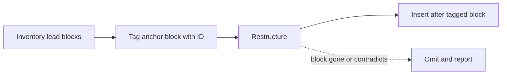
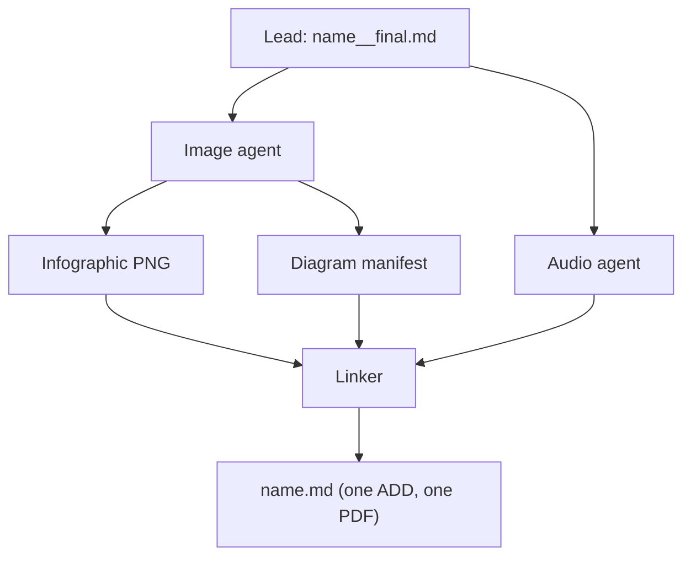
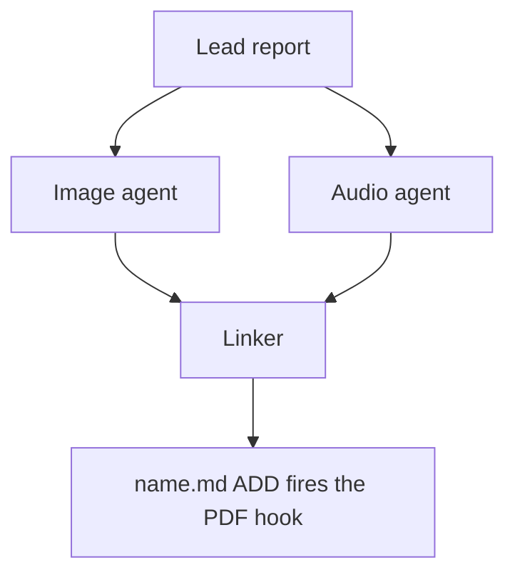

# Mermaid diagrams in `#research_swarm`: image-agent proposals, linker placement

Lead researcher: `research.21.final`. Research date: 2026-10-18. This report merges four
independent reports (`__cdx`, `__cld`, `__grk`, `__gem` in this directory) with my own
checks against the plugin, sase, sase-core, and bob-cli sources, plus two render tests
run through the installed `bob`. This is a design recommendation. Nothing has been
implemented.

## Bottom line

**Build it. The division of labor you proposed is right: the image agent proposes, the
linker publishes, and the lead's report is never touched. What decides whether the
feature helps is the handoff contract, plus four guardrails: fidelity, legibility,
restraint, and fail-open.**

- **Why now.** bob's Highlights PDF pipeline gained Mermaid rendering on 2026-10-17.
  It renders explicitly tagged ` ```mermaid ` fences as fitted vector figures, using a
  pinned Mermaid 12.2.0 bundle. I confirmed the installed `bob` renders them. GitHub
  renders the same fences natively. So a Mermaid block in the published `<name>.md`
  works on both reading surfaces, with no new renderer, no PNG copies, and no SVGs. One
  researcher (grk) reported that Highlights PDFs would print Mermaid as source. That
  was true before 2026-10-17 and is now stale.
- **Handoff.** The image agent writes one companion Markdown manifest,
  `<name>.diagrams.md`. It holds proposals, not a report. Each diagram gets its own
  section with a short fenced `yaml` block and the validated `mermaid` fence. The YAML
  block names:
  - `anchor`: a verbatim one-line excerpt from the lead's `__final.md` that occurs
    exactly once;
  - `illustrates`: the point the diagram makes, in the report's own terms;
  - `caption`.

  The agent always sets a small `diagrams` output variable (`ready`, `none`, or
  `failed`), even when it proposes nothing. This is the audio agent's
  artifact-plus-variable pattern, applied to diagrams.
- **Placement.** The linker binds each diagram to the lead block that contains its
  anchor *during its existing inventory step, before it restructures*. The binding then
  travels with that content through reordering, merging, and table-to-list conversion.
  The linker inserts the fence verbatim, with its caption, right after the block that
  ends up carrying that content. It omits and reports any diagram it cannot bind, or
  that the surrounding final text no longer supports. It never edits a diagram,
  invents one, or parks it in an appendix.
- **Guardrails.**
  1. *Fidelity:* every box and arrow restates something the report says.
  2. *Legibility:* there is a mandatory bob render check, and diagrams are designed for
     a PDF column about 650 px wide and at most about half a page tall.
  3. *Restraint:* zero to three diagrams, and zero is the normal answer for surveys and
     recommendation lists.
  4. *Fail-open:* a diagram failure never fails the image agent or blocks publication.

**Requirement adjustments.** These are summarized here and justified in
[Requirement adjustments](#requirement-adjustments):

- the diagram brief goes in a new `#research/diagrams` macro, not in `#research/image`;
- add a `diagrams` swarm flag that follows `image` by default;
- the image agent *does* create one non-report file;
- the linker's "write no prose" rule gets one narrow exception;
- the linker may reject proposals;
- the manifest needs a new, collision-safe exclusion glob.

## How the swarm works today

These facts constrain the design. All were verified on 2026-10-18 against
`sase-research-artifacts` at `17623956`.

- **Topology.**
  - The image agent waits on the lead, forks the lead's conversation, and runs
    `#research/image`.
  - The linker waits on the lead, plus the image and audio agents when they are
    enabled, and alone publishes `<name>.md`.
  - `image=true` or `audio=true` implies the linker.
  - No new agent or wait edge is needed for diagram work inside the image stage.

  Sources: [image segment](https://github.com/sase-org/sase-research-artifacts/blob/17623956c379f580ad1931c927df0093d51feb91/src/sase_research_artifacts/xprompts/research_swarm.md#L269-L274),
  [`run_linker`](https://github.com/sase-org/sase-research-artifacts/blob/17623956c379f580ad1931c927df0093d51feb91/src/sase_research_artifacts/xprompts/research_swarm.md#L144).
- **`#research/image` is ten lines.** It asks for one `<stem>_infographic.png`, strips
  a trailing `__final` from the stem, and forbids overwrite. It has:
  - no way to decline;
  - no source binding;
  - no artifact registration.

  It is also a standalone macro, usable outside a swarm, where no linker exists.
  ([macro](https://github.com/sase-org/sase-research-artifacts/blob/17623956c379f580ad1931c927df0093d51feb91/src/sase_research_artifacts/xprompts/research_image.md))
- **The linker is a heavy restructurer with a strict fidelity contract.**
  - It inventories every claim, number, table cell, code block, and link.
  - It reorders sections around the reader's questions, merges duplicates, renames
    headings for portable anchors, and converts every table into a list.
  - Its only original prose is the research-query summary.
  - It opens the file in a fixed order: title, research query, listen card,
    infographic, bottom line.

  Placement by line number or heading slug will therefore often point at nothing.
  ([linker contract](https://github.com/sase-org/sase-research-artifacts/blob/17623956c379f580ad1931c927df0093d51feb91/src/sase_research_artifacts/xprompts/research_swarm.md#L276-L465))
- **The linker currently sees only reports, images, and audio.**
  - `_report_records` lists Markdown artifacts with `research:` labels.
  - Images are listed by `kind == "image"`.
  - Audio comes through `agents[...].audio` plus `audio:`-labelled artifacts.

  A diagram handoff needs its own narrowly filtered listing; writing a file alone
  establishes nothing.
  ([inputs](https://github.com/sase-org/sase-research-artifacts/blob/17623956c379f580ad1931c927df0093d51feb91/src/sase_research_artifacts/xprompts/research_swarm.md#L294-L313))
- **The PDF fires once.** The `research-highlights` hook renders on the `ADD` of a
  matching Markdown path, and bob refuses to replace an existing library PDF.
  Everything a reader should see must be in the linker's first commit. That already
  holds for anything the image agent produces, because the linker waits on it.
- **Inventory and hook globs.**
  - The Research pane inventory takes every `20*/**/*.md` except companion pages:
    `*_infographic.md`, `*_narration.md`, and `*.png.md`-style pages.
  - The hook additionally excludes `__*.md` drafts and the lead's `__final.md`.
  - Any new Markdown file the image agent commits becomes a Research-pane entry and
    triggers a spurious Highlights PDF unless it is excluded.

  The hook does not exclude commits by the `.image` agent.
  ([globs](https://github.com/sase-org/sase-research-artifacts/blob/17623956c379f580ad1931c927df0093d51feb91/src/sase_research_artifacts/provider.py#L36-L127))
- **`sase artifact read` strips YAML frontmatter and managed link sections** before
  printing Markdown. Any handoff metadata the linker must see therefore cannot live in
  frontmatter.
  ([`_strip_managed_text`](https://github.com/sase-org/sase/blob/7b9436bedeed0ba7a716a3a6a91ff55d776e09d6/src/sase/artifact_cli/read.py#L224-L228))
- **Non-Markdown artifacts get a lazy `<stem>.md` companion on their first link.**
  - sase-core's `companion_md_path` maps `x.json` to `x.md`, or to `x.json.md` on a
    collision.
  - Reads are recorded as links.
  - So a JSON handoff that the linker reads can spawn a `<name>_diagrams.md` companion,
    which the current globs do not exclude.

  ([`companion_md_path`](https://github.com/sase-org/sase-core/blob/80dc704a4f2e1f640f7caa9e578957669c31367d/crates/sase_core/src/artifact_link/path.rs#L79-L114),
  [artifact-links reference](https://github.com/sase-org/sase/blob/7b9436bedeed0ba7a716a3a6a91ff55d776e09d6/docs/reference/artifact-links.md))
- **The image path is the common path.** October 2026 has 74 linker-published report
  directories and 75 infographics. In practice, nearly every swarm that runs the linker
  also runs the image agent, so hanging diagrams off that stage reaches most swarms.
  Gemini's worry about the `image=false` default is real only for linker-less runs.
- **Diagrams already appear ad hoc.**
  - The research repo holds 148 Mermaid fences in 95 files.
  - 7 of October's 74 linker-published reports contain them.
  - Linkers already carry lead-drawn diagrams through verbatim.
- **The `@image` alias** is `codex/gpt-6.1-sol@xhigh | grok/grok-4.6@xhigh |
  agy/gemini-3.8-flash-high`. These are general-purpose agents, so writing Mermaid
  suits them. However, the Gemini Flash fallback produced every Mermaid parse failure
  that cld measured in the repo.
  ([config](https://github.com/sase-org/sase-research-artifacts/blob/17623956c379f580ad1931c927df0093d51feb91/src/sase_research_artifacts/default_config.yml))

### What bob's Mermaid renderer does

This comes from bob-cli `fd3f400b` (2026-10-17) and its
[docs](https://github.com/bobs-org/bob-cli/blob/fd3f400b142ab667ca4ba885ebe5a8d2ea9976c1/docs/highlights-create.md#L256-L293).

- **Scope.** It renders only explicitly tagged fences (` ```mermaid `, `~~~mermaid`,
  `{.mermaid}`), including fences nested in lists and blockquotes.
- **Rendering.** It uses one offline browser launch per document, DejaVu Sans, a
  neutral theme, and `securityLevel: strict`.
- **Fitting.** Figures scale down to fit the text box. They are never split or
  rearranged. Below 50% of natural size, bob warns that labels may be small.
- **Failure handling.** A block that fails to parse stays as source under an italic
  note, and the import still succeeds. bob prints
  `diagrams: rendered N of M Mermaid diagrams`, plus one `warning:` line per failure.
- **Out of scope.** Accessibility-title metadata, landscape pages, other diagram
  languages, and SVG embeds. `BOB_HIGHLIGHTS_DIAGRAMS=off` disables rendering.

## Is this a good idea?

Yes, with conditions.

### What is right about the plan

- **One publisher.** The lead's `__final.md` stays immutable provenance, and the linker
  writes `<name>.md` exactly once, before the one-shot PDF hook.
- **The image agent is a good home.**
  - It forks the lead, so it already has the full research context.
  - It is already on the linker's critical path, so diagram work adds no new wait edge
    and no second fork of a large conversation.
  - It already owns visual summarization, so the infographic and the diagrams can be
    planned together: the infographic gives the overview, and each diagram explains one
    mechanism.
- **Mermaid is the right medium.**
  - It is text, so it is diffable, reviewable on GitHub, and cheap.
  - It prints as vector text in the PDF and renders natively on GitHub.
  - It complements a raster infographic, which cannot be searched and can garble text.
  - D2 has better layout, but GitHub does not render it in Markdown.
- **The topic mix suits it.** Most reports here describe pipelines, agents, state
  machines, and rollouts, and researchers already draw diagrams unprompted.

### Risks

1. **Fidelity is the deepest risk.** An arrow asserts order, causality, ownership, or
   data movement. A missing edge implies independence. A sequence diagram can turn
   "may happen" into "always happens". No syntax checker catches this. The linker
   exists to guarantee "exactly the lead's meaning", so diagrams need grounding rules
   and a contradiction gate.
2. **Legibility is the most measurable risk, and it shows up in two forms.**
   - *Width.* cld rendered the 141 Mermaid blocks then in the repo through bob's exact
     configuration.
     - 136 parse.
     - 37% would print below half their natural size, which means labels around 6 pt.
     - So would 12 of the 30 blocks in published reports.
     - Median scales: sequence diagrams 0.33, `flowchart LR` 0.50,
       `flowchart TD` 0.64, `stateDiagram-v2` 0.72.
   - *Height,* which bob does not warn about. In my test, two `flowchart TD` diagrams
     had 6–7 ranks, a decision diamond, and 5–9-word labels. Each claimed a page by
     itself and stranded the following one-line paragraph on a near-empty page: a
     5-page PDF with no warning printed. The same content redrawn as compact flows
     rendered in 2 pages, with no warnings and no wasted pages. Those flows had at most
     five short-labelled nodes per row and no diamonds; they were 5-node `LR` chains or
     a 5-rank `TD`. Long labels wrap into tall boxes, and diamonds render as large
     rhombi.

   cld separately found that a heading *directly* above a near-page-tall diagram can
   produce an empty page.
3. **Anchoring under restructuring** is the core design problem. See
   [Placement that survives the linker](#placement-that-survives-the-linker).
4. **Over-diagramming.** Models like to draw. Making zero easy and normal matters as
   much as making diagrams possible.
5. **Prompt and file plumbing traps.**
   - Putting the brief in the standalone `#research/image` would leave orphan manifests
     beside one-off infographics.
   - A new file that misses the exclusion globs becomes a fake report and a fake PDF.
   - Frontmatter metadata disappears through `sase artifact read`.
6. **Dual-job load.** One agent making a poster *and* precise graphs may do one of them
   badly. Give it two separate briefs, run in sequence.
7. **Failure coupling.** A crashed image agent already parks the linker. Diagram work
   adds steps, so its failures must degrade to "no diagrams" and the agent must still
   finish normally.

### Would I take a different approach?

Mostly no. Here is how the alternatives compare.

**Who authors the diagrams:**

- **The lead, inline.** This already happens and costs nothing. But the lead is the
  busiest agent and does no validation or visual pass. Keep allowing it, and have the
  image agent skip anything the lead already drew. Do not make it *the* mechanism.
- **The linker.** Rejected as the author. It would break the linker's "editor, not
  researcher" contract and grow the swarm's largest prompt. All four reports agree. It
  remains a reasonable fallback only for swarms that have no image stage.
- **A separate `.diagrams` agent.** Viable: it gets its own model choice and its own
  failure domain. I defer it because it costs another fork of the lead conversation,
  another queue slot, and another wait edge that a crash can park. Putting the brief in
  its own macro makes this a one-segment move later.
- **The image agent.** Recommended.

**What carries the handoff:**

- **The image agent edits `__final.md`, or adds HTML-comment slots to it.** Forbidden
  by the requirement. It also races the linker's inventory.
- **A unified diff or patch against `__final.md`.** Rejected. The linker rewrites
  rather than applies patches.
- **An annotated full copy of the report.** Rejected. That is a second report.
- **Mermaid bodies in `sase var`.** Rejected. Variables have size limits: 8 KiB per
  string leaf and 64 KiB per variable. They are not durable in the repo, and they leak
  into completion messages. Use a variable for status only.
- **A JSON packet (cdx's choice).** Workable. cdx is right that it gives typed fields
  and atomic metadata, and that an agent can serialize it with a tool instead of
  hand-escaping. But it loses on three counts:
  - multi-line Mermaid inside JSON strings is a classic LLM escaping failure;
  - it is not reviewable as rendered diagrams on GitHub;
  - its lazy `.md` companion needs a glob exclusion anyway, so its main advantage
    disappears.
- **Pre-rendered PNG or SVG.** Rejected. Both reading surfaces render Mermaid natively,
  raster loses vector text, and binaries bloat a public repo and get companions too.
- **A Markdown manifest whose metadata sits in the body.** Recommended.

## Resolving the disagreements

- **Does the Highlights PDF render Mermaid?**
  - cdx, cld, and gem: yes.
  - grk: no.
  - *Resolution:* yes. bob-cli `54670b45`…`fd3f400b` (2026-10-17) added it, and my
    test with the installed `bob` rendered 3 of 3 diagrams. grk's v1 "accept a PDF gap"
    adjustment is unnecessary.
- **Carrier format.**
  - cdx: JSON.
  - cld: Markdown with a YAML block per diagram.
  - grk: Markdown with a YAML-frontmatter index.
  - gem: Markdown with bullet metadata.
  - *Resolution:* Markdown, with all load-bearing metadata in the body, as cld
    proposed. grk's frontmatter index would be invisible to a linker that reads
    through `sase artifact read`, because that command strips frontmatter. gem's free
    bullets are harder to check mechanically.
- **File name.**
  - cdx: `<name>_diagrams.json`.
  - cld and grk: `<name>_diagrams.md` plus a new glob.
  - gem: `<name>__diagrams.md`, relying on the hook's `__` exclusion.
  - *Resolution:* use `<name>.diagrams.md`, excluded with `!20*/**/*.diagrams.md`.
    Both alternatives have real problems:
    - **`*_diagrams.md` would also match a published report whose stem ends in
      `_diagrams`.** This swarm's own Gemini draft was named
      `research_swarm_mermaid_diagrams__gem.md`. Had the lead picked that stem, the
      canonical `research_swarm_mermaid_diagrams/research_swarm_mermaid_diagrams.md`
      would have vanished from the Research pane and never received a PDF. Report
      stems use underscores and hyphens, not dots, so a dotted suffix cannot collide.
      It also mirrors the existing `*.png.md` exclusions.
    - **gem's `__diagrams.md`** escapes the hook but still enters the Research pane,
      because the inventory keeps `__` drafts. It also masquerades as a researcher
      draft suffix.
- **How a diagram names its place.**
  - cdx: full-block exact quote, heading path, prefix and suffix context, `covers`, and
    a SHA-256 of the source, resolved before restructuring.
  - cld: a unique one-line quote plus an `illustrates` sentence, searched in the
    restructured file.
  - grk: `after_quote`, then a heading hint, then an appendix. It also tells the linker
    to keep anchor text byte-for-byte.
  - gem: a loose anchor passage.
  - *Resolution:* combine cld's cheap, checkable anchor with cdx's timing. Details in
    [Placement that survives the linker](#placement-that-survives-the-linker). Drop the
    digest, the appendix fallback, and the "lock the quote" rule.
- **Where the instructions live.**
  - cdx: a `mermaid=off|auto` mode on `#research/image`.
  - cld: a new `#research/diagrams` macro.
  - grk: the swarm image segment.
  - gem: rewrite `#research/image`.
  - *Resolution:* a new macro, invoked only by the swarm. That leaves standalone
    `#research/image` unchanged and makes a later move to its own agent trivial.
- **A `diagrams` flag.**
  - cld and gem: yes, following `image`.
  - cdx and grk: later.
  - *Resolution:* include it in v1. It costs three template lines and gives both an off
    switch and a cheap diagrams-only run.
- **Validation and who may edit.**
  - cld: a mandatory bob render check, with the linker copying diagrams verbatim.
  - cdx: recorded checks, and the linker may reject a diagram.
  - grk: light lint only, no `mmdc`.
  - gem: the linker fixes syntax.
  - *Resolution:* mandatory bob render check in the image agent. The linker copies
    verbatim or omits; it never fixes or redraws. `mmdc` is not needed, because bob is
    the production renderer.
- **Signalling "no diagrams".**
  - cdx: always publish a packet, even an empty one.
  - cld: a variable only.
  - grk: an empty sidecar plus a variable.
  - *Resolution:* the variable is always set and is the status of record. The manifest
    exists only when at least one diagram passed, so most swarms commit no empty files
    to the public repo.

## Placement that survives the linker

There are two separate problems: finding the right block in the lead's report, and
carrying that association through the linker's rewrite.

1. **Find it in the source, deterministically.** The `anchor` is 5–20 words copied
   verbatim from *one line* of a body paragraph or list item in `__final.md`. Headings,
   tables, code blocks, and existing Mermaid fences do not qualify. The image agent
   proves the anchor is unique with an audited read:

   ```sh
   sase artifact read <lead-ref> "<reason>" | grep -cF -- '<anchor>'
   ```

   The output must be `1`. Keeping the anchor to one line keeps the check
   deterministic for both hard-wrapped and unwrapped reports. Because the anchor sits
   in body text, the frontmatter that `sase artifact read` strips cannot affect the
   check. This also avoids cdx's hashing trap: comparing a hash of the stripped body
   with a hash of the raw file.
2. **Bind before restructuring.** In its step-2 inventory, the linker finds the one
   lead block that contains each anchor and records the diagram ID against that
   inventory item. It then restructures as usual, and the ID moves with the content:
   reordered, merged with a duplicate, or converted from a table into a list. If
   needed, it can keep a private scratch marker such as `<!-- D:publication-order -->`
   in its working draft and remove it before writing. Searching the *finished* file for
   the anchor text, as cld and grk proposed, fails whenever the linker rewords the
   passage. grk's fix for that, forbidding the linker to reword anchors, constrains the
   editor for the diagram's sake.
3. **Insert, then gate.** The linker puts the fence byte-for-byte directly after the
   block that now carries the tagged content, followed by the caption as one italic
   line, with blank lines around both. It then checks that the surrounding final text
   still states the `illustrates` point, and that no box or edge contradicts it. If
   either check fails, or the anchor matched zero or several blocks, it omits the
   diagram and names it in its final response.
4. **Placement rules.**
   - Never inside the fixed opening sequence: title, research query, listen card,
     infographic, bottom-line heading.
   - Never directly under a heading. Insertion after a block already guarantees this,
     and it avoids the blank-page case cld found.
   - Never inside a list or blockquote: after the whole list instead.
   - A diagram bound to bottom-line content goes at the end of that section.
   - Two diagrams bound to the same block go in manifest order.
   - Never in an appendix. A diagram away from its prose has little value, so it is
     better omitted.



*Placement is bound to the source before restructuring and travels with the content.*

The W3C Web Annotation
[Text Quote Selector](https://www.w3.org/TR/annotation-model/#text-quote-selector) and
Hypothesis's [fuzzy anchoring](https://web.hypothes.is/blog/fuzzy-anchoring/) are the
precedents. Both locate a target by its exact quoted text and fall back to context. Here
the fallback is semantic, the `illustrates` line, because the matcher is an LLM editor
rather than a diff algorithm. Do not adopt the full W3C model, a global block-ID system,
or a SHA-256 digest. The image agent waits on the same single lead snapshot the linker
reads, and the linker already refuses anything but exactly one lead entry. A
source-label match in the manifest, plus the lead `ref` in the variable, catches the
pathological case far more cheaply.

## Requirement adjustments

These change the request as written.

1. **New: put the brief in its own `#research/diagrams` macro.** The swarm's image
   segment runs `#research/image` and then `#research/diagrams`. Standalone
   `#research/image` stays PNG-only, because it has no linker to consume a manifest.
   Running the diagrams brief second lets it avoid repeating what the infographic
   shows.
2. **New: add a `diagrams` swarm input** (`bool`, `default: null`, meaning "follow
   `image`").
   - `image=true` gives both the infographic and diagrams.
   - `image=true diagrams=false` gives the infographic only.
   - `diagrams=true` alone runs the image segment with only the diagrams brief, a cheap
     run with no raster image.
   - `diagrams=true` implies the image segment and the linker.
   - If a nullable `bool` fails to load, use an `auto|on|off` enum instead.
3. **Clarified: "do not create its own report" still permits one non-report file.**
   `<name>.diagrams.md` is a companion manifest, like `<name>_narration.md`. It is
   excluded from the Research inventory and the Highlights hook, and registered under a
   `diagrams:` label, not `research:`. Without this clarification, the no-report rule
   would forbid the very artifact the linker needs.
4. **New: zero to three diagrams, and zero is normal.**
   - Never duplicate the infographic, a diagram the lead already drew, or a short list.
   - Never turn a table into a diagram.
   - Diagrams must restate only what the report claims: no new actors, steps, numbers,
     orderings, or causal arrows. Keep conditional wording conditional, and keep
     proposed designs distinct from implemented ones.
5. **New: validation is mandatory.**
   - Every diagram must pass a bob render check, with no parse failure and no
     small-label warning, and must obey the size rules.
   - If no check can run, propose no diagrams and set `status: failed` with a reason.
6. **New: the image agent always reports an outcome.** It sets
   `sase var set diagrams …` to `ready`, `none`, or `failed`. A missing variable means
   unknown or failed, never "considered and declined".
7. **Changed: the linker's no-new-content rule gets one scoped exception.** It may copy
   manifest diagrams and their captions verbatim. It may *omit* any proposal it cannot
   bind or that the final text does not support. It never edits, redraws, merges, or
   invents a diagram.
8. **New: degrade, never block.** Diagram failures leave "no diagrams" plus a reason.
   The infographic and the diagrams fail independently. A missing or invalid manifest
   never stops publication of a valid lead report. Existing stop conditions remain: a
   missing or ambiguous lead, or a `<name>.md` collision.
9. **Unchanged.**
   - Audio still narrates `__final.md`, so diagrams never reach the narration, and the
     prose must stay complete without them.
   - The infographic keeps its fixed slot above the bottom line, and diagrams never go
     there.
   - Lead-authored diagrams are carried through untouched.

## Recommended solution



*The image agent adds a diagram manifest beside the infographic; the linker still
publishes once.*

### The diagram manifest

`<YYYYMM>/<name>/<name>.diagrams.md` is committed beside the report. It uses the same
stem rule as `#research/image`, so `topic__final.md` gives `topic.diagrams.md`. It is
written without overwrite, and only when at least one diagram passed the check. All
fields live in the body, because `sase artifact read` strips frontmatter. Here is an
illustrative example (the quoted text is hypothetical):

````markdown
# Diagram proposals: <report title>

Proposals for the swarm linker, not a report. Each diagram restates only what the
source report says.

```yaml
source: research:<YYYYMM>/<name>/<name>__final.md
producer: research.<N>.image
check: "diagrams: rendered 1 of 1 Mermaid diagrams"
```

## publication-order

```yaml
anchor: |-
  so the link must be in the linker's first commit.
illustrates: |-
  The linker waits for every companion agent because the PDF hook fires once, on the
  ADD of name.md.
caption: The linker publishes once, after every companion finishes.
```


````

The fields:

- **`## <id>`:** a unique lowercase slug for each diagram.
- **`anchor`** (required): the one-line, unique excerpt, verified with `grep -cF`. It
  is a YAML literal block, so backticks and quotes copy exactly.
- **`illustrates`** (required): one sentence in the report's terms. It is the fidelity
  check and the semantic fallback locator.
- **`caption`** (required): about 15 words at most, becoming one italic line under the
  figure. Use no figure numbers, because nothing cross-references them and the linker
  would have to maintain them.
- **The `mermaid` fence:** exactly the source that passed the check.
- **Accessibility.** `accTitle` and `accDescr` are optional. GitHub's renderer uses
  them, but bob's PDF does not, so the caption and the surrounding prose are the text
  equivalent.

### The status variable

The variable is always set, and it never carries Mermaid bodies:

```json
{"status": "ready", "count": 2, "manifest": "<YYYYMM>/<name>/<name>.diagrams.md", "source_ref": "<lead ref>"}
{"status": "none", "count": 0, "reason": "Survey of options; no flow to draw."}
{"status": "failed", "count": 0, "reason": "bob render check unavailable on this host"}
```

Keep `file:` refs and local paths out of the committed manifest, because the research
repo is public. The lead `ref` belongs only in the variable.

### `#research/diagrams` (new macro in `sase-research-artifacts`)

Here is a condensed body:

````markdown
---
name: research/diagrams
description: Propose validated Mermaid diagrams for a research report in a companion manifest that the swarm linker places.
---

Decide whether Mermaid diagrams would help a reader understand the lead's report. If so,
write them to a companion manifest for the linker to place. Never edit the report and
never write a report of your own. Read the report through `sase artifact read` on the
registered lead entry listed above; do not work from memory.

1. Decide. Zero is a normal outcome. Propose a diagram only when all hold:
   - the report describes three or more connected parts: a flow, a state lifecycle, an
     exchange between actors over time, a dependency structure, or a phased plan;
   - a reader would grasp it faster from the picture than from the prose;
   - every box, arrow, and label shows something the report states;
   - it repeats neither the infographic, a Mermaid diagram already in the report, a
     table, nor a short list.
   At most three.
2. Draw for a PDF column about 650 px wide, and at most about half a page tall.
   - Types: `flowchart` (prefer `TD`; use `LR` only for a chain of five or fewer short
     nodes), `sequenceDiagram` (at most four participants), `stateDiagram-v2`,
     `classDiagram`, `erDiagram`. No `%%{init}%%`, `click`, `style`, `classDef`, HTML,
     or icons.
   - At most four boxes side by side and about five ranks. Avoid decision diamonds in
     `TD` flows: put the condition on a labelled edge.
   - Labels of about four words or fewer, in the report's terms. Quote every label
     (`A["Lead report"]`, `-->|"on failure"|`). Never use `end` as a node id.
3. Validate in a scratch Markdown file outside the research checkout, with a
   paragraph before each diagram:
   `bob ref create <scratch>/check.md -o <scratch>/check_render.pdf -n -P <project>`.
   Every diagram must render (`diagrams: rendered N of N`), with no `warning:` lines.
   Fix, simplify, or drop; stop after three rounds. If the check cannot run, propose
   nothing.
4. Write `<stem>.diagrams.md` beside the report, without overwrite (format above).
   Confirm each anchor prints `1` with
   `sase artifact read <lead-ref> "<reason>" | grep -cF -- '<anchor>'`.
5. Register it with
   `sase artifact create -p "<abs-path>" -l "diagrams:<YYYYMM>/<name>/<stem>.diagrams.md"`
   (no `--move`). Then always set the variable:
   `sase var set diagrams --json --value '<status object>'`. With no diagrams, write no
   file. A diagram failure never fails this agent; finish normally so the linker can
   publish.
````

Notes on the check command, which I verified on this host on 2026-10-18:

- `-n` is `--no-audio`, not a dry run. The dry run (`-d`) never starts the renderer.
- `-o` outside the library writes no vault state. bob prints that a scan will not
  discover the PDF.
- `-P` must name a real Bob area or project note. The hook passes the project name.
- cld notes that the output PDF's stem must differ from the Markdown file's stem.
- Three diagrams took about 12 s of wall time. cld measured about 7 s of added time for
  three diagrams, against a 120 s hook timeout.

### `research_swarm.md` changes

- **Input and logic:**

  ```jinja
  
  
  
  ```

- **Image segment:**
  - `%if(should_run={{ run_visual }})`, keeping `#fork:research.{@1}.final`.
  - When `run_diagrams`, list the lead's registered report with `#_report_records`.
  - Body: `#research/image #research/diagrams`.
- **Linker waits:** `%wait:research.{@1}.image` when `run_visual`, not only when
  `image`.
- **Linker inputs (when `run_diagrams`):** mirror audio. Accept only entries from
  `research.{@1}.image`:

  ```text
  
  - agent={{ key }} diagrams={{ outputs.diagrams }}
  
  
  - wait_name={{ a.wait_name }} label={{ a.label }} path={{ a.path }} ref={{ a.ref }}
  
  ```

- **Linker text,** kept short:
  - *Preamble:* "The only prose you write yourself is the research-query summary; the
    only other content you add is the image agent's diagrams and captions, copied
    verbatim."
  - *Step 1:* "If the `diagrams` status is `ready`, read the one listed manifest with
    `sase artifact read`, and confirm its `source` equals the lead's label."
  - *Step 2:* "Record each diagram ID against the one lead block that contains its
    anchor."
  - *Step 3, a new bullet:* the binding, insertion, and placement rules from
    [Placement that survives the linker](#placement-that-survives-the-linker). Add "or
    a diagram" to the list of forbidden table substitutes.
  - *Step 6:* "Every manifest diagram appears exactly once, byte-identical, or is named
    as omitted. Lead diagrams are all still present."
  - *Final response:* list accepted and omitted IDs, with reasons. Never write
    "diagrams pending".
  - *Final layout:* add `<name>.diagrams.md` (optional) when `run_diagrams`.

### `provider.py` change

Add `"!20*/**/*.diagrams.md"` to `_COMPANION_MARKDOWN_EXCLUDE_GLOBS`, which feeds both
the inventory and the hook, and update the module docstring. The glob must ship in the
same plugin release as the macro change, or earlier. Otherwise the first manifest
commit mints a Highlights PDF.

### Tests and docs

- **`test_macro_loading.py`:** render the swarm with `diagrams` unset, true, and false,
  each crossed with `image` true and false. Assert:
  - `#research/diagrams` is present or absent as expected;
  - the linker waits on `.image` whenever `run_visual`;
  - the linker text carries the binding and placement rules only when `run_diagrams`;
  - the opening-order text is unchanged;
  - the stem rule yields `topic.diagrams.md` from `topic__final.md`;
  - standalone `#research/image` is unchanged.
- **`test_provider_specs.py`:** `x/x.diagrams.md` is excluded from both the inventory
  and the hook. Add a regression test that `x_diagrams/x_diagrams.md` is *not*
  excluded.
- **Wheel tests:** add `research_diagrams.md` and `research/diagrams` to
  `test_wheel_contract.py` and `wheel_smoke.py`.
- **Docs:** update the plugin's `docs/macros.md` (input table, segment description,
  final layout) and its README.
- **Acceptance cases worth exercising:**
  - `status: none`, and a missing variable;
  - an anchor that matches twice;
  - a source-label mismatch;
  - section reordering, heading renames, table-to-list conversion, and merged
    duplicates;
  - an existing lead diagram;
  - two proposals bound to one block;
  - image plus audio running in parallel;
  - a final PDF that shows real figures at the intended passages, with bob's
    `rendered N of M` count checked.

No `sase` or `sase-core` change is needed: `wait.artifacts`, `agents` outputs,
`sase var`, `#fork`, and nullable inputs already exist. If deterministic anchor
validation or insertion ever becomes a shared backend facility, it belongs in
`sase-core`, per the Rust-core boundary, not in Python glue.

### Rollout, measurement, and reopen conditions

1. **Plugin:** ship the macro, the swarm flag, the linker text, the provider glob, the
   tests, and the docs as one `sase-research-artifacts` change.
2. **bob-cli follow-up (strongly recommended):** a vault-free
   `bob ref diagrams check <file.md> --json` that reuses the existing collect and render
   path. It should:
   - report per-diagram `ok`, `error`, `width_pt`, `height_pt`, and `scale`;
   - flag fitted heights above about half the text-box height, which today goes
     unreported;
   - exit non-zero on failure.

   That would remove the `-P` vault dependency from the macro. Also fit figures to the
   text height minus a heading allowance, to fix the blank page cld found.
3. **Pilot for about 20 swarms, then measure:**
   - the share of runs with at least one diagram, and the reasons for skipping;
   - linker omissions and their reasons;
   - bob's `rendered N of M` lines and small-label warnings in hook output;
   - the image agent's added runtime;
   - Bryan's Highlights annotations on diagram pages.
4. **Reopen the design if:**
   - the image agent becomes the linker's long pole, or `@image` models write weak
     diagrams: move `#research/diagrams` into its own segment on a strong text model;
   - more than about 1 in 10 diagrams is omitted for placement: have the lead emit
     stable section anchors;
   - most proposals are rejected, or merely restate the infographic: narrow the scope,
     or let the linker do a light diagram pass instead.
5. **Later:**
   - a linker preflight render of `<name>.md` before committing, which also catches
     LaTeX failures that today surface only in the one-shot hook;
   - an optional `replaces:` field to relayout lead diagrams that print below 0.5
     scale;
   - defaulting diagrams on for linker-less swarms, if the pilot shows value.

## Evidence and limits

**Source revisions inspected:**

- `sase-research-artifacts` `17623956`
- `sase` `7b9436be`
- `sase-core` `80dc704a`
- `bob-cli` `fd3f400b`

**My own checks:**

- I read the swarm, image, and audio macros, the provider globs, the `@image` alias,
  `sase artifact read`'s frontmatter stripping, sase-core's `companion_md_path`, the
  lazy-companion docs, nullable-input docs, and bob's Mermaid docs and CLI help.
- I counted Mermaid fences and swarm outputs in the research repo.
- I ran two scratch renders through the installed `bob` and rasterized the pages
  with `mutool`:
  - tall `TD` flows: 5 pages, 2 of them nearly blank, no warnings;
  - compact flows: 2 pages.

  Both diagrams in this report come from the passing render.
- I confirmed that `-n` means `--no-audio`.

**Taken from the researchers' reports and not re-run by me:**

- cld's corpus-wide fit measurement, including the 37% below-0.5 figure and the
  per-layout medians;
- cld's blank-page-under-heading test;
- cdx's synthetic JSON and anchor-ambiguity checks.

**External:**

- [GitHub: creating Mermaid diagrams](https://docs.github.com/en/get-started/writing-on-github/working-with-advanced-formatting/creating-diagrams).
  GitHub pins its own Mermaid version, which may lag bob's 12.2.0, so stay on core
  diagram types.
- [mermaid-sonar](https://dev.to/entropicdrift/mermaid-sonar-detecting-hidden-complexity-in-diagram-documentation-3461),
  a single practitioner post arguing that render validation alone misses readability
  and that width scaling cuts legibility. Its numbers are unverified beyond that post.
- [Mermaid syntax validation via `parse`](https://mermaid.js.org/config/usage.html#syntax-validation-without-rendering)
  and [Mermaid accessibility](https://mermaid.js.org/config/accessibility.html).
- cld cited a "DIAGRAM-FAIL-BENCH" NeurIPS 2026 abstract on render-constraint gaps. I
  could not find it, so treat it as unverified. Nothing in this recommendation depends
  on it.

**Not done:**

- No implementation.
- No end-to-end swarm run.
- No measurement of whether diagrams actually help readers. There is no numerical
  evidence of a quality or latency benefit yet, which is why the pilot and its reopen
  conditions are part of the recommendation.
