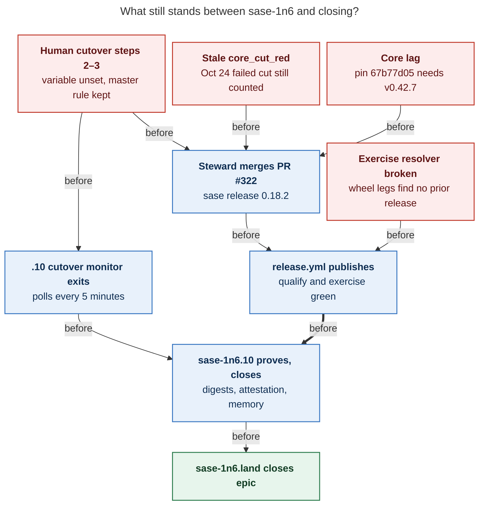
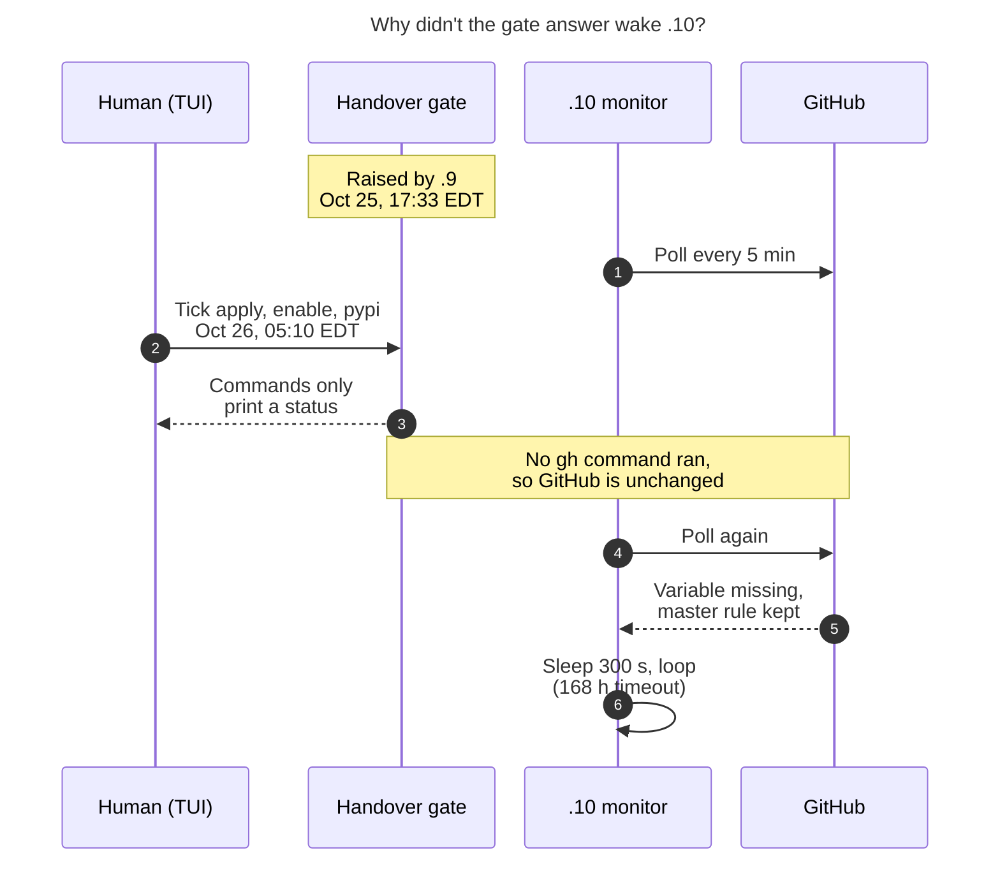
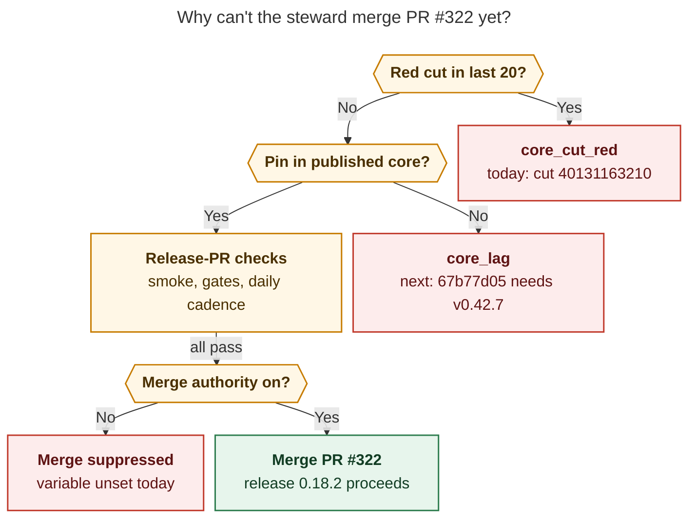

# What is blocking the `sase-1n6` (E2) epic? Status on Oct 26, 2026

This follows `research:202610/sase_1n6_e2_stall_update_20261024.md`. Since that report,
the sleeping nested phase woke up and the epic moved quickly: phases `.5`, `.6`, and `.9`
all closed on Oct 25. E2 now has one open phase. I checked everything below live
between 07:55 and 08:15 EDT on Oct 26.

## Short answer

Nine of E2's ten phases are closed. The last one is `sase-1n6.10`, "First steward
release, acceptance evidence, and the decision record". It has to watch the first real
release go through the new steward and `release.yml`, then prove it. No such release can
happen yet, for four separate reasons:

1. **The handover gate was ticked, but two of its steps never happened.** At 05:10 EDT
   you ticked "Steward merge authority is on" and "pypi environment allows only v* tags"
   in the TUI. Those gate options only print a status string; they don't change GitHub.
   `RELEASE_STEWARD_MERGE_ENABLED` still doesn't exist, and the `pypi` environment still
   has its `master` branch rule. The `.10` agent's monitor polls for exactly those
   settings, so it is still waiting.
2. **The release steward is stuck on a stale `core_cut_red`.** Every steward tick since
   Oct 24 21:56 UTC blames a sase-core cut that failed on Oct 24, even though the release
   it was cutting (v0.42.5) shipped 22 minutes later. While that verdict stands, the
   steward never reaches the merge decision for sase release PR #322 (0.18.2).
3. **Core lag.** sase master pins sase-core commit `67b77d05`, and no published core
   contains it. v0.42.7 (sase-core PR #338) would, but that PR is still open. Because
   of the lag, the latest rehearsal failed qualification: tests expect language
   detection that only the unpublished core has.
4. **The `release.yml` exercise step can't find a previous release.** Both wheel
   exercise legs report every sase version, from 0.18.1 down to 0.1.0, as "no longer
   resolves". This is recorded only in bead notes; no bead or agent is assigned to fix it.

Blocker 1 needs only you, but the timing matters (see below). Blocker 2 will probably
clear on its own within about a day. Blockers 3 and 4 have no owner.



*Arrows mean "must clear before", and converging arrows mean all of them: E2 closes only
after four independent blockers (red) clear and a real release reaches PyPI.*

## Where the epic stands

| Bead or agent | State | Waiting on |
| --- | --- | --- |
| `sase-1n6` epic | IN_PROGRESS | its lander |
| Phases `.1` through `.9` | CLOSED | nothing |
| Phase `sase-1n6.10` | IN_PROGRESS, no notes yet | monitor `9szd2935pyzr` |
| Agent `sase-1n6.10--mon` (codex/gpt-6-luna) | RUNNING as "WAITING CUTOVER" since Oct 25 17:52 EDT | GitHub settings |
| Agent `sase-1n6.land` (claude/opus) | WAITING since Oct 19 | all ten phase beads |

The `.10` agent is doing what it was designed to do. It polls rather than sleeping
blindly, which is the fix the Oct 24 report asked for, so it will wake within 5 minutes
of the settings appearing.

## Blocker 1: the gate was answered, but GitHub never changed

Phase `.9` closed at 17:33 EDT on Oct 25 and raised gate
`custom-69faba44-62d3-42fd-9129-27998a15b021` with four human-only steps:

1. Run `chezmoi update -a --force` on athena, so ci_watch stops merging sase release
   PRs.
2. Run `gh variable set RELEASE_STEWARD_MERGE_ENABLED --body true -R sase-org/sase`.
3. Remove the `master` branch rule from the `pypi` environment, leaving only `v*`.
4. Optionally, remove `publish.yml`'s trusted publisher on PyPI.

The gate response (`source: tui`, 05:10:52 EDT Oct 26) selected `apply`, `enable`, and
`pypi`. Each option's command is a two-line shell script such as
`printf '{"status":"enabled"}\n'`. Ticking an option records that you did the step; it
doesn't do the step. Here is the live state:

| Step | Evidence | Done? |
| --- | --- | --- |
| 1, ci_watch | `~/.config/sase/sase_athena.yml` (modified Oct 25 17:39) lists only sase-github and sase-telegram under `release_repositories` | Yes |
| 2, merge variable | `gh api repos/sase-org/sase/actions/variables` returns `total_count: 0`; steward run 40314997000 logs `RELEASE_STEWARD_MERGE_ENABLED:` as empty | No |
| 3, tag-only pypi | `deployment-branch-policies` still lists `master` (type branch, id 51457521) and `v*` (type tag) | No |
| 4, optional | Not selected | Not applicable |

The `.10` monitor checks every 300 s and exits only when all three conditions hold: the
variable is `true`, there are zero branch rules, and the tag rules are exactly `v*`. Its
timeout is 168 hours, so it gives up around Nov 1 at 21:52 UTC.



*The gate's options only acknowledge a step, so the monitor still sees the old GitHub
settings and keeps polling.*

These two commands finish the handover. This research agent didn't run them, because
they are the human-only steps the gate asked for:

```bash
gh variable set RELEASE_STEWARD_MERGE_ENABLED --body true -R sase-org/sase
gh api -X DELETE repos/sase-org/sase/environments/pypi/deployment-branch-policies/51457521
```

**Run them last, not now.** Once the monitor exits, `.10`'s recorded next step starts a
four-day `release_watch` monitor. If blockers 2 through 4 are still open, that watch
expires and `.10` stops with the phase open and nothing running. That is the same
ownerless-phase stall that happened on Oct 22 and Oct 24. Merge authority is also the
last check before the steward merges (Figure 3). Once it is on, the steward merges #322
on the first tick after blockers 2 and 3 clear, and that release run then fails on
blocker 4. Flip steps 2 and 3 right after blockers 3 and 4 are fixed, and before the
Nov 1 timeout.

## Blocker 2: a stale core_cut_red stops the steward early

All 11 scheduled steward runs from 40136374005 (Oct 24 21:56 UTC) through 40314997000
(Oct 26 11:25 UTC) return the same verdict:

```text
release_watch: core_cut_red
CORE_CUT_RED check=cargo_fmt_+_clippy_+_test_(macos-latest) run=https://github.com/sase-org/sase-core/actions/runs/40132266138 attempt=1
```

That line is the typed annotation from sase-core `release-plz.yml` run 40131163210. It
was a workflow_dispatch cut at 20:44 UTC on Oct 24, and its "Merge release PR" job
failed. Everything after it went green:

- The CI run it names, 40132266138, had only one attempt, and its macOS job passed at
  21:39:49 UTC.
- The next cut, 40136208288 at 21:53 UTC, passed. PR #336 (v0.42.5) merged at 22:18
  UTC, and v0.42.6 shipped on Oct 25.
- All 13 cut runs since the failure have passed.

The cause is in sase-core's `crates/sase_core/src/release_steward/policy.rs`, in
`handle_no_train`. It returns `CoreCutRed` for the first completed cut with a typed
failure among the newest 20 completed cut runs. The reader in
`tools/_release_watch_health.py` sets that window with `CUT_HISTORY_LIMIT = 20`.
Nothing checks whether a newer cut passed or whether that release already shipped. The
check also runs before the core-lag check and before any release-PR logic. So even with
merge authority on, the steward would stop at `core_cut_red` and never look at PR #322.



*The steward checks recent core cuts first, so today's stale red cut stops it before
core lag, release-PR checks, or the merge-authority switch come into play.*

The failed run is now 14th among the newest completed cut runs, so it leaves the 20-run
window after about seven more cuts finish. Cuts run on the `23 */6 * * *` and
`41 7 * * *` schedules plus every push to core master. At Oct 25's pace of about nine
runs in 20 hours, that takes roughly one more day. A lasting fix would count a
typed-red cut only when no newer cut is green.

I recorded this as DISCOVERED ISSUE note #11 on `sase-1n6`, with a timing correction in
note #12. `/sase_new_task` found no duplicate task, and the policy was introduced by
`sase-1n6.7.1.1` (sase-core `dd817d56`). The bead rules route a defect caused by an
active epic to that epic, not to a new task.

## Blocker 3: core lag

- **The pin is unpublished.** `sase-core-revision.txt` pins `67b77d0561fb` on sase
  master and on release PR #322's branch. Commit `ce75abd76f` ("label Swift languages",
  Oct 25 17:06 EDT) set it. `git tag --contains 67b77d05` returns nothing; the newest
  published core is v0.42.6 (`7c0a7b8f25`).
- **The release pin is still 0.42.6.** `pyproject.toml` pins `sase-core-rs==0.42.6`.
- **v0.42.7 is ready but unmerged.** sase-core PR #338 ("chore: release v0.42.7",
  opened Oct 25 20:43 UTC) is open, `MERGEABLE`, and `CLEAN`, with green checks. The
  core merge helper merges it only on the `41 7 * * *` schedule or a workflow_dispatch
  cut. Both v0.42.5 (#336) and v0.42.6 (#337) were merged by hand as `bbugyi200`.
- **The steward won't dispatch a cut.** A completed green cut at `67b77d05` already
  exists, so the policy reports "applicable core cut already completed".
- **Qualification fails meanwhile.** Rehearsal 40234446645 (Oct 25 21:13 UTC, at
  `ce75abd76f`) reports
  `QUALIFY_RED(test (3.12):tests, test (3.13):tests, test (3.14):tests)`, with failures
  such as `assert None == 'swift'`, `'kotlin'`, and `'typescript'`. The new
  language-detection tests need the unpublished core.

Clearing it takes two steps. First, publish v0.42.7, either by merging #338 or by
letting the daily merge cut do it. Second, land a sase commit that pins
`sase-core-rs==0.42.7`. The previous pin commit, `7423fa8380`, came from an agent in
the now-closed `.5` subtree, so no current agent or bead owns that step.

## Blocker 4: the exercise resolver finds no previous release

Both wheel legs of the same rehearsal fail the same way:

```text
sase==0.18.1 no longer resolves; skipping
sase==0.18.0 no longer resolves; skipping
... every release down to sase==0.1.0 ...
UPGRADE_NO_INSTALLABLE_PREVIOUS no installable PyPI release at or below 0.18.1
```

`release.yml`'s resolver runs
`uv pip install --dry-run --system --python 3.12 sase==<version>` with
`capture_output=True`. It never prints the captured stderr and labels every nonzero exit
"no longer resolves", so the log hides the real cause. Every version in that list is on
PyPI, so something in the runner setup breaks the resolve. The sdist legs pass.

`publish` depends on `exercise`. The rehearsal's `exercise` job failed with
`EXERCISE_RED(linux+macos): linux-wheel evidence missing; macos-wheel evidence missing`,
so a real tag run will most likely hit the same failure.

This has been known since Oct 23, when epic note #9 recorded it from runs 40000653149
and 40000657197, and `.9` raised it again as a PROPOSED FOLLOW-UP (note #4). The epic
holds it only as notes, though: no task bead or phase was created. `.10`'s recorded next
action treats the failure as "the already-recorded baseline failure", so nobody is
fixing it.

## A problem waiting in .10's next step

After cutover, `.10` plans to run
`tools/release_watch --until-released 0.18.1 --deadline 4d`. According to
`tools/_release_watch.py`, `--until-released VERSION` repeats snapshots "until that
exact version is confirmed". 0.18.1 was already published on Oct 25 through the old
`publish.yml` path (`sase-1nn`), not through the steward. The same next-action text then
says "After a newer release is confirmed, prove…", so the version in the command
contradicts the stated intent.

I didn't run the watcher to see whether it counts 0.18.1 as a confirmed train. If it
does, the watch exits immediately, `.10` finds no `release.yml` manifest to prove, and
it leaves the phase open. When `.10` resumes, either the bare `--until-released` (wait
for a new version) or `--until-released 0.18.2` matches what the phase intends.

## Status of the epic's other discovered issues

- Note #1, the core source-pin containment gap, was handled by the nested `.5` child
  epics, which are now closed.
- Note #2, the suffix parser, was fixed, as recorded in note #3.
- Note #10, the SC2012 `ls | wc -l` dist counting in `release.yml`'s build step, is still
  present (`wheels="$(ls dist/*.whl 2>/dev/null | wc -l)"`). It is a lint finding, not a
  release blocker.

## Recommended order

1. Give blocker 4 an owner, either a task bead or an agent. The work: print the
   resolver's stderr, find the runner-side cause, and prove both wheel legs green with a
   rehearsal.
2. Publish sase-core v0.42.7 by merging #338, then land the `sase-core-rs==0.42.7` pin in
   sase. A rehearsal should then pass qualification.
3. Let the stale `core_cut_red` age out, or fix the policy (note #11). Confirm a steward
   tick reports a different state.
4. Then run the two `gh` commands from blocker 1. The `.10` monitor exits within 5
   minutes. Check its `--until-released` target before it starts the four-day watch.
5. If none of this happens before about Nov 1 at 21:52 UTC, the cutover monitor times
   out and `.10` will need a relaunch.

## Evidence

- **Beads:** `sase-1n6` (notes #1 through #12), `sase-1n6.9` (notes #1 through #5), and
  `sase-1n6.10`.
- **Gate:** `custom-69faba44-62d3-42fd-9129-27998a15b021`. Its `request.json`,
  `response.json`, and `commands/*` live under `~/.sase/interaction_requests/custom/`.
  `sase gate wait -i <id> -k custom --json` reports `answered`.
- **Monitor:** `sase monitor show 9szd2935pyzr`. Agents come from `sase agent list -a -j`.
- **GitHub settings:** `gh api repos/sase-org/sase/actions/variables` and
  `gh api repos/sase-org/sase/environments/pypi/deployment-branch-policies`.
- **Steward runs:** `release-steward.yml` schedule runs 40136374005 through 40314997000.
- **sase-core:** cut 40131163210 (failed), CI 40132266138 (green), and cut 40136208288
  (green). PRs #336 and #337 are merged; #338 is open.
- **Rehearsal:** `release.yml` run 40234446645.
- **Code:** sase-core `crates/sase_core/src/release_steward/policy.rs` (`handle_no_train`)
  at `67b77d05`; in sase, `tools/_release_watch_health.py` (`_read_cuts`,
  `CUT_HISTORY_LIMIT`), `tools/_release_watch.py` (`--until-released`), and
  `.github/workflows/release.yml` (the previous-release resolver and `publish` needs).
