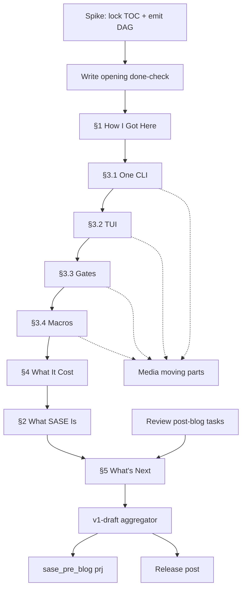

# Splitting the SASE blog into Obsidian tasks

**Date:** 2026-10-23
**Researcher:** grk (`research.2b.grk`). Independent report. I did not read peer reports from this swarm.
**Question:** How should the in-progress sase.sh launch post be boiled down into actionable Obsidian tasks, including a spike that produces more tasks?

## Bottom line

Create **one planning spike** on `[[sase_blog]]` whose only job is to lock the table of contents onto `[[sase_blog_contents]]` and emit a small writing DAG. Then write **one H2 (or one §3 H3) per sitting** into that article note. Keep every sequential successor `[?]`-blocked so `bob ready` stays under the per-note cap of 5.

The current graph is why the page feels stuck. `Write introduction!` is already in Next, the article already has a 189-word opening, and everything else hides behind a single blocked task, `Finish full v1 draft of blog post!`. That v1 task is a project. The 70-bullet Requirements dump, the July Outline, and the article's "1. The Abstractions" catalog are three different maps of the same post. The spike's output is one map.

Do this on `[[sase_blog]]`. Do not open a fourth project. `[[sase_pre_blog]]` is product freeze work; `[[sase_post_blog]]` is the series after launch. Prose lives only in `[[sase_blog_contents]]` (`type: [[article]]`). Tasks live on the project note.

---

## 1. What is actually on the desk

Verified 2026-10-23 against `~/bob` and the sase checkout.

| Surface | State |
| --- | --- |
| Live post `docs/blog/posts/structured-agentic-software-engineering.md` | 2,882 words. Product-noun H2s: Wraps Agent CLIs, Macros, Agents Tab, Install, What's Next. Still the URL to rewrite in place. |
| `[[sase_blog_contents]]` | `type: [[article]]`. 274 words, 10 sections, 10 TODO stubs. Preamble 189 words. Then empty catalog **1. The Abstractions** with all seven "things sase generalizes" as H3s. |
| `[[sase_blog]]` | Project, `status: wip`, `task_count: 14`, `open_task_count: 2`. Ready lane: **1 of 5** (`bob ready` cap 5, state `room`). The one Ready task is the Hassan et al. paper. |
| Next / WIP | `[*] Write introduction!` (`^write-introduction`). Depends on the launch-post outline (done), `sase_blog_261017` (**canceled**), `read-blog-notes` (done), and two Anthropic refs that completed 2026-10-21 / 2026-10-23. |
| Blocked aggregator | `[?] Finish full v1 draft of blog post!` (`^v1-draft`) depends only on the introduction. It blocks `[[sase_pre_blog#^prj]]`. |
| Requirements | 70 top-level bullets under `## Requirements`, plus Screenshots, Contents, Outline, Later Posts. |
| Accepted outline | `research:202610/sase_launch_post_outline/sase_launch_post_outline__final.md`, ingested as `[[ref/chat/sase_launch_post_outline]]` (status `read`). Five H2s plus an unheaded opening, ~2,800 words, hard cap 3,000. Cover **four** of the eight generalizations in post 1. Template for every §3 sub-section: special case → generalization → one proof artifact → grid answers as prose. |
| Your annotations on that outline | Yes to the §3 template, Why a TUI, `%wait`/`#fork`, What It Cost, poll issues, "No weasels; just work." |

`bob articles outline sase_blog_contents` already prints the numbered skeleton and the TODO stubs. That command is the living TOC once headings change. `bob articles format` owns section numbers; it does not change words.

---

## 2. Why this feels like writer's block

Three maps are open at once.

**Map A — article headings (what you see when you write).** `1. The Abstractions` / 1.1–1.7. This is the 2026-08-07 "Things that sase generalizes" list pasted in as the whole post. It asks you to write a catalog.

**Map B — project Outline (July, still in `sase_blog.md`).** Introduction → Overview → XPrompts → ACE → AXE → Future. Product nouns that the accepted outline already retired (macros, `sase tui`, scheduler).

**Map C — accepted research outline (read, highlighted, supposed to end the outline question).** Unheaded opening → How I Got Here → What SASE Is → What SASE Generalizes (four rungs) → What It Cost → What's Next. Headings name ideas. The other four generalizations are the series map.

You are currently tasked to "write the introduction" into Map A, while Map C is the outline you already accepted, and Map B is still sitting on the project note. Sitting down to write 1.1 "Gates -> Plans -> Epics" as the first body section fights the outline you highlighted two weeks ago.

The task graph then makes the fight worse:

1. **The next action has no done check.** The preamble already exists. `Write introduction!` can stay `[*]` forever because nothing says "promise sentence + stats strip + Getting Started link, then close."
2. **`^v1-draft` is one sitting that is actually ~2,600 remaining words plus media plus citations.** GTD's test is: an outcome that takes more than one physical action is a project. David Allen: put the next physical action on the list; park sequential later steps in project support so the action list stays attractive.
3. **Research is wired onto the writing next action.** Introduction still lists canceled `sase_blog_261017` and two PyPI-area refs as `dependsOn`. Those refs are useful for later sections and for `[[sase_pypi_releases]]`. They are not required to finish a 200-word opening.
4. **Seventy requirements are competing with ten TODOs.** Requirements is a good parking lot. Promoting all 70 to `#task` would crowd `bob ready` (cap 5; `[[bob_gtd]]` shipped a warning at ≥5 ready tasks on a project) and turn list-making into the work.
5. **Media, research, product freeze, and prose share one lane.** Recapturing June screenshots, drawing stick figures, reading the ASE paper, putting unstable features behind flags (`[[sase_pre_blog]]`), and writing §3.3 are different contexts. Mixing them makes "work on the blog" mean five jobs.

The prior outline report's line that the failure mode is "replace rather than own" still applies. The spike below produces *your* section cards and *your* DAG. Agents verify facts and render assets after the words exist.

---

## 3. Methods that fit this vault

These are the pieces worth stealing. None of them requires a new system. They map onto notes and commands you already have.

### 3.1 Snowflake: grow the post, then draft

Randy Ingermanson designed novels the way he designed software: divide-and-conquer plus top-down design. Start with one sentence, expand to a paragraph, expand to a page, then a scene list, then the draft. Each step is small enough to finish; the large-scale structure is proven before the 2,800-word sitting. You already have Step 1 in the live title and in the drafted pride paragraph. The spike is Steps 2–4 for *this* post: a five-sentence H2 summary, then a four-line card per body section, then rewrite the article headings to match. After that, drafting is Step 10: one scene (one H2 / one §3 H3) at a time.

You do not need character charts. You do need the analog of his scene spreadsheet: the DAG in §6.

### 3.2 GTD: one next action, project support for the rest

Allen's definitions, from the GTD site:

- **Project** = outcome that takes more than one action step.
- **Next action** = the next physical, visible action.

Putting steps 2, 3, and 4 of a sequential chain on the action list "dulls the attraction of engaging with the list." Sequential successors belong in project support until their predecessor finishes. Independent *moving parts* (prose vs recapture screenshots vs poll issues) each get their own next action.

Your vault already implements this:

- `#task` lines with `[id::]` / `dependsOn` / `^block-id`
- `[*]` / `[/]` Next & In Progress, `[?]` Blocked, `[ ]` Ready
- `bob ready` Ready-lane cap **5**
- `## Requirements` as the parking lot
- `bob task reconcile` to restamp blocked/open from dependencies

The fit is: **one unblocked writing task at a time**, media as parallel moving parts, Requirements remaining a parking lot until the spike files each bullet.

GTD's other relevant rule: next actions live for doing; project support is the parking lot for future actions that depend on something else happening first. `[[sase_blog_contents]]` is the manuscript. `[[sase_blog]]` `## Tasks` is the action list. `## Requirements` / `## Later Posts` are project support. `[[sase_blog.md]]` `## Outline` should stop being a fourth map: after the spike it becomes a one-line pointer to the article, or it is rewritten to match the article headings exactly.

### 3.3 Task granularity test

For every proposed `#task`, all four must be yes:

1. Finished result in one sentence.
2. One owner (you, for prose; an agent later for GIFs if you want).
3. Identifiable predecessor.
4. Completion visible without a progress meeting.

"Finish full v1 draft" fails 1, 3, and 4. "Write §3.3 Plan Mode → Gates into `[[sase_blog_contents]]`, ~280 words, special-case → generalization → `img/20260824_141701.png` → one lesson in prose" passes.

Words such as *and*, *also*, *then* in a task title usually mean two tasks. "Write the gates section and recapture the screenshot" is two moving parts.

Tiny administrative actions ("open the file", "run `bob articles format`") stay inside the parent sitting. Over-splitting a writing project into forty identical next actions is how the list dies.

When scope is uncertain, the first task is discovery: the spike. Its result is the work list. That is the software-spike analog you asked for.

### 3.4 Diátaxis: this post is explanation, and you already read the workflow

The launch post is **explanation** (understanding-oriented, opinion allowed, bounded by a *why*). Getting Started stays a link. Install stays out. That decision is already in the accepted outline and in `[[ref/blogs/diataxis_fr_compass_and_howto]]` (finished 2026-10-16).

The Diátaxis *workflow* page is the other half, and it is already in your library. It tells you to take small publishable steps, pick the thing in front of you, and complete one action. It also warns against creating empty four-quadrant scaffolding. Translating that here: **do not** pre-create empty H2s for every later post in the series. **Do** rewrite `[[sase_blog_contents]]` headings to the *this-post* outline so the article is always complete at its current stage (opening done, then §1 done, …) even while unfinished.

Word budgets from the accepted outline become the per-task acceptance checks:

| Slot | Budget | Current |
| --- | --- | --- |
| Opening (no H2) | ~200 | 189 words of pride/identity; missing promise sentence, Getting Started link, stats caveat |
| §1 How I Got Here | ~500 | empty |
| §2 What SASE Is | ~350 | empty; write 2.2 last |
| §3 What SASE Generalizes | ~1,150 (four H3s ≈ 280 each) | empty catalog of *seven* H3s |
| §4 What It Cost | ~400 | empty; needs your slop examples and AI broccoli |
| §5 What's Next | ~250 | empty |
| **Total** | ~2,800, cap 3,000 | 274 |

---

## 4. What the spike must decide (so you never re-decide it at the keyboard)

The spike is a real work session, about one sitting. It produces files and tasks. It does not produce prose beyond the five-sentence summary and the section cards.

**Decision 1 — which map wins.** Map C (accepted outline). Rewrite `[[sase_blog_contents]]` headings to:

- *(unheaded opening)*
- `## 1. How I Got Here` with 1.1 Twelve Months, 1.2 My Ladder, 1.3 The Missing Layer
- `## 2. What SASE Is, and Isn't` with 2.1 The Bet, 2.2 The Name, 2.3 Who It's For
- `## 3. What SASE Generalizes` with 3.1 One CLI → Every CLI, 3.2 A Wall of Terminals → One Screen, 3.3 Plan Mode → Gates, 3.4 One Prompt → Programs
- `## 4. What It Cost` with 4.1 The Slop I Shipped, 4.2 AI Broccoli, 4.3 Limitations
- `## 5. What's Next, and I Need Your Help` with 5.1 The Other Four, 5.2 Out of Tokens, 5.3 Try It

Then `bob articles format sase_blog_contents`. Beads/sidecars, VCS/Patches, project-management/artifacts/memory, and routines/jobs leave the article as H3s. They become one paragraph in 5.1 plus `## Later Posts`.

**Decision 2 — file every Requirements bullet.** Three buckets only:

- **Assigned:** child bullet under the writing task that will use it (or a four-line section card in Project Support).
- **Parked:** `## Later Posts` or `[[sase_post_blog]]`.
- **Dropped:** one-line cancel with a reason, same as you already do in CANCEL LOG.

Do not create a `#task` per requirement. Seventy tasks would crowd Ready and hide the next action.

**Decision 3 — done checks for the two existing writing tasks.**

- `^write-introduction` is done when the opening has (a) the pride paragraph, (b) a 3–4 number stats strip plus "Motion isn't progress," (c) one promise sentence plus a Getting Started link, (d) no heading. Media: none. Then mark it `[x]`.
- Replace `^v1-draft` with an aggregator that `dependsOn` the section-draft tasks in §6. Same block id so `[[sase_pre_blog#^prj]]` keeps working.

**Decision 4 — Ready-lane budget.** After the spike, `[[sase_blog]]` should have at most:

- 1 Ready writing/planning task (the current next sitting)
- 1 Ready `#ref` if you still want the ASE paper in the lane
- 0–1 Ready media moving part (only if it does not depend on a section that is unwritten)

That is 2–3 of 5. Leave room. `bob ready sase_blog` today: 1 ready, 2 blocked, 1 pending, cap 5.

---

## 5. Section cards (the snowflake page, produced by the spike)

One card per body H3. Four lines, written by you, stored as a nested list under the matching `#task` or under `## Project Support`. These are **not** extra tasks.

Template (from the outline you highlighted):

1. **Special case (😈):** the pre-SASE rung.
2. **Generalization (😇):** what the post claims SASE made of it.
3. **Proof artifact:** one screenshot, GIF, or `sase artifact read` example, named as a path.
4. **Lesson / grid:** one sentence of high value, untapped opportunity, or lesson learned. Prose, never an H4.

Example for 3.3, filled from your own highlights so the spike is not starting from zero:

- 😈 Auto-approved plans die with the chat; plan mode is a special case of something.
- 😇 Gates → plans → epics; questions and launch approvals are the same primitive.
- Proof: `~/bob/img/20260824_141701.png` (four related plans via `sase artifact read`).
- Lesson candidate: a gate never blocks an agent.

The spike fills the other seven cards the same way. Empty cards are allowed; an empty card is a signal that this section still needs a five-minute think, not a 500-word sitting.

---

## 6. Recommended task DAG

Stay on `[[sase_blog]]`. Use existing id style `sase_blog__…` and `^block-id`. Dates below are placeholders; `bob` will stamp `[created::]` if you create in-app.

### 6.1 The spike (create this now, only new Ready writing-system task)

```markdown
- [ ] #task Spike: lock post-1 TOC on [[sase_blog_contents]] and emit the writing DAG [created::2026-10-23] [id:: sase_blog__toc-spike] [priority:: high] ^toc-spike
	- Rewrite article headings to the accepted 5-H2 outline; `bob articles format sase_blog_contents`.
	- Point `## Outline` at the article (or rewrite it to match). Move the four unused generalizations into `## Later Posts`.
	- File every `## Requirements` bullet: assigned / parked / dropped.
	- Write the five-sentence H2 summary and the eight section cards.
	- Create the tasks in §6.2–6.4 with `dependsOn`. Leave only `^write-opening` (or `^write-s1`) unblocked besides this spike and the ASE `#ref`.
	- Redefine `^write-introduction` done-check; retarget `^v1-draft` as aggregator.
	- 🧱 **BLOCKS:** [[#^write-opening]]
```

That is the planning task that produces more tasks. Close it when `bob articles outline sase_blog_contents` shows the Map C headings and the new `#task` lines exist.

### 6.2 Writing tasks (one sitting each, sequential)

Keep these `[?]` until the predecessor is `[x]`. `bob task reconcile` will open the next one.

| id / `^` | Task (result in one sentence) | Budget | Depends on |
| --- | --- | --- | --- |
| `sase_blog__write-opening` `^write-opening` | Opening in `[[sase_blog_contents]]` has pride + stats caveat + promise + Getting Started link. | ~200 | `^toc-spike`. **Retarget or close** existing `^write-introduction` onto this done-check. |
| `sase_blog__write-s1` `^write-s1` | §1 How I Got Here is drafted: 12-month beat, ladder, missing-layer 😈 list, plan-mode question planted. | ~500 | `^write-opening` |
| `sase_blog__write-s3-1` `^write-s3-1` | §3.1 One CLI → Every CLI drafted from its card. | ~280 | `^write-s1` |
| `sase_blog__write-s3-2` `^write-s3-2` | §3.2 Wall of Terminals / Why a TUI drafted from its card. | ~280 | `^write-s3-1` |
| `sase_blog__write-s3-3` `^write-s3-3` | §3.3 Plan Mode → Gates drafted; four-plans figure cited. | ~280 | `^write-s3-2` |
| `sase_blog__write-s3-4` `^write-s3-4` | §3.4 One Prompt → Programs drafted; 😈/😇 `%wait`/`#fork` bullets in. | ~280 | `^write-s3-3` |
| `sase_blog__write-s4` `^write-s4` | §4 What It Cost drafted: four slop categories with one real SASE example each, broccoli slot, limitations list. | ~400 | `^write-s3-4` and a capture bullet for broccoli/slop examples if those are still only in Keep |
| `sase_blog__write-s2` `^write-s2` | §2 What SASE Is drafted; **2.2 The Name written last.** | ~350 | `^write-s4` (and the rename decision if it is still open) |
| `sase_blog__write-s5` `^write-s5` | §5 series map + ask + Try It + closing line. | ~250 | `^write-s2` and the existing "Review all post-blog tasks for the Future Work section" |
| `sase_blog__v1-draft` `^v1-draft` | Full draft in the article is under 3,000 words and readable top to bottom. | assemble + cut | all `^write-s*` |

Suggested next-action title once the spike is done, if the opening still lacks the promise sentence:

> Write the promise sentence and Getting Started link into the `[[sase_blog_contents]]` preamble, then close `^write-introduction`.

That is a physical action you can finish in fifteen minutes. It is the GTD unstick.

**Why §3 is sequential rather than four Ready tasks.** Voice and the ladder callbacks want one thread. Four Ready writing tasks would also spend the whole Ready cap. Independent *media* for those sections can still run in parallel (see 6.3).

**Why §2 is late.** The accepted outline already says write The Name last. Rename-proof headings are in place after the spike, so delaying §2 does not block §1 or §3.

### 6.3 Parallel moving parts (media / production)

These are separate next actions because they use a different context (screenshot recapture, image models, `gh` issues). Each depends on the section it illustrates, or on a terminology freeze, not on the whole v1 draft.

Keep the ones you already have. Add only what the spike's cards name as missing:

| Existing or new | Role |
| --- | --- |
| Recapture `~/tmp/screenshots/20260616_*` and `20260624_*` | Terminology has moved (xprompt → macro, ace → tui, family → session). Blocked on freeze + the section that uses each shot. |
| Timeline infographic; `window_farm_vs_control_tower`; `one_prompt_provider_clis`; `prompt_burrito` | Diagram briefs already exist per the outline. One task per brief, blocked on the section card naming it. |
| Agents observability GIF / prompt-input GIF | Files exist; confirm they still match current UI. |
| `type:poll` GitHub issues | Blocked on `^write-s5` (the ask). |
| Update commit/line counts (`[b]` in the article) | Publish-day task, blocked on `^v1-draft`. |
| Existing: transcribe to podcast and listen | Blocked on `^v1-draft`. |
| Existing: Gas Town term links | Walk the draft once after `^v1-draft`; keep blocked until then. |
| Existing: review post-blog tasks for Future Work | Predecessor of `^write-s5`. |

Placeholder HTML comments already in the live post (`<!-- DIAGRAM: window_farm_vs_control_tower... -->`) are a fine pattern for the article: the writing task can land a comment where the figure goes, and the media task replaces it.

### 6.4 Leave these where they are

- `[[sase_pre_blog]]` tasks (flags, docs-like-zensical, pi/hermes, security audit). They gate *launch*, not *sentences*. `^v1-draft` already blocks that project's `^prj`.
- `[[sase_post_blog]]` as a whole. `^write-s5` reads it; it does not absorb it.
- `#ref` tasks. The ASE paper can stay Ready. `structured_agentic_software_engineering` (the live post, as a ref) stays blocked on the Anthropic code-review ref, which is now done — worth a reconcile pass.
- `^sase-blog` Release task, still depending on `[[job_2026_apply_29]]`.

### 6.5 Graph



Solid arrows are `dependsOn`. Dotted arrows are "this section names a proof artifact the media task can start once the card exists."

---

## 7. Sitting recipe (so each writing task is actually startable)

When a `^write-s*` flips to Ready:

1. Open `[[sase_blog_contents]]` at that heading only. Ignore Requirements.
2. Read the four-line card.
3. Draft the sitting in your voice, toward the word budget. Leave `TODO` only for a named missing proof path, never for "explain gates."
4. Run `bob articles format sase_blog_contents` if you added headings.
5. If you overshoot the budget, cut in that sitting or park overflow as a child bullet "trim in `^v1-draft`."
6. Mark the task `[x]`. The next `dependsOn` target becomes the next physical action.

That is Diátaxis "complete, not finished" applied to one article: after §1 the article is a complete opening-plus-origin-story; after §3 it is a complete argument; `^v1-draft` is the first time it has to be a complete *post*.

---

## 8. What I would not do

These are the strategies that look like "splitting the blog into tasks" and recreate the block.

- **A new project note** (`sase_blog_draft` etc.). You already have project / pre / post. A fourth note splits the Ready lane and the `^prj` chain.
- **One `#task` per Requirements bullet.** Seventy Ready-adjacent items. Your own GTD work shipped a warning for this.
- **Writing into the current 1.1–1.7 catalog.** That cements Map A and throws away the outline you already accepted.
- **Agent-drafted section bodies as the sitting.** The outline research already called that the recurring failure mode. Agents: fact-check, counts, GIFs, `bob articles format`. You: the four-line card and the sitting.
- **Empty series scaffolding** in the article (Beads, Memory, Mobile, Evals, ChangeSpec, Architecture as H2s). Those are Later Posts. One paragraph in 5.1 is enough.
- **Planning every media filename before the first sitting.** Media tasks come from the cards. Cards come from the spike. The spike is the first next action.

---

## 9. Recommended strategy (do this)

**This weekend, one sitting: the TOC spike.** Create `^toc-spike` on `[[sase_blog]]` as the only new Ready task. Its output is (1) Map C headings in `[[sase_blog_contents]]`, (2) eight four-line cards, (3) the DAG in §6 with successors blocked, (4) Requirements filed, (5) `^write-introduction` given a done-check you can close the same day if the promise sentence is all that remains.

**Then, one H2/H3 per sitting in this order:** opening → §1 → §3.1 → §3.2 → §3.3 → §3.4 → §4 → §2 → §5 → assemble. Always exactly one unblocked writing task.

**Media as side quests** off the cards, never inside the prose task titles.

**Launch chores stay on `[[sase_pre_blog]]`.** They start when `^v1-draft` closes, which is what the current `dependsOn` already says.

The unstick is smaller than it feels. The next physical action is not "write the blog." It is: *put the accepted outline into the article headings and write four lines for §3.1.* After that, the Ready lane will tell you what to do tomorrow.

---

## Sources

**Vault (inspected):** `~/bob/sase_blog.md` · `~/bob/sase_blog_contents.md` · `~/bob/sase_pre_blog.md` · `~/bob/sase_post_blog.md` · `~/bob/why_sase.md` · `~/bob/sase_blog_0_legacy_notes.md` · `~/bob/sase_blog_blockers.md` · `~/bob/project.md` · `~/bob/article.md` · `~/bob/_templates/new_project.md` · `~/bob/_templates/new_article.md` · `~/bob/bob_gtd.md` · `~/bob/ref/chat/sase_launch_post_outline.md` · `~/bob/ref/notes/sase_blog_261019.md` · `~/bob/sase_pypi_releases.md`

**Commands:** `bob articles outline sase_blog_contents` · `bob articles list` · `bob ready sase_blog -f json` (cap 5, 1 ready) · `bob query` on `outgoing([[sase_blog]])`

**Checkout:** `docs/blog/posts/structured-agentic-software-engineering.md` (2,882 words, 2026-07-08)

**Prior research (audited read):** `research:202610/sase_launch_post_outline/sase_launch_post_outline__final.md`

**External (opened):**

- Randy Ingermanson, *How to Write a Novel Using the Snowflake Method* (2008 archive of the original article): <https://web.archive.org/web/20080103035348/http://www.advancedfictionwriting.com/art/snowflake.php>
- Randy Ingermanson interview, divide-and-conquer / top-down design: <https://www.creative-writing-now.com/the-snowflake-method.html>
- David Allen, *Managing Projects* (project = >1 action; next action = next physical visible step; sequential steps stay off the action list): <https://gettingthingsdone.com/2010/02/managing-projects-tips-from-david-allen/>
- David Allen, *The GTD Approach to Linking Next Actions and Projects* (project support is the parking lot for dependent future actions): <https://gettingthingsdone.com/2020/06/the-gtd-approach-to-linking-next-actions-and-projects/>
- Daniele Procida, Diátaxis *Explanation*: <https://diataxis.fr/explanation/>
- Daniele Procida, Diátaxis *as a guide to work* (small steps, complete-not-finished): <https://diataxis.fr/how-to-use-diataxis/>
- ONES, *How to Decide How Small Project Tasks Should Be* (four-question granularity test): <https://ones.com/blog/how-to-decide-how-small-project-tasks-should-be/>

Library check: 1 of 10 candidates already in your library (1 finished: Diátaxis compass / how-to-use). Proposed capture if you want the method notes in `ref/`: `bob ref create https://web.archive.org/web/20080103035348/http://www.advancedfictionwriting.com/art/snowflake.php` (Snowflake). Skip a GTD reread; your vault already implements the relevant rules.
