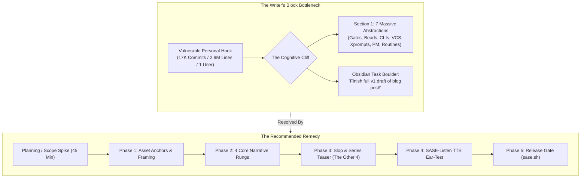

# Decomposing the SASE Launch Blog Post into Actionable Obsidian Tasks: Strategy & Implementation Framework

## Executive Summary

Writer's block on a foundational technical post is almost never a failure of willpower or lack of subject mastery; it is a **structural breakdown between cognitive scope and task granularity**. In the case of the SASE launch post (`~/bob/sase_blog_contents.md`), this block manifests from an acute clash between two opposing forces:

1. **A deeply authentic, vulnerable personal narrative**: The opening paragraphs capture a raw, resonant developer journey—pride in software engineering, anxiety over AI encroachment, an obsessive attempt to regain control, and a prototype that escalated into 17,000 commits and 2.9 million lines of code.
2. **An overwhelming architectural catalog**: Immediately following the hook, the draft confronts the author with `## 1. The Abstractions`—a monolithic laundry list of seven distinct architectural subsystems (Gates/Plans/Epics, Beads/Sidecars, Agent CLIs, VCS operations, Xprompts/Control flow, Project Management, and Routines/Jobs).

In the author's Obsidian project tracking note (`~/bob/sase_blog.md`), the task portfolio reflects this same cognitive bottleneck: a single, undifferentiated boulder titled `- [?] #task Finish full v1 draft of blog post!` blocks all downstream progress. In productivity systems (specifically within the Dataview/Bob task model), a task whose scope spans days of creative synthesis without explicit sub-deliverables inevitably triggers procrastination, rolling deadlines, and creative paralysis.

This research paper investigates the structural mechanics of writer's block in complex software launch essays, evaluates four distinct task decomposition strategies, designs a tailored **Spike-Driven Progressive Disclosure Strategy**, and provides an actionable, drop-in Obsidian task suite engineered for Bryan's `~/bob` vault conventions.



---

## 1. Root Cause Analysis: Anatomy of the Current Bottleneck

A forensic comparison between `~/bob/sase_blog_contents.md`, `~/bob/sase_blog.md`, and prior planning artifacts (`~/bob/ref/chat/sase_launch_post_outline.md`) reveals three underlying drivers of the current impasse.

### 1.1 The "Seven Abstractions" Scope Creep (Reference Manual vs. Launch Essay)

In `~/bob/sase_blog_contents.md`, the draft breaks down immediately after the introductory footnotes:

```markdown
## 1. The Abstractions
### 1.1 Gates -> Plans -> Epics
### 1.2 Beads -> Sidecar repos
### 1.3 Agent CLIs
#### 1.3.1 Skills, **memory**, provider interface, NOT hooks
#### 1.3.2 Agent presentation / organization (tribes, clans, families, hoods, metadata/files/tools panel)
### 1.4 VCS and workspace operations
### 1.5 Xprompts / Agent control flow (forks/waits/queues)
### 1.6 Project Management (hoods, agents sidecar, artifacts)
### 1.7 Routines and Jobs
```

This outline is a direct verbatim copy of an ideation note in `sase_blog.md` under `Things that sase generalizes:`. While an impressive architectural taxonomy, dumping seven dense subsystems into Section 1 of a public launch post creates an impossible creative hurdle:
- **Tone mismatch**: The essay abruptly pivots from a compelling personal narrative ("pride... taking back control... prototype gone wild") to an encyclopedic technical reference manual.
- **Cognitive exhaustion**: Writing seven in-depth technical explanations before reaching the real developer payoff or the lived experience of using SASE requires upwards of 8,000 words of heavy prose.
- **Contradiction with prior decisions**: The earlier outline review (`sase_launch_post_outline.md`) explicitly recommended showcasing **four core rungs** of lived experience in Post 0 and packaging the remaining concepts ("The Other Four": Beads & SDD, VCS/ChangeSpecs, Project Management, Routines/Jobs) as the **Series Map / Future Posts teaser**. Re-inserting all seven into Section 1 re-introduced the exact scope trap that had previously been resolved.

### 1.2 The "Undifferentiated Boulder" Anti-Pattern in Obsidian

In `~/bob/sase_blog.md`, the project task graph contains:
- `- [*] #task Write introduction!` (in progress, heavily encumbered by 5 dependencies).
- `- [?] #task Finish full v1 draft of blog post! [id:: sase_blog__v1-draft] [dependsOn:: sase_blog__write-introduction] ^v1-draft` (blocked).

In task management theory (GTD, Shape Up, and Agile story mapping), "Finish full v1 draft" is an **epic disguised as a task**. When an author looks at their daily task dashboard and sees a single checkbox representing 20 hours of ambiguous intellectual labor, the amygdala responds with avoidance. The brain cannot visualize the physical next action, so it stalls.

### 1.3 Asset Disconnection

Bryan already possesses rich, high-conviction raw materials that are currently idle:
- Screenshots in `~/tmp/screenshots/` (outage retries, `%wait`, alternations, questions/tales).
- Core thesis definitions (AI slop categories, prompt debt, loop vs. graph engineering).
- Memorable quotes ("I'm bad at naming things...", PIW Goal 1 vs Goal 2, "No weasels; just work").
- Media pipelines (`sase-listen` TTS podcast workflow for commute listening).

Because these assets are not represented as individual, checkable tasks in Obsidian, drafting feels like starting from a blank page rather than assembling and connecting pre-existing puzzle pieces.

---

## 2. Evaluation of Task Decomposition Strategies

To break the deadlock, we evaluate four candidate strategies against key creative engineering criteria: **cognitive friction reduction**, **narrative integrity**, **Obsidian workflow alignment**, and **resistance to regression**.

| Criterion | Strategy 1: Linear Section-by-Section | Strategy 2: Thin-Slice Zero Draft | Strategy 3: Asset-First Assembly | Strategy 4: Spike-Driven Progressive Disclosure (Recommended) |
| :--- | :--- | :--- | :--- | :--- |
| **Primary Mechanism** | 1 Task per outline header (`1.1` to `1.7`) | 1 fast 3-hour brain dump task, then editing passes | Gather/annotate all media/quotes first, then write connective tissue | Time-boxed scoping spike, followed by 4 narrative rungs and asset anchors |
| **Cognitive Friction** | **Very High**: Hits the brick wall of Section 1.1 immediately. | **Moderate**: Requires immense discipline not to stop and edit. | **Low**: High initial momentum, but lacks narrative cohesion. | **Very Low**: Clarifies boundaries upfront; each writing session has a narrow, concrete goal. |
| **Scope Protection** | **Poor**: Encourages writing full specs for all 7 abstractions. | **Moderate**: Scope creep happens during the long drafting session. | **Moderate**: Assembles assets without filtering post relevance. | **Exceptional**: Explicitly demotes 3 abstractions to series teasers during the Spike. |
| **Obsidian Fit** | Clutters note with 10+ open writing tasks simultaneously. | Replaces one boulder with another slightly smaller boulder. | Good for asset links, weak for narrative flow. | Perfect match for Bob's Dataview tags, dependencies, and block IDs. |
| **Risk of Block** | **High**: Author gets stuck on technical nuance in early sections. | **Medium**: Author gets overwhelmed by a messy 6,000-word draft. | **Medium**: "Asset collection" becomes productive procrastination. | **Low**: Continuous visible progress through small, unblocked increments. |

### Evaluation Verdict

- **Strategy 1 (Linear)** fails because the outline in `sase_blog_contents.md` is fundamentally over-scoped. Dividing an over-scoped outline into 7 tasks just creates 7 smaller walls.
- **Strategy 2 (Zero Draft)** is great for novelists, but technical essays with code concepts and architectural claims easily collapse into rambling drafts that are excruciating to edit.
- **Strategy 3 (Asset-First)** is a necessary ingredient, but insufficient on its own.
- **Strategy 4 (Spike-Driven Progressive Disclosure)** is the decisive winner. It begins with a **decision spike** that repairs the outline scope in 45 minutes, establishes the **Four Core Rungs**, and breaks drafting into modular, bite-sized tasks paired with concrete proof assets.

---

## 3. The Recommended Strategy: Spike-Driven Progressive Disclosure

The Spike-Driven Progressive Disclosure framework operates in five distinct, decoupled phases. Each phase has explicit completion criteria, preventing work from leaking across boundaries.

```mermaid
flowchart LR
    subgraph S0 ["Phase 0: Scope Spike"]
        direction TB
        S_SPIKE["Spike: Lock 4 Rungs<br/>(Prune 1.2, 1.4, 1.6, 1.7)"]
        S_INTRO["Polish Intro & Timeline"]
        S_SPIKE --> S_INTRO
    end

    subgraph S1 ["Phase 1: Asset Anchors"]
        direction TB
        A1["Outage Retry Still"]
        A2["TUI Observability GIF"]
        A3["Gate Clip / Screenshot"]
        A4["Slop & Debt Definitions"]
    end

    subgraph S2 ["Phase 2: The 4 Core Rungs"]
        direction TB
        R1["Rung 1: One CLI → Every CLI"]
        R2["Rung 2: Wall of Terminals → TUI"]
        R3["Rung 3: Plan Mode → Gates"]
        R4["Rung 4: One Prompt → Programs"]
    end

    subgraph S3 ["Phase 3: The Reality & Horizon"]
        direction TB
        H1["What It Cost (Prompt Debt)"]
        H2["The Other 4 (Series Map)"]
        H3["The Ask (type:poll Issues)"]
        H4["Steve Yegge Sign-off"]
    end

    subgraph S4 ["Phase 4 & 5: Review & Ship"]
        direction TB
        T1["sase-listen TTS Generation"]
        T2["Commute Ear-Test & Polish"]
        T3["Publish to sase.sh"]
    end

    S0 --> S1
    S1 --> S2
    S2 --> S3
    S3 --> S4
```



### 3.1 Phase 0: The Framing Spike & Foundation (Timebox: 45 Minutes)

The objective of Phase 0 is to eliminate structural ambiguity before writing another sentence.
- **Task**: `[SPIKE] Resolve §1 Abstractions Scope — Demote 3 subsystems to Series Teaser`.
- **Decision Rule**: A launch post is an invitation into a philosophy, not an API specification.
  - **Retain in Core Post (The 4 Rungs)**:
    1. *Agent CLIs* (Multi-provider interface, usage windows, outage resilience).
    2. *TUI & Screen* (`tmux_ai_window` evolution, "Why a TUI?", live agent observability).
    3. *Gates & Single-Turn Execution* (Plan mode evolution, gates -> plans -> epics, durable artifacts).
    4. *Programs / Xprompts* (`%wait` / `#fork`, macros as a prompt language, PIW/LSP).
  - **Demote to §5 Series Teaser ("The Other Four")**:
    1. *Beads & SDD* (Save for Post 2: "Spec-Driven Development with Beads").
    2. *VCS & Workspace Isolation* (Save for Post 3: "Reinventing Version Control for Agents: ChangeSpecs & Stitches").
    3. *Project Management & Memory* (Save for Post 4: "Agentic Memory: Webs, Strands, and Ledgers").
    4. *Routines, AXE & Telegram* (Save for Post 5: "Autonomous Operations with AXE").

### 3.2 Phase 1: Proof Artifact & Asset Curation (Low Cognitive Lift)

Writer's block thrives when facing a blank cursor. By gathering and staging concrete artifacts first, the author transforms writing from *ex nihilo* creation into narrative framing around tangible evidence.
- Stage the provider outage retry screenshot (`~/tmp/screenshots/20260616_140429.png`).
- Stage the `%wait` coordination screenshot (`~/tmp/screenshots/20260616_115015.png`).
- Stage the 4-plans artifact reading proof (`img/20260824_141701.png`).
- Format the 4 AI slop categories (Unnecessary backward compat, unused features, duplication, prompt debt).

### 3.3 Phase 2: Modular Drafting of the 4 Core Rungs

Each core rung follows an identical, predictable micro-structure that removes rhetorical guesswork:
$$\text{Micro-Structure} = \text{The Concrete Pain} \longrightarrow \text{What SASE Generalizes} \longrightarrow \text{One Proof Artifact} \longrightarrow \text{Lived Lesson / Takeaway}$$

1. **Rung 1: One CLI $\rightarrow$ Every CLI**
   - *Pain*: Vendor lock-in, differing CLI flags, provider outages halting work.
   - *Generalization*: Model-agnostic meta-harness; unified provider abstraction.
   - *Proof*: Outage retry screenshot; SuperGrok / Claude usage window monitors.
   - *Lesson*: Provider parity creates anti-fragility; token budgeting by model tier.
2. **Rung 2: A Wall of Terminals $\rightarrow$ One Screen**
   - *Pain*: Managing 10 tmux windows manually (`tmux_ai_window`); lost agent state.
   - *Generalization*: The TUI control tower (ACE); dynamic tabs, tribes, and clans.
   - *Proof*: Agents tab screenshot / animated demo GIF.
   - *Lesson*: "Why a TUI?" Bandwidth of visual text vs. web dashboard latency.
3. **Rung 3: Plan Mode $\rightarrow$ Gates**
   - *Pain*: Agents getting stuck waiting for user input, polling loops, fragile harnesses.
   - *Generalization*: Gates as the fundamental interaction primitive; single-turn execution contract ("a gate never blocks an agent").
   - *Proof*: Plan artifact reuse (`sase artifact read` 4-plans screenshot); questions gate.
   - *Lesson*: Durable host-mediated completion over agent self-certification.
4. **Rung 4: One Prompt $\rightarrow$ Programs**
   - *Pain*: Copy-pasting repetitive prompt boilerplate; no workflow branching.
   - *Generalization*: Macros/Xprompts as a deterministic programming language for prompts (`#fork`, `%wait`, alternations).
   - *Proof*: `%wait` screenshot; Prompt Input Widget (PIW) demo.
   - *Lesson*: Loop engineering vs. graph engineering; vibe evals through alternations.

### 3.4 Phase 3: The Reality Check & The Horizon

- **Section 4: What It Cost**: Leaning honestly into the ~17,000 commits, ~2.9 million lines, ~1 user reality. The candid taxonomy of AI slop and "prompt debt" accumulated while building with agents.
- **Section 5.1: The Series Map ("The Other Four")**: Teasing Beads, VCS/ChangeSpecs, Memory, and Routines. Because these are teasers, they only require one punchy paragraph and a link each.
- **Section 5.2: The Ask**: "I need your help. I'm out of tokens." Introducing `type:poll` GitHub issues.
- **Closing**: The Steve Yegge tribute ("No weasels; just work").

### 3.5 Phase 4 & 5: Audio Verification via `sase-listen` and Release

Bryan's unique edge is his audio feedback loop:
- Run `sase-listen` to convert `sase_blog_contents.md` into an MP3 episode on his private podcast feed.
- Listen on AntennaPod during a walk or commute. The ear immediately detects clunky transitions, jargon overload, and pacing lulls that the eye skips over.
- Make targeted edits, run `just check`, and ship to `sase.sh`.

---

## 4. Drop-In Obsidian Implementation: The `sase_blog` Task Suite

The following block is designed to directly replace the single `- [?] #task Finish full v1 draft of blog post!` task in `/home/bryan/bob/sase_blog.md`. It adheres strictly to Bryan's Dataview schema, link formatting, block ID conventions, and emoji indicators.

```markdown
### In Progress & Immediate Next

- [*] #task [SPIKE] Resolve §1 scope tension: lock the 4 core narrative rungs and demote 3 abstractions to series teaser [fresh:: 2026-10-23] [created:: 2026-10-23] [priority:: high] [id:: sase_blog__spike-scope-pruning] ^spike-scope-pruning
	- 💡 **GOAL:** Prune `sase_blog_contents.md` Section 1 so it features only CLIs, TUI, Gates, and Macros. Move Beads, VCS, and Routines to §5 Series Map.
	- 🧱 **BLOCKS:** [[#^asset-curation]] • [[#^draft-rung-1-clis]]

### Blocked on Spike

- [?] #task Stage proof artifacts and definitions for the 4 core rungs [fresh:: 2026-10-23] [created:: 2026-10-23] [priority:: high] [id:: sase_blog__asset-curation] [dependsOn:: sase_blog__spike-scope-pruning] ^asset-curation
	- ⛓️ **DEPENDS ON:** [[#^spike-scope-pruning]]
	- 🧱 **BLOCKS:** [[#^draft-rung-1-clis]] • [[#^draft-rung-2-tui]] • [[#^draft-rung-3-gates]] • [[#^draft-rung-4-programs]]
	- Link screenshots: outage retry (`20260616_140429.png`), wait (`20260616_115015.png`), and 4-plans (`img/20260824_141701.png`).
	- Confirm 4 slop categories (compat, unused, dup, prompt debt).

- [?] #task Draft Rung 1: One CLI → Every CLI (Multi-provider meta-harness, usage windows, outage retries) [created:: 2026-10-23] [id:: sase_blog__draft-rung-1-clis] [dependsOn:: sase_blog__spike-scope-pruning, sase_blog__asset-curation] ^draft-rung-1-clis
	- ⛓️ **DEPENDS ON:** [[#^spike-scope-pruning]] • [[#^asset-curation]]
	- 🧱 **BLOCKS:** [[#^draft-rung-2-tui]]

- [?] #task Draft Rung 2: A Wall of Terminals → One Screen (tmux_ai_window, 'Why a TUI?', agent observability) [created:: 2026-10-23] [id:: sase_blog__draft-rung-2-tui] [dependsOn:: sase_blog__draft-rung-1-clis, sase_blog__asset-curation] ^draft-rung-2-tui
	- ⛓️ **DEPENDS ON:** [[#^draft-rung-1-clis]] • [[#^asset-curation]]
	- 🧱 **BLOCKS:** [[#^draft-rung-3-gates]]

- [?] #task Draft Rung 3: Plan Mode → Gates (Gates as interaction primitive, durable artifacts, single-turn contract) [created:: 2026-10-23] [id:: sase_blog__draft-rung-3-gates] [dependsOn:: sase_blog__draft-rung-2-tui, sase_blog__asset-curation] ^draft-rung-3-gates
	- ⛓️ **DEPENDS ON:** [[#^draft-rung-2-tui]] • [[#^asset-curation]]
	- 🧱 **BLOCKS:** [[#^draft-rung-4-programs]]

- [?] #task Draft Rung 4: One Prompt → Programs (Macros, %wait/#fork, PIW & LSP, vibe evals with alternations) [created:: 2026-10-23] [id:: sase_blog__draft-rung-4-programs] [dependsOn:: sase_blog__draft-rung-3-gates, sase_blog__asset-curation] ^draft-rung-4-programs
	- ⛓️ **DEPENDS ON:** [[#^draft-rung-3-gates]] • [[#^asset-curation]]
	- 🧱 **BLOCKS:** [[#^draft-reality-check]]

- [?] #task Draft Reality Check: What It Cost (AI slop, prompt debt, 17K commits / 2.9M lines / 1 user) [created:: 2026-10-23] [id:: sase_blog__draft-reality-check] [dependsOn:: sase_blog__draft-rung-4-programs] ^draft-reality-check
	- ⛓️ **DEPENDS ON:** [[#^draft-rung-4-programs]]
	- 🧱 **BLOCKS:** [[#^draft-series-map-and-ask]]

- [?] #task Draft Horizon: Series Map ('The Other Four') and The Ask ('Out of Tokens' + type:poll GitHub issues) [created:: 2026-10-23] [id:: sase_blog__draft-series-map-and-ask] [dependsOn:: sase_blog__draft-reality-check] ^draft-series-map-and-ask
	- ⛓️ **DEPENDS ON:** [[#^draft-reality-check]]
	- 🧱 **BLOCKS:** [[#^listen-podcast-review]]
	- End with Steve Yegge closing: "No weasels; just work."

- [?] #task Generate sase-listen TTS audio edition and conduct commute ear-test [created:: 2026-10-23] [priority:: high] [id:: sase_blog__listen-podcast-review] [dependsOn:: sase_blog__draft-series-map-and-ask] ^listen-podcast-review
	- ⛓️ **DEPENDS ON:** [[#^draft-series-map-and-ask]]
	- 🧱 **BLOCKS:** [[#^polish-and-ship]]
	- Listen on AntennaPod; capture clunky phrasing or tonal inconsistencies in voice notes.

- [?] #task Final Polish & Ship to https://sase.sh [created:: 2026-10-23] [priority:: high] [id:: sase_blog__polish-and-ship] [dependsOn:: sase_blog__listen-podcast-review] ^polish-and-ship
	- ⛓️ **DEPENDS ON:** [[#^listen-podcast-review]]
	- 🧱 **BLOCKS:** [[sase_pre_blog#^prj]]
```

---

## 5. Tactical Playbook: Overcoming Writer's Block by Section

To ensure that each unblocked task can be executed in under 45 minutes, follow these targeted execution rules:

### 5.1 Executing the Scope Spike (Phase 0)

1. Open `~/bob/sase_blog_contents.md`.
2. Delete the lines `### 1.2 Beads -> Sidecar repos`, `### 1.4 VCS and workspace operations`, `### 1.6 Project Management`, and `### 1.7 Routines and Jobs` from Section 1.
3. Paste them into Section 5 as:
   ```markdown
   ## 5. The Horizon: What's Coming in the Series
   - **Post 2: Beads & Spec-Driven Development**: How sidecar repos decouple task tracking from code branches.
   - **Post 3: Re-inventing VCS for Agents**: ChangeSpecs, stitches, and why agents need private worktrees.
   - **Post 4: Agentic Project Memory**: Webs, strands, and why retrieval is not a vector database.
   - **Post 5: Operational Autonomy**: Background service hosts, AXE, and Telegram control loops.
   ```
4. Rename `## 1. The Abstractions` to `## 2. Four Rungs on the Ladder to Structured Autonomy`.
5. Check off the spike task in `sase_blog.md`.

### 5.2 Drafting the 4 Rungs (Phase 2)

- **Write in the first person**: SASE is a personal craft project, not a corporate whitepaper. Use the voice established in the introduction ("I wanted control back...").
- **Do not write code listings from memory**: Refer directly to existing tests or fixtures in `sase/` or screenshots in `~/tmp/screenshots/`.
- **Anchor with the quotes**:
  - In Rung 2 (TUI): Use the quote about the Prompt Input Widget: *"Goal number one: make editor support for xprompts as awesome as possible with LSP. Goal number two: make the prompt input widget so awesome that using any other editor for agent prompts is unthinkable."*
  - In Rung 3 (Gates): Use the quote *"Plan mode is the canonical or best example of some deeper primitive. I know it. Interrupts?"*
- **Keep word counts bounded**: Cap each rung at 500–700 words. If a rung threatens to exceed 800 words, you are writing documentation, not an introductory blog post. Stop, summarize the concept, and defer details to the documentation link.

### 5.3 The Audio Loop (Phase 4)

Reading one's own writing produces visual habituation—the mind fills in missing words and glides over awkward syntax. Listening to synthesized audio through `sase-listen` breaks this habituation:
- Audio exposes cadence flaws: sentences that require three commas to parse will sound breathless in TTS.
- Audio highlights tonal dissonance: a sudden academic lecture tone in the middle of a personal narrative stands out jarringly.
- Fixing only what bothers the author's ear during an AntennaPod commute walk provides a definitive "definition of done" for the prose.

---

## 6. Summary of Recommendations & Next Steps

1. **Adopt Strategy 4 (Spike-Driven Progressive Disclosure)**: Do not attempt to write the full blog post in a single marathon session.
2. **Execute the Scope Spike First**: Prune the seven abstractions down to the four lived rungs in `sase_blog_contents.md`. Move the remaining three to the series roadmap.
3. **Update `~/bob/sase_blog.md`**: Replace the monolithic `Finish full v1 draft of blog post!` task with the 9-task dependency chain provided in Section 4 of this report.
4. **Leverage Existing Proof Assets**: Ground each narrative rung in pre-existing screenshots and quote cards rather than starting from blank markdown.
5. **Close the Loop with Audio**: Rely on `sase-listen` and AntennaPod to declare the draft final before publishing to `sase.sh`.
