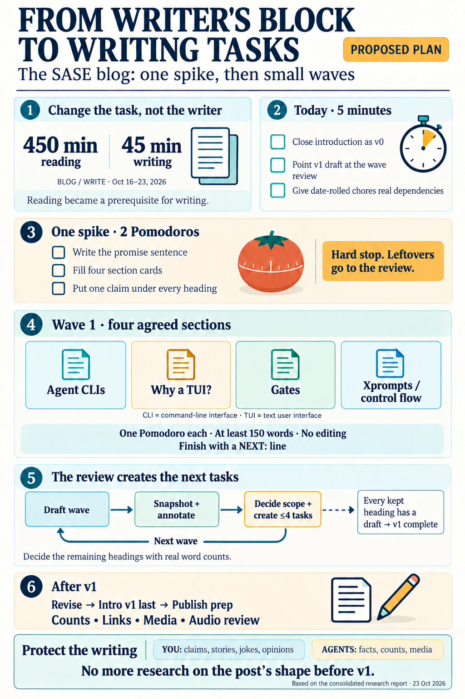
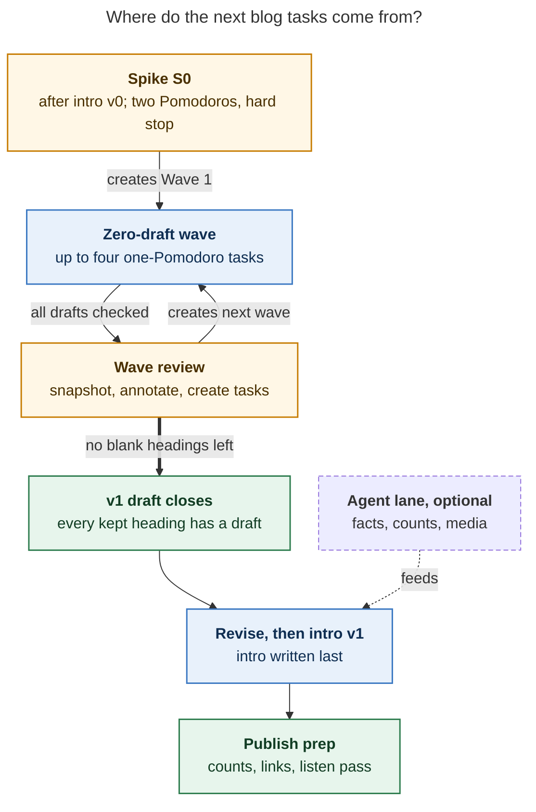

# Breaking the SASE Blog Post into Obsidian Tasks: One Spike, Then Waves

> **Research query:** How can the rough draft of the SASE blog post (`~/bob/sase_blog_contents.md`), stalled by
> writer's block, be split into a set of actionable Obsidian tasks, perhaps including a spike or planning task that
> produces more tasks, and what strategy is recommended?



## Bottom line

1. **The problem is how the tasks are cut, not your writing.** Your only two writing tasks, *Write introduction!* and
   *Finish full v1 draft of blog post!*, are projects rather than next actions. The ledger shows the result. Since the
   intro task was created on 10-16, you have completed **520 minutes** of BLOG and WRITE Pomodoros. **45** minutes went
   to the writing task and **450** went to reading. Of that reading, 265 minutes were spent on two PyPI-area refs
   wired in as `dependsOn` prerequisites of the intro. Your dependency graph made
   [reading a precondition of writing](#five-task-design-defects). (cld found this; I re-derived the same numbers.)
2. **Tasks that roll share one shape: open-ended judgment over the whole document.** *Proofread blog post!* was
   cancelled twice. *Flesh out … for each section*, *Describe demo video … for each main section*, and *Plan first
   blog post* (whose sub-bullet read "Create more tasks for this") were also cancelled. What finished were tasks with
   one concrete artifact and one sitting: the WisprFlow brain-dump, mechanical restructures, and annotating a
   snapshot. Each Highlights snapshot drew 17 comments. The plan has to turn every piece of the post into the second
   kind of task.
3. **All five reports, and your own annotations, agree on four sections:** Agent CLIs, agent presentation ("Why a
   TUI?"), gates, and xprompts/control flow. Write those first. Whether the other five headings get full sections or
   a series-map paragraph is still **open**: you put "?" on the outline's "The Other Four" and never restructured the
   article after reading it. [Let the first wave review decide that](#where-the-reports-disagreed-and-how-i-resolved-it),
   once real word counts exist. Don't decide it in a spike or let an agent decide it.
4. **Recommended system:** close the intro task as **v0** today. Run [**one two-Pomodoro spike**](#the-spike-s0) with a
   hard stop. Then write in [**waves of at most four one-Pomodoro zero-draft tasks**](#the-waves). Each wave ends with
   a **wave review** that snapshots, annotates, and creates the next wave. That review is the recurring "planning task
   that produces more tasks." Agents handle facts, counts, and media in a [separate lane](#the-agent-lane) and never
   write post prose. Write the intro **last**.
5. **Make this the last research on the post's shape before v1.** This is at least the fifteenth blog-related research
   report since May, and eight of those covered the post's content, structure, or readiness. The July
   authorship-gap report already said "more research is the failure mode, not the fix." Today's swarm was launched
   from your first WRITE Pomodoro.

## What is on the desk

Verified 2026-10-23.

- **`sase_blog_contents.md`**
  - *Verified state:* 274 words. Two paragraphs of your prose, four footnote TODOs (`[1]` name, `[2]` Omnigent, `[a]`
    links, `[b]` counts), and ten headings (`1.1`–`1.7` plus `1.3.1`, `1.3.2`), each just `TODO`. `bob articles list`
    reports 10 TODO stubs.
  - *Consequence for the split:* "TODO stubs → 0" is a ready-made progress metric for v1.
- **Article structure**
  - *Verified state:* `## 1. The Abstractions` was added on **2026-10-15**, copied from your 2026-08-07 Requirements
    bullet "Things that sase generalizes." You finished reading the outline ref on **10-18**. After 10-16, the only
    edit was one reworded intro sentence (10-23).
  - *Consequence for the split:* The headings are your most recent structural choice. Agents should not overturn them
    (see [where the reports disagreed](#where-the-reports-disagreed-and-how-i-resolved-it)).
- **`^write-introduction`**
  - *Verified state:* `[/]` In Progress since 10-16. All five `dependsOn` items are closed: the outline ref (done
    10-18), the 10-17 snapshot (cancelled), `read-blog-notes` (done), *Redesigning source control* (done 10-21), and
    *How the Claude Code team does code review* (done). WORK LOG: "Research on how to split up into tasks."
  - *Consequence for the split:* Nothing is blocking it now. Close it as a v0 (see [today's housekeeping](#today)).
- **`^v1-draft`**
  - *Verified state:* `[?]`, depends only on the intro, blocks `sase_pre_blog#^prj` (13 blocked engineering tasks).
  - *Consequence for the split:* Keep the ID because a link depends on it. Re-point its dependency and give it a
    concrete done-check.
- **`^sase-blog` (release)**
  - *Verified state:* `[?]`, depends on `job_2026_apply_29#^prj`.
  - *Consequence for the split:* That gate applies to publishing, not writing. Leave it alone.
- **`## Requirements`**
  - *Verified state:* **43** top-level bullets (70 counting nested), plus 3 Screenshots, a July `## Outline`, and 6
    Later Posts.
  - *Consequence for the split:* This is raw material for the section cards. Do **not** turn it into 43 tasks.
- **`bob ready sase_blog`**
  - *Verified state:* 1 of 5 Ready (the *Agentic Software Engineering* paper ref), state `room`.
  - *Consequence for the split:* The per-note cap of 5 already works as a WIP limit.
- **Date-rolled tasks** (new finding)
  - *Verified state:* The Gas Town link task (scheduled **10-24**), *Review all post-blog tasks for Future Work*
    (**10-25**), and *transcribe … into a podcast episode and listen* (**10-26**) are `[?]` only because their
    scheduled dates are in the future. `bob task reconcile` will move them to Ready on those dates.
  - *Consequence for the split:* In three days your Ready lane will ask you to listen to a podcast of a post with no
    body. Give these tasks real dependencies today (see
    [what to do with the existing tasks](#what-to-do-with-the-existing-tasks)).
- **Pomodoro themes**
  - *Verified state:* `WRITE` appeared for the first time today (10-23). Until then, `BLOG` covered both reading and
    writing.
  - *Consequence for the split:* You've already started separating the two. The plan makes that rule explicit.
- **Your outline-ref annotations**
  - *Verified state:* "Yes!" or "I like" on One CLI (usage-window indicators, outage retries), Why a TUI, Plan Mode →
    Gates (plus artifact sidecars, auditability, future `sase artifact write/validate`), One Prompt → Programs ("Yes to
    all of this!"), What It Cost, the out-of-tokens ask, and the closing line. **"?"** on "The Other Four." "Add this
    to intro" on the promise sentence plus Getting Started link. On How I Got Here: "explain why I left Google! Or
    maybe just 'that' I left Google?"
  - *Consequence for the split:* These are the inputs for the cards. They also show the scope question is still
    unresolved.

## Five task-design defects

1. **The next action has no physical shape.** By Allen's GTD definitions, an outcome that needs more than one action is
   a project, and the next action is "the next physical, visible activity." *Finish full v1 draft* hides about 2,500
   words, a dozen decisions, media, and citations behind one checkbox. Lab evidence fits this: people procrastinate
   less when a task is construed concretely (McCrea et al., 2008).
2. **Reading gates writing.** `dependsOn` is finish-to-start. When the upstream tasks are reads and the downstream
   task is drafting, each new ref pushes writing back while still feeling like progress. Rose's 1980 study of blocked
   writers points at rigid rules and plans such as "read everything relevant before writing the intro," not at a lack
   of ability.
3. **The order is depth-first and starts with the hardest part.** The intro is a promise about sections that don't
   exist yet, so it is the part you can least write well right now. Standard advice is to write the introduction
   last. Your own annotation, asking for a promise sentence plus a Getting Started link, depends on what the body
   ends up saying.
4. **There are three competing maps.** The article has the 7-heading catalog. `sase_blog.md` still has the July
   `## Outline` (Introduction → Overview → XPrompts → ACE → AXE). The 10-07 research outline has five H2s and four
   rungs. Sitting down to write means picking a map first. grk identified this, and it holds up. The fix is to
   retire the July outline as a pointer and to make the article the only manuscript, **without** forcing the 4-vs-7
   decision early (see [where the reports disagreed](#where-the-reports-disagreed-and-how-i-resolved-it)).
5. **Research has become the default response to being stuck.** Fifteen blog research reports exist. The July report
   documented a recurring "replace rather than own" cycle: three launch drafts, each generated, stalled, and then
   replaced. Another restructure proposed by agents would be cycle four. Three of today's five reports propose one:
   grk and gem would re-cut to the four-rung outline, and cdx would rebuild the post around a single episode.

## Where the reports disagreed and how I resolved it

- **Scope: 7 headings or 4 rungs?**
  - *Positions:* grk and gem: rewrite the article to the 5-H2 / 4-rung outline now. cld and mus: keep your 7 headings
    and cut later only if needed. cdx: one real episode plus at most 3 concepts.
  - *Resolution:* **Defer it to the Wave 1 review, and make it your decision.** Wave 1 is the four sections everyone
    agrees on. Then decide the remaining five headings (full section, series-map paragraph, or cut) with real word
    counts in hand.
  - *Evidence:* You marked "The Other Four" with "?" and kept the 7-heading article after reading the outline. The
    four rungs map one-to-one onto article headings: One CLI → §1.3, Wall of Terminals → §1.3.2, Plan Mode → Gates →
    §1.1, One Prompt → Programs → §1.5. cld's Wave 1 is exactly those four.
- **Intro first or last?**
  - *Positions:* grk: give the intro a done-check and finish it first. cld and cdx: write it last. mus: confirm its
    dependencies and close it.
  - *Resolution:* **Close it as v0 today. Write Intro v1 last.** grk's done-check (pride paragraph, stats caveat,
    promise sentence, Getting Started link, no heading) becomes the Intro v1 card.
  - *Evidence:* The two paragraphs are a real v0 in your voice, and the promise depends on the body.
- **Spike size and output**
  - *Positions:* cdx: 2×25 min. cld: 2 Pomodoros. grk: one sitting, but it files all 43 Requirements and 8 cards. gem:
    45 min, but it deletes headings. mus: one Pomodoro per section (≈7).
  - *Resolution:* **2 Pomodoros, hard stop.** Cards for the four Wave 1 sections only, plus one claim sentence under
    *every* heading. Other Requirements stay parked until their wave review.
  - *Evidence:* Your June "Plan first blog post … create more tasks" task was cancelled. An unbounded planning task is
    a known failure mode here.
- **Section order**
  - *Positions:* grk and gem: a strict sequential chain, one Ready writing task at a time. mus: §1.5 first. cld: waves
    of 3–4, easiest first.
  - *Resolution:* **Waves of up to four, any order within a wave.**
  - *Evidence:* Picking the easy hole first (Lakein's Swiss-cheese method) beats a chain where one stuck section blocks
    everything. Four tasks plus the paper ref fit the cap of 5.
- **Footnote quick wins first?**
  - *Positions:* mus: file 4 footnote tasks immediately for momentum. Everyone else: later.
  - *Resolution:* **`[b]` and `[a]` are publish-day work. `[1]` and `[2]` go to the agent lane for facts, then you
    write the joke.**
  - *Evidence:* The counts drift daily: the repo has 16,356 commits today against "~17K" in the draft. Links need a
    body to link from. Closing intro v0 gives you the momentum checkmark mus was after.
- **Agents' role**
  - *Positions:* cld and grk: facts and media only, never prose. gem: doesn't say.
  - *Resolution:* **Agents never draft post prose.**
  - *Evidence:* `^prj` says "in my own voice." Three replace-don't-own cycles. You also commented "No. I highlighted
    this as something that needed changing" when an agent misread your highlight.
- **Word budgets**
  - *Positions:* Outline: ~280 per rung, ~2,800 total, cap 3,000. gem: 500–700 per rung.
  - *Resolution:* **Zero drafts have a floor (≥150 words) and no ceiling. Budgets apply only in revision.**
  - *Evidence:* gem's numbers put the four rungs alone at 2,000–2,800 words and would break the cap.
- **`^v1-draft`**
  - *Positions:* gem: replace it with a new `^polish-and-ship`. Others: keep it.
  - *Resolution:* **Keep the ID.** Redefine it as "every kept heading has a zero draft in your words."
  - *Evidence:* `sase_pre_blog#^prj` depends on `sase_blog__v1-draft`. Closing it sooner also unblocks the 13
    pre-launch tasks sooner.

**Corrections to individual reports**, so they don't get reused:

- **grk:** says "70 top-level Requirements bullets"; the real number is 43 top-level (70 includes nested bullets). It
  also calls the outline "accepted," which overstates the case given your "?" on The Other Four.
- **mus:** says there is a "~20-item backlog"; the real number is 43. It calls the PyPI-ref comments "intro-ready," but
  "this feels like the problem I was having with mentors" and "Changesets are what 'patches' should be!" fit §1.4 VCS
  or a later ChangeSpec post better.
- **gem:** proposes future post titles (for example "Agentic Memory: Webs, Strands, and Ledgers") that don't appear in
  your Later Posts list. Its spike also deletes four headings on your behalf. Its "8,000 words" figure is unsupported.
- **cdx:** says `^write-introduction` is `[*]` Next; it is `[/]` In Progress. Its single-episode restructure is
  better used as a rule for each section: every card names one real day (see
  [the rules for every blog task](#rules-for-every-blog-task)).

## Principles that shape the tasks

These are the parts of the five reports' source material that change what a task looks like. The researchers
gathered the sources and I did not re-fetch them. The findings match the published work as I know it. Evidence
quality varies, and I flag it where it matters.

- **Project vs next action; sequential steps belong in project support, not on the action list (Allen, *GTD*):** Only
  the current wave is detailed. Later steps are one-line placeholders or Requirements bullets.
- **Concrete construal reduces procrastination (McCrea, Liberman, Trope & Sherman, 2008):** Every task names a
  section, a verb, and an output size.
- **Implementation intentions, meta-analysis d ≈ 0.65 (Gollwitzer & Sheeran, 2006):** "After morning GTD, the first
  Pomodoro is WRITE."
- **Specific plans reduce intrusion from unfinished goals (Masicampo & Baumeister, 2011; abstract only):** End every
  writing Pomodoro with a `NEXT:` line in the task's WORK LOG. This is the "Hemingway bridge."
- **Rigid rules block writers (Rose, 1980):** Reading never blocks drafting, and "intro first" is removed.
- **Drafting and reviewing are separate processes (Flower & Hayes, 1981):** Zero-draft tasks and revise tasks are
  never the same task or the same Pomodoro.
- **Brief regular sessions beat binges (Boice, via secondary summaries):** One-Pomodoro writing tasks. No "writing
  day."
- **Spikes are time-boxed and their output is knowledge (Cohn; XP):** The spike outputs decisions and tasks, has a
  hard stop, and is used once.
- **Rolling-wave planning (progressive elaboration):** A wave review creates the next wave and nothing further.
- **Freewrite, start in the middle, talk it out (GMU Writing Center); shitty first drafts (Lamott):** Dictate zero
  drafts (your WisprFlow brain-dump finished in 3 days). No deleting, mark gaps with `??`.
- **Explanation docs: complete, not finished (Diátaxis; already in your library):** After each wave the article is
  complete at its current stage, even though it isn't finished.
- **LLM-written essays reduce ownership and recall (MIT Media Lab 2025 preprint, preliminary):** This supports the
  no-agent-prose rule. Your own ledger supports it more strongly.

The task test (from grk, cdx, and cld): before a line becomes a `#task`, check that (1) its finished result fits in
one sentence, (2) you can start without deciding what it means, (3) it fits in one sitting, and (4) completion is
visible: a passage, a file, or a decision. "Work on abstractions" fails all four. "Zero-draft §1.5: dictate ≥150
words under its heading, no editing, end with a NEXT line" passes all four.

## The recommended task system

### Rules for every blog task

1. **One Pomodoro, one verb, one visible output, one heading.** Use verbs like *dictate*, *write 3 sentences*,
   *list*, or *paste*. Avoid *work on*, *figure out*, and *finish*.
2. **Writing never depends on reading.** A ref may block only the *revision* of the section it feeds.
3. **Drafting and revising are separate tasks.** Zero drafts allow no deletions and no lookups.
4. **Two lanes.** WRITE is yours: claims, jokes, admissions, opinions. AGENT covers facts, counts, the Gas Town map,
   docs checks, media, and poll issues. Agents produce tables and files, never post prose.
5. **At most 5 Ready on `sase_blog`.** Wave size is 5 minus the other Ready tasks. `bob ready sase_blog` is the check.
6. **Every card names one real day.** The proof slot is an actual episode with an artifact (cdx's rule). If you
   stall, answer "What happened the last time I used this?" out loud for ten minutes.
7. **End each WRITE Pomodoro with a bridge:** `NEXT: <first words of the next sentence or question>`.
8. **WRITE Pomodoros link only to zero-draft or revise tasks.** Refs go under READ.

### Today

About 5 minutes of housekeeping.

1. Mark `Write introduction!` `[x]` with WORK LOG line "Closed as intro v0; intro v1 is written last."
2. **Re-point `^v1-draft` in the same edit.** Otherwise closing the intro unblocks it and drops the whole-post task
   into Ready. Point it at `^w1-review` for now, and have each wave review re-point it to the next review.
3. Give the three date-rolled tasks real dependencies (see
   [what to do with the existing tasks](#what-to-do-with-the-existing-tasks)).
4. Paste the [paste-ready block](#paste-ready-block).
5. Replace the July `## Outline` body with one line, "Superseded by the headings in [[sase_blog_contents]]," so the
   article becomes the only map.

### The spike S0

Two Pomodoros, hard stop.

**Question it answers:** *What does the next writing session put on the page, and why does a reader care?*

**Inputs:** the draft, your outline-ref annotations, and `## Requirements`. No new reading and no new research.
cld's report has a requirement → section map (its Appendix A) and per-section docs and media (its Appendix B) to
speed this up.

**Pomodoro 1: decide.**

1. **Reader and promise.** Write one promise sentence, the one your annotation asked for. A workable default reader
   is a software engineer who already uses a coding-agent CLI and has never heard of SASE (cdx).
2. **Fill four cards**, one per Wave 1 section, four lines each:

   - 😈 the special case before SASE
   - 😇 what SASE generalized it into
   - one real proof artifact, as a path
   - one lesson in a sentence

   The [paste block](#paste-ready-block) pre-fills starter text from your notes and annotations. Rewrite it in your
   own words; you're editing, not starting from zero.
3. **Settle two naming overlaps for now:** "families" is now "agent sessions," and "hoods" appears under both §1.3.2
   and §1.6. Leave "Xprompts" vs "macros" and any product rename (your "sal" idea) for the terminology freeze, and
   write name slots last.

**Pomodoro 2: skeleton and wiring.**

1. **Write one claim sentence under every heading**, breadth-first, ugly allowed. That covers the five non-Wave-1
   headings too. This is the walking skeleton. If you can't write a claim for a heading, that's evidence for the Wave 1
   review's scope decision.
2. Adjust the pasted Wave 1 tasks to match the cards. Confirm that `bob ready sase_blog` shows ≤ 5.
3. Write the bridge line.

**Exit criteria:** a promise sentence exists; four cards are filled; no heading is blank; the Wave 1 tasks are wired;
the Ready count is ≤ 5. **Stop rule:** at two Pomodoros, anything unfinished becomes a bullet under `^w1-review`.
**Anti-goals:** no restructuring of headings, no requirement triage beyond Wave 1, no research swarm, no section
prose.

### The waves



*Figure 1. Only the spike and the wave reviews (amber) create tasks. Your writing tasks (blue) never wait on reading.
The agent lane (dashed, optional) feeds revision, never a zero draft. Arrows mean "unlocks."*

- **Wave 0**
  - *Contents:* Close intro v0, [housekeeping](#today), spike S0
  - *Pomodoros (estimate):* ~2
- **Wave 1**
  - *Contents:* Zero drafts of the four agreed sections: §1.3 Agent CLIs, §1.3.2 Agent presentation, §1.1 Gates →
    Plans → Epics, §1.5 Xprompts / control flow. Then the **W1 review**: snapshot the draft (a Highlights PDF ref like
    *SASE Blog · 2026-10-19*, or audio), annotate it for 1 READ Pomodoro, then **decide the other five headings**
    (full section, series-map paragraph, or cut), and create Wave 2.
  - *Pomodoros (estimate):* ~6
- **Wave 2**
  - *Contents:* Whatever W1 kept from §1.2, §1.3.1, §1.4, §1.6, §1.7, plus **What It Cost** (slop categories with one
    real example each, AI broccoli, limitations; you wrote "I like this!"). W2 review.
  - *Pomodoros (estimate):* ~5–6
- **Wave 3**
  - *Contents:* **What's Next / I Need Your Help** (series map for parked sections, out-of-tokens ask, poll issues;
    input: the post-blog review task). Decide whether How I Got Here (ladder, leaving Google) is its own H2 or part of
    the intro. W3 review **closes `^v1-draft`**, which unblocks `sase_pre_blog`.
  - *Pomodoros (estimate):* ~4–6
- **Wave R**
  - *Contents:* Revise about two sections per Pomodoro from annotations plus the agent fact pack. Apply word budgets
    (~2,800, cap 3,000). Freeze terminology. Salvage the `tmux_ai_window` scene from the July live post.
  - *Pomodoros (estimate):* ~8–10
- **Wave I**
  - *Contents:* **Intro v1, written last** (card below). Then footnote `[1]`, title, and closing line.
  - *Pomodoros (estimate):* ~2–3
- **Wave P**
  - *Contents:* Re-derive `[b]` counts on publish day with a stated method, the `[a]` link pass, embed media, the full
    listen pass, render check. Release stays gated on `job_2026_apply_29`.
  - *Pomodoros (estimate):* ~3–4

At your recent pace of about 3.25 completed BLOG/WRITE Pomodoros a day, v1 is roughly six writing days away
(~17–20 Pomodoros) and a publishable post roughly 9–12 days away (~30–37 Pomodoros). That holds only if WRITE time
actually goes to writing.

### The agent lane

Optional; launch whenever convenient.

One task, *Launch the blog fact-pack agent*, can cover all of this. It produces tables and files only. You review
them in Wave R, never before a zero draft, so the fact pack can't become the new reading.

- **Counts `[b]`**
  - *What to produce:* A table of commits and lines by repo, with the method stated
  - *Leads already found:* Today `sase` has **16,356** commits (first commit 2026-02-14) and about **2.96M** Python
    lines in `src`+`tests` (2.51M code lines) by `tokei`. "~2.9M lines of Python and Rust" is really one repo's
    Python.
- **Footnote facts `[1]` `[2]`**
  - *What to produce:* Sources only; you write the joke
  - *Leads already found:* README: pronounced "sassy." The name collides with Gartner's 2019 *Secure Access Service
    Edge*. Acronym origin: the SASE paper (Hassan et al.). Omnigent: prior research
    `omnigent_meta_harness_lessons_for_sase`.
- **Gas Town term map**
  - *What to produce:* One row per section mapping it to the Gas Town / Gas City analog, with a link
  - *Leads already found:* Absorbs the existing Gas Town link task's prep. Watch for a clash between your "NOT hooks"
    and Gas Town's own use of *hooks*.
- **"Why not hooks?"**
  - *What to produce:* Find the rationale
  - *Leads already found:* You asked "Why is that again?" on the outline. No doc records it (cld).
- **Per-section fact sheet**
  - *What to produce:* Current command and term names plus the docs page for each section
  - *Leads already found:* cld's Appendix B lists the docs pages.
- **Media**
  - *What to produce:* Re-render tapes and screenshots with current names; propose media for sections that have none
  - *Leads already found:* Five VHS tapes exist. The June screenshots predate the renames. §1.2, §1.6, and §1.7 have
    no proof media.

### What to do with the existing tasks

- **`[/] Write introduction!`:** Mark `[x]` as intro v0 today.
- **`[?] Finish full v1 draft`:** Keep `^v1-draft`. Re-point it at `^w1-review` now and at each later review. Done
  means "every kept heading has a zero draft in my words; 0 TODO stubs."
- **Gas Town term link task (sched. 10-24):** Add `⛓️ DEPENDS ON: [[#^v1-draft]]`. The agent lane prepares the map.
- **Review post-blog tasks for Future Work (sched. 10-25):** Add `⛓️ DEPENDS ON: [[#^w1-review]]`. It feeds the What's
  Next zero draft.
- **Transcribe into podcast and listen (sched. 10-26):** Add `⛓️ DEPENDS ON: [[#^v1-draft]]` for the full listen pass.
  Wave reviews can snapshot to audio sooner if you like.
- **`#ref` *Agentic Software Engineering* paper (Ready):** READ lane only. It feeds footnote `[1]` and never blocks
  writing.
- **`#ref` July live post (sched. 10-30):** Attach it to the Wave R salvage pass.
- **`^sase-blog` release:** Unchanged.
- **`sase_pre_blog`:** Unchanged. Write about what ships today. Unfinished features (pi, hermes) become What's Next
  mentions.
- **`## Requirements`:** Stays the parking lot. Each wave review pulls only the bullets its next wave needs.

### Paste-ready block

For `sase_blog.md`. This follows your existing syntax. `bob task reconcile` derives `[dependsOn::]` from the
`⛓️ DEPENDS ON` lines and keeps `[?]` current. Section names are plain text rather than heading links so that
renaming a heading can't break them.

```markdown
- [ ] #task Spike S0: write the promise sentence, fill the four Wave 1 cards, write one claim sentence under every heading in [[sase_blog_contents]], wire Wave 1 (2 🍅, hard stop) [created::2026-10-23] [priority:: high] [id:: sase_blog__s0-spike] ^s0-spike
	- INPUT: [[sase_blog_contents]] · `## Requirements` · my outline-ref annotations. No new reading.
	- EXIT: promise sentence · 4 cards · no blank heading · `bob ready sase_blog` ≤ 5
	- STOP: at 2 🍅, leftovers become bullets under [[#^w1-review]]
- [?] #task Zero-draft §1.3 Agent CLIs (One CLI → Every CLI): dictate ≥150 words under its heading, no editing, end with a NEXT line [created::2026-10-23] [id:: sase_blog__zd-cli] [dependsOn:: sase_blog__s0-spike] ^zd-cli
	- ⛓️ **DEPENDS ON:** [[#^s0-spike]]
	- CARD: 😈 one CLI at a time · 😇 every provider behind one harness · PROOF: retries through the Claude outage (~/tmp/screenshots/20260616_140429.png) · LESSON: "optimal experience, not optimal performance"; usage-window indicators; rival labs' models on one task (QUOTE)
- [?] #task Zero-draft §1.3.2 Agent presentation (A Wall of Terminals → One Screen; "Why a TUI?"): dictate ≥150 words, no editing, end with a NEXT line [created::2026-10-23] [id:: sase_blog__zd-tui] [dependsOn:: sase_blog__s0-spike] ^zd-tui
	- ⛓️ **DEPENDS ON:** [[#^s0-spike]]
	- CARD: 😈 tmux_ai_window · 😇 one screen for every agent (tribes, clans, sessions) · PROOF: agents-observability GIF · LESSON: the Agents tab is the buggiest part; "sub-agent" doesn't cut it
- [?] #task Zero-draft §1.1 Gates → Plans → Epics (Plan Mode → Gates): dictate ≥150 words, no editing, end with a NEXT line [created::2026-10-23] [id:: sase_blog__zd-gates] [dependsOn:: sase_blog__s0-spike] ^zd-gates
	- ⛓️ **DEPENDS ON:** [[#^s0-spike]]
	- CARD: 😈 "Plan mode is the canonical or best example of some deeper primitive. I know it. Interrupts?" · 😇 gates → plans → epics · PROOF: an agent read 4 related plans (img/20260824_141701.png) · LESSON: artifact sidecars + auditability via `sase artifact read`; `write/validate` goes to What's Next
- [?] #task Zero-draft §1.5 Xprompts / control flow (One Prompt → Programs): dictate ≥150 words, no editing, end with a NEXT line [created::2026-10-23] [id:: sase_blog__zd-macros] [dependsOn:: sase_blog__s0-spike] ^zd-macros
	- ⛓️ **DEPENDS ON:** [[#^s0-spike]]
	- CARD: 😈/😇 bullets for `%wait` and `#fork` · alternations → "vibe evals" (~/tmp/screenshots/20260619_214831.png) · stashes (img/20260802_*) · PIW goal #1/#2 quote · LESSON: loop vs graph engineering
- [?] #task Wave 1 review: snapshot + annotate the draft (1 🍅 READ); decide full section / series-map paragraph / cut for §1.2, §1.3.1, §1.4, §1.6, §1.7; create ≤4 Wave 2 tasks; re-point ^v1-draft; write the bridge [created::2026-10-23] [id:: sase_blog__w1-review] [dependsOn:: sase_blog__zd-cli, sase_blog__zd-tui, sase_blog__zd-gates, sase_blog__zd-macros] ^w1-review
	- ⛓️ **DEPENDS ON:** [[#^zd-cli]] • [[#^zd-tui]] • [[#^zd-gates]] • [[#^zd-macros]]
- [?] #task Intro v1 (write last): pride paragraph + stats caveat + promise sentence + Getting Started link; decide "why" vs "that" I left Google; full provider list [created::2026-10-23] [id:: sase_blog__intro-v1] [dependsOn:: sase_blog__v1-draft] ^intro-v1
	- ⛓️ **DEPENDS ON:** [[#^v1-draft]]
```

Dictation prompts for every zero draft. These fold in your old "high value / untapped opportunity / lesson learned"
grid:

1. 😈 What annoyed me before SASE did this, and what did I actually do instead?
2. 😇 What did SASE generalize it into? Name one specific day it paid off.
3. 💸 What did it cost, what's still broken, and what would I do differently?

## Risks and stop rules

- **A fourth replace-don't-own cycle:** You dictate every zero draft and write every claim sentence. Agents never
  produce prose. Don't run an agent "first draft" pass.
- **The spike turns into a planning project:** Two Pomodoros, a hard stop, and cards for Wave 1 only. Your cancelled
  June planning task is the precedent.
- **Reading creeps back in:** Refs live in READ and block only revision. Each wave gets exactly one annotate Pomodoro,
  and its output becomes tasks the same day.
- **Scope creep past 3,000 words:** The W1 review is the designated moment to make cuts, using real word counts.
  Parked headings become one paragraph each in the series map.
- **Terminology churn (xprompts → macros, families → sessions, a possible rename):** Headings name ideas. Freeze terms
  in Wave R. Write name slots last.
- **Another research swarm on the post's shape:** Not before v1. Factual questions go to the agent lane with a stop
  rule.
- **A wave stalls:** If a zero-draft task rolls twice, split it: dictate the 😈 half, then the 😇 half. If a whole
  wave stalls, the review cuts one section rather than adding planning.

## Evidence and limits

- **I verified directly:** the draft and its git history; `sase_blog.md`; the done archive; the 10-16 → 10-23
  Pomodoro ledger (matches cld exactly); `bob ready sase_blog`; `bob task reconcile` semantics (from `--help`); your
  comments on the outline ref and both PyPI refs; dependency statuses in `sase_pypi_releases.md`; the repo commit
  count and `tokei` line count; the README pronunciation; the outline's word budgets; and the July authorship-gap
  report.
- **Taken from the reports without re-checking:** the external literature, cld's per-section docs and media map, and
  grk's live-post word count. The Boice and Hemingway-bridge claims rest on secondary summaries, and the MIT study is
  a preliminary preprint.
- **Estimates:** the Pomodoro and calendar figures. They assume WRITE time goes to writing.
- **No vault changes were made.** Everything above is a proposal for you to paste or adapt.

## Recommended strategy

**Close the intro, run one small spike, then write in waves whose reviews create the next tasks.**

1. **Today (5 minutes):** mark *Write introduction!* done as **intro v0**. Re-point `^v1-draft` to `^w1-review` in
   the same edit. Add real dependencies to the three date-rolled tasks before they surface on 10-24, 10-25, and 10-26.
   Paste the [paste-ready block](#paste-ready-block). Reduce the July `## Outline` to a pointer at the article.
2. **Next two WRITE Pomodoros: [Spike S0](#the-spike-s0), hard stop.** Write the promise sentence and edit the four
   pre-filled cards. Then write **one claim sentence under every heading**. If you do only one thing, do that: it
   turns ten blank TODOs into ten sentences to expand.
3. **Wave 1: the four sections everyone agrees on.** Dictate a ≥150-word zero draft for each, easiest first, with no
   editing, and end each with a `NEXT:` line. Make the first Pomodoro of each day WRITE.
4. **Wave 1 review: the planning task that produces more tasks.** Snapshot the draft, annotate it the way you annotate
   refs (your strongest habit), then decide the fate of the other five headings with real word counts. Create at most
   four Wave 2 tasks.
5. **Repeat until no heading is blank.** Then `^v1-draft` closes and `sase_pre_blog` unblocks. Then revise, write
   **Intro v1 last**, and do publish chores. Release stays gated on `job_2026_apply_29`.
6. **Keep agents in [their lane](#the-agent-lane)** (facts, counts, Gas Town map, media, poll issues) and run no more
   research on the post's shape before v1.

## Question and inputs

**Lead researcher's consolidated report** · 2026-10-23 · merges five independent reports
([`__cdx`](sase_blog_writers_block_task_plan__cdx.md), [`__cld`](sase_blog_writers_block_task_plan__cld.md),
[`__grk`](sase_blog_writers_block_task_plan__grk.md), [`__mus`](sase_blog_writers_block_task_plan__mus.md),
[`__gem`](sase_blog_writers_block_task_plan__gem.md)) with my own checks of the vault, the Pomodoro ledger, git
history, your annotations, and the sase repo.

> **Research question.** You have writer's block on the SASE launch post (`~/bob/sase_blog_contents.md`). You want to
> turn it into actionable Obsidian tasks, possibly including a spike or planning task that produces more tasks. How
> should the post be split, and what strategy should you follow?

## Sources

**Vault (read-only):** `sase_blog_contents.md` (plus git history), `sase_blog.md`, `done/sase_blog_done.md`,
`sase_pre_blog.md`, `sase_pypi_releases.md`, daily notes `2026/20261016`–`20261023.md`. `bob ref show -c` on
`ref/chat/sase_launch_post_outline`, `ref/blogs/solving_code_review_at_anthropic`, and
`ref/blogs/redesigning_source_control`. `bob ready sase_blog -f json`, `bob articles list`, and
`bob task reconcile --help`.

**Prior research (audited reads):** `research:202607/first_post_authorship_gap/first_post_authorship_gap.md` and
`research:202610/sase_launch_post_outline/sase_launch_post_outline__final.md`.

**Repo:** `README.md`, `git rev-list --count HEAD`, `tokei src tests`.

**External (via the researchers' reports):**
Allen, [Managing Projects](https://gettingthingsdone.com/2010/02/managing-projects-tips-from-david-allen/) and
[Linking Next Actions and Projects](https://gettingthingsdone.com/2020/06/the-gtd-approach-to-linking-next-actions-and-projects/) ·
[McCrea et al. 2008](https://www.psychologicalscience.org/journals/psychological-science/j.1467-9280.2008.02240.x/) ·
[Gollwitzer & Sheeran 2006](https://kops.uni-konstanz.de/entities/publication/2e749bfb-8533-437c-8203-7e788c910c5f) ·
[Masicampo & Baumeister 2011](https://pubmed.ncbi.nlm.nih.gov/21688924/) ·
[Rose, Writer's Block](https://www.mikerosebooks.com/writer-s-block--the-cognitive-dimension.html) ·
[Flower & Hayes summary](https://writingcommons.org/section/writing-process/problem-solving-strategies/) ·
[Boice summary](https://prolifiko.com/?p=14245) ·
[GMU Writer's Block](https://writingcenter.gmu.edu/writing-resources/writing-as-process/writers-block) ·
[Mountain Goat: spikes](https://mountaingoatsoftware.com/blog/spikes) ·
[Rolling wave planning](https://thedigitalprojectmanager.com/project-management/rolling-wave-planning/) ·
[Snowflake method](https://web.archive.org/web/20080103035348/http://www.advancedfictionwriting.com/art/snowflake.php) ·
[Diátaxis: how to use](https://diataxis.fr/how-to-use-diataxis/) ·
[Orzel: write the intro last](https://chadorzel.com/principles/?p=6118) ·
[Atlassian: Swiss-cheese method](https://www.atlassian.com/blog/productivity/swiss-cheese-salami-methods) ·
[MIT "Your Brain on ChatGPT" coverage](https://www.techlearning.com/news/your-brain-on-chatgpt-everything-educators-need-to-know-about-mits-ai-study).
No new reading is recommended. Diátaxis is already finished in your library.
