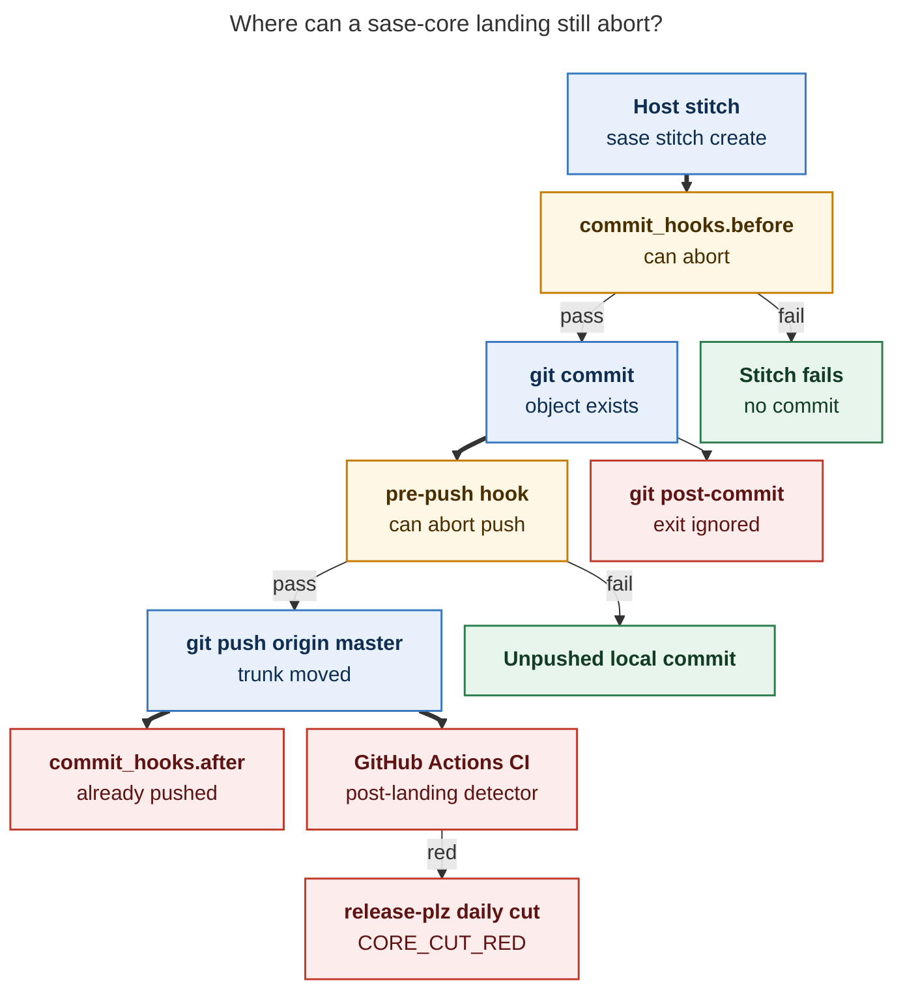
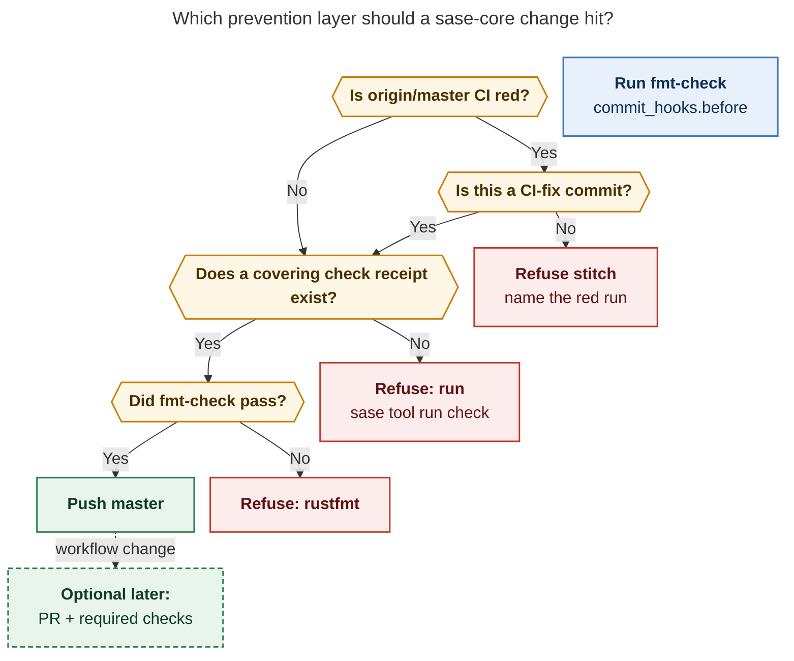

# sase-core CI keeps going red because stitches land on unprotected master; a git post-commit hook cannot close that gap

**Question.** Why does sase-core CI keep failing, and can a post-commit hook (or a close cousin) stop the same classes of failure from recurring?

**Verdict.** The recurring redness is a landing-policy problem with two cooperating causes: (1) host-owned stitches push straight to unprotected `master`, so GitHub Actions is always a *post-landing* detector; (2) the failures that then paint `master` red are mostly macOS wall-clock tests and Linux load races, which a Linux-side git hook would miss even if it ran the full local gate. A git `post-commit` hook is the wrong lifecycle for this repo: git ignores its exit code, SASE already pushes inside the same stitch, and ephemeral workspace clones never install unversioned hooks. The recommended control is a **layered stitch admission policy** (refuse to pile onto a red trunk, require a covering `sase tool run check` receipt, run a sase-core-valid cheap before-hook) plus finishing the two tests that currently paint CI red. A GitHub ruleset or merge queue is the only non-bypassable fence, and it requires switching sase-core off direct-to-master stitches.

## 1. How sase-core actually lands

sase-core is the linked Rust backend for sase (`sase-core-rs` on PyPI). Agents do not run `git commit` by hand. The host `builtin@commit` finalizer runs `sase stitch create` per dirty repository, with `cwd` set to that repository's path (`src/sase/finalizers/commit_repair_stitch.py`). The git provider then:

1. runs `commit_hooks.before` (project config, currently `just fix`);
2. `git add` / `git commit -m …`;
3. syncs with origin and **pushes the current branch** (`src/sase/vcs_provider/plugins/_git_commit_dispatch.py`);
4. runs `commit_hooks.after` (empty today).

GitHub reports **no branch protection** on `master` and **no rulesets**. Tip commit `cd62c83d` (`feat(staged_handoff): …`) has **zero associated pull requests**. Over 2026-10-17 → 2026-10-29, `git log` shows **79** first-parent commits on `master`; **69** carry `SASE_TYPE=stitch` and **10** look like release-plz merges (`chore: release vX.Y.Z (#N)`).

The repo's own `AGENTS.md` already names the consequence:

> `master` is unprotected, and a red commit also fails every release-plz run.

That is the production landing model: trunk-direct stitches, CI afterwards, release-plz watching the same trunk.

Patch-only hooks never see this path. sase's `vcs_provider.default_hooks` (`just lint`, `just test`) attach to new Patches. Direct `create_commit` stitches skip them.

## 2. What CI actually runs

`.github/workflows/ci.yml` on `push` to `master` and on pull requests:

| Job | What it runs | Notes |
| --- | --- | --- |
| `cargo fmt + clippy + test (ubuntu-latest)` | `scripts/check.sh` fmt-check, features (hakari), clippy `-D warnings`, `cargo test --workspace` under the hermetic git/SASE env | Same steps as `just check` / `scripts/check.sh all`, minus the OS |
| `cargo fmt + clippy + test (macos-latest)` | Identical script on `macos-latest` | Blocking since `d99ba118`. ci.yml comments that macOS minutes cost more than Linux and sketches a two-speed split |
| `maturin build + import smoke` | abi3 wheel + import + gateway/federation/sudo binaries | Did not fail any master-push CI run in the 12-day window below |
| `release workflow scripts` | `scripts/check.sh script-test` (unittest of `.github/scripts`) | Failed three times on a floating `astral-sh/setup-uv@v10` tag; now pinned to `v10.3.0` |

`just check` in the checkout is the local twin of the rust-checks jobs: fmt-check, hakari features, clippy `-D warnings`, every test, script tests. Agents must route it through `sase tool run check` (guarded recipe). AGENTS.md warns that a targeted `just test -p sase_core` skips `sase_core_py` binding tests; that gap let stale schema fixtures reach master in `a509dcc`.

CI also runs on every release-plz PR. A red trunk therefore keeps PR #340 (`chore: release v0.43.1`) red, and the daily cut records `CORE_CUT_RED`. The release steward's `core_ci_red` / `core_cut_red` states in `docs/contribute/release-train.md` are how a sase-core test failure blocks the sase release train.

A companion workflow, `runner-starvation-retry.yml`, reruns jobs that never got a hosted runner. It does not rerun failed tests.

## 3. Measured failure pattern (200 CI runs, 12 days)

Source: `gh run list --workflow CI --limit 200` on `sase-org/sase-core`, 2026-10-17T03:33Z through 2026-10-29T02:36Z, plus per-run `jobs` for every master-push failure.

| Slice | Count |
| --- | --- |
| CI workflow runs fetched | 200 |
| Conclusions | 134 success, 66 failure |
| Master **push** CI runs | 80 |
| Master-push failures | **28 / 80 (35%)** |
| Current tip (2026-10-29 02:35Z, `cd62c83d`) | red (ubuntu rust-checks) |
| Last green master push | 2026-10-29 01:30Z, `95dc0c10`, [run 40800810108](https://github.com/sase-org/sase-core/actions/runs/40800810108) |

Failed **job** names on those 28 master-push failures:

| Failed job | Count |
| --- | --- |
| `cargo fmt + clippy + test (macos-latest)` | 21 |
| `cargo fmt + clippy + test (ubuntu-latest)` | 12 |
| `release workflow scripts` | 3 |

Failed **job combinations**:

| Combination | Count | Meaning |
| --- | --- | --- |
| macOS rust-checks only | **13** | Linux local `just check` is green; CI still red |
| macOS and Ubuntu rust-checks | 8 | Real regressions or load flakes on both |
| Ubuntu rust-checks only | 4 | Includes the current cache-race flake |
| release workflow scripts only | 3 | Action-pin, already fixed |

macOS is the dominant master-red job. A hook that runs on Athena/Apollo (Linux) cannot see that class.

### 3.1 Two signatures that currently paint the trunk

**A. macOS WAL busy-budget (product, in flight as `sase-1pi.1`).**

From 2026-10-27 21:37Z (`3f8baa79`, "count the WAL probe against the busy budget") through 2026-10-29 00:32Z, master-push CI failed the macOS rust-checks job on every commit in a **12-commit streak**. Representative panic from [run 40794754688](https://github.com/sase-org/sase-core/actions/runs/40794754688) at `df14e8f4`:

```
tool_run::store::connection::tests::wal_mode_probe_consumes_conversion_budget
WAL setup renewed an exhausted budget: 1.173389917s
```

The test's budget is 250 ms with a 425 ms wall bound. Ubuntu passed the same SHAs. Plan `plan:202610/unblock_e2_core_release_flow.md` (epic `sase-1pi`) records elapsed times of 746 ms–1.23 s on `macos-latest`, hypothesizes SQLite's `HAVE_USLEEP=1` busy handler charging *nominal* sleeps against `busy_timeout`, and treats that as a product defect on developer Macs as well as CI. `sase-1pi.1` landed `0fd85e4a` (wall-clock busy handler) and recorded a green macOS job on that SHA; Ubuntu then failed the *other* signature below.

**B. Ubuntu bead-cache race (flake, no task bead).**

Current tip [run 40807288117](https://github.com/sase-org/sase-core/actions/runs/40807288117) at `cd62c83d`:

- ubuntu rust-checks: **failed**
- macos rust-checks: **passed**
- wheel smoke: passed
- release scripts: passed

```
bead_read_model_parity::concurrent_readers_see_consistent_snapshots
panicked at crates/sase_core/tests/integration/bead_read_model_parity.rs:934
cache is stale: the next read rebuilds
test result: FAILED. 404 passed; 1 failed
```

The same panic appears on [run 40684718736](https://github.com/sase-org/sase-core/actions/runs/40684718736) at `49870f00` (Ubuntu side of a both-OS failure) and on run 40797498289 at `0fd85e4a`. Successor `95dc0c10` changed only release-steward files and went **green** on Ubuntu with identical cache code. `sase-1pi.1` note #2 recorded this as a `PROPOSED FOLLOW-UP` and explicitly did not file a bead. Closed epic `sase-1io.7` already chased "read-model cache race" once; the assertion still flakes under CI parallelism.

A local `just check` that passes, then a stitch, then a red Ubuntu job on an unrelated SHA, is the definition of a load flake. Putting that same suite in a git hook would fail-closed on the flake *or* fail-open the same way CI does.

### 3.2 A third class, already closed: workflow action pins

Three master-push failures on 2026-10-19 (`9876b3ae`, `a908ceb3`, `f0f2275f`) died in `release workflow scripts` with:

```
Unable to resolve action `astral-sh/setup-uv@v10`, unable to find version `v10`
```

`cbc08c53` / current `ci.yml` pin `astral-sh/setup-uv@v10.3.0`. `.github/scripts/test_workflow_action_pins.py` now fails the suite if a floating `vN` tag returns. This class is a **CI-config** failure: it is independent of product tests, and a source-tree hook would not have caught it until the pin test existed.

### 3.3 Historical "we skipped the local gate" class

Closed bug `sase-10i` (2026-09-13): stitch `3fa0a542` landed unformatted `retention.rs` test code. `scripts/check.sh fmt-check` went red *after* the push. A monitor on Apollo then inherited a failing `just check` it did not cause. The fmt break was later fixed in passing by `d0ec62c`. The bead asked for a stitch-time fmt gate or per-SHA CI respect before declaring landing success. It was closed on 2026-09-22 as "stale task bead swept from triage" **without the guard**.

That class is the one a cheap before-hook *would* catch. It is not the class that has been painting master red for the last two weeks.

### 3.4 Standing flake catalog (open, sase-core)

These READY flake beads are labeled `sase-core flake:` and remain open. Several already have independent `+1` corroboration. AGENTS.md tells agents to look here before treating a `just check` fail-then-pass as their own regression.

| Bead | Node | Corroboration |
| --- | --- | --- |
| `sase-15d` | telemetry `concurrent_writers_preserve_every_delta` | 1 observation |
| `sase-15f` | sudo_runner cwd cleanup under load | 1 observation |
| `sase-15g` | gateway fleet 504 / snapshot_refresh timeout | +4 |
| `sase-15h` | sudo_runner fake-sudo `ETXTBSY` | +6 |
| `sase-1gz` | federation_worker symlink listener | +10 |
| `sase-1ik` | macro LSP `metadata_env_ignores_legacy_prefix` env race | 1 observation |

A required-CI-before-merge policy, or a full-suite git hook, will stall on this catalog until the races are deterministic. `sase-g8` (`fatal: could not parse HEAD` in a git fixture) was closed after a single occurrence; the hermetic test env in `scripts/check.sh` (`GIT_CONFIG_GLOBAL=/dev/null`, `user.useConfigOnly`) is the lasting fix for host-identity drift (`a031ee4`). Remaining flakes are concurrency, load, and macOS timing.

## 4. Why the redness recurs

Four properties of the landing system cooperate:

**1. Detection is after the push.** GitHub Actions `on: push` cannot veto a direct push. Required status checks and merge queues apply to *pull request merges*. With no PRs and no rulesets, CI is a weather report.

**2. Stitches keep landing on an already-red trunk.** After `3f8baa79` made macOS red, eleven further stitches still pushed. Each one re-ran CI, re-failed macOS, and re-blocked the v0.43.1 cut. The product change in those commits was unrelated to WAL. Nothing in stitch admission asks "is origin/master's latest CI green?"

**3. Instruction-led `just check` is not a fence.** Guarded recipes already refuse raw agent `just check` (`decisions:guarded-recipes`). Agents still skip the workspace gate (targeted `-p` runs, `a509dcc`) or run it and then lose a CI-only flake. `sase-1pi.1` recorded a passing local `sase tool run check` (5549 core tests) for the WAL fix, then watched Ubuntu CI fail the cache assertion on that SHA. Receipts prove a Linux ToolRun settled; they do not prove macOS CI or a later SHA.

**4. The configured before-hook is the wrong command for this repo.** Merged sase config is `commit_hooks.before: just fix`. sase-core's justfile recipes are `check`, `clippy`, `fast`, `fmt`, `modules`, `test`. In the linked checkout, `just fix` exits: `justfile does not contain recipe 'fix'. Did you mean 'fmt'?`. Stitches nevertheless land (69 in 12 days). Whatever the skip/override path is, **rustfmt is not gating sase-core landings today** (`sase-10i`). `commit_hooks` is a single global string, not per linked repo.

## 5. What a post-commit hook would actually do

Git's own contract ([githooks](https://git-scm.com/docs/githooks)): the `post-commit` hook "is invoked after a commit is made" and **cannot affect the outcome of `git commit`**. Git ignores a non-zero exit.

SASE's stitch then pushes in the same process. The SASE analogue of post-commit is already `commit_hooks.after`, which the docs state runs "only after `create_commit` or `create_pull_request` succeeds, **including its push**." A failing after-hook leaves the commit on the remote and asks the operator to `sase stitch create --resume`. That is a notification, not a gate.

Additional mismatches with this repo:

- **Ephemeral clones.** Agent workspaces are `sase_<N>` checkouts. Unversioned `.git/hooks` never appear there. Git will not honor a committed `core.hooksPath` until each clone sets it (a local config write). Sample hooks in `.git/hooks/*.sample` are the only files present today.
- **Some commit paths pass `--no-verify`.** Auto-commit of prompt Q&A and ACE revert transactions use `git commit --no-verify`. The main stitch path uses `git commit -m` without that flag, so a *pre-commit* or *pre-push* hook would run *if installed*. `post-commit` still cannot abort.
- **Duration.** `just check` is documented at ~5 minutes with a 10-minute tool timeout. `commit_hooks` have **no timeout of their own**. A full-suite hook would hang a finalizer until the host's hard subprocess cap.
- **OS matrix.** 13 of 28 recent master-push failures were macOS-only. Athena running `just check` after commit would have been green for those SHAs.
- **Flakes.** The current Ubuntu red is a 1-in-N cache race. A hook that runs the same test either blocks a good commit or lets the flake through.

A `pre-push` hook is the closest git-native abort that still fits "hook." It can refuse the push and leave a local commit (stitch already has `_format_unpushed_commit_failure`). It still needs to be installed in every clone, still runs only on Linux hosts, still cannot see macOS CI, and still fights the flake catalog. SASE already has a better-placed abort: `commit_hooks.before`, which runs **before** `git commit` and fails the stitch with `before_hook_failed`.



*Caption. The only abort that prevents a commit object is `commit_hooks.before`. A git post-commit hook and SASE's after-hook both run after trunk can already move. GitHub Actions is a detector for a landing policy that already happened.*

## 6. Alternatives, ranked by what they actually catch

| Control | Aborts the landing? | Catches fmt (`sase-10i`)? | Catches Linux clippy/tests? | Catches macOS WAL? | Catches Ubuntu cache flake? | Bypassable? |
| --- | --- | --- | --- | --- | --- | --- |
| Git `post-commit` running `just check` | No | Only as a log line | On Linux hosts, if installed | No | Sometimes, as a false block | Yes (missing hook, `--no-verify`) |
| Git `pre-push` running `just check` | Push only | Yes, if installed | Linux only | No | Flake stall | Yes |
| SASE `commit_hooks.before: just fix` (today) | Would abort if the recipe existed | No (wrong recipe) | No | No | No | Global string, wrong tree |
| SASE `commit_hooks.before: ./scripts/check.sh fmt-check` | Yes | Yes | No | No | No | Same as any before-hook; still in-process |
| Covering `sase tool run check` receipt required to stitch | Yes | Yes | Yes (Linux hermetic suite) | No | Flake stall or false green | Host policy; agents cannot skip the finalizer |
| **Refuse stitch while origin/master CI is red** | Yes (except CI-fix commits) | Indirect (stops pile-on) | Indirect | Stops 11/12 of the WAL streak | Stops piling onto the cache flake | Host policy |
| GitHub ruleset: require PR + rust-checks | Yes (server) | Yes, via CI | Yes | Yes | Flake stall on the PR | Needs admin bypass off |
| GitHub merge queue | Yes (server, serializes) | Yes | Yes | Yes | Flake stall, but isolated to the queue | Needs PR workflow |
| Revert-on-red / `ci_watch` paging | After the fact | After | After | After | After | Detection |

The high-leverage row is **refuse stitch while origin/master CI is red**. It uses a signal that already exists (`gh run list` / Actions API, the same fact the steward calls `core_ci_red`), costs seconds, and would have kept the WAL defect to one red SHA instead of twelve. It does not *fix* WAL or the cache race; it stops unrelated footprint/artifact-link/clippy stitches from extending `CORE_CUT_RED`.

A GitHub ruleset is the only control that a stitch cannot talk itself out of. It is also a workflow change: 69 of 79 recent commits would have had to be `create_pull_request` (or a merge-queue entry) instead of `create_commit`. Prior SASE research already exists on merge queues (`research:202610/github_native_merge_queue_primer`, `research:202610/merge_queue_fenced_master_and_exact_sha_releases`). This report does not reopen that design; it records that **direct-to-master stitches and required status checks cannot be true at the same time**, because the checks have not run at push time.

Moving macOS off the push path (the cost note in `ci.yml`) would hide the *dominant* current failure from `CORE_CUT_RED` and is the wrong split until the WAL budget is actually green on `macos-latest`.

## 7. Recommended solution

Implement a **four-layer fence**, in this order. Layer 1 is days of work and stops the recurrence *shape* (pile-on). Layer 4 is the durable server-side policy if the project is willing to stop stitching straight to `master`.

### Layer 1 — Red-trunk stitch hold (do this first)

Before `git push` of a sase-core `create_commit` to `origin/master`, the host (stitch admission or a sase-core-specific before-hook script) queries the latest completed `CI` workflow on `origin/master`.

- If that run is green, push.
- If it is red, refuse with the run URL and failed job names, unless the commit subject matches a small allowlist (`fix(ci)`, `fix(clippy)` when clippy is the red job, or an explicit `SASE_CORE_LAND_ON_RED=<reason>` recorded in stitch evidence).

This is the SASE-native cousin of "do not land on a red tree." It would have blocked eleven of the twelve WAL-streak stitches and the staged-handoff tip that re-reddened Ubuntu after a green SHA. The steward already has the fact (`core_ci_red`); stitch currently ignores it.

### Layer 2 — sase-core-valid cheap before-hook

Replace the inherited `just fix` for this repository with a command that exists here:

```bash
./scripts/check.sh fmt-check
```

Optionally add `./scripts/check.sh features` (hakari drift, no compile). Keep clippy and the test suite *out* of this hook: they belong in the receipt (layer 3). Implement as a **per-linked-repo** `commit_hooks.before` (today the key is global). `fmt-check` is seconds, closes `sase-10i`, and fails the stitch *before* a commit object exists.

Do not put this in `.git/hooks/post-commit`. Put it in `commit_hooks.before` so the abort is in-process, versioned in project config, and present in every ephemeral workspace without a local `core.hooksPath` write.

### Layer 3 — Receipt-gated full Linux check

Require a covering, unexpired `sase tool run check` receipt for the sase-core fingerprint before the host pushes `master`. This matches `decisions:receipts-prove-before-they-skip`: the receipt is **proof for admission**, and the child still ran. Prepared host completion already consults receipts for all-KNOWN/FLAKY trees; extend that idea to sase-core landing.

This catches clippy `-D warnings`, hakari, hermetic tests, and script tests as they run on Linux. It does not catch macOS WAL or a CI-only race. Combined with layer 1, a Linux-green commit that then goes macOS-red still **stops the next twelve stitches**.

### Layer 4 — Server-side fence when the project is ready to leave unprotected master

Add a GitHub ruleset on `sase-org/sase-core`:

- block force-push to `master`;
- require a pull request;
- require status checks `cargo fmt + clippy + test (ubuntu-latest)` and `(macos-latest)`, plus wheel-smoke.

Switch sase-core host completion from `create_commit` to `create_pull_request` (or a merge queue). Until that switch, layers 1–3 are the achievable fence. A ruleset in front of the current stitch path would only be theater: required checks never run before a direct push.

### Parallel product work (otherwise every gate stalls)

1. Finish `sase-1pi.1` (WAL wall-clock busy handler) and wait for a merge-capable cut that contains `0fd85e4a` (`core_cut = wait` already decided).
2. File a flake/bug bead for `bead_read_model_parity::concurrent_readers_see_consistent_snapshots` (`cache is stale: the next read rebuilds`) and fix the cache invalidation race. Closed `sase-1io.7` did not end it. `sase-1pi.1` note #2 is the witness; this report is a second.
3. Keep burning down `sase-15g`, `sase-15h`, `sase-1gz` (already +4 / +6 / +10). A future required-check policy will otherwise queue behind them.



*Caption. Layer 1 asks whether trunk is already red before any new SHA is added. Layer 3 demands a Linux `just check` receipt. Layer 2 is the cheap rustfmt abort. A GitHub PR ruleset is a later workflow change, drawn dashed.*

## 8. Rejected controls

These look adjacent to the request and fail the abort-point or coverage tests above.

- A git `post-commit` hook (or lefthook / pre-commit.com as the primary control): git ignores the exit code, clones never install unversioned hooks, and the dominant failures are off-host.
- Full `just check` inside any git hook: about five minutes, no hook timeout, flake-stall, Linux-only.
- Moving the macOS rust-checks job off the push path to save minutes while WAL still fails there: `CORE_CUT_RED` would stop seeing the main red job.
- Weakening the 425 ms WAL assertion or retry-wrapping `concurrent_readers` in CI: AGENTS.md forbids weakening an assertion to get a green run.

## 9. Sources

### Primary (this session)

- sase-core checkout `cd62c83d` (origin/master at research time): `AGENTS.md`, `justfile`, `scripts/check.sh`, `sase/sase.yml`, `.github/workflows/ci.yml`, `release-plz.yml`, `runner-starvation-retry.yml`, `.github/scripts/test_workflow_action_pins.py`, `crates/sase_core/tests/integration/bead_read_model_parity.rs` (assertion at line 934).
- GitHub API: `GET /repos/sase-org/sase-core/branches/master/protection` → 404 "Branch not protected"; `GET /repos/sase-org/sase-core/rulesets` → `[]`; `GET /commits/cd62c83d/pulls` → `[]`.
- `gh run list --workflow CI --limit 200` plus `gh run view --json jobs` for all 28 master-push failures; failed-log extracts from runs 40807288117, 40794754688, 40684718736, 39289328389.
- `git log --since=2026-10-17`: 79 commits, 69 with `SASE_TYPE=stitch`.
- Beads (audited `sase bead read`): `sase-1pi`, `sase-1pi.1`, `sase-10i`, `sase-15d`, `sase-15f`, `sase-15g`, `sase-15h`, `sase-1gz`, `sase-1ik`, `sase-g8`, `sase-1io`.
- Plan artifact `plan:202610/unblock_e2_core_release_flow.md`.
- sase: `sase/sase.yml` (`commit_hooks.before: just fix`), `src/sase/workflows/commit/command_hooks.py`, `src/sase/vcs_provider/plugins/_git_commit_dispatch.py`, `src/sase/finalizers/commit_repair_stitch.py`, `docs/reference/config/finalizers.md`, `docs/contribute/release-train.md`, `docs/contribute/commit-workflow-orchestrator.md`.
- Decisions already in agent memory: `ci-two-speed-split`, `guarded-recipes`, `receipts-prove-before-they-skip`, `rust-core-required`, `host-owned-completion`.

### Related prior research (not this swarm)

- `research:202610/master_ci_red_why_and_how_to_stay_green/` — sase (Python) master redness; two-speed CI and `ci_watch` live there. sase-core has no equivalent fence.
- `research:202610/github_native_merge_queue_primer/` and `research:202610/merge_queue_fenced_master_and_exact_sha_releases/` — server-side alternative if layer 4 is taken.

### External

- [Git hooks](https://git-scm.com/docs/githooks) — `post-commit` cannot affect `git commit`.
- [GitHub rulesets](https://docs.github.com/en/repositories/configuring-branches-and-merges-in-your-repository/managing-rulesets/about-rulesets)
- [GitHub merge queue](https://docs.github.com/en/repositories/configuring-branches-and-merges-in-your-repository/configuring-pull-request-merges/managing-a-merge-queue)

Library check: 0 of 5 candidates already in your library (0 finished). Propose `bob ref create <URL>` (add `-L` to also narrate) for any of the three GitHub/git docs you want in `ref/`.
