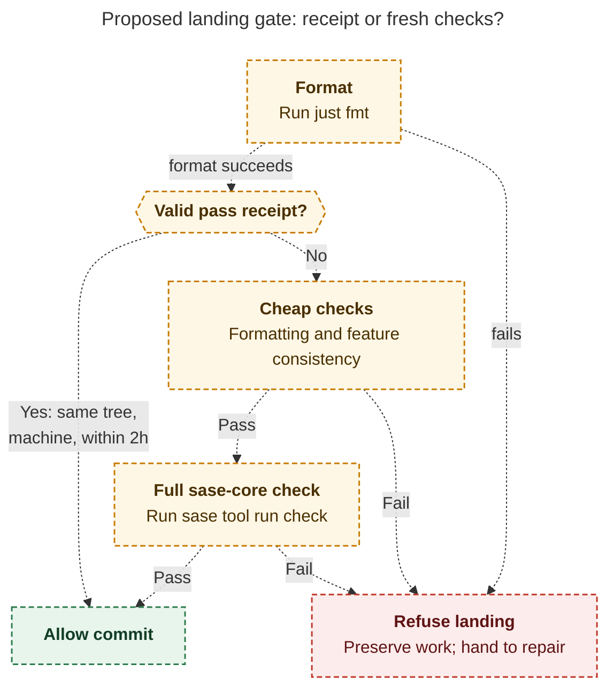

# Diagram proposals: Why sase-core CI keeps going red, and the hook that would actually stop it

Proposals for the swarm linker, not a report. Each diagram restates only what the source
report says.

```yaml
source: research:202610/sase_core_ci_red_recurrence_and_landing_gate/sase_core_ci_red_recurrence_and_landing_gate__final.md
producer: research.5g.image
check: "mmdc 12.0.0 with the PDF-mirroring config rendered 1 of 1 Mermaid diagrams"
```

## landing-gate-decision

```yaml
anchor: |-
  In sase-core's `sase/sase.yml`, set `commit_hooks.before` to a script. A sketch:
question: |-
  How does the proposed landing gate decide to allow or refuse a commit?
illustrates: |-
  The proposed landing gate accepts a covering pass receipt or runs the cheapest
  checks followed by the full check, refusing failed landings while preserving
  work for repair.
caption: "The proposed gate accepts matching pass receipts within two hours; otherwise checks must pass, and failures preserve work for repair."
review: "535.891×940 px, fit 95.0%; question and visual checks passed; 0 revisions; converging paths are alternatives"
```


