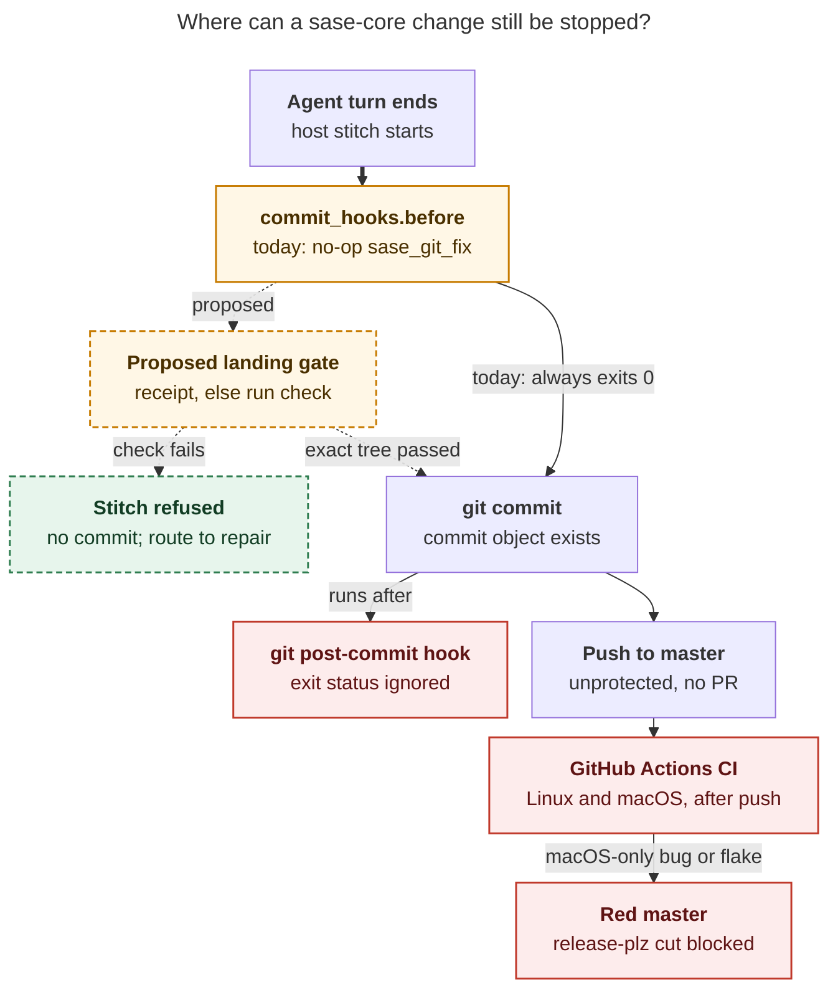

# Why sase-core CI keeps going red, and the hook that would actually stop it

_Lead consolidation · 2026-10-29 · merges five independent reports (cdx, cld, grk, mus,
gem) with the lead's own checks of CI logs, hook evidence, the ToolRun ledger, and
sase-core source at `cd62c83d`._

## Bottom line

- **How bad it is.** sase-core's `master` was red for **29% of October's wall-clock
  time** (196 of 676 hours), and **40% of October master pushes failed CI** (93 of
  235). That is up from 22% in late September. In the last two weeks, 32–35% of
  master-push runs failed. The tip, `cd62c83d`, is red right now.
- **It is not one problem.** The failures fall into five classes. The two biggest by
  red time are mistakes a full local `check` catches: formatting, Clippy, feature drift,
  compile errors, and deterministic test failures. They make up about **half of all red
  time**. The rest are macOS-only bugs that a Linux machine cannot see, intermittent
  tests ("flakes"), and CI configuration errors.
- **Why the same classes keep coming back:**
  1. Nothing enforces sase-core's `check` at landing time. The before-commit hook that
     runs on every sase-core landing is a no-op in that repo.
  2. Most sase-core changes come from agents rooted in *other* projects, mainly sase.
     Their instructions do not reliably point them at sase-core's `check`.
  3. Flakes have no owner. Even when a flake has a bead, the local triage cannot
     recognize it.
  4. `master` is unprotected, and nobody owns a red `master`, so it stays red for
     12–27 hours while unrelated commits keep landing on it.
- **A git `post-commit` hook cannot fix this.** git ignores its exit status, so it runs
  too late to block anything. Agents never run `git commit` themselves, and ephemeral
  workspace clones never get unversioned `.git/hooks`.
- **Recommendation.** Use the hook SASE already runs on every sase-core landing,
  `commit_hooks.before`, and turn it into a **landing gate**. The gate runs before
  `git commit` and refuses any tree that has not passed sase-core's `check`. Then add
  four things:
  - a Linux-side macOS cross-compile check;
  - an owner for every flake (the current one is now filed as **`sase-1pl`**);
  - a watcher that assigns a repair agent on the first red push;
  - server-side required checks later, but only if red time stays high.

## 1. What fails

| Class | Examples | Episodes | Red pushes | Episode-hours | Longest | Caught by a local Linux `check`? |
| --- | --- | --: | --: | --: | --: | --- |
| **A. Fast static** | rustfmt (7), Clippy `-D warnings` (9), hakari feature drift (2), compile error (1) | 19 | 44 | 90 h | 15.1 h | **Yes**, in seconds to ~2 min |
| **B. Deterministic tests** | stale contract or fixture tests: `proposed_with: null` plan fixture, directive matrix, xprompt→macro rename | 9 | 40 | 48 h | 13.8 h | **Yes**, with the full workspace `check` |
| **C. macOS-only** | WAL busy-deadline timing, case-insensitive APFS, APFS refusing non-UTF-8 names, `mode_t` is `u16`, `/private/var` symlinks | 8 | 27 | 87 h | **27.4 h** | **No**. A cross-target `cargo check` catches the compile subset |
| **D. Flakes** | `concurrent_readers_see_consistent_snapshots`, sudo_runner `ETXTBSY`, tool_run argv | 34 | 39 | 46 h | 8.6 h | **No**. A rerun passes |
| **E. CI config / infrastructure** | `astral-sh/setup-uv@v10` unresolvable, BSD `sed`, runner starvation | 4 | 6 | ~7 h | 6.4 h | No |

_Source: cld, 1,000 CI runs from 2026-09-16 to 2026-10-29 and the logs of all 467 failed
jobs. An "episode" runs from a signature's first red push to the push that cleared it.
Overlapping episodes double-count, which is why the episode-hours (294 h) exceed the
wall-clock red time (275 h)._

The narrower windows agree with this shape:

- **cdx (100 master pushes, 10-12 → 10-29):**
  - 24 runs failed in tests, 5 in Clippy or compilation, and 3 in job setup.
  - None failed in formatting, features, or wheel smoke.
- **grk (80 master pushes, 10-17 → 10-29):**
  - The macOS job failed 21 times and the Ubuntu job 12 times.
  - **13 of the 28 failures were macOS-only.**
- **mus (commit history):** traces each class to its structural fix. Examples:
  - the hermetic git environment (`a031ee4`);
  - the action-pin test (`cbc08c53`);
  - the colorless `cargo tree` parse (`04fbb48d`);
  - the BSD-portable toolchain read (`d48aaf3e`).

The mix has shifted over time:

- **Early October:** mostly classes A and B, deterministic mistakes.
- **Mid-October:** macOS portability problems (FFI types, filenames) and a stale
  fixture.
- **Last ten days:** two test-level problems, described next.

Release-plz PRs inherit a red `master`. All 121 failed October PR runs were
`chore: release` PRs, so every red hour also blocks core cuts (`CORE_CUT_RED`) and the
sase release train.

## 2. What is red right now

**The macOS WAL budget failure is fixed.**
`tool_run::store::connection::tests::wal_mode_probe_consumes_conversion_budget` failed on
every macOS run for **12 consecutive master pushes**, starting at `3f8baa79`, with
elapsed times of 746 ms to 1.23 s against a 425 ms bound.

The cause was a product defect, not just a strict test. SQLite's built-in busy timeout
counts accumulated sleep, not elapsed wall-clock time ([SQLite busy-timeout
contract](https://www.sqlite.org/c3ref/busy_timeout.html)). Commit `0fd85e4a` replaced it
with a custom busy handler that enforces one absolute deadline, and added a
deterministic oversleep test. macOS has passed on every run since. Keep that fix. Do
**not** adopt the alternative of widening timing budgets on CI: it would hide the same
bug on developers' Macs, and sase-core's `AGENTS.md` forbids weakening assertions.

**The cache-freshness race is the current red, and it was unowned until today.**
`bead_read_model_parity::concurrent_readers_see_consistent_snapshots` fails at
`bead_read_model_parity.rs:934` with **"cache is stale: the next read rebuilds"**.

- **The cache never returned wrong data.** The test's earlier assertions, that every
  snapshot matches a real state and that the cache agrees with replay, both pass. What
  fails is the final freshness check, `assert!(verify.compared)`.
- **The lead's recount** covered the 120 most recent failed CI runs:
  - 12 runs carried this freshness failure;
  - the "served a state no replay ever produced" assertion appeared only once (run
    37912989918, 2026-10-09).
- **It predates the recent test changes.** It was first seen on 10-13, before
  `b12e5815` merged the integration tests into one binary. It also recurs after
  `sase-1io.7.1` ("make the read-model cache safe under concurrent access") was closed.
- **It is intermittent.** `95dc0c10`, a release-steward-only change with identical
  cache code, went green between two red pushes.

**Likely mechanism** (gem's hypothesis; the lead confirmed the code path but has not
reproduced the failure):

1. In `crates/sase_core/src/bead/read_model/store.rs`, `rebuild_from_replay` calls
   `mark_failed_rebuild` on any `Fault::Cache` that is not a lost generation race. A
   rebuild that times out on a busy database while four reader threads and an appender
   contend would qualify.
2. That arms a process-wide **10-minute** `FAILED_REBUILD_BACKOFF` for this cache path.
3. For those 10 minutes, every later read, including the test's own
   `resync`/`assert_parity`, is served by replay and never refreshes the cache file.
4. `read_model_verify_cache` therefore reports the cache as stale.

If confirmed, the right fix is in the product: a brief busy timeout should not switch
readers to replay-only mode for 10 minutes, which also degrades production readers. A
test-only reset of the backoff would hide that. cdx's caution still applies: confirm
first. The cheapest confirmation is to include `cache_diagnostic` in the assertion
message.

This failure had been recorded as a "proposed follow-up" or note on `sase-1pi.1`,
`sase-1io.6`, and `sase-1io.2`, but never filed as its own bead. **The lead filed it as
`sase-1pl`** (flake, large). It is linked to `sase-1io.7.1` and `sase-1pi.1`.

## 3. Why the same failure classes recur

### 3.1 Landed sase-core content often never passed sase-core's `check`

cld matched every landed commit's file hashes against athena's ToolRun ledger, which
covers 231 agent commits from 09-25 to 10-29:

| What the landed content had | Commits | Share |
| --- | --: | --: |
| A passing sase-core `check` on identical content | 150 | 65% |
| A matching `check` that **failed**, and no passing one | 39 | 17% |
| Edits after the agent's last `check` | 25 | 11% |
| No sase-core `check` at all | 17 | 7% |

**None of the 150 passing-content commits introduced a class A or B failure.** Every
attributable A/B introducer had no check, a stale check, or a failed check.

Rebasing onto a newer `master` after the check did not matter. Commits that were checked
on an older `master` and then rebased had a 25% red rate, against 23% for commits
checked on the exact base. So checking the pre-rebase tree is good enough. This answers
cdx's concern that only a post-rebase, pre-push check is valid.

### 3.2 The hook that runs on every sase-core landing does nothing there

The host stitch runs SASE's `commit_hooks.before` before `git commit`. sase sets it to
`just fix`. sase-core's `sase/sase.yml` sets no hook, so it falls through to the
user-level `sase_git_fix`, which does nothing there. cld traced why: the script looks
for a capital-J `Justfile`, and sase-core has a lowercase `justfile` with no `fix`
recipe.

The lead checked the evidence records. **All 40 sase-core before-hook records since
10-20 ran `sase_git_fix`, exited 0, and took about 0.04 s.**

This corrects grk, who said the hook was `just fix` failing with "no recipe". It also
shows that the hook is resolved **per repository**: sase's `just fix` never ran in the
linked sase-core checkout. So a sase-core-specific hook would take effect.

### 3.3 Most sase-core landings come from agents rooted in other projects

Of those 40 hook records:

- **35 ran in sase's linked sase-core checkout**, from sase-rooted agents;
- **5 ran in bob-cli's external sase-core checkout**;
- **none** came from a sase-core-rooted workspace.

cld independently found the same pattern among failure introducers: 9 of the 11
attributable A/B introducers on athena were sase-rooted agents. Those agents ran
**sase's** `check`, which does not format, lint, or test sase-core.

Their instructions explain why:

- sase's core memory tells agents to read the lint-and-test note only when they changed
  sase files "excluding file changes in the separate repos contained in the sase/repos/
  directory".
- `sase repo open sase-core` prints that sase-core's own `AGENTS.md` "is not loaded
  automatically".
- The instruction to run `sase tool run check` in linked repos does exist, but it sits
  inside the note those agents are told they may skip.

### 3.4 A Linux check cannot see macOS

Six of the eight macOS-only episodes were introduced by commits that **passed** a local
Linux `check`. The `mobile_pairing` sequence shows the cost:

1. `mode_t` is `u16` on macOS, which caused an `E0308` type mismatch.
2. The first fix caused a second error, `E0617`.
3. Together they produced three macOS-only reds over about 21 hours, because agents on
   Linux could only test a fix by pushing it.

cld showed that a cross-target `cargo check --target aarch64-apple-darwin`, using a stub C
compiler and archiver, catches this subset on Linux. It took **2 m 12 s cold** and
reproduced CI's exact errors on `916d5e3a`. Runtime behavior (file-system case folding,
`/proc`, scheduling) still needs real macOS CI.

### 3.5 Flakes are invisible to triage, so landing on a failed check became normal

**sase-core's local check fails about half the time.** Of the last 300 sase-core `check`
runs on athena, **151 failed**: 123 with exit code 101 (a test failure) and 28 with exit
code 1. Many of these are mid-iteration failures, so this is not a flake rate.

**Triage cannot tell its flakes apart.** `sase tool failures` labels every sase-core
failure **UNKNOWN or NEW, at stage `*`, with no owner**. This is because sase-core's
`check` declares `stages: none`. Even the federation_worker symlink failure, which has
flake bead `sase-1gz` with +10 corroborations, shows up as NEW.

**So agents rely on the honor system.** sase-core's `AGENTS.md` asks agents to look up
`sase-core flake:` beads themselves. In 17% of landings, the agent concluded the failure
was not theirs and landed anyway. That included `f8d05efc`, a deterministic contract
failure that kept `master` red for about 27 hours.

**Failures also hide each other.** `scripts/check.sh test` runs `cargo test --workspace`
without `--no-fail-fast`. One failing test binary therefore hides regressions in the
others, both locally and in CI.

### 3.6 Nobody owns a red `master`

`master` has no branch protection and no rulesets, and grk found that the tip commit has
no associated PR. CI therefore only detects problems after they have landed. After
`3f8baa79` turned macOS red, **eleven unrelated stitches still pushed** onto the red
trunk. Nine episodes stayed red for 12–27 hours.

One gap is latent rather than observed: `rust-toolchain.toml` pins `channel = "stable"`,
so a new stable Rust release could add new Clippy lints with no code change. cld found
no case of this in the window.

## 4. Why a post-commit hook won't work, and which hook will



_Caption. Only `commit_hooks.before` can refuse a sase-core landing before a commit
exists. Today it always passes. A git post-commit hook and GitHub Actions CI both run
after the change has already landed. Dashed nodes and edges are proposed._

All five reports reject `post-commit` for these reasons:

- **It runs too late.** It fires after the commit exists, and git ignores its exit
  status ([githooks](https://git-scm.com/docs/githooks)). SASE's own equivalent,
  `commit_hooks.after`, runs after the push, so it can only report.
- **It never reaches the commits that matter.** Agents never run `git commit`; the host
  finalizer does it through `sase stitch create`, in ephemeral `sase_<N>` clones that
  contain only the stock `*.sample` hooks.
- **It is Linux-only.** It cannot see class C at all.
- **It is the wrong cost model.** A full `check` takes 5–11 minutes, and a flake would
  either block a good commit or let a bad one through.

A git **`pre-push`** hook can abort, but it would have to be installed in every clone.
It also runs only on Linux. cdx adds a further risk: the stitch's push-retry loop could
mistake a verification failure for a remote race and rerun or rebase.

**`commit_hooks.before` is the right place to gate.** It is SASE's own pre-commit:

- it runs in the repository being committed, including cross-repo checkouts;
- its configuration is versioned with the project;
- it leaves an audit record;
- a failure stops the stitch with `before_hook_failed` before any commit exists.

## 5. Where the reports disagreed

| Question | Positions | Resolution |
| --- | --- | --- |
| Are the failures static or tests? | gem: "100% test flakes, 0% static" | **Wrong outside a 3-day window.** Over six weeks, static failures (A) and deterministic test failures (B) are about half of red time (cld). cdx and mus also show Clippy, FFI compile, and fixture failures. |
| What does sase-core's before-hook run? | grk: `just fix`, which fails; cld: no-op `sase_git_fix` | **cld is right.** All 40 of 40 evidence records ran `sase_git_fix`, which exited 0. |
| What exactly is the cache failure? | cld: "served a state no replay ever produced"; cdx, grk, gem: "cache is stale" | **It is a stale cache, not wrong data.** 12 of the 120 most recent failed runs show it, against 1 for the wrong-state assertion. |
| Verify before or after the rebase? | cdx: the final post-rebase candidate; cld: the pre-commit tree | **Before is enough for now.** Rebased commits had a 25% red rate against 23% for exact-base commits (cld). |
| Can a receipt let the gate skip running `check`? | cld, grk: yes; cdx: rerun when needed | **Yes, as proof for host completion, which is what the `receipts-prove-before-they-skip` decision allows.** A receipt only ever means "this ran and passed". Without one, the gate runs the full check. |
| Can the gate accept known flakes (`no_new_failures`)? | cld: yes | **Not yet.** sase-core's triage cannot recognize its flakes (§3.5). Start with pass-only receipts, and add stage declarations to sase-core's `check` so flakes can be recognized. |
| Server-side required checks first? | mus, gem, cdx: yes; cld, grk: later | **Later, and only if needed.** Required checks cannot coexist with direct-to-master stitches, because the checks have not run at push time. A PR flow with a 26-minute median macOS job would serialize landings. sase's own `ci-two-speed-split` decision rejected a merge queue. |
| Refuse new landings while `master` is red? | grk: as Layer 1 | **Not as a hard block yet.** With flakes this common (the tip went red again right after a green push), a hard hold would freeze all core and cross-repo landings on every flake. Assign an owner on the first red instead (step 4). |
| Retry or loosen tests in CI? | gem: scale timing budgets; cld: nextest `--retries 1` | **No loosening.** The WAL failure was a real product bug. Retries are acceptable only once a "flaky" result automatically files or corroborates a bead. |

## 6. Recommended solution

The ordering follows each step's share of red time and its cost.

### Step 0 — Restore a green signal (now)

- Keep `0fd85e4a`.
- Have `sase-1pl` confirm and fix the cache-backoff mechanism in the product.

### Step 1 — A landing gate in sase-core's `commit_hooks.before`, the "hook" you asked about

This step targets classes A and B: about **47% of episode-hours**, including 5 of the 10
longest red stretches.

In sase-core's `sase/sase.yml`, set `commit_hooks.before` to a script. A sketch:

```bash
#!/usr/bin/env bash
# scripts/land_gate.sh: host-owned before-commit gate for sase-core.
set -euo pipefail
cd "$(git rev-parse --show-toplevel)"
just fmt                                        # cheap auto-fix; a no-op on a tree that passed check
if sase tool receipt check >/dev/null 2>&1; then
  exit 0                                        # this exact tree already passed check on this machine
fi
./scripts/check.sh fmt-check                    # fail fast on the cheapest gates
./scripts/check.sh features
exec sase tool run check                        # full gate on the tree about to land
```

The script needs these to work:

- **A receipt policy on sase-core's `check`.** Today it has none, and
  `sase tool receipts` reports 0. Start with `accept: [pass]` and `ttl: 2h`, matching
  sase's TTL. Add `no_new_failures` only after `check` declares stages and triage can
  recognize sase-core flakes.
- **A safe failure path.** A refused landing must leave the work intact and hand off to
  the existing commit-repair flow, never land red.
- **Timing within limits.** Hooks have no timeout of their own; finalizer subprocesses
  are capped at 1,800 s. A full `check` takes 5–11 minutes, so it fits.
- **An implementation-time check** that the hook resolves to sase-core's config for
  sase-rooted and bob-cli-rooted landings. The per-repository resolution in §3.2
  suggests it will.

**Cost.** cld estimates about 81 unverified commits × about 6 minutes, roughly
**15 minutes of host time per day**. Commits that already have a covering receipt pay
milliseconds. Compare that with 196 red hours in October.

**Optional extras:**

- a thin `pre-push` hook that calls the same script, for manual human pushes;
- teaching `sase_git_fix` to recognize a lowercase `justfile`, a blind spot other repos
  share.

### Step 2 — Catch macOS compile errors on Linux

- Add `./scripts/check.sh macos-check`, the stub-compiler `cargo check` for
  `aarch64-apple-darwin`, scoped to `sase_core` and `sase_gateway`. Include it in
  `check`, so the receipt covers it. When the target is not installed, skip it with a
  loud warning.
- Add a short portability checklist to sase-core's `AGENTS.md`:
  - APFS is case-insensitive;
  - there is no `/proc`;
  - macOS refuses non-UTF-8 file names;
  - `mode_t` is `u16`;
  - `/var` is a symlink to `/private/var`;
  - wall-clock budgets need real deadlines.

### Step 3 — Close the instruction gap for cross-repo agents

Update sase's memory, through `/sase_memory_write`, so that an agent that dirtied the
linked sase-core checkout is told to run `sase tool run check` there before finishing.
The Step 1 gate is the backstop. Earlier feedback keeps repairs inside the agent's own
turn instead of a later repair handoff.

### Step 4 — Make flakes and red trunks owned

- **Detect flakes.** Declare stages on sase-core's `check` so triage stops reporting
  every failure as `*`/UNKNOWN.
- **Report everything.** Add `--no-fail-fast` to the test step in CI and in
  `check.sh`, so one failure no longer hides others.
- **Watch the trunk.** Add a sase-core red-trunk watcher: a `ci_watch` entry or a
  `workflow_run` trigger that launches or assigns a repair agent on the **first** red
  push, naming the failing test and the first red SHA.
- **Pin Rust.** Pin `rust-toolchain.toml` to an exact version (currently 1.99.1) and
  bump it on purpose.

### Step 5 — Server-side fence (only if red time stays above ~5% after steps 0–4)

- Move sase-core landings from direct pushes to PRs or a merge queue.
- Require the Linux and macOS rust-checks, release-script tests, and wheel smoke to
  pass before merging.

This is the only fence for macOS runtime bugs, but it changes the landing workflow.
Prior research covers the design: `research:202610/github_native_merge_queue_primer` and
`research:202610/merge_queue_fenced_master_and_exact_sha_releases`.

### Expected effect and validation

Against this window's data:

- **Step 1** removes classes A and B (~138 of 294 episode-hours).
- **Step 2** removes the FFI compile subset (~9 h).
- **Step 0** removes the largest current flake (~16 red pushes).

Together these should move `master` from ~29% red toward single digits. Step 4's watcher
keeps the remaining macOS-runtime and flake episodes short.

To validate the rollout, follow cdx's plan and push deliberately bad candidates:

- a stale wire fixture;
- a Clippy violation;
- a `mode_t` misuse;
- a bad action pin;
- an edit made after a passing check.

Run them from both a core-rooted and a sase-rooted, linked-checkout workspace. Confirm
that each is refused before any commit exists.

## 7. Caveats

- **apollo is not covered.** The ToolRun ledger and hook evidence are per machine. The
  59 apollo commits (32 in October), including 5 of the 9 Clippy episodes, could not be
  classified, so the athena pattern is assumed to hold there.
- **The cache mechanism is unconfirmed.** The backoff explanation is consistent with the
  code but not reproduced, and no unchanged-SHA rerun was performed.
- **Episode attribution is approximate.** Classes are inferred from test names and the
  first compiler error. Because cargo stops at the first failing binary, a later
  "revealer" commit is sometimes credited with an earlier break.
- **Branch state was observed at research time.** `master` had no protection or
  rulesets when the researchers checked. That can change.

## Sources

- **Researcher reports in this folder:**
  - `__cdx`: 32-run failure ledger, SQLite contract, publish-path ordering;
  - `__cld`: 1,000-run taxonomy, ToolRun exact-tree ledger, hook evidence, macOS
    cross-check experiment;
  - `__grk`: landing model, job-combination counts, red-trunk hold, flake catalog;
  - `__mus`: commit-history classes and structural fixes;
  - `__gem`: cache backoff mechanism and test anatomy.
- **Lead checks (2026-10-29):**
  - `gh run list` of the last 25 master-push CI runs (no change since the reports);
  - `--log-failed` scans of the 120 most recent failed CI runs;
  - `crates/sase_core/src/bead/read_model/store.rs` (`FAILED_REBUILD_BACKOFF`,
    `rebuild_from_replay`);
  - `tests/integration/bead_read_model_parity.rs:868–936`;
  - sase-core `sase/sase.yml`, `rust-toolchain.toml`, `scripts/check.sh`;
  - 40 sase-core `commit_hooks/*.before.*.json` evidence records;
  - `sase tool runs -t check -n 300` and `sase tool failures` in sase-core;
  - `sase tool receipt --help` and `sase tool receipts`;
  - sase `docs/contribute/tool-run-receipts.md`;
  - decisions `receipts-prove-before-they-skip`, `ci-two-speed-split`,
    `check-full-is-explicit`;
  - the `lint_and_test.md` memory note;
  - beads `sase-1pi`, `sase-1io.7.1`, `sase-1nw`, `sase-1p6`.
- **Representative runs:**
  - [40807288117](https://github.com/sase-org/sase-core/actions/runs/40807288117)
    (cache, tip);
  - [40794754688](https://github.com/sase-org/sase-core/actions/runs/40794754688)
    (WAL);
  - [39052497949](https://github.com/sase-org/sase-core/actions/runs/39052497949)
    (macOS FFI);
  - [39037820472](https://github.com/sase-org/sase-core/actions/runs/39037820472)
    (Clippy);
  - [38997640825](https://github.com/sase-org/sase-core/actions/runs/38997640825)
    (fixture);
  - [39272030360](https://github.com/sase-org/sase-core/actions/runs/39272030360)
    (action pin).
- **External:** [git hooks](https://git-scm.com/docs/githooks); [SQLite busy
  handler](https://www.sqlite.org/c3ref/busy_handler.html); [GitHub protected
  branches](https://docs.github.com/en/repositories/configuring-branches-and-merges-in-your-repository/managing-protected-branches/about-protected-branches).

## Proposed follow-ups

1. **Filed:** `sase-1pl`, the sase-core cache-freshness flake.
2. sase-core landing gate (`commit_hooks.before`, plus a `check` receipt policy and
   stage declarations).
3. sase-core `check.sh macos-check` and an `AGENTS.md` portability checklist.
4. sase memory: tell cross-repo agents to run `sase tool run check` in the linked
   sase-core checkout.
5. sase-core CI: `--no-fail-fast`, an exact Rust toolchain pin, and a red-trunk
   watcher.
6. sase: make `sase_git_fix` recognize a lowercase `justfile`.
