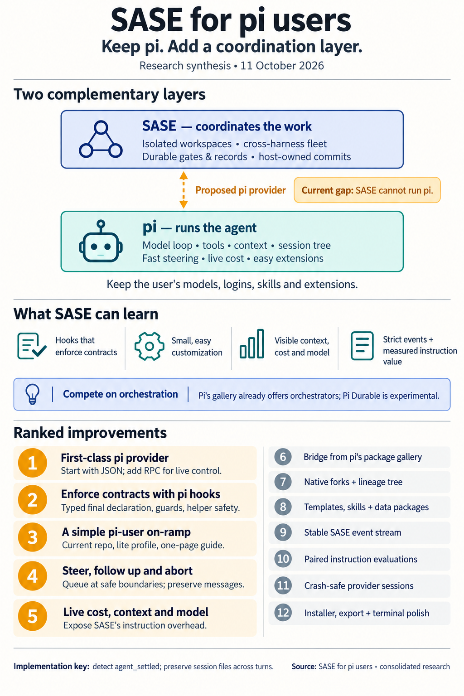

# SASE for pi users: host pi, don't become it

> **Research query:** Research the pi repo (`earendil-works/pi`): how does it compare to
> SASE, and in what ways can SASE learn from pi? End with a ranked list of improvements to
> SASE worth considering to make it more appealing to someone who already uses pi.

## Bottom line

- **Pi and SASE sit at different layers.** Pi
  ([earendil-works/pi](https://github.com/earendil-works/pi)) is a minimal, hackable
  **single-agent harness**: it owns the model loop, tools, context, session file, and
  terminal UI. SASE is a **coordination layer above harnesses**: isolated workspaces,
  launch admission, dependency waits, review records, gates, monitors, and host-owned
  landing. Pi is mainly a candidate **backend** for SASE, and only secondarily a rival.
- **A pi user will not switch harnesses to try SASE, and today SASE cannot run pi.**
  SASE registers eight `sase_llm` providers (`agy`, `claude`, `codex`, `fakey`, `grok`,
  `muse`, `opencode`, `qwen`; `pyproject.toml`). None is pi, and no bead mentions pi or
  Earendil. Four of the five researchers rank [a pi provider](#a-first-class-pi-provider)
  first. This report agrees: until SASE runs the user's own pi, with their models,
  logins, skills, and extensions, nothing else on the list reaches them.
- **The scale gap shapes the strategy.** On 2026-10-11 pi had 114,256 GitHub stars,
  14,538 forks, and 4.19M npm downloads in the last week. SASE had 5 stars and 1 fork. A
  pi user has probably never heard of SASE, so the first five minutes must feel like
  pi.
- **The real competitor is not the pi CLI.** It is (a) the orchestration packages already
  in pi's gallery, which advertise worktrees, swarms, schedules, and handoffs, and (b)
  [**Pi Durable**](#adjacent-packages), Earendil's experimental durable runtime. SASE has
  to beat a `pi install` of an orchestrator package. Its
  [defensible differences](#real-advantages-of-sase-for-a-pi-user) are host-owned
  landing, durable gates and records that outlive any process, a cross-harness fleet
  (Claude Code, Codex, and pi side by side), and a git-native project operating system.
- **Pitch:** "Already using pi? Keep it. SASE runs *your* pi in isolated clones, enforces
  its contracts with pi's own hooks, lands the work through reviewable host-owned
  commits, and gives you the fleet, scheduler, and inbox that pi deliberately leaves out."

## What pi is today

### Product shape

Pi is MIT-licensed TypeScript on Node ≥ 22.19. It installs with `curl | sh`, npm, Nix, or
standalone binaries, and runs on Linux, macOS, Windows, and Termux. It is owned by
Earendil (Armin Ronacher). Mario Zechner created it and moved it under Earendil in 2026.
The monorepo has 14 packages: `ai`, `agent`, `coding-agent`, `tui`, `codemode`, `mcp`,
`durable`, `chord`, `server`, `protocol`, `client`, `env`, `telemetry`, and `evals`.

### A deliberately small core

There are four default tools (`read`, `bash`, `edit`, `write`). `grep`/`find`/`ls` are
optional, and Codemode and tool search are opt-in. The system preamble is short, and
skills are advertised only by name and description. The README says pi "skips features
like sub-agents and plan mode". Plan mode, subagents, permission gates, sandboxing,
todos, and git checkpoints ship only as examples under `examples/extensions/`. The
quickstart teaches a "least powerful mechanism" ladder: `AGENTS.md` → prompt template →
skill → extension → TUI component → custom provider → package.

### Customization is cheap

Extensions are TypeScript files loaded by `jiti`, so there is no build step. They live in
`~/.pi/agent/extensions/` or `.pi/extensions/`, and `/reload` picks up changes. They can
register tools, `/` commands, shortcuts, flags, providers, MCP servers, virtual models,
and renderers, and they can hook more than 20 lifecycle events. Packages bundle
extensions, skills, prompts, and themes and install with `pi install npm:…|git:…|./path`.
Personal and project scopes are supported, and a public gallery indexes the `pi-package`
keyword. Skills follow the cross-tool Agent Skills spec, including the `~/.agents/skills`
and `.agents/skills` locations.

### The conversation is the product

- **Sessions:** a JSONL tree with `id`/`parentId`. `/tree` moves within a session,
  `/fork` and `/clone` split work into new files, and abandoned branches survive with
  optional summaries.
- **Compaction:** inserts a summary entry while the original entries stay on disk.
- **Steering vs follow-up:** `Enter` during a run queues a *steer*, which is delivered
  after the current assistant turn's tool calls and before the next LLM call. `Alt+Enter`
  queues a *follow-up* for after the run. `Esc` aborts and returns queued text to the
  editor.
- **Status:** the footer shows model, context usage, and cost, and `/session` breaks cost
  down per physical model. Since 1.1.0, pi emits OSC 7501 program status (working,
  blocked, done, error).

### Pi owns the model loop

`pi-ai` covers 30+ providers, including subscriptions, API keys, and local models.
**Virtual models** let an extension route each request to a physical model and thinking
level. Routing state is stored per branch, routing stays sticky on continuations to
protect the prompt cache, and the transcript shows `auto • high → <physical model>`.

### Native MCP and Codemode

**1.0 changed the context story.** Pi 1.0 added native MCP over stdio and HTTP, with
per-server exposure modes (`direct`, `codemode`, `deferred`, `hidden`). It also added
**Codemode**: the model writes a QuickJS script that calls tools, in parallel if it
likes, and only the script's output reaches the model. Codemode is **off by default**,
and its tool declarations share a 3,000-token inline budget.

### Machine interfaces are strict and uniform

Print mode, `--mode json`, `--mode rpc`, and an in-process SDK all share one event
vocabulary. `agent_end` is not completion: retries, compaction recovery, and queued work
can follow it, and **`agent_settled`** is the terminal event. A successful RPC `prompt`
response means only that the prompt was accepted, queued, or handled. In JSON mode, a
failed model response appears in the event stream **without a nonzero exit code**, so a
host must inspect events (`docs/cli-integration.md`).

### Safety and isolation

**Safety is the user's job, by design.** There is no permission system. Project trust
only gates *loading* of `.pi/` resources, and context files load regardless. The docs
point to Docker, OpenShell, and the Gondolin micro-VM for real isolation. Pi's own
`AGENTS.md` carries a section of git rules because "multiple pi sessions may be running
in this cwd at the same time… Git operations… will stomp on other sessions' work". That
is a manual version of the isolation SASE's workspace claims enforce.

### Adjacent packages

- **Pi Durable** is a crash-resumable harness. Commits are stored before anything is
  shown, submissions are idempotent by `requestId`, tools carry replay policies, and it
  has task-ownership trees and subagents as owned conversations. It is marked
  **"Experimental. The API changes without notice"**, and "one process owns a storage at
  a time; there is no cross-process locking."
- **Chord** provides facets, services, and replicated state.
- **server, protocol, and client** provide CBOR remote sessions.
- **pi-env** is a small Rust daemon that runs tools over SSH while credentials stay
  local.
- **evals** runs paired *documentation-lift* evaluations, with and without docs, in
  isolated containers.

## Head-to-head comparison

| Dimension | Pi | SASE | Edge |
|---|---|---|---|
| Layer | Harness that owns the model loop | Orchestrator that drives other CLIs | Complementary |
| First useful task | Curl, `/login`, type | `uv tool install sase`, authenticate a *different* CLI, choose project/workspace | Pi |
| Model access | 30+ APIs, local models, virtual routers, `/model` mid-session | Seven CLIs, size aliases, effort ladder, load balancing, usage-limit auto-disable | Pi for reach; SASE for cross-harness routing |
| Parallelism and isolation | None in core; gallery packages; documented same-cwd git hazards | Numbered clones, claims, `%wait`/`%queue`, clans/tribes, multi-model fan-out | **SASE** |
| Work records | Session files | Patches/stitches, beads/epics, Goals, ToolRuns, receipts, artifacts | **SASE** |
| Completion | Agent or user runs git | Agents declare; host finalizers commit or open PRs | **SASE** |
| Background and async human loop | None in the CLI; Durable is a library | AXE, service host, monitors, durable gates, Telegram/mobile | **SASE** |
| Session lineage | Native tree, fork, clone, branch summaries | Agent sessions/clans; `#fork` injects a sanitized `# Previous Conversation` text block | Pi (keeps tool fidelity and cache) |
| Mid-run control | Steer, follow-up, abort-with-queue-restore | None user-facing today (see [Mid-run steering in SASE](#mid-run-steering-in-sase)) | Pi |
| Extension cost | One `.ts` file + `/reload`; `pi install` | Python entry-point plugins (`sase plugin install`); config macros | Pi, by a lot |
| Hook depth inside the agent loop | `tool_call` block/mutate, `before_agent_start`, `context`, `agent_before_settle` continue | Depends on the provider (Claude PreToolUse guard; Grok "sentence only"; Muse/agy none) | Pi |
| Context and cost visibility | Live footer, per-physical-model cost, startup resource header | Audit-grade (`sase instructions verify`, bundle manifests, usage windows); no dollar-cost surface | Pi live, SASE post-hoc |
| Always-loaded instructions | Short preamble plus whatever context files the user adds | 18.4 KB project `CLAUDE.md` + 4.1 KB home `CLAUDE.md` in this project (≈5–6k tokens) | Pi |
| Machine interfaces | Print, JSON, RPC, SDK, CBOR; one documented event vocabulary | `--json` on many commands; Python integration helpers; mobile/editor bridges | Pi for uniformity |
| Platforms | Linux, macOS, Windows, Termux, Nix | POSIX only | Pi |

### Real advantages of SASE for a pi user

- Isolation by default: the clone is the sandbox they would otherwise build with Docker.
- "Pi types, SASE lands": host-owned commits and reviewable Patches.
- Gates that survive the agent process.
- A fleet that can mix pi with Claude Code and Codex.
- Git-portable beads and goals.
- A machine-wide project registry with sidecars.
- AXE background work.

[Pi Durable](#adjacent-packages) narrows part of this gap, but it is an experimental
toolkit, not a finished engineering workflow. Durable cannot wrap Claude Code. SASE can
wrap pi.

### Real advantages of pi for a pi user

- Time-to-first-token.
- The conversation as the product: steering, tree, compaction, cost footer.
- The make-it-yours loop.
- Model mobility within one task.
- Codemode.
- Embeddability.
- Platform reach.
- Polish: themes, OSC 7501, HTML export and share.

## What SASE should learn from pi

1. **Enforce contracts with hooks, not paragraphs** (cld). SASE's most important
   invariants still ride on instruction text for most providers:
   - the single-turn final declaration;
   - never commit;
   - never run raw guarded `just` recipes;
   - helpers return and only roots declare.

   `docs/agent_providers.md` admits helper coverage is "sentence only" for Grok and absent
   for Muse and agy. Pi's lifecycle API turns these invariants into mechanisms:
   - `tool_call` can block a call, and a handler *failure* also blocks, as a fail-safe.
   - `agent_before_settle` can append entries and request exactly one continuation.
   - A tool can return `terminate: true`.

   Pi could become SASE's
   [**best-enforced** provider](#a-sase-pi-extension-package-that-enforces-sase-contracts-mechanically)
   rather than a weakly governed one.
2. **Pi makes SASE's instruction delivery provable.** SASE renders instruction bundles,
   but "current providers do not read" `SASE_INSTRUCTIONS_FILE`
   (`docs/instruction_bundles.md`). Pi persists every system-prompt *section* and tool
   declaration in the session JSONL's first system message (`docs/session-format.md`).
   `sase instructions verify` could therefore check delivery exactly for pi, instead of
   inferring it.
3. **Teach the smallest mechanism first.** Pi's ladder (template → skill → extension →
   package) is one page. SASE has more machinery: macros, directives, project tags,
   memory, workflows, plugins, gates, and about 70 glossary terms. Every piece is
   defensible, but a newcomer sees a wall. SASE needs
   [the one-page chooser and a profile](#an-on-ramp-for-pi-users-with-progressive-disclosure)
   that keeps advanced subsystems dormant until wanted.
4. **Treat context as a scarce, visible resource.** The useful lessons are
   progressive-disclosure skills, deferred tool exposure, compaction that keeps
   originals, and a context meter people actually look at. SASE already has bundle
   manifests and token estimates; it should surface them per launch rather than leave
   them in audit tooling. cdx makes a useful caution: pi's short preamble does not
   guarantee a short *effective* prompt once project files, skills, and tools load.
5. **Make transitions explicit.** Pi distinguishes queued steering from queued follow-up,
   `agent_end` from `agent_settled`, and handled from queued. SASE has extra distinctions
   worth showing rather than flattening into "done": agent settled vs declaration
   accepted vs finalizer landed.
6. **Ship strictly framed machine interfaces.** These include exact framing rules, id
   correlation, a documented event catalog, and explicit settle semantics. Pi's JSON and
   RPC modes are how OpenClaw, pi-chat, and IDEs embed pi. SASE's bridges are Python
   helpers plus `--json` commands, with no comparable event stream.
7. **Measure whether instructions earn their tokens.** Pi's `evals` package runs paired
   with-docs and without-docs arms in fresh containers, and withholds headline lift when
   any pair is blocked. That method fits SASE's own `corpus-before-mechanism` and
   `receipts-prove-before-they-skip` instincts. It is the evidence SASE needs before
   trimming or adding always-on text.
8. **Borrow, don't import, the durable-runtime ideas.** These are commit-before-show,
   `requestId` idempotency, declared tool replay policies, `failFast`/`allSettled` waits,
   and bottom-up abort. They make a clean checklist for SASE's own launch, monitor, gate,
   and finalizer semantics. Do not adopt [Durable or Chord](#adjacent-packages) as a
   backend: Durable is experimental and single-process, and SASE's shared logic belongs
   in `sase_core`.
9. **Don't copy pi's minimalism where it is a harness decision.** Pi has no isolation,
   no tracking, and no landing contract. Those absences are SASE's reason to exist. The
   lesson is to make SASE's layer adoptable incrementally and enforced mechanically, not
   to strip it out.

## Disagreements and corrections

### Mid-run steering in SASE

**"SASE has no steering" is partly wrong, and more interesting than reported.** cld and
grk say SASE has no mid-run messaging. The git history says otherwise.

- On 2026-03-14, `739196a9c9` added a "mid-execution user interrupt for running agents".
  It was bound to `m` on the Agents tab, and `22dfe4a826` extended it to Codex.
- On 2026-03-28, `1a46198f14` removed the TUI side: the modal, the mixin, and the footer
  binding. The plan records no rationale.
- The provider half is still shipped. `start_interrupt_monitor()` in
  `src/sase/llm_provider/_subprocess_plain.py` watches `interrupt_request.json` and
  **terminates** the provider process. The Claude, Codex, agy, Muse, and fakey providers
  then continue with the message; on Claude, that means a fresh session id.
- No writer remains in this tree.

So SASE once shipped **kill-and-redirect**. Pi's design is **queue-at-a-safe-boundary**,
with a separate follow-up queue. Pi's is the better model to revive. The leftover
plumbing is a fallback for providers without a steering channel, and also a cleanup
candidate if steering is not revived. Before reviving steering, find out why the `m`
feature was removed.

### SASE Codemode targets the wrong layer

gem's #1, "SASE Codemode", proposes a QuickJS or Python sandbox wired into SASE's
tool-execution dispatcher, and projects a "50–70% token reduction". SASE does not execute
model tool calls; the provider CLIs do. The directories gem cites (`src/sase/llm/`, and a
tool dispatcher in `src/sase/agent/`) do not exist as described, and the savings figure
has no source. The same mismatch applies, more mildly, to mus's "codemode analogue as a
workflow step".

**Resolution.** SASE users get Codemode through the pi provider, provided SASE does
**not** override pi's tool exposure or re-declare tool catalogs (grk #14, cdx). A
cross-provider version, such as an MCP server exposing a script tool, is a later idea. It
should wait for measured need, per `corpus-before-mechanism`.

### Other gem overstatements

- gem says SASE extensions require editing `src/sase/plugins/` or chezmoi templates.
  `sase plugin install <name|git+url|path>` exists.
- gem says SASE host completion runs full verification plus Symvision before landing. The
  default `builtin@commit` path lands the declared dirty repos via `sase stitch create`
  (`docs/commit_workflows.md`); verification happens through agent-run guarded recipes
  and recorded evidence.
- gem's routing examples use stale model names.

gem's useful contributions are the sharpest framing of Codemode and virtual models, the
supply-chain detail, and a "promote this chat into a SASE task" idea, which is folded
into [item 6 below](#a-pi-to-sase-bridge-in-the-pi-gallery).

### JSON mode or RPC mode for the provider

**cld and mus vs cdx and grk.** Both camps are right about different phases.
`--mode json` matches SASE's single-turn contract exactly: it takes all prompts up front,
streams events, and exits. That makes it the smallest correct first slice. RPC is required for
steering, follow-up, abort, and live model switching. Pi's JSON and RPC modes **share the
same event shapes** (`docs/json.md`), so build one event normalizer: ship JSON first,
then add RPC control behind it.

### A long-lived pi process across SASE turns

grk proposes that one SASE agent row own one long-lived pi RPC process, with successor
turns sent as extra `prompt` commands. **Don't.** That is a standing daemon, and it
conflicts with the `single-turn-agents` and `adapters-normalize-harnesses` decisions. Pi's
session *file* already provides continuity.

**Resolution.** Each SASE turn launches pi on the same session file:
- use an absolute `--session <path>` with a SASE-owned `--session-dir`;
- or use `--fork <path> --session-id <new>` for a SASE fork.

This matters because pi groups sessions by cwd, and a successor turn can land in a
different numbered workspace. A cwd-relative lookup would treat the session as a
cross-project match and offer to fork it. Steering *within* one turn stays inside the
single-turn contract, but it deserves a short decision record (cld).

### Session trees

mus ranks a SASE-wide conversation tree #2, gem has visual rewind at #6, grk has a tree
view at #9, and cld has native fork at #3. Merged view:
- Do not build a second history engine.
- Use pi's native fork for pi-backed agents.
- Render SASE's existing lineage (retries, handoffs, pipes, forks) as a tree.
- Any "fork from here" must say whether it forks **context only** or **repository state
  too**. Pi's tree does not roll back files (cdx). SASE can offer real repo-state forks
  only at turn boundaries, where diffs and commits exist. gem's "clone at the exact
  mid-run git tree" would need per-step checkpoints that SASE does not record.

### Project trust

cld's launch line passes `--approve`, which trusts project-local `.pi` extensions, and
those extensions are executable code. Auto-approving a clone of a project the user
registered is reasonable (grk). Auto-approving external or newly opened repos is not.
Make trust a per-project setting, not a blanket flag.

## Ranked improvements for a SASE that appeals to pi users

Ranking weighs (a) whether a daily pi user would try SASE, keep it, and recommend it;
(b) leverage for all SASE users; and (c) effort and risk. Effort ratings are relative:
S, M, or L. The improvements below appear in rank order, 1 through 12.

### A first-class pi provider

**Rank 1 (M; critical).** A first-class `pi` provider that preserves the user's pi.
**Support: cdx, cld, grk, mus.**

Add a `sase_llm` provider following the existing adapter split (`pi.py`,
`_subprocess_pi.py`, `_tool_call_pi.py`).

**First slice**
- Run `pi --mode json` in the claimed workspace with an explicit
  `--session-dir`/`--session-id`, and persist the session path on the agent record.
- Pass `--model <pattern>[:thinking]` through unchanged, including extension-registered
  virtual models, and map SASE effort onto pi thinking levels.
- Treat **`agent_settled`** as the end of the turn, and never trust exit code 0 alone.
- Normalize `message_update`, `tool_execution_*`, and `message_end` events into SASE's
  live reply, tool calls, and usage, including pi's priced cost.

**Things that already fit**
- Pi natively loads `AGENTS.md`/`CLAUDE.md` from the workspace and its ancestors, so no
  extra instruction delivery is needed. Verify exactly-once loading as the Grok adapter
  does.
- Deploy SASE skills through `llm_skill_deploy_subpath` to `~/.pi/agent/skills` or the
  cross-tool `~/.agents/skills`.
- Fill `llm_install_metadata` (pi has a curl installer and self-update) and
  `llm_interactive_cli`. pi then shows up in `sase agent-cli install`, `sase doctor`, and
  the tmux Agent chooser for free.
- Extend `sase instructions verify` to read pi's persisted system-prompt sections
  ([lesson 2 above](#what-sase-should-learn-from-pi)).

**Restraint.** Leave Codemode, MCP, tool exposure, and the user's extensions to pi's own
settings. Treat project trust per [Project trust](#project-trust).

**Risks.** Pi releases often and ships breaking changes in point releases (for example,
1.0.3). Pin a minimum version in `sase doctor` and cover the adapter with a recorded
event-stream fixture, as fakey does.

**Success measure.** A pi user completes a landed task in SASE using their existing pi
config without editing it.

### A sase-pi extension package that enforces SASE contracts mechanically

**Rank 2 (M; very high).** **Support: cld, uniquely, and it is the strongest idea in the
swarm.**

The provider loads the `sase-pi` package with `-e`. Its contents:
- **`sase_final` as a typed tool** with a TypeBox schema matching the declaration, which
  returns `terminate: true`.
- **An `agent_before_settle` guard.** If no declaration was submitted, append a reminder
  and `continue: true` once. This makes `single-turn-agents` a mechanism.
- **A `tool_call` guard** that blocks `git commit`, `gh pr create`, and raw guarded
  recipes, with a reason that names the sanctioned path. Pi's failure-blocks semantics
  make this guard fail-safe.
- **Helper safety.** Pi's own subagent example spawns `pi --mode json -p --no-session`
  children that inherit the parent's environment and context files. The package must
  detect non-root processes, for example through a root token passed only via the
  provider's `-e` invocation, and refuse `sase_final` there (`helpers-return-roots-declare`).

**Why it ranks this high.** It makes pi the best-governed SASE provider, and its lessons
flow back to the Claude PreToolUse guard.

### An on-ramp for pi users with progressive disclosure

**Rank 3 (M).** A "SASE for pi users" on-ramp with progressive disclosure. **Support:
cdx, cld, grk, gem.**

- A one-screen doc, plus `sase doctor` detecting pi.
- A first-run path that targets **the repo the user is standing in**. It shows exactly
  which project and checkout will be used, offers minimal registration, and launches one
  pi-backed agent in an isolated clone. SASE's current project is independent of cwd, and
  the `+home` quickstart runs in a sandbox, so keep those semantics behind an explicit
  entry path rather than changing them globally.
- A **lite profile**: parallel isolated agents, TUI, and review, with beads, SDD, Goals,
  memory webs, and autonomy dormant until opted into.
- A pi-style "least powerful mechanism" chooser at the top of Getting Started.
- A quiet default for trusted projects, so the gates do not read as permission theater.

**Success measure.** A new pi user gets a correct-repo result in one sitting and can say
where the edits landed.

### Steering and follow-up for running agents

**Rank 4 (M; needs a decision record).** Steer, follow-up, and abort for running agents.
**Support: cdx, cld, grk. Revised by [Mid-run steering in SASE](#mid-run-steering-in-sase).**

Revive the removed Agents-tab message feature with pi's semantics:
- Enter steers, which queues the message for the next safe boundary.
- A chord sends a follow-up.
- Esc aborts and restores the queued text.
- Visible pending messages show whether each one was accepted or delivered.

For pi, implement this with RPC `steer`/`follow_up`/`abort`; this is the trigger for the
RPC phase of [item 1](#a-first-class-pi-provider). For providers without a steering
channel, fall back to the existing kill-and-redirect plumbing and label it honestly. Also
ship `sase agent steer <name> "<msg>"` for the CLI, Telegram, and mobile surfaces.

**Success measure.** Users redirect work without killing and forking it, and no queued
text is lost.

### Live visibility and an instruction budget

**Rank 5 (S–M).** Live cost, context, and model visibility, plus an instruction budget.
**Support: cld, grk, mus, cdx.**

- On every agent row and chat footer, show the resolved harness, the selected and
  physical model, thinking level, context used out of the window, and dollar cost. Use
  honest "unknown" values where a provider reports nothing. SASE currently has usage
  windows but no dollar-cost surface.
- Roll costs up per clan, epic, Goal, and day. That aggregation belongs in `sase_core`.
- Show **SASE's own instruction overhead** per launch from the bundle manifests.

This matters more for pi users than for anyone else. Once pi is the provider, SASE's
≈5–6k tokens of always-loaded instructions appear in pi's own startup header and context
meter. Trimming them is an adoption issue, not just hygiene. Use
[item 10](#paired-instruction-and-memory-lift-evals) to decide what stays.

### A pi to SASE bridge in the pi gallery

**Rank 6 (S–M after 1–2).** A pi → SASE bridge in the pi gallery. **Support: cdx, cld.
Absorbs gem's "promote" idea.**

Add interactive commands to the `sase-pi` package and publish it with the `pi-package`
keyword:
- `/sase run …` launches an isolated SASE agent from inside pi;
- `/sase promote` forks the current pi session into a SASE-managed agent in a fresh
  clone, which is gem's chat-to-task promotion done through pi's native `--fork`;
- `/sase agents` shows a status widget;
- `/sase inbox` shows pending gates.

The commands shell out to existing `sase` JSON commands. They do not get their own
scheduler or finalizer.

**Why it ranks here.** This is where pi users discover tools, and the gallery's
orchestrator packages are the incumbent. Ship three maintained recipes: implement plus
review, parallel investigation with synthesis, and verify-then-land.

### Native fork and resume for pi and a tree view of SASE lineage

**Rank 7 (S–M after 1).** Native fork/resume for pi, and a tree view of SASE lineage.
**Support: cld, grk, mus, gem. Merged per [Session trees](#session-trees).**

- When the source and target agents are both pi, implement `#fork`/`#resume` with
  `pi --fork <path> --session-id <new>` instead of text injection. This keeps tool
  fidelity and the prompt cache. Keep the text path as the portable fallback.
- Render retries, handoffs, pipes, and forks as a tree in the Agents tab.
- Label every fork as context-only or repo-state.

### Cheap customization

**Rank 8 (M).** Cheap customization: `/` templates, Agent Skills interop, and data-only
packages. **Support: grk, cld, mus, cdx, gem.**

- `/name` in the TUI prompt expands a Markdown template from `~/.sase/prompts/`, with
  `#name` kept for full macros.
- Discover third-party `SKILL.md` directories under `.agents/skills` with progressive
  disclosure.
- Add `sase install npm:|git:|./path` for **data** packages (macros, skills, templates,
  themes) at user or project scope, with a project-trust prompt and pinned refs.
- Add drop-in Python hook files for small host events (launch, gate created, agent
  failed). They are trust-gated, cannot bypass finalizers, and leave executable plugins
  on the entry-point path.
- Do not try to host TypeScript extensions in the Python host. Pi's extensions stay
  pi's, through [item 1](#a-first-class-pi-provider).

### A stable SASE event stream and command protocol

**Rank 9 (M–L).** **Support: cld, gem, mus.**

Add `sase agent watch --json`, or a socket, with a pi-quality specification:
- strict LF framing;
- id correlation;
- a documented event catalog: launched, routed, tool call, gate opened, declared,
  finalized, settled;
- explicit settle semantics.

The schema belongs in `sase_core` because every frontend must agree on it. This feeds
[item 6](#a-pi-to-sase-bridge-in-the-pi-gallery), editors, the mobile gateway, and
dashboards.

### Paired instruction and memory lift evals

**Rank 10 (M–L).** **Support: cld.**

Adopt pi's `evals` method: run the same tasks with and without a memory note, skill, or
instruction section, in fresh workspaces with paired arms, and withhold headline lift
when any pair is blocked. This turns
[item 5's](#live-visibility-and-an-instruction-budget) budget cuts from opinion into
evidence.

### Crash-safe provider sessions and typed recovery contracts

**Rank 11 (L, incremental).** **Support: cdx, grk.**

- Persist the pi session path and RPC request ids before sending.
- After a SASE restart, reattach or mark the agent interrupted. Never double-prompt.
- Declare which host-owned operations may retry, which need reconciliation, and which
  must report uncertain effects, and add failure-injection tests.

Do not equate submission dedup with exactly-once external effects.

### Reach and polish

**Rank 12 (each S–M; lowest).** **Support: cld, grk, mus, gem.**

- OSC 7501 aggregate status from the TUI. It is cheap and makes SASE a good citizen in
  the terminals and dashboards pi users run.
- A one-line installer and `sase update`, plus a documented WSL path.
- HTML export of agent chats, with a pre-share secrets reminder.
- Terminal-adaptive themes.
- Pi-style supply-chain notes for `sase agent-cli install`.

Native Windows and single-binary packaging wait for demand.

### Explicitly not recommended

- A SASE-native Codemode, virtual-model router, or REPL harness (gem #1–#3; see
  [SASE Codemode targets the wrong layer](#sase-codemode-targets-the-wrong-layer)). These
  compete with pi instead of hosting it. Pass pi's versions through.
- Replacing SASE internals with pi-ai, Chord, or Pi Durable.
- Keeping a hidden pi daemon alive across SASE turns
  ([see above](#a-long-lived-pi-process-across-sase-turns)).
- Plan mode or todos in core. SASE already has beads, Goals, and workflows.
- Claiming universal pi-extension compatibility. RPC mode stubs several TUI methods, and
  extension dialogs normally wait in-process. Certify a subset, and treat any dialog →
  gate mapping as deliberate design work, not a free translation (cdx).

## Suggested sequencing

1. **Epic: "pi as a managed inner loop."** Items [1](#a-first-class-pi-provider) and
   [2](#a-sase-pi-extension-package-that-enforces-sase-contracts-mechanically), plus the
   per-project trust setting. Start with JSON mode, guards, and verified instruction
   delivery.
2. **Front door.** Item [3](#an-on-ramp-for-pi-users-with-progressive-disclosure), with
   the cheap parts of items [5](#live-visibility-and-an-instruction-budget) (cost footer)
   and [12](#reach-and-polish) (OSC 7501).
3. **Live control.** Item [4](#steering-and-follow-up-for-running-agents), which brings
   the RPC phase of item 1 and a decision record for in-turn steering. Then item
   [7](#native-fork-and-resume-for-pi-and-a-tree-view-of-sase-lineage).
4. **Distribution.** Item [6](#a-pi-to-sase-bridge-in-the-pi-gallery) in the pi gallery,
   then items [8](#cheap-customization) and
   [9](#a-stable-sase-event-stream-and-command-protocol).
5. **Evidence and robustness.** Items [10](#paired-instruction-and-memory-lift-evals) and
   [11](#crash-safe-provider-sessions-and-typed-recovery-contracts).

**Strategic risk.** Earendil will grow Pi Durable toward multiplayer, crash recovery, and
remote environments. SASE stays relevant to pi users by staying **harness-neutral and
git-native**, which means hosting pi well while still running Codex next to it. Becoming
a worse pi is how it loses them.

## Evidence base and confidence

_Consolidated report, 2026-10-11. It merges five independent researcher reports (`__cdx`,
`__cld`, `__grk`, `__mus`, `__gem`, all in this directory) with the lead researcher's own
verification against the pi checkout and the SASE source._

| Source | Snapshot |
|---|---|
| pi monorepo | `96abe9a5ad45` (2026-10-11). `pi-coding-agent` is 1.1.0 (2026-10-07) and 1.0.0 shipped 2026-10-01. There were five releases in the seven days after 1.0.0, so expect churn. |
| SASE | Local checkout at `c10f074f59` / `e926d4100b`, package 0.17.1, alpha, POSIX-only |
| Researcher reports | cdx, cld, grk, mus, and gem were each produced independently |
| Lead verification | Re-read the pi docs and examples and the SASE source and git history for every claim the ranking depends on (see [Disagreements and corrections](#disagreements-and-corrections)) |

This is a review of source code and documentation. No pi model calls, benchmarks,
usability sessions, or extension-compatibility tests were run. Popularity numbers were
read live from the GitHub API and the npm downloads API. Package-gallery observations
come from a single web search snapshot.

## Sources

**Pi checkout** (`96abe9a5ad45`, opened via `sase repo open gh:earendil-works/pi`):
- `README.md` and `AGENTS.md` (multi-session git rules);
- under `packages/coding-agent/`: `CHANGELOG.md` and the `docs/` pages `extensions.md`,
  `cli.md`, `cli-integration.md`, `json.md`, `rpc.md`, `rpc-commands.md`,
  `rpc-extension-ui.md`, `session-format.md`, `sessions.md`, `configuration.md`,
  `security.md`, `skills.md`, `codemode.md`, `mcp.md`, `virtual-models.md`, and
  `terminal-setup.md`;
- `examples/extensions/` (including `subagent/index.ts`);
- `packages/durable/README.md`.

**SASE checkout:**
- `pyproject.toml` (`sase_llm` entry points) and `src/sase/llm_provider/` (`claude.py`,
  `_subprocess_plain.py`, `_hookspec.py`);
- git history `739196a9c9`, `22dfe4a826`, and `1a46198f14`, and the plan
  `202603/remove_agents_m_keymap.md`;
- docs: `agent_providers.md`, `instruction_bundles.md`, `macros.md`, `plugins.md`,
  `integrations.md`, and `commit_workflows.md`;
- the project and home `CLAUDE.md` (byte sizes).

**Live data (2026-10-11):**
- GitHub API for `earendil-works/pi` (114,256 stars, 14,538 forks) and `sase-org/sase`
  (5 stars, 1 fork);
- the npm downloads API for `@earendil-works/pi-coding-agent` (4,185,174 downloads,
  2026-10-04 to 10-10).

**Web:**
- [Pi 1.0](https://earendil.com/posts/pi-1-0/), [Pi Durable](https://earendil.com/posts/pi-durable/),
  and ["You Said No MCP!"](https://earendil.com/posts/you-said-no-mcp/) (via cdx and grk);
- pi gallery orchestrator packages:
  - [@onlinechefgroep/pi-agent-orchestrator](https://pi.dev/packages/@onlinechefgroep/pi-agent-orchestrator?page=29)
  - [@xzzpig/pi-subagents](https://pi.dev/packages/@xzzpig/pi-subagents?name=sub)
  - [@0xkobold/pi-orchestration](https://pi.dev/packages/@0xkobold/pi-orchestration?page=7)
  - [@pi-orca/agents](https://pi.dev/packages/@pi-orca/agents?name=tmux)
  - [pi-subagentura](https://pi.dev/packages/pi-subagentura?name=tmux)

**Researcher reports:** `sase_for_pi_users__{cdx,cld,grk,mus,gem}.md` in this directory
([cdx](sase_for_pi_users__cdx.md), [cld](sase_for_pi_users__cld.md),
[grk](sase_for_pi_users__grk.md), [mus](sase_for_pi_users__mus.md),
[gem](sase_for_pi_users__gem.md)). cdx has full pinned-URL citations for pi and SASE
docs, and cld has the community and press sources.
