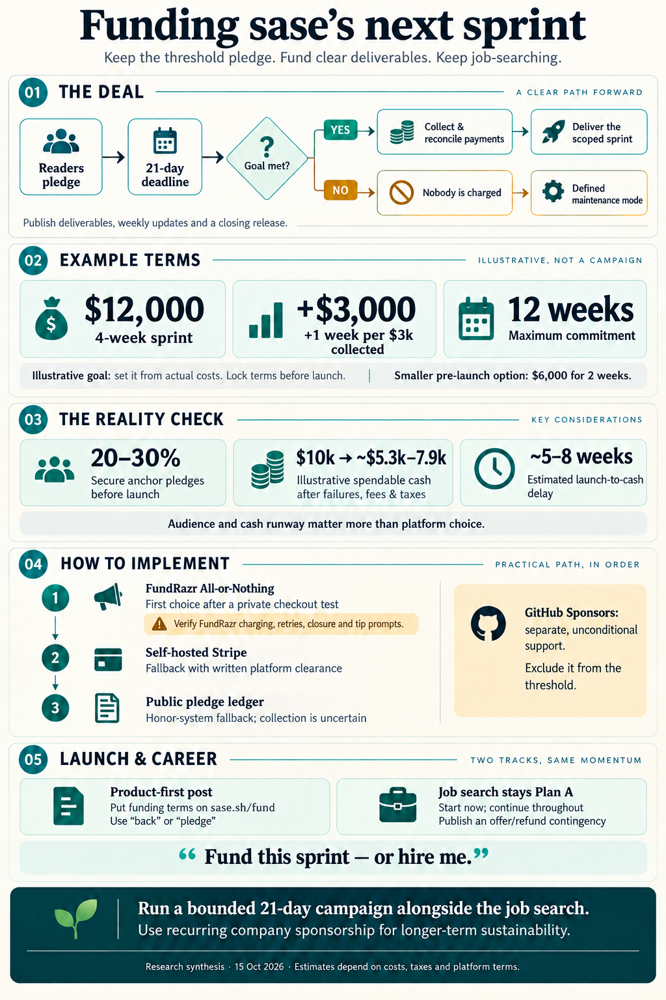

# Funding a sase Sprint at Launch with Threshold Pledges: Critique, Adjusted Terms, and a Recommendation

> **Research query:** My first sase blog post will say I have to stop developing and maintaining sase to find a
> job because I am running out of money. What is the best way to implement threshold pledges, where readers pledge
> amounts charged only if a total (say $10,000) is met, and I then keep working on sase for a set period (say one
> month per $10,000) before resuming the job search? Critique the plan (is it a good idea, and would you take a
> different approach?), clearly call out any justified requirement adjustments, and end with a recommended solution.

## Bottom line

1. **Keep the mechanism.** "Nobody pays unless the total clears a threshold" is an *assurance contract*. It is the
   shape behind Kickstarter and the 1998 Street Performer Protocol. It fits your situation honestly: below the
   threshold the money would not change what you do, because you need a job either way. Three of the
   [four reports](#about-this-report) keep it. gem would drop it for flexible funding; I don't agree, for the
   reasons given [below](#where-the-reports-disagreed-and-how-i-resolve-it).

2. **Change the deal.** The plan as written sells *a month of your time* and *a pause in your job search*. Both are
   the wrong units. Sell a [**scoped sprint with named deliverables**](#requirement-adjustments), priced from your
   real budget, with a cap. Keep the job search running the whole time. All four reports reach this conclusion
   independently.

3. **The odds depend on audience and anchors, not on the platform.** Every open-source crowdfunding success
   reviewed (Django migrations, DRF 3, Neovim, ProseMirror) already had an audience. sase is alpha, and this post is
   its first real exposure. Without pre-committed anchor pledges and a good Hacker News day, a $10k+ cliff will
   probably miss. With 20–30% of the goal committed before launch, it is a credible bet. **Treat it as a cheap
   option, not as the financial plan.** Even a successful campaign delivers usable cash about 5–8 weeks after
   launch.

4. **Recommended implementation:** a 21-day [**FundRazr All-or-Nothing**](#fundrazr-all-or-nothing) campaign, used
   only after you have tested its checkout privately. It needs no backer accounts, takes cards or PayPal, and has a
   0–5% platform fee. Link it from a `sase.sh/fund` terms page and from a short closing section of a product-first
   launch post. **Second choice** is a [self-hosted Stripe Checkout (setup mode)](#self-hosted-stripe-checkout)
   pledge page, if Stripe clears it in writing. **Zero-infra fallback** is a public
   [honor-system pledge ledger](#honor-system-ledger). **Kickstarter is a weak fit,** for reasons the reports
   underweighted (see [Kickstarter](#kickstarter)). **GitHub Sponsors** runs on `/fund` as the separate,
   unconditional channel.

5. **What I would do differently overall:** make the job search Plan A starting now. Write the launch post so it
   works as a product launch *and* a portfolio piece ("fund this sprint *or* hire me"). Treat recurring company
   sponsorship as the only path that could ever sustain full-time sase. A one-time campaign buys a sprint. It does
   not buy a career.

## Is this a good idea

**Verdict: worth doing as a bounded experiment attached to a strong product post, after the changes below. Not
worth doing as written, and never as a substitute for job-searching now.**

### What is right about it

- **Candor is an asset.** Readers already know that solo-maintained alpha tools are fragile. Naming the funding
  cliff turns a hidden risk into a choice they can act on. *(cld, grk)*
- **The threshold is truthful.** Promising "I only take your money if it changes the outcome" is unusual, and it
  builds trust. *(cld)*
- **A deadline and a binary outcome convert better than a vague "sponsor me" link.** *(cld, grk)*
- **Both outcomes are acceptable.** If it funds, you get paid time on your project. If it fails, nobody is charged
  and you still have the audience and a portfolio piece.

### What is wrong with it as written

1. **It depends on an audience that doesn't exist yet.** The precedents all had installed bases. Django migrations
   had the Django core team behind it. DRF was already widely used. ProseMirror's author already maintained
   CodeMirror. Cold launch traffic is mostly people meeting sase for the first time, and developer tools take weeks
   to evaluate. Organizations take longer still. *(cld, cdx, gem)*
2. **One month is a gap, not a bridge.** Money arrives about 5–8 weeks after launch (see
   [requirement adjustments](#requirement-adjustments), A5). The funded month then ends at the same cliff. Marijn
   Haverbeke, who crowdfunded Tern and ProseMirror, later wrote that periodically asking users to fund another drive
   *"is a drag, and not very effective"*, and that *"the monthly part is the important thing"*. His model moved to
   corporate monthly tiers of €100–1000. *(lead; echoes grk, gem)*
3. **It sells inputs.** "A month of my life" can't be audited. "Ship this list, with weekly notes" can. *(all four)*
4. **Pausing the job search is the largest hidden cost.** Hiring pipelines commonly run 1–3 months from first
   application to start date. A pause also forces a choice between your backers and any offer that arrives
   mid-sprint. *(all four)*
5. **"I'm stopping" can depress adoption.** "The only maintainer is about to leave" is a reason *not* to adopt a
   tool. You should still say it, but say it as a fork in the road: sase stays MIT-licensed and installable, and
   here is exactly what maintenance mode means. *(gem's strongest point; cld's mitigation)*
6. **Hacker News treats fundraisers as off-topic for Show HN.** The Show HN rules say *"Don't post landing pages or
   fundraisers"* and list blog posts as off-topic. A launch post that reads like a fundraiser invites flags and
   uncharitable comments. Submit the post as a regular submission with its original title. If you also do a Show
   HN, link the repository or install path, never `/fund`. *(lead, verified on news.ycombinator.com)*
7. **It collides with the post you already planned.** The accepted outline caps the rewrite at about 2,800 words
   (hard cap 3,000). Its §5, "What's Next, and I Need Your Help" (about 250 words), already holds an "I'm out of
   tokens" ask and `type:poll` issues. A full campaign pitch does not fit, and two money asks would confuse readers.
   *(grk; lead re-checked the outline)*
8. **An uncapped promise and a public failure are both avoidable.** Cap the weeks. Write terms that make a miss
   graceful ("if this doesn't fund, nobody is charged, and thank you either way"). Prospective employers will read
   it. *(cld, cdx)*

## Where the reports agreed

These points have independent support from at least three of the four reports. I re-verified the factual ones where
noted.

- **Ordinary card holds cannot span a multi-week campaign.** Online authorizations last about 7 days (5 for Visa
  merchant-initiated). Extended authorizations are limited and don't fit this use. Conditional charging over a
  21–30 day window needs saved payment methods and later off-session charges. That means a crowdfunding platform,
  or Stripe SetupIntents. Stripe's own SetupIntents docs give *"a crowdfunding website that collects card details to
  be charged later, only if the campaign reaches a certain amount"* as an example use case. *(all four; lead
  re-verified)*
- **GitHub Sponsors, Open Collective, Polar, Liberapay, and GoFundMe do not implement the condition.** Their
  "goals" are progress bars, and they charge immediately. GoFundMe also pays out without the goal being met.
  *(all four)*
- **$10,000 pledged is not $10,000 of income.** Failed payments, fees, self-employment tax, and income tax leave
  roughly **$5.3k–7.9k spendable** (see [what a pledge total actually buys](#what-a-pledge-total-actually-buys)).
  *(cdx, cld, grk, gem)*
- **Sell deliverables, price in time.** Backers can judge "install/onboarding that works, a stable plugin API, a 1.0
  release". They can't judge "a month of Bryan". *(all four)*
- **Don't pause the job search.** One funded month is shorter than a typical hiring pipeline. Pausing the search
  turns the end of the sprint into a cold restart. *(all four)*
- **Keep the post product-first.** Put the ask in a short closing section and the terms on a separate page. Frame
  it as "fund *or* hire". *(all four)*
- **Cap the commitment.** An uncapped "1 month per $10k" could bind you to most of a year if the post goes viral.
  *(cdx, cld)*
- **Say "pledge / back / sponsor", not "donate".** Pledges are not tax-deductible, and with work promised in return
  they are almost certainly taxable business income. *(all four)*
- **Line up anchor pledges before launch.** In Kickstarter data, projects that pass about 20% of goal fund roughly
  80% of the time. *(cld, grk, cdx)*

## Where the reports disagreed and how I resolve it

Each item gives the question, the reports' positions, and my resolution.

- **Keep all-or-nothing?**
  - *Positions:* cdx, cld, grk: yes. gem: no, use flexible funding so a $8,700 result isn't $0.
  - *Resolution:* **Keep it.** The cliff is honest because partial money doesn't buy a sprint. gem's concern is
    handled by the unconditional GitHub Sponsors link on `/fund`, which takes partial support anyway.
- **Implementation**
  - *Positions:* cdx: FundRazr. cld: self-hosted Stripe on sase.sh. grk: honor ledger converting to GitHub
    Sponsors/Polar. gem: no threshold at all.
  - *Resolution:* **FundRazr after a private test. Self-hosted Stripe second, if pre-cleared. Ledger as a zero-infra
    fallback. Kickstarter last** (see [implementation options, ranked](#implementation-options-ranked)).
- **Kickstarter as fallback**
  - *Positions:* cdx, cld: yes. grk: only if you insist. gem: rejects living-expense campaigns.
  - *Resolution:* **Demoted.** I verified two facts that the reports underweighted. Backers **must have a
    Kickstarter account**. Projects that *develop AI tools* must disclose the data sources their software references
    and whether consent was obtained, and Kickstarter says it is *"unlikely to allow"* a project whose provider lacks
    consent processes. A tool built on frontier-LLM agent CLIs sits squarely in that risk.
- **Conversion and pledge size**
  - *Positions:* gem: 0.03–0.2% conversion, $10–25 pledges, $10–$500 realistic. cld: 0.3–1%, $50–70. grk:
    0.3–0.8%, $40–80.
  - *Resolution:* **gem's funnel is unsourced, and precedent contradicts its pledge sizes.** Average pledges in
    comparable campaigns were about £35 (Django migrations), about £74 (DRF 3), and about $127 (ProseMirror: $53,977
    from 424 backers). Conversion is the real unknown. Treat every funnel as illustrative.
- **Collection failure rate**
  - *Positions:* gem: 10–20% declines plus 40–60% SCA drop-off. cld: about 3–4%. cdx: 10% stress buffer.
  - *Resolution:* **Budget 5–10% on a saved-card platform.** A creator agency's sample of 11 large Kickstarter
    campaigns averaged **about 3%** failed cards, and planners suggest a 3–5% buffer. gem's figures carry no source.
    Budget **15–35%** non-fulfillment for an honor ledger (cld cites a Johns Hopkins study in which 64% of online
    charity pledges were fully paid).
- **Public goal for ~$10k of need**
  - *Positions:* cdx: $12k. cld: $10k if burn ≤ $6k, else $12.5k. grk: $11.6k. gem: $14k.
  - *Resolution:* **Derive it from your actual burn** (formula in
    [what a pledge total actually buys](#what-a-pledge-total-actually-buys)). $12k for a 4-week sprint is the
    default example.
- **Cap**
  - *Positions:* cdx: 12 weeks. cld: 24 weeks.
  - *Resolution:* **12 weeks.** Beyond that it is a job and should be funded like one, with recurring sponsors.
- **Duration**
  - *Positions:* cdx, cld: 21 days. grk: 30 days.
  - *Resolution:* **21 days.** It suits your cash position. Shorter campaigns do at least as well, and Kickstarter
    recommends 30 days or less.
- **Tokens vs runway**
  - *Positions:* grk: keep the outline's "I'm out of tokens" ask as a separate button. cdx: one primary call to
    action.
  - *Resolution:* **One primary money call to action in the post.** Model/API spend becomes a line in the sprint
    budget. Use the outline's `type:poll` issues to let readers choose the sprint deliverables.
- **Polar fees**
  - *Positions:* gem: 4% + 40¢. grk: 5% + 50¢.
  - *Resolution:* **Both are right.** Organizations created on or after 2026-05-27 pay 5% + 50¢; older ones are
    grandfathered at 4% + 40¢. Polar no longer sells issue-funding bounties, so gem's "Polar feature bounties"
    advice is outdated.
- **Grants**
  - *Positions:* cld: FLOSS/fund. grk: NLnet, deadline 3 Nov 2026.
  - *Resolution:* **Long shots; don't plan around them.** I confirmed the NLnet deadline (2026-11-03, noon CET).
    NLnet's GenAI policy (v1.1) requires up-front disclosure and a prompt provenance log, and a stricter revision is
    coming. That is a heavy burden for a heavily agent-authored codebase.

**gem claims I dropped as unsupported:** the "$300k–500k offers" figure, the claim that GitHub "covers fees", and
the example deliverables naming stale model versions. gem's strongest point stands: launching with "the maintainer
is leaving" deters adoption. I address it in [the critique](#what-is-wrong-with-it-as-written) (point 5).

## What a pledge total actually buys

**Illustrative cash flow for $10,000 pledged.** Assumptions: about $75 average pledge, US cards, no donor-covered
fees. Income tax ranges from 0% to 30% combined federal and state, depending on your total 2026 income and state.

Each line compares FundRazr (Optional Tips, 2.9% + $0.30) with Kickstarter (5% + about 3% + $0.20):

- **Failed or dropped collections:** FundRazr −$500 (5%) · Kickstarter −$300 (3%)
- **Platform and processing fees:** FundRazr −$314 · Kickstarter −$802
- **Received:** FundRazr **≈ $9,190** · Kickstarter **≈ $8,900**
- **Self-employment tax (15.3% × 92.35% of net):** FundRazr −$1,300 · Kickstarter −$1,260
- **Income tax (0–30% of net minus half the SE tax):** FundRazr −$0 to −$2,560 · Kickstarter −$0 to −$2,480
- **Spendable:** FundRazr **≈ $5.3k–7.9k** · Kickstarter **≈ $5.2k–7.6k**

**Set the goal from your budget, not the other way round.** Let *S* be what you must actually have for 4 weeks,
including health insurance and model/API spend. Then:

`public goal ≈ S ÷ [(1 − failure) × (1 − fees) × (1 − tax)]` ≈ `S ÷ (0.919 × (1 − t))`

Public goal for each amount *S* needed for 4 weeks:

- **$6,000:** Goal at *t* = 25% ≈ $8,700 · Goal at *t* = 35% ≈ $10,000
- **$8,000:** Goal at *t* = 25% ≈ $11,600 · Goal at *t* = 35% ≈ $13,400
- **$10,000:** Goal at *t* = 25% ≈ $14,500 · Goal at *t* = 35% ≈ $16,700

Model/API spend is a deductible business expense, so it needs only about $1.09 of pledges per dollar, not the full
tax gross-up. So **"$10k = 1 month" holds only if your all-in monthly burn is about $6k or less.** If not, either
raise the goal or shorten the sprint. The public number is a price for work, not your household budget. Publish
budget *categories* (your time, compute, taxes, contingency), not a spending ledger. *(cdx, cld, grk; lead
arithmetic)*

**What $12,000 needs.** With $3,000 of anchors committed before launch, the remaining $9,000 is about 120 backers at
$75 or 180 at $50. At 20,000 visitors (a good front-page day) that is a 0.6–0.9% pledge rate. That is achievable
only with a strong post and a warm counter. Without the anchors and the traffic, it is a long shot. *(lead judgment,
consistent with the cld and grk funnels)*

**Refunds cost money.** Processing fees are generally not returned on refunds. Any promise to refund unworked weeks
therefore needs a reserve kept out of the spendable budget. *(cdx)*

## Implementation options ranked

Each option lists its rank, whether it enforces the threshold condition, backer friction, all-in cost on success,
cash timing after the deadline, and main risks.

### FundRazr All-or-Nothing

- *Rank:* **1**
- *Enforces the condition:* Yes. Pledges are promises; the owner triggers the charge once the goal is met.
- *Backer friction:* **Low**: no account; card or PayPal
- *All-in cost on success:* 0% platform under Optional Tips (5% under Flat Rate) plus about 2.9% + $0.30
- *Cash after deadline:* Up to 48h to charge, then retries over several days, then your Stripe/PayPal payout (a new
  Stripe account's first payout takes about 7–14 days)
- *Main risks:* Small, little-known brand. The checkout tip prompt has drawn complaints. Docs disagree on whether
  charging is manual or automatic at the deadline. Funds go to *your* Stripe/PayPal account, so that account's risk
  review still applies. 60-day maximum.

**Why FundRazr first.** The decisive constraint is your time, not the few hundred dollars of fee difference. A
hosted platform that needs no backer account is the fastest way to a working conditional charge with low drop-off,
and it puts the payment-correctness liability on someone else. Three conditions apply:

1. **Run a private end-to-end test before publishing.** Pledge with your own card and inspect the full checkout,
   then cancel. Confirm whether charging is manual or automatic at the deadline, how retries work, and that the
   campaign *closes* after collection rather than rolling over into immediate-charge donations.
2. **If the Optional Tips prompt is pre-selected or pushy, pay the 5% Flat Rate instead.** A developer audience
   reads a sneaky tip as a scam signal, and about $500 is a cheap price for a clean checkout. *(lead judgment;
   extends cdx)*
3. **Pick self-hosted Stripe instead if** FundRazr fails the test, or if you want the pledge page itself to be a
   showcase and Stripe has cleared the campaign *in writing*. cld's design (§4.2 of `__cld`) is sound. sase.sh is
   currently an assets-only Cloudflare Worker (`wrangler.jsonc`), so this means adding a Worker script and a D1
   table. Rehearse in test mode with Stripe's SCA card `4000 0027 6000 3184`, a decline card, a cancellation, a
   missed goal, and a re-run of the charge job.

### Self-hosted Stripe Checkout

- *Rank:* **2**
- *Option:* **Self-hosted Stripe Checkout (setup mode), charged off-session at the deadline** on sase.sh
- *Enforces the condition:* Yes, by your code
- *Backer friction:* Lowest: Stripe-hosted page, no account
- *All-in cost on success:* About 3–4%
- *Cash after deadline:* Same Stripe payout schedule
- *Main risks:* You own payment-critical code (idempotent charging, SCA recovery emails, cancellation,
  reconciliation). Stripe lists crowdfunding and fundraising as *restricted*, which means extra due diligence. A
  burst of off-session charges on a new account can trigger review or payout holds. Build plus test-mode rehearsal
  costs days you may not have.

### Honor-system ledger

- *Rank:* **3**
- *Option:* **Honor-system ledger** (GitHub issue plus `/fund` table), converted to GitHub Sponsors one-time
  payments or invoices after the goal
- *Enforces the condition:* Socially, not mechanically
- *Backer friction:* Low for developers (GitHub identity)
- *All-in cost on success:* 0–6%
- *Cash after deadline:* Days to weeks of chasing
- *Main risks:* 15–35% non-fulfillment. "Goal met but too little collected" needs a published rule.

### Kickstarter

- *Rank:* **4**
- *Enforces the condition:* Yes, natively
- *Backer friction:* **Medium: account required**
- *All-in cost on success:* 5% plus about 3–5% processing
- *Cash after deadline:* 14-day collection window, then 3–14 business days
- *Main risks:* AI-tool disclosure and consent rule (see
  [above](#where-the-reports-disagreed-and-how-i-resolve-it)). Must "create something new", so it has to be framed
  as "sase 1.0". Project review. Creative-community audience.

### Other options considered

- **Indiegogo, BackerKit**
  - *Rank:* —
  - *Enforces the condition:* Yes
  - *Backer friction:* Account required
  - *All-in cost on success:* About 8–10%
  - *Cash after deadline:* Platform-dependent
  - *Main risks:* Same downsides as Kickstarter, with no advantage for this campaign.
- **GitHub Sponsors, Open Collective, Polar, Liberapay, GoFundMe**
  - *Rank:* ✗
  - *Enforces the condition:* **No**: charge immediately or keep everything
  - *Backer friction:* —
  - *All-in cost on success:* —
  - *Cash after deadline:* —
  - *Main risks:* Fine as unconditional channels. They do not implement your requirement.
- **Manual-capture card holds**
  - *Rank:* ✗
  - *Enforces the condition:* Expire after about 7 days
  - *Backer friction:* —
  - *All-in cost on success:* —
  - *Cash after deadline:* —
  - *Main risks:* Cannot span the campaign.

### Company anchors

Have them pledge on the platform with a corporate card, so the counter starts warm. If a company can only pay by
invoice, record its written conditional commitment before launch, publish it on `/fund`, and lower the platform
goal by that amount before the goal locks. Never count anything in two places.

## Requirement adjustments

Each item names your original requirement in bold, then what it is adjusted to and why.

- **A1. The first post announces you are stopping and asks for pledges**
  - *Adjusted to:* **The post stays a product post.** Its existing §5 gets about 150 words of honest closing text.
    Terms live on `sase.sh/fund`.
  - *Why:* HN rules make fundraisers off-topic for Show HN. The outline's word cap and the adoption signal argue the
    same way. *(all four, plus HN rule)*
- **A2. 1 month of work per $10k**
  - *Adjusted to:* **Threshold buys a named 4-week sprint** (e.g. install/onboarding, 1.0 API freeze, docs), chosen
    with the outline's `type:poll` issues. Weekly public notes. Closing release and report.
  - *Why:* Backers fund outcomes, and the polls get readers invested. *(all four; poll tie-in is new)*
- **A3. $10k threshold**
  - *Adjusted to:* **Derive it from your burn using [the goal formula](#what-a-pledge-total-actually-buys).**
    Default example: **$12,000 = 4 weeks**. If anchor soundings come in under about $2.5k, **drop to $6,000 = 2
    weeks** before launch rather than risk a public miss.
  - *Why:* $10k nets about $5.3k–7.9k. Kickstarter's advice is to set the minimum viable goal. *(cdx, cld, grk;
    fallback rung adapted from grk)*
- **A4. Implicitly uncapped**
  - *Adjusted to:* **+1 week per additional $3,000 collected, capped at 12 weeks ($36k).** Above the cap, close the
    campaign, or put the excess into compute/CI and disclose it in advance. Extensions are computed from
    *reconciled* funds, not the live counter.
  - *Why:* Prevents an accidental half-year commitment and keeps every pledge visibly useful. *(cdx, cld)*
- **A5. Resume the job search after the funded period**
  - *Adjusted to:* **The search runs now and throughout.** The sprint starts within 7 days of funds settling, with
    dates announced. **Escape hatch:** if you take an offer, first try to set the start date after the sprint
    (offers commonly allow a few weeks). Otherwise each backer chooses between the remaining weeks done on evenings
    and weekends within 6 months, or a pro-rata refund.
  - *Why:* Money arrives 5–8 weeks after launch, and hiring takes months. *(all four; scheduling into the offer gap
    is new)*
- **A6. (unspecified)**
  - *Adjusted to:* **21-day hard deadline. No extensions and no goal changes after launch.** If the terms must
    change, cancel and relaunch.
  - *Why:* Urgency, cash timing, and fresh consent. *(cdx, cld)*
- **A7. "Donate"**
  - *Adjusted to:* **"Back" or "pledge".** *Not tax-deductible; payment for open-source development.*
  - *Why:* It is taxable income tied to work. Avoid charity-solicitation framing. *(all four)*
- **A8. Stop developing sase**
  - *Adjusted to:* **Define the stop:** "sase stays MIT and installable; maintenance-only (security fixes, releases,
    no new features) on my own time."
  - *Why:* Turns the "abandonware" signal into a known state. *(cld, gem)*
- **A9. Ask the public**
  - *Adjusted to:* **Secure $2.5–3.5k (20–30%) of anchors privately before launch:** former colleagues, early users,
    and 3–5 companies running agent CLIs.
  - *Why:* The strongest predictor of success in the crowdfunding data. *(cld, grk, cdx)*
- **A10. Only a money ask**
  - *Adjusted to:* **"Fund this sprint *or* hire me."** One secondary contact link for roles or a fixed-price "sase
    onboarding week" engagement.
  - *Why:* The failure branch becomes job-search work. *(all four)*
- **A11. One channel**
  - *Adjusted to:* **The threshold campaign is the only money link in the post.** `/fund` also lists GitHub Sponsors
    (0% fee on personal sponsorships) for people who want to give unconditionally. That money is separate and never
    counts toward the threshold.
  - *Why:* Clean promise, and partial support isn't wasted. *(cdx, cld)*

## Recommended solution

**Mechanism.** A 21-day, all-or-nothing **"Fund a sase 1.0 sprint"** campaign on **FundRazr**, after the private
checkout test. Fall back to self-hosted Stripe if FundRazr fails the test and Stripe pre-clears the campaign, or to
an honor ledger if neither works. **GitHub Sponsors** sits on `/fund` as the unconditional channel. Don't use
Kickstarter unless the other three all fail.

**Terms to publish on `/fund`:**

- **Threshold:** **$12,000 → 4 full-time weeks** (replace with your number from
  [the goal formula](#what-a-pledge-total-actually-buys)). Pre-launch fallback: $6,000 → 2 weeks.
- **Extensions:** +1 week per additional $3,000 collected, up to **12 weeks**
- **Deadline:** 21 days, with exact date, time, and time zone. No extensions.
- **What it buys:** A published deliverable list (poll-selected), weekly public notes, and a closing release,
  report, and reconciliation
- **Start:** Within 7 days of funds settling. Dates announced.
- **Job search:** Continues throughout. Escape hatch per [A5](#requirement-adjustments).
- **If it misses:** Nobody is charged. sase stays MIT in defined maintenance mode. Thank-you post.
- **If collection falls short:** Absorb ordinary losses within the contingency. If a severe shortfall makes the
  sprint impossible, publish the numbers and refund.
- **Wording:** "Back / pledge". Not tax-deductible. Payment for open-source development.
- **Recognition:** Opt-in backers page. Logo for $2,500+ "founding sponsors". Nothing that costs you meaningful
  time.

**Suggested closing for the post** (about 120 words; it slots into the outline's §5 and keeps your "out of tokens"
voice):

> **I need your help.** sase has been my full-time, unpaid work for [N] months, and my savings are running out, so
> I've started looking for a job. If you'd like sase to get one more focused push first, I'm running a 21-day,
> all-or-nothing campaign for a 4-week sprint on [deliverables, picked in these polls]. That includes the tokens it
> burns. If pledges reach $12,000 by [date], cards are charged and I start, with weekly public notes. If not, nobody
> pays anything, and sase stays MIT and maintained. Terms and budget: [sase.sh/fund]. And if your team builds agent
> tooling and wants someone who builds things like this, [I'd love to talk].

**Timeline:**

1. **Now:** start the job search. It is Plan A regardless.
2. **T−14 to T−1 (prep, about 2–3 days of total effort):**
   - Compute *S* and the goal (see [what a pledge total actually buys](#what-a-pledge-total-actually-buys)). Book a
     one-hour CPA consult (SE tax, quarterly estimates, health-insurance subsidy effects).
   - Set up the FundRazr private campaign, connect Stripe/PayPal, and run the checkout test.
   - Enable GitHub Sponsors and add `.github/FUNDING.yml` (none exists in the repo today).
   - Write `/fund`. Define maintenance mode.
   - Ask for anchors.
3. **T0:** publish the post. Submit it to HN with the original title as a regular submission, and never submit
   `/fund`. Anchors pledge in the first hours.
4. **T+4 to T+18:** publish 2–3 of the drafted series posts (ten `draft: true` posts exist in `docs/blog/posts/`),
   but only ones you have personally reviewed. Each ends with the counter. Post a short weekly update covering the
   total and what the next $3,000 buys.
5. **T+19:** send a "48 hours left" note.
6. **T+21:** close.
   - **Met:** send a pre-charge notice, collect, reconcile failures (about a week), publish the ledger and sprint
     dates.
   - **Missed:** send "nothing charged" and a gracious thank-you.
7. **Sprint:** weekly notes, ship, then a retrospective. Offer recurring company tiers on GitHub Sponsors (monthly,
   Marijn-style) as the only path to more full-time time.

**Calendar caution (judgment).** Avoid a 21-day window that spans Thanksgiving week (2026-11-23 to 2026-11-27) or the
late-December holidays. Traffic, attention, and hiring all dip then. If the post isn't ready to launch by about
2026-11-02, consider January. Don't rush the post to fit the campaign.

**Why this beats the alternatives.** It keeps your threshold idea, which is the right mechanism. It takes days to set
up, not a payments build. It needs no backer accounts during a one-day HN spike. It makes the promise one you can
keep whichever way the job search goes. And it lets the post do useful work in every outcome: adoption, a portfolio,
and inbound job leads.

**Longer term.** GitHub reports that organizations provide nearly 40% of Sponsors funding, and an organization
sponsorship averages about 15 times an individual one. Marijn Haverbeke and Caleb Porzio both reached sustainability
through recurring, mostly corporate support, not repeated drives. If sase gains real users, pursue that, or a role
that is compatible with maintaining sase.

## Confidence and gaps

- **Verified this round by the lead:**
  - The HN Show HN rule against fundraisers.
  - Kickstarter's account requirement, AI-tool disclosure and consent rule, fees ("5%" plus Stripe's "roughly
    3–5%"), and payout timeline (14 days plus 3–14 business days).
  - Stripe's SetupIntents crowdfunding example.
  - Polar's May 2026 fee change.
  - NLnet's 2026-11-03 deadline and its GenAI policy.
  - ProseMirror's Indiegogo result and Marijn's statements.
  - LaunchBoom's about 3% failed-card figure.
  - The launch-post outline's §5, the ten draft posts, the assets-only `wrangler.jsonc`, and the absence of
    `FUNDING.yml`.
- **Not independently verified:** FundRazr and ConnectionPoint pages returned HTTP 403 to my fetcher. FundRazr facts
  rest on cdx's reading, ConnectionPoint help snippets surfaced by search (no backer account; owner confirms the
  charge), and third-party reviews (the fee models). The doc discrepancy between manual and automatic charging is
  **unresolved**, which is why the private test is mandatory. Kickstarter's `/rules` page was also blocked, so the
  explicit "fund my life" wording comes from 2014 rules coverage.
- **Assumptions:** conversion rates, average pledge size, tax rates, hiring-cycle length, and the odds judgments.
- **Unknown to every researcher:** your monthly burn, runway length, state of residence, 2026 income, and existing
  Stripe/PayPal or GitHub Sponsors eligibility. If your runway is shorter than about 2–3 months, the campaign
  cannot be the bridge under any design.

## About this report

**Date:** 2026-10-15 · **Type:** consolidated decision research (lead synthesis) · **Inputs:** four independent
reports (`__cdx`, `__cld`, `__grk`, `__gem` in this folder) plus the lead researcher's own verification. This
report covers mechanism and product questions. It is not legal, tax, or employment advice.

**The request.** The first sase blog post will say plainly that you have to stop developing sase and look for a job,
because you are running out of money. Readers would pledge amounts that are charged only if a total threshold (say
$10,000) is reached. If it is reached, everyone is charged and you keep working on sase for a set period (say one
month per $10,000) before you resume the job search. How should this be implemented, is it a good idea, and what
should change?

## Sources

**Mechanism and precedent.**

- [Kelsey & Schneier, Street Performer Protocol (1998)](https://www.schneier.com/academic/archives/1998/11/the_street_performer.html)
- [Assurance contract](https://en.wikipedia.org/wiki/Assurance_contract)
- [ProseMirror Indiegogo campaign](https://indiegogo.com/projects/prosemirror)
- [Marijn Haverbeke, "Sustainable maintenance" (2015)](https://marijnhaverbeke.nl/blog/sustainable-maintenance.html)
- [Marijn Haverbeke funding page](https://marijnhaverbeke.nl/fund/)
- [Django schema migrations Kickstarter](https://www.djangoproject.com/weblog/2013/mar/22/kickstarting-schema-migrations-django/)
- [DRF 3 Kickstarter](https://sdtimes.com/django/django-rest-framework-kickstarts-new-release/)
- [Crowdfunding success odds and the 20% rule](https://cmf-fmc.ca/now-next/articles/how-likely-is-your-crowdfunding-campaign-to-succeed/)
- [GitHub Sponsors passes $100M; org share](https://www.helpnetsecurity.com/2026/07/21/open-source-github-sponsors-100-million/)
- [Will McGugan, from maintainer to founder](https://www.willmcgugan.com/blog/tech/post/from-open-source-maintainer-to-founder-ceo)
- [Caleb Porzio on GitHub Sponsors](https://calebporzio.com/i-just-cracked-1-million-on-github-sponsors-heres-my-playbook)

**Platforms and payments.**

- [Hacker News: Show HN rules](https://news.ycombinator.com/showhn.html)
- [HN guidelines](https://news.ycombinator.com/newsguidelines.html)
- [Kickstarter: fees](https://help.kickstarter.com/en-us/articles/16236674-what-are-the-fees)
- [Kickstarter: how do I pledge (account required)](https://help.kickstarter.com/en-us/articles/16236524-how-do-i-pledge)
- [Kickstarter: AI content and AI technology](https://help.kickstarter.com/en-us/articles/16236759-can-i-use-ai-generated-content-or-create-ai-technology-in-my-project)
- [Kickstarter: when is my card charged](https://help.kickstarter.com/en-us/articles/16236544-when-is-my-card-charged)
- [Kickstarter: receiving funds](https://help.kickstarter.com/en-us/articles/16236545-if-my-project-is-successfully-funded-how-do-i-receive-my-funds)
- [Kickstarter: final amount below goal](https://help.kickstarter.com/en-us/articles/16236515-what-happens-if-the-final-funding-amount-is-lower-than-the-goal-after-a-campaign-has-ended)
- [LaunchBoom: failed cards on Kickstarter](https://launchboom.com/blog/failed-credit-cards-on-kickstarter-and-how-to-fix-them-a70b592d79ca)
- [FundRazr pricing](https://fundrazr.com/pages/pricing-fees)
- [FundRazr FAQ](https://fundrazr.com/pages/faq)
- [ConnectionPoint: goal reached](https://connectionpoint.com/help/docs/all-or-nothing-campaigns-what-happens-when-the-goal-is-reached/)
- [ConnectionPoint: failed pledges](https://connectionpoint.com/help/docs/all-or-nothing-campaigns-can-a-pledge-fail-to-become-a-transaction/)
- [FundRazr review (fee models)](https://www.merchantmaverick.com/reviews/fundrazr-review/)
- [FundRazr Trustpilot (tip complaints)](https://ca.trustpilot.com/review/fundrazr.com)
- [Stripe SetupIntents](https://docs.stripe.com/payments/setup-intents)
- [Stripe holds and authorization windows](https://docs.stripe.com/payments/place-a-hold-on-a-payment-method)
- [Stripe restricted businesses](https://stripe.com/legal/restricted-businesses)
- [Stripe payouts](https://docs.stripe.com/payouts)
- [GitHub Sponsors fees and taxes](https://docs.github.com/en/sponsors/sponsoring-open-source-contributors/about-sponsorships-fees-and-taxes)
- [Polar fees](https://polar.sh/docs/merchant-of-record/fees)
- [Introducing Polar Plans (May 2026)](https://polar.sh/blog/introducing-polar-plans)
- [Indiegogo platform upgrade](https://help.indiegogo.com/article/645-what-changed-with-the-platform-upgrade)

**Tax and grants.**

- [IRS: crowdfunding guidance](https://www.irs.gov/newsroom/irs-reminds-taxpayers-of-important-tax-guidelines-involving-contributions-and-distributions-from-online-crowdfunding)
- [IRS: charitable contributions](https://www.irs.gov/taxtopics/tc506)
- [NLnet call, deadline 2026-11-03](https://nlnet.nl/news/2026/20260903-call.html)
- [NLnet GenAI policy](https://nlnet.nl/foundation/policies/generativeAI/)

**Prior sase research and repo context.**

- `research:202610/sase_launch_post_outline/sase_launch_post_outline.md` (§5 "What's Next, and I Need Your Help")
- `docs/blog/posts/` (ten `draft: true` posts)
- `wrangler.jsonc` (assets-only Worker)
