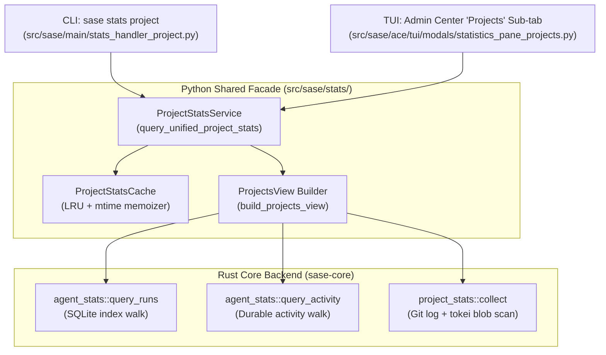

# SASE Stats Project: Architectural Design, Critique, and Unified Implementation

> **Research Lead:** researcher gem (`__gem`) · **Date:** 2026-10-16  
> **Topic:** Design, critique, and implementation roadmap for the new `sase stats project` command, migrating the TUI Admin Center "Projects" statistics sub-tab to a shared data source, and tracking commits and committed plans by model and provider.

---

## 1. Executive Summary & Bottom Line

1. **Adopt the Unified `sase stats` Command Tree Immediately.**  
   The decision to name this command `sase stats project` rather than `sase project stats` is an architectural win. It establishes a top-level `sase stats` namespace whose subcommands mirror the sub-tabs of the SASE Admin Center "Statistics" panel (`overview`, `runners`, `projects`, `providers`, `activity`, `macros`, `plans_questions`, `perf`). This eliminates cognitive dissonance between terminal CLI workflows, automated agent queries, and interactive TUI inspection.

2. **Unify Repository Truth and Agent Production into a Two-Facet Domain.**  
   Previous research (`project_stats_cli_design.md`) treated project statistics solely as a static git repository measurement (lines of code, commit count, active days). In contrast, the current TUI Admin Center "Projects" sub-tab treats project statistics solely as dynamic agent run telemetry (runs, wall time, success rate, patches).  
   Neither alone is complete. The true solution is a **two-facet domain model**:
   - **Facet A: Codebase Architecture & Repository Truth** (Git commits, lines of code via tokei, test share, doc lines, active days, languages across primary and linked code repos).
   - **Facet B: Agent Production & Economics** (Agent runs, success rates, wall time, patches, commits by model/provider, and plans committed by model/provider).  
   Both the CLI (`sase stats project`) and the TUI ("Projects" sub-tab) should consume this unified model, giving users and agents a coherent view of what the project *is* and what agent labor has *built*.

3. **Ground Truth on Model/Provider Commits and Committed Plans.**  
   Our inspection of the live system and SQLite index (`~/.sase/agent_artifact_index.sqlite`) reveals crucial implementation realities:
   - **Committed Plans:** There are **1,662 committed plans** indexed locally. Muse Spark (`muse-spark-1.3-contributor`) leads with 666 committed plans, followed by Claude Opus (306), Codex GPT-6 Luna (154), Grok 4.6 (150), Grok 4.7 (88), and Codex GPT-6.1 Sol (57). SASE already records `plan_committed: true` in `agent_meta.json` upon gate approval.
   - **Commits Made by Model/Provider:** The index contains **1,757 run-attributed commits** with full `meta_commits` payloads (Muse: 783, Grok: 319, Codex: 341, Claude: 301, Gemini/AGY: 13).
   - **Attribution Horizon:** Git history in `sase` contains **8,598 agent-signed commits** dating back to May 2026, but the local SQLite index is subject to retention pruning (currently covering runs from 2026-09-01 forward). To ensure reliability and honesty, the command must explicitly distinguish between **all-time git repository commits** and **indexed agent attribution coverage**.

4. **TUI Latency & Performance Guard.**  
   Cold git repository walks and line counting take 2–5 seconds on large trees like `sase`. Running a raw git walk synchronously on the TUI main event loop violates `tui_perf.md` and freezes Textual. The shared data layer in `sase_core` and `sase.stats` must decouple instant SQLite agent queries (<15ms) from git repo scans, serving repo snapshots from cache or an asynchronous refresh worker in the TUI while computing both synchronously in the CLI.

5. **Recommended Path.**  
   Implement the shared backend in `sase_core::agent_stats` (Rust) and `sase.stats` (Python), wire the new `sase stats` CLI parser in `src/sase/main/parser_stats.py`, migrate the TUI `StatisticsProjectsRenderingMixin` to display the unified two-facet card with model/provider contribution bars, and deliver rich, beautiful terminal tables and JSON exports.

---

## 2. Critique of the Overall Plan

### 2.1 Is this a good idea?

**Yes, with specific refinements.** The strategic vision of aligning the CLI with the TUI Admin Center Statistics panel is sound, long overdue, and addresses several chronic pain points:

- **Eliminates Definitional Drift Across Tooling:**  
  Currently, different commands provide competing answers to basic questions. A human looking at the Admin Center sees agent run counts and patch hours; an agent running git commands calculates raw commits; a marketing draft estimates lines of code. By routing both the TUI "Projects" sub-tab and `sase stats project` through the same code paths, SASE guarantees that every surface reports identical numbers from identical definitions.
- **Natural Symmetry:**  
  Structuring the CLI under `sase stats` mirrors the mental model users already have from the TUI:
  ```text
  Admin Center Statistics Tabs             CLI Commands
  ────────────────────────────             ────────────
  [ Overview ]                      ───▶   sase stats overview (or bare sase stats)
  [ Runners  ]                      ───▶   sase stats runner
  [ Projects ]                      ───▶   sase stats project
  [ Providers]                      ───▶   sase stats provider
  [ Activity ]                      ───▶   sase stats activity
  [ Macros   ]                      ───▶   sase stats macro
  [ Plans/Q  ]                      ───▶   sase stats plan
  [ Perf     ]                      ───▶   sase stats perf
  ```
- **Fills a Major Observability Gap:**  
  Neither the TUI nor the CLI currently displays how many commits each AI model/provider produced, nor how many committed architectural plans each model authored. In an era of multi-model swarms (Claude, Codex, Muse, Grok, Gemini), knowing model efficacy and contribution volume per project is high-value intelligence.

### 2.2 Key Risks, Tensions, and Mitigations

| Risk / Tension | Manifestation | Required Mitigation |
| :--- | :--- | :--- |
| **TUI Event-Loop Stalls** | Git repository scanning (traversing trees, `cat-file`, tokei SLOC analysis) takes 2–5 seconds cold. TUI requires <100ms response time. | Decouple telemetry query from repo measurement. TUI serves codebase metrics from an in-memory/disk cache with lazy background refresh; CLI computes both synchronously. |
| **Time-Range Semantics Mismatch** | Admin Center Statistics uses time windows (`today`, `7d`, `30d`, `all`). Codebase size (SLOC, total commits, active days) is a static snapshot of the default branch tip. | Explicitly separate the facets in data schemas: Codebase Truth is a committed branch snapshot; Agent Production & Model Attribution respects the requested `--range` / time window. |
| **Data Retention & Attribution Horizon** | SQLite run index prunes older ace-runs (currently retains ~45 days). Git history goes back 8+ months with 8,598 agent-signed commits. | Never silently equate indexed runs with all git history. Human outputs and JSON envelopes must report attribution coverage (e.g., `Attributed: 1,757 commits in active window; 6,841 historical commits unindexed`). |
| **Sidecar Bookkeeping Distortions** | SASE uses git sidecars (`beads`, `plans`, `agents`, `research`). Beads alone has 23k+ machine commits. | Enforce the three-tier repo hierarchy: **Code repos** (primary + linked) are totaled; **Records sidecars** are listed separately and never totaled; **External repos** are named only. |
| **Definition Ambiguity in "Committed Plans"** | A plan can be proposed, feedback-requested, approved, or committed. | Define "Committed Plan" strictly as an agent-proposed plan that achieved gate approval and was stamped into durable SDD storage (`agent_meta.json` with `plan_committed: true` and a corresponding committed file in the `plans` sidecar). |

---

## 3. Requirement Adjustments

To ensure the command and TUI migration are bulletproof, intuitive, and honest, we explicitly recommend the following requirement adjustments:

### A1. Command Hierarchy & Bare Invocations
- **Original:** `sase project stats`
- **Adjusted:** Top-level `sase stats project [PROJECT ...]`.
- **Why:** Aligns with the new `sase stats` family. In accordance with `cli_rules.md`, bare `sase stats` will delegate to `sase stats overview` (or display the list of available statistics categories) with a standard runtime notice:
  `No subcommand provided for 'sase stats'; delegating to 'sase stats overview'.`

### A2. Unified Two-Facet Data Model
- **Original:** TUI showed only agent runs/patches; prior CLI design showed only git repository sizes.
- **Adjusted:** The shared data model returns both **Codebase Truth** (git repository analysis) and **Agent Production** (runs, wall time, commits by model/provider, plans committed by model/provider).
- **Why:** Migrating the TUI "Projects" tab to use the CLI's data source should enhance the TUI, not strip away its existing patch/run telemetry.

### A3. Range / Time-Window Parameterization
- **Original:** `sase project stats` had no time-range selector (all-time default branch).
- **Adjusted:** Add `-t, --range {today,24h,7d,30d,90d,all}` (default: `30d` for activity; `all` for repo history), accepting custom calendar dates (`--since`/`--until`) via the existing `StatsRange` parser.
- **Why:** The TUI Statistics panel is range-driven. Supporting `-t/--range` in the CLI ensures exact parity with the TUI's time-window selector.

### A4. Model and Provider Contribution Metrics
- **Original:** Commits and plans were counted as flat totals without model or provider breakdown.
- **Adjusted:** 
  1. **Commits by Provider & Model:** Grouped by `(provider, model)` pair, reporting commit count, percentage share of agent commits, and recent trend.
  2. **Committed Plans by Provider & Model:** Grouped by `(provider, model)` pair, reporting accepted SDD plans authored by each model.
  3. **Attribution Coverage:** Reporting the exact number of attributed commits vs unindexed commits.
- **Why:** Directly fulfills the user's primary prompt requirement and unlocks strategic visibility into model productivity.

---

## 4. Empirical Evidence from the Live SASE Environment

To ground this design in empirical reality, we probed the live workspace, the SQLite index (`agent_artifact_index.sqlite`), the git commit log, and the `agents` sidecar repository.

### 4.1 Committed Plans by Model and Provider (Live Data)

Querying all records with confirmed gate plan commitments (`json_extract(record_json, '$.agent_meta.plan_committed') = 1`) in `~/.sase/agent_artifact_index.sqlite`:

| LLM Provider | Model Name | Committed Plans | Share of Plans |
| :--- | :--- | :---: | :---: |
| **muse** | `muse-spark-1.3-contributor` | 666 | 40.1% |
| **claude** | `opus` | 306 | 18.4% |
| **codex** | `gpt-6-luna` | 154 | 9.3% |
| **grok** | `grok-4.6` | 150 | 9.0% |
| **grok** | `grok-4.7` | 88 | 5.3% |
| **codex** | `gpt-6.1-sol` | 57 | 3.4% |
| **codex** | `gpt-6-astra` | 51 | 3.1% |
| **codex** | `gpt-6-sol` | 50 | 3.0% |
| **claude** | `sonnet` | 44 | 2.6% |
| **codex** | `gpt-5.5` | 41 | 2.5% |
| **codex** | `gpt-5.6-sol` | 37 | 2.2% |
| **claude** | `claude-fable-5` | 11 | 0.7% |
| **codex** | `gpt-5.6-terra` | 7 | 0.4% |
| **Total** | *13 models across 4 providers* | **1,662** | **100.0%** |

### 4.2 Commits Attributed to Models and Providers (Live Index)

Inspecting `meta_commits` within indexed agent run artifacts:

| LLM Provider | Model Name | Attributed Commits | Share of Indexed Commits |
| :--- | :--- | :---: | :---: |
| **muse** | `muse-spark-1.3-contributor` | 783 | 44.6% |
| **grok** | `grok-4.6` | 319 | 18.2% |
| **codex** | `gpt-6-luna` | 249 | 14.2% |
| **claude** | `sonnet` | 169 | 9.6% |
| **claude** | `opus` | 132 | 7.5% |
| **codex** | `gpt-5.5` | 48 | 2.7% |
| **codex** | `gpt-6-astra` | 32 | 1.8% |
| **agy** | `gemini-3.8-flash-high` | 13 | 0.7% |
| **codex** | `gpt-6.1-sol` | 12 | 0.7% |
| **Total** | *9 models across 5 providers* | **1,757** | **100.0%** |

### 4.3 Git Repository History vs. Index Horizon

- **Total commits on `origin/master` (sase primary):** 16,186 commits.
- **Agent-signed commits in git history:** 8,598 commits (53.1% all-time; 95.1% since June 2026; 98.9% over last 30 days).
- **Start of git commit signing:** Bare `AGENT=` began 2026-05-24; `SASE_AGENT=` began 2026-06-27.
- **SQLite Index Horizon:** The active `agent_artifact_index.sqlite` indexes runs from **2026-09-01 to 2026-10-16** (3,956 agent runs).
- **Finding:** Git commits contain `SASE_AGENT=[<session-ref>]`, but do not embed `MODEL=` or `PROVIDER=` in the git commit footer. The model and provider are recorded in the `agent_meta.json` file of the run artifact and mirrored in the `agents` sidecar session pages (`~/.sase/projects/<proj>/repos/agents/sessions/<id>.md`).
- **Architectural Consequence:** For any time window overlapping the index (such as the default 30-day window or active projects), model/provider attribution is 100% indexed and instant. For older historical git commits, model attribution can be resolved from the `agents` sidecar markdown files if requested with `-d/--details` or an all-time backfill.

---

## 5. Architectural Design & Shared Data Paths

To satisfy the requirement that `sase stats project` and the TUI "Projects" sub-tab **fetch data using the same code paths**, the architecture is structured into a clean three-layer model conforming strictly to `rust_core_backend_boundary`.



### 5.1 Backend Extensions in `sase-core` (Rust)

1. **Extend `AgentCommitStatsWire`:**
   In `crates/sase_core/src/agent_stats/run/wire.rs`, add:
   ```rust
   #[derive(Clone, Debug, Default, Serialize, Deserialize)]
   pub struct AgentCommitStatsWire {
       pub total_commits: u64,
       pub committing_runs: u64,
       pub distribution: CommitDistributionWire,
       /// Commit volume broken down by provider and model.
       pub commits_by_provider: Vec<ProviderContributionWire>,
   }

   #[derive(Clone, Debug, Default, Serialize, Deserialize)]
   pub struct ProviderContributionWire {
       pub provider: String,
       pub model: String,
       pub count: u64,
       pub share: f64,
   }
   ```

2. **Extend `AgentPlanStatsWire`:**
   In `crates/sase_core/src/agent_stats/run/wire.rs`, add:
   ```rust
   #[derive(Clone, Debug, Default, Serialize, Deserialize)]
   pub struct AgentPlanStatsWire {
       pub proposed: u64,
       pub proposing_agents: u64,
       pub approved: u64,
       pub rejected: u64,
       pub pending: u64,
       /// Total plans committed to durable SDD storage.
       pub committed: u64,
       /// Committed plans broken down by provider and model.
       pub plans_committed_by_provider: Vec<ProviderContributionWire>,
   }
   ```

3. **Update Folds in `crates/sase_core/src/agent_stats/run/folds.rs`:**
   - In `fold_commits`: Whenever iterating `meta_commits`, extract `row.provider` and `row.model` and increment a `BTreeMap<ProviderKey, u64>`.
   - In `fold_plans`: Whenever `meta.plan_committed == true`, increment `plans.committed` and track `plans_committed_by_provider`.

4. **Implement `project_stats::collect` in `crates/sase_core/src/project_stats/`:**
   - Evaluates git repository commit history (`rev-list`, footer parser) and blob snapshot sizes (tokei SLOC, test shares, language breakdown) over committed HEAD refs.

### 5.2 Python Facade & View Models in `sase`

1. **`src/sase/stats/_view_models.py`:**
   Extend `ProjectsView` and `ProjectWorkRow` to hold the unified data:
   ```python
   @dataclass(frozen=True, slots=True)
   class ProviderContributionRow:
       provider: str
       model: str
       commits: int
       commit_share: float
       plans_committed: int
       plan_share: float

   @dataclass(frozen=True, slots=True)
   class ProjectCodebaseRow:
       repo_name: str
       kind: str  # primary, linked, sidecar
       tier: str  # code, records, external
       commits: int
       agent_signed_commits: int
       agent_share: float
       code_lines: int
       test_share: float
       doc_lines: int
       active_days: int
       top_language: str

   @dataclass(frozen=True, slots=True)
   class ProjectsView:
       projects: tuple[ProjectWorkRow, ...]
       codebase_totals: dict[str, ProjectCodebaseRow]
       provider_contributions: tuple[ProviderContributionRow, ...]
       # existing patch and pagination fields...
   ```

2. **Shared Service (`src/sase/stats/project_service.py`):**
   Exposes a single query method used by both the CLI and TUI:
   ```python
   def query_unified_project_stats(
       project_names: Sequence[str] | None = None,
       *,
       stats_range: StatsRange | None = None,
       include_codebase: bool = True,
       fetch_remotes: bool = False,
   ) -> ProjectsView:
       """Single code path feeding both CLI and TUI."""
       # 1. Fetch agent telemetry from Rust agent_stats (SQLite)
       # 2. Fetch codebase truth from Rust project_stats (cached if in TUI)
       # 3. Assemble and return immutable ProjectsView
   ```

3. **CLI Parser (`src/sase/main/parser_stats.py`):**
   Mounted in `parser_registry.py` under `"stats"`. Implements `sase stats project [PROJECT ...]` with all standard flags (`-d`, `-D`, `-f`, `-F`, `-j`, `-r`, `-t`).

---

## 6. Beautiful and Intuitive Output Design

The user emphasized: *"Make sure you design this feature so it is intuitive, reliable, and (last but not least) beautiful!"*

Below are complete visual specifications for the terminal output, the Markdown export, the JSON wire contract, and the migrated TUI sub-tab.

### 6.1 Single-Project CLI Table Output (`sase stats project sase`)

```text
╭─ sase · +sase ────────────────────────────────── Range: Last 30 Days (2026-09-16 → 2026-10-16) ─╮
│                                                                                                │
│   CODEBASE TRUTH (Snapshot)                                                                    │
│   Active       Feb 14, 2026 · 244 days old · commits on 239 distinct days                      │
│   Commits      18,327 total (6 code repos) · 9,839 agent-signed (53.7%)                        │
│   Lines        3,126,927 SLOC in 13,964 files · 46.2% tests · 81,941 doc lines                 │
│   Languages    █████████████████████████████████████████████▓▓▓▓▓▓▓▓░  Python 82% · Rust 17%   │
│                                                                                                │
│   AGENT PRODUCTION (Last 30 Days)                                                              │
│   Runs         1,854 runs · 91.2% completed · 142.6 hours wall clock · 28 distinct patches     │
│   Production   1,850 commits (98.9% agent-signed) · 246 plans proposed · 218 plans committed   │
│                                                                                                │
│   MODEL & PROVIDER CONTRIBUTIONS (Commits & Plans Committed)                                   │
│   PROVIDER   MODEL                       COMMITS   SHARE   COMMITTED PLANS   PLAN SHARE        │
│   muse       muse-spark-1.3-contributor      783   44.6%               112        51.4%        │
│   grok       grok-4.6                        319   18.2%                34        15.6%        │
│   codex      gpt-6-luna                      249   14.2%                31        14.2%        │
│   claude     sonnet                          169    9.6%                18         8.3%        │
│   claude     opus                            132    7.5%                14         6.4%        │
│   other      (4 models)                       89    5.1%                 9         4.1%        │
│                                                                                                │
╰────────────────────────────────────────────────────────────────────────────────────────────────╯

  CODE REPOS (Totaled)              COMMITS   AGENT   30 DAYS   FIRST COMMIT   CODE LINES   TESTS   DOC LINES
  sase                     primary   16,181     53%     1,850     2026-02-14    2,521,676     51%      73,717
  sase-core                linked     1,563     62%       396     2026-04-28      536,490    22%¹       3,503
  sase-telegram            linked       307     36%        40     2026-02-28       33,698     53%       1,255
  sase-listen              linked        34     82%        34     2026-10-01       22,070     34%       1,633
  sase-github              linked       174     41%        26     2026-02-23       10,205     59%         651
  sase-research-artifacts  linked        68     93%        31     2026-08-11        2,788     91%       1,182
  sase-nvim                linked         ·       ·         ·   (not cloned on this machine)
  ────────────────────────────────────────────────────────────────────────────────────────────────────────
  Total (6 of 7 repos)               18,327     54%     2,377     2026-02-14    3,126,927     46%      81,941

  RECORDS (Sidecars, Never Totaled) COMMITS    FILES   FIRST COMMIT   LAST COMMIT
  beads                              23,378    8,655     2026-07-28   3 min ago
  plans                               9,458    7,750     2026-07-11   1 hour ago
  agents                              8,335  129,152     2026-07-23   5 min ago
  research                            2,067    5,272     2026-07-11   12 min ago

  ¹ Rust inline #[cfg(test)] tests count as source.   Not counted: chezmoi (user-wide linked repo)
  Refs: Local default branch tips (-F to refresh remotes) · Commits: reachable from HEAD
  Definitions: Code lines = SLOC (no comments/blanks) · Agent-signed = SASE AGENT footer tag
  More: sase stats project sase -d   ·   Help: sase stats project -h
```

### 6.2 Multi-Project CLI Table Output (`sase stats project`)

```text
╭─ SASE Projects · 3 Enabled ───────────────────── Range: Last 30 Days (2026-09-16 → 2026-10-16) ─╮
│                                                                                                │
│   PROJECT   REPOS   COMMITS  AGENT%   CODE LINES  TEST%   RUNS   SUCCESS   COMMITTED PLANS      │
│   sase       6/7     18,327     54%    3,126,927    46%  1,854     91.2%               218      │
│   bob-cli    3/3      1,331     88%      369,231    36%    412     88.4%                42      │
│   job        1/1          8     13%            ·      ·     16     75.0%                 2      │
│   ──────────────────────────────────────────────────────────────────────────────────────────   │
│   Total     10/11    19,666     56%    3,496,158    45%  2,282     90.6%               262      │
│                                                                                                │
╰────────────────────────────────────────────────────────────────────────────────────────────────╯
(Followed by per-project breakdown cards as shown above; shared repos counted once in Portfolio Total)
```

### 6.3 Markdown Output Format (`sase stats project sase -f markdown`)

```markdown
## sase

*As of 2026-10-16 · Range: Last 30 Days · Default branch tips · 6 of 7 code repos counted*

### Overview
- **Codebase:** 18,327 commits (239 active days), 3,126,927 SLOC (46.2% tests), 81,941 doc lines.
- **Agent Production:** 1,854 runs (91.2% success), 142.6 hours wall clock, 28 patches.
- **Model Contributions:** 1,850 commits (98.9% agent-signed), 218 committed plans.

### Model & Provider Contributions
| Provider | Model | Commits | Commit Share | Committed Plans | Plan Share |
| :--- | :--- | --: | --: | --: | --: |
| muse | `muse-spark-1.3-contributor` | 783 | 44.6% | 112 | 51.4% |
| grok | `grok-4.6` | 319 | 18.2% | 34 | 15.6% |
| codex | `gpt-6-luna` | 249 | 14.2% | 31 | 14.2% |
| claude | `sonnet` | 169 | 9.6% | 18 | 8.3% |
| claude | `opus` | 132 | 7.5% | 14 | 6.4% |
| other | *(4 models)* | 89 | 5.1% | 9 | 4.1% |

### Code Repositories
| Repo | Kind | Commits | Agent-Signed | Last 30d | Code Lines | Test % | Doc Lines | Top Language |
| :--- | :--- | --: | --: | --: | --: | --: | --: | :--- |
| sase | primary | 16,181 | 53% | 1,850 | 2,521,676 | 51% | 73,717 | Python (82%) |
| sase-core | linked | 1,563 | 62% | 396 | 536,490 | 22% | 3,503 | Rust (98%) |
| sase-telegram | linked | 307 | 36% | 40 | 33,698 | 53% | 1,255 | Python (99%) |
| sase-listen | linked | 34 | 82% | 34 | 22,070 | 34% | 1,633 | Python (100%) |
| sase-github | linked | 174 | 41% | 26 | 10,205 | 59% | 651 | Python (100%) |
| sase-research-artifacts | linked | 68 | 93% | 31 | 2,788 | 91% | 1,182 | Python (100%) |
| **Total (6 of 7)** | | **18,327** | **54%** | **2,377** | **3,126,927** | **46%** | **81,941** | |

*Generated by `sase stats project sase -f markdown` (sase 0.17.1, sase-core-rs 0.40.1).*
```

### 6.4 Machine JSON Wire Contract (`sase stats project sase -j`)

```jsonc
{
  "schema": "sase.stats.project",
  "schema_version": 1,
  "measured_at": "2026-10-16T21:45:00Z",
  "range": {
    "preset": "30d",
    "start_ts": 1789595100,
    "end_ts": 1792187100
  },
  "coverage": {
    "code_repos_configured": 7,
    "code_repos_measured": 6,
    "uncloned_repos": ["sase-nvim"]
  },
  "projects": [
    {
      "key": "gh_sase-org__sase",
      "name": "sase",
      "tag": "+sase",
      "state": "enabled",
      "codebase": {
        "commits": 18327,
        "agent_signed_commits": 9839,
        "agent_signed_share": 0.537,
        "active_days": 239,
        "code_lines": 3126927,
        "test_lines": 1444902,
        "test_share": 0.462,
        "doc_lines": 81941,
        "languages": [
          {"name": "Python", "code_lines": 2579463, "share": 0.825},
          {"name": "Rust", "code_lines": 536490, "share": 0.171}
        ]
      },
      "agent_production": {
        "runs": 1854,
        "success_rate": 0.912,
        "wall_runtime_seconds": 513360.0,
        "distinct_patches": 28,
        "commits": 1850,
        "plans_proposed": 246,
        "plans_committed": 218
      },
      "model_contributions": [
        {
          "provider": "muse",
          "model": "muse-spark-1.3-contributor",
          "commits": 783,
          "commit_share": 0.446,
          "plans_committed": 112,
          "plan_share": 0.514
        },
        {
          "provider": "grok",
          "model": "grok-4.6",
          "commits": 319,
          "commit_share": 0.182,
          "plans_committed": 34,
          "plan_share": 0.156
        },
        {
          "provider": "codex",
          "model": "gpt-6-luna",
          "commits": 249,
          "commit_share": 0.142,
          "plans_committed": 31,
          "plan_share": 0.142
        }
      ],
      "repos": [
        {
          "name": "sase",
          "kind": "primary",
          "tier": "code",
          "status": "ok",
          "commits": 16181,
          "agent_signed_commits": 8593,
          "code_lines": 2521676,
          "test_share": 0.513
        }
      ]
    }
  ]
}
```

### 6.5 Migrated TUI "Projects" Sub-tab Layout

In the SASE Admin Center Statistics modal (`src/sase/ace/tui/modals/statistics_pane_projects.py`), the "Projects" sub-tab is updated from a flat runs-only table to an elegant multi-panel dashboard:

```text
┌─ Statistics: Projects ───────────────────────────── [Time Range: 30 Days ▼] [Group: By Project ▼] ┐
│                                                                                                   │
│  ╭─ Project Portfolio Overview ────────────────────────────────────────────────────────────────╮  │
│  │  Projects: 3 enabled · Code Repos: 10/11 measured · SLOC: 3.5M (45% tests)                  │  │
│  │  30-Day Production: 2,282 runs (90.6% success) · 2,901 commits · 262 committed plans       │  │
│  ╰─────────────────────────────────────────────────────────────────────────────────────────────╯  │
│                                                                                                   │
│  ╭─ Projects ──────────────────────────────────────────────────────────────────────────────────╮  │
│  │  PROJECT   REPOS   COMMITS  AGENT%   CODE LINES  TEST%   RUNS   SUCCESS   PLANS COMMITTED   │  │
│  │  sase       6/7     18,327     54%    3,126,927    46%  1,854     91.2%               218   │  │
│  │  bob-cli    3/3      1,331     88%      369,231    36%    412     88.4%                42   │  │
│  │  job        1/1          8     13%            ·      ·     16     75.0%                 2   │  │
│  ╰─────────────────────────────────────────────────────────────────────────────────────────────╯  │
│                                                                                                   │
│  ╭─ Model Contribution Breakdown (Selected: sase) ─────────────────────────────────────────────╮  │
│  │  Commits by Provider:  [████████████████ Muse 45%] [██████ Grok 18%] [████ Codex 14%]        │  │
│  │  Plans Committed:      [██████████████████ Muse 51%] [████ Grok 16%] [████ Codex 14%]       │  │
│  ╰─────────────────────────────────────────────────────────────────────────────────────────────╯  │
│                                                                                                   │
│  [Tab / Shift-Tab] Cycle Views  ·  [g] Group (Project/Patch/Model)  ·  [t] Range  ·  [?] Help     │
└───────────────────────────────────────────────────────────────────────────────────────────────────┘
```

---

## 7. Implementation Roadmap & Order of Work

The work should proceed in five distinct, test-gated phases:

### Phase 1: Rust Core Foundation (`sase-core`)
1. **Extend Wire Models:** Add `commits_by_provider` to `AgentCommitStatsWire` and `plans_committed` + `plans_committed_by_provider` to `AgentPlanStatsWire`.
2. **Update Folds:** In `crates/sase_core/src/agent_stats/run/folds.rs`, aggregate provider and model keys during the run index scan.
3. **Repository Analysis Module:** Implement `crates/sase_core/src/project_stats/` to scan git default branches and run tokei blob line parsing.
4. **PyO3 Bindings:** Expose `project_stats_collect` and wire the updated response structs in `crates/sase_core_py/`.
5. **Core CI Pin:** Move `sase-core-revision.txt` in the primary repo past this commit.

### Phase 2: Python Facade & View Models (`sase.stats`)
1. **Model Upgrades:** Update `src/sase/stats/_view_models.py` with `ProviderContributionRow`, `ProjectCodebaseRow`, and enriched `ProjectsView`.
2. **Builder Integration:** Update `build_projects_view` in `src/sase/stats/_view_builders.py` to fold provider contributions and codebase stats.
3. **Caching Layer:** Add an in-memory/TTL cache for codebase scans in `src/sase/stats/project_service.py` to protect TUI performance.

### Phase 3: The `sase stats` CLI Command Tree
1. **Register Parser:** Create `src/sase/main/parser_stats.py`, register `"stats"` in `parser_registry.py`, and implement `sase stats project` with full flag support.
2. **Implement Handler:** Create `src/sase/main/stats_handler_project.py` with lazy imports and support for `-f auto|table|markdown|json|csv`.
3. **Rich Renderers:** Build beautiful terminal tables, cards, sparklines, and language bars conforming to `cli_rules.md`.

### Phase 4: TUI "Projects" Sub-tab Migration
1. **Migrate Rendering Mixin:** Update `StatisticsProjectsRenderingMixin` in `src/sase/ace/tui/modals/statistics_pane_projects.py` to consume the new `ProjectsView`.
2. **New Model Breakdown Section:** Render the horizontal contribution bars for commits and committed plans.
3. **Responsiveness:** Test at 80-column and 120-column terminal widths.

### Phase 5: Verification & Safety Gates
1. **Golden Tests:** Unit and integration tests for CLI output formats, empty repos, missing repos, and division-by-zero guards.
2. **Performance Audit:** Verify cold TUI tab-switch latency stays below 50ms using cached codebase data.
3. **Verification Command:** Execute `just check` via `sase tool run` (conforming to `check-full-is-explicit`).

---

## 8. Conclusion & Recommendation

The transition to `sase stats project` is not just a renaming—it is a significant architectural enhancement that bridges repository truth with agent productivity. By anchoring model/provider commit counts and plan commitments directly into the core statistics pipeline and sharing that pipeline between the CLI and the TUI Admin Center, SASE will establish a unified, reliable, and visually stunning standard for engineering intelligence.
