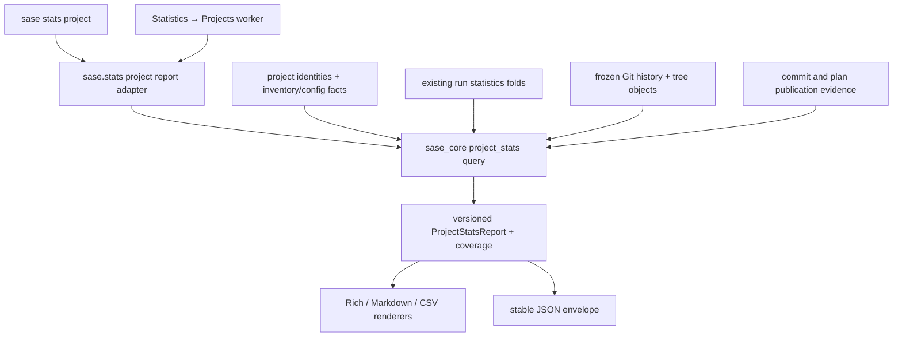

# `sase stats project`: one trustworthy report for the CLI and Statistics → Projects

**Independent research by cdx · 2026-10-16**

Build this feature. The new `sase stats` namespace is a better home for analytical queries than project lifecycle management, and sharing the project report with the TUI is the right architectural investment. The important change to the earlier proposal is deeper than the command name: **combine repository facts and SASE activity through one reporting service, while keeping their definitions, clocks, and coverage separate.** Add model attribution to the evidence captured when work is committed; a reader alone cannot recover evidence that was never recorded.

My recommendation is a Rust-owned `ProjectStatsReport` consumed by both frontends, with an explicit repository snapshot, the existing run activity, and exact-or-unknown attribution for code commits and committed plans. Ship the Projects migration and both attribution metrics in the initial feature. Retain the original repository size, history, age, and multi-format requirements. Leave the other Statistics sub-tabs on their current paths until their own migrations.

## Scope, method, and evidence

I read the shared [earlier consolidated design](project_stats_cli_design/project_stats_cli_design.md) through `sase artifact read`, inspected the current Python and Rust implementations independently, ran two small read-only provenance probes, and checked the upstream Git, SQLite, and tokei documentation. I did not open or consult any other report or chat from this research swarm.

Source revisions inspected:

- **sase:** `3e5027a8a73d47d295703dc6f73ed4b7fe7e3623`.
- **sase-core:** `594faf31d80af79a148cb67968318b2bfb1a5770`.
- **Earlier shared report:** `research:202610/project_stats_cli_design/project_stats_cli_design.md`.

This report assumes the original requirements for file/line counts, project age, all enabled projects by default, and repository breakdowns still apply. The new request expands that product into a shared statistics surface; it does not explicitly cancel those requirements. All mockup numbers below are fictional. No end-to-end implementation or new performance benchmark was produced.

### What exists today

| Finding | Evidence and implication |
| --- | --- |
| There is already a frontend-neutral statistics package. | `src/sase/stats/query.py` calls `agent_stats_query_runs` and `agent_stats_query_activity`; `views.py` and `_view_builders.py` build presentation models. Extend this seam instead of creating a competing Python project analytics package. |
| The Projects tab is an activity report. | `statistics_pane_data.py` loads composite run/activity queries; `statistics_pane_projects.py` renders By Project, By Patch, and Project → Patch. It currently reports runs, outcomes, commit-result counts, attributed Patches, summed runtime, and last launch. It does not scan repository size or Git lifetime history. |
| Its commit count has a launch-cohort clock. | Rust `agent_stats/run/query.rs` selects runs by launch timestamp, then `folds.rs::fold_commits` counts objects in `done.step_output.meta_commits`. Commits can occur outside the selected launch window. The fold does not itself validate commit identities or deduplicate SHAs. |
| The compact metadata is insufficient for a reliable new commit ledger. | `commit_tracking.py::write_result_marker` writes dedicated `commit_sha`, `run_id`, and `method` fields, but `run_agent_helpers_state.py::_commit_result_list_record` drops them and derives `sha` from the generic `result`. A PR result can therefore become a URL in a field called `sha`. Preserve the typed writer fields in the projection before building new attribution on it. |
| Plan approvals are not committed plans. | `agent_stats/activity.rs` and `gate_bundles.rs` count plan proposals and decisions from durable gates. The wire explicitly warns against user-facing totals from the older index-derived plan counters. Gate choice `commit` is still an intention; storage success needs separate evidence. |
| There are several successful plan-publication paths. | `_plan_archive_approval.py` handles approval-time archive publication; `plan_approval_receipts.py` records direct, gateless approval; `axe/run_agent_exec_plan_accept.py` has handoff/compatibility handling; `bead/cli_work_from_plan_launch.py` commits epic plans. A boolean checked on one planner path cannot cover them all. |
| An agent footer can identify a session rather than a concrete turn. | `workflows/commit/runtime_tags.py` documents the distinction, and `agents_sync/links.py::resolve_agent_commit_tag` calls `sase_agent_ref_for_turn`. Different turns in that session can use different models. Joining a footer name to one current model would misattribute history. |
| Published agent metadata can help, but is not a universal ledger. | `agents_sync/v2_models.py::V2RunRecord` contains run metadata and commit records; model/provider are rendered in `rendering_agent_page.py`. However, `agents_sync/models.py::CommitRecord` is explicitly a **primary-repository** record and has no repository ID. Linked-repo attribution needs additional evidence. |
| Repository inventory is a useful adapter, not yet a sufficient measurement contract. | `RepoRecord` has project key/name, repo kind, clones, pin, and source. It does not distinguish project-declared from user-wide linked configuration. `resolution_config` starts from cwd-merged configuration; the earlier report's cross-project contamination concern therefore still needs a regression test. I did not reproduce its named issue against a live second project. |
| The TUI has a refresh contract to preserve. | `StatisticsPane` uses an off-thread worker, rejects stale results, and refreshes active statistics every 30 seconds. Repository-wide recomputation on that timer would introduce a new cost profile. |

### Two independently verified probes

**1. Footer evidence at a frozen mainline revision.** I walked `origin/master` at `3e5027a8a73d47d295703dc6f73ed4b7fe7e3623` with `git log --format=%B%x00` and parsed each message with the existing Rust-backed `parse_commit_footer` facade:

| Measure | Count |
| --- | ---: |
| Reachable commit messages | 16,192 |
| Nonempty canonical `AGENT` footer | 8,604 |
| Nonempty canonical `MODEL`, `PROVIDER`, `TURN`, or `RUN` footer | 0 for each key |

These counts describe that revision, not a launch-day statistic. They prove that a footer-only model report is currently impossible. They do **not** prove that historical models cannot be recovered by exact joins to retained run metadata.

**2. Projection loses the actual commit identity.** Calling the current `_commit_result_list_record` with this synthetic writer-shaped input:

```json
{
  "method": "create_pull_request",
  "run_id": "sample-run",
  "result": "https://example.test/pull/1",
  "commit_sha": "aaaaaaaaaaaaaaaaaaaaaaaaaaaaaaaaaaaaaaaa",
  "cwd": "/example/repo",
  "committed_at": 123
}
```

returned:

```json
{
  "sha": "https://example.test/pull/1",
  "cwd": "/example/repo",
  "committed_at": "123"
}
```

This is a narrow projection probe, not a claim that every live PR record has this shape. It demonstrates why counting arbitrary metadata objects or trusting their `sha` field is unsuitable for the new metrics.

## Critique of the overall plan

The idea is good for three reasons: it makes statistics available to scripts and agents, gives the TUI and CLI the same definitions, and turns published project numbers into something auditable. A CLI over the same backend is also a practical way to test the TUI's data independently of Textual.

The main risk is a deceptively simple word: **commits**. There are at least three legitimate quantities here:

1. Commit-result records associated with runs launched in a period.
2. Distinct actual commits created during a period.
3. Commits reachable from a particular repository ref, including work created outside SASE.

They can disagree without either source being corrupt. Similarly, plans proposed, plans approved, plans archived, plans committed, and commits that implement plans are different facts. A beautifully rendered single unlabeled counter would hide those differences.

The earlier report was sensible for a repository-focused launch report. Several choices no longer fit:

- Keeping a separate `sase.project_stats` domain away from `sase.stats` would now reinforce the duplication the user wants to remove.
- Deferring model/provider attribution and the TUI until later contradicts the updated scope.
- Deferring every cache was defensible for an occasional CLI; a periodically refreshed TUI needs reuse of immutable measurements immediately.
- A repo-only report cannot replace the existing Projects activity data without losing outcomes, runtime, and Patch drilldowns.
- New visual flourishes should follow the trustworthy model, not become another reason to defer it. Release tags, churn, token costs, and elaborate growth charts are unnecessary for the first shared service.

I would keep the command descriptive. Commit count, plan count, and line count are activity and inventory measures, not scores for model quality or developer productivity. Avoid a model leaderboard or “commits per dollar” inference in this feature.

### Alternatives considered

| Approach | Advantage | Why I would or would not use it |
| --- | --- | --- |
| CLI imports `statistics_pane_data.load_statistics_view` | Smallest apparent change | Reject. It makes a public CLI depend on TUI modules, loads unrelated views, retains the wrong commit/plan definitions, and does not implement repository facts. |
| Build the earlier repo-only command under the new spelling | Clear repository accounting | Incomplete. It leaves Projects on another source and omits its existing activity. |
| Replace every Statistics tab with one generic analytics framework | Broad consistency | Reject for this change. It makes one useful feature contingent on an entire analytics rewrite. |
| Shared project report, existing run folds, new repository/provenance facts | Preserves behavior while creating the next migration seam | **Recommended.** One query contract, typed facets, and independent renderers. |
| Build a new permanent event warehouse first | Arbitrary future analytics | Reject as a prerequisite. Extend existing commit/publication evidence and use rebuildable projections; do not introduce a second system of record for all SASE activity. |

## Explicit requirement adjustments

| ID | Adjustment | Reason |
| --- | --- | --- |
| A1 | Use **`sase stats project [PROJECT ...]`**. Bare `sase stats` shows useful group help. Do not add the unshipped `project stats` spelling as an alias. | Fits the future family without publishing redundant names or silently choosing a default future tab. |
| A2 | Keep “no project = all enabled projects.” Accept explicit disabled projects; `-D/--include-disabled` broadens the implicit set. Preserve display-name/alias/`+tag` resolution. | Retains the earlier requirement. The TUI can keep its current-project seed; default selection and backend semantics are separate concerns. |
| A3 | Preserve repository metrics **and** existing Projects activity, including its launch-cohort clock. Call the actual cohort commit column **Run commits** and the repository-event column **Code commits**. | The new TUI requirement expands the earlier repository report; it should not erase existing information. |
| A4 | “By model/provider” means recorded execution provider plus recorded effective model. For plans, credit the planner who authored the accepted document, not the host process or later coder that saved it. | These are useful, explainable attribution rules. Record the publisher separately. Provider is the SASE adapter, not an inferred model vendor. |
| A5 | Count distinct logical plans first committed, not plan-store commits, proposals, approvals, phase rows, status updates, or implementing commits. | A single plan may be edited and synchronized many times. A batch may commit several plans. |
| A6 | Unknown attribution is a visible result. Do not label an unsigned commit “human” or guess the model from an agent name, current alias, or commit author. | The history lacks direct model fields; honest coverage is essential. Prefer “agent-tagged” to “agent-signed,” which could imply cryptographic signing. |
| A7 | Carry metric-specific clocks and source coverage. Default the CLI to `all` for the original cumulative report; retain the TUI's existing `7d` default. | Same code path means same answer for the same resolved query, not a forced change to either frontend's established scope. Always print the resolved scope. |
| A8 | Introduce immutable-result caching with the initial TUI migration. | An unchanged tree/history should not be reparsed every 30 seconds. Cache loss must affect speed only. |
| A9 | Show a real measured zero as `0`; use `—`/`null` for unavailable or inapplicable values. | The earlier mockup blurred these cases for zero-code projects. An empty measured repository is known to have zero commits. A missing repository is not. |
| A10 | Keep sidecars out of code totals, but use the plan store as evidence for committed plans. | “Sidecars are not totaled as product code” must not become “ignore the place where plans are committed.” |
| A11 | Do not promise full historical model coverage or globally complete run history. | Git, the local agent index, published agent metadata, and plan receipts have different retention and machine coverage. State each limit. |
| A12 | Correct the Projects commit calculation where actual commit evidence is available. Retain raw legacy result counts only as labeled compatibility diagnostics. | Preserving activity semantics does not justify treating duplicate results or URLs as real commits. Numeric changes from this correction must be documented. |

The rest of this report makes those adjustments concrete.

## Metric contract: define before rendering

Use an inclusive start and exclusive end, `[start_ts, end_ts)`, resolved once with the configured SASE timezone. Keep the existing Statistics range vocabulary: `today`, `24h`, `7d`, `30d`, `90d`, `all`, relative `Nh/Nd/Nw`, month, and date interval. If exact instant replay is added, extend this shared grammar with RFC3339 timestamp intervals; do not create a second `--since/--until` parser for the CLI.

| Metric family | Source and clock | Rule |
| --- | --- | --- |
| Runs and outcomes | Local indexed runs; **launch time** | Preserve current lifecycle buckets and user-hidden policy. Label coverage as this host's retained indexed history. |
| Success | Same launch cohort | Preserve Projects' `completed / all runs`; do not silently switch to Overview's finished-run denominator. Return numerator/denominator. No runs means a null rate. |
| Agent runtime | Same launch cohort | Sum valid recorded durations. It is summed agent time, potentially overlapping, not elapsed project wall-clock time. Multiple Patch associations can make child runtime non-additive. |
| Run commits | Existing launch cohort, normalized actual commit facts | Deduplicate actual commits associated with selected runs. Where legacy identities cannot be established, report incomplete coverage or a known minimum. Preserve the old raw count as `legacy_commit_result_records` in diagnostics, never as an exact commit total. |
| Code commits | Frozen code-repo refs; **committer timestamp** for range filtering | Count actual reachable commit objects, including merges, once under the defined deduplication policy. All-time means all reachable history, with shallow-history coverage disclosed. |
| Model/provider code commits | Same actual commit set | Attribute each commit once to one recorded responsible turn, or an explicit unresolved bucket. This describes recorded responsibility, not exclusive authorship of every changed line. |
| Committed plans | Canonical plan publication evidence; **first successful commit time** | One logical plan, one first publication. Count both tale and epic roots; expose tier. Generated phase material is not an extra root plan. Do not count a later plan edit again. |
| Model/provider committed plans | Same first-publication set | Credit the authoring planner of the accepted committed version. Store publication actor separately. |
| Code/docs files and lines | Tree at a recorded full commit OID | Snapshot quantities; they do not become “lines added during the selected period.” Print `Tree at <ref>@<oid>` separately from the activity window. |
| First/last commit, age, active days | Frozen full code history | Lifetime quantities. Active days are the union of commit calendar dates in the report timezone. Age is elapsed time since the earliest commit, not the number of active days. |

**Time caveat:** committer time is a recorded timestamp, not the instant a commit reached mainline. A rebase can change it. A snapshot plus a date filter is not proof of when work was merged. The existing generic `VcsCommitWire.timestamp` uses **author time**; add a dedicated committer timestamp for this report rather than silently repurposing that field.

Git documents reachable-history set semantics and distinguishes `--since-as-filter` from the early-stopping `--since` walk. Prefer an exact numeric filter over the captured history records; do not assume parent timestamps are monotonic. See [Git revision traversal](https://git-scm.com/docs/git-rev-list). This also makes boundary tests straightforward.

### Repositories, refs, and totals

Keep the earlier three-tier inventory, implemented by explicit metadata rather than names:

- **Code:** primary plus project-declared linked repositories. Measure and total them.
- **Records:** configured sidecars. List their identity, availability, and small repository facts separately. The plans store additionally supplies domain plan facts.
- **Outside project totals:** user-wide linked repositories and ad-hoc external repositories. Identify the exclusion reason. Do not silently treat a user-wide tools repo as product code in every project.

Add configuration provenance to the inventory: at least declaration scope (`project` or `user`), source file, canonical repository identity, and sidecar role. Keep classification policy in Rust; Python supplies the configuration facts it currently owns. Do not hardcode a `chezmoi` exclusion.

Resolve each selected project's own configuration independently of cwd. Reuse alias-aware project resolution and `ProjectDisplaySnapshot`; human labels are `PROJECT_NAME`, keys are machine identities. A new command is not justification to duplicate project-resolution rules.

Default to offline reads of the canonical clone's known default-branch ref; record the exact ref and full commit OID once. For a local-only repository, a labeled local `HEAD` fallback is reasonable. An unresolved remote default ref must be reported, not silently replaced with a feature-branch HEAD. Linked-repo pins remain separately reported; the default mainline measurement should match the earlier design.

Validate clone identity before invoking Git. A missing nested clone must not cause Git to walk up and measure the ancestor repository. Do not clone, fetch, repair indexes, or rewrite project files as an implicit statistics read. `-F/--fetch` is the explicit network option. Track fetch observation time separately from the last commit's age; one is not evidence of the other.

Per-repo counts are exact for that repo/ref. For project and all-project summaries, expose both repository commit occurrences and **unique commit objects**. Deduplicate known repository identities first and shared commit OIDs second for the unique headline. Project rows are overlapping views, so their sum need not equal the deduplicated all-project total. File totals count tree paths per unique repository, not unique blob bytes. Report partial coverage beside every aggregate affected by a missing code repository.

### File/line policy

Retain role partitions: source, tests, docs, agent context, and configuration/data. Code is source plus tests, with the test share visible. Count generated, vendored, binary, LFS-pointer, symlink, and submodule entries as disclosed exclusions rather than following them into other working trees.

Keep code lines as parser-counted code excluding blanks/comments; doc lines are nonblank lines. Include physical/comment/blank counts and language breakdown in JSON. Path-based test classification cannot recognize every inline Rust unit test; disclose that limit rather than promising semantic test coverage.

Use the tokei crate over committed blob bytes with explicit configuration and a recorded engine/policy version. Its [documented byte parser](https://docs.rs/tokei/latest/tokei/enum.LanguageType.html#method.parse_from_slice) supports this without a working-tree scan. Avoid its path helpers for blob measurement because they may read the filesystem. Do not ship an optional binary plus a different fallback counter. Retain the earlier build-size/build-time dependency check as an implementation gate; I did not remeasure the dependency graph here.

Stream selected objects through Git's batch interface instead of launching a process per file. The [Git object interface](https://git-scm.com/docs/git-cat-file) supports batched contents and metadata; parse content by its declared byte length and use unambiguous path handling. Missing objects and oversized skipped inputs must become diagnostics, never silent zeros.

## Attribution: fix the evidence at its write points

### Actual commits

The smallest sound foundation is a typed fact normalized in Rust:

```text
CommitFact
  canonical repository ID + full commit OID
  committer timestamp + origin/type
  responsible concrete turn ID, if known
  execution provider + effective model, if known
  attribution source + resolution status
```

The actual commit object establishes existence. An operation ID or marker filename establishes a workflow attempt, not another commit. Multiple markers for one `(repo_id, commit_oid)` collapse into one fact. A proposal, PR URL, empty result, or failed attempt is not a commit. A replay that creates a new reachable commit OID is a new Git object under the chosen policy; unreachable retries are not added to mainline totals.

**For new commits, add runtime-owned provenance at the centralized commit/finalizer boundary.** Keep `SASE_AGENT` for its existing navigation meaning, and add a versioned concrete-turn reference plus provider/model fields, for example:

```text
SASE_AGENT=<existing global agent/session reference>
SASE_TURN=<globally scoped concrete producing turn reference>
SASE_PROVIDER=<recorded execution adapter>
SASE_MODEL=<recorded effective model>
```

The exact new key names should follow the identity contract; a local timestamp alone is not globally unique. Capture values from the producing turn's durable metadata. A host finalizer, repair process, or human approval must not stamp its own model over the work's producer. Runtime ownership, inherited-tag cleanup, resumed-commit restoration, and raw-commit absorption must all understand the new fields. Otherwise model attribution will be correct on the happy path and wrong on retries.

Use the existing core footer parser: it handles legacy and prefixed keys, linked values, and terminal-block boundaries. A grep for model-looking text in a commit body would count examples and prose.

**For historical commits, resolve in this order:**

1. Valid explicit concrete-turn/provider/model evidence on the commit, when available.
2. Exact `(repository ID, full commit OID)` matches to preserved commit records tied to a concrete run and immutable model/provider metadata.
3. An unambiguous globally scoped legacy agent reference tied to a single concrete producing run, with provenance recorded as legacy evidence.
4. Otherwise unresolved. A session containing several candidate models is ambiguous even if one happens to be the newest.

Do not manufacture missing repository IDs for the primary-only v2 commit archive. Its exact primary-repo matches can enrich historical coverage; it is not evidence for every linked-repo SHA. Preserve `commit_sha`, `method`, `run_id`, `committed_at`, and repository identity in the current marker-to-index projection so future records do not have the same gap.

Archive enrichment should read supported structured metadata through a read-only reporting adapter. It must not import remote agents, reconstruct local live-agent state, or scrape chat transcripts/Markdown pages. SASE's publish-only agents-sync decision remains intact. If a broader archive reader is needed for complete historical coverage, make that a bounded compatibility task, not a resurrection of the deleted import leg.

Conflicting evidence is surfaced explicitly and is not settled by arbitrary file order. Preserve raw recorded model names; mutable aliases such as size presets are context, not model identities. Store whether a model was reported by the provider or merely configured when that distinction is available. Do not claim a more precise identity than the provider exposes.

### Committed plans

**The count unit is the logical plan document first committed, not the Git commit that transported it.**

A plan publication fact should contain:

```text
project ID + stable plan ID + canonical plan reference + tier
accepted document digest
authoring concrete turn + recorded provider/model
storage repository ID + first commit OID + committed timestamp
publication operation ID + publisher identity + evidence status
```

Add a stable ID to new plans at canonical archive creation and preserve it across renames/reorganization. Use the canonical reference for navigation; keep the ID for counting. This is a small identity field, not a new plan lifecycle system.

Capture author provenance **before** control passes to the host or coder. The planner that authored the accepted version gets the plan credit. Record later contributors separately if desired, but do not turn one plan into several whole-plan credits.

Extend existing archive/approval evidence rather than inventing a second global event warehouse. Make the shared plan-commit operation return commit evidence, pass it into existing durable receipts/result records, and publish the immutable author/plan identity with the canonical plan. In-tree storage, sidecar storage, ordinary approval, direct approval, epic archive, and already-archived resume must converge on the same idempotent publication fact.

A receipt records success only after the commit exists and contains the expected plan identity/content. A selected `commit` option, a file copy, `plan_approved`, or an isolated `plan_committed=True` is insufficient. A push failure is a separate publication status: a local committed plan exists, while a report over frozen upstream refs will exclude it until reachable there. Keep those scopes explicit.

There is a crash window between creating a Git commit and writing its receipt. Reconcile receipts from the committed plan ID/provenance and verified Git object on resume. A missing secondary receipt must not cause a duplicate plan or retroactively erase an existing committed plan.

Historical backfill can combine verified archive references, commit history, direct/gate receipts, and exact planner associations. Do not equate approval time, file `create_time`, month directory, or a sidecar migration commit with the original successful commit time. Renames, copies, deleted plans, and bulk imports require care: retain proven rename identity, expose unresolved legacy identity/date coverage, and report a known minimum when an exact lifetime count is not defensible. Never rewrite old commit history to improve attribution.

### Coverage and arithmetic

Provide independent quality dimensions:

- Repository availability and history completeness.
- Local run-index retention and observation watermark.
- Plan-publication identity/time coverage.
- Model/provider resolution coverage for each counted fact set.

An unavailable source is not the same as an available fact with unknown model. Keep partial-provider rows (`provider` known, `model` null) and unresolved reasons such as `missing_metadata`, `ambiguous_session`, or `conflicting_evidence`.

For a complete selected commit set:

```text
sum(all provider/model buckets, including unresolved) = unique code commits
sum(provider subtotals) = the same unique code commits
```

Equivalent invariants apply to verified committed plans. Provider totals derive from the same fact rows; do not run a separate approximation. Never add provider totals to their child model totals. Counts with unresolved historical identity must state their lower-bound status instead of masquerading as complete totals.

## One service, two frontends

Introduce **one public project-report service under `sase.stats`**, backed by a `project_stats` module in `sase_core`. The existing Python package is already the right domain entry point despite its current TUI-heavy callers.



### Ownership

**Rust owns** metric definitions, repository inclusion policy, history/tree measurement, deduplication, attribution joins, grouping/rollups, validation, source diagnostics, and cache correctness. Extend existing run folds rather than implementing an alternative lifecycle/success algorithm. It should be possible for another frontend to consume the same wire.

**Python owns** CLI parsing, existing configuration/plugin orchestration, gathering inventory inputs, thin binding adapters, and rendering. Preserve the project-display snapshot mechanism. Shared metric help/definitions should come from domain metadata so the CLI footer and TUI help cannot drift independently.

The service should accept typed selected facets (`activity`, `repositories`, `attribution`) so the Projects loader can request what its active grouping needs. That is a performance control, not permission for separate metric algorithms. Both frontends call the same facade for identical facets. The TUI must not invoke the CLI subprocess or parse its output.

Prefer one batch binding, such as `project_stats_query`, over one binding call per project, repo, model, or plan. Reuse/refactor existing internal run aggregation helpers; avoid recomputing runner occupancy, macro pairings, skills, questions, and previous-period comparisons merely to load Projects. Other Statistics tabs can retain their current composite queries in this change.

### Suggested report shape

This is a design sketch, not a binding naming mandate:

```text
ProjectStatsReport
  schema_version, metric_policy_version, engine_versions
  query: resolved project keys, range, timezone, facets, ref policy
  observed_at, source watermarks, snapshot identity
  definitions
  projects[]
    project_key, project_label, lifecycle_state
    activity                 # existing launch-cohort quantities
    repository_summary       # code history + current tree + lifetime dates
    committed_plans          # first-publication quantities and quality
    repositories[]           # kind, inclusion, exact ref/OID, facts, coverage
    patches[]                # existing attribution/drilldown compatibility
    attribution
      by_provider[]
      by_provider_model[]
      unresolved_reasons[]
  deduplicated_totals
  coverage, diagnostics
```

Keep epoch values, exact integers, nullable rates, units, and evidence categories in the machine contract. Rendering strings, ANSI, Rich objects, and locale-formatted numbers do not belong in it. A provider/model row identifies both fields; model display names alone need not be globally unique.

Do not expose the existing internal `AgentRunStatsResponseWire` wholesale as the new public CLI JSON contract. It contains deprecated plan fields and historical wire aliases. ProjectStats should be a clean versioned report envelope over those sources, with a separate metric-policy version for meaning changes.

### Snapshot consistency

Capture one resolved clock/range, one inventory/display snapshot, and each selected repository OID before measuring. Read related index projections from one bounded read snapshot or one immutable extracted batch. SQLite documents that an active read transaction sees a stable database snapshot; see [SQLite transactions](https://www.sqlite.org/lang_transaction.html). Do not hold a global agent-index lock through Git scans or network fetches.

There is no atomic transaction across all repos, local SQLite, and filesystem receipts. Return source watermarks and an observation span rather than claiming global simultaneity. If a ref advances mid-query, finish against the captured OID and revalidate on the next refresh. A query limit may truncate display rows; it must not truncate totals. Keep omitted-row counts visible, especially for the current 50-row Patch cap.

## CLI contract and visual design

Proposed initial interface:

```text
sase stats
sase stats project [PROJECT ...]
  -D, --include-disabled
  -F, --fetch
  -f, --format {auto,csv,json,markdown,table}
  -g, --group-by {drilldown,model,patch,project,provider,repo}
  -h, --help
  -j, --json
  -r, --range RANGE
  -s, --section {activity,all,attribution,repositories}
```

Defaults: all enabled projects, range `all`, section `all`, grouping `project`, format `auto`. Explicit projects can be display names, existing aliases, or `+tags`, resolved before querying. Deduplicate repeated selections. Invalid/ambiguous selectors should identify candidates and exit without measuring the wrong project. Avoid a second positional selector interpretation based on cwd.

`--section` selects report facets; `--group-by` selects a human presentation, not a different counting formula. Incompatible combinations should produce an actionable error. JSON includes all rows in the selected facets regardless of human grouping. The repo CSV remains one row per project/repository membership with explicit field names; attribution CSV, selected with `--section attribution`, is one row per project/provider/model. Mixed `all` reports should ask the user to choose one CSV section rather than interleave unrelated row schemas.

Keep the earlier output convention: `auto` is a styled table on a terminal and plain Markdown when piped. Machine consumers explicitly request `-j`/`-f json`. JSON is the complete, stable contract; `-j` is an alias, and conflicts with another explicit format are errors. stdout carries the report; progress and diagnostics use stderr. A spinner appears only when interactive and slow enough to matter.

Examples:

```bash
sase stats project
sase stats project +sase -r 7d
sase stats project +sase -r all -s attribution -g model
sase stats project +sase -r all -s attribution -g provider -f markdown
sase stats project +sase -s repositories -f csv
sase stats project +sase -F -j > project-stats.json
```

Use the project accent and existing repo/provider colors; do not convey meaning through color alone. Align exact numbers, use sparse borders, and put scope and coverage beside the values they qualify. Order model rows by count only as a neutral browsing order; do not number them as a performance ranking. Stable secondary sorting prevents flicker.

### One-project layout, illustrated

```text
╭─ sase · Project statistics ─────────────────────────────────────╮
│ Activity: last 7 days · local recorded runs · UTC               │
│  120 runs     88% success     81 run commits     42h agent time  │
│                                                               │
│ Repositories: default-branch snapshots · 6/7 code repos         │
│  18,000 unique commits · 3.0M code lines · 46% tests            │
│  Started Feb 14 · 239 active days · tree refs recorded below   │
╰───────────────────────────────────────────────────────────────╯

  CONTRIBUTIONS IN PERIOD       CODE COMMITS    COMMITTED PLANS
  Provider A                         60                    6
    Model A                          40                    4
    Model B                          20                    2
  Provider B                         30                    3
    Model C                          30                    3
  Agent, model unresolved             5                    1
  No agent attribution              25                    0
  Total                            120                   10

  Attribution: models resolved for 90/120 commits and 9/10 plans
  Code commits use commit time; plans use first committed time.
  Repository size is the current measured tree, not period growth.
```

The lifetime repository block and period contribution table intentionally name their different scopes. Exact per-repo values appear in the following repo table; JSON always contains exact values even when a prose headline is compact.

At 80 columns, use the essential columns and move secondary facts beneath each row. At narrower widths, use vertical cards. Never cut off digits to fit a wide table. Use `—` with a short reason for unavailable data, `0` for measured zero, and a visible partial/stale note when applicable. Honor existing color and terminal capability conventions and provide an ASCII-safe rendering.

For all projects, lead with a compact project comparison, followed by clearly separated repo and attribution sections. Do not dump a giant six-dimensional table or hide unresolved contributions in a footnote. A project with repository history but no local runs still belongs in the report.

### Projects sub-tab migration

Keep By Project, By Patch, and Project → Patch, with the current run/activity clocks, lifecycle semantics, and clearer labels. Correct commit-result counting through the normalized fact layer; document the resulting numeric changes and legacy coverage instead of forcing false parity with old totals. Add **By Repository** and **By Model** groupings. The model grouping includes provider subtotals; the CLI may render a provider-only projection from the same rows.

Use the same `ProjectStatsReport` facade in the existing background loader. Reuse pure project/model table components where helpful; do not make the widget tree the shared service. CLI layout can use natural page width while TUI components respect their viewport.

The pane should show:

- Its existing run summary, explicitly labeled as launch-cohort activity.
- Repository snapshot facts in the repository grouping, including missing/excluded rows.
- Code-commit and committed-plan attribution in the model grouping, with coverage.
- Definitions and a CLI command for the selected scope in contextual help.

Avoid adding more permanent hero tiles or another dashboard tab. Keep zero-state distinctions: no runs, empty repository, no committed plans, metadata unavailable, and load failed are different states. Preserve selected grouping and range during refresh.

This meets “same data source” without forcing every hidden grouping to perform every expensive scan on every refresh. Other Statistics sub-tabs remain unchanged; their future migration can follow the same request/envelope conventions without speculative stub subcommands now.

## Performance and failure behavior

Use a rebuildable local cache owned by the Rust measurement layer. Start with a bounded in-process cache for the TUI; persist it only if measured repeated cold CLI work justifies the extra storage lifecycle. A new permanent SQLite database is not a prerequisite. At minimum cache tree measurements by `(repo identity, tree OID, classification policy, engine version)` and history facts by the captured commit OID. Attribution also depends on evidence/index generation, so a newly recovered model must invalidate attribution even when Git HEAD did not change. Configuration provenance and project labels have separate freshness tokens.

A warm report reuses immutable facts. A cold report measures in a worker with bounded parallelism. Cache writes are disposable local state, not source-data mutation; corruption or deletion falls back to measurement. Register any new persistent cache with SASE's existing disk accounting rather than leaving an unmanaged file.

Preserve TUI rules: no I/O or JSON work in render/action callbacks, thin synchronous timers, worker-side collection, existing debounce/coalescing, and stale-result rejection using the full query identity. Release the GIL during substantial Rust work using the project's binding pattern. Cancelling a Textual worker is not proof a blocking Git subprocess stopped; use bounded subprocess timeouts, cooperative cancellation where feasible, and deduplicate in-flight measurements.

On a failed refresh, keep the previous successful report with a visible stale timestamp/error. On first load, show loading/unavailable, never zero placeholders. Revalidate cheap tokens on the 30-second tick; do not run a full history/blob scan or fetch on that cadence. Do not warm every project before first TUI paint.

Performance goals to validate, not measurements from this research:

- Immediate TUI interaction while a cold report loads; no new event-loop/pump stalls.
- A warm single-project report within roughly 250 ms under representative local data.
- A cold complete sase report within the earlier approximately 5-second target if feasible; measure after adding provenance joins, not just Git traversal.
- Idle unchanged refreshes do not rescan blobs/history.

Return usable independent facets when one source fails. A missing local agent index must not erase a readable repository report; a missing linked repo must not turn its code lines into zero. A shallow clone gets a visible history limit. Unsupported VCS or missing LFS content gets a typed per-repo status rather than a Git guess.

Suggested command outcomes:

| Exit | Meaning |
| --- | --- |
| `0` | All requested sources were read successfully; historical unknown attribution can still be an explicitly reported value. Empty valid scope is successful. |
| `1` | Fatal failure prevented a usable requested report. |
| `2` | Invalid arguments, unknown/ambiguous project selection, or incompatible format/section. |
| `3` | A report was emitted but requested source coverage is partial, including a failed explicit fetch with stale local fallback. |

Do not add a strictness flag just to rescue ambiguous defaults. The JSON envelope and human coverage line should already make source incompleteness apparent. Unknown model identity alone should not make every historical report fail forever.

## Implementation sequence and acceptance evidence

This is an implementation recommendation, not a request to implement in this research turn.

1. **Freeze definitions and measure recoverable provenance.** Use the current repository and metadata fixtures to quantify how many commits can be joined exactly and how many remain session-ambiguous. Inventory committed-plan paths and their success evidence. Do not promise full historical coverage before this spike. Add missing inventory declaration scope and cwd-independent project configuration as focused prerequisites where regression tests demonstrate the gap.
2. **Strengthen write-point evidence.** Preserve typed commit identities through compact metadata; record concrete producer turn/provider/model at centralized commit/finalizer paths; add stable plan identity and author provenance; have all successful plan-commit paths return and persist equivalent evidence. Keep these additive and idempotent. New facts should remain correct through crash/retry/replay and host finalization.
3. **Implement the Rust project report and cache.** Compose the existing activity folds with repository measurement and exact provenance joins. Add typed request/response contracts, per-source diagnostics, meaningful aggregation invariants, and one registered binding. Do not build an alternate Python engine.
4. **Ship the CLI.** Register `stats` in `main/parser_registry.py`, add its parser/handler, update root help and completion metadata/snapshots, and provide table/Markdown/JSON/CSV renderers over the common report. Read the CLI/docs conventions when making those edits. Keep all public long options paired with short aliases and help lists alphabetical.
5. **Migrate Projects and its new groupings.** Replace its private data assembly with the shared facade, preserve the existing three activity groupings, correct their commit evidence as specified in A12, add repository/model presentations, and retain off-thread loading and stale-response checks. The other unmigrated tabs may temporarily retain legacy commit-result counters; their help must not imply cross-tab equivalence with the new verified count. Keep contextual help and any changed keymap defaults synchronized with `src/sase/default_config.yml`.
6. **Land the coordinated integration.** Update the `sase-core-revision.txt` pin to include the new binding before depending on it from sase. Run the prescribed `sase tool run` verification for both repositories; the agent default is `just check`, not `check-full`. No global reinstall is required to finish the source change.

The first product release should include both requested model/provider metrics and the Projects migration. The sequence above is staged engineering, not a proposal to defer those requirements into an unspecified future phase.

### Tests that would establish correctness

| Area | Required adversarial cases |
| --- | --- |
| Actual commits | Duplicate markers, PR URL result plus valid dedicated SHA, proposal without a commit, failed write, multiple repos, rebased/unreachable retries, merges, same repo selected twice. |
| Attribution | Legacy and prefixed/linked footers; model-looking body prose; one session using two models; exact turn match; alias changes; provider known/model unknown; conflicting evidence; host finalizer or repair model differs from producer. |
| Plans | Approval without commit; failed archive/commit; tale and epic roots; direct approval; batch commit of several plans; in-tree and sidecar storage; status/header updates; copy/rename; deleted plan; import/migration without original timestamp; resume after Git commit but before receipt. |
| Time | Launch before window but commit inside it, launch inside but commit after it, plan approved in one window and committed in another, exact end boundary, DST, non-monotonic commit dates. |
| Inventory/tree | Cwd in another project, explicit disabled project, alias/name/key distinctions, user-wide linked repo, missing nested clone, shared repo, shallow/unborn repo, true zero-code tree, generated/vendor exclusions, CRLF, missing final newline, binary/LFS/gitlink/symlink. |
| Coverage/cache | Missing index with available Git, missing repo with available runs, repaired model evidence without HEAD change, policy/config change, corrupt cache, ref changes during scan, partial fetch, omitted Patch rows. |
| Cross-frontend | Freeze clock, query, inventory, and source versions; assert CLI JSON and the TUI adapter receive the same domain values. Then check rendered numbers against that report, with wide/narrow/ASCII/no-color snapshots. |
| Responsiveness | A slow cold repository worker does not block navigation; old results cannot overwrite a newer project/range/grouping; unchanged refreshes do no full scan. |

Do not use golden tables as the only tests. The critical properties are fact existence, deduplication, provenance, clocks, and coverage. Existing lifecycle behavior should be asserted through shared fixtures rather than duplicated implementations.

## Remaining uncertainty and deliberate deferrals

- Historical commit-to-model coverage has not been measured beyond the footer audit. Exact local or published run joins may recover much more than the footer-only count suggests.
- A complete historical plan count may need legacy storage/rename mappings. The first implementation should expose what is proven and where a lower bound remains.
- I did not independently revalidate the earlier report's tokei license/dependency-size analysis or named inventory issue status. The current source supports the concerns; implementation should test the behavior and measure the dependency cost.
- Exact public tag/field naming and the existing global concrete-turn identity representation need a small API review. The required semantics are settled here; a second naming scheme is unnecessary.
- Churn, cost/token accounting, model quality comparisons, elaborate growth charts, gateway routes, and migration of the other seven Statistics views remain out of scope.

## Source map

Repository links below are permalinks to inspected source, not unversioned implementation guesses.

- [SASE query adapter](https://github.com/sase-org/sase/blob/3e5027a8a73d47d295703dc6f73ed4b7fe7e3623/src/sase/stats/query.py), [view models](https://github.com/sase-org/sase/blob/3e5027a8a73d47d295703dc6f73ed4b7fe7e3623/src/sase/stats/_view_models.py), and [range semantics](https://github.com/sase-org/sase/blob/3e5027a8a73d47d295703dc6f73ed4b7fe7e3623/src/sase/stats/ranges.py).
- [Statistics loader](https://github.com/sase-org/sase/blob/3e5027a8a73d47d295703dc6f73ed4b7fe7e3623/src/sase/ace/tui/modals/statistics_pane_data.py), [Projects rendering](https://github.com/sase-org/sase/blob/3e5027a8a73d47d295703dc6f73ed4b7fe7e3623/src/sase/ace/tui/modals/statistics_pane_projects.py), and [worker/refresh behavior](https://github.com/sase-org/sase/blob/3e5027a8a73d47d295703dc6f73ed4b7fe7e3623/src/sase/ace/tui/modals/statistics_pane.py).
- [Rust launch-cohort query](https://github.com/sase-org/sase-core/blob/594faf31d80af79a148cb67968318b2bfb1a5770/crates/sase_core/src/agent_stats/run/query.rs), [commit folds](https://github.com/sase-org/sase-core/blob/594faf31d80af79a148cb67968318b2bfb1a5770/crates/sase_core/src/agent_stats/run/folds.rs), [work attribution](https://github.com/sase-org/sase-core/blob/594faf31d80af79a148cb67968318b2bfb1a5770/crates/sase_core/src/agent_stats/run/attribution.rs), and [statistics wire](https://github.com/sase-org/sase-core/blob/594faf31d80af79a148cb67968318b2bfb1a5770/crates/sase_core/src/agent_stats/wire.rs).
- [Commit marker writer](https://github.com/sase-org/sase/blob/3e5027a8a73d47d295703dc6f73ed4b7fe7e3623/src/sase/workflows/commit/commit_tracking.py), [compact metadata reader](https://github.com/sase-org/sase/blob/3e5027a8a73d47d295703dc6f73ed4b7fe7e3623/src/sase/axe/run_agent_helpers_state.py), [runtime tags](https://github.com/sase-org/sase/blob/3e5027a8a73d47d295703dc6f73ed4b7fe7e3623/src/sase/workflows/commit/runtime_tags.py), and [core footer grammar](https://github.com/sase-org/sase-core/blob/594faf31d80af79a148cb67968318b2bfb1a5770/crates/sase_core/src/commit_footer.rs).
- [Gate-derived plan activity](https://github.com/sase-org/sase-core/blob/594faf31d80af79a148cb67968318b2bfb1a5770/crates/sase_core/src/agent_stats/gate_bundles.rs), [approval archive](https://github.com/sase-org/sase/blob/3e5027a8a73d47d295703dc6f73ed4b7fe7e3623/src/sase/_plan_archive_approval.py), [direct approval receipts](https://github.com/sase-org/sase/blob/3e5027a8a73d47d295703dc6f73ed4b7fe7e3623/src/sase/plan_approval_receipts.py), and [epic archive commit](https://github.com/sase-org/sase/blob/3e5027a8a73d47d295703dc6f73ed4b7fe7e3623/src/sase/bead/cli_work_from_plan_launch.py).
- [Agent archive run model](https://github.com/sase-org/sase/blob/3e5027a8a73d47d295703dc6f73ed4b7fe7e3623/src/sase/agents_sync/v2_models.py), [primary-only commit model](https://github.com/sase-org/sase/blob/3e5027a8a73d47d295703dc6f73ed4b7fe7e3623/src/sase/agents_sync/models.py), and [session-aware footer links](https://github.com/sase-org/sase/blob/3e5027a8a73d47d295703dc6f73ed4b7fe7e3623/src/sase/agents_sync/links.py).
- [Repository inventory](https://github.com/sase-org/sase/blob/3e5027a8a73d47d295703dc6f73ed4b7fe7e3623/src/sase/repo_inventory.py), [inventory types](https://github.com/sase-org/sase/blob/3e5027a8a73d47d295703dc6f73ed4b7fe7e3623/src/sase/_repo_inventory_models.py), and [configuration resolution](https://github.com/sase-org/sase/blob/3e5027a8a73d47d295703dc6f73ed4b7fe7e3623/src/sase/_linked_repo_config_state.py).
- Audited project guidance: `cli_rules.md`, `sase_artifacts.md`, `tui.md`, `tui_perf.md`, and the decisions `rust-core-required`, `project-labels-never-keys`, and `agents-sync-publish-only`.

## Recommended solution

Implement **`sase stats project [PROJECT ...]` as a Rust-owned shared project report under the existing statistics domain**. Keep repository facts and recorded SASE activity visibly distinct, preserve the existing Projects views, and add repository/model views over that same report. Count real commit objects and distinct first-committed plans; credit concrete producing turns and authoring planners; make unresolved attribution and source coverage visible.

Strengthen commit and plan evidence at their existing write points, add a rebuildable immutable-fact cache for the TUI, and make JSON the stable contract for both human renderers. Ship the CLI, Projects migration, and both provider/model metrics together. This yields a useful feature now and a credible pattern for future `sase stats` commands without making this release depend on an analytics-platform rewrite.
