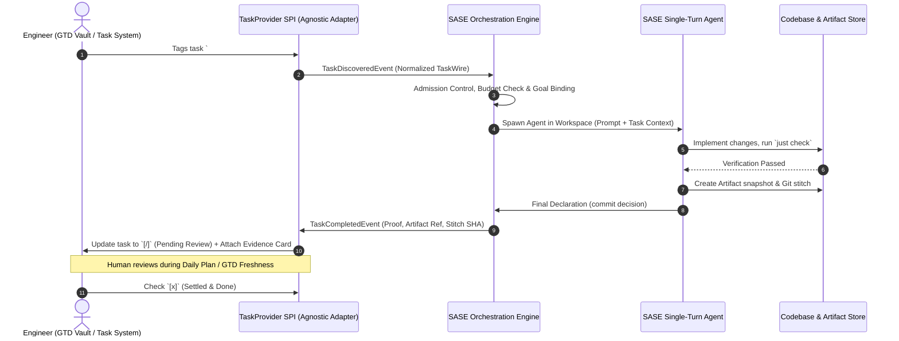
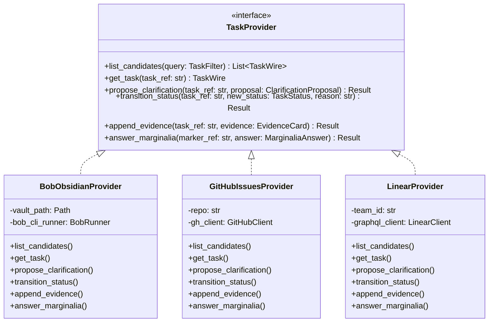
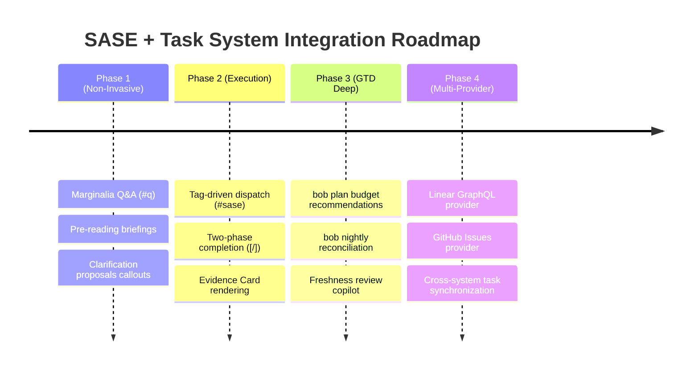

# Deep Integration Between SASE and Task Management Systems: Architectural Foundations, System-Agnostic Design, and Unlocked Use-Cases

*Researcher `gem` · Independent Investigation Report (`__gem`) · 2026-10-25*

---

## Executive Summary & Verdict

### The Bottom Line: Is It a Good Idea?

**Yes—unambiguously.** Deepening the integration between SASE (and agent orchestration in general) and task management systems is not merely a "convenient tooling enhancement"; it represents the necessary evolutionary leap from **episodic prompt engineering** to **continuous ambient delegation**.

Today, agent orchestration tools (including SASE, Claude Code, and Antigravity) are predominantly used in a *synchronous, high-friction, episodic mode*: a human engineer sits in front of a terminal or IDE, formulates a prompt, launches an agent turn, waits or monitors progress, evaluates the diff, and manually commits or updates their external trackers. 

Meanwhile, human cognitive management lives in **task management systems** (such as Bryan's `bob-cli` / Obsidian GTD vault, Linear, or GitHub Issues). This creates a severe **cognitive impedance mismatch**:
- Humans capture intentions, brainstorms, reading questions, and architectural goals asynchronously throughout their day (via mobile notes, PDF marginalia, GTD reviews, and quick captures).
- Agents possess vast, highly parallelizable, non-fatiguing execution capacity, but sit completely idle until a human manually converts an intention into a CLI command.
- The human becomes an exhausted, rate-limiting router: manually moving items between the task system and the agent orchestrator.

A deeper, **task-management-system-agnostic SASE integration** fundamentally bridges this chasm. It establishes the task system as the **ambient Human-Agent Collaboration Boundary (HACB)**. In this paradigm:
1. **Tasks become bidirectional execution contracts**: Humans express intent and acceptance criteria; agents clarify ambiguity, propose execution plans, execute autonomously when authorized, and return verifiable evidence.
2. **Two-phase completion preserves human agency**: Agents never unilaterally close human tasks (`[x]`); they fulfill mechanical verification and transition tasks to pending review (`[/]`) with cryptographic/verifiable proof.
3. **Ambient knowledge work is unlocked**: Reading marginalia (PDF highlights), daily planning budgets, and backlog hygiene transform from neglected manual chores into continuous collaborative loops.

### Essential Caveats and Architectural Boundaries

While the concept is exceptionally sound, its success hinges on strict architectural boundaries:
- **Strict System Agnosticism (The `TaskProvider` SPI):** SASE core must never be hardcoded to Obsidian markdown syntax, regexes, or Bob-specific vault structures. SASE must define a clean, provider-neutral interface (`TaskProvider`). Obsidian/Bob is simply a first-tier provider implementation, alongside Linear, GitHub Issues, and Jira.
- **Clear Domain Separation (Tasks vs. Goals vs. Beads):** An external task is a **declaration of human intent**. A SASE Bead is an **internal engineering work unit / execution DAG**. A SASE Goal is an **audited human-bound objective**. Conflating these into a single "unified task object" causes split-brain state and destroys SASE's hermetic execution guarantees.
- **Fail-Closed Admission & Budget Control:** Ambient, tag-driven agent execution introduces the hazard of runaway loops and quota exhaustion. Autonomous launches must pass through SASE's strict tool control plane, concurrency limiters, and budget policies.

---

## 1. First-Principles Evaluation: The Symbiosis of Agents and Task Systems

```
+---------------------------------------------------------------------------------------+
|                                HUMAN COGNITIVE DOMAIN                                 |
|  - High taste, vision, judgment, implicit context                                     |
|  - Finite attention bandwidth (10-15 Pomodoros/day)                                   |
|  - Asynchronous, impulsive capture (mobile, PDF highlights, GTD morning planning)     |
+-------------------------------------------+-------------------------------------------+
                                            |
                                 Task Management Interface
                              (Obsidian / Bob, Linear, GitHub)
                                            |
+-------------------------------------------v-------------------------------------------+
|                          TASK PROVIDER SPI (PROVIDER-AGNOSTIC)                        |
|  - Normalizes Tasks, Events, Proof Cards, and Marginalia                              |
|  - Enforces Two-Phase Completion: Open [ ] -> In Progress [*] -> Pending Review [/]   |
+-------------------------------------------+-------------------------------------------+
                                            |
                                  SASE Orchestration Plane
                                            |
+-------------------------------------------v-------------------------------------------+
|                                AGENT EXECUTION DOMAIN                                 |
|  - Massive parallel throughput, zero fatigue                                          |
|  - Single-turn execution, hermetic workspaces (sase_<N>), strict verification         |
|  - Immutable Goal Ledger, SDD Bead DAGs, and Durable Artifacts                        |
+---------------------------------------------------------------------------------------+
```

### 1.1 The Cognitive Impedance Mismatch

Human software engineers spend an enormous fraction of their cognitive energy not on typing code, but on **task maintenance**: triaging incoming bugs, breaking down epics, estimating effort, scheduling tasks into daily budgets (e.g. Pomodoros), clarifying underspecified notes, and remembering why a task was created weeks ago.

When agent orchestration is disconnected from task management, this burden actually *increases*. The human must:
1. Review their task list in Obsidian or Linear.
2. Select a task.
3. Context-switch to a terminal workspace.
4. Compose an elaborate prompt explaining the task context, file locations, and acceptance criteria.
5. Wait for the agent or monitor it.
6. Inspect the resulting stitch/PR.
7. Return to the task manager and manually mark the task as done.

This high friction ensures that agents are only deployed for large, deliberate chunks of work. Small tasks, exploratory questions on reading papers, and backlog clarification remain stranded in the task manager.

### 1.2 Shifting from Active Prompting to Ambient Delegation

By integrating SASE deeply with the task management system, delegation becomes **ambient**:
- During morning planning (`bob plan`), the engineer glances at their backlog and simply tags three tasks `#sase`.
- While reading a technical paper on an iPad in Highlights, the engineer highlights a dense paragraph and types `Comment: #q How does our memory allocator handle this edge case?`.
- In the background, SASE discovers these items, validates prerequisites, allocates compute according to available budget, executes the work inside isolated workspaces, and returns structured findings.
- The engineer never opened a terminal, ran an agent command, or monitored a process. The task system itself served as the control interface.

### 1.3 The Two-Phase Completion Contract

A critical design flaw in naive AI task assistants is the "auto-completion fallacy": an agent finishes running and marks the user's task as complete (`[x]`). This breeds distrust because:
1. The agent may have passed unit tests while missing the human's unstated intent.
2. The agent may have made subtle architectural compromises.
3. The human loses visibility into what changed in their system.

SASE's philosophy mandates a **Two-Phase Completion Contract**:
- **Phase 1 (Agent Verification & Pending State):** The agent completes its work, verifies passes (e.g., `just check`), creates a durable artifact, and transitions the task to **Pending Review / Awaiting Acceptance** (in Obsidian Tasks notation, `[/]`). It attaches an immutable **Evidence Card** detailing the stitch, branch, test results, and artifact reference.
- **Phase 2 (Human Settlement & Close):** The human inspects the evidence card during their GTD review (or when accepting a PR). The human decides whether to accept the work and mark the checkbox `[x]`, or reject it with feedback.



---

## 2. Architectural Blueprint: A Task-Management-Agnostic Provider Model

To prevent SASE from becoming an unruly monolith coupled to Obsidian markdown quirks or specific SaaS API schemas, the integration must follow SASE's existing decoupled architecture (analogous to `vcs_provider` and `workspace_provider`).

### 2.1 The Domain Separation: Tasks vs. Goals vs. Beads

A foundational tenet of SASE is clean domain boundaries. We must strictly define the relationships between external tasks, SASE goals, and SASE beads:

```
+-----------------------------------------------------------------------------+
| EXTERNAL TASK (Human Domain: Obsidian / Linear / GitHub)                    |
| - High-level intent, desired outcome, human priority, scheduled date        |
| - Example: "- [ ] Implement LRU caching for artifact reads #sase"           |
+--------------------------------------+--------------------------------------+
                                       | 1 : 1 (on launch)
                                       v
+-----------------------------------------------------------------------------+
| SASE GOAL (Host/Agent Contract: Rust Core Goal Ledger)                      |
| - Bound by host to turn before spawn; immutable event stream; human-settled  |
| - Example: Goal ⌖ "Add in-memory LRU cache to artifact resolver"            |
+--------------------------------------+--------------------------------------+
                                       | 1 : N (decomposition)
                                       v
+-----------------------------------------------------------------------------+
| SASE BEADS (Internal Engineering Execution DAG: SDD Store)                   |
| - Structured work units: Plan, Phases, Tasks (bug, ci, feature, flake)      |
| - Explicit sizes (small, medium, large), dependencies, machine status       |
| - Example: Phase 1: `cache_struct`, Phase 2: `eviction_policy`, Phase 3: `benches` |
+--------------------------------------+--------------------------------------+
                                       | Produces
                                       v
+-----------------------------------------------------------------------------+
| DURABLE ARTIFACT & VERDICT (Verification Proof)                              |
| - Stored in research/attachments repo; snapshot hash; test suite receipt   |
| - Example: `research:202610/artifact_cache_benchmarks.md`                   |
+-----------------------------------------------------------------------------+
```

1. **External Task:** The human's backlog item. Lives in the task management system. Managed by the human GTD lifecycle.
2. **SASE Goal (`⌖`):** The host-owned binding that links an LLM turn to an objective. Immutable events, settled only by humans. Every task-triggered agent run binds to an external-task-backed Goal.
3. **SASE Bead:** The internal, fine-grained engineering DAG. An external task might be executed as a single standalone task bead (`-T "task(feature)" -z small`), or it might be compiled into an Epic Plan DAG with multiple phase beads. External systems never need to understand bead internals.
4. **Durable Artifact:** The verifiable evidence (code stitches, benchmark logs, visual snapshots, research reports) produced during execution.

### 2.2 The `TaskProvider` Service Provider Interface (SPI)

The `TaskProvider` interface defines the contract that any task backend (Obsidian via `bob-cli`, Linear, GitHub Issues, Jira, Todo.txt) must satisfy.



#### Core Wire Structures

```rust
pub enum TaskStatus {
    Open,           // [ ]
    InProgress,     // [*]
    PendingReview,  // [/]  (Two-phase completion gate)
    Completed,      // [x]  (Human closed)
    Blocked,        // [?]
    Cancelled,      // [-]
}

pub struct TaskWire {
    pub id: String,                     // E.g., "obsidian://sase.md#^refactor-cli" or "linear://ENG-402"
    pub provider: String,               // "bob", "linear", "github"
    pub title: String,                  // "Refactor CLI option parsing"
    pub body: Option<String>,           // Detailed notes, bullet points, context
    pub status: TaskStatus,
    pub tags: Vec<String>,              // ["#sase", "#refactor", "#p1"]
    pub scheduled_date: Option<NaiveDate>,
    pub due_date: Option<NaiveDate>,
    pub dependencies: Vec<String>,      // Target IDs this task depends on
    pub metadata: BTreeMap<String, Value>,
    pub source_location: SourceLocation, // File path, line number, block ID, URL
}

pub struct EvidenceCard {
    pub task_id: String,
    pub goal_id: String,
    pub agent_run_id: String,
    pub summary: String,
    pub stitch_sha: Option<String>,
    pub branch: Option<String>,
    pub pr_url: Option<String>,
    pub artifact_refs: Vec<String>,     // E.g., ["research:202610/cli_refactor_notes.md"]
    pub verification_verdict: String,   // E.g., "PASSED (142 tests, 0 failures)"
    pub completed_at: DateTime<Utc>,
}

pub struct ClarificationProposal {
    pub task_id: String,
    pub proposed_title: Option<String>,
    pub clarified_scope: String,
    pub acceptance_criteria: Vec<String>,
    pub recommended_size: String,       // "small", "medium", "epic"
    pub recommended_macro: Option<String>, // E.g., "#research_swarm", "#plan_swarm"
    pub proposed_tag: String,           // E.g., "#sase" or "#sase/ready"
}
```

### 2.3 Provider Implementations

1. **The `BobObsidianProvider` (`bob-cli` & Obsidian Vault):**
   - **Discovery:** Leverages `bob query` or native AST parsing to scan for tags (`#sase`, `#q`) without brute-force filesystem scans.
   - **AST Integrity:** Uses AST-aware markdown manipulation (preserves human whitespace, frontmatter, folding state, and block IDs `^block-id`).
   - **Status Mapping:** Direct mapping to Obsidian Tasks checkboxes:
     - `[ ]` $\leftrightarrow$ `Open`
     - `[*]` $\leftrightarrow$ `InProgress`
     - `[/]` $\leftrightarrow$ `PendingReview`
     - `[x]` $\leftrightarrow$ `Completed`
     - `[?]` $\leftrightarrow$ `Blocked`
   - **Non-Invasive Callouts:** Renders clarification proposals and evidence cards as native Obsidian Collapsible Callouts (`> [!PROPOSAL]-` and `> [!EVIDENCE]-`).
2. **The `GitHubIssuesProvider`:**
   - Maps GitHub Issues to `TaskWire`.
   - Uses labels (`sase:ready`, `sase:in-progress`, `sase:review-needed`).
   - Proposes clarifications as issue comments with checklist buttons.
   - Attaches evidence as structured PR cross-references and comment summaries.
3. **The `LinearProvider`:**
   - Maps Linear issues, cycles, and project states.
   - Transitions state to "In Review" upon agent completion.
   - Links Linear attachments to SASE artifact URLs.

---

## 3. Comprehensive Taxonomy of Unlocked Use-Cases

A deep, task-management-system-agnostic SASE integration unlocks capabilities that span five distinct functional domains:

```
+-----------------------------------------------------------------------------------+
|                        TAXONOMY OF UNLOCKED USE-CASES                             |
+-----------------------------------------------------------------------------------+
|                                                                                   |
|  1. AUTONOMOUS EXECUTION & SMART DELEGATION ("Tag and Forget")                    |
|     * Tag-Triggered Single-Turn Execution with Two-Phase Proof Cards              |
|     * Tiered Model & Swarm Routing via Tag Decorators (#sase/fast, #sase/deep)    |
|     * Dependency-Chained DAG Wave Execution (Unlocking via dependsOn)             |
|     * Off-Peak & Nightly Batch Execution of Backlog Chores                        |
|                                                                                   |
|  2. PROACTIVE CLARIFICATION, SIZING & TRIAGE ("Agent as Senior Staff Partner")    |
|     * Ambiguity Detection & Interactive Clarification Proposals                   |
|     * Automated Task Sizing & Epic Plan Decomposition Recommendations             |
|     * Semantic Duplicate & Precedent Matching Across Projects                     |
|     * Pre-Flight Feasibility & Blocker Gating                                     |
|                                                                                   |
|  3. MARGINALIA, ACTIVE READING & KNOWLEDGE INTEGRATION ("Ambient Scholar")       |
|     * Marginalia Q&A: Answering PDF Highlight Questions (#q) in Notes             |
|     * Pre-Reading Synthesis & Architectural Impact Briefings                      |
|     * Literature-to-Code Tracing & Memory Strand Extraction                       |
|     * Automated Audio Edition Enrichment (sase-listen Integration)                |
|                                                                                   |
|  4. GTD WORKFLOW AUGMENTATION (Daily Planning & Review)                           |
|     * Morning Plan Feasibility & Delegation Budgeting (bob plan)                  |
|     * Nightly Reconciliation & Daily Journal Ledger (bob nightly)                 |
|     * Freshness Review Copilot & Stale Project Revitalization (bob freshness)     |
|     * Active Pomodoro Contextualization & Focus Anchoring                         |
|                                                                                   |
|  5. REVERSE-FLOW: AGENT DISCOVERIES TO HUMAN BACKLOG                              |
|     * Surfacing Discovered Tech Debt, Flakes, and Bugs into GTD Inbox             |
|     * Post-Incident & Failed-Verification Action Item Extraction                  |
|     * Automatic Milestone & Release Note Reconciliation                           |
|                                                                                   |
+-----------------------------------------------------------------------------------+
```

---

### Use-Case Category 1: Autonomous Execution & Smart Delegation ("Tag and Forget")

#### 1.1 Tag-Triggered Execution with Two-Phase Verification
- **Scenario:** The engineer captures a well-defined task during an issue review: `- [ ] Add JSON output format to sase tool list #sase ^tool-list-json`.
- **Workflow:**
  1. The task watcher detects `#sase` on an open task.
  2. SASE binds the task to a Goal, opens an ephemeral workspace (`sase_15`), and launches a single-turn agent.
  3. The agent inspects the code, implements the `--json` flag, adds unit tests, runs `just check`, and submits its final declaration.
  4. SASE records the commit stitch and durable artifact snapshot.
  5. The task is transitioned from `[ ]` to `[/]` (Pending Review), and SASE writes a structured Evidence Card directly beneath the task in Obsidian/Linear.
- **Value:** The human never had to switch terminals, run prompts, or wait. The task is ready for human review during their next GTD cycle.

#### 1.2 Tiered Model and Harness Routing via Tag Modifiers
- **Scenario:** Different tasks require vastly different compute profiles, models, and orchestration strategies.
- **Tag Grammar:**
  - `#sase/fast` $\rightarrow$ Routes to high-speed, cost-effective models (e.g. Gemini Flash, Claude Haiku) for mechanical edits, typo fixes, or docstring additions.
  - `#sase/deep` $\rightarrow$ Routes to high-effort reasoning models (e.g. Gemini Pro High, Claude Sonnet/Opus) with extended thinking for subtle algorithmic fixes or concurrent race repairs.
  - `#sase/swarm` or `#sase/research` $\rightarrow$ Dispatches a multi-agent macro swarm (`#research_swarm`) across multiple model families to synthesize diverse perspectives on a design problem.
  - `#sase/epic` $\rightarrow$ Dispatches a planning agent to draft a formal Tale/Epic Plan (`./epic_plan.md`), validate it, compile it into an SDD bead DAG, and stage it for human approval.
- **Value:** The human specifies the desired compute tier and architecture with a single tag, matching cost and effort to task complexity.

#### 1.3 Dependency-Chained DAG Wave Execution
- **Scenario:** A project has three interrelated tasks:
  - Task A: `- [ ] Define wire schema for TaskWire ^schema`
  - Task B: `- [ ] Implement BobObsidianProvider parser (dependsOn:: ^schema) ^parser`
  - Task C: `- [ ] Add integration tests for Bob provider (dependsOn:: ^parser) ^tests`
- **Workflow:**
  1. SASE recognizes that Task A has no prerequisites; it launches an agent to implement Task A.
  2. When Task A transitions to `[/]`, SASE evaluates Task B's dependencies. Since its dependency is satisfied, Task B is automatically launched.
  3. When Task B lands in `[/]`, Task C is launched.
- **Value:** Complex multi-step engineering pipelines run asynchronously in correct dependency order without requiring the human to manually orchestrate each stage.

#### 1.4 Off-Peak and Nightly Batch Execution
- **Scenario:** The user has 15 non-urgent maintenance tasks in their `#sase/backlog` (dependency updates, linting cleanup, dead-code removal, test coverage gaps).
- **Workflow:**
  - Integrated with `bob nightly` or scheduled off-peak AXE chops.
  - Runs during late-night hours when machine resources and API rate limits are completely unconstrained.
  - Enforces SASE's weighted capacity budgets (e.g., maximum 2 concurrent workspace builds) to prevent resource contention.
  - Prepares all completed work in `[/]` status for the human's morning review.

---

### Use-Case Category 2: Proactive Clarification, Sizing & Triage ("Agent as Senior Staff Partner")

#### 2.1 Ambiguity Detection and Interactive Clarification Proposals
- **Scenario:** The user jots a quick, cryptic note in their inbox: `- [ ] fix tool run timeout race`. They do not tag it `#sase` because they haven't thought through the details.
- **Workflow:**
  1. In the background (during freshness triage), an agent reads the untagged task and searches the codebase (`src/sase/tools/`).
  2. The agent identifies the likely race condition in `src/sase/tools/run.py` around SIGTERM handling.
  3. Rather than executing blindly, the agent generates a **Clarification Proposal** formatted as a collapsed callout block beneath the task:
     ```markdown
     - [ ] fix tool run timeout race ^timeout-race
       > [!PROPOSAL]- SASE Clarification & Launch Plan
       > **Identified Issue:** Potential race condition in `src/sase/tools/runner.py#L112-L140` where process cleanup fails if child exits between SIGTERM and SIGKILL.
       > **Proposed Scope:**
       > 1. Use monotonic wait loop with PID polling.
       > 2. Ensure ToolRun reservation record marks status `TIMED_OUT` before termination.
       > 3. Add regression test in `tests/test_tool_runner_timeout.py`.
       > **Recommended Sizing:** `small` (single-turn worker)
       > *Check the box below to approve this scope and launch:*
       > - [ ] Approve & Launch `#sase` worker ^approve-timeout-race
     ```
  4. If the human agrees, they simply check the approval box. The task is tagged `#sase` and automatically scheduled.
- **Value:** Eliminates the mental friction of drafting detailed prompt specifications. The agent does the legwork of analyzing the codebase and drafting acceptance criteria.

#### 2.2 Automated Task Sizing and Decomposition Guidance
- **Scenario:** A user captures an ambitious feature: `- [ ] Add full Linear sync support to SASE`.
- **Workflow:**
  1. The sizing evaluator inspects the task against SASE sizing rules (`sase_sizes.md`).
  2. The agent determines that this task is far too large for a single-turn worker (requires new provider crate in `sase-core`, Python bindings, CLI commands, and test suites).
  3. The agent appends a recommendation:
     ```markdown
     > [!WARNING]- Scope Alert: Task Exceeds Single-Turn Ceiling
     > This request is estimated as an **Epic / Tale** (> 5 files, cross-repository changes across `sase-core` and `sase`).
     > **Recommended Action:** Decompose into an Epic Plan.
     > - [ ] Launch `#plan_swarm` to generate `docs/plans/linear_sync_epic.md`
     ```

#### 2.3 Semantic Duplicate and Historical Precedent Matching
- **Scenario:** A user files a bug: `- [ ] TUI bus error on terminal resize`.
- **Workflow:**
  1. Agent scans closed SASE beads, historical Git commit messages, and prior research reports (`sase/repos/research/202610/`).
  2. Surfaces immediate context:
     ```markdown
     > [!INFO]- Related Precedent Found
     > Found existing research: `research:202610/apollo_tui_bus_error_crash.md`
     > Closed bead: `sase-t81` ("Fix SIGBUS on resize during GC compaction").
     > The current issue may be a regression of `sase-t81`.
     ```

---

### Use-Case Category 3: Marginalia, Active Reading & Knowledge Integration ("Ambient Scholar")

#### 3.1 Marginalia Q&A in Reading Notes (`~/bob/ref/`)
- **Scenario:** While reading an academic paper on agent evaluation harnesses in Highlights on iPad, the user highlights a paragraph describing "passive monitor verification" and types:
  `Comment: #q How does this compare to our SASE monitor prepared completion contract in sase_final?`
- **Workflow:**
  1. `bob ref scan` syncs the PDF highlight into the reference note `~/bob/ref/papers/agent_harnesses.md`.
  2. The SASE Marginalia Agent discovers the `#q` tag.
  3. The agent reads the referenced paper excerpt, loads SASE reference memory (`sase_final.md` and `docs/reference/automation/monitors.md`), and performs a comparative analysis.
  4. The agent writes the answer directly into the reference note under the comment:
     ```markdown
     > "Passive monitor verification observes the execution stream without injecting synthetic probes..."
     
     Comment: #q How does this compare to our SASE monitor prepared completion contract in sase_final?
     
     > **SASE Scholar Answer (2026-10-25):**
     > The paper's "passive monitor" is identical to SASE's `sase final prepare` + `sase monitor start -p verify -f <ref>` workflow. 
     > Both systems decouple verification from agent token generation: the agent publishes an intent hash, hands execution to the host monitor, and dies. 
     > The key difference: SASE's monitor enforces an explicit *escalation protocol* (exit code 124 triggers a recovery successor turn), whereas the paper's harness fails closed without automated recovery.
     ```
- **Value:** Reading and technical comprehension are supercharged. The user's marginalia becomes an active dialogue with an AI partner grounded in their personal codebase.

#### 3.2 Automated Pre-Reading Briefings
- **Scenario:** The user queues a 40-page paper on database replication: `bob ref create https://arxiv.org/abs/...`.
- **Workflow:**
  - Before the user opens the PDF, a background agent reads the document, extracts key claims, highlights potential pitfalls, and generates a 1-page "Executive Reading Briefing" at the top of the reference note.
  - The briefing explicitly highlights: "Sections 3 and 5 are directly applicable to our Goal Ledger hot-read caching; Sections 4 and 6 can be safely skimmed."

#### 3.3 Dynamic Literature-to-Code Tracing & Memory Strand Extraction
- **Scenario:** An engineering book or paper establishes a novel concept (e.g., "Two-Speed Verification Split").
- **Workflow:**
  - The agent detects this key insight and proposes creating a new strand in the SASE memory web:
    `sase/memory/decisions/two_speed_verification.md`.
  - Links the new strand bidirectionally to the reference note in `~/bob/ref/` and the relevant source code files.

---

### Use-Case Category 4: GTD Workflow Augmentation (Daily Planning & Review)

#### 4.1 Morning Plan Budget Feasibility & Delegation Recommendations (`bob plan`)
- **Scenario:** During morning planning, Bryan runs `bob plan`. The command reports a daily budget of 12 Pomodoros, but 20 Pomodoros of tasks are scheduled for "Today".
- **Workflow:**
  1. The integration evaluates the scheduled tasks:
     - 8 Pomodoros are high-touch human architectural design (cannot be delegated).
     - 12 Pomodoros are routine implementations, test fixtures, and refactors.
  2. SASE outputs a delegation recommendation:
     ```text
     Daily Budget Alert: 20 Pomodoros scheduled vs. 12 available.
     Recommendation: Delegate 8 Pomodoros to SASE agents:
       - [ ] Update clippy lints across bob-cli (#sase/fast) [Est: 2 🍅]
       - [ ] Add JSON serialization to Goal events (#sase) [Est: 3 🍅]
       - [ ] Write integration test for Highlights sync (#sase) [Est: 3 🍅]
     Net Human Load after delegation: 12 Pomodoros (100% budget fit).
     ```

#### 4.2 Nightly Reconciliation and Daily Journal Ledger (`bob nightly`)
- **Scenario:** At the end of the day, `bob nightly` runs.
- **Workflow:**
  1. Gathers all agent runs executed during the past 24 hours.
  2. Compiles an executive summary of completed agent work, verified test verdicts, and generated artifacts.
  3. Appends this ledger into today's daily journal note in Obsidian (`journals/2026-10-25.md`).
  4. Flags any tasks in `[/]` status that have been awaiting human review for $> 48$ hours.

#### 4.3 Freshness Review Copilot (`bob freshness`)
- **Scenario:** During weekly GTD freshness review, walking large project notes (like `sase.md`, which contains over 200 tasks) is daunting.
- **Workflow:**
  1. Agent runs an automated drift analysis on the project note:
     - Detects tasks that reference deleted code files or retired features $\rightarrow$ Proposes `bob task archive`.
     - Detects tasks whose acceptance criteria were satisfied by recent commits $\rightarrow$ Proposes marking `[/]`.
     - Identifies unblocked tasks whose `dependsOn` targets have been closed $\rightarrow$ Moves them to the `### Ready` lane.

#### 4.4 Pomodoro Focus Anchoring & Contextual Bias
- **Scenario:** When the human starts a live Pomodoro (`bob capture '='` on a task), the active task is recorded.
- **Workflow:**
  - If the human opens a conversational agent session (e.g. Antigravity or TUI) during that 25-minute window, SASE automatically injects the active Pomodoro task, its parent project note, and recent related commits as high-priority background context.

---

### Use-Case Category 5: Reverse Flow: Agent Discoveries to Human Backlog

#### 5.1 Surfacing Discovered Work into the Human GTD Inbox
- **Scenario:** While working on an epic, a SASE worker discovers an unrelated subtle memory leak or race condition. Under SASE rules, the agent creates a task bead (`sase bead create -T "task(bug)" ...`).
- **The Problem:** In a siloed system, that bead sits in the SDD store unseen unless the human explicitly checks `sase bead ready`.
- **The Solution:** The integration automatically projects newly created high-priority task beads into the human's Obsidian GTD inbox (`inbox.md`) or relevant project note (`sase.md`) under a dedicated section:
  ```markdown
  ### Discovered by Agents (Awaiting Human Triage)
  - [ ] Memory leak in TUI widget unmount (found during sase-14 epic run) #bug #from-agent ^agent-disc-92
    - Bead: `sase-b42` · Size: `small` · Detected: 2026-10-25
  ```
- **Value:** The human's GTD system remains the true single source of truth for all engineering work, human or machine-discovered.

#### 5.2 Post-Incident and CI Failure Action Item Extraction
- **Scenario:** A master push fails CI on an off-path test runner, or an epic land agent escalates.
- **Workflow:**
  - SASE's triage system diagnoses the failure signature.
  - Automatically files an actionable, scheduled task in the human's project note with root-cause analysis and proposed fix commands.

---

## 4. Concrete Case Study: The SASE + Bob Ecosystem

To visualize how this works in practice, let us examine the concrete interaction between SASE and Bryan's `bob-cli` / Obsidian environment.

### 4.1 Markdown Syntax and Annotation Protocols

In Bob's Obsidian vault (`~/bob`), tasks follow the Obsidian Tasks format with Bob-specific extensions.

#### Example 1: Tag-Driven Autonomous Execution & Evidence Card

**Initial State (Human writes task):**
```markdown
## Tasks
- [ ] Add JSON export to sase project stats #sase ^stats-json
```

**Intermediate State (SASE launches worker):**
```markdown
## Tasks
- [*] Add JSON export to sase project stats #sase ^stats-json
  > [!INFO]- SASE Agent Running
  > **Agent Session:** `sase_14.run_8812` (Model: Gemini 3.8 Flash High)
  > **Goal:** ⌖ Add JSON output format to project stats CLI
```

**Final State (Agent passes tests and submits declaration):**
```markdown
## Tasks
- [/] Add JSON export to sase project stats #sase ^stats-json
  > [!EVIDENCE]- SASE Completion Evidence (Pending Human Review)
  > - **Status:** Verification Passed (`just check` clean, 142 tests passing)
  > - **Stitch:** `4b91f0a` on workspace `sase_14`
  > - **Artifact:** `sase artifact read research:202610/stats_json_verification.md "Inspect test output"`
  > - **Files Modified:**
  >   - `src/sase/project_stats/cli.rs` (+45, -2)
  >   - `src/sase/project_stats/json.rs` (+120, -0)
  >   - `tests/test_project_stats_json.py` (+88, -0)
  > *Check `[x]` to accept this work and trigger master merge.*
```

#### Example 2: Marginalia Q&A on Highlights PDF Notes (`~/bob/ref/`)

**Initial State (Synced from Highlights on iPad):**
```markdown
### Annotations

**Page 12**

> The coordinator must enforce non-blocking gate semantics to avoid deadlock in concurrent swarm topologies.

Comment: #q Why does SASE require gates to never block an agent?
```

**Post-Agent State (Agent automatically answers the question):**
```markdown
### Annotations

**Page 12**

> The coordinator must enforce non-blocking gate semantics to avoid deadlock in concurrent swarm topologies.

Comment: #q Why does SASE require gates to never block an agent?

> [!NOTE]- SASE Architectural Answer
> **Answered by SASE Knowledge Agent · 2026-10-25**
> SASE memory decision `gates-never-block` defines this explicitly:
> 1. **Resource Preservation:** Agents are single-turn execution processes. Blocking an agent on human feedback holds expensive provider tokens, process memory, and temporary workspace leases idle.
> 2. **Process Integrity:** Nothing can reliably wake an in-process waiting agent across machine restarts or network drops.
> 3. **Mechanical Continuation:** Creating a gate *terminates* the agent's turn cleanly. When the gate is settled by the human, a fresh successor turn is mechanically spawned with the gate decision injected into its context.
```

---

## 5. Architectural Safeguards: Preventing Autonomous Failure Modes

Autonomous integration between background watchers and agent runners carries non-trivial risks. SASE's architecture must incorporate robust safeguards:

```
+-------------------------------------------------------------------------------+
|                       AUTONOMOUS ADMISSION CONTROL PIPELINE                   |
+-------------------------------------------------------------------------------+
|                                                                               |
|   External Task Tagged (#sase)                                                |
|         |                                                                     |
|         v                                                                     |
|   [ 1. Rate Limiting & Concurrency Gate ]                                     |
|         | - Max 2 concurrent autonomous runs                                 |
|         | - Daily token/spend ceiling ($20/day)                               |
|         v                                                                     |
|   [ 2. Pre-Flight Workspace Health Check ]                                    |
|         | - Workspace clean? No uncommitted diffs or dirty locks              |
|         | - Test suite baseline passing on HEAD?                              |
|         v                                                                     |
|   [ 3. Intent & Scope Validator ]                                             |
|         | - Task size <= Medium (Epics require explicit approval)             |
|         | - No protected path violations (e.g. CI configs, secret vaults)     |
|         v                                                                     |
|   [ 4. Hermetic Launch in Isolated Workspace (sase_<N>) ]                     |
|                                                                               |
+-------------------------------------------------------------------------------+
```

1. **Spend and Rate-Limit Ceilings:**
   - Autonomous background dispatch must have strict hard caps: e.g., maximum 3 background tasks per hour, maximum $15.00 daily compute expenditure.
   - If an agent hits a rate limit or API error, it backs off exponentially and annotates the task with the delay reason.
2. **Protected Paths and Dangerous Operations:**
   - Tasks that require privileged permissions (e.g., `sudo`, production deployment, deleting repositories) fail admission.
   - SASE creates an explicit notification gate (`/sase_gate`) rather than executing automatically.
3. **AST Preservation and Git Sync Coordination:**
   - When modifying Obsidian markdown files, SASE must coordinate with `bob vault-sync` to avoid Git merge conflicts.
   - Writes to vault notes must be atomic, using file coordination locks (`maintenance_lock`) identical to `bob task reconcile`.

---

## 6. Implementation Roadmap & Phased Adoption Plan



### Phase 1: Passive Observation & Marginalia Q&A (Immediate / Low-Risk)
- **Objective:** Deploy read-only intelligence and non-invasive marginalia Q&A without mutating task states or executing code changes.
- **Deliverables:**
  - `sase task marginalia`: AXE chop scanning `~/bob/ref/` for `#q` comments and appending answers.
  - `sase task clarify`: Background evaluator generating non-destructive `> [!PROPOSAL]` callouts for ambiguous inbox tasks.
  - Zero risk of broken code or unintended commits.

### Phase 2: Tag-Driven Autonomous Execution & Proof Cards (Core Milestone)
- **Objective:** Enable direct delegation from task tags with full verification safety.
- **Deliverables:**
  - Implement `BobObsidianProvider` conforming to `TaskProvider` SPI.
  - Watcher chop detecting `#sase` tags on open tasks.
  - SASE worker execution with mandatory `just check` verification.
  - Two-phase completion transition (`[ ]` $\rightarrow$ `[/]`) with rich Evidence Card formatting.

### Phase 3: GTD Deep Integration & Maintenance Hooks (Workflow Harmony)
- **Objective:** Integrate with Bryan's daily cognitive rhythms.
- **Deliverables:**
  - Hook into `bob plan`: SASE calculates agent delegation capacity against daily Pomodoro budgets.
  - Hook into `bob nightly`: Compiles daily agent execution journals and reconciles completed tasks.
  - Hook into `bob freshness`: Automated drift analysis for stale project notes.

### Phase 4: Full Multi-Provider SPI (Platform Agnosticism)
- **Objective:** Abstract provider logic into pluggable modules.
- **Deliverables:**
  - Extract `TaskProvider` into `sase_core_rs`.
  - Implement `GitHubIssuesProvider` and `LinearProvider`.
  - Enable bidirectional cross-sync between Obsidian tasks, GitHub Issues, and SASE Beads.

---

## 7. Conclusion

Integrating SASE deeply and agnostically with task management systems is a transformative architectural move. It honors the fundamental reality of software engineering: **human thinking is continuous, asynchronous, and exploratory; agent execution is discrete, parallel, and rigorous.**

By establishing a clean, provider-agnostic `TaskProvider` layer, enforcing two-phase verification (`[/]`), and anchoring agent execution to verifiable evidence cards, SASE can transform task management from a static record of backlog debt into a dynamic, ambient operating system for collaborative human-agent intelligence.
