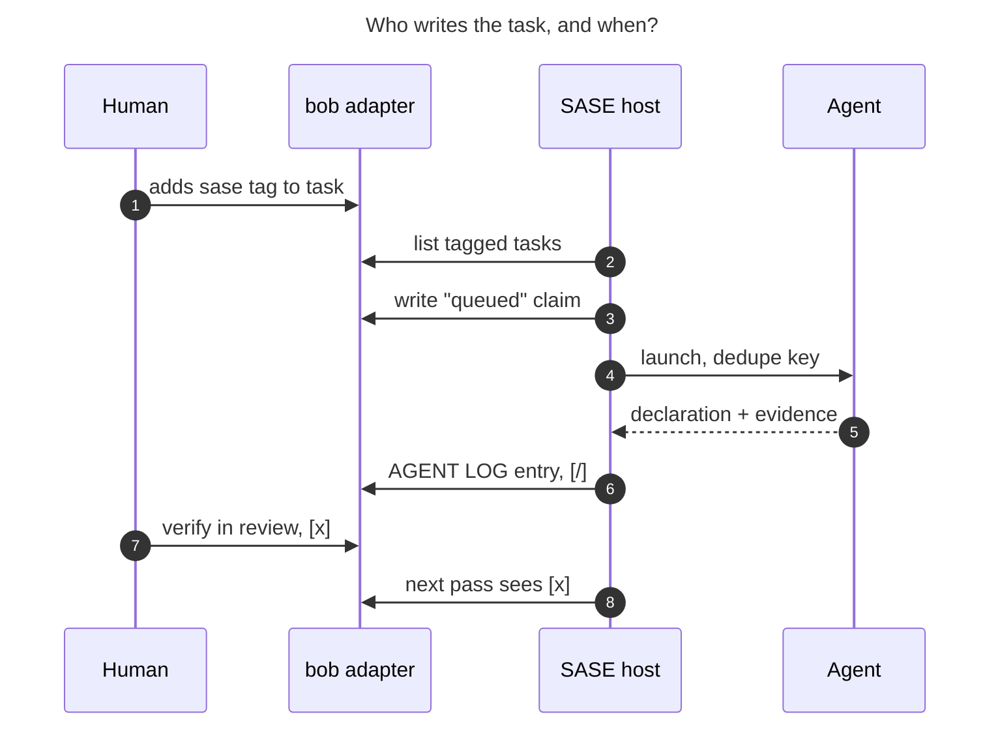

# Task managers as a SASE work source: is it a good idea, and what would it unlock?

*Researcher cld · 2026-10-25. I read these sources directly:*

- *sase source, docs and decision records;*
- *the bob-cli, bob-plugins and bob-mac-capture checkouts;*
- *the live Bob vault, through read-only `bob query` and counts;*
- *prior research artifacts.*

*An outside survey of agent and tracker products came from a delegated web search that cited primary sources. I did not re-fetch every URL myself, and claims it could not verify are marked. Nothing in the vault or any repo was changed.*

---

## Bottom line

- **Yes. The connection you are sensing is real, and it is about structure, not convenience.**
  - GTD's clarify step always had a "delegate it" branch, which feeds a Waiting For list. For a solo person that branch was mostly empty. Agents fill it.
  - SASE has quietly rebuilt a second GTD system for its agents: beads with a `ready` triage queue, `TaskTriage` gates, a notification inbox, and a designed Goals "Review" lane where "agents claim; you close". That system runs in parallel to Bob.
  - Two trusted systems is the classic GTD failure. Your own October research on `~/bob/sase.md` found the problem there was "ownership, not volume".
- **Your vault is already mostly a backlog of agent-shaped work.**
  - It has 495 open `#task` lines. 376 of them (76%) live in `sase*.md` and `bob*.md` notes. Another 41 are `#ref` reading tasks.
  - Today, nothing carries a task's identity into the agent run that works it, or carries the evidence back.
- **The value is closing the loop, not saving keystrokes on launch.** You already archive roughly 70–78 SASE prompts a day in the sase project alone, so launching is not the bottleneck. What is missing is one identity running task → run → evidence → your verification. It should be checked inside the review ritual you already do every morning: the `]s` walk's PENDING tier, which comes due daily for `[/]` tasks.
- **About 80% of the machinery exists.** On the SASE side:
  - scheduler (AXE) jobs with filesystem triggers and durable `dedupe_key`s;
  - custom gates and questions;
  - host-owned finalizers that report evidence;
  - a working one-way GitHub-issue → bead mirror as precedent;
  - the Goals claim/settle design.

  On the Bob side:
  - JSON `bob query` and `bob ref show`;
  - appending a child line under a task through `bob capture -t`;
  - digest-guarded task refs.

  What is missing is thin:
  - a work-item adapter contract;
  - an origin field on agent runs;
  - a write-back finalizer;
  - three or four agent-facing `bob` verbs;
  - an answers journal for reference notes.
- **Two of your ideas need a correction before design.**
  - **`#q` answers cannot go "in the same note" as you pictured.** Bob overwrites anything inside the generated Highlights region on every rescan, and by policy it never writes PDF annotations or replies. Answers should live in a Bob-owned journal that Bob renders under the question (§3.1c).
  - **Agents must not flip checkboxes directly.** `[/]` should come from a new Bob "return" gesture that the SASE host runs after the turn, never from the agent. The integration must also never stamp `fresh`, never link tasks into Today, and never author `[?]`. All three are settled Bob rules.
- **Be agnostic in the contract, not in the adapter count.** Design the interface around a canonical lifecycle (Figure 1) and per-tracker capability flags. Build Bob as adapter #1, then move the existing GitHub mirror onto the same contract as adapter #2. Only then consider Linear, Todoist or Taskwarrior. That is the spirit of SASE's own "mechanism follows corpus" decision.
- **The main risk is your review capacity, not agent capability.** Bob's Pending cap (`plan.max_pending`, default 10) is a ready-made backpressure signal: stop launching when returned work is not being verified.
- **Recommended first slice:** read-only work whose output is cheap to verify. That means `#sase/research` (research swarm → report → back-link) and `#q` (answers). Next comes plan-only delegation, then readiness proposals. Code delegation that ends in `[/]` comes last.

---

## 1. Is the "deeper connection" real?

### 1.1 GTD and agent orchestration are the same pipeline

| GTD stage | What it asks | Bob today | SASE today |
| --- | --- | --- | --- |
| Capture | Get it out of your head | `bob capture`, `mac_inbox.md`, `gkeep_inbox.md`, Highlights `#task` comments | Prompt input, Telegram, `sase run` |
| Clarify | Is it actionable? What is the next action? What does done look like? | NEW review tier; `fresh` stamp means "a human confirmed this" | Plans/tales, `/sase_questions`, plan approval gates |
| Delegate → Waiting For | Who else can do it? | No delegate target | Agent launch; Agents tab; `%wait` |
| Organize | Projects, next actions, contexts | `^prj` projects, lanes `[ ] [*] [/] [?]`, Depends-On links | Epics/phases, beads, `%wait(bead=…)`, `%queue` |
| Reflect | Weekly review: is the system still trustworthy? | `]s` walk tiers PRE → NEW → PROJECTS → PENDING → NEXT → TICKLER → REFERENCES → ROTTEN → POST | `TaskTriage` gates, notifications, Goals Review lane (designed) |
| Engage | What do I do now? | Today ledger, Pomodoros, caps | Runner queue, admission holds, usage windows |
| Horizons | Areas, goals, purpose | Area notes and their `parent` tree | Goal ledger (⌖); "host binds every turn to one goal" |

The table shows two systems answering the same questions for two kinds of actors. The deep version of the integration is not "Bob can start agents". It is **one trusted system with two kinds of actors: you, and delegates who cannot be held accountable.** Linear's agent guidelines use the same wording, and their model keeps a human assignee while the agent is a *delegate*.

### 1.2 Evidence from your own system

- **The corpus exists.** A read-only `bob query --tasks 'not done'`, de-duplicated by path and line, returns 495 open tasks:

  | Lane | Count |
  | --- | --- |
  | Blocked `[?]` | 434 |
  | Ready `[ ]` | 40 |
  | Next `[*]` | 15 |
  | In Progress `[/]` | 6 |

  - Across all 495, 386 carry a `scheduled` date and 58 have dependencies, so "Blocked" mostly means "scheduled for later".

  - 341 sit in `sase*.md` notes and 35 in `bob*.md` notes.
  - The rest are spread across personal-life areas. I name none of them here, because this research repo is public.
- **The dual backlog is a known pain.** The 2026-10-19 consolidated report on `~/bob/sase.md` counted 228 open SASE tasks and 83 idea bullets living outside SASE's bead store. It found 14 merge groups, 4 contradictions and 18 ideas that were already done or obsolete. It called the root problem "ownership, not volume".
- **Agents already flow into Bob, one way.** Your `research-highlights` file hook runs `bob ref create --include-id -P …` for every new research report. Bob tags those references with origin `agent-report`, and Mac Capture has a "Chats" scope for them. The reverse direction (task → agent → evidence on the task) does not exist.
- **The question-asking habit already exists.** No `#q` tags are in the vault yet. A rough regex finds about 214 highlight-comment callouts across `~/bob/ref/`, and about 45 comment lines containing a `?` across 24 reference notes. Treat these as a proxy, not a count of real questions.

### 1.3 What would make this a *bad* idea

Do not build it if these turn out to be true:

1. **Your bottleneck is attention, not hand-offs.** At about 70+ prompts a day, starting agents is clearly not the problem. If verifying their output is already saturated, automated intake only adds load.
   - METR found 0 of 15 agent PRs mergeable as-is, at about 42 minutes of fix-up each.
   - An MSR '26 study of 33,596 agent PRs found 38% of rejected PRs died with no reviewer engagement at all.
2. **Your personal tasks are too terse to delegate safely.** Ambig-SWE (ICLR 2026) shows models struggle to tell well-specified tasks from underspecified ones. Most GTD next actions are one line on purpose.
3. **The vault becomes a second write target with weak concurrency.**
   - `bob capture` takes no lock.
   - Vault sync commits every 15 seconds on the Mac.
   - Reconcile admits it "cannot provide a true compare-and-swap against an editor".

   An agent writing into a note you are editing in Obsidian ends up in `_conflicts/`.

Each risk has a cheap mitigation (§5). None of them argues against the *connection*, but together they argue for a narrow first slice.

---

## 2. What already exists, and the gaps

### 2.1 SASE building blocks

| Building block | Where | Use here |
| --- | --- | --- |
| AXE scheduler jobs | `docs/reference/automation/scheduler-jobs.md` | Each job emits `proposed_launches` with `prompt`, `workspace`, `model`, `env`, `dedupe_key`, `wait_on`. The `fs` trigger plus a `max_quiet` backstop can watch `~/bob` shallowly, with no content reads. `dedupe_key` is "durable work identity", and `%if` re-checks eligibility at admission. This is the intake loop. |
| External issue mirror | `src/sase/external_mirror/`, `docs/reference/work-units/bead-mirroring.md` | The precedent, but GitHub-only and one-way. It hard-codes task type `github`, goes through `sase_vcs` issue hooks, and closing a bead never closes the upstream issue. |
| Custom gates | `docs/reference/automation/notification-gates.md` | Any automation can raise Accept / Edit / Reject options with argv commands and typed inputs. Accepting a readiness proposal fits here. |
| Questions | `/sase_questions` | The `input_required` state; the turn ends and continuation is mechanical (decision `gates-never-block`). |
| Finalizers | `docs/reference/config/finalizers.md`, `src/sase/finalizers/` | `builtin@command` or a plugin provider runs after the turn with the payload, obligations and `assigned_bead_id`, and reports typed evidence (`sha`, `url`, `bead`). This is the write-back point, and it keeps completion host-owned. |
| Launch provenance | `AgentMetaWire` (`src/sase/core/agent_scan_wire_markers.py`) | Carries `bead_id`, `prompt_origin`, `prompt_source_surface`, job ids, `output_variables`. **There is no field for an external work item or a goal.** |
| Goals (⌖) | Decisions `goal-ledger`, `goals-host-binds`; research `202609/sase_goals_design` | "Agents claim; you close": a claim moves the goal to Review and a human settles it. Only G1 (the ledger) has shipped; binding and claims are still to come. |
| Plugin groups | `docs/reference/integrations/plugins.md` | `sase_commands` (a `sase bob …` command), `sase_task_types`, `sase_finalizers`, `sase_config` (routine defaults), `sase_macros`. |

### 2.2 Bob building blocks

| Need | Exists | Gap |
| --- | --- | --- |
| Find tasks by tag | `bob query -f json --tasks 'tags include #…'`; records carry status, tags, path, line, block id | — |
| Stale-safe task identity | `[[note#^block]]`; `bob capture-tasks` returns `LINE:DIGEST` refs | No single-task `bob task show <ref> -f json` |
| Append evidence | `bob capture -r <note> -t <block> -- 'text'` adds a child bullet before the Work Log. `-S TITLE` appends under an *existing* ALL-CAPS section. | No managed `🤖 AGENT LOG` section; no digest guard on append |
| Set a lane | Only through capture or Pomodoro gestures; cancel exists only in the Task Card | No "delegated work returned → Pending" verb |
| Read annotations | `bob ref show <ref> -f json`: `annotations[]` with quote, comment, page, `block_id`, section | No answers model |
| Deep links | `obsidian://bob-goto-task?path=&line=&ref=&block=` | — |
| Display in Obsidian | bob-ledger-tools renders read-only blocks from CLI JSON, with stale-while-revalidate | No agent-status mark |

---

## 3. Use cases

### 3.1 The three you named, sharpened

#### (a) Tag a task → an agent works it → evidence + `[/]`

- **Trigger: edge-triggered on the tag *appearing*, not on it being present.** Devin's Linear integration fires only on transition. Cursor users report one mention spawning two agents. Use `dedupe_key = bob:<note>#^<block>:<trigger>:<generation>`, where generation increments each time you re-delegate after a rejection.
- **Routing.** Map the note to a SASE project through config or area ancestry (`sase*.md` → `+sase`, `bob*.md` → `+bob-cli`), and map the tag to a macro and an autonomy ceiling (§4.3).
- **Cross-host claim.** At launch, the host writes a `🤖 queued · <agent> · <host>` child line. That line is your Waiting For marker, and it also lets other machines see the task is taken.
- **Return.** A host finalizer runs a Bob "return" gesture after the turn. It appends an AGENT LOG entry and sets `[/]`. The entry holds: date, one-line outcome, evidence refs (`research:…`, PR URL, commit, `agent:<name>`), and a "check it" line telling you how to verify. The agent supplies these in its declaration and never touches the vault.
- **Settlement.** You verify in the PENDING tier and press `[x]`. The next intake pass sees it and settles the run (or, later, the goal). If you reject, return the task to Ready with a note. The bridge reads that as reject-with-feedback and can re-delegate with the note as the follow-up prompt. That is the same rule the Goals design adopted: a follow-up retracts a claim.
- **Open semantic question.** Bob defines `[/]` as "work started in Obsidian". Agent returns would share that lane with your own work in progress. That is probably fine because Pending is walked daily, but the AGENT LOG marker should render as a chip so you can tell the two apart.

#### (b) Agent-proposed clarifications that, if accepted, add the trigger

This is the safety valve for (a), not a separate feature.

- **Why.** The research says agents do not reliably notice underspecification. A *separate* detector step before execution ("Ask or Assume?", 2026) recovers much of the gap, and asking indiscriminately hurts (ClarifyGPT).
- **Shape.**
  1. A scheduled readiness routine runs, for example after `bob nightly`.
  2. It scores untagged Ready and Next tasks in software notes for agent-readiness.
  3. It emits **at most N proposals a day** (start with 3), each containing:
     - a rewritten task line;
     - a `REQUIREMENTS` / acceptance-criteria child block;
     - the suggested trigger (macro, project, autonomy ceiling), for example plan+implement or `#research_swarm`;
     - any questions it could not resolve.
- **Surface.** Start with a SASE custom gate offering Accept / Edit / Reject. Accept runs the Bob edits and adds the tag, and that edge-triggers the launch. A `bob capture` edit of an existing task stamps `fresh`, which is correct here because your acceptance *is* human confirmation. Later, Bob could add a PROPOSALS review tier so this lives in the walk.
- **Research swarms.** A research-swarm proposal is the same object with a different macro. The report already flows back into `ref/` through your file hook. All the bridge adds is a `🪢 LINKS: research for` relation, or an AGENT LOG ref, on the originating task.

#### (c) `#q` questions on Highlights annotations → answers

**Where the answer can go:**

| Option | Verdict |
| --- | --- |
| Write a reply into the PDF annotation | ✗ "One writer owns highlights"; Bob "never writes annotations or replies". It would reopen the `open-pdf-writes-are-coordinated` decision. |
| Write inside `<!-- highlights:begin/end -->` | ✗ "User edits inside the generated region may be overwritten." |
| Write an `## Answers` section outside the region, linking `[[#^h-…]]` | ✓ Works today, but separates question from answer. Good enough for a prototype. |
| **Bob-owned answers journal** `.bob/answers/<host>.jsonl`, keyed by `^h-` id plus a question digest, which Bob renders as a nested `[!answer]` callout under the comment | ✓✓ Recommended. It mirrors the existing themes/relations journals, where Bob is the only writer. Annotation ids hash the quote, not the comment, so editing a question keeps its id; the stored digest lets Bob flag an answer as stale. `bob ref show -f json` would gain `answers[]`. |

**Trigger.** Either:
- a positional `#q` at the end of a comment, which stays an ordinary Obsidian tag unless a section claims it; or
- a per-PDF `# Open questions #q` declaration, which turns all of them into one section card. That makes a natural "Q&A" block.

**Agent.** It is read-only:
- inputs: `bob ref show -f json` plus the PDF text;
- answers carry page citations;
- **no network by default** (§5);
- an opt-in `#q+web` allows web lookups for questions beyond the paper.

**Gap you should decide on.** You ask in the Highlights app, but the answer would appear only in Obsidian. Options:
- accept that;
- push the answer as a notification or Telegram message;
- later revisit the PDF-write decision.

No product the survey found answers questions embedded in annotations asynchronously. Readwise Ghostreader and the Zotero plugins are interactive chats, so this niche looks unserved.

### 3.2 Other use cases, by GTD stage

Ratings: **Value** to you; **Risk** of harm or noise; **Ready** = how much exists today (H = mostly built, M = needs bridge pieces, L = needs new design).

| # | Stage | Use case | What the agent does → what is written back | Value | Risk | Ready |
| --- | --- | --- | --- | --- | --- | --- |
| 1 | Capture | **Inbox clarifier** | For new `mac_inbox` / `gkeep_inbox` lines: proposes a route (`@area`), a project, a next-action rewrite, duplicates (`bob capture-related`), and "agent-delegable?". Proposal only; you accept during the NEW tier. | H | L | M |
| 2 | Capture | **Phone-driven delegation** | A Telegram message becomes `bob capture` with a trigger tag, then a launch, then an answer back on Telegram. It reuses sase-telegram. | M | M | M |
| 3 | Clarify | **Stalled-project decomposition** | A `#prj` with no open next action (a classic weekly-review check) gets proposed next actions, or a SASE plan for software projects. | H | L | M |
| 4 | Clarify | **Dependency and relation discovery** | Proposes Depends-On prerequisites or `🪢 LINKS` relations between tasks, feeding Bob's existing DAG. | M | L | M |
| 5 | Clarify | **Context reconstruction for cryptic old tasks** | For a rotten one-liner whose meaning has faded, rebuilds the context from git history, beads and agent chats, and appends a `CONTEXT` child. | M | L | M |
| 6 | Organize | **Backlog unification for SASE work** | The bob task stays the intent record. Tag-to-launch runs the work; any beads a plan creates are execution detail; completion returns to the bob task. This dissolves the dual backlog without mirroring 341 tasks into beads. | H | M | M |
| 7 | Organize | **Already-done detector** | Cross-checks open bob tasks against closed beads, merged PRs, commits and research reports, then proposes `[x]` with evidence. The Oct-19 report found 18 stale or done ideas by hand. | H | L | M |
| 8 | Organize | **Duplicate / contradiction finder** | Turns that one-off 5-agent swarm into a monthly proposal-only routine. | M | L | H |
| 9 | Reflect | **ROTTEN decision support** | For each due rotten task, suggests keep / decay / cancel with a reason. It pre-fills the optional ROTTEN LOG reason, but you decide; Bob's rule is that nothing decays silently. | M | L | M |
| 10 | Reflect | **Weekly review brief** | A one-page prep: stalled projects, stale Waiting For items, agent returns awaiting verification, usage spent per area, hidden deadlines in task text without a `due::`. It prepares the review and never performs it. | H | L | M |
| 11 | Reflect | **Reverse flow: SASE asks become Bob tasks** | SASE items that can wait more than a day become tasks in a SASE-inbox area, with deep links: `TaskTriage` beads left in `ready`, "needs human" global installs, flag removals, failed-agent relaunches. Resolving in either place resolves both. Transient approvals stay notifications. | H | M | M |
| 12 | Engage | **Prep packs for tasks only you can do** | For human-only tasks (a call, a meeting, an application, a purchase), the agent gathers context and drafts. Output is a draft or brief, for example a Gmail draft or tailored CV bullets for a job-search task. You do the last 20%. | H | L | M |
| 13 | Engage | **Waiting For watchers** | A task waiting on an external event (PR merged, CI green, email reply, release published) gets a prerequisite that a job closes when the event fires. Bob then resurfaces the task as TICKLER. This is like beads' `gh:pr` / timer gates. | H | L | M |
| 14 | Engage | **Reading-task prep** | For the 41 `#ref` tasks: a reading guide (claims, terms, questions to watch for), a "worth reading?" verdict for rotten ones, and a `sase listen` render, which is already wired through `highlights.listen_command`. | M | L | H |
| 15 | Engage | **Highlights verbs beyond `#q`** | `#verify` (fact-check against sources), `#explain`, `#cite` (find the primary source), `#connect` (propose relations to vault notes or refs). Same journal, different prompt. | M | M | M |
| 16 | Engage | **Annotation → task → agent chain** | A Highlights comment `- #task … @sase` already becomes a task in `sase.md`. Adding a trigger tag makes reading-time ideas launch directly, with evidence returning to the task. | M | M | M |
| 17 | Engage | **Capacity-aware delegation** | Delegated work is admitted against usage windows and the Pending cap. Big swarms are deferred to off-hours, for example chained after `bob nightly`. | M | L | M |
| 18 | Engage | **Agent time in the ledger and Stats** | Delegated runs show up as "agent Pomodoros" or theme minutes, so Stats shows human vs. delegated throughput per area. | L | L | L |
| 19 | Horizons | **Bob projects/areas as goal origins** | When goal binding ships, a delegated task binds as the goal's origin. Goal Review = `[/]`; human Verify = `[x]`. You can settle from either surface. | H | L | L |
| 20 | Any | **Same bridge for GitHub issues on bobs-org / sase-org** | Adapter #2. Labels replace tags, and comments replace AGENT LOG entries. It proves the contract is tracker-agnostic. | M | L | M |

**My top picks, in order:**
1. `#sase/research` (3.1a/b with a swarm macro). It is nearly free, because the report pipeline already exists.
2. `#q` (3.1c).
3. The already-done detector (#7) and the weekly review brief (#10). Both are high value, proposal-only, and impossible to "break" anything with.
4. The readiness proposals (3.1b).
5. Reverse flow (#11).
6. Plan-only, then implement, delegation of SASE tasks (#6).

---

## 4. A tracker-agnostic design

### 4.1 The narrow waist

Keep the contract tiny and capability-flagged:

- **`WorkItem`**:
  - `source` (adapter id);
  - `id`, stable: Bob `note#^block`, GitHub `owner/repo#n`;
  - `revision` (digest);
  - `title`, `body`, `tags`, `native_status`;
  - `deeplink`;
  - `context_refs`.
- **Capabilities**: `list(query)`, `get(id)`, `watch_token()`, `annotate(id, entry, if_revision)`, `set_state(id, canonical_state, if_revision)`, `propose(id, patch)`, `create(item)`. An adapter declares which it supports. For example, Bob has no `set_state(failed)`; a failure stays a notification.
- **Canonical lifecycle.** A2A v1.0's `TaskState` is the most complete off-the-shelf model: submitted, working, input-required, auth-required, completed, failed, canceled, rejected. MCP's 2026 tasks extension uses a similar subset. Adapt it into a *delegation* lifecycle where the last step is always human.

```mermaid
---
title: "Who may move a delegated task, and to where?"
accTitle: "Delegated task lifecycle"
accDescr: "A task moves from Ready to Delegated by a human gesture, through agent work and optional questions, to Returned for review; only a human moves it to Done or back with feedback."
---
stateDiagram-v2
  direction TB
  state "Ready [ ]" as READY
  state "Proposed (agent edit)" as PROPOSED
  state "Delegated (tag set)" as DELEGATED
  state "Working (agent run)" as WORKING
  state "Needs input (gate)" as INPUT
  state "Returned [/] + evidence" as RETURNED
  state "Done [x]" as DONE
  state "Failed (notify only)" as FAILED

  READY --> PROPOSED: readiness agent
  PROPOSED --> DELEGATED: human accepts
  PROPOSED --> READY: human rejects
  READY --> DELEGATED: human tags
  DELEGATED --> WORKING: intake launches once
  WORKING --> INPUT: agent asks
  INPUT --> WORKING: human answers
  WORKING --> RETURNED: host finalizer
  WORKING --> FAILED: run fails
  FAILED --> DELEGATED: human retries
  RETURNED --> DONE: human verifies
  RETURNED --> DELEGATED: human rejects + feedback

  classDef focus fill:#E8F1FB,stroke:#3B78C2,stroke-width:1.5px,color:#0F2E52
  classDef outcome fill:#E7F5EC,stroke:#2E7D4F,stroke-width:1.5px,color:#123D24
  classDef risk fill:#FDECEC,stroke:#C0392B,stroke-width:1.5px,color:#5F1414
  class DELEGATED,WORKING,INPUT focus
  class RETURNED,DONE outcome
  class FAILED risk
```

*Figure 1. Every edge into Delegated, Done, or back to Ready is a human gesture. The agent's only outbound moves are "ask" and "return through the host". This is the same invariant as SASE's `goals-host-binds` ("only a human settles") and Bob's "creation and automation never stamp `fresh`".*

### 4.2 Does the contract generalize? Mapping five trackers

| Concept | Bob | GitHub Issues | Linear | Todoist | Taskwarrior |
| --- | --- | --- | --- | --- | --- |
| Stable id | `note#^block` | `owner/repo#n` | issue id | task id | uuid |
| Trigger | tag on task line | label / assignment | delegate to agent (AgentSession) | label | tag (`+agent`) via `on-modify` hook that only enqueues |
| Annotate | AGENT LOG child line | comment | session activity (`response`, `externalUrls`) | comment | annotation |
| Returned for review | `[/]` + AGENT LOG | label `agent-returned` / draft PR | session `complete`, issue still assigned to human | section "Review" or label | `+review` tag / `start` |
| Needs input | question gate + child line | comment `@you` | `elicitation` activity (`select` signal) | comment | annotation |
| Propose edit | gate → bob edits | comment with suggested body | elicitation | comment | — |
| Human done | `[x]` | close | human moves state | complete | `done` |

The rows line up. The differences live in how each tracker spells each state, and that belongs in the adapter's state map. beads' `bd linear|jira|github sync` uses exactly that approach: `state_map`, `label_type_map`, `external_ref`.

### 4.3 Triggers and autonomy ceilings

Tags pick both the **macro** and the **autonomy ceiling**, following Sentry Seer's per-project "stop after root cause / plan / PR" and Factory's tiered `--auto` levels:

| Tag (suggested) | Macro / mode | Ceiling | Write-back |
| --- | --- | --- | --- |
| `#q` (Highlights) | answer | read-only, no network | answers journal |
| `#sase/research` | `#research_swarm` | read-only + report | AGENT LOG + `LINKS: research for` |
| `#sase/prep` | prep pack / drafts | drafts only (Gmail draft, doc) | AGENT LOG with draft link |
| `#sase` | plan | **stops at plan approval** | AGENT LOG with `plan:` ref |
| `#sase/do` | plan + implement (`#propose` or `#pr`) | draft PR / saved diff | `[/]` + PR / diff ref |

**Use an explicit allowlist for trigger tags.** SASE macros use `#name` and Obsidian tags use `#name` too. That is a tempting coincidence: a task line like "Compare X and Y `#research_swarm`" is almost a prompt. But it is also a hazard. An unrelated tag could match `#commit` or `#pr`.

### 4.4 Identity, dedupe and the multi-host vault

- **One intake host.** The vault syncs across athena, apollo and the Mac. Run intake on exactly one machine, a config key such as `work_sources.bob.host`.
- **Watch cheaply.**
  - Use an AXE `fs` trigger on `{path: ~/bob, glob: "*.md"}`. It is shallow and stats files without reading them; the busy hub notes like `sase.md` are top level.
  - Add `max_quiet: 10m` as a backstop.
  - Then run one `bob query -f json --tasks 'tags include #sase …'`.
- **Write the claim back.** The `🤖 queued` child line is the cross-host idempotency record and is visible in Obsidian. `dedupe_key` stops relaunches on the intake host, and `%if` re-checks at admission that the task is still open and still tagged.
- **Removing the tag is a cancel request.** It is not an instant kill.

### 4.5 Who writes what

*Figure 2. The agent never touches the vault. Every vault write goes through `bob` verbs, called by the SASE host before launch (step 3) and after the turn (step 6). This is SASE's `host-owned-completion` decision applied to a task manager.*

Rules the bridge must keep, all from accepted Bob decisions:

- never stamp `fresh`;
- never link into Today or the Pomodoro ledger ("unblocked tasks are offered, never auto-linked");
- never author `[?]`, since Blocked is derived;
- never rewrite the Depends-On line except through Bob's own gestures;
- write only through `bob`, so the vault keeps a single writer.

### 4.6 Where the code lives

- **sase-core (Rust).** The lifecycle, state mapping, dedupe identity and the `work_item` origin on agent runs. Your boundary memory says to treat behavior as core if a web app, CLI or editor would need it to match the TUI. An Agents-tab "delegated from" column and a future web view both qualify.
- **A `sase-bob` plugin**, like `sase-github`:
  - the adapter;
  - a `sase bob` command group (`sase_commands`);
  - routine defaults (`sase_config`);
  - an optional `bob` task type;
  - the write-back finalizer provider (`sase_finalizers`).
- **bob-cli.** Small, agent-facing, digest-guarded verbs, all previewable with `-d`:
  - `bob task show <ref> -f json`, returning a digest;
  - `bob task annotate <ref> --section "AGENT LOG" --if-digest …`;
  - `bob task return <ref> --evidence … --if-digest …`, which appends AGENT LOG and sets Pending;
  - `bob task cancel`;
  - the answers journal plus `answers[]` in `bob ref show`.
- **Beads vs. goals.** Do not mirror personal tasks into beads.
  - SASE's `goal-ledger` decision explains why: beads are the agent-work lifecycle, goals are "the person's outcome records", and coupling them was rejected.
  - A Bob task is an outcome record. In the near term, carry the origin in launch `env` plus a new `agent_meta` field.
  - When goal binding ships, make the external item the goal's origin.
  - GitHub issues can keep mirroring into beads, because those really are agent-work items.

---

## 5. Risks and how to defuse them

| Risk | Evidence | Mitigation |
| --- | --- | --- |
| Review overload | METR 0/15 mergeable; 38% of rejected agent PRs got no engagement; LF survey: maintainers call 25% of incoming PRs "AI slop" | Gate intake on Bob's Pending cap (10); cap proposals at N a day; start with read-only modes whose output takes a minute to check |
| Underspecified tasks | Ambig-SWE; ClarifyGPT | Separate readiness step (3.1b); `input_required` through questions; plan-only default ceiling |
| Vault write races | `bob capture` has no lock; reconcile has no compare-and-swap against the editor; 15 s Mac sync; conflicts go to `_conflicts/` | Single writer (`bob`), digest guards, append-only managed sections, one intake host, writes only between turns |
| Prompt injection ("lethal trifecta") | The vault holds clipped web content and third-party PDFs; GitHub strips hidden characters from issues before its agent sees them | Triggers need a human-applied tag (agents may only add tags by executing an accepted gate); `#q` agents are read-only with no network by default; strip HTML comments and hidden text from task bodies |
| Cost and usage runaway | Weekly limits added over 24/7 background use; Gas Town at "thousands of dollars a month" | `%queue` capacity, usage-window-aware admission, per-day delegation budget, swarms only off-hours |
| Erosion of review trust | GTD writers: the weekly review's purpose is *trust*; CHI 2025: more confidence in AI goes with less critical thinking | Agents prepare reviews and never perform them; every settle is a human gesture; "check it" steps on every return |
| Three trackers | Bob, beads and goals already overlap | One identity rooted in the Bob task; beads only for execution decomposition; goals as the claim/verify state, rooted in the external item |
| Premature abstraction | The `corpus-before-mechanism` decision (about retrieval, but the lesson carries over) | Bob + GitHub adapters before a third; prototype without core changes first |

---

## 6. Recommended path, with metrics and exit criteria

1. **Phase 0: prototype with no core changes (days).**
   - A user-level AXE job polls `bob query` for `#sase/research` tasks and proposes `#research_swarm` launches with `dedupe_key`s.
   - A `builtin@command` finalizer appends a child line with the report ref, using today's `bob capture -r <note> -t <block>`.
   - Lanes do not change yet.
   - Separately, prototype `#q` with a plain `## Answers` section outside the generated region.
2. **Phase 1: Bob verbs and a plan-only `#sase`.**
   - Add `task show/annotate/return/cancel`, the AGENT LOG section, the answers journal, and the queued marker.
   - `#sase` runs plan-only delegation, and the return sets `[/]`.
3. **Phase 2: proposals.**
   - The readiness routine plus gate (3.1b).
   - The already-done detector (#7) and the weekly review brief (#10), as proposal-only routines.
4. **Phase 3: contract extraction.**
   - Move the lifecycle and origin into sase-core, and ship the `sase-bob` plugin.
   - Port the GitHub mirror as adapter #2.
   - Bind goals to external items when goal binding ships.
   - Add the reverse flow (#11) and `#sase/do`.

**Measure from day one.** The bridge can compute all of these:

- acceptance rate of returns (`[x]` without a rejection);
- your review minutes per return;
- the share of items bounced as underspecified;
- days with Pending at or above its cap;
- usage spent per delegated item.

**Reshape or stop** if, after about 30 delegated items:
- acceptance is under 40%, or
- Pending sits at its cap on most days.

In that case, retreat to proposal-only modes. For calibration, the MSR '26 study's agent-PR merge rates ranged from 43% to 83% depending on the agent, and fixes merged far less often than docs or CI changes.

---

## 7. Questions only you can answer

1. **Who owns SASE software tasks: `~/bob/sase.md` or beads?** I recommend the Bob task holds intent and beads hold execution, but this is your call, and the prior research shows it is the crux.
2. **Should agent returns share the `[/]` lane with your own work in progress?** The alternative is `[/]` plus a visible marker, or a dedicated review tier.
3. **Where should `#q` answers appear?** Only in Obsidian, or pushed back to where you read (a notification, or later the PDF itself)?
4. **What is the default autonomy ceiling for a bare `#sase` tag?** I suggest plan-only.
5. **Which machine runs intake?**
6. **Are personal, non-software tasks in scope?** Their text goes to model providers.

---

## Sources

**Internal** (paths relative to each repo):

- sase:
  - `docs/reference/automation/scheduler-jobs.md` (`fs` trigger, `dedupe_key`, `%if`);
  - `docs/reference/work-units/bead-mirroring.md`;
  - `src/sase/external_mirror/` (`_issue_apply.py` hard-codes the `github` type);
  - `docs/reference/automation/notification-gates.md`;
  - `docs/reference/config/finalizers.md`;
  - `src/sase/finalizers/`;
  - `src/sase/core/agent_scan_wire_markers.py`;
  - `docs/reference/integrations/plugins.md`;
  - `~/.config/sase/sase.yml` (the `research-highlights` hook running `bob ref create --include-id`).
- sase decision records: `goals-host-binds`, `goal-ledger`, `host-owned-completion`, `gates-never-block`, `single-turn-agents`, `corpus-before-mechanism`.
- sase research artifacts:
  - `research:202609/sase_goals_design/sase_goals_design.md` ("Agents claim; you close"; R12, follow-ups as goal events);
  - `research:202610/bob_sase_task_portfolio_split/bob_sase_task_portfolio_split__final.md` (228 open SASE tasks in `sase.md`; "ownership, not volume").
- bob-cli:
  - `docs/concepts/tasks-and-lanes.md` (six lanes; Next and Pending are sticky; Blocked is derived);
  - `docs/highlights-ref-sync.md` (generated region overwritten; "Bob never creates or mutates sidecars"; section tags and the `# Open questions #q` example);
  - `docs/reference/vault-format.md`;
  - `docs/reference/configuration.md` (`plan.max_pending` 10, `freshness.pending_interval` 1);
  - `docs/reference/glossary.md` ("creation and automation never stamp `fresh`");
  - `docs/capture.md` and `src/native/capture/commit.rs` (no cross-process lock);
  - `docs/task-status-hooks.md` (no CAS against the editor);
  - `docs/vault-git-sync.md`;
  - the decision roster in `AGENTS.md` (`open-pdf-writes-are-coordinated`, `unblocked-tasks-are-offered`, `task-lanes-are-sticky`, `today-is-read-from-the-ledger`).
- bob-plugins: `docs/develop/plugin-apis.md`; `plugins/bob-ledger-tools` (CLI-JSON code blocks with stale-while-revalidate).
- Live vault, read-only, 2026-10-25:
  - `bob query -f json --tasks 'not done'`, de-duplicated by path and line;
  - `bob query -s '#q'` (no results);
  - regex counts of highlight comment callouts under `~/bob/ref/`.
- Prompt-archive counts from `sase agent prompts list --month 2026{09,10} -j`, sase project: 2,330 and 1,746. These include generated prompts.

**External** (from the delegated survey; dates as reported there):

- Linear agent platform: [agent interaction](https://linear.app/developers/agent-interaction.md), [signals](https://linear.app/developers/agent-signals), [approach blog, 2025-08-01](https://linear.app/blog/our-approach-to-building-the-agent-interaction-sdk), [AIG](https://linear.app/developers/aig).
- GitHub Copilot coding agent: [GA changelog](https://github.blog/changelog/2025-09-25-copilot-coding-agent-is-now-generally-available/), [risks & mitigations](https://docs.github.com/en/copilot/concepts/agents/coding-agent/risks-and-mitigations), [best results](https://docs.github.com/en/copilot/tutorials/coding-agent/get-the-best-results), [Claude/Codex assignees](https://github.blog/changelog/2026-02-04-claude-and-codex-are-now-available-in-public-preview-on-github/).
- Agent integrations: [Devin × Linear (edge-triggered automations, playbook labels)](https://docs.devin.ai/integrations/linear.md); [Cursor double-spawn report](https://forum.cursor.com/t/cursor-linear-integration-starting-two-background-agents-at-once/135033); [Sentry Seer stopping points](https://docs.sentry.io/product/ai-in-sentry/seer/autofix); [Factory `droid exec` autonomy levels](https://docs.factory.com/cli/droid-exec/overview); [Jira agents (private draft → publish)](https://support.atlassian.com/jira-software-cloud/docs/collaborate-on-work-items-with-ai-agents/); [Claude Code GitHub Actions](https://code.claude.com/docs/en/github-actions).
- Protocols: [A2A specification (TaskState)](https://a2a-protocol.org/latest/specification/); [MCP tasks extension SEP-2663](https://modelcontextprotocol.net/seps/2663-tasks-extension); [LangChain ambient agents / Agent Inbox](https://www.langchain.com/blog/introducing-ambient-agents).
- Open-source analogs: beads, Backlog.md and Gas Town, read from checkouts opened via `sase repo open` (beads `docs/cli-reference/linear.md`, `docs/workflows/gates.md`); [Appleton on Gas Town](https://maggieappleton.com/gastown); [Anthropic: harnesses for long-running agents](https://anthropic.com/engineering/effective-harnesses-for-long-running-agents).
- Evidence:
  - [Ehsani et al., MSR '26, 33,596 agent PRs](https://arxiv.org/html/2601.15195);
  - [METR 2025-08-12](https://metr.org/blog/2025-08-12-research-update-towards-reconciling-slowdown-with-time-horizons);
  - [Ambig-SWE](https://arxiv.org/abs/2502.13069);
  - ["Ask or Assume?"](https://www.alphaxiv.org/abs/2603.26233);
  - [ClarifyGPT](https://dl.acm.org/doi/10.1145/3660810);
  - [Linux Foundation survey, 2026-10-20](https://www.linuxfoundation.org/press/new-lf-research-survey-shows-generative-ai-cuts-open-source-coding-time-in-half-but-25-of-incoming-pull-requests-are-considered-ai-slop);
  - [Feng et al., autonomy levels](https://arxiv.org/abs/2506.12469v1);
  - [Lee et al., CHI 2025](https://advait.org/files/lee_2025_ai_critical_thinking_survey.pdf).
- Reading tools: [Readwise Ghostreader](https://docs.readwise.io/reader/guides/ghostreader/overview).
- Unverified by the survey: Highlights app AI features; exact GA dates for Asana AI Teammates and Notion Custom Agents.
