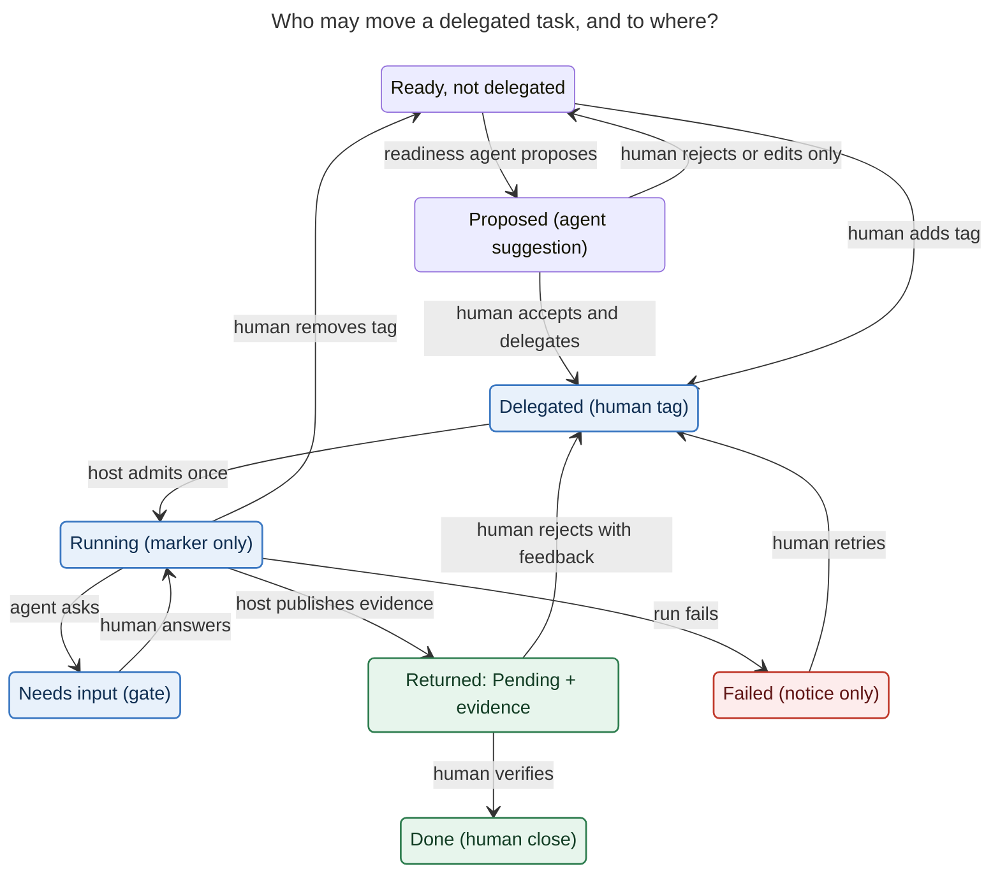
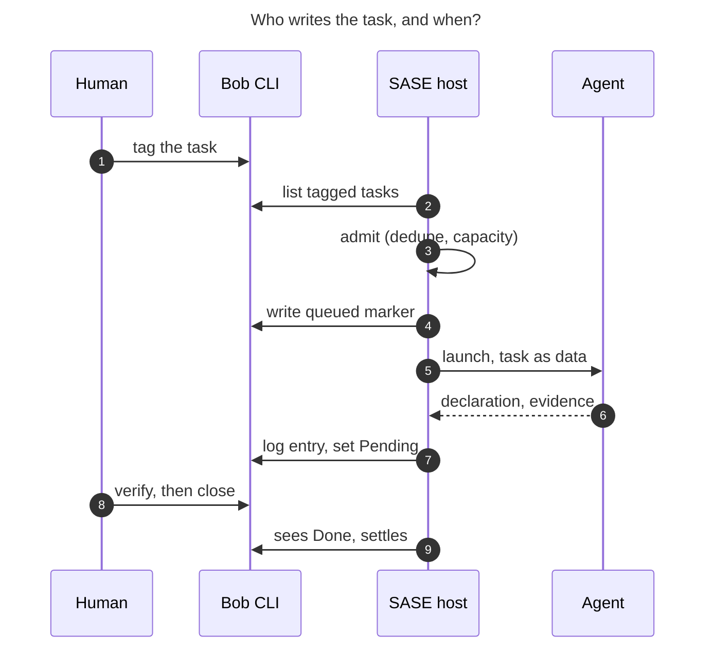

# Task systems as SASE's delegation surface: is a deeper, tracker-agnostic integration worth building?

*Lead researcher's consolidated report · 2026-10-25. It merges five independent reports (cdx, cld, grk, mus, gem) with my own checks. I checked against the bob-cli source and docs, the SASE docs, the live Bob vault (read-only `bob query` / `bob ref`), and a few external sources. Where the researchers disagreed, §3 records the verdict and the evidence behind it. This repo is public, so no personal task contents appear here. Nothing in the vault or any code repo was changed.*

---

## Bottom line

- **Yes, the connection is real, and it is structural.** A task manager and an agent orchestrator answer the same questions: what is committed, what is ready, what is blocked, who is doing it, and how we know it is done. They answer them for different actors.
  - SASE has quietly grown a second GTD system for its agents: beads with a `ready` triage queue, TaskTriage gates, a notification inbox, and a Goals design where "agents claim; you close". It runs in parallel to Bob.
  - Two trusted systems is the classic GTD failure. The 2026-10-19 study of `~/bob/sase.md` called the problem "ownership, not volume".
  - The deep version of this integration is **one commitment book (your task system) with two kinds of actors**: you, and delegates who cannot be held accountable. SASE stays the execution OS. A thin **delegation layer** connects the two.
- **The value is closing the loop, not saving keystrokes at launch.** You already launch dozens of SASE prompts a day, so launching is not the bottleneck. What is missing is one identity that runs task → agent run → evidence → your verification. That verification should happen inside the review you already do: Bob's PENDING tier, which comes due daily.
- **It is a good idea under five conditions.** They are the same ones Linear and GitHub Copilot converged on:
  1. Delegation is an explicit human gesture.
  2. Settlement stays human.
  3. The task system remains the commitment book.
  4. SASE remains the execution OS.
  5. Background launches go through admission, are capacity-limited, and are off by default.

  It is a *bad* idea if it is built as "file hook on `~/bob/**/*.md` → `sase run`".
- **Three parts of your initial picture need correcting before design** (all verified in bob-cli):
  1. **`#q` answers cannot go inside the Highlights comment.** Bob owns and rewrites the `<!-- highlights:begin/end -->` region on every sync. Answers go in the same note but outside that region, and later into a Bob-owned answers journal that Bob renders under the question.
  2. **Bob has no supported way to set `[/]` from automation today.** Pending is set by the Pomodoro close gesture, so reusing it would invent Pomodoro history. Bob needs one narrow "return delegated work" verb. The SASE host runs it after the turn; the agent never touches the vault.
  3. **Do not use a bare `#sase` tag, and never treat macro-looking text in a task as a command.** Seven open SASE tasks mention macros such as `` `#research_swarm` `` and `` `#coder` `` in their text. These are tasks *about* the macros. A tag-as-prompt bridge would launch them.
- **The binding constraint is your review capacity, not agent capability.** Bob already reports a Pending cap (`plan.max_pending`, default 10). Use it as backpressure: stop admitting discretionary work while returned work sits unverified.
- **Start with read-only loops whose output takes a minute to check:** research-question tasks (`#research_swarm` → report → back-link) and `#q` answers. Then plan-only delegation and gated clarification proposals. Code delegation that ends in `[/]` comes last.
- **Be agnostic in the contract, not in the number of adapters.** Bob is adapter one. A label-triggered GitHub adapter is adapter two, reusing the existing issue mirror's identity. Linear, Todoist and others come only after both work. SASE's own "mechanism follows corpus" decision says the same.
- **The less obvious use cases may be the most valuable:**
  - preparation for tasks only you can do;
  - "negative work" such as already-done detection and duplicate merging;
  - SASE's own asks flowing *into* Bob;
  - watchers for tasks you are waiting on;
  - every accepted or rejected return becoming a labelled example for routing models and autonomy levels.

---

## 1. Is the connection real?

### 1.1 The same pipeline, two actors

| GTD stage | Bob today | SASE today |
| --- | --- | --- |
| **Capture** | `bob capture`, Mac/Keep inboxes, Highlights `#task` comments | Prompt input, Telegram, `sase run` |
| **Clarify** (what is done? next action?) | NEW review tier; the `fresh` stamp means "a human confirmed this" | Plans, `/sase_questions`, plan gates |
| **Delegate → Waiting For** | *No delegate target* | Agent launch, Agents tab, `%wait` |
| **Organize** | Projects (`^prj`), lanes, Depends-On links | Epics/phases, beads, `%queue` |
| **Reflect** | `]s` walk: PRE → NEW → PROJECTS → PENDING → NEXT → TICKLER → REFERENCES → ROTTEN → POST | TaskTriage gates, notifications, Goals review lane (designed) |
| **Engage** | Today ledger, Pomodoros, caps | Runner queue, admission holds, usage windows |
| **Horizons** | Area/project tree | Goal ledger (⌖): "host binds every turn to one goal" |

GTD always had a "delegate it" branch that feeds a Waiting For list. For a solo person it was mostly empty. Agents fill it. *(cld)*

The theory is old too. Horvitz's mixed-initiative principles call for:

- accounting for uncertainty about the user's intent;
- weighing the cost of interrupting;
- making invocation and termination cheap;
- preferring a narrower useful action when intent is unclear.

That supports a spectrum from explicit execution to proposed clarification. It does not support a confidence threshold that silently grants authority. *(cdx; [Horvitz 1999][horvitz])*

### 1.2 Four objects that must stay distinct

Every researcher landed on the same separation, with slightly different names:

| Object | Owner | Answers | Settled by |
| --- | --- | --- | --- |
| **Commitment**: a Bob task, GitHub issue, or Highlights question | You, in the task system | What did I commit to, where, and when? | You (Done or Cancelled) |
| **Delegation**: *the missing object* | Host policy plus your gesture | What work is authorized, against which version of the commitment, with which playbook and limits? | Host records it; you revoke it |
| **Goal (⌖)** | You; the host binds each turn | What outcome is this turn for? | Only you (`goals-host-binds`) |
| **Bead** | SASE's agent-work tracker | Which unit of engineering work is in flight? | Host or agent close |

One commitment can have several delegations (research, decide, implement, verify), and one delegation can have several attempts. A successful run can show that the task should change or be dropped. *(cdx)*

Merging these into one "unified task" object is the failure SASE's `goal-ledger` decision already rejected: making goals a bead type "would couple the agent-work lifecycle to the person's outcome records". *(grk, cld)*

### 1.3 Evidence from your own system

All figures below come from my read-only queries on 2026-10-25 unless attributed.

- **The corpus exists.** There are 494 open tasks.
  - By lane: 434 Blocked, 41 Ready, 8 Next, 11 Pending.
  - 341 sit in `sase*.md` notes and 35 in `bob*.md` notes.
  - 386 have a `scheduled` date and only 58 have dependencies. "Blocked" mostly means "scheduled for later" (the Oct-19 study found the same: 210 of 228 in `sase.md`).
  - Only **220 of 494 (45%) have a block ID**, so the adapter must mint one at delegation time (`bob capture-task-id` exists).
- **Agent output already flows into Bob, one way.** The `research-highlights` file hook runs `bob ref create --include-id …` for each new research report. Nothing flows back from task to agent to evidence. *(cdx, cld, grk)*
- **The question habit already exists.** About 40 Highlights comments read as questions, and about 17 already mint `#task`s *(grk, cld)*. No `#q` tag exists anywhere in the vault yet, so the tag is free.
- **You already asked for this.** On the Microsoft Research paper *Goals as First-Class Abstractions in Human-AI Collaboration* (finished 2026-10-13), the passage "no tool supports goal-guided agent orchestration" carries your comment "sase will!". Another comment asks for an optional `goal` field on beads. A delegated task is a natural origin for such a goal. *(grk; I confirmed the comments with `bob ref show`)*

### 1.4 The industry has converged on this split

| Product | Pattern | Lesson for SASE |
| --- | --- | --- |
| **Linear** | The human stays the assignee and the agent is a *delegate*. Agent sessions have their own states (pending, active, awaitingInput, complete, error, stale). Clarification is a first-class "elicitation" activity. | Keep the task separate from the attempt. Freeze the request snapshot, because comments can be edited. *([Linear agent interaction][linear])* |
| **GitHub Copilot coding agent** (also Jira, Azure Boards) | Assign an issue → draft PR → human review. The agent cannot close the issue around the merge. | "Issue launches agent" alone is weak differentiation. SASE's edge is personal notes, reading, and non-code work. *([GitHub][github-agent])* |
| **Devin** | Playbook labels (`!plan`, `!implement`, `!triage`). Automations fire on label *transition*. | Tags choose a playbook, not just "run". Triggers must be edge-triggered. *(cld)* |
| **GitHub Agentic Workflows "Issue Monster"** | A scheduled agent hands issues to Copilot, but skips when five or more agent drafts are open. | Handing out work is easy. Handing out the *right amount* is the craft. *(grk)* |
| **Asana AI Teammates** | Assignable like a teammate. | General availability could not be confirmed as of October 2026. *([Computerworld][asana])* |
| **Todoist and others** | Mostly third-party MCP servers that let an assistant edit tasks directly. | Guides warn that silent edits are where agents go wrong. *([Composio][todoist-mcp])* |
| **Obsidian "Agent Deck"** (v1.2.3, ~40 downloads) | Binds a list line to a Claude Code or Codex session. Shows a line-end pill (Delegating / NEEDOK / TOREVIEW / DONE) and writes the result under the task. | Small, but direct prior art for an in-vault "returned for review" marker. *([Agent Deck][agentdeck])* |

**Protocols are transport, not commitment.**

- A2A's `TaskState` and the MCP Tasks extension (2026-07-28) model submitted / working / input-required / completed / failed / cancelled. They are useful behind an execution adapter.
- MCP task completion can carry a tool result with `isError: true`. So "transport complete" must never mean "your commitment is done". *(cdx; [A2A][a2a], [MCP Tasks][mcp-tasks])*
- Asana's webhook guide warns that events can be missed or arrive in bursts while a user edits. Treat any event as "reconsider this object", never "launch exactly once from this payload". *(cdx; [Asana][asana-events])*

### 1.5 What would make it a bad idea

| Condition | Evidence | Mitigation |
| --- | --- | --- |
| **Review, not hand-off, is your bottleneck** | METR found 0 of 15 agent PRs mergeable as-is, at about 42 minutes of fix-up each. An MSR '26 study of 33,596 agent PRs found 38% of rejected ones got no reviewer engagement. *(cld)* | Pending-cap backpressure. Start with outputs that take minutes to check. |
| **Personal tasks are too terse to delegate** | Ambig-SWE shows models struggle to tell well-specified from underspecified tasks. "Ask or Assume?" (2026) found that a *separate* underspecification detector reached a 69.4% resolve rate on underspecified SWE-bench Verified, closing most of the gap to fully specified tasks. *([arXiv 2603.26233][askassume])* | Make readiness a distinct proposal step, never a silent launch. |
| **The vault becomes a second write target with weak concurrency** | Multi-machine git sync; conflicts land in `_conflicts/`. cld reports that `bob capture` takes no cross-process lock. | One intake host. Every write goes through `bob`, guarded by a digest of the task. |
| **It creates work faster than it removes it** | Duplicate launches, stale answers, and too many proposals turn it into another inbox. *(cdx)* | Measure accepted outcomes and human time saved, never agents launched (§8). |

None of these argues against the *connection*. Together they argue for a narrow first slice.

---

## 2. What already exists, and what is missing

### 2.1 SASE

| Building block | Verified behavior | Role here |
| --- | --- | --- |
| **AXE scheduler jobs** | Emit `proposed_launches` with `dedupe_key` and `wait_on`. The `fs` trigger is a **shallow** stat/glob with no recursion and no content reads, plus a required `max_quiet` backstop. A `dedupe_key` is "durable work identity": released if the launch never starts or ends in terminal failure, otherwise reserved permanently. `%if` rechecks eligibility at admission. | The intake loop. `~/bob/*.md` is shallow-watchable. Nested `ref/**` needs one watch per directory or the `max_quiet` cadence. Re-delegating after a rejection needs a generation number in the key. |
| **External issue mirror** | GitHub only and one-way. Creates `open` beads, never `ready`. Identity is `external_ref`. | The precedent for identity and conservative reconciliation. It handles *inventory*, not delegation. |
| **Gates and questions** | Durable bundles answerable from the TUI, Telegram, mobile, or the CLI. Creating one ends the creator's turn. | The proposal and "needs input" surface. |
| **Finalizers** | `builtin@command` exists. Only trusted config can define commands. The host runs finalizers after the model returns. | A possible write-back point. §3 explains why the authoritative write-back belongs in the intake job instead. |
| **Plugin entry points** | 13 groups, including `sase_task_types`, `sase_finalizers`, `sase_commands`, and `sase_config`. **There is no task-source group.** | A generic adapter seam is new work, not a config toggle. |
| **Goals (⌖)** | The G1 ledger shipped. The docs list deterministic binding, claims with verification, drafts and the Goals tab as "coming next". | Bind delegations to goals once binding ships. Design the delegation record so it can become a goal's origin without a migration. |
| **Launch provenance** | cld found no field on agent metadata for an external work item or goal. | Add an origin field so the Agents tab can show "delegated from …". |

### 2.2 Bob

| Need | Exists today | Gap |
| --- | --- | --- |
| Find tasks by tag | `bob query -f json --tasks …`: path, line, block ID, status, scheduled, dependsOn | — |
| Stable identity | Block IDs; `capture-tasks` refs (line plus digest) that refuse stale or ambiguous matches; `capture-task-id` to mint an ID | No single-task `show` returning a digest of the whole task block. The current digest covers only the task line, not child requirements. *(cdx)* |
| Append evidence | `bob capture --route N --task ID [--task-section TITLE] -- '…'` appends a sub-bullet under a task | No managed agent-log section, and no digest guard on append |
| Set Pending | Only through the Pomodoro close outcome (`task-lanes-are-sticky`: "an =x close sets In Progress") | **No verb for "delegated work returned → Pending"** |
| Read annotations | `bob ref show -f json`: quote, comment, page, `^h-` ID, section membership | No answers model |
| Backpressure | `plan.max_pending` = 10 (reported, never refuses work); Pending walked daily (`pending_interval` = 1) | — |
| Render in Obsidian | bob-ledger-tools renders read-only blocks from CLI JSON | No "delegated / returned" chip |

**Rules from accepted Bob decisions** that any integration must keep *(cld, grk, verified)*:

- Never stamp `fresh`.
- Never link a task into Today or the Pomodoro ledger ("unblocked tasks are offered, never auto-linked").
- Never author `[?]`; Blocked is derived and `bob task reconcile` will undo it.
- Never set `[*]`. Next means "explicitly committed work".
- Never edit Depends-On lines except through Bob's own gestures.
- Write only through `bob`; Bob Mac Capture is the model of a thin client.

---

## 3. Where the researchers disagreed, and the verdicts

| # | Question | Positions | Verdict and evidence |
| --- | --- | --- | --- |
| 1 | **Where do `#q` answers go?** | Inside or under the comment (grk, gem). Outside the managed region (cdx; cld for a prototype). A Bob-owned answers journal (cld). | **Outside the region now, a Bob journal later.** I verified in `highlights-ref-sync.md` that "user edits inside the generated region may be overwritten". Phase 1: an answers section in the same note, outside the markers, with a `[[#^h-…]]` back-link and the question digest. Product: an append-only `.bob/answers/<host>.jsonl` (the same pattern as Bob's themes and relations journals), which Bob renders as a callout under the question. Bob owns the region, so this is safe. |
| 2 | **Can the trigger be `#sase`?** | Yes (gem, mus). `#sase` as plan-only (cld). Never, citing ~1,563 `#sase` tokens (grk). | **Use a namespaced family such as `#sase/research`, never bare `#sase`.** grk overstated the live collision. My query found `#sase` on 92 pages, mostly 2025 daily archives, and on 100 tasks, **all done or cancelled; zero open**. Three reasons still argue against it: every task in `sase*.md` is already "about SASE"; the tag has legacy meaning; and macro-like text appears in task bodies (row 3). Match an allowlist exactly; never use substring matching. |
| 3 | **Can task text act as a prompt?** | cld flagged the hazard; gem routes on tags freely. | **Task text is always quoted data, never expanded.** I found 7 open SASE tasks that mention `` `#research_swarm` ``, `` `#review_research` ``, `` `#coder` ``, `` `#fork` `` or `` `#sshot` `` in code spans, for example "Make `#research_swarm` work with …". The trigger tag picks a host-configured playbook. Model, workflow and credentials come from host policy, never from task or PDF text. |
| 4 | **What lane while the agent runs?** | `[*]` Next (gem's mapping; mus's "claim"). No lane change (cdx, cld, grk). | **No lane change.** I verified that `[*]` is "explicitly committed work", raised by linking under today's Pomodoros. Setting it would invent a commitment and skew `bob plan`. Show "queued / running" with an integration marker instead: a child line now, a rendered chip later. |
| 5 | **Pending on return?** | Everyone: yes. mus asks whether a separate state would be better. | **`[/]` plus a visible "agent returned" marker.** It shares the lane with your own in-progress work, but Pending is walked daily, which is exactly the review you want. The only current path to `[/]` is a Pomodoro close, so add a Bob verb (§6.6). Agent Deck's TOREVIEW pill is prior art for the marker. |
| 6 | **Mirror each task into a bead?** | Yes, a bead per task (mus). No: goal 1:1, beads only for decomposition (cdx, cld, grk, gem). | **No blanket mirroring.** The `goal-ledger` decision rejects coupling outcome records to the bead lifecycle, and mirroring 341 SASE tasks would recreate the dual backlog. Create beads only when a playbook decomposes engineering work. |
| 7 | **Fold the GitHub mirror into the bridge?** | Port it as adapter #2 (cld, mus). Keep it as a sibling (grk). | **Keep the mirror unchanged.** Inventory ("the bead list is a superset of issues") and delegation ("this row is authorized") are different jobs. Add a label-triggered GitHub *delegation* adapter that reuses the mirror's `external_ref`. That still proves the contract with a second tracker. |
| 8 | **Where do proposals appear?** | SASE gate (cld, grk, mus). An in-vault callout with an "Approve & Launch" checkbox (gem). | **Gates first, a Bob review tier later.** Gates are durable, answerable from your phone, and need no unsolicited vault writes. A checkbox inside a callout would invent a new meaning for a Bob checkbox and race with your editor. Later, a Bob PROPOSALS tier fed from a Bob-owned journal can put proposals inside the `]s` walk. |
| 9 | **Chain dependents when a prerequisite returns `[/]`?** | Yes, wave execution (gem). No (cdx). | **Offer, don't chain.** Bob dependencies clear on Done, and chaining on an unverified return builds on unreviewed work. Follow `unblocked-tasks-are-offered`: offer the next task. At most, allow opt-in speculative continuation for read-only playbooks. |
| 10 | **Should checking `[x]` trigger a merge?** | Yes (gem). | **No.** That makes the Done checkbox a deploy trigger and bypasses host-owned completion. Landing follows SASE's normal finalizer flow. `[x]` settles the commitment, and later the goal. |
| 11 | **Where does write-back run?** | A finalizer after the turn (cld). A later intake tick that sees the bound agent finish (grk). | **The intake tick is authoritative, with a publication outbox.** Write-back has to survive Bob being offline without rerunning the agent (cdx). It must also fire once after a *swarm's* final agent, not after each member. An optional `builtin@command` finalizer can be a fast path, but it must not fail the agent's run when the vault is unavailable. |
| 12 | **How is the budget expressed?** | Dollars a day (gem). | **Launches per day, usage-window-aware admission, and the Pending cap.** SASE meters subscription usage windows, not dollars. |

---

## 4. Your three use cases, made concrete

### 4.1 Tag a task → an agent works it → evidence + `[/]`

1. **Gesture.** You add a delegation tag from an allowlisted family. The tag picks both a **playbook** and an **autonomy ceiling**, following Sentry Seer's "stop after root cause / plan / PR" and Devin's playbook labels *(cld)*:

   | Tag (illustrative) | Playbook | Ceiling | Returns |
   | --- | --- | --- | --- |
   | `#sase/research` | `#research_swarm` | read-only plus report | report ref back-linked to the task |
   | `#sase/prep` | prep pack | drafts only | brief, checklist, or draft link |
   | `#sase/plan` | plan | **stops at plan approval** | plan ref |
   | `#sase/do` | plan + implement | draft PR or saved diff | PR or stitch ref, then `[/]` |

2. **Identity and snapshot.** The adapter resolves `note#^block`, minting a block ID if needed. It snapshots the task line, its child requirements, and any dependencies, and records a digest. Integration-owned lines are excluded from that digest, so writing progress never re-triggers work *(cdx, mus)*.
3. **Routing.** The residence note picks the project (`sase*.md` → sase, `bob*.md` → bob-cli; otherwise ask). This is a better project source than whichever project the TUI happens to have open *(grk)*.
4. **Admission.** One AXE job on **one intake host** proposes the launch:
   - dedupe key `bob:<note>#^<block>:<mode>:<generation>`;
   - a `%if` recheck at admission that the task is still open, still tagged, and has an unchanged digest;
   - capacity and usage-window limits;
   - **no new discretionary admissions while Pending is at its cap.**

   The trigger is edge-triggered on the tag *appearing*. Cursor users report one mention spawning two agents *(cld)*.
5. **Visible claim.** The host writes a "queued · agent · host" child line through `bob capture --task`. This is your Waiting For marker. It is not a lock; the single intake host is what prevents double launches.
6. **Return.** When the run finishes, the next intake tick rereads the task. If the digest still matches, it calls the Bob return verb, which appends an agent-attributed log entry and sets `[/]`. The entry holds the date, a one-line outcome, evidence refs (`research:…`, PR, stitch, `agent:<name>`), checks actually run, known gaps, and a **"check it" line** telling you how to verify. If the task changed while the agent worked, the result is published as *stale for the earlier version* and the lane is left alone.
7. **Settlement.** You verify in PENDING and close with `[x]`; the next pass settles the attempt, and later the goal. A rejection with a note sends the task back with feedback. The bridge can re-delegate under a new generation with your note as the follow-up prompt. That matches the Goals rule that a follow-up retracts a claim.
8. **Revocation.** Removing the tag is a cancel request for future admission and running work. It is not a rollback; partial evidence is kept and reported.

### 4.2 Agent-proposed clarifications that, once accepted, delegate

This is the safety valve for 4.1, not a separate feature.

- **Separate permission to *look* from permission to *act*.** A scheduled readiness routine, perhaps after `bob nightly`, scans only allowlisted software notes. It looks only at Ready, Next, or due-today tasks, never the 434 date-Blocked rows or personal areas.
- **Each proposal** contains:
  - a diff of the original and proposed task text and requirements;
  - acceptance criteria;
  - assumptions and missing inputs;
  - the suggested playbook (plan + implement, `#research_swarm`, prep, or "just ask one question");
  - the target project and an effort bound.

  For example, "Improve PDF intake" might become "Reproduce duplicate reference creation after a rename; find the cause and propose a fix that keeps annotation back-links". The goal is success you can inspect, not a longer prompt *(cdx)*.
- **The gate offers three answers:** *save clarification only*, *save and delegate (mode X)*, or *reject*.
  - Accepting runs `bob` edits. Your acceptance is a real human confirmation, so stamping `fresh` here is correct.
  - "Save and delegate" adds the tag, and the intake loop picks it up on a later tick (gates never block).
  - Rejection starts a cooldown until the task changes materially, so you are not re-asked every scan.
- **Approval covers the reviewed revision and playbook.** Accepted research does not authorize implementation. Upgrading one agent to a swarm changes the budget and needs a new approval.
- **Confidence ranks proposals; it never authorizes them.** An agent can understand "book a trip" perfectly and still lack purchase authority *(cdx)*.
- **Budget.** At most three proposals per day to start, and track accepted, edited, dismissed and ignored rates. A research-swarm proposal is the same object with a different macro. Its report already flows back into `ref/` through your file hook; the bridge only adds the back-link.

### 4.3 `#q` questions in Highlights → answers in the same note

1. **Detect from structure, not text.** Read `bob ref show -f json`. A `#q` either joins a declared section such as `# Open questions #q`, in which case the tag is *consumed* and survives only as section membership, or stays an ordinary Obsidian tag. A grep for the literal `#q` misses the first case *(cdx; verified)*.
2. **Identity.** Use the `^h-` annotation ID plus a digest of the question text. Comment text is excluded from the ID hash, so editing a question keeps its ID. The digest marks the old answer superseded *(cdx, cld)*.
3. **Answer.** A single read-only agent, not a swarm by default. Inputs: the quote, the comment, page and section, and the PDF text. **No network by default.**
   - Every answer carries page citations and separates what the paper claims from inference.
   - Outcomes are explicit: *answered*, *needs an assumption*, *source unavailable*, or *the paper does not establish this*.
   - If a question is really a project, offer "promote to a `#sase/research` task" as a gate.
4. **Write.** Phase 1 writes to an answers section outside the managed region; the product version uses the Bob answers journal (§3 row 1). Writing into the PDF annotation itself would be a new path under the `open-pdf-writes-are-coordinated` decision, so it is out of scope.
5. **Two choices are yours:**
   - **Answer or hint.** For learning-oriented reading, a per-reference "hint first" default keeps productive uncertainty *(cdx)*.
   - **Where you see it.** You ask in Highlights, but the answer lands in Obsidian. Optionally push a Telegram or notification digest.

Prior art: Readwise Ghostreader and the Zotero plugins answer interactively. No product the researchers found answers questions left in annotations asynchronously *(cld)*.

---

## 5. Use cases the integration unlocks

These are proposals, not existing functionality. *Phase* refers to §8.

| Stage | Use case | What the agent does → what comes back | Phase |
| --- | --- | --- | --- |
| **Execute** | **Research-question tasks** | Task body becomes the swarm question; report ref back-linked. Nearly free, because the report pipeline exists. | 1 |
| | **Plan-only delegation** | Stops at plan approval; plan ref goes on the task | 2 |
| | **Cross-project dispatch** | Residence note routes the work (`%dispatch` / `+project`) | 2 |
| | **Deferred delegation** *(new)* | Delegate now, run when the task's `scheduled::` date arrives, so the result is waiting at that morning's review. This uses Bob's own date-Blocked recovery as the timer. | 3 |
| | **Off-hours batch** | Queued delegations run in quiet usage windows, after `bob nightly` | 3 |
| **Clarify** | **Readiness proposals** (yours) | §4.2 | 3 |
| | **Smallest unblocking question** | One precise question plus proposed defaults instead of a speculative run | 3 |
| | **Decomposition** | A big commitment or stalled `#prj` gets proposed next actions with Depends-On edges, or an epic plan for software | 3 |
| | **Context reconstruction** | A cryptic old one-liner gets a CONTEXT child rebuilt from git, beads and agent chats | 3 |
| | **Inbox clarifier** | New Mac or Keep inbox lines get a proposed route, project, rewrite, duplicate check, and a "delegable?" verdict | 3 |
| **Reading** | **`#q` answers** (yours) | §4.3 | 1 |
| | **More annotation verbs** | `#verify` (fact-check), `#explain`, `#cite` (find the primary source), `#connect` (relate to vault notes). Same journal, different prompt. | 4 |
| | **Reading triage** | For `#ref` tasks: a reading guide, a "worth reading?" verdict for rotten items, a `sase listen` audio edition | 3 |
| | **Annotation → task → agent** | A Highlights `#task` comment already becomes a task; adding a delegation tag sends reading-time ideas straight to work | 3 |
| **Review** (proposal-only) | **Already-done detector** | Cross-checks open tasks against closed beads, merged PRs, commits and reports, then proposes `[x]` with evidence. The Oct-19 study found 18 such items by hand. | 3 |
| | **Duplicate and contradiction finder** | Across Bob, beads and GitHub issues; proposes links or merges, never silent merges | 3 |
| | **ROTTEN decision support** | Suggests keep / decay / cancel with a reason that pre-fills the ROTTEN LOG; you decide | 3 |
| | **Review brief** | Before the `]s` walk: returns awaiting verification, stale delegations, stalled projects, deadlines buried in task text. It prepares the review and never performs it. | 2 |
| **Human-only work** | **Prep packs** | For calls, purchases, applications, errands: context, checklist, comparison, or a draft (for example a Gmail draft). You do the last step. | 2 |
| | **Decision briefs** | "Choose an approach" tasks get options, trade-offs, evidence and one recommendation, kept beside the commitment | 2 |
| **Waiting / verify** | **Waiting For watchers** | A task waiting on a PR merge, CI run, release or reply gets a prerequisite that a job closes when the event fires; Bob then resurfaces it as TICKLER | 4 |
| | **Outcome verification** | Checks a result or deployment against the original acceptance criteria, separating "the run succeeded" from "the outcome is true" | 4 |
| | **Standing orders** | A recurring task plus a delegation tag becomes a bounded monitor that reports only material deviations, with no second scheduler | 4 |
| | **Stalled-delegation rescue** | A stale attempt gets a diagnosis, a smaller scope, or a handoff proposal instead of a forgotten "running" marker | 4 |
| **Reverse flow** | **SASE asks → Bob tasks** | Items that can wait more than a day become Bob tasks with deep links: TaskTriage beads left in `ready`, "needs human" global installs, flag removals, failed-agent relaunches, and human-only work agents discover. Resolving in either place resolves both. Transient approvals stay notifications. | 4 |
| **Agnostic payoffs** | **GitHub label delegation** | Adapter #2. Write-back is an issue comment plus a PR link. | 4 |
| | **Cross-system evidence routing** | One patch or report satisfies linked commitments in several trackers, through explicit identity links | 4 |
| | **Phone delegation** | A Telegram message becomes a tagged `bob capture`, and the answer comes back on Telegram | 4 |
| | **Acceptance as an eval corpus** | Every return becomes a labelled (intent, playbook, model, evidence, human verdict) tuple that calibrates routing, size aliases and autonomy defaults, as explicit recommendations rather than silent permission growth | 4 |

**Three categories deserve emphasis because they are easy to miss:**

1. **Preparation.** Agents cannot have the conversation, make the purchase, or decide the design, but they can assemble what you need. The task system supplies the timing and purpose a chat assistant lacks *(cdx)*.
2. **Negative work.** Finding that a task is already done, duplicated, or based on a false assumption shrinks your obligations. The system should reward these outcomes rather than push agents to manufacture deliverables. Cancel and merge recommendations still belong to you *(cdx, cld)*.
3. **The eval corpus.** This is the deepest reason the connection matters. Today SASE learns nothing about whether a run served your intent. A task system that records your accept or reject gives SASE ground truth per task type for free *(grk, cdx)*.

**What this should deliberately *not* unlock:**

- a second GTD app inside the SASE TUI;
- working the date-Blocked backlog because a model "understands" it;
- agents settling goals or closing tasks;
- bidirectional status sync that fights `bob task reconcile`;
- whole-vault scanning.

Two of gem's ideas need privacy and design work before they are worth pursuing: injecting the active Pomodoro task into agent context, and counting agent time in Stats.

---

## 6. A tracker-agnostic shape

### 6.1 The narrow waist

Each adapter exposes **work items** plus **capability flags**. It does not have to implement one universal interface.

- **WorkItem fields:**
  - `source` (adapter) and `kind` (task or annotation question);
  - stable `id` (Bob `note#^block`, GitHub `owner/repo#n`, Highlights `ref#^h-…`);
  - `locator` (current position, which can move);
  - `revision` (digest);
  - `title`, `body`, `tags`, `native_status`, `deeplink`, `context_refs`;
  - `visibility` (private or public).
- **Capabilities:**
  - `list(query)`, `get(id)`, `watch_token()`;
  - `annotate(id, entry, if_revision)`;
  - `return_for_review(id, evidence, if_revision)`;
  - `propose(id, patch)`, `create(item)`;
  - `observe_cancel(id)`.

  If an adapter lacks conditional writes, unattended edits to the task text are disabled and only additive evidence is allowed. A reread followed by a write is not a compare-and-swap *(cdx)*.
- Keep tracker-specific verbs out of the core interface. gem's `answer_marginalia` is better expressed as a capability of the annotation kind.

### 6.2 The delegation record (conceptual, not an API)

```yaml
source:   { provider: bob, object_id: <stable id>, locator: sase.md#^task, revision: <block digest>, visibility: private }
request:  { id, version, playbook: research, ceiling: read-only, acceptance: [...], authorization: <gate id | standing policy>, budget }
attempts: [ { attempt_id, launch_id, agent, outcome } ]
publication: { evidence_id, operation_id, state: pending|published|stale }
review:   { decision: pending|accepted|rejected, at, note }
goal:     <goal id, once binding ships>
```

Four separations are worth having even in a prototype *(cdx)*:

- **Source ID versus locator:** a task can move.
- **Request version versus attempt:** an infrastructure retry must not authorize different work.
- **Publication state versus execution state:** a good result can exist while Bob is offline.
- **Delegation versus goal:** goal binding has not shipped yet.

### 6.3 Lifecycle



*Figure 1. Every edge into Delegated or Done, and every edge back to Ready, is a human gesture. The agent's only outbound moves are "ask" and "return through the host". "Running" is integration state shown as a marker; it never changes Bob's lane. "Host publishes evidence" is the host's post-run write-back (§3 row 11). This is SASE's `goals-host-binds` ("only a human settles") applied to a task manager.*

### 6.4 The mapping generalizes

| Concept | Bob | GitHub Issues | Linear | Todoist | Taskwarrior |
| --- | --- | --- | --- | --- | --- |
| Stable id | `note#^block` | `owner/repo#n` | issue id | task id | uuid |
| Delegate signal | allowlisted tag | label or assignee | delegate to an agent | label | tag via an `on-modify` hook that only enqueues |
| Evidence | agent-log child entry | comment plus PR link | session activity, `externalUrls` | comment | annotation |
| Returned for review | `[/]` plus marker | `agent-returned` label or draft PR | session `complete`; human still assignee | "Review" section or label | `+review` |
| Needs input | gate plus child line | comment mentioning you | elicitation | comment | annotation |
| Human done | `[x]` | close | human moves the state | complete | `done` |

*(cld)* The rows line up, and the differences belong in each adapter's state map. beads' own `bd linear|jira|github sync` uses `state_map` and `external_ref` the same way.

### 6.5 Who writes what



*Figure 2. The agent never touches the vault. Every vault write goes through `bob`: the host calls it before launch (step 4) and on a later pass after the run (step 7). This is SASE's `host-owned-completion` decision applied to the task system.*

### 6.6 Where the code lives

- **bob-cli** gets small, digest-guarded, previewable (`-d`) verbs. This is real Bob work, not something SASE should fake by regex-editing task trees:
  - `bob task show <ref> -f json`, returning a block digest;
  - `bob task annotate <ref> --section "AGENT LOG" --if-digest …`;
  - `bob task return <ref> --evidence … --if-digest …`, which appends an agent-attributed log entry and sets Pending **without touching the Pomodoro ledger**;
  - `bob task cancel`;
  - an answers journal, with `answers[]` added to `bob ref show`.
- **A `sase-bob` plugin** (the same shape as `sase-github`) provides:
  - the adapter;
  - a `sase bob …` command group (`sase_commands`);
  - routine defaults (`sase_config`);
  - an optional write-back finalizer.
- **sase-core** owns, once the prototype has earned it:
  - the delegation record, lifecycle and identity rules;
  - the "never settle" invariant;
  - the origin field on agent runs.

  This passes your boundary memory's litmus test: an Agents-tab "delegated from" column and a future web view must agree. A new entry-point group (grk suggests `sase_intent_sources`) comes later still.
- **Before any of that:** a prototype with no core changes (§8). `corpus-before-mechanism` was written about memory retrieval, but its lesson carries over: SASE deleted three speculatively built mechanisms at real cost.

### 6.7 Alternatives considered

| Approach | Verdict |
| --- | --- |
| A script watches tags, runs `sase run`, appends text | Fine as a throwaway prototype with one writer and explicit tasks. As a product, identity, authorization, retry and write-back rules become hidden script state. |
| **Thin adapter plus a small delegation ledger** | **Recommended.** |
| Mirror every task into beads or goals with full bidirectional sync | Reject. Conflicting ownership, a duplicate inbox, and schema mismatch. |
| Give agents a task-system MCP server with write tools (the Todoist-style pattern) | **Read-only tools are fine for context. Reject agent-side writes.** They bypass host-owned completion, idempotency and digest guards, and put an injection-exposed actor in charge of your commitment book. |
| Use only vendor-native agents (Linear, Copilot) | A useful comparator and a later adapter surface. Cannot reach Bob or your reading. |
| Build a universal workflow engine and task graph first | Reject. It duplicates SASE and spends heavily before any value is observed. |

---

## 7. Reliability, safety and privacy

| Failure or risk | Required behavior |
| --- | --- |
| Two machines see the same tagged task | One intake host at first (for example `work_sources.bob.host`). Git sync and the queued line are not locks. |
| The same event arrives twice, or the bridge sees its own write | Dedupe on source ID + request version + playbook. Never treat an integration-written change as a new trigger, so trigger only on a human-touched digest *(mus)*. |
| Crash after launch, before recording | Reconcile the durable admission or attempt before relaunching. An unknown outcome stays unknown. |
| Requirements change mid-run | Judge the result against the snapshot it was given. Publish it as stale rather than claiming the new scope. |
| Write succeeds but the acknowledgment is lost | Make the write idempotent, or look for the operation marker before appending. **Never rerun the agent to redeliver.** |
| Result is good but the vault is offline | Keep the evidence durably and show "publication pending". Retry only the delivery. |
| A task moves, is archived, or loses its ID | Resolve through Bob's identity tracking, or stop. Never update the nearest-looking task. Write back before `bob nightly` archives `[x]` items. |
| The host finalizer fails | Do not publish a success claim. Keep partial output separate from verified completion. |
| The user deletes an answer or rejects a proposal | Treat it as intent, with a cooldown, not as a cue to regenerate. |
| Prompt injection (clipped web pages, third-party PDFs) | Task and PDF text are data. A trigger needs a human-applied tag; agents add tags only by executing an accepted gate. `#q` agents are read-only with no network by default. Strip hidden text and HTML comments. |
| Review overload | Pending-cap backpressure, proposal budgets, and pausing discretionary admission when the review backlog grows faster than you clear it |
| Runaway cost | `%queue` capacity, usage-window-aware admission, a daily delegation budget, swarms only off-hours. Never add a path where a file event calls `sase run` directly. |
| Erosion of review trust | Agents prepare reviews and never perform them. Every return carries a "check it" step. Every settlement is your gesture. |

**Privacy needs its own route.**

- SASE's goal docs say shared goal content is as public as the beads sidecar, and this research repo is public too.
- The delegation record must carry the source's visibility and route storage accordingly: private tasks get private artifacts and no public bead text.
- Personal, non-software tasks also send their text to model providers. Keep them out of scope until you opt in per area.
- A standing authorization for bounded reading answers should *not* add an approval dialog per answer. External actions (sending, purchasing, publishing) always need their own authority *(cdx)*.

---

## 8. Recommended path

**Phase 0: baseline and dry run (days).**

- Record how much time you spend today composing prompts from tasks, finding results, and filing evidence.
- Run candidate detection with **no launches and no writes**. Check that tags, sections, dependencies, archived items and edited questions are classified correctly.
- This shows whether your friction is in *initiation*, *context assembly*, *execution quality*, or *review*. If it is mostly review, automatic initiation will make things worse.

**Phase 1: two read-only loops, no core changes.**

- A user-level AXE job on one host does the work:
  - it polls `bob query` for `#sase/research`;
  - it proposes `#research_swarm` launches with dedupe keys;
  - on a later tick it appends the report ref with `bob capture --route … --task …`.
- **No lane changes yet.**
- Separately, run `#q` on about ten questions across a few references. Include:
  - a PDF that cannot be fully read;
  - a question edited after capture;
  - an image-based question;
  - a re-sync to confirm answers survive.

**Phase 2: Bob verbs and plan-only delegation.**

- Add `task show / annotate / return / cancel`, the agent log section, and the answers journal.
- `#sase/plan` returns to `[/]`.
- Add prep packs, decision briefs, and the review brief.
- Deliberately exercise the failure cases: duplicate observation, restart, editing during a run, cancellation, and failed publication.

**Phase 3: proposals.**

- Readiness proposals through gates, at most three a day, with a "save clarification only" option.
- Proposal-only hygiene routines: the already-done detector, duplicates, and ROTTEN support.
- Deferred and off-hours delegation.

**Phase 4: extract the contract, then add the second tracker.**

- Move the delegation record, lifecycle and origin field into sase-core, and ship the `sase-bob` plugin.
- Add the GitHub label adapter.
- Bind goals once binding ships.
- Add the reverse flow, `#sase/do` code delegation, watchers, and the eval corpus.

Ship it behind a default-off feature flag. It reaches users, is unproven, and one failure mode is catastrophic: launching the whole backlog *(grk)*.

**Measure from day one** (pilot criteria, not validated targets):

| Metric | Read it as |
| --- | --- |
| Net human time: prompt prep + review + repair + upkeep versus similar manual tasks | Continue only if it falls |
| Acceptance rate (`[x]` without major redirection), **per playbook** | A good blended rate must not hide a bad category |
| Review minutes per return; Pending age; days at the Pending cap | Throughput must not outrun review |
| Proposal outcomes: accepted, edited, dismissed, ignored | Mostly ignored → lower frequency or narrower scope |
| Integrity failures: wrong-target writes, lost text, duplicates, stale shown as current | **Target zero; investigate each one** |
| Usage per accepted outcome, including retries, swarm members and verification | More agents only where decision quality improves |
| `#q`: citation correctness, unsupported-answer rate, hint usefulness | Judge learning value separately from volume |

**Reshape or stop** after about 30 delegated items if acceptance is under 40% or Pending sits at its cap on most days. In that case, retreat to proposal-only modes. For calibration, agent PR merge rates in the MSR '26 study ranged from 43% to 83% by agent *(cld)*. A sample of 20–30 items reveals product problems; it does not establish reliability.

---

## 9. Decisions only you can make

1. **Who owns SASE software intent: `~/bob/sase.md` or beads?** All five researchers lean toward the Bob task holding intent and beads holding execution. The prior study shows this is the crux.
2. **Should returns share `[/]` with your own work in progress?** The recommendation is yes, with a visible "agent returned" marker. The alternative is a dedicated review tier.
3. **What is the default ceiling for delegation?** The suggestion is plan-only unless the tag says otherwise.
4. **Should `#q` give answers or hints by default, and where should answers surface?** Obsidian only, or also pushed to Telegram?
5. **Which machine runs intake?** athena and apollo already share `bob_sync.lock` for vault sync.
6. **Are personal, non-software tasks in scope?** Their text reaches model providers and must never reach public sidecars.
7. **What proposal budget and quiet hours earn your trust?**

---

## Provenance

**Researcher reports**, in this directory: `__cdx` (delegation records, reliability, identity), `__cld` (GTD mapping, vault evidence, Bob verbs, lifecycle), `__grk` (intent contract, playbook tags, collision warning), `__mus` (bridge interface, loop guards, phasing), `__gem` (use-case taxonomy, wire sketches). Diagrams were adapted from cld and checked with the Mermaid CLI 12.0.0 PDF-mirroring render: Figure 1 at 752×1150 px (77.6% fit), Figure 2 at 794×653 px (82.2% fit).

**My own checks (2026-10-25):**

- **bob-cli docs and CLI:**
  - `docs/concepts/tasks-and-lanes.md` (`[*]` = "explicitly committed work"; `[/]` = "work started in Obsidian"; Blocked derived);
  - `docs/highlights-ref-sync.md` (generated region "may be overwritten"; `#`/`@` section aliases and tag consumption);
  - `docs/reference/configuration.md` (`plan.max_pending` 10, reported not enforced; `pending_interval` 1);
  - `docs/reference/cli/capture.md` (`--task`/`--task-section` child append);
  - `bob task --help` (only archive, move, reconcile, reroll);
  - decisions `task-lanes-are-sticky`, `unblocked-tasks-are-offered`, `open-pdf-writes-are-coordinated`.
- **SASE docs:**
  - `docs/reference/automation/scheduler-jobs.md` (shallow `fs` trigger, `max_quiet`, `dedupe_key` release semantics, `%if`);
  - `docs/reference/work-units/goals.md` (binding and claims "coming next");
  - `docs/reference/integrations/plugins.md` (13 entry-point groups, no task-source group);
  - `docs/reference/config/finalizers.md` (`builtin@command`, trusted config only).
- **Vault, read-only:**
  - `bob query -f json --tasks 'not done'`: 494 open; lanes 434/41/8/11; 341 in `sase*`, 35 in `bob*`; 386 scheduled; 58 with dependencies; 220 with block IDs; 7 open SASE tasks quoting macro names in code spans;
  - `bob query -s '#sase'`: 92 pages, mostly 2025 archives;
  - `tags include #sase`: 100 tasks, all done or cancelled;
  - `bob query -s '#q'`: 0;
  - `bob ref show` on the AutomationXP 2026 Goals paper note (finished 2026-10-13; comments quoted in §1.3).
- **Prior research:** `research:202610/bob_sase_task_portfolio_split/bob_sase_task_portfolio_split__final.md` (228 open in `sase.md`, 210 date-scheduled, "ownership, not volume").
- **Library check:** 1 of 6 related candidates is already in your library (1 finished: the Goals paper). The Horvitz mixed-initiative paper, Ambig-SWE, the autonomy-levels paper, GTD, and the LangChain ambient-agents post were not found in `ref/`.

**External sources** (checked 2026-10-25; vendor docs show patterns, not productivity gains):
[Linear agent interaction][linear] · [GitHub Copilot surfaces][github-agent] · [A2A specification][a2a] · [MCP Tasks extension 2026-07-28][mcp-tasks] · [Asana events][asana-events] · [Asana AI Teammates (Computerworld)][asana] · [Todoist MCP (Composio)][todoist-mcp] · [Obsidian Agent Deck][agentdeck] · [Ask or Assume? (arXiv 2603.26233)][askassume] · [Horvitz, Principles of Mixed-Initiative UIs][horvitz].

The researchers' delegated surveys cited these sources, which I did not re-verify: METR 2025-08-12; Ehsani et al. MSR '26; Ambig-SWE; ClarifyGPT; Devin × Linear; Cursor double-spawn report; Sentry Seer; GitHub Agentic Workflows "Issue Monster".

[linear]: https://linear.app/developers/agent-interaction
[github-agent]: https://docs.github.com/en/copilot/concepts/copilot-surfaces/copilot-on-github
[a2a]: https://a2a-protocol.org/latest/specification/
[mcp-tasks]: https://modelcontextprotocol.github.io/ext-tasks/specification/2026-07-28/tasks.html
[asana-events]: https://developers.asana.com/reference/events
[asana]: https://www.computerworld.com/article/4063082/asana-puts-ai-teammate-agents-to-work.html
[todoist-mcp]: https://composio.dev/content/todoist-mcp-how-to-give-claude-and-chatgpt-control-of-your-tasks
[agentdeck]: https://community.obsidian.md/plugins/agent-deck
[askassume]: https://www.alphaxiv.org/abs/2603.26233
[horvitz]: https://www.microsoft.com/en-us/research/wp-content/uploads/2016/11/chi99horvitz.pdf
