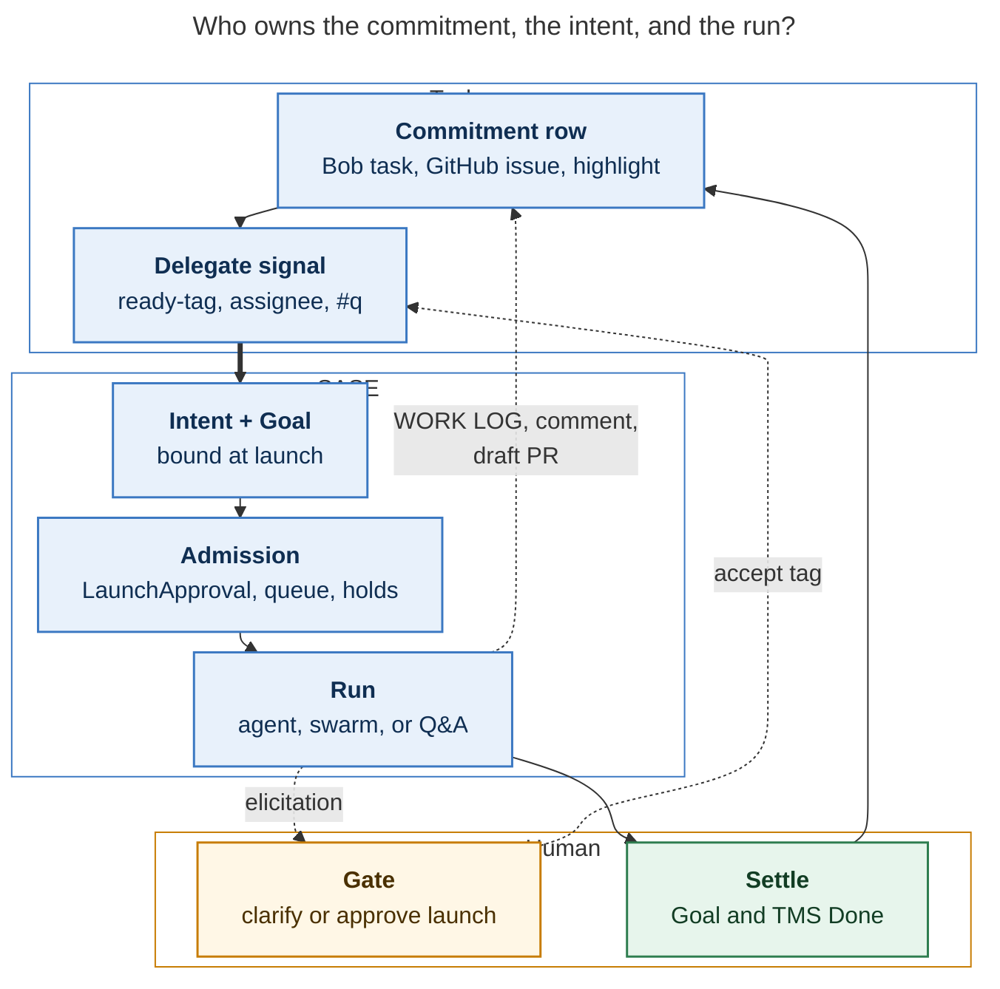
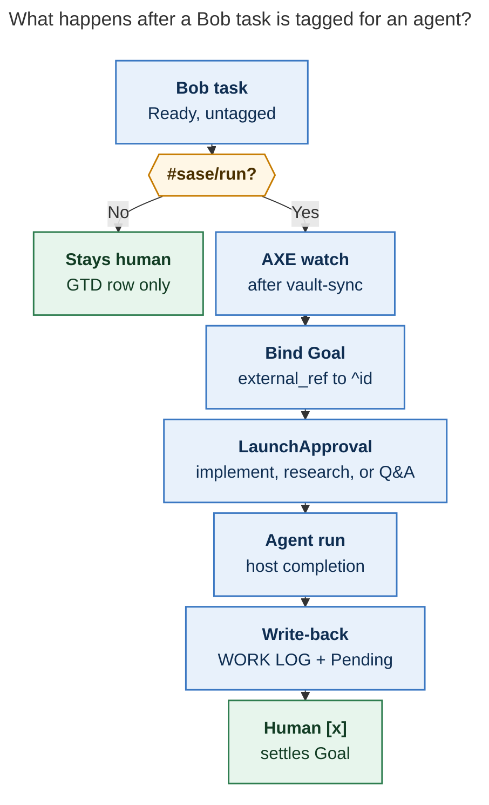

# SASE and task-management systems: a TMS-agnostic intent layer

**Question.** Is there a deeper connection between SASE (and agent orchestration in general) and task-management systems, and if so, is a *task-management-system-agnostic* SASE integration a good idea? What use-cases would it unlock, starting from Bob/Obsidian tasks, Highlights questions, and agent-proposed clarifications?

**Researcher.** grk (`research.2h.grk`). Independent report. I did not read peer reports from this swarm.

**Sources.** SASE core memory and decision records; `sase-core` goal ledger; SASE docs on beads, AXE jobs, file hooks, plugins, and `external_issue_mirror`; the `bob-cli` vault contracts (lanes, reconcile, relations, WORK LOG, Highlights sync); the live `~/bob` vault (tags, Highlights comments, `sase_goals.md`, `sase_better_tasks.md`); bobs-org GitHub repos; Linear Agent Session docs; GitHub Copilot coding-agent docs; Devin Linear/Jira docs; Microsoft Research *Goals as First-Class Abstractions in Human-AI Collaboration* (AutomationXP 2026), already finished in the Bob library.

## Bottom line

Yes: agent orchestration and task management are the same problem at two altitudes, and SASE has already started splitting them. A **TMS-agnostic intent layer** is a good idea. Turning SASE into a GTD app, or folding Bob tasks into beads, is not.

The connection is this: a task manager is the **human commitment book**. SASE is the **execution operating system** for agents. The missing piece is a thin, opt-in **intent adapter**: watch a TMS for an explicit “this may be delegated” signal, bind a SASE Goal, choose a playbook (implement, research swarm, Q&A, clarify), launch through existing admission (`LaunchApproval`, AXE `proposed_launches`, runner capacity, holds), write evidence back into the TMS, and leave **settlement to the human**. That last clause is already SASE law (`goals-host-binds`, `host-owned-completion`) and already Bob law (Pending `[/]` is sticky; Done `[x]` is a human close).

The three use-cases in the prompt are the right first customers, and they are not special cases. They are three playbooks on one contract:

1. **Explicit ready-tag → launch → WORK LOG + Pending.** This is Linear “delegate to agent while keeping a human assignee” and Copilot “assign issue, open a draft PR, human reviews.”
2. **Agent proposes a clarification on an untagged task; acceptance adds the ready-tag and launches.** This is Linear `elicitation` / Copilot clarifying questions / Devin scoping comments, routed through a SASE gate rather than an in-process wait.
3. **Highlights `#q` (or equivalent) on a `ref/` note → answer written back into the same comment.** This is a lightweight playbook: no bead, no Patch, still a Goal, still write-back.

Do this. Do not reuse `#sase` as the ready-tag: the vault already has **1,563** `#sase` tokens, and they mean “this is SASE product work,” not “an agent may start.” Auto-launch on `#sase` would point the orchestration layer at the entire product backlog.

**Verdict.** Build the intent-adapter plugin seam now; ship Bob as adapter zero; keep GitHub’s existing issue *mirror* as a sibling, not as the launch path; default every launch to a gate; never let an adapter mark Done.

## 1. Why the connection is real

SASE’s own vocabulary already has three non-interchangeable “task” objects, and the project spent 2026 making that split explicit:

| Object | Owner | Question it answers | Settlement |
| --- | --- | --- | --- |
| **Bob task** (Obsidian checkbox + `#task`) | Person, in the vault | What did I commit to, in which lane, under which project? | Human (Done / Cancelled). Blocked is *derived*. |
| **SASE Goal** (`goal:<id>`, ⌖) | Person; host binds every LLM turn | What outcome is this turn for? | Human only (`goals-host-binds`). Agents claim or keep open. |
| **Bead** | Agent-work tracker, project-scoped | What unit of agent work is in flight, blocked, or ready for triage? | Host/agent close with a resolution; TaskTriage is a human gate for `ready`. |
| **Patch / stitch** | Change record | What landed? | VCS workflow. |
| **Job (Chop)** | Scheduler | What scripted automation should run on a cadence? | AXE; may *propose* launches, never spawn LLMs itself. |
| **Gate** | Human decision | May this continue? | Human branch; creator’s turn already ended (`gates-never-block`). |

The 2026-09-26 `sase_goals` project note already states the intended relationship: goals for every prompt/plan/epic, beads with an optional `goal` field, planner agents listing goals before setting one. Those bullets were harvested from Highlights comments on Microsoft Research’s AutomationXP 2026 paper, which Bryan finished on 2026-10-13. The paper’s load-bearing claims, in Bryan’s own annotations:

- Existing tools track goals; they do not articulate, align, or *use* them.
- “No tool supports goal-guided agent orchestration” — Bryan’s comment: “sase will!”
- Agents should receive delegated goals and report progress against them, “not merely against tasks completed.”
- Interoperability: goal representations should travel across tools. Bryan’s follow-up: “Beads should support an optional `goal` field!”

That is the deeper connection. A TMS row is a *human-facing goal at task altitude*. An agent run is a *claim against that goal*. A bead is *how SASE tracks the claim’s work*. Mixing those three into one object is how you get the failure mode the goal-ledger decision already rejected: “making goals a bead type would couple the agent-work lifecycle to the person’s outcome records.”

Bob is the existence proof that the human book cannot live in SASE. The vault owns state; `bob` owns capture grammar and vault writes; Obsidian plugins render and stamp; Mac Capture is a thin client of `bob`. Lanes are sticky. Blocked is recomputed from prerequisites, future `[scheduled::]`, and project inheritance. Relations (`🪢 LINKS`) are inert on purpose: they never block, promote, or schedule. That is a GTD system with a decade of local law. SASE should attach to it, not absorb it.

The same pattern is now industry-default, which is independent evidence that the split is not a Bob idiosyncrasy:

- **Linear** (2026 agent platform): a human stays the *assignee*; the agent is a *delegate*. `AgentSession` states are `pending / active / error / awaitingInput / complete / stale`. Agents emit `thought / action / elicitation / response / error`. Clarification is a first-class activity, not a status smash. Playbooks and labels select *which* agent loop to start.
- **GitHub Copilot coding agent**: assign an issue to Copilot; it opens a *draft* PR and requests review. The agent cannot mark the issue done in a way that bypasses human merge. Copilot for Jira (public preview 2026-03-05) and Azure Boards/Linear/Slack entry points are the same contract on more TMSes. Dependabot and CodeQL autofix use the same “assign → draft PR → human merge” shape.
- **Devin**: assign, `@mention`, or apply a playbook label (`!plan`, `!implement`, `!triage`, `!review`). Confidence is reported on the ticket. The TMS is intake; git is landing; the human still reviews.
- **GitHub Agentic Workflows “Issue Monster”** (2026-10-20): a scheduled agent *hands* issues to Copilot, with an explicit capacity gate (skip if five or more open Copilot draft PRs). Handing work to an agent is easy; handing it the *right amount* is the craft.

SASE already has the execution-side equivalents of all of that: Goals, beads, `LaunchApproval`, AXE `proposed_launches`, `%queue` / `max_running_agents`, agent holds, gates, host-owned finalizers. What it does not have is a first-class *intake* from a human TMS that is not GitHub issues-as-beads.

## 2. What SASE and Bob already do (the gap)

### 2.1 SASE today: execution OS, GitHub-shaped intake

Current SASE is already an operating layer above coding-agent CLIs (the 2026-05-08 “missing operating layer” post is still the right picture, even as a draft). The launch path is unified: TUI / `sase run`, approved `LaunchApproval`, and AXE job batches share one typed admission plan. Agent-initiated launches freeze behind `LaunchApproval`. AXE jobs may write `proposed_launches` into `SASE_JOB_RESULT_FILE`; the runner, not the script, spawns.

The existing TMS integration is **one-way GitHub issue mirroring**:

- Builtin AXE job `external_issue_mirror` (every 15 minutes, one instance per enabled `git`/`gh` project) plus `sase bead sync-external`.
- Each uncovered GitHub issue becomes a `small` **`open`** task bead — **never `ready`**, so a first-pass backlog cannot flood `TaskTriage`.
- Identity is `external_ref` plus a `bug:<display>#<n>` ref. Upstream close/reopen may close/reopen the mirrored bead when it is safe; claimed, in-progress, parented, or reference-only beads get a note only.
- `sase-github` registers an agent-uncreatable `github` task type. Agents never file it. The mirror stamps it.
- Flag beads are excluded (internal hygiene, not GitHub noise).

That is a *mirror*, not a *delegate*. It copies tracker rows into beads so the Beads pane is a superset of the issue list. It does not launch an agent when you label an issue `sase` or assign it to SASE. Mirrored beads sit in `open` until a human triages them. That is the correct default, and it is also why Bryan still lives in `~/bob/sase.md` rather than in the Beads pane for product intent.

Other almost-adapters:

- **File hooks.** `research-highlights` already runs `bob highlights create` on new research reports (ADD on the research sidecar, excluding `*__*.md` swarm drafts and `research.*.grk` agent names). That is SASE → Bob, the opposite direction of the prompt’s use-cases, and it proves the hook machinery can talk to `bob`.
- **Task-type plugins** (`sase_task_types`). The catalog is builtins + plugins + project config. This is the extension point GitHub already uses.
- **Plugin top-level commands** (`sase_commands`). A future `sase intent …` or `sase bob …` can mount here without grafting argparse.
- **Goals.** Rust-owned event ledger, host-bound per turn, human settlement. This is the SASE-native identity an adapter should bind to, not a new fourth tracker.
- **`sase_better_tasks` backlog**, still blocked/scheduled: periodic bead-triage *job*; per-task-type prompt sets used as gate launch commands; bulk sequential task-bead launches. Those are execution-side improvements. They do not replace a TMS adapter.

### 2.2 Bob today: human commitment book

From `bob-cli` docs and the live vault:

- A task is one actionable Markdown checkbox in an area, project, or inbox note, usually `#task`, with a `^block-id` when it needs to be linked.
- Lanes: `[ ]` Ready, `[*]` Next, `[/]` Pending (Obsidian “In Progress”), `[?]` Blocked (derived), `[x]` Done, `[-]` Cancelled.
- Next and Pending are **sticky**. Unlinking does not release them. Only an explicit release returns them to Ready.
- `bob task reconcile` is the source of truth for promotions and derived Blocked, including after capture and `bob projects sync`.
- Child slots are contracted: Cancel Log, Depends-On, BLOCKS, Sub-projects, LINKS, LINKED FROM, then user children, Schedule Log, **WORK LOG**.
- WORK LOG is newest-first dated summaries. Human gestures (Ctrl+Shift+Enter unlink of `[/]`, Alt+N release) prepend a summary and *leave the task In Progress* unless the human also closes it. That is exactly the write-back slot the prompt wants.
- Capture, not raw file edits, is the supported writer. Mac Capture never writes the vault; it calls `bob`.
- Vault git-sync (`bob vault-sync`, nightly on athena/apollo) is the replication plane. Concurrent machine writes without the CLI’s all-or-nothing commit path will produce `_conflicts/`.
- Highlights comments sync into `ref/**/*.md` as `> [!note] Comment …` under the quote. Bryan already uses this as a task factory: comments containing `#task` become vault tasks (17 such comments in `ref/` today). **39** Highlight comments currently look like questions (`?`). **217** comment-bearing notes exist across **54** files. The `#q` use-case is not hypothetical; it is a pile of unanswered comments on papers Bryan is actually reading.

Vault tag inventory (non-`done/`, approximate token counts): `#gtd` 8789, `#work` 4561, `#task` 4123, `#sase` **1563**, `#ref` 557, `#prj` 99. `#sase` is an *area* tag, used for years of inbox captures and the SASE project tree. A ready-for-agent tag that collides with it is a production incident waiting to happen.

Prior research (`bob_sase_task_portfolio_split`, 2026-10-19) measured `sase.md` at **228 open tasks**, 218 of them Blocked, 210 of those merely date-scheduled. “Blocked” in this vault mostly means “scheduled for later,” not “cannot be done.” An agent that treated every `[?]` `#sase` line as ready work would ignite the backlog.

### 2.3 The actual gap

```
Bob / Linear / GitHub / Highlights          SASE today
─────────────────────────────               ─────────────────────────
Human commits to a row                      Goals exist but are not
                                            created from those rows

No “delegate to SASE” signal                LaunchApproval exists but
except typing a prompt in the TUI           nothing in Bob raises it

GitHub issues copy into open beads          Beads do not launch
                                            until TaskTriage

Highlights comments sit on the note         research-highlights writes
                                            PDFs *out*; nothing reads
                                            `#q` comments *in*

Agent finishes; Bryan pastes a summary      Host-owned completion
by hand, or doesn’t                         never reaches the vault
```

The prompt’s three use-cases are exactly the three arrows that are missing: **signal in, evidence out, and a gated propose-to-signal loop.**

## 3. What “TMS-agnostic” should mean

Agnostic does **not** mean “SASE reimplements Todoist, Linear, and Obsidian Tasks behind a facade.” It means SASE defines a small **intent contract**, and each TMS is a plugin that speaks it.

### 3.1 Intent contract (the adapter seam)

Each adapter implements:

| Verb | Meaning | Bob example | GitHub example | Highlights example |
| --- | --- | --- | --- | --- |
| **Watch** | Produce candidate intents from an explicit signal | AXE job after vault-sync, `bob query` / task index for a dedicated tag | Label, assignee, or issue comment | `bob ref scan` / file mtime on `ref/**/*.md` comments tagged `#q` |
| **Read** | Title, body, ids, project, playbook, current lane/state | Vault-relative path + `^block-id` | `owner/repo#n` | `ref/…md` + highlight id (`^h-…`) |
| **Bind** | Create or reuse a SASE Goal; optionally a bead | Goal titled from the task line; `external_ref: bob:<path>#^id` | Already have `external_ref` on mirrored beads; bind a Goal at *launch*, not at mirror | Goal at Q&A launch; skip bead |
| **Launch** | Emit a playbook prompt through admission | `proposed_launches` or `LaunchApproval` | Same, from a `sase` label, *not* from mere existence of the issue | Small Q&A agent, `%queue` cheap |
| **Write-back** | Append evidence; maybe move to a *non-terminal* lane | WORK LOG entry + `[/]` Pending | Issue comment + draft PR link | Nested answer under the same `Comment` callout |
| **Elicit** | Propose a clarification or a ready-tag, as a gate | Gate whose accept option runs `bob` to edit the task and add the tag | Issue comment + “apply label to launch” | Propose adding `#q` or rewriting the question |
| **Never settle** | Do not mark Done / close / merge | Stay `[/]`; human `[x]` | Stay open or draft; human merges | Comment stays; reading task stays `[/]` or `[ ]` |

This belongs in `sase-core` as a typed wire (litmus: a web app, CLI, or editor would need the same behavior), with Python/plugin adapters for I/O, the same split as VCS, workspace, task-types, and file-hooks. A reasonable entry-point group is `sase_intent_sources`, parallel to `sase_task_types` and `sase_file_hooks`.

### 3.2 What the adapter must not do

- **Must not own the TMS.** The vault remains the vault. GitHub remains GitHub. SASE stores the Goal, the agent run, and links.
- **Must not mark Done.** The prompt’s `[/]` after completion is the correct terminal-for-the-agent state. It matches Copilot’s draft PR, Linear’s `complete` session that still leaves the issue assigned to a human, and `goals-host-binds`.
- **Must not author Bob `[?]`.** Blocked is derived. An agent that writes `[?]` will be repaired by `bob task reconcile` and will fight the user.
- **Must not write Bob Markdown by hand.** All vault mutations go through `bob` (capture, a future `bob task note` / work-log CLI, or a reviewed equivalent). Raw edits plus `bob vault-sync` is how `_conflicts/` happens.
- **Must not auto-launch on area tags, schedules, or mere Ready.** Signal has to be *delegation*, not *existence*.
- **Must not wait in the creating agent.** Clarification is a gate shell (`gates-never-block`, `single-turn-agents`). The adapter watches for the accept option’s side effect (tag added) and then launches.
- **Must not duplicate every TMS row into a Goal or bead.** Materialize a Goal at delegation time. Materialize a bead only for engineering-sized playbooks. Q&A can be Goal + agent run + write-back.

### 3.3 Playbooks, not a single “run an agent”

Devin’s playbook labels are the right product idea. SASE already has the mechanism: macros and `#bd/work_task` / `#research_swarm` / custom Q&A. The adapter’s job is to *choose a playbook*, not to always spawn a coding agent.

Suggested Bob tag family (names are negotiable; collision-freedom is not):

| Tag | Playbook | Creates bead? | Default admission |
| --- | --- | --- | --- |
| `#sase/run` (or `#agent-ready`) | Implement or plan+implement in the bound project | Usually | `LaunchApproval` |
| `#sase/research` | `#research_swarm` | No (research sidecar artifacts) | `LaunchApproval` |
| `#sase/q` or `#q` on a highlight comment | Answer in place | No | Auto if cheap / queued; else gate |
| *(none)* | Elicit only | No | Gate: “accept clarification + add `#sase/run`” |

**Do not use `#sase`.** It is already the product-area tag.

### 3.4 Layer picture

**Reader question:** Which layer should SASE own versus the task manager?

**Caption:** The task manager keeps human commitments. SASE binds an intent and runs agents. Humans settle both the Goal and the TMS row; adapters never mark Done.



Converging arrows mean “all of these feed the next step.” Dashed arrows are write-back and elicitation, not ownership transfer.

## 4. Use-cases the layer unlocks

The three in the prompt first, then others that fall out of the same contract. Each notes whether it needs a new SASE primitive or only an adapter + playbook.

### 4.1 Prompted use-cases (ship these first)

**U1. Tag a Bob task as ready-for-agent; later a SASE agent works it; evidence lands; lane becomes Pending `[/]`.**

This is the Linear/Copilot/Devin core loop with Bob as TMS. Watch with an AXE job (same shape as `external_issue_mirror`, but *filter on the delegation tag*, not “every issue”). Bind a Goal whose `external_ref` is `bob:<note>#^block-id`. Choose project from the task’s residence note (`sase.md` → `+sase`, `bob-cli` project notes → `+bob-cli`, otherwise ask). Launch through `LaunchApproval` until the playbook is boring. On host completion, adapter prepends a WORK LOG line (`*YYYY-MM-DD* — <summary> · @agent:<name> · @goal:<id> · @artifact:…`) and sets `[/]`. Human later `[x]`s, which is also Goal settlement.

Why `[/]` rather than `[x]`: Bob Pending is sticky and means “work has started in this system.” Host-owned completion is *SASE’s* proof, not Bryan’s acceptance. Putting `[x]` from an adapter would skip the review walk, freshness, and Pomodoro close path. The prompt already chose the right lane.

**U2. Untagged task the agent understands; propose a clarification; acceptance adds the ready-tag and launches.**

This is Linear `elicitation` plus Devin’s scoping comment. Implementation: a *proposal* job, not a launch job. Scan a bounded set (Today’s Next, or `#sase` Ready with no future schedule — never the 218 date-Blocked rows). For each, if a cheap model is confident it can name project, playbook, and missing acceptance criteria, open a **question/custom gate** whose Accept command is `bob` rewriting the task (body, maybe `#sase/run` or `#sase/research`) and whose Reject is a no-op plus a WORK LOG “declined.” Because gates never block the creator, the proposer dies; the watch job sees the new tag on a later tick and enters U1.

Confidence gating matters. `sase_better_tasks` already wants a confidence field derived from which model signed off. Reuse that idea here: only `@medium` or above may propose a ready-tag; `@small` may only propose a clarifying sentence.

Default this **off** for personal areas (`#love`, `#dad`, `#meds`, `#laundry`, `#dog`). Allowlist project notes (`sase*.md`, `bob*.md`, `job.md`, …) until the false-positive rate is measured.

**U3. Highlights questions (`#q`) answered in the same note.**

The pipeline already exists: Highlights → sidecar → `ref/**/*.md` comment callouts; `bob ref scan` on the Mac after ⌘S. Add a watch on new/changed comments matching `#q` (or a dedicated tag — `#q` is currently rare, so it is available). Playbook: read the PDF via `bob ref show -c`, answer the question, patch the comment body (or a sibling bullet under it) through a `bob`-owned writer, leave the reading task’s lane alone unless it was the question-task itself.

Do **not** require a bead. Do **not** launch `#research_swarm` by default; a single answering agent with the paper as `@file` / `bob ref` context is the right size. Offer “promote this answer to a `#sase/research` task” as a gate if the question is actually a project.

Volume today is tractable: 39 question-like comments, 17 comments that already mint `#task`s. This is the highest delight-per-complexity adapter after U1.

### 4.2 Additional use-cases (same contract)

**U4. GitHub label `sase/run` launches, while the existing mirror stays open-only.** The mirror continues to copy issues into `open` beads. The *label* (or assignee-to-SASE) is the delegation signal, matching Copilot’s assign and Devin’s `devin` label. Write-back is an issue comment plus the Patch/PR link. This is the product-facing TMS adapter; Bob is the personal one.

**U5. Research-question tasks.** A Bob task tagged `#sase/research` launches `#research_swarm` with the task body as the question and writes the `research:` artifact ref into the WORK LOG. The current swarm *is* this use-case, invoked from a prompt instead of a checkbox.

**U6. Reading-queue assist.** `#ref` tasks in Ready/Next: propose a one-page précis, or answer open highlight questions for that PDF in batch. Never mark the reading task `[x]`; reading state is derived from the tracker *and* frontmatter. Adapter may leave a note; Bryan still “reads.”

**U7. Inbox routing proposals.** `inbox.md` / `mac_inbox.md` still hold old zorg-style `#sase` lines. A proposer suggests a residence note, a `#task` promotion, and a project — as a gate. This is GTD clarify, which Bob currently does by hand during the review walk. High value, high risk of being annoying; keep it a weekly job, not a file-hook.

**U8. Dependency unblock fan-out.** When a Bob prerequisite closes, reconcile already recovers dependents and *offers* successors for Today. An adapter can add a second offer: “also launch `#sase/run` on these unblocked engineering tasks.” Human picks, same as Bob’s successor picker. Do not auto-launch the whole unblocked set.

**U9. CI / Dependabot / CodeQL analog, already half-built.** SASE has `ci` and `bug` task types, `TaskTriage`, and Copilot-class “assign the alert.” An adapter from GitHub checks to a `ci` bead is closer to today’s mirror+triage than to Bob. Keep it on the GitHub plugin. The intent layer just makes “ready for agent” a shared verb.

**U10. Recurring chores vs agent work.** `bob nightly` already syncs and archives. AXE already runs jobs. A Bob task with a recurrence mark and `#sase/run` is how you get “weekly, an agent triages beads” (`sase_better_tasks` ^bead-triage-job) without inventing a second scheduler. The job is the watch; the task is the human-visible standing order.

**U11. Cross-project dispatch.** A Bob task in `sase.md` that is really a `bob-cli` change: the adapter’s Read step names the project; `%dispatch` / `+bob-cli` does the rest. Today Bryan has to remember which TUI project is current. The TMS row is a better source of project than the MRU head.

**U12. Telegram / mobile “work my next tagged task.”** `sase-telegram` already answers gates and launches. Once intents exist, a Telegram command is `sase intent next` + approve. No new TMS.

**U13. Human-only counterpart.** Agents already file task beads for follow-ups. The reverse: an agent that discovers *human* work (billing, a Mac setting, a conversation) writes a Bob capture (`bob capture '…'`) *without* `#sase/run`. The vault stays the life tracker; SASE stays the factory. This is how you stop stuffing `#cancel Twilio` into the SASE backlog (already visible in `inbox.md` history).

**U14. Goal changelog / evals.** `sase_goals.md` requirements already ask for an agent changelog driven by goals, and for evals keyed on goals (Databricks-inspired, Microsoft paper). A TMS adapter that always binds a Goal at delegation gives those features a corpus: every U1/U3 run is a labelled (intent, claim, evidence, human settlement) tuple.

**U15. Capacity-aware pull.** Issue Monster’s lesson: skip if too many agent drafts are open. SASE already has `max_running_agents`, `%queue`, and holds. An intent watcher should *pull* N ready intents per tick, not push every new tag immediately. Pair with the 15-minute AXE cadence used by `external_issue_mirror`.

**U16. Proposal of playbook, not only of tag.** For a tagged task, a pre-agent can say “this is a research swarm, not an implement” and rewrite `#sase/run` → `#sase/research` via a gate. The prompt already names this (“plan and implement, or `#research_swarm`”).

**U17. Stale-intent recovery.** If a Goal is `review` and the Bob task is still `[/]` after N days, notify; do not auto-`[x]`. If the agent failed, write-back an error line (Linear `error` activity) and leave `[/]` or revert to Ready only on an explicit release.

**U18. Multi-TMS identity.** One Goal may cite `bob:sase.md#^foo` *and* `bug:sase#123` if both rows are the same commitment. Artifact links already have `related` / `implements` / `derives-from`. Prefer linking over merging stores.

### 4.3 What this does *not* unlock (on purpose)

- A second GTD app inside sase’s TUI that competes with Bob’s review walk, freshness, and Pomodoro ledger.
- Auto-working 228 `sase.md` Blocked rows because a model “understands” them.
- Agents settling Goals.
- Bidirectional status sync that fights `bob task reconcile` (the GitHub mirror already learned to *note* rather than smash status when the bead is in progress).

## 5. Lifecycle of U1 (the main path)

**Reader question:** What happens after a Bob task is tagged for an agent?

**Caption:** A watch job sees the ready-tag, binds a Goal, admits a launch, writes a WORK LOG, and leaves the task Pending for the human to close.



The “No” branch on the first decision is the whole safety story: untagged work stays a human GTD row.

## 6. Constraints that should shape the design

These are not optional product preferences. They are frozen SASE decisions plus Bob contracts.

**From SASE**

- **Single-turn agents.** The watch job and the worker are different processes. Nothing polls in an LLM turn.
- **Gates never block.** U2/U16 elicitation is a gate shell. The watch job is what continues.
- **Host-owned completion.** Write-back happens in a finalizer or in the AXE job that observes a completed agent, not in the model’s “I am done” sentence.
- **Goals host bind.** Every launched turn gets a Goal *before spawn*. The adapter is the thing that can supply it. Untagged TUI prompts keep today’s bind path.
- **Completion is not skippable via receipts.** Evidence in the WORK LOG is a citation (`@agent`, `@goal`, `@artifact`), not a claim that the TMS row is done.
- **Runner capacity and holds.** U15 pull-evaluation. Fail-open hold store already exists.
- **Rust core for shared behavior.** Intent records, playbook enum, bind rules, “never settle” invariant: `sase-core`. I/O: plugins.
- **Machine writes off the primary.** Goal/bead writes already go through hidden clones. Bob writes go through `bob` on the vault, which has its own git-sync lock. Do not open `~/bob` as a SASE workspace and stitch it.
- **Global install is human-only.** A Bob adapter that needs a new `bob` subcommand is a bob-cli change, gated like any other.

**From Bob**

- Vault is source of truth; CLI is the writer; plugins are renderers.
- Sticky Pending is the right post-agent lane.
- Derived Blocked: adapters observe it as a *reason not to launch* (future schedule, open dependsOn, `#prj_is_blocked`), they do not set it.
- WORK LOG and LINKS already have grammar. Put evidence in WORK LOG; put `[[bead]]` / Goal citations on LINKS if a relation is wanted (relations never launch — good).
- Nightly archive (`bob task archive`) will move `[x]` tasks into `done/`. Write-back must be done before that, which is automatic if write-back happens at agent completion, not at human close.

**From industry incidents**

- Cursor CLI recursive spawn (~318M tokens in 33 minutes, 2026-10-16) is what un-admitted auto-launch looks like. SASE’s `LaunchApproval` + job `dedupe_key` + capacity budget are the countermeasure. Do not add a “just `sase run` from a file hook on every vault change” path.
- Copilot Cloud Agent’s Aug 2026 status outage (task *visibility* delayed 60–90 minutes while tasks still ran) is a reminder to treat TMS write-back as best-effort and to keep SASE’s own agent row as the live status. Linear’s `externalUrls` on `AgentSession` is the same idea: link out to the real run.

## 7. Recommended shape and phasing

### 7.1 Architecture in one paragraph

Add an **Intent** record in `sase-core` (id, source adapter, external_ref, playbook, goal_id, optional bead_id, state `seen / gated / launched / writeback / abandoned`). Adapters are plugins. One AXE routine ticks every adapter (`for_each: intent_sources`, same style as `external_issue_mirror[<project>]`). Each tick: watch → diff against Intent store → propose launches / gates → later tick performs write-back when the bound agent is terminal. Humans settle Goals and TMS rows. The Beads pane keeps showing *work*; Bob (or GitHub, or Linear) keeps showing *commitments*.

Do **not** replace `external_issue_mirror`. It solves “the bead list is a superset of the issue list.” Intent solves “this row is delegated.” A mirrored GitHub issue without a `sase/run` label is inventory. A Bob task without `#sase/run` is inventory.

### 7.2 Phases

**P0 — Contract + Bob U1 (small epic).** Intent wire; one AXE job; Bob adapter using a *new* tag; `LaunchApproval`; WORK LOG + `[/]` via `bob`; Goal bind; `dedupe_key` per `^block-id`; capacity cap of 1–2 launches per tick. Manual `sase intent sync --dry-run`. No untagged proposals. No Highlights. No GitHub launch.

**P1 — U3 Highlights `#q`.** Same job, second adapter, Q&A playbook, write into the comment. Still no untagged proposals.

**P2 — U2 elicitation.** Allowlisted project notes only. Gate, not auto-tag. Measure accept/reject.

**P3 — GitHub launch label** on top of the existing mirror. This is the public-product adapter.

**P4 — Playbook tags, Telegram `intent next`, U8 successor offers, U14 eval corpus.** Only after P0 write-back is boring.

A feature flag (`beta`, default off) is warranted: this is user-reaching, unproven, and has a catastrophic failure mode (launching the backlog). `sase flag new` is the path; the Off branch is “watch is a no-op.”

### 7.3 Bob-cli work that SASE should not fake

If `bob` lacks a supported way to (a) append a WORK LOG entry and (b) set a lane to Pending without a Pomodoro gesture, **add that to bob-cli** as a small, tested command. Do not have SASE parse and rewrite task trees. Bob’s own docs are explicit that capture/reconcile own those trees, and the JS/Rust twins share vector tables. An adapter that bypasses them will desync chips, freshness, and grouping.

Likely bob-cli surface (proposal, not a spec): `bob task log <id-or-link> --summary … --lane pending`. Reuse the WORK LOG prepend contract already used by Ctrl+Shift+Enter.

### 7.4 Is it a good idea? The actual test

It is a good idea if and only if:

1. Delegation is explicit.
2. Settlement stays human.
3. Bob (or whichever TMS) remains the commitment book.
4. SASE remains the execution OS.
5. Auto-launch is admitted, capacity-limited, and default-off.

Those five are already true of Linear’s agent platform and Copilot’s issue assignment. SASE would be catching up to a pattern the rest of the ecosystem standardized in 2025–2026, while keeping the Goal/bead split those products still mush together.

It is a *bad* idea if the implementation is “file hook on `~/bob/**/*.md` → `sase run`.” That violates 1, 2, and 5, fights vault-sync, and ignores the 1,563 `#sase` tags.

## 8. Risks and open questions

| Risk | Why it is real | Mitigation |
| --- | --- | --- |
| Tag collision with `#sase` | 1,563 existing tokens | New tag family; never treat `#sase` as delegate |
| Backlog ignition | 228 open tasks in `sase.md`, 210 scheduled-as-Blocked | Watch only the delegate tag; pull N per tick |
| Vault conflicts | Multi-machine git sync, `_conflicts/` | Writes only through `bob`; job on one host (athena or apollo), not both |
| Double bookkeeping | Goal + Bob task + bead | Goal at delegation only; bead only for implement playbooks; links not copies |
| Status fights with reconcile | GitHub mirror already special-cases in-progress | Adapters may set Pending; they may not set Blocked or Done |
| Noisy U2 proposals | Freshness walk already competes for attention | Allowlist notes; confidence floor; weekly cadence |
| Personal tasks | `#meds`, `#dad`, `#love` in the same vault | Adapter allowlist; never scan whole-vault `#task` |
| Recursive launch | Cursor 318M-token incident | `LaunchApproval`, `dedupe_key`, no file-hook spawn |
| Write-back without a bob CLI | Temptation to regex the vault | Block SASE P0 on the bob-cli command |
| Goal ledger load | 470 open tasks × always-on Goals | Do not pre-create Goals for inventory |

**Open questions for the lead / later design:**

1. Exact tag spelling (`#sase/run` vs `#agent-ready` vs a Tasks custom status). Must not be `#sase`.
2. Which machine runs the Bob watch (vault-sync already uses `bob_sync.lock` on athena/apollo; pick one writer).
3. Whether implement playbooks create a bead *and* a Goal, or a Goal whose claim is the agent run (bead optional). Recommendation: Goal always; bead when the playbook would have used `sase bead work` anyway.
4. Whether U3 answers are allowed to auto-launch without `LaunchApproval` when the comment is `#q` and the model is small. Recommendation: queue, don’t silent-auto, until volume is known.
5. How to name the plugin package: a `sase-bob` plugin in bobs-org vs a generic `sase-intent` in sase-org with a Bob adapter module. Recommendation: generic core + Bob adapter in a plugin, same as `sase-github` contributing `github` task types.

## 9. Library check

Candidates consulted against `bob ref`:

- Microsoft Research, *Goals as First-Class Abstractions in Human-AI Collaboration* (AutomationXP 2026) — **in library, finished** (reading task completed 2026-10-13; 22 highlights).
- Linear agent-interaction / Agent Session docs — not a library PDF; used as a primary web source.
- GitHub Copilot coding-agent / Jira integration changelog — primary web sources.
- Devin Linear/Jira integration docs — primary web sources.

Library check: 1 of 4 PDF-class candidates already in the library (1 finished). The other three are product docs, not readings to queue.

## Sources

- SASE decision records: `goal-ledger`, `goals-host-binds`, `host-owned-completion`, `gates-never-block`, `single-turn-agents`, `plugin-commands`, `rust-core-required`.
- SASE glossary: Goal, Job, Artifact, Patch, Receipt, Macro Swarm, Sase Gate, Sase Scheduler.
- `sase-core` `crates/sase_core/src/goal/{mod.rs,wire.rs}` — Goal statuses `draft/active/review/done/dropped`; actors human/agent/host; human settlement flavors.
- SASE docs: `docs/reference/work-units/bead-mirroring.md`, `docs/reference/automation/scheduler-jobs.md` (`proposed_launches`), `docs/reference/automation/scheduler-default-routines.md` (`external_issue_mirror`), `docs/contribute/plugin-api.md` (`sase_task_types`, `sase_file_hooks`), `docs/reference/config/prompts-and-tools.md` (`research-highlights`), `docs/contribute/architecture.md` (unified launch admission), `docs/blog/posts/why-coding-agents-need-orchestration.md`.
- `sase-github` `src/sase_github/task_types.py` and README — agent-uncreatable `github` type stamped by the external issue mirror.
- `src/sase/external_mirror/issues.py` — mirror creates `open` small beads, never `ready`.
- bob-cli: `docs/concepts/tasks-and-lanes.md`, `docs/concepts/how-bob-fits-together.md`, `docs/task-status-hooks.md`, `docs/task-relations.md`, `docs/ref.md`, `docs/highlights-ref-sync.md`, `docs/reference/glossary.md` (Work Log).
- Live vault: tag counts; `sase_goals.md`; `sase_better_tasks.md`; Highlights comments under `~/bob/ref/` (217 comments, 39 question-like, 17 `#task`-minting).
- Prior research: `202610/bob_sase_task_portfolio_split/bob_sase_task_portfolio_split__final.md` (228 open tasks in `sase.md`).
- Microsoft Research, *Goals as First-Class Abstractions in Human-AI Collaboration*, AutomationXP 2026, PDF in `lib/papers/…`, notes in `ref/papers/2026_goals_as_first_class_abstractions_in_human_ai_collaboration_automationxp26.md`.
- Linear: <https://linear.app/developers/agent-interaction>, <https://linear.app/docs/assigning-issues>, <https://linear.app/developers/agents>.
- GitHub Copilot: <https://docs.github.com/en/copilot/how-tos/use-copilot-agents/coding-agent/assign-copilot-to-an-issue>, <https://github.blog/changelog/2026-03-05-github-copilot-coding-agent-for-jira-is-now-in-public-preview/>, Issue Monster <https://github.github.com/gh-aw/blog/2026-10-20-agent-of-the-day/>.
- Devin: <https://docs.devin.ai/integrations/linear>, <https://docs.devin.ai/integrations/jira>, <https://linear.app/integrations/devin>.
- Amp Linear assign: <https://ampcode.com/news/assign-it-to-amp> (2026-10-19).
- Cursor recursive-spawn incident: Cursor forum, 2026-10-17.
- bobs-org repos: `bob-cli`, `bob-plugins`, `bob-mac-capture`, `bob`, plus SASE sidecars (`bob-cli--beads`, `--plans`, `--research`, `--agents`).
