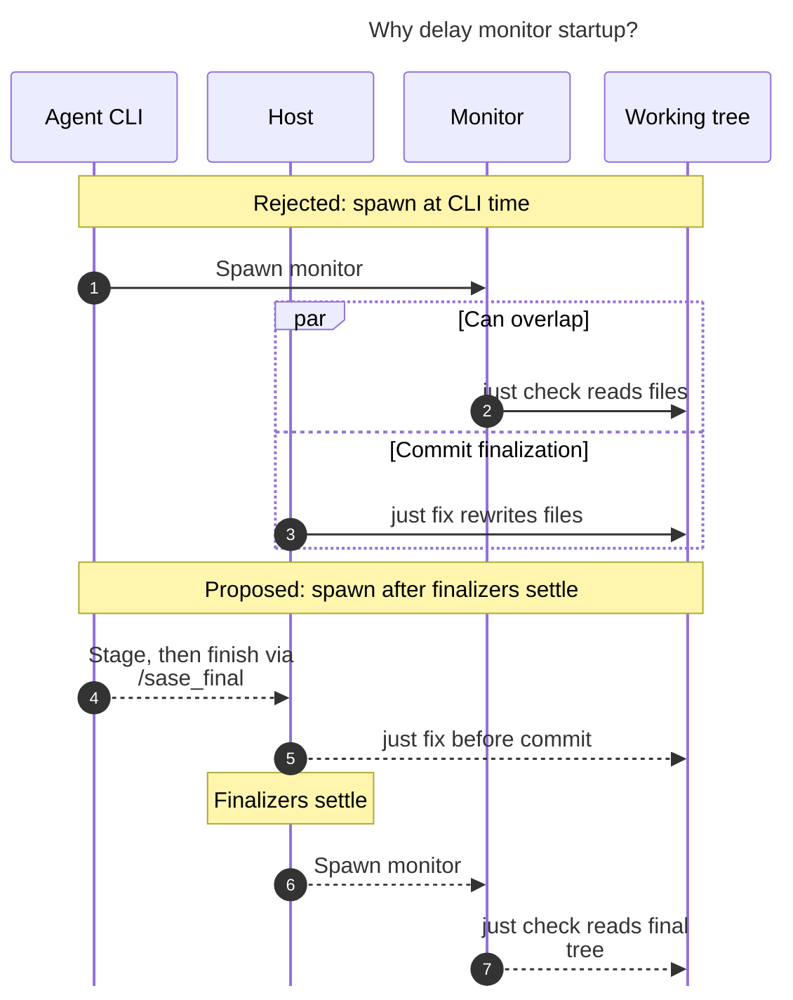

# Diagram proposals: Ending gate, plan, and monitor turns through host completion

Proposals for the swarm linker, not a report. Each diagram restates only what the source
report says.

```yaml
source: research:202610/staged_handoffs_through_host_completion/staged_handoffs_through_host_completion__final.md
producer: research.5f.image
check: "mmdc 12.0.0 with the PDF-mirroring config rendered 1 of 1 Mermaid diagrams"
```

## monitor-finalization-race

```yaml
anchor: |-
  A monitor spawned at CLI time could run
question: |-
  Why must a monitor start after finalization?
illustrates: |-
  Staging a monitor and spawning it after finalization keeps `just check` from running while the commit finalizer's `just fix` hook rewrites files.
caption: Starting the monitor after finalizers settle prevents its check from racing the commit hook's file rewrites.
review: "562x759.5 px, fit 100%; question and visual checks passed; 1 visual revision in 2 look rounds; 1 syntax repair"
```


