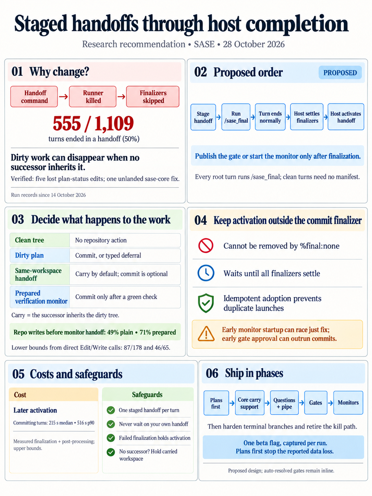
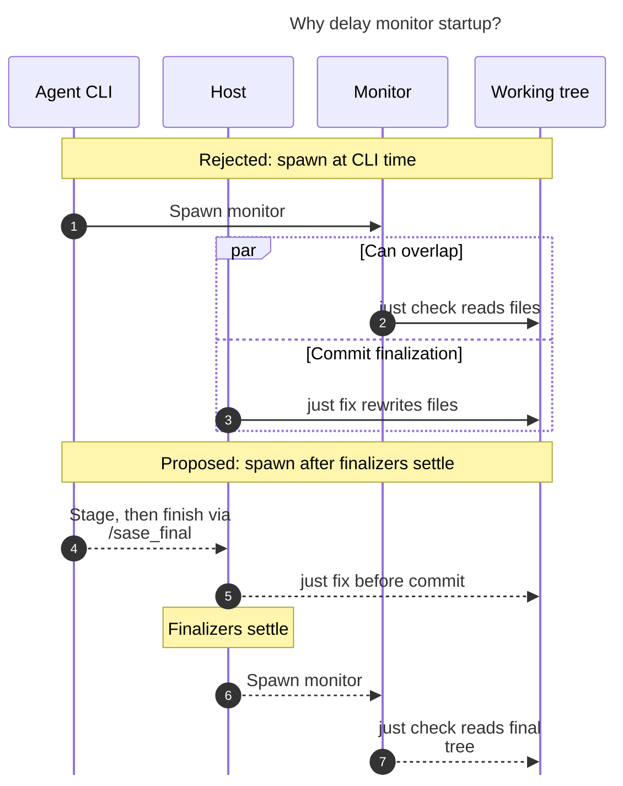
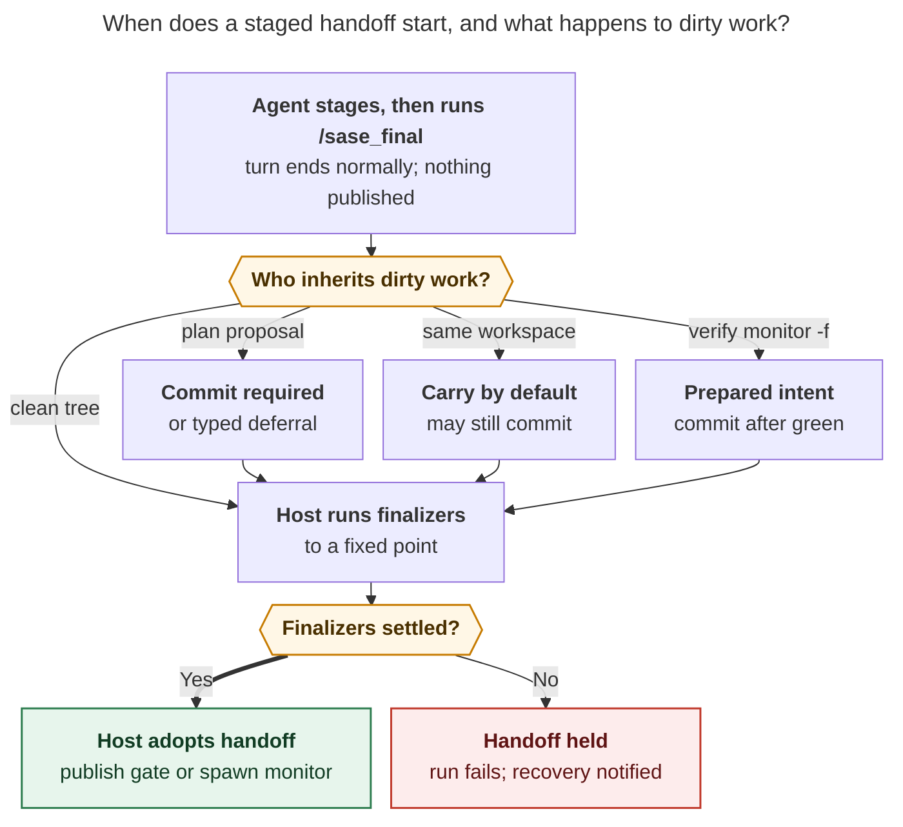

# Ending gate, plan, and monitor turns through host completion

> **Research query:** Should SASE stop having gates (especially plans) and monitors kill
> the agent that invoked them, and instead require every agent turn to submit a final
> declaration and end through a finalizer, probably the existing commit finalizer taught
> that plan and monitor turns need not commit, so agents can commit file changes and
> propose plans in the same turn (context: the `bob-cli-dw.land` and `sase-1ou.land`
> agents)? Help decide the best way to implement it, critique the plan, call out any
> justified adjustments to the requirements, and end with a recommended solution.



## Bottom line

**Yes, this is a good idea, and the evidence says it is overdue.** Today a handoff
command SIGTERMs its own runner partway through a tool call, and the finalizer controller
then skips itself because a pending-handoff marker exists. Any edit the agent made before
the handoff is never committed. [That is happening now](#work-is-being-lost-now): the
bob-cli backlog landers lost five plan-status edits, and a sase-core fix from
`sase-1ou.land` never reached master. Handoffs are not an edge case either. They end
[**half of all turns**](#how-often-turns-end-in-a-handoff).

All five researchers agree on the direction, and so do I. All five also push back on
parts of the proposal as written. I would ship it with four adjustments, each called out
in [Adjustments](#adjustments-to-the-requirements):

1. **Reuse the declaration and `builtin@commit` for repository decisions, but do not put
   the handoff inside the commit finalizer.** Agents *stage* the handoff. The host runs
   the selected finalizers to their fixed point and only then adopts the staged handoff
   as a fixed, host-owned step. It is not a finalizer instance, so `%final:none` cannot
   remove it ([A3](#a3-reuse-the-commit-finalizer-for-decisions-not-for-the-handoff)).
2. **Reverse the "plans may skip the commit" relaxation.** A plan turn with dirty
   repositories must commit them (or file a typed deferral). Committing them is the whole
   point of the change. Handoffs that resume in the same workspace (monitor, questions,
   pipe) get a new, explicit, host-defaulted **`carry`** disposition instead
   ([A2](#a2-split-may-skip-the-commit-into-four-cases)).
3. **"Every turn declares" means "every root turn runs `/sase_final`"**, not "every turn
   writes a manifest". A clean turn still reads the context and stops. In practice this
   just deletes the exemption ([A1](#a1-every-root-turn-runs-the-final-declaration-skill)).
4. **Cover all eight handoff entry points**, not only gates, plans, and monitors.
   Otherwise two end-of-turn protocols survive indefinitely
   ([A4](#a4-cover-all-eight-entry-points)).

The [recommended solution](#recommended-solution) is at the end.

## How it works today

Every in-agent handoff follows the same steps: write a marker, kill the runner, skip the
finalizers, then have the runner adopt the marker.

1. The command writes one of five markers into the run's artifacts directory:
   `.sase_plan_pending`, `.sase_questions_pending`, `.sase_monitor_pending`,
   `.sase_gate_pending`, or `.sase_pipe_pending`.
2. It calls `kill_agent_runner_group()` (for example `src/sase/main/plan_propose_handler.py:479`).
   That function sends SIGTERM to the whole runner process group, so the provider dies
   mid-tool-call.
3. `_invoke.py` still reaches `run_finalizers()`. But `should_skip_finalizers()`
   (`src/sase/finalizers/controller_context.py:41`) returns true whenever a marker exists.
   Declaration recovery returns early for the same reason
   (`declaration_recovery.py:47`). **The commit finalizer never runs.**
4. Marker adoption happens **only on the killed path**
   (`_handle_killed_iteration`, `src/sase/axe/run_agent_exec.py:154`). It runs
   `handle_plan_marker` and the other handlers, and because the model's reply died with
   the provider, it writes a synthetic chat response.

The plan handler's own comment states the consequence: "Proposing a plan terminates the
runner mechanically, so … a finalizer or a later commit-triggered hook never runs for
this turn." The `/sase_final` skill and the `host-owned-completion` decision record both
list these handoffs as exemptions.

The Codex adapter lists eight handoff entry points (`_subprocess_codex.py`,
`_SASE_HANDOFF_COMMAND_PREFIXES`). They fall into two groups, and the difference drives
the implementation cost:

- **A: marker only**
  - *Commands:* `plan propose`, `questions`, `pipe`
  - *Where the side effect happens:* The CLI validates (and archives the plan) and
    writes the marker. The runner does the real work after the kill, which is already
    *after* the point where finalizers run.
- **B: side effect first**
  - *Commands:* `gate create`, `sudo request`, `launch request`, `run`, `monitor start`
  - *Where the side effect happens:* The CLI publishes the gate or spawns the monitor
    supervisor and moves the workspace claim, *then* kills the runner.

What happens to a dirty tree after a handoff depends on whether a same-workspace
successor exists. Continuations inherit the predecessor's finalizer baseline
(`commit_finalizer_inheritance.py`), so its dirty files become the successor's
obligations. That "carry" already works for monitor follow-ups, answered questions, and
pipes. It fails wherever no successor inherits the tree:

- **Epic plan approve.** Phase agents run in *other* workspaces. This is the worst case,
  because it is the successful path.
- **Plan reject or timeout, and commit-only.**
- **Stopped or lost monitors.**
- **Cancelled questions.**
- **Terminal gate branches.**

On those paths the claim is released and the next agent to claim the workspace resets it.

## Evidence

### Work is being lost now

These cases are verified; each lists what happened and the lead's verification:

- **bob-cli backlog landers (`bob-cli-e0`)**
  - *What happened:* The landers for epics `bob-cli-d7`, `-da`, `-dd`, `-df`, and `-dp`
    each set the epic plan to `status: done`, then proposed the next batch. All five
    plans are still `wip` on origin. `bob-cli-dw.land` diagnosed this and **chose not to
    propose B7** so that its own test fix and nine plan edits would commit. The chain
    stalled.
  - *Lead's verification:* Transcript quotes match across cdx, grk, mus, and gem.
- **`sase-1ou.land`**
  - *What happened:* The lander fixed sase-core contention tests and a `connection.rs`
    regression, closed `sase-1p6`, then proposed child epic `sase-1ou.6`. The finalizer
    stayed in phase `planned`.
  - *Lead's verification:* sase-core `origin/master` has **no commit after `ed8328f9`
    (12:31 EDT)** as of this writing. `sase-1p6` is **READY again**: cld's +1 reopened
    it.
- **`bob-cli-dp.land--code`**
  - *What happened:* Edited `src/sase/sdd/_link_files.py`, `validate_committed_plans.py`,
    and a new test in an opened sase checkout at 14:36, then proposed epic B6.
  - *Lead's verification:* sase master has no commit touching those paths after 14:12.
    The edits are likely lost (their intent is unconfirmed).

The plan that `sase-1ou.land` proposed even writes down the contract it needed: the
reconciled files "commit after its turn and exist before this plan launches." Today's
handoff cannot guarantee that (cdx).

### How often turns end in a handoff

This is a re-measurement. I re-ran cld's count over 1,109 `ace-run` records dated
2026-10-14 or later, across all projects. It matches. Runs by outcome:

- **completed:** 552
- **monitored:** 310
- **gated (tale plan 129, epic plan 78, custom 9, question 6, sudo 4):** 226
- **epic_approved (inline):** 19
- **failed:** 2

So **555 of 1,109 turns (50%) ended in a handoff.**

### How often handoff turns are dirty

This is a new measurement. cld flagged this as an unmeasured gap. For each handoff, I
traced the run that started it and counted direct `Edit`/`Write` tool calls. I excluded
`/tmp` and the `sase_plan_*.md` scratch file. The count misses Bash `sed` edits and Codex
`apply_patch`, so it is a **lower bound**. Whether the proposer wrote repo files, by
handoff kind:

- **Tale plan:** **0 / 129**
- **Epic plan:** 3 / 78 (the lander cases)
- **Epic plan, auto-approved:** 3 / 19
- **Monitor, unprepared:** **87 / 178 (49%)**
- **Monitor, prepared (`-f`):** **46 / 65 (71%)**

This settles two design questions:

- **"Plans must commit" costs almost nothing.** Planners essentially never edit files, so
  the rule only bites the lander turns that need it.
- **Monitors must not be forced to commit.** About half of plain monitor turns hand off
  dirty work on purpose ("run `just check` on my changes; the follow-up commits"). For
  monitors, the zero-friction path has to stay "carry".

### Cost the kill has already imposed

cld catalogued the coping machinery that exists only because a turn ends by a signal from
inside a tool call:

- in-flight handoff markers and the late-adoption wait;
- the Codex stranded-handoff nudge (Codex yields `exec_command` after about 30 s);
- lost-gate-intent adjudication;
- sub-second `monitor start` latency work, including a double fork so the supervisor
  survives the kill;
- SIGTERM claim-release exceptions;
- `kill_agent_runner_group()` itself (Claude puts Bash in its own process group);
- synthetic chat responses.

Staging lets most of this be deleted.

## Is this a good idea

**Yes.** The kill was a reasonable shortcut when handoffs were rare and planners did not
edit code. Three things have changed since then:

- landers now make real edits before proposing successors;
- monitors are the most common way a turn ends;
- the kill path keeps needing race patches.

The decision records the kill came from (`gates-never-block` and `single-turn-agents`)
are about *not waiting*, and staging keeps that guarantee. The agent still never blocks
on a human or a long command, and continuation is still mechanical. Only *when* the
provider exits, and *what runs first*, changes. `host-owned-completion` even names its
own reopen condition ("after operational soak"), and the [evidence above](#evidence) is
that soak.

What you give up, and why each is acceptable:

1. **The hard mechanical stop.** After staging, the agent can keep working. That is
   mostly harmless, because a monitor staged this way checks the *final* tree, which is
   better. Three guardrails cover the rest: refuse a second staged handoff, refuse a wait
   on your own staged handoff, and keep the existing completion watchdog
   (`_subprocess_plain.py:137`). The watchdog reaps a provider that is still alive 120 s
   after an accepted declaration.
2. **Activation latency.** The gate or monitor now starts only after finalization. I
   measured completed runs since 2026-10-20, from the `finalizing` phase to the end of
   the run. Runs that committed took a **median of 215 s, p75 329 s, and p90 516 s**.
   Runs with nothing to commit took a median of 48 s. Both figures include
   post-processing, so they are upper bounds. cld's "a minute or more" understates this.
   A dirty plan turn's gate will appear about 3–9 minutes later than today. That is fine
   for a human decision. Carry and clean turns add almost nothing.
3. **Runner slot hold.** The slot is held through finalization, as for any completed
   turn. That is minutes, not the human-scale wait `gates-never-block` was written to
   avoid.
4. **Dependence on the model ending its turn.** The provider exits at the end of its turn
   regardless. The host adopts the staged handoff whether or not a manifest was needed.
   Only a dirty plan turn with no declaration needs the existing one-shot
   declaration-recovery turn.

None of these outweighs silent data loss.

## The proposal point by point

Each of your points, with its verdict:

- **Gates and monitors stop killing the agent; use a finalizer instead:** **Agree.**
  Phrase it as: the turn ends through host completion, and the host adopts the staged
  handoff afterwards.
- **"Just use the existing commit finalizer":** **Agree for repository decisions;
  disagree for running the handoff.** See
  [A3](#a3-reuse-the-commit-finalizer-for-decisions-not-for-the-handoff).
- **All turns must submit a final declaration:** **Adjust.** Every root turn runs
  `/sase_final`; a manifest is required only when obligations need decisions. See
  [A1](#a1-every-root-turn-runs-the-final-declaration-skill).
- **The commit finalizer accepts that plan and monitor turns need not commit:**
  **Split.** Clean trees already work. Dirty plans must commit. Same-workspace handoffs
  get `carry`. See [A2](#a2-split-may-skip-the-commit-into-four-cases).
- **Benefit: more intuitive:** **Agree.** One end-of-turn protocol replaces "declare,
  unless you ran one of five commands".
- **Benefit: commit and propose in one turn:** **Agree, and the evidence is stronger
  than the two cited agents.** It also enables "commit, then wait on CI" monitors
  (`sase-1o0`).

## Adjustments to the requirements

Each item below changes, or adds to, what you asked for.

### A1 Every root turn runs the final declaration skill

**Every root turn runs `/sase_final`; a manifest only when needed.**

A clean commit-only turn already gets `trigger: not_triggered` and
`submission_required: false` (`declaration_store.py`). The skill reads the context and
returns. Keep that. The change is simply to **delete the handoff exemption** from the
skill, AGENTS.md, and the decision record.

cdx proposed an empty "completion acknowledgment" on every clean turn. I would not adopt
it now. The host already knows when a provider exited normally, and a mandatory empty
submit adds a failure mode (missing ack → recovery) to roughly 150 clean turns every two
weeks, with no work to protect. Native helpers still never declare.

### A2 Split may-skip-the-commit into four cases

**Split "may skip the commit" into four cases.** Required repository treatment, by tree
state and handoff:

- **Clean, any handoff:** Nothing. Already true today; **no code change.**
- **Dirty, plan propose (tale or epic):** `commit` for every obligation, or a
  host-adjudicated typed deferral. **This reverses the proposal**, because no successor
  reliably inherits the tree (epic approval moves to other workspaces; reject, timeout,
  and commit-only release the claim). It also puts the lander's fixes on master before
  the phase agents start.
- **Dirty, same-workspace handoff (monitor without `-f`, questions, pipe, gates whose
  branches inherit the workspace):** A new **`carry`** disposition. The host defaults to
  it, so `submission_required` is false when every obligation may be carried. The agent
  may still commit some repositories and carry others. The run records
  `carried → <successor>`.
- **Dirty, prepared verify monitor (`sase final prepare` plus `monitor start -f`):** The
  prepared intent satisfies the declaration. The commit still happens only after a green
  check, as today.

**Why a new disposition, not an existing deferral.** grk proposed reusing the existing
deferral reason `belongs_to_another_turn` as the carry valve. That **does not work**.
`declaration_deferrals.py:250` rejects `foreign_work` and `belongs_to_another_turn`
deferrals whose paths this run wrote directly, or that the baseline marks as run-owned.
And an upheld deferral completes the run as `deferred`, with "someone has to finish the
commit by hand afterward" (`sase_final.md`). Carry needs its own vocabulary, which is a
sase-core change (see [Wire changes in sase-core](#wire-changes-in-sase-core)).

A related clarification on bead closure: **do not infer `bead_action` from the
handoff.** mus suggested defaulting plan turns to `keep`, but a lander legitimately closes
its epic *and* proposes a successor. Keep today's rule: `close` only when the whole
assigned scope is complete (cdx).

### A3 Reuse the commit finalizer for decisions not for the handoff

All five reports reject running the gate or monitor *inside* `builtin@commit`:

- **It can be deselected.** The default config selects `commit` but `required: []`, so
  `%final:none` clears it. A plan proposed on a `%final:none` turn must still be
  proposed.
- **Fixed-point semantics.** A later finalizer can dirty the tree and reactivate commit.
  An irreversible launch inside the loop can fire before the tree has converged.
- **Retries.** `max_attempts: 2` and conflict repair could repeat a launch side effect,
  or leave a gate live while the parent turn is in recovery.
- **Separation of concerns.** `builtin@commit` is the VCS adapter. Continuation has
  nothing to do with VCS selection.

So the handoff is a **controller-owned epilogue** that runs after the finalizers settle.
It may be *shown* as a "handoff" stage in status output if that fits your mental model of
"finalizers" better (cdx's suggestion). Internally it is not configurable.

### A4 Cover all eight entry points

`questions` and `pipe` kill the same way as plans (`questions_command_handler.py:86`,
`pipe_handler.py:287`). `sudo request`, `launch request`, and `run` are gates. Leaving
any of them exempt keeps the old protocol alive. Ship them in phases, but plan for all of
them.

### A5 Stage instead of side-effecting especially for monitors

**Stage, don't side-effect, especially for monitors.**

[Group-B](#how-it-works-today) commands must split into **validate/stage** (while the
agent is alive and can fix errors) and **publish/spawn** (after finalization). For
monitors this is a correctness requirement, not a matter of taste. The sase project's
stitch config runs a `before: "just fix"` hook (`sase/sase.yml`). A monitor spawned at CLI time could run
`just check` while the commit finalizer is rewriting files and pushing. A gate published
early could be approved before the commits land.
[The monitor startup race diagram](#figure-monitor-finalization-race) contrasts a
CLI-time spawn, whose `just check` can overlap the `just fix` rewrites, with staging the
monitor and spawning it only after the finalizers settle.

<div id="figure-monitor-finalization-race">



_Starting the monitor after finalizers settle prevents its check from racing the commit hook's file rewrites._

</div>

Both grk's and gem's designs keep the CLI-time monitor spawn, and both have this race.
The existing claim preflight in `monitor/start_flow.py` is a natural seam for the split.

### A6 Fail closed and never silently drop carried work

- **Finalization fails** (a commit still fails after conflict repair): do not adopt the
  handoff. The run fails with `handoff_not_adopted`, keeps the staged record and the
  archived plan, and the notification names a re-adopt command.
- **An upheld deferral** counts as an accepted completion, so the handoff proceeds.
- **Carried work reaches a branch with no successor** (stopped or lost monitor,
  cancelled question, terminal gate branch): hold the workspace and raise the existing
  stranded flag instead of releasing it. This also closes a loss path that exists today
  (cld).

### A7 Gates that auto-resolve inline stay inline

**Gates that `%auto`-resolve inline stay inline.**

Gate creation resolves `%auto` synchronously (`gate_turn/transaction.py:226`), and
`maybe_handoff_gate_from_agent` already returns without a handoff when the record is
terminal. Keep that: an auto-resolved gate is a synchronous call, not a handoff. Only a
gate that would actually be *pending* gets staged.

This settles a cdx/cld disagreement in cld's favour. cdx's concern, an approved command
racing the commits, only arises if auto-resolution runs after the creator ends.

## Alternatives considered

Each option, with its verdict:

- **0. Guardrail only.** Refuse `plan propose` while repos are dirty.
  - *Verdict:* Stops the silent loss but makes commit-and-propose impossible. It
    recreates `bob-cli-dw.land`'s forced choice. Rejected.
- **M. Declare, then hand off; keep the kill** (mus's recommendation). The agent submits
  first; the handoff command refuses if the submission is missing or stale; finalizers
  run before marker adoption.
  - *Verdict:* The smallest change, and correct **for group A** (plans), because their
    side effects already happen after finalizers. **Wrong for group B**: the monitor
    spawn, gate publication, and claim move happen at CLI time, before the commit, so
    they race the finalizer. It also keeps all the kill machinery and the lost final
    response, and teaches an order ("declare, then propose") that agents would have to
    unlearn. Acceptable only as a plans-only stopgap, and [Phase 1](#rollout) below is
    small enough not to need one.
- **F. Handoff as a finalizer** (inside `builtin@commit` or as `builtin@handoff`).
  - *Verdict:* Rejected for the reasons in
    [A3](#a3-reuse-the-commit-finalizer-for-decisions-not-for-the-handoff).
- **I. Run finalizers inline inside the handoff CLI, then kill.**
  - *Verdict:* Rejected. Finalization takes minutes (see
    [Is this a good idea](#is-this-a-good-idea)), which exceeds harness tool budgets
    (Codex yields after about 30 s), and it can launch model-driven repair turns nested
    inside a tool call.
- **S. Stage, declare, then the host adopts** (cdx, cld, gem; grk for plans, gates,
  questions, and pipe, but its monitors still spawn at CLI time).
  - *Verdict:* **Recommended.** It fixes the loss class, keeps the real final response,
    and lets the kill machinery be retired.

## Recommended design

### Turn-end protocol

```text
finish file work
→ sase plan propose | questions | pipe | gate create | sudo/launch request | run | monitor start
     (validate + stage; prints "Staged — nothing starts until you end your turn with /sase_final")
→ /sase_final   (context shows the staged handoff and the allowed dispositions;
                 submit only if submission_required)
→ last message  (a real response; no synthetic preview)
→ provider exits normally
→ host: run_finalizers to a fixed point → adopt the staged handoff → successor / gate / monitor
```



**Figure 1.** Every path into "Host runs finalizers" is one alternative; exactly one
applies per repository. The gate or monitor starts only after the finalizers settle.
Plans must commit, same-workspace handoffs (monitor, questions, pipe) carry by default,
and bound verify monitors commit only on green. Rendered with Mermaid CLI 12.0.0 at
714.8 × 962 px, fit 91.3%.

Agent-facing rules:

- **At most one staged handoff per turn.** The existing `handoff_guard` refusal stays.
- **Stage first, then declare.** The context digest covers the staged handoff, so
  staging after a successful submit is refused with a repair message instead of silently
  making the submission stale.
- **No waiting on your own handoff.** `sase monitor wait` or `gate wait` on your own
  staged handoff is refused: "it starts after your turn ends."
- **Finalizer-owned turns** (recovery, repair) still refuse handoffs
  (`owned_turn.py`). A recovery turn only completes the declaration; the already-staged
  handoff is adopted after it.

### Host changes (Python)

- `should_skip_finalizers()` and the declaration-recovery early return stop skipping for
  a *staged* marker. Legacy killed-mode markers keep the old behaviour while the flag is
  off.
- After `run_finalizers()` returns on a normal, not-killed iteration, the exec loop checks
  `pending_handoff_kind()` and calls the existing `handle_*_marker` functions. Those
  handlers currently run only inside `_handle_killed_iteration`. They should receive the
  model's **real final response**; keep the plan preview as an extra section.
- Keep the `done.json` outcomes (`gated`, `monitored`, …) and the notification
  suppression, so dashboards and notifications don't change.
- Claim moves now happen while the runner is alive and on its normal shutdown path. That
  is simpler than the SIGTERM handler's marker exceptions.
- Failed-close recovery (`_failed_close_recovery_assess.py`) stops short-circuiting on
  `pending_handoff`, so a failed commit on a handoff turn can be repaired *before* the
  gate exists (grk).

### Wire changes in sase-core

These wire changes follow the Rust-core boundary. Whether sase-core changes depends on
the phase:

- **The plans slice needs none.** Plans use only `commit` and the existing deferrals, so
  that slice can ship as a Python-only change. grk's "no wire change" is right for this
  slice.
- **`carry` needs a wire change.** Add a `handoff` descriptor to `FinalizerContextWire`
  (`kind`, `staged_ref`, `successor_workspace: inherit|none`, `carry_allowed`), covered by
  `context_digest`. Add a `carry` repository decision that is legal only when
  `carry_allowed`. Teach validation that a prepared intent bound to the staged monitor
  satisfies the declaration. Then move `sase-core-revision.txt` past the sase-core
  commit.

### Per entry point

How each entry point stages and adopts, and which dispositions it allows:

- **`plan propose`**
  - *Stage (CLI, agent alive):* Unchanged validate, format, and archive; write the
    marker; **no kill**
  - *Adopt (runner, after finalizers):* `handle_plan_marker` → plan gate turn
  - *Dispositions:* commit / deferral
- **`questions`, `pipe`**
  - *Stage (CLI, agent alive):* Unchanged; no kill
  - *Adopt (runner, after finalizers):* Existing handlers
  - *Dispositions:* commit / carry
- **`gate create`, `sudo request`, `launch request`, `run`, workflow HITL**
  - *Stage (CLI, agent alive):* Validate the spec and evaluate `%auto`. If it resolves,
    return inline (no handoff); otherwise stage the spec
  - *Adopt (runner, after finalizers):* Create, publish, move the claim →
    `handle_gate_marker`
  - *Dispositions:* commit, or carry when branches inherit the workspace
- **`monitor start`**
  - *Stage (CLI, agent alive):* Preflight argv, profile, ToolRun policy, lane lock, and
    claim; reserve (do not consume) any `-f` intent
  - *Adopt (runner, after finalizers):* Spawn the supervisor and acknowledge →
    `handle_monitor_marker`
  - *Dispositions:* commit / carry / prepared

`monitor start -J` (join) adopts a ToolRun that is already running, so it cannot be made
inert. Reserve that run ID for host adoption and never rerun it (cdx). Because the spawn
now runs after the provider exits, the "finish inside Codex's ~30 s yield" constraint
disappears.

### Failure semantics

Behaviour in each situation:

- **Staged, no declaration, every obligation carry-allowed or clean:** Host synthesizes
  `carry` and adopts
- **Staged, no declaration, commit required (dirty plan):** Existing one-shot
  declaration-recovery turn, then adopt
- **Finalizers fail:** Do not adopt; run fails `handoff_not_adopted`; staged record kept;
  re-adopt command in the notification
- **One repository commits, another fails:** Keep the receipts; hold activation; resume
  only the remaining work
- **Commit succeeds, host crashes before adoption:** A reconciler adopts the recorded
  staged intent without recommitting
- **Provider crashes after staging:** Same as a missing declaration. A **user kill**
  discards the staged handoff, as today
- **Adoption itself fails (spawn or publish):** Run fails with the adoption error;
  carried work stays in a **held** workspace with the stranded flag
- **Plan rejected or timed out after a commit:** Prior commits stand; never roll back

Adoption must be idempotent. A retry adopts the existing gate or monitor instead of
creating a duplicate. This is the transactional-outbox pattern (cdx): durable intent plus
idempotent delivery.

## Rollout

The changes span sase-core, the runner, eight CLIs, generated skills, and decision
records, so they belong in one epic. **Use a `beta` epic-scaffolding flag**
(`staged_handoffs`, created with `sase flag new`), for three reasons:

- **Policy fit.** The flag policy allows epic-scaffolding beta flags exactly when "a
  landed phase would otherwise expose part of an unfinished feature". A plans-stage /
  monitors-kill mix is such a state.
- **Per-run snapshot.** Snapshot the flag value into the run's metadata at launch, so a
  running agent's protocol never changes mid-turn (cdx's per-run protocol version).
- **Dogfood the fix now.** Turn the flag on for your own runs as soon as Phase 1 lands.
  The data-loss fix then starts working immediately, without waiting for the monitor
  work.

grk argued for no flag. That is reasonable for a single-shot change, but this one is
phased.

**One instruction set for both flag states.** Let each command's own output teach the
protocol. The command prints "Staged — finish with `/sase_final`" when flagged and keeps
today's kill otherwise. Skills then say: "if the command reports *staged*, end through
`/sase_final`; otherwise it already ended your turn." That avoids two diverging skill
texts.

1. **Runner adoption path plus plans (Python only).** Make the skip stage-aware, add
   post-finalizer adoption with the real response, implement the
   [failure semantics](#failure-semantics), and stop `plan propose` from killing. Plans
   require commit. **This alone fixes `bob-cli-e0`, the `sase-1ou` loss class, and the
   backlog-chain stall.** Test both flag states.
2. **Core wire.** Add the `handoff` descriptor, the `carry` disposition, the
   prepared-disposition rule, and digest coverage; move the revision pin.
3. **Questions and pipe.** Stage them; carry by default.
4. **Gates** (`gate create`, `sudo`, `launch request`, `run`, workflow HITL). Split into
   stage and publish; keep the inline `%auto` path.
5. **Monitors.** Split preflight from spawn, integrate prepared completion and `-J`
   adoption, and document "commit, then wait on CI" (the case behind `sase-1o0`).
6. **Terminal-branch hardening.** Hold the workspace and raise the stranded flag when
   carried work has no successor.
7. **Land.** Remove the flag. Delete the kill path and the coping code from
   [Cost the kill has already imposed](#cost-the-kill-has-already-imposed) that no
   longer has a caller. Update docs, the glossary, skills, and decision records.

**Checkpoint after step 4.** If monitor surgery turns out to be heavier than expected,
monitors can stay on the kill path briefly, since they already carry dirty trees safely
on their non-stopped branches. Keep the flag open until they move, so the exemption does
not become permanent.

### Decision records, memory, and instructions

All of these go through `/sase_memory_write`. Records are superseded, never edited in
place.

- **New decision record.** Write one, for example "Handoffs End Through Host
  Completion". It claims that a turn-ending handoff is staged, the turn completes through
  host completion, and the host then adopts the handoff. It **partly supersedes**:
  - the "kills the creating agent's turn immediately" clause of `gates-never-block`;
  - the "terminates the runner" mechanism of `single-turn-agents`;
  - the mechanical-exemption sentence of `host-owned-completion`.

  The no-blocking and host-ownership principles stay in force. The reopen condition stays
  "true suspend/resume".
- **Glossary.** Update the `gate_turn` and `sase_monitor` strands ("hands off and kills…").
  `helpers-return-roots-declare` keeps the staging commands as root-only.
- **Generated skills.** Update `sase_final`, `sase_plan`, `sase_monitor`, `sase_gate`,
  `sase_questions`, `sase_handoff`, `sase_sudo`, and `sase_run` per
  `generated_skills.md`. Also update the AGENTS.md "SASE Final Declaration" text, the
  Claude single-turn text, and the land prompt's commit-before-plan workaround.
- **Readout classifier.** Update `instructions/readout.py` so that a handoff with an
  accepted (or not-required) declaration stays in its handoff class, and a dirty handoff
  without one counts as a miss (mus).

### Tests that decide whether it is safe

The lists from cdx, grk, and cld collapse to these:

1. Dirty plans sidecar plus primary plus linked repo → propose → declare → approve. All
   commits are on origin before the gate publishes (`bob-cli-e0`'s reproduction).
2. The same without a declaration → recovery turn → commit → gate. Fail closed if
   recovery fails.
3. A clean propose with `%final:none` still creates the gate.
4. A later finalizer dirties the tree → no adoption until the finalizers reconverge.
5. A dirty unprepared monitor → carry is synthesized → the follow-up inherits and
   commits. A stopped monitor holds the workspace.
6. Prepared `-f` monitor: the starting turn does not commit; green commits with no model;
   red commits nothing and enters recovery.
7. `%auto` gate → inline result, no handoff, no staged record.
8. Crash injection after a commit but before adoption, and after a spawn but before the
   receipt → one logical gate or monitor, with no rerun.
9. Old killed-mode markers stay readable. A new-protocol turn can never take the
   marker-skip path.

The suites to flip deliberately include `test_handoff_skips_generic_controller`,
`test_controller_handoff_skip_journals_phase_skipped`,
`test_handoff_skips_declaration_recovery`, `test_finalizer_owned_turn_handoffs.py`, and
`plan_chain_golden/test_marker_and_loop_golden.py`.

## Where the researchers disagreed, and how I resolved it

Each question, the positions taken, and the resolution:

- **Where does the handoff run?**
  - *Positions:* cdx, cld, gem, grk: after the finalizers, in the host. mus: at CLI time
    after a declaration, keeping the kill
  - *Resolution:* **After the finalizers.** mus's ordering races group-B side effects
    ([A5](#a5-stage-instead-of-side-effecting-especially-for-monitors),
    [option M](#alternatives-considered))
- **How should same-workspace work be carried?**
  - *Positions:* cld: a new `carry`. cdx: custody transfer with a lossless snapshot.
    grk: `belongs_to_another_turn`. gem and mus: commit first
  - *Resolution:* **`carry`, host-defaulted.** grk's valve is rejected by the adjudicator
    ([A2](#a2-split-may-skip-the-commit-into-four-cases)). Forcing commits would hit
    about half of monitor turns
    ([How often handoff turns are dirty](#how-often-handoff-turns-are-dirty)). cdx's
    lossless snapshot is worthwhile later hardening; holding the workspace covers the
    first cut
- **Does the monitor spawn at CLI time?**
  - *Positions:* grk, gem: yes (then adopt). cld, cdx: after the finalizers
  - *Resolution:* **After the finalizers.** The `just fix` before-hook race
    ([A5](#a5-stage-instead-of-side-effecting-especially-for-monitors))
- **Must every turn submit?**
  - *Positions:* cdx: an empty ack on every turn. Others: run `/sase_final` and submit
    only if required
  - *Resolution:* **Submit only if required**
    ([A1](#a1-every-root-turn-runs-the-final-declaration-skill))
- **sase-core wire change?**
  - *Positions:* grk, mus: none. cld, cdx: yes
  - *Resolution:* **None for plans; yes for carry**
    ([Wire changes in sase-core](#wire-changes-in-sase-core))
- **Feature flag?**
  - *Positions:* cld: beta. grk: none. cdx: per-run protocol version
  - *Resolution:* **Beta scaffolding flag, snapshotted per run** ([Rollout](#rollout))
- **`%auto` gates**
  - *Positions:* cld: stay inline. cdx: resolve after finalization
  - *Resolution:* **Inline** ([A7](#a7-gates-that-auto-resolve-inline-stay-inline))
- **`bead_action` on handoff turns**
  - *Positions:* mus: default `keep`. cdx: don't infer
  - *Resolution:* **Don't infer**; landers legitimately `close`
    ([A2](#a2-split-may-skip-the-commit-into-four-cases))

## Open questions

- **PR-mode projects.** When `builtin@commit` opens a PR instead of pushing, the epic's
  phase agents will not see the lander's pre-plan commit. Should epic approval wait for
  the merge, or should phase agents branch from the PR head? (cld)
- **Tale-plan carry.** Tale approve and feedback both inherit the workspace. You could
  allow `carry` for tale plans, with terminal-branch holding as the safety net. The data
  (0/129 dirty) says it barely matters; I'd keep commit-only for simplicity.
- **A dirty monitor that waits on master** (`sase-1o0`). Once staging lands, the final
  context can warn when a staged monitor's command or `--next` references master while
  obligations are carried.
- **Measurement.** My dirty-at-handoff counts miss Bash and Codex edits. Log "dirty
  obligations at stage time" during the flag period to get the true rate.

## Recommended solution

**Adopt staged handoffs that end through host completion.**

- Every turn-ending command (`plan propose`, `questions`, `pipe`, `gate create`,
  `sudo request`, `launch request`, `run`, `monitor start`) validates and **stages**
  instead of killing the runner. Gates that `%auto`-resolve stay inline.
- Every root turn ends normally through `/sase_final`. A manifest is needed only when the
  context says decisions are required.
- The host runs the selected finalizers to their fixed point, using the existing
  declaration and `builtin@commit` for repository decisions:
  - **plans must commit** (or file a typed deferral);
  - **same-workspace handoffs carry by default** through a new explicit `carry`
    disposition;
  - **bound verify monitors** keep prepared, commit-on-green completion.
- Only then does a fixed, idempotent, host-owned adoption step publish the gate, spawn
  the monitor, or launch the successor.
- If finalization fails, the handoff is held, never dropped. Carried work on a branch
  with no successor holds its workspace.

Ship it as one epic behind a per-run-snapshotted `staged_handoffs` beta flag, and turn it
on for your own runs as soon as the Python-only [**plans slice**](#rollout) lands,
because that slice alone stops the data loss you are seeing today. Then add the `carry`
wire, questions and pipe, gates, and monitors, and land by deleting the kill path and its
coping code. Record the change as a new decision that partly supersedes
`gates-never-block`, `single-turn-agents`, and `host-owned-completion`, while keeping
their no-blocking principle.

## Sources

_Consolidated report · lead researcher · 2026-10-28 · sase master `02716dcbc0`, sase-core
`ed8328f9`. Merges five independent reports (cdx, cld, grk, mus, gem) with the lead's own
source checks and run-record measurements._

**Researcher reports** (in this directory): `__cdx.md` (lifecycle states, outbox
analogy, custody transfer, `-J` joins), `__cld.md` (entry-point groups, the loss cases,
handoff counts, `carry`), `__grk.md` (the e0 analysis, prepared-monitor exemption,
figures), `__mus.md` (declare-then-handoff alternative, readout classifier),
`__gem.md` (separation-of-concerns critique, baseline handling).

**Lead verification** (source at `02716dcbc0`):

- Finalizer skip and recovery: `src/sase/finalizers/controller_context.py:41`,
  `declaration_recovery.py:47`.
- Kill and marker adoption: `src/sase/main/plan_propose_handler.py:479`,
  `src/sase/axe/run_agent_exec.py:154` and `:362` (adoption only on the killed path);
  entry-point list in `src/sase/llm_provider/_subprocess_codex.py`
  (`_SASE_HANDOFF_COMMAND_PREFIXES`).
- Deferral adjudication: `src/sase/finalizers/declaration_deferrals.py:250`; deferral
  semantics in `src/sase/macros/skills/sase_final.md`.
- Finalizer config: `src/sase/default_config.yml` (`defaults: [commit]`, `required: []`);
  `docs/reference/config/finalizers.md` (`%final:none`); `sase/sase.yml`
  (`before: "just fix"`).
- Gates, inheritance, and watchdog: `src/sase/gate_turn/transaction.py:226`,
  `src/sase/gate_turn/agent_handoff.py`, `src/sase/llm_provider/commit_finalizer_inheritance.py`,
  `src/sase/llm_provider/_subprocess_plain.py:137`.

**Run records:** `~/.sase/projects/*/artifacts/ace-run/202610/*/*/done.json`,
`agent_meta.json`, and `tool_calls.jsonl`. Outcome counts are from 2026-10-14 on;
finalization timing is from 2026-10-20 on.

**History and beads:** sase-core `origin/master` log (nothing after `ed8328f9`); sase
`origin/master` log for the `bob-cli-dp` paths; beads `sase-1p6` (READY, reopened),
`sase-1o0`, and `bob-cli-e0`.

**Decision records** (read through `sase memory read`): `gates-never-block`,
`single-turn-agents`, `host-owned-completion`, `helpers-return-roots-declare`; flag
policy from `sase_flags.md`.
